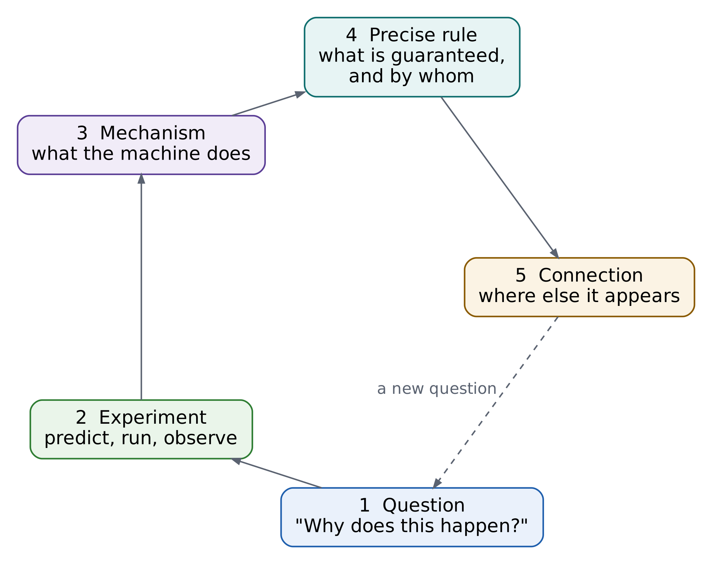
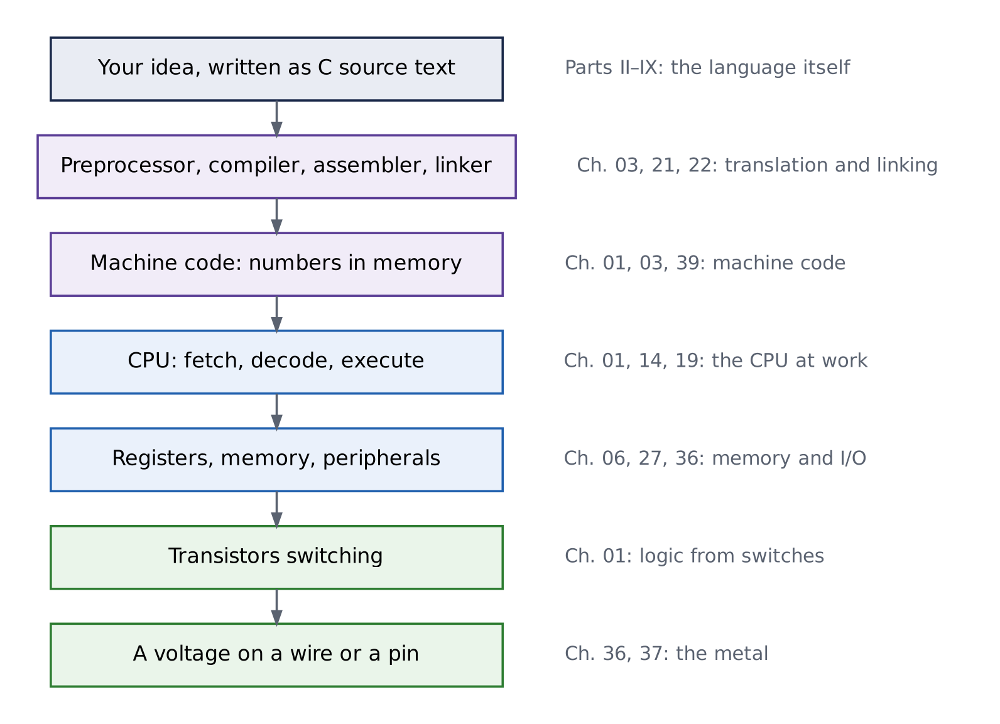

ref: 00.01
title: How This Book Teaches
chapter: Chapter 00 — Before the Journey
part: Preliminary
builds: — (this is where the book begins)
---
## The question

A student is working through a well-known C textbook. The chapter on loops advises, in a single sentence, that counting loops should always be controlled by integers, because floating-point values "may be approximate". Out of curiosity, the student ignores the advice. They write a loop that starts at 0.00, adds 0.05 each time, and keeps going while the value is less than or equal to 1.00. They expect to see twenty-one values, ending with 1.00.

The loop stops at 0.95.

The textbook was right, and its advice was sound. But it answered only *what* to do. It did not answer the questions that a curious mind asks next:

- Why should twenty additions of 0.05 fail to reach 1.00, when every schoolchild knows that twenty twentieths make a whole?
- If the value is not 1.00, what is it, exactly?
- Why does `printf` show 0.95 when the stored value is something else?
- Is this a fault in the computer, in the compiler, in C, or in mathematics itself?
- Where else in real systems will the same thing happen, and what does it cost when it does?

To answer them, the student had to leave the book, search elsewhere, ask questions from several angles, and then stitch the answers together by hand. That stitching is slow, and the answers found that way are of uneven quality. Some are precise; some are half-true; a few are wrong.

**This book exists to do that stitching for you, carefully and in order.** It is a book about C, but it treats every rule of C as the answer to a question, and it does not stop at the rule. It follows each question down to the mechanism that produces the behavior, and outward to the places where the same mechanism appears again.

This first section explains how the book does that, so that you know what to expect of every section that follows, and how to get the most from it.

## The journey

### A reference manual answers "what"; this book answers "why"

There are two very different kinds of book about a programming language.

A **reference manual** is organized for looking things up. It tells you what each feature does, in the fewest words that are exactly correct. It is indispensable when you already understand the subject and need a detail. But it is a poor teacher, because it assumes the very understanding that a learner lacks.

A **teaching book** is organized as a journey. It begins from what you already know, raises a problem you cannot yet solve, and builds the idea that solves it. The best teaching books on C proceed this way: they introduce counting with a `while` loop before they introduce the `for` statement, so that `for` arrives as the answer to a felt need rather than as a new piece of syntax to memorize.

This book is a teaching book that goes further down and further out than most:

- **Further down.** When C behaves in a certain way, we ask what the compiler produced, what the processor executed, how the value is stored in memory, and, when it matters, what the transistors and wires are doing. Nothing is left as a black box simply because it is inconvenient to open.
- **Further out.** When an idea is understood, we follow where it leads: to the linker, to the operating system, to a microcontroller, to software that must run for years in orbit without a technician to restart it.

:::why
A rule that is memorized without its reason is fragile. It is forgotten under pressure, misapplied to the wrong case, and cannot be adapted when the situation changes. A rule that is *understood* can be rebuilt from first principles when memory fails, and recognized in disguise when it appears somewhere new. An engineer who designs, reasons and debugs needs the second kind.
:::

### The cycle of understanding

Every section of this book is built around one cycle, shown in Figure 00.01-1. It is worth learning now, because you will meet it again in every chapter, and because it is a good way to study anything technical.

{w=12}

Let us walk once around the cycle with a small example. It is not the 0.05 loop from the opening, which receives its own full treatment in §16.03; it is a close relative, small enough to finish here.

**1. Question.** Mathematics says that 0.1 + 0.2 = 0.3. Does C agree?

**2. Experiment.** Before running anything, we *predict*. Here is the program. Read it and decide what you expect each of the three lines of output to be. Write your prediction down.

```c Listing 00.01-1  Does 0.1 + 0.2 equal 0.3?
// sum_check.c
#include <stdio.h>

int main(void) {
    double a = 0.1 + 0.2;
    printf("%.2f\n", a);
    printf("%.17f\n", a);
    printf("%d\n", a == 0.3);
}
```

Line 5 computes the sum of the two values and stores it in a variable named `a` of type `double`, C's usual type for numbers with fractional parts. Line 6 prints `a` rounded to two decimal places. Line 7 prints it to seventeen decimal places. Line 8 prints the result of the comparison `a == 0.3`, which in C is 1 when the comparison is true and 0 when it is false. You will learn how to compile and run a program in §00.02; for now, here is what happens:

```terminal
$ gcc -std=c23 -Wall -Wextra -pedantic sum_check.c -o sum_check
$ ./sum_check
```

```output
0.30
0.30000000000000004
0
```

The first line agrees with mathematics. The third line flatly contradicts it: C says that `a` is *not* equal to 0.3. The second line hints at why: when we look more closely, `a` is not 0.3 at all.

**3. Mechanism.** The computer does not store numbers in decimal. It stores them in binary, as sums of powers of two: halves, quarters, eighths, sixteenths, and so on. Some decimal fractions, such as 0.5 or 0.25, are exact sums of such pieces. But 0.1 is not. In binary its digits repeat forever, just as 1/3 repeats forever in decimal (0.3333…). A `double` has room for only a fixed number of binary digits, so the computer stores the *nearest value it can represent*. On the author's verification machine, the values actually stored are these:

Table: Table 00.01-1  What is really stored (GCC 14.2, x86-64 Linux, type double)
<!-- widths: 22,78 -->
| You wrote | The value actually stored |
|---|---|
| `0.1` | 0.1000000000000000055511151231257827021181583404541015625 |
| `0.2` | 0.200000000000000011102230246251565404236316680908203125 |
| `0.3` | 0.299999999999999988897769753748434595763683319091796875 |
| `0.1 + 0.2` | 0.3000000000000000444089209850062616169452667236328125 |

Look at the last two rows. The stored "0.3" is a little *below* the true 0.3. The computed sum is a little *above* it. They are two different numbers, so `==` correctly reports that they are not equal. And `%.2f` hid all of this, because it rounds the stored value to two decimal places *for display*, without changing what is stored.

Nothing is broken here. The sum was computed exactly according to the rules of binary floating-point arithmetic, on the values that were stored. (In fact, because both operands are constants, GCC computed the sum while translating the program, using the same rounding rule the processor would have used; the running program only compares two stored values. §03.04 shows how to see what the compiler produced, and §09.05 why it may compute in advance.) The surprise came from the gap between the numbers we *wrote* and the numbers that *exist* inside the machine.

*Inference:* most surprises of this kind in real programs come from equality tests rather than from the arithmetic itself.

**4. Precise rule.** Now, and only now, we state exactly what is guaranteed, and by whom.

:::precise
The C standard does not itself require any particular format for floating-point numbers. Its Annex F describes conformance to the international floating-point standard (IEC 60559, the same standard as IEEE 754). An implementation announces that it follows Annex F by defining a macro: `__STDC_IEC_559__` in C99 to C17, and `__STDC_IEC_60559_BFP__` in C23. On x86-64 Linux, GCC with the GNU C library defines both, and stores `double` in the IEEE 754 64-bit binary format. The equality operator `==` compares the values of its operands exactly; it has no notion of "close enough". (Two special cases, a NaN, which compares unequal even to itself, and the precision in which an expression may be evaluated, are explained in §07.05 and §07.07.)
:::

**5. Connection.** Where else does this matter? Everywhere a program counts, accumulates or compares fractional values: a loop counter stepping by 0.05 (§16.03), money that must balance to the last cent (§07.08), a sensor reading compared against a threshold, a clock that counts tenths of a second and converts the count into seconds. The last of these has a sobering history.

:::history
On February 25, 1991, a Patriot air-defense battery at Dhahran, Saudi Arabia, failed to intercept an incoming Scud missile, which struck a barracks and killed 28 American soldiers. A review by the US General Accounting Office (report GAO/IMTEC-92-26, February 1992) found a software problem in the timekeeping. The system's clock counted time as a whole number of tenths of a second, and converted it to seconds by multiplying by one tenth, held in a 24-bit fixed-point register. Because one tenth has no exact binary form, a tiny error was introduced, and the error grew with the time since the system was started. After about 100 hours of continuous operation the time error was roughly a third of a second, enough to shift the region in which the radar looked for the missile by several hundred meters. Later analysis argued that the full story was subtler, involving the conversion being improved in some parts of the program but not others. We return to this case in §07.08, where fixed-point arithmetic, the kind the Patriot's 24-bit calculation used, gives you the tools to work through the arithmetic yourself.
:::

Notice that the connection has raised new questions. How exactly are the binary digits of 0.1 produced? Why 24 bits? Why should improving the conversion in only *some* places make things worse? This is the dashed arrow in Figure 00.01-1: understanding one thing well always opens the next door. The book is arranged so that, when you reach each new door, the key is already in your hand.

### Four kinds of statement

You may have noticed that the walk around the cycle used four different kinds of sentence. Keeping them apart is one of the habits this book tries hardest to teach, because confusing them is the source of a great deal of wrong knowledge about C.

Table: Table 00.01-2  The four kinds of statement this book keeps apart
<!-- widths: 20,42,38 -->
| Kind | What it tells you | Example from this section |
|---|---|---|
| **Established fact** | Something documented outside the C standard: a historical record, a datasheet value, a published measurement. As reliable as its source, which is named. | "On February 25, 1991, a Patriot battery at Dhahran failed to intercept a Scud missile." |
| **The standard** | What the C language itself requires of every implementation. True on any machine with any conforming compiler. | "`==` compares stored values exactly." |
| **The implementation** | What a *named* compiler does on a *named* machine. True there; possibly different elsewhere. | "GCC 14.2 on x86-64 Linux stores 0.1 as 0.1000000000000000055511…" |
| **Inference** | The author's reasoning from the facts. Usually sound, but a conclusion, not a fact, and labeled as such. | "Most surprises of this kind in real programs come from equality tests rather than from the arithmetic itself." |

In the text, these are marked as follows:

- Established facts rest on the documents named in each section's *Sources and verification*.
- Exact statements of what the standard requires are gathered in *Precisely speaking* boxes, naming the version of C (C99, C11, C17 or C23) whenever the versions differ.
- Every output shown in an Output block comes from an actual run. The toolchain and machine are named beside it, as in Table 00.01-1, or in the section's *Sources and verification*. Where the author could not run something, typically a hands-on project on a real board, the text says so and describes the expected result as an expectation, not an observation.
- Inference is introduced as such, with words like "the author's view is…", "this suggests…", or the label *Inference*.

:::myth
"If my program printed it, that is what C does." Not quite. A program's output shows what *one* implementation did on *one* machine, with *one* set of compiler options. It may be guaranteed by the standard, or it may be a choice that another compiler makes differently, or it may be the accidental result of behavior the standard leaves undefined. Experiments are essential, but an experiment tells you what happened, not what is promised. The book will always tell you which of the two you are looking at.
:::

When the author is unsure of something, the text says so plainly. Where a fact depends on a version that may change after this book was written (a compiler's default settings, a tool's installation steps), the section names the version and the date at which it was checked.

### The road this book travels

The order of the chapters is not the usual order of a C textbook, and it is worth knowing why before you begin.

A C program is a piece of text. Between that text and anything happening in the physical world lies a long chain of transformations, shown in Figure 00.01-2. Most books start at the top of the chain and seldom go below the second box. This book walks the whole chain, and Part I begins at the *bottom*: with the physical bit, the transistor used as a switch, and the logic, arithmetic and memory that switches can build. Only then does it ask why C was invented, and how a program becomes something a processor can run.

{w=15.5}

The reason is simple. Almost every surprise in C, from the 0.05 loop to a crash caused by a pointer, is explained by something lower in this chain. If the lower levels are built first, every later explanation can rest on ground you have already walked over. If they are skipped, explanations must say "the computer just does this", which is exactly the black box this book refuses to accept.

After the foundations, the book follows a strict order of dependence: data before the expressions that compute with it; expressions before the statements that control their flow; control before functions; functions before the memory model that makes pointers intelligible; and all of that before the hardware chapters, where C is used to command a microcontroller directly. No section depends on a later one, with a single exception: the experiments of this first section need the workbench set up in §00.02. When a later section is mentioned, it is only as a signpost: "we return to this in §24.06".

Throughout, every important idea is tested on **three machines** that differ in ways that reveal what C does and does not promise:

Table: Table 00.01-3  The three machines used throughout the book
<!-- widths: 18,27,28,27 -->
| | Your laptop | Arduino Uno | ESP32 |
|---|---|---|---|
| Processor | x86-64 | AVR ATmega328P, 8-bit | Xtensa LX6, 32-bit |
| Runs under | Fedora Linux | Nothing: bare metal | FreeRTOS |
| Why it is here | The everyday hosted environment | Tiny memory, 16-bit `int`, no hardware divide | A modern microcontroller with an operating system of its own |

A caution for buying the third board: many boards sold as "ESP32" today carry newer chips, such as the ESP32-C3 or ESP32-C6, with a different processor (RISC-V). This book's ESP32 is the original ESP32, found for example on boards built around the ESP32-WROOM-32 module.

A rule that behaves identically on all three is a property of the C language. A rule that changes between them is a property of an implementation, and the book will show you exactly where the line falls.

### How each section is built

Every section, from §01.01 to the end of the book, follows the same anatomy. Knowing it lets you move through a section with purpose.

1. **Title block and "Builds on".** The section's fixed reference (for example §16.03), its title, and the earlier sections it depends on. If something in a section seems to come from nowhere, the "Builds on" line tells you where to look.
2. **The question.** Each section opens with a problem, a puzzle or an experiment that cannot yet be explained. Read it slowly, and try to answer it yourself before reading on.
3. **The journey.** The main body, which builds the idea from intuition to mechanism to the precise rule. The boxes appear inside it, exactly where they are needed.
4. **Terms introduced.** Every new technical term, with a one-line definition. This is the part most worth copying by hand.
5. **Self-check.** Questions that test understanding rather than memory. Answer them in writing before looking at the answers.
6. **Experiments.** Programs to change, predict, run and explain on your own machine.
7. **Hands-on (AVR / ESP32).** Where the topic touches hardware, a small project on a real board that shows the mechanism at work.
8. **Answers.** For the self-check, and for the predictions the experiments ask you to make, with the reasoning, not merely the result.
9. **Sources and verification.** The documents the section relies on, the toolchains its programs were run with, and any statements that are the author's inference.

The seven kinds of box each have one purpose. You have now met four of them:

Table: Table 00.01-4  The seven boxes
<!-- widths: 28,72 -->
| Box | What you will find in it |
|---|---|
| **Why this exists** | The problem that forced an idea into being, and what life was like before it. |
| **Under the hood** | What the compiler, linker, processor or hardware actually does. |
| **Common misconception** | A wrong belief, why it is tempting, and the precise correction. |
| **Precisely speaking** | Exactly what the standard says, naming its version, or what a named implementation does. |
| **History** | Who needed the idea, when, and why. |
| **On the metal (AVR / ESP32)** | How the topic behaves on a microcontroller. |
| **In orbit** | Why the topic matters to spacecraft and satellites: reliability, radiation, power and scarce resources. |

:::orbit
Software in a satellite cannot be patched by a technician who walks over to it, and often cannot be restarted without risk. Its memory may be struck by radiation that flips a bit. Its power is rationed by solar panels and batteries; its processor is chosen for survival rather than speed. These conditions make the small details of C, such as exactly how a number is stored or exactly what happens when a calculation overflows, into matters of mission success or failure. Wherever a topic bears on such systems, this box will say how.
:::

### How to do the experiments

The experiments are where understanding is made, rather than received. They follow one discipline, and it is worth adopting it fully from the start:

1. **Predict before you run.** Write down what you expect, and why. A prediction that turns out wrong is the most valuable thing an experiment can give you, because it marks exactly where your mental model differs from the machine.
2. **Run exactly what is shown first.** Then change one thing at a time. When two things change at once, you cannot tell which one caused the result.
3. **Explain the result in your own words.** If you cannot, the experiment is not finished. Return to the journey of the section, or to the sections it builds on.
4. **Keep a record of your wrong predictions.** A short list headed "beliefs I have corrected" becomes, over months, a precise map of the traps in C, drawn by you.

### Notation and conventions

Table: Table 00.01-5  Notation used throughout the book
<!-- widths: 30,70 -->
| You will see | It means |
|---|---|
| §16.03 | Chapter 16, section 3. Section numbers never change. |
| Listing 16.03-1, Figure 16.03-2, Table 16.03-1 | The first listing, second figure or first table of §16.03. |
| `monospace text` | Code, commands, file names, or anything typed exactly as shown. |
| `$ gcc …` in a dark block | A command typed in the terminal on Fedora. Type the part after the `$`, not the `$` itself. |
| `# …` in a dark block | A comment explaining the command; it is not typed. |
| Any other line in a dark block | A continuation of the command above it (after a `\` at the end of a line, or text fed to the command); it is typed too. |
| A pale block headed "Output" | What the program printed, copied from an actual run. |
| `0b1010`, `0x2F` | Numbers written in binary and hexadecimal (explained fully in §04.01). |
| KB | 1024 bytes when describing memory, as microcontroller datasheets do. Where 1000 is meant, the text says so. |
| C99, C11, C17, C23 | Editions of the C standard, named after the year of their completion; C17 was published by ISO in 2018 and C23 in 2024 (explained in §02.05). |

### Studying by hand

If you take notes by hand, as many careful students do, the book is arranged to make that efficient. You do not need to copy everything. A good division is this:

- **Copy** the *Terms introduced*, the precise rules in *Precisely speaking* boxes, and the small diagrams of memory, bits and flow. Writing them fixes them.
- **Sketch** your own versions of the larger figures from memory after reading, then compare. The parts you cannot redraw are the parts not yet understood.
- **Run** every experiment rather than copying its output. An output you produced yourself is remembered; one you copied is not.
- **Write** your predictions and your "beliefs I have corrected" list beside your notes for each section.

Where a figure is intricate, the text will say which part of it is worth copying.

### On pace

This is a long book, written for depth rather than speed. Some sections will be read in an evening; some will take a week of experiments. There is no merit in hurrying through a section whose question you cannot yet answer. If a section feels difficult, the usual cause is a gap in one of the sections it builds on, and the "Builds on" line tells you where to look. Going back is not falling behind; it is how foundations are made solid.

## Terms introduced

- **Reference manual**: a book organized for looking up exact facts, assuming the reader already understands the subject.
- **Teaching book**: a book organized as a journey from what the reader knows to what they do not yet know.
- **Mechanism**: the physical or logical process that produces a behavior; the answer to "how does it actually happen?"
- **The standard**: the international document (ISO/IEC 9899) that defines the C language for every implementation.
- **Implementation**: a particular compiler, with its libraries and settings, on a particular machine.
- **Inference**: a conclusion reasoned from facts, as distinct from a fact itself.
- **Established fact**: a statement documented by a named source outside the C standard, such as a datasheet or a historical record.
- **`double`**: C's usual type for numbers with fractional parts; on the laptop and the ESP32 a 64-bit binary floating-point number, but on the AVR, with avr-gcc's default settings, only 32 bits (§07.07).
- **Floating-point number**: a number stored as binary digits together with a scale; most decimal fractions can be stored only approximately (Chapter 07).

## Self-check

1. In one or two sentences each, describe the difference between a reference manual and a teaching book. Which would you consult to find the exact meaning of a conversion like `%.17f`, and which would you read to understand why it was needed?
2. Name the five steps of the cycle of understanding, in order. At which step should you write down a prediction?
3. In Listing 00.01-1, the first line of output was `0.30` but the third was `0`. Explain, without using the word "approximately", why these two lines do not contradict each other.
4. Classify each statement as **established fact**, **standard**, **implementation** or **inference**:
   (a) "On x86-64 Linux, GCC stores `double` in the IEEE 754 64-bit format."
   (b) "The operator `==` compares two values exactly."
   (c) "Beginners would make fewer errors if they never compared floating-point values with `==`."
   (d) "The Patriot battery's clock error after about 100 hours was roughly a third of a second."
5. A friend runs a program on their laptop, sees a certain output, and concludes "so that is what C does". What is wrong with that conclusion, and what further question should they ask?
6. Why does Part I begin with transistors and logic, rather than with a first C program?
7. Which box would you expect to contain each of the following?
   (a) The 1991 Patriot clock failure.
   (b) The fact that the C standard does not require IEEE 754.
   (c) The belief that "if `printf` shows 0.30, the value is 0.30".

## Experiments

These experiments need a working compiler. If you have not yet set one up, read §00.02 first, then return here.

**Experiment 00.01-1. Reproduce the walk.** Type Listing 00.01-1 into a file named `sum_check.c`, compile it with the command shown, and run it. Before running, write your prediction for all three lines. Compare.

**Experiment 00.01-2. A sum that is exact.** Change line 5 to `double a = 0.5 + 0.25;` and the comparison on line 8 to `a == 0.75`. Predict the three lines of output, then run it. Explain the difference from Experiment 00.01-1 using only the idea of halves and quarters.

**Experiment 00.01-3. Seeing the whole stored value.** Add the line `printf("%.70f\n", 0.1);` to the program, which asks for seventy digits after the decimal point. Predict what it will print, then run it, and compare the result with the first row of Table 00.01-1. What does the fact that the digits *stop*, followed only by zeros, tell you about the stored value?

**Experiment 00.01-4. Begin the record.** Start your list of "beliefs I have corrected". Write down any prediction from Experiments 00.01-1 to 00.01-3 that turned out wrong, and one sentence stating the corrected belief.

## Answers

**Self-check 1.** A reference manual states exactly what each feature does, for a reader who already understands; a teaching book leads a reader from what they know to a new idea by way of a problem that needs it. You would consult a reference for the exact meaning of `%.17f`, and read a teaching book to understand why such precision was needed at all.

**Self-check 2.** Question, experiment, mechanism, precise rule, connection. The prediction is written at the *experiment* step, before the program is run.

**Self-check 3.** The value stored in `a` is 0.3000000000000000444…, and the stored value for the constant `0.3` is 0.2999999999999999888…, so they are different numbers and `==` reports 0. The first line shows `0.30` because `%.2f` rounds the stored value to two decimal places when it is *displayed*; displaying does not change what is stored. One line reports the display; the other reports the comparison of the true stored values.

**Self-check 4.** (a) Implementation: it names a compiler and a machine. (b) Standard: it is required of every conforming implementation. (c) Inference: a reasonable conclusion, but a judgment, not a fact about C. (d) Established fact: it is documented in the GAO report, a named source outside the C standard.

**Self-check 5.** An output shows what one implementation did on one machine with one set of options. It may be guaranteed by the standard, or a choice another compiler makes differently, or the accident of undefined behavior. The further question is: *is this behavior guaranteed by the standard, chosen by this implementation, or undefined?*

**Self-check 6.** Because nearly every surprise in C is explained by something lower in the chain from source text to voltage. Building the lower levels first lets every later explanation rest on understood ground, instead of on "the computer just does this".

**Self-check 7.** (a) *History*. (b) *Precisely speaking*. (c) *Common misconception*.

**Experiment 00.01-1.** The output is `0.30`, `0.30000000000000004` and `0`, as shown in the journey. If you predicted `1` for the third line, add it to your record: the stored sum and the stored constant are different numbers.

**Experiment 00.01-2.** The output is `0.75`, `0.75000000000000000` and `1`. One half and one quarter are both exact binary fractions (a half is 0.1 in binary; a quarter is 0.01), so both are stored exactly, their sum is computed exactly, and it equals the exactly stored 0.75. The difficulty in Experiment 00.01-1 was never addition itself; it was that 0.1, 0.2 and 0.3 cannot be stored exactly in binary.

**Experiment 00.01-3.** It prints `0.1000000000000000055511151231257827021181583404541015625000000000000000`: the 55 digits of the first row of Table 00.01-1, then fifteen zeros. The digits stop because the stored value is a finite sum of powers of two, and every such sum has a finite decimal expansion. The stored value is therefore an exact, ordinary number; it is simply not the number 0.1. (This exact expansion is what the GNU C library prints. The C standard requires correctly rounded digits only up to a limited number of significant digits, given by the macro `DECIMAL_DIG`, which is 21 on this machine; another library may print different digits beyond that.)

## Sources and verification

- **Toolchain.** All programs in this section were compiled with GCC 14.2.0 (`gcc-14`, options `-std=c23 -Wall -Wextra -pedantic`) on x86-64 Ubuntu Linux 24.04 with the GNU C library, and the outputs shown are copied from those runs. The values in Table 00.01-1 were confirmed independently with Python's exact decimal conversion. That GCC 15 or 16 on Fedora will print identical output is an inference (the format of `double` and the GNU C library are the same there), for the reader to confirm. That GCC folds `0.1 + 0.2` at compile time was confirmed with `gcc-14 -std=c23 -O0 -S`, whose output contains the finished constant and no addition instruction.
- **The C standard.** Annex F of ISO/IEC 9899 (IEC 60559 floating-point arithmetic) and the macros `__STDC_IEC_559__` and, in C23, `__STDC_IEC_60559_BFP__`; both were confirmed defined on the verification machine with `gcc-14 -std=c23 -dM -E`. The publication years of C17 (2018) and C23 (2024) are ISO's. The size of `double` on avr-gcc 7.3.0 (`__SIZEOF_DOUBLE__` 4) was read with `avr-gcc -mmcu=atmega328p -dM -E`.
- **The Patriot failure.** US General Accounting Office, *Patriot Missile Defense: Software Problem Led to System Failure at Dhahran, Saudi Arabia*, GAO/IMTEC-92-26, February 1992; and R. Skeel, "Roundoff Error and the Patriot Missile", *SIAM News* 25(4), July 1992, p. 11, for the later analysis.
- **Inference in this section.** The remark that most such surprises come from equality tests (in the walk and in Table 00.01-2), and the advice in "How to do the experiments" and "Studying by hand", are the author's judgment, not established fact.
