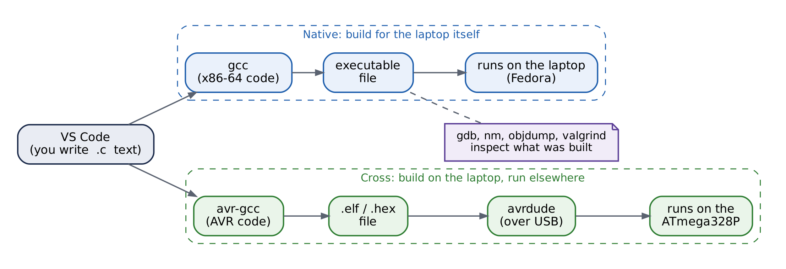

ref: 00.02
title: Setting Up the Workbench on Fedora
chapter: Chapter 00 — Before the Journey
part: Preliminary
builds: §00.01
---
## The question

You have a laptop running Fedora Linux, and a book that asks you to run experiments on almost every page. What, exactly, must be on the machine before a file of C text can become a running program? And, since this book refuses black boxes, what must be on it so that you can *watch* each step of that transformation, take the result apart, and see what is inside?

There is a tempting shortcut: install an integrated environment with a large green "Run" button, press it, and see the output. It works, and for many purposes it is fine. But consider what the button hides. It decides which compiler to use and which options to give it. It runs several separate programs one after another and shows you none of them. When something goes wrong, it shows you a message stripped of the context that would explain it. For a book whose purpose is to open every box, the button is itself a box.

So this section builds a different kind of workbench: a small set of tools, each with one clear job, operated from the command line where every step is visible. By the end of it you will have compiled and run your first program, provoked your first warning and your first error on purpose, built a program for a microcontroller you have not yet connected, and you will know what every tool on the bench is for.

## The journey

### What a workbench must do

Before choosing tools, decide what jobs must be done. Turning C text into a running program, and understanding the result, needs seven:

Table: Table 00.02-1  The jobs of the workbench and the tools that do them
<!-- widths: 24,30,46 -->
| Job | Tool | First used seriously in |
|---|---|---|
| Write and edit C text | VS Code (any text editor would do) | This section |
| Translate C into a program | `gcc`, the GNU Compiler Collection | This section; in depth in Chapter 03 |
| Look inside what was built | `nm`, `objdump`, `readelf`, `size` (the GNU *binutils*) | §03.05 |
| Run a program step by step | `gdb`, the GNU debugger | §19.02 |
| Find memory errors | `valgrind` | §26.04 |
| Rebuild only what changed | `make` | §21.08 |
| Read the official documentation | the manual pages (`man`) | §18.05 |

For the microcontroller chapters, three more jobs are added: translate C into code for a *different* processor (`avr-gcc`), provide the C library for that processor (`avr-libc`), and copy the result into the chip (`avrdude`). Figure 00.02-1 shows how the two sets of tools relate.

{w=16.5}

A **native compiler**, such as `gcc` on your laptop, produces machine code for the same kind of processor it runs on. A **cross-compiler**, such as `avr-gcc`, runs on your laptop but produces machine code for a different processor, here the 8-bit AVR in the Arduino Uno. The laptop could never run that code itself; it is meant for another machine, and must be carried there by `avrdude`.

### Installing software the Fedora way

On Fedora, software is installed as **packages**: archives that contain a program, a description of what else it needs, and a digital signature proving where it came from. Packages are kept in **repositories**, collections maintained by the Fedora Project. The **package manager**, `dnf`, fetches packages from the repositories, checks their signatures, works out what else they depend on, and installs everything in the right places.

This matters more than it may seem. A program downloaded by hand from a website must be checked, placed and updated by you. A package is checked, placed and kept up to date by the system. For tools you will rely on for years, the package manager is the right way.

Installing software changes the system for every user, so it needs administrator rights. The command `sudo` ("do as the superuser") runs one command with those rights, after asking for your password. Here is the command that installs the whole native workbench:

```terminal
# install the compiler, debugger, build tool, binary tools, memory checker,
# manual pages for C functions, and a system-call tracer
$ sudo dnf install gcc gdb make binutils valgrind man-pages strace
```

Read it piece by piece: `sudo` runs the rest with administrator rights; `dnf` is the package manager; `install` is what you are asking it to do; and the remaining words are the names of the packages. `dnf` will show you a list of what it is about to install, including other packages these depend on, and ask for confirmation. Some of the packages may already be present; `dnf` simply skips those. The last package, `strace`, is not needed until Chapter 32, but it is small and it is convenient to install it now.

:::precise
Fedora 41 replaced the internals of the package manager with a new version (DNF 5), but the command is still called `dnf` and the commands in this book are unchanged. If a package name has changed by the time you read this, `dnf search <word>` lists the packages whose names or descriptions contain that word.
:::

### Your first program on the bench

Make a folder for the book's experiments. This book keeps it inside the book's own folder, under the name `_Analytical-C-Lab`, with one subfolder per section, so that each experiment sits beside the text that asks for it. Create the folder for this section and move into it:

```terminal
$ mkdir -p ~/Documents/C-Programming/Analytical-Books/Analytical-C-A-deeper-understanding/_Analytical-C-Lab/00-02
$ cd ~/Documents/C-Programming/Analytical-Books/Analytical-C-A-deeper-understanding/_Analytical-C-Lab/00-02
$ code .
```

`mkdir` makes a directory; the option `-p` makes any missing parent directories too, and does not complain if the directory already exists. The `~` is the shell's shorthand for your home folder. `cd` ("change directory") moves the shell into the new folder, so that files you create and commands you run happen there. Finally, `code .` opens VS Code on the current folder, written `.`. (If VS Code is not yet installed, see "The editor" below; any editor will do for now.)

Create a file named `check_toolchain.c` containing the following. Type it exactly; you will understand every line by the end of Chapter 03.

```c Listing 00.02-1  Asking the compiler to describe itself
// check_toolchain.c
#include <stdio.h>

int main(void) {
    printf("C standard version: %ld\n", __STDC_VERSION__);
    printf("Compiler:           %s\n", __VERSION__);
    printf("Hosted environment: %d\n", __STDC_HOSTED__);
    printf("Size of int:        %zu bytes\n", sizeof(int));
}
```

The names that begin and end with two underscores are **predefined macros**: values that the compiler itself supplies, describing the compiler and the environment it is building for. The program simply prints four of them. Now compile and run it. In VS Code, the shortcut Ctrl+` (the key above Tab) opens a terminal inside the editor, already in your folder.

```terminal
$ gcc -std=c23 -Wall -Wextra -pedantic -g check_toolchain.c -o check_toolchain
$ ./check_toolchain
```

The first command translates the text file `check_toolchain.c` into a program file named `check_toolchain`; the options in between are explained in a moment. The second command runs that program. The `./` means "the file in this folder": the shell does not look in the current folder for programs unless told to, a precaution that prevents a stray file from being run by accident in place of a real command.

On the author's verification machine, the output was the following. Beneath it, Table 00.02-2 also records what a current Fedora system printed.

```output
C standard version: 202000
Compiler:           14.2.0
Hosted environment: 1
Size of int:        4 bytes
```

Your output will differ in the first two lines, and the difference is itself a lesson:

Table: Table 00.02-2  What the first line reports with different compilers
<!-- widths: 46,18,36 -->
| Compiler and option | Prints | Status of this row |
|---|---|---|
| GCC 14.2 with `-std=c23` (author's machine) | 202000 | Run by the author |
| GCC 16.2.1 with `-std=c23` (Fedora 44) | 202311 | Run on the reader's own Fedora machine |
| GCC 15 with `-std=c23`, or GCC 15 or 16 with no option | 202311 | From GCC's documentation |
| avr-gcc 7.3 with no option (the version inside the Arduino IDE) | 201112 | Run by the author on the same base version |

:::precise
The macro `__STDC_VERSION__` names the edition of the C standard that the compiler is following, as a year and month: `199901L` for C99, `201112L` for C11, `201710L` for C17 and `202311L` for C23. GCC 14 implemented most of C23 before the standard's final number was fixed, and reports the provisional value `202000L`. GCC 15 reports the final `202311L`, and it also made C23 (with GNU extensions) its default, so on a current Fedora you get C23 even without the `-std` option.
:::

The third line says that the program is running in a **hosted environment**: one with an operating system, which provides files, a screen and the full standard library. Chapter 02 explains the alternative, a freestanding environment, which is exactly what a bare microcontroller is. The fourth line, `4 bytes`, is the size of C's basic integer type on your laptop. Hold on to that number. On the Arduino Uno, the same line would say 2, and Chapter 05 explains why.

### The options, and why each one is there

Every compile command in this book uses the same options unless the text says otherwise. Each has a reason:

Table: Table 00.02-3  The book's standard compiler options
<!-- widths: 24,76 -->
| Option | What it does |
|---|---|
| `-std=c23` | Follow the C23 standard exactly as published. Without it, a current GCC uses `gnu23`: C23 plus GNU's own extensions. The book wants to know what *C* guarantees, not what GCC adds. |
| `-Wall` | Turn on a large set of warnings about code that is legal but probably wrong. Despite the name, not *all* warnings. |
| `-Wextra` | Turn on a further set of warnings that `-Wall` leaves out. |
| `-pedantic` | Warn about any use of extensions that strict ISO C does not allow. Together with `-std=c23`, it makes GCC hold you to the standard. |
| `-g` | Include debugging information in the program, so that `gdb` can relate machine instructions back to lines of your source. It does not change what the program does. |
| `-o name` | Name the output file. Without it, GCC names the program `a.out`, for historical reasons (Chapter 03). |

Notice what is absent: no optimisation option. The default, equivalent to `-O0`, translates your code as literally as possible, which makes the machine code easy to relate to the source. Later chapters will add `-O2` or `-Os` deliberately, precisely to watch what optimisation changes.

:::myth
"`-Wall` turns on all warnings." It does not; it turns on a commonly useful set. Experiment 00.02-2 below shows a warning that appears only when `-Wextra` is added. The names are historical and should not be read literally. Neither option turns on everything, and some warnings exist only as individual options; the GCC manual lists them all.
:::

Typing the whole command every time is tedious and error-prone. The shell lets you define an **alias**, a short name that stands for a longer command. Add one to the file `~/.bashrc`, which the shell reads every time a terminal opens:

```terminal
$ echo "alias c23='gcc -std=c23 -Wall -Wextra -pedantic -g'" >> ~/.bashrc
$ source ~/.bashrc
$ c23 check_toolchain.c -o check_toolchain
```

`echo` prints its text, and `>>` *appends* that text to the end of the file named after it. (A single `>` would *replace* the file's contents, so take care to type two.) Run the first command only once; running it again adds a duplicate line. `source` makes the current shell read the file again, so the alias works at once. From now on, `c23` means the full command. The book will still show the full command in each listing, so that you can always see what is being asked of the compiler.

### Errors and warnings: the compiler is speaking to you

The compiler talks in two tones of voice, and it is important to hear the difference from the beginning.

An **error** means the compiler cannot make sense of your text as C. It refuses to produce a program at all. A **warning** means your text is valid C, a program *is* produced, but the compiler has noticed something that is very likely a mistake. Beginners learn to fear errors and to ignore warnings. It should be nearly the other way round: an error is caught at once and cannot cause harm, while an ignored warning often becomes a fault that appears only later, far from its cause.

Here is a program with a deliberate error, a missing semicolon:

```c Listing 00.02-2  A program the compiler will refuse
// broken.c
#include <stdio.h>

int main(void) {
    printf("hello\n")
}
```

```output
broken.c: In function 'main':
broken.c:5:22: error: expected ';' before '}' token
    5 |     printf("hello\n")
      |                      ^
      |                      ;
    6 | }
      | ~
```

Read the message as precisely as it was written. `broken.c:5:22` means file `broken.c`, line 5, column 22. The compiler tells you what it expected (`;`) and what it found instead (the `}` on line 6). It even draws a caret under the spot and suggests the missing character. Notice that it reports the problem at the point where it *noticed* the mistake, which is the end of line 5. With a missing semicolon those are the same place; later you will meet errors that are noticed some distance from where they were made, and the habit of reading the position carefully will serve you well.

:::hood
`gcc` is not one program but a **driver** that runs several others in turn. Add the option `-v` (verbose) to any compile command and it prints each program it runs. On the author's machine, among many other lines, it showed these three (paths shortened):

```
.../14/cc1 -quiet -v ... check_toolchain.c ...
as -v --64 -o /tmp/ccju82AT.o /tmp/ccxJcr07.s
.../14/collect2 ... -o check_toolchain ...
```

`cc1` is the compiler proper, which turns C into assembly language; `as` is the assembler, which turns assembly into machine code in an object file; and `collect2` prepares and runs `ld`, the linker, which joins your object file with the C library to make the finished program. The names of the temporary files are random and will differ on your machine. Chapter 03 follows each of these steps in detail; for now it is enough to know that the green "Run" button would have hidden all of them.
:::

### The editor: VS Code

VS Code is a free editor published by Microsoft. It is not in Fedora's own repositories, but Microsoft provides a repository of its own. Adding it takes three commands, taken from Microsoft's installation instructions (checked 24 November 2026):

```terminal
# 1. trust Microsoft's signing key, so dnf can verify the packages
$ sudo rpm --import https://packages.microsoft.com/keys/microsoft.asc
# 2. tell dnf where Microsoft's repository is
$ echo -e "[code]\nname=Visual Studio Code\nbaseurl=https://packages.microsoft.com/yumrepos/vscode\nenabled=1\nautorefresh=1\ntype=rpm-md\ngpgcheck=1\ngpgkey=https://packages.microsoft.com/keys/microsoft.asc" | sudo tee /etc/yum.repos.d/vscode.repo > /dev/null
# 3. refresh the list of available packages, then install
$ dnf check-update && sudo dnf install code
```

The first command imports the key used to sign Microsoft's packages, so that `dnf` can verify that what it downloads really came from Microsoft. The second writes a small description of the repository into the folder where `dnf` looks for such descriptions (`tee` writes what it receives into a file; `sudo` is needed because that folder belongs to the system). The third installs the package named `code`.

Two pieces of advice about the editor:

- Microsoft's optional "C/C++" extension underlines suspected mistakes as you type. It is helpful, but its underlining comes from its own analyser, not from `gcc`, and the two sometimes disagree, especially about recent C23 features. When they disagree, **the compiler is the authority**: it is the program that actually builds your code.
- VS Code is a large application, but it runs comfortably within 8 GB of memory alongside a terminal. Avoid installing many extensions; each one costs memory and attention, and this book needs none of them.

### The microcontroller toolchain

The AVR tools are in Fedora's own repositories:

```terminal
$ sudo dnf install avr-gcc avr-libc avr-binutils avrdude
```

`avr-gcc` is the cross-compiler; `avr-libc` is the C library written for AVR chips, together with the header files that name every hardware register; `avr-binutils` provides the AVR versions of the inspection tools (`avr-objdump`, `avr-size` and others); and `avrdude` copies programs into the chip.

You do not need a board to test the cross-compiler. Here is the traditional first microcontroller program, which flashes the LED on an Arduino Uno. You will understand every line in Chapter 36; for now, notice only that it contains no `printf`, because a bare microcontroller has no screen.

```c Listing 00.02-3  A program for the ATmega328P
// blink.c  (compiled for the ATmega328P; uploading comes in Chapter 36)
#include <avr/io.h>
#include <util/delay.h>

int main(void) {
    DDRB |= (1 << DDB5);       // pin PB5 (Arduino pin 13): output
    for (;;) {
        PORTB ^= (1 << PORTB5);  // flip the pin: LED on, LED off
        _delay_ms(500);
    }
}
```

```terminal
$ avr-gcc -mmcu=atmega328p -DF_CPU=16000000UL -Os -Wall -Wextra blink.c -o blink.elf
$ avr-size blink.elf
$ file blink.elf
```

`-mmcu=atmega328p` tells the cross-compiler exactly which chip to build for, which decides the instruction set, the memory sizes and the register addresses. `-DF_CPU=16000000UL` tells the delay function that the Uno's clock runs at 16 MHz, so that it can count the right number of cycles for half a second. `-Os` asks for the smallest code, because the chip's memory is small. On the author's machine, using avr-gcc 7.3.0, the output was:

```output
   text	   data	    bss	    dec	    hex	filename
    162	      0	      0	    162	     a2	blink.elf
blink.elf: ELF 32-bit LSB executable, Atmel AVR 8-bit, version 1 (SYSV), statically linked
```

The whole program occupies 162 bytes of the chip's 32 KB of program memory. Fedora's newer avr-gcc may produce a slightly different number; the *difference* between compiler versions is itself the kind of thing this book teaches you to notice. The `file` command confirms what Figure 00.02-1 claimed: this is a program for an "Atmel AVR 8-bit" processor, which your laptop could not run.

:::metal
You now have *two* AVR compilers: Fedora's (version 15 on recent releases) and the one bundled inside the Arduino IDE (version 7.3.0, from 2018). They follow different editions of C by default: the old one reports `__STDC_VERSION__` as `201112L` (C11), the new one as C23. The Arduino IDE also compiles your sketch as C++, not C. When this book writes bare-metal C, it uses Fedora's compiler; when it discusses Arduino sketches, it remembers that a different, older compiler is at work.
:::

To upload to a real board, your user account needs permission to use the serial port through which the Uno talks to the laptop. On Fedora, serial ports belong to a **group** called `dialout`, and only members of that group may open them. Add yourself once:

```terminal
$ sudo usermod -aG dialout $USER
# now log out and log in again, then check:
$ groups
```

`usermod -aG dialout $USER` *appends* (`-a`) the *group* (`-G`) `dialout` to your user, whose name the shell supplies in `$USER`. Group membership is read when you log in, so the change takes effect only after logging out and in again. When it has worked, `dialout` appears in the list printed by `groups`. When the Uno is plugged in, it usually appears as the device file `/dev/ttyACM0`; `ls -l /dev/ttyACM0` shows that the file belongs to the `dialout` group. You will use all of this in Chapter 36.

### The ESP32 toolchain: later, not now

The ESP32 is programmed with Espressif's framework, ESP-IDF, which includes its own compiler, libraries and build system. It is large (it occupies several gigabytes once installed), it changes quickly, and the book does not need it until Chapter 38. Installing it now would only mean updating it later. When the time comes, Espressif's current method (checked 24 November 2026, for ESP-IDF v6.1.1) is to install its *ESP-IDF Installation Manager* from a repository, and let it install the rest:

```terminal
$ sudo tee /etc/yum.repos.d/espressif-eim.repo << 'EOF'
[eim]
name=ESP-IDF Installation Manager
baseurl=https://dl.espressif.com/dl/eim/rpm/$basearch
enabled=1
gpgcheck=0
EOF
$ sudo dnf install eim-cli
$ eim install
```

These steps are recorded here only so that the workbench is described completely. Chapter 38 will check them again against Espressif's documentation before using them.

:::orbit
Teams that build flight software usually *freeze* their toolchain: they choose an exact version of the compiler and its libraries at the start of a project and do not change it without a formal review, because a new compiler version can translate the same source into different machine code. A program that was tested with one compiler has, strictly speaking, not been tested with another. This book follows a mild form of the same discipline: every output names the compiler that produced it, so that when your results differ, you can tell whether you have found a mistake or merely a different compiler.
:::

### Checking the whole bench

Run these commands once everything is installed. Each should print a version number rather than "command not found".

Table: Table 00.02-4  Checklist for the finished workbench
<!-- widths: 40,60 -->
| Command | Confirms |
|---|---|
| `gcc --version` | The native compiler (expect version 15 or later on Fedora 43+) |
| `gdb --version` | The debugger |
| `make --version` | The build tool |
| `objdump --version` | The binary inspection tools |
| `valgrind --version` | The memory checker |
| `man 3 printf` | The manual pages for C library functions (press `q` to leave) |
| `avr-gcc --version` | The AVR cross-compiler |
| `avrdude -?` | The uploader (it prints its options) |
| `groups` | That `dialout` is among your groups |

The `3` in `man 3 printf` deserves a word. The manual is divided into numbered sections: section 1 describes commands you type in the shell, section 2 describes the services the operating system kernel provides to programs, and section 3 describes functions in libraries such as the C library. There is both a shell command named `printf` (section 1) and a C function named `printf` (section 3); the number chooses which one you mean.

## Terms introduced

- **Toolchain**: the set of programs that together turn source text into a running program (compiler, assembler, linker, libraries) and help inspect the result.
- **Package**: an archive containing a program, a list of what else it needs, and a signature proving its origin.
- **Repository**: a maintained collection of packages from which a package manager installs.
- **Package manager (`dnf`)**: Fedora's program for installing, updating and removing packages.
- **`sudo`**: runs a single command with administrator rights, after asking for your password.
- **Native compiler**: a compiler that produces code for the same kind of processor it runs on.
- **Cross-compiler**: a compiler that runs on one kind of processor and produces code for another.
- **Compiler driver**: the program you run as `gcc`, which in turn runs the compiler proper, the assembler and the linker.
- **Compiler option (flag)**: a word beginning with `-` that changes what the compiler does, such as `-Wall` or `-o`.
- **Error**: a message saying the text is not valid C; no program is produced.
- **Warning**: a message saying the text is valid C but probably not what you meant; a program is still produced.
- **Predefined macro**: a name, such as `__STDC_VERSION__`, whose value the compiler itself supplies.
- **Hosted environment**: an environment with an operating system and the full standard library.
- **Alias**: a short name the shell expands into a longer command.
- **Group (`dialout`)**: a set of users given a shared permission; members of `dialout` may use serial ports.
- **Manual section**: a numbered part of the manual pages; section 1 for commands, 2 for kernel services, 3 for library functions.

## Self-check

1. Why does this book build programs from the command line rather than with an editor's "Run" button? Give two things the button hides.
2. What is the difference between a native compiler and a cross-compiler? Which of the two is `avr-gcc`, and why could your laptop not run the program it produces?
3. Why is it better to install `gcc` with `dnf` than to download it from a website?
4. In the command `gcc -std=c23 -Wall -Wextra -pedantic -g check_toolchain.c -o check_toolchain`, what would change if you left out each of `-std=c23`, `-g` and `-o check_toolchain`?
5. The first line of Listing 00.02-1's output was `202000` on the author's machine, but should be `202311` on yours. What does this number mean, and why do the two machines disagree?
6. A friend says: "My program compiled with only warnings, so it is correct." What is wrong with this reasoning?
7. In the error message `broken.c:5:22: error: expected ';' before '}' token`, what do 5 and 22 mean? Why is the error reported on line 5 when the `}` is on line 6?
8. Why must you log out and in again after adding yourself to the `dialout` group?

## Experiments

**Experiment 00.02-1. Your own toolchain report.** Compile and run Listing 00.02-1 on your Fedora machine. Before running it, predict all four lines, using Table 00.02-2. Then compile it again *without* `-std=c23` and run it once more. Does the first line change? Explain.

**Experiment 00.02-2. Hearing the warnings.** Create this file:

```c Listing 00.02-4  Two suspicious lines
// warnings.c
#include <stdio.h>

int square(int x, int unused) {
    return x * x;
}

int main(void) {
    int y;
    printf("%d\n", square(3, 0));
}
```

Compile it three times: with no warning options (`gcc -std=c23 warnings.c -o warnings`), with `-Wall`, and with `-Wall -Wextra`. Before each, predict how many warnings will appear. Then explain why each warning appeared when it did.

**Experiment 00.02-3. Watching the driver.** Compile Listing 00.02-1 with the option `-v` added. The output is long. Find the lines that run `cc1`, `as` and `collect2`, and write down the order in which they appear.

**Experiment 00.02-4. A program for another machine.** Build Listing 00.02-3 with `avr-gcc` exactly as shown, then run `avr-size` and `file` on the result. Record the size your compiler produced. Then try to run it directly with `./blink.elf`, and explain the result.

**Experiment 00.02-5. Two printfs.** Run `man 1 printf` and then `man 3 printf`. Read the first screen of each. In one sentence each, say what each `printf` is.

## Answers

**Self-check 1.** Because the book's purpose is to make every step visible. The button hides which compiler and options are used, and the separate programs (compiler proper, assembler, linker) that run one after another; it may also hide the full text of error messages.

**Self-check 2.** A native compiler produces code for the processor it runs on; a cross-compiler produces code for a different processor. `avr-gcc` is a cross-compiler. Its output consists of AVR instructions, which an x86-64 processor does not understand: they are a different language of machine instructions.

**Self-check 3.** A package is verified by its signature, installed with everything it depends on, placed where the system expects it, and kept up to date automatically. A hand download must be checked, installed and updated by you.

**Self-check 4.** Without `-std=c23`, a current GCC uses `gnu23`, which permits GNU extensions as well as standard C. Without `-g`, the program works the same but `gdb` cannot relate its instructions to your source lines. Without `-o check_toolchain`, the program is named `a.out`.

**Self-check 5.** It is the value of `__STDC_VERSION__`, naming the edition of the C standard the compiler follows. GCC 14 reports a provisional value for C23 because it implemented C23 before the final number was fixed; GCC 15 and later report the final value, `202311`.

**Self-check 6.** A warning means the compiler suspects a mistake, so "only warnings" means "several suspected mistakes". Even a program with no warnings is not thereby correct: the compiler can detect only certain kinds of mistake. Freedom from warnings is a minimum, not a proof.

**Self-check 7.** Line 5, column 22. The compiler cannot know a semicolon is missing until it reads the next token, the `}`, and finds that it cannot follow `printf("hello\n")`. It reports the position where the statement should have ended, the end of line 5, and names the token that revealed the mistake.

**Self-check 8.** The list of groups a user belongs to is read when they log in, and every program started afterwards inherits it. Programs already running, including your current shell, keep the old list.

**Experiment 00.02-1.** On Fedora 43 or later, the first line should be `202311`, the second your compiler's version, the third `1` and the fourth `4 bytes`. On a Fedora 44 machine with GCC 16.2.1 the output was exactly that, with the second line reading `16.2.1 20261029 (Red Hat 16.2.1-3)`. Without `-std=c23` the first line should *not* change, because GCC 15 and later already default to C23 (as `gnu23`, which reports the same version number). On GCC 14, by contrast, leaving out the option would print `201710`, because GCC 14 defaulted to C17. Record your result; it tells you which compiler you have.

**Experiment 00.02-2.** No warnings without options; one warning (`unused variable 'y'`) with `-Wall`; two with `-Wall -Wextra`, the second being `unused parameter 'unused'`. The author's output for the last case was:

```output
warnings.c: In function 'square':
warnings.c:4:23: warning: unused parameter 'unused' [-Wunused-parameter]
    4 | int square(int x, int unused) {
      |                   ~~~~^~~~~~
warnings.c: In function 'main':
warnings.c:9:9: warning: unused variable 'y' [-Wunused-variable]
    9 |     int y;
      |         ^
```

The text in square brackets names the individual option that controls each warning. The unused-variable warning belongs to the set enabled by `-Wall`; the unused-parameter warning belongs to the set enabled by `-Wextra`. This is the demonstration promised in the *Common misconception* box.

**Experiment 00.02-3.** `cc1` first, then `as`, then `collect2`: compile, assemble, link. Chapter 03 explains why the order must be this one.

**Experiment 00.02-4.** The size will be close to 162 bytes; the exact number depends on your avr-gcc version. Trying `./blink.elf` fails, typically with an error such as "cannot execute binary file: Exec format error": the operating system recognises that the file contains machine code for a different processor and refuses to run it.

**Experiment 00.02-5.** Section 1 describes the shell command `printf`, which formats text in the terminal; section 3 describes the C library function `printf`, which a C program calls. They share a name and a formatting style, but they are different programs.

## Sources and verification

- **Toolchain used for outputs.** GCC 14.2.0 (`-std=c23`) and avr-gcc 7.3.0 with avr-libc 2.0.0, on x86-64 Ubuntu Linux 24.04. Every output shown was copied from a run on that machine, except the GCC 16.2.1 row of Table 00.02-2 and the Fedora output quoted in the answer to Experiment 00.02-1, which were run by the reader on Fedora 44 on 24 November 2026. The `-v` output in the *Under the hood* box was shortened; the omitted parts are marked `...`.
- **GCC defaults and `__STDC_VERSION__`.** GCC 15 release notes and "Porting to GCC 15" (gcc.gnu.org): the default C dialect changed from `gnu17` to `gnu23`. GCC's C status page confirms that `gnu17` was the default from GCC 8 to GCC 14. The values 201112 (avr-gcc 7.3) and 202000 (GCC 14 with `-std=c23`) were observed directly.
- **Fedora package versions.** packages.fedoraproject.org, checked 24 November 2026: gcc 15.3 on Fedora 43 and 16.2 on Fedora 44; avr-gcc 15.2 on Fedora 43 and later.
- **VS Code installation.** Microsoft, "Visual Studio Code on Linux" (code.visualstudio.com/docs/setup/linux), checked 24 November 2026; commands reproduced as given there.
- **ESP-IDF installation.** Espressif, "Installation of ESP-IDF and Tools on Linux", for ESP-IDF v6.1.1, checked 24 November 2026; commands reproduced as given there. The size "several gigabytes" is the author's estimate, not a documented figure.
- **Serial-port permissions.** Arduino support article "Fix port access on Linux", which describes adding the user to the `dialout` group.
- **Inference in this section.** The advice on extensions and memory in "The editor", and the description of toolchain freezing in flight software as usual practice, are the author's judgement.
