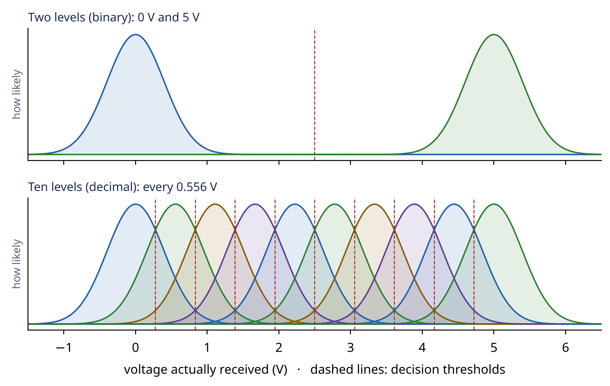
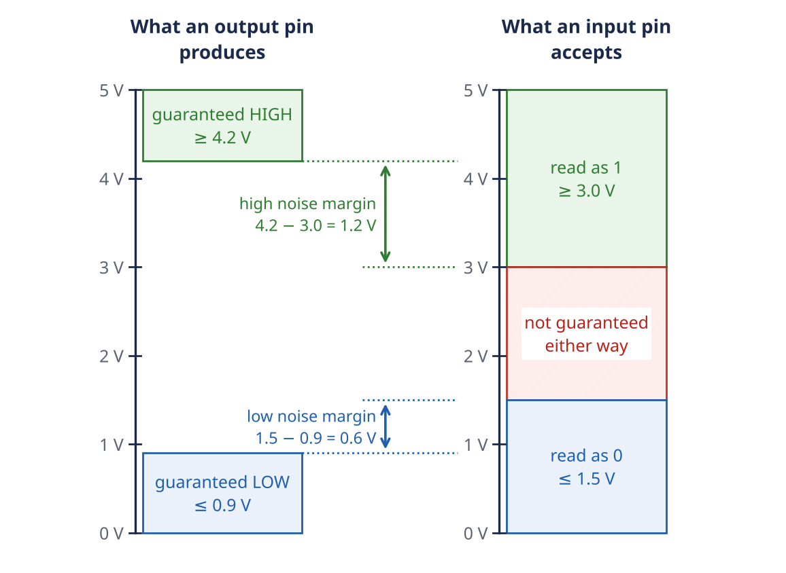
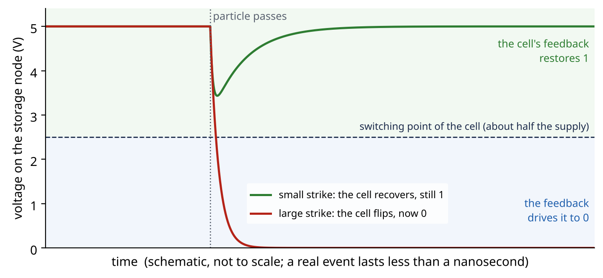

ref: 01.01
title: Information as Physical States
chapter: Chapter 01 — What a Computer Physically Is
part: Part I — The Machine Beneath C
builds: §00.01, §00.02
---
## The question

In an Arduino sketch you write `digitalWrite(13, HIGH);` and the little LED on the board lights up. The word `HIGH` sits in your program as if it were a simple fact. But a program is only text, and an LED responds only to electricity. Somewhere between the two, the idea "HIGH" must have become something physical.

So consider these questions before reading further:

- What exactly is on pin 13 when it is "HIGH"? Five volts? Always exactly five?
- If the pin carried 4.6 volts, would it still be HIGH? What about 2.5 volts?
- When the chip *reads* a pin rather than driving it, how does it decide whether what it sees is HIGH or LOW?
- Human beings count in tens. Why is every computer you will ever program built from parts that have only *two* states, and not ten?
- And if information is a physical thing, can something physical *damage* it?

These are not questions about C, and yet everything in C rests on their answers. Every variable you will ever declare, every number you add, every character you print, is in the end a pattern of physical states inside a machine. This section asks what those states are, why there are exactly two of them, and what it takes to keep them reliable.

## The journey

### Information needs a physical home

Let us begin with what information *is*, in the plainest terms. You possess information when you can tell apart possibilities that might otherwise be confused. A traffic light carries information because it can be red, yellow or green, and you can tell which. A light switch carries information because it can be up or down. A blank sheet of paper, which can only be blank, carries none.

That gives us the first principle of this book: **information must be held by something physical that can be in different, distinguishable states.** For a machine to *use* that information, three further things must be possible:

1. **Set** the state: put it deliberately into one condition or another.
2. **Hold** the state: keep it unchanged until it is changed on purpose.
3. **Read** the state: detect which condition it is in, without confusion.

Machines have used many kinds of physical state to hold information. You will meet several of them in this book:

Table: Table 01.01-1  Physical carriers of information inside computers
<!-- widths: 28,44,28 -->
| Where | The physical state | Met again in |
|---|---|---|
| A wire between two chips | A high or low voltage | This section; Chapter 36 |
| A register or SRAM cell | Two cross-coupled inverters (a loop of feedback) locked in one of two voltage states | §01.04 |
| DRAM (your laptop's main memory) | Electric charge stored on a tiny capacitor, or its absence | §01.04 |
| Flash memory (an SSD, the Uno's program memory) | Charge trapped in an insulated layer: a "floating gate" in the Uno, often a "charge-trap" layer in a modern SSD | §01.04 |
| A hard disk | The direction of magnetization of a small patch of the surface | — |
| An optical disc | Microscopic pits and flat areas reflecting a laser differently | — |

Inside a running processor, the state that matters almost everywhere is **voltage**. It is worth being exact about what that word means.

**Voltage** is a difference in electric potential between two points: the energy that each unit of electric charge (each coulomb) would gain or lose in moving from one point to the other. A helpful picture, though only a picture, is water pressure: a higher voltage pushes charge harder, just as higher pressure pushes water harder through a pipe. Voltage is always measured *between* two points. In a circuit, one point is chosen as the reference and called **ground**, or 0 V; when we say "pin 13 is at 5 volts", we mean five volts above the board's ground.

Voltage suits computation for three reasons. It can be changed in a few billionths of a second by a transistor (§01.02). It travels along a wire to wherever it is needed. And a circuit can compare one voltage with another and act on the result. Those three abilities provide *set*, *move* and *read*. *Holding* a voltage needs something more, a circuit that keeps restoring it, which §01.04 builds.

### How many states should one wire carry?

A wire's voltage can take any value within its range: 0 V, 1.37 V, 4.002 V, and every value in between. So why not use that richness? We count in tens, so we might let one wire carry a whole decimal digit, dividing its range of 0 to 5 V into ten levels, about 0.556 V apart. One wire would then carry as much as several two-level wires. Mechanical calculators had long stored each digit on a wheel with ten positions, so the question was a natural one for the first designers of electronic computers. It is worth seeing why "ten" is the wrong answer.

The difficulty is **noise**: unwanted changes to a voltage that come from the physical world rather than from the design. Every real circuit has noise, from several sources at once:

- **Thermal noise.** Electrons in any conductor jiggle randomly with heat, producing tiny random voltages. It can be reduced by cooling, but never removed at room temperature.
- **Interference.** A wire acts as a small antenna. Neighboring wires that switch quickly (*crosstalk*), nearby motors and radios, and ripples on the power supply all push stray voltages onto it.
- **Manufacturing variation.** No two transistors are exactly alike. A circuit meant to produce 5.000 V may produce 4.93 V in one chip and 5.04 V in another.
- **Temperature and aging.** Components drift as they warm up and as they age over the years.
- **Loss along the way.** A signal that travels a long wire arrives slightly weakened and blurred.

So a voltage that was *sent* as exactly 2.778 V arrives as something near 2.778 V, plus or minus a random amount. The receiver must decide which level was meant. If the levels are close together, a modest amount of noise pushes the voltage nearer to a *neighboring* level, and the receiver decides wrongly.

How serious is this? We need not argue; we can measure it. The program below plays the part of a noisy wire. It sends a million randomly chosen levels, adds random noise to each, lets a receiver choose the nearest level, and counts the mistakes. It does this three times, with the same 0 to 5 V range divided into 2, 4 and 10 levels, and with exactly the same amount of noise each time.

```c Listing 01.01-1  Counting read errors on a noisy wire
// noise_levels.c
// How often is a noisy voltage misread, with 2, 4 or 10 levels in 0-5 V?
#include <stdio.h>
#include <stdint.h>

static uint32_t state = 2463534242u;    // fixed seed: same output every run

static double uniform(void) {           // a number from 0 up to (not incl.) 1
    state ^= state << 13;
    state ^= state >> 17;
    state ^= state << 5;
    return state / 4294967296.0;
}

static double noise(double sigma) {     // roughly bell-shaped noise
    double sum = 0.0;
    for (int k = 0; k < 12; ++k) {
        sum += uniform();
    }
    return (sum - 6.0) * sigma;
}

int main(void) {
    const double full_scale = 5.0;            // volts
    const double sigma = 0.4;                 // size of the noise, in volts
    const long trials = 1000000;
    const int levels_to_try[] = {2, 4, 10};

    for (int t = 0; t < 3; ++t) {
        int levels = levels_to_try[t];
        double step = full_scale / (levels - 1);   // spacing between levels
        long errors = 0;
        for (long i = 0; i < trials; ++i) {
            int sent = (int)(uniform() * levels);  // a random level
            double volts = sent * step + noise(sigma);
            int read = (int)(volts / step + 0.5);  // nearest level
            if (read < 0) {
                read = 0;
            }
            if (read > levels - 1) {
                read = levels - 1;
            }
            if (read != sent) {
                ++errors;
            }
        }
        printf("%2d levels, spacing %.3f V: %7ld errors in %ld (%.4f %%)\n",
               levels, step, errors, trials, 100.0 * errors / trials);
    }
}
```

You are not expected to follow every line yet; by Chapter 18 you will understand almost all of it (the shifts in the random-number generator are explained in §13.02, and the details of `printf` in §31.02). The heart of it is lines 34 to 45. Line 34 chooses which level to send. Line 35 turns that level into a voltage and adds noise. Line 36 is the receiver: it finds the nearest level to the voltage it received. Lines 37 to 42 keep the answer within the possible levels, and lines 43 to 45 count a mistake whenever the level read differs from the level sent. Line 25 sets the size of the noise. The functions on lines 8 to 21 produce the random numbers; they use a fixed starting value (line 6), so that your output will match the book's exactly, on any machine.

```terminal
$ gcc -std=c23 -Wall -Wextra -pedantic noise_levels.c -o noise_levels
$ ./noise_levels
```

```output
 2 levels, spacing 5.000 V:       0 errors in 1000000 (0.0000 %)
 4 levels, spacing 1.667 V:   27243 errors in 1000000 (2.7243 %)
10 levels, spacing 0.556 V:  443655 errors in 1000000 (44.3655 %)
```

The result is not a small difference; it is the difference between a machine that works and one that is useless. With two levels, not one reading in a million was wrong. With four, nearly three in every hundred. With ten, *almost half*. Figure 01.01-1 shows why. Each bell-shaped curve shows where the received voltage tends to land for one level that was sent. With two levels, the curves sit far apart and stay visibly clear of the dashed decision line between them. With ten, every curve spills across the decision lines beside it, on both sides for all but the two outermost levels.

{w=16}

:::precise
The noise in Listing 01.01-1 is made by adding twelve random numbers, a classic shortcut that gives a nearly bell-shaped (normal) distribution. It has one honest limitation: it can never exceed six times `sigma`, that is 2.4 V, so in this model a two-level wire *cannot* err, because an error needs 2.5 V of noise. Truly normal noise has no such limit. With σ = 0.4 V, a calculation from the normal distribution gives a two-level error rate of about 2 in 10<sup>10</sup>: about two errors in every ten billion readings. That is still vastly better than four or ten levels, but it is not zero, and the difference will matter when we reach error-detecting codes in §13.05.
:::

There is a second, deeper reason why two levels win, and the simulation does not show it. A computer does not read a voltage once and stop; it passes values through millions of circuits, one after another. Suppose each circuit simply copied the voltage it received, noise and all. Then every stage would add its own noise to the noise already there, and after a long chain the value would be lost, as a photocopy of a photocopy of a photocopy becomes unreadable.

Digital circuits do something different. Each one *decides* which level it received and then produces a fresh, clean version of that level at its output. A slightly low "HIGH" goes in; a full, strong HIGH comes out. The noise is discarded at every stage instead of accumulating. This is like a chain of people *retyping* a message rather than photocopying it: as long as each person can read the letters, the last copy is as clean as the first. This restoring behavior is the essence of what makes a circuit **digital**, and it works only if every stage can decide with near certainty, which, as we have just measured, means few levels widely spaced.

:::history
The first general-purpose electronic computer, ENIAC, completed in 1945 and unveiled in February 1946, was a *decimal* machine, with some 17,000 vacuum tubes. Yet even ENIAC did not put ten voltage levels on a wire. It held each digit in a ring of ten circuits, each of which had only two states, on or off, with exactly one of the ten on at a time: the electronics was already two-state, and only the *grouping* was decimal. In June 1945, John von Neumann's report on its successor, the EDVAC, drew the conclusion: since the elements themselves have two stable states, the digits should have two values as well. Binary arithmetic is also simpler (there is no decimal multiplication table to build into the machine), and more economical: about 3.3 two-state elements can hold as much as a decimal digit, against ENIAC's ten. Decimal machines remained popular into the 1960s, among them IBM's 650, which coded each digit in seven two-state elements (a "bi-quinary" code), and in 1958 a team at Moscow State University led by Nikolay Brusentsov even built *Setun*, a working computer based on three-valued logic. But two-state elements became universal, and binary numbers became the norm.
:::

Two-level designs are not the end of the argument, only its usual answer. The flash memory in an SSD often stores two, three or four bits in a single cell by distinguishing 4, 8 or 16 levels of trapped charge. It can do so because flash is read slowly and carefully, and because every block is protected by strong error-correcting codes that repair the misreadings that inevitably occur. The trade-off is exactly the one our simulation exposed: more levels hold more information in the same space, at the cost of more errors that must be detected and corrected.

### Thresholds, not values: two states on a real chip

We have spoken of "two levels" as if a wire carried either exactly 0 V or exactly 5 V. A real chip cannot promise that, because of the very noise and variation we have just discussed. What it can promise is a set of **thresholds**: boundaries that divide the range of voltages into regions with agreed meanings.

The ATmega328P's datasheet, the manufacturer's official specification, states these boundaries precisely. For a chip powered from 5 V, they are:

Table: Table 01.01-2  ATmega328P logic levels at V<sub>CC</sub> = 5 V (datasheet, −40 °C to 85 °C)
<!-- widths: 14,46,40 -->
| Symbol | Meaning | Guaranteed value |
|---|---|---|
| V<sub>IL</sub> | Highest input voltage certain to be read as 0 | 0.3 × V<sub>CC</sub> = 1.5 V |
| V<sub>IH</sub> | Lowest input voltage certain to be read as 1 | 0.6 × V<sub>CC</sub> = 3.0 V |
| V<sub>OL</sub> | Highest voltage an output produces for LOW (while sinking 20 mA) | 0.9 V |
| V<sub>OH</sub> | Lowest voltage an output produces for HIGH (while sourcing 20 mA) | 4.2 V |

Here V<sub>CC</sub> is the supply voltage that powers the chip, and the letters I and O stand for *input* and *output*. (The table uses the "V<sub>CC</sub> = 5 V" figures; the datasheet also gives values for lower supply voltages, and in Experiment 01.01-3 you will use them.) Figure 01.01-2 draws the same numbers to scale.

{w=14.5}

Read the figure from both sides, because each side makes a separate promise.

**The output's promise.** When an output pin is driven LOW, its voltage will be no higher than 0.9 V; when driven HIGH, no lower than 4.2 V. Those limits hold even while the pin sinks 20 mA (when LOW) or sources 20 mA (when HIGH) (more current pulls the voltage further from the ideal, which is why the datasheet states the current).

**The input's promise.** Any voltage at or below 1.5 V *will* be read as 0. Any voltage at or above 3.0 V *will* be read as 1. Between 1.5 V and 3.0 V the datasheet promises nothing: a particular chip at a particular temperature will switch somewhere in that band, but you may not rely on where.

The space between the two promises is the design's protection against noise, its **noise margin**. A HIGH output is at least 4.2 V, and an input needs only 3.0 V to see a 1, so noise of up to 1.2 V can be added to a HIGH signal without changing its meaning. A LOW output is at most 0.9 V, and an input sees a 0 for anything up to 1.5 V, so a LOW signal can absorb 0.6 V of noise. This is the real-world form of the widely spaced levels in Figure 01.01-1: not two exact voltages, but two *bands*, separated by a gap that no correctly working output occupies, except fleetingly while it switches from one band to the other.

:::precise
These are guarantees, not typical values. The datasheet defines the "max" of V<sub>IL</sub> as the highest voltage at which a pin is guaranteed to be read as low, and the "min" of V<sub>IH</sub> as the lowest at which it is guaranteed to be read as high. They hold only within the stated conditions: a supply between 2.4 V and 5.5 V for the input limits, the stated currents for the output limits, and a temperature between −40 °C and 85 °C. Outside those conditions, the datasheet promises nothing at all. Chapter 36 shows where to find these tables for yourself.
:::

:::myth
"HIGH means 5 volts." It does not. To an ATmega328P input, HIGH means *any* voltage from 3.0 V up to the supply voltage. (The datasheet allows half a volt above the supply before damage becomes possible, but that is a limit to stay away from, never a level to design for.) As an output, HIGH means *at least* 4.2 V under a 20 mA load, and it will be nearer the supply voltage when the pin drives little or no current. So 4.6 V on a driven pin is entirely normal, and still HIGH. And 2.5 V is not "half HIGH": it is a voltage that a correctly working output passes through only while switching, and that an input may read either way.
:::

The thresholds also tell an engineer what may safely be connected to what. Many modern chips, including the ESP32, run from 3.3 V. Espressif's datasheet guarantees an ESP32 HIGH output of at least 0.8 × 3.3 V = 2.64 V, which is *below* the 3.0 V that an ATmega328P input needs before it guarantees a 1. So the two datasheets together promise nothing. In practice, a lightly loaded ESP32 pin sits close to 3.3 V and is usually read as 1, but with a margin of about 0.3 V instead of 1.2 V: it works on the bench and may fail in a noisy environment, or with another chip. The engineering answer is a *level shifter*, a small circuit that translates 3.3 V signals into 5 V ones. Reasoning of exactly this kind, from the datasheets' numbers rather than from "it worked when I tried it", is what this book means by thinking like an engineer.

### The bit

We can now name the unit of information that two-state systems store.

A **bit** (short for *binary digit*) is the amount of information held by one choice between two possibilities. A wire that is either LOW or HIGH holds one bit; so does a switch that is up or down, or a flip-flop that is set or clear. By convention, the two states of a bit are written **0** and **1**. Those are only names: in a circuit they correspond to LOW and HIGH; in logic, to false and true. Which voltage stands for which digit is itself a convention, chosen by the designer. Most circuits let HIGH mean 1, but you will meet signals that are *active-low*, where LOW means "yes".

One bit distinguishes two possibilities. What can several bits do together? Each additional bit *doubles* the number of distinct patterns, because every pattern of the previous bits can now be followed by either a 0 or a 1:

Table: Table 01.01-3  How the number of patterns grows with the number of bits
<!-- widths: 12,30,58 -->
| Bits | Patterns | Example |
|---|---|---|
| 1 | 2 | 0, 1 |
| 2 | 4 | 00, 01, 10, 11 |
| 3 | 8 | 000, 001, 010, 011, 100, 101, 110, 111 |
| 4 | 16 | enough for one decimal digit, with 6 patterns left unused |
| 8 | 256 | one byte |
| 16 | 65,536 | the number of values an `int` can hold on the ATmega328P (Chapter 05) |
| 32 | 4,294,967,296 | the number of values an `int` can hold on your laptop |
| 64 | about 1.8 × 10<sup>19</sup> | the size of a memory address on your laptop |

In general, *n* bits have 2<sup>*n*</sup> patterns. Put the other way around, the question "how many bits do I need to tell apart *N* possibilities?" is answered by the smallest *n* for which 2<sup>*n*</sup> ≥ *N*. The ten decimal digits need 4 bits (since 2<sup>3</sup> = 8 is too few and 2<sup>4</sup> = 16 is enough); the 26 letters of the English alphabet need 5. The exact amount of information in a choice among *N* equally likely possibilities is log<sub>2</sub> *N* bits: about 3.32 bits for a decimal digit. That is the true information content of the ten-level wire we rejected, and the reason it was tempting.

:::history
The word "bit" first appeared in print in Claude Shannon's 1948 paper *A Mathematical Theory of Communication*, which founded information theory. Shannon credited the word to his colleague John Tukey. The **byte**, a group of bits handled as a unit, was named by Werner Buchholz at IBM in 1956. Early machines used bytes of various sizes; the eight-bit byte became the common standard after IBM adopted it for its System/360 computers in 1964.
:::

Bits are grouped into larger units that you will meet throughout the book:

- A **byte** is, in practice, 8 bits: the smallest unit of memory that has its own address on nearly every modern computer, including all three of this book's machines.
- A **nibble** is half a byte, 4 bits: exactly one hexadecimal digit (§04.01).
- A **word** is the amount of data a particular processor handles most naturally in one operation. It is a property of the processor, not a fixed size: the ATmega328P's registers hold 8 bits, the ESP32's 32 bits, and your laptop's 64 bits. Be warned that manuals also use "word" as a fixed name for 16 bits: the AVR datasheet calls its 16-bit program-memory units words, and Intel's x86 manuals call 16 bits a WORD (and 32 and 64 bits a DWORD and a QWORD), for historical reasons.

:::precise
C defines a **byte** as the size of a `char`, which must be at least 8 bits; the exact number is given by the constant `CHAR_BIT`. On all three of this book's machines `CHAR_BIT` is 8, but the standard allows it to be larger, and some processors used in signal processing have 16-bit or even 32-bit bytes. Every size that C reports, for example with `sizeof` as in Listing 00.02-1, is counted in these bytes. §05.02 returns to `CHAR_BIT` in full.
:::

### What this means for a C programmer

At first sight this section has been about physics, not programming. But every chapter that follows depends on three consequences of it.

First, **everything a C program stores is a pattern of bits**, held physically as voltages, charges or magnetization. An `int` holding 7, a `double` holding 0.1, a character `'A'`, the address of a variable: each is a group of bits and nothing more. What makes the pattern *mean* 7 or 0.1 or `'A'` is the type through which C interprets it, a theme that becomes central in §06.02. (The surprise of §00.01 had the same root: the pattern stored for 0.1 is not the number 0.1, as Chapter 07 shows in detail.)

Second, **a finite number of bits can tell apart only a finite number of values.** A 32-bit `int` has 4,294,967,296 patterns and no more; there is no room for the 4,294,967,297th. That single fact explains integer wraparound and overflow (§04.02, §04.04), the approximations of floating point (Chapter 07), and much else.

Third, **the reliability of a bit is physical, and so it can fail.** Almost all the time the margins we have studied keep every bit exactly as it was set, and a program can treat its data as perfectly stable. But the guarantee is an engineering achievement, not a law of nature.

:::orbit
In space, information is attacked by radiation. A heavy ion from a cosmic ray can pass straight through a chip, freeing electric charge along its path; a proton trapped in the Earth's radiation belts usually does the same indirectly, by striking a silicon nucleus whose fragments then free the charge. If enough of that charge collects at the node of a memory cell holding a 1, it drags the node's voltage down. A memory cell is a loop of two inverters (§01.04), and its loop has a *switching point*, roughly half the supply voltage. A small strike leaves the voltage on the 1 side of that point, and the cell's own feedback restores it, as the green curve in Figure 01.01-3 shows. A large one pushes it past the switching point, and the cell's feedback then holds the *wrong* value: the bit has flipped (red curve). The chip is not damaged, but the information is: this is a **single-event upset**, also called a *soft error*. Such upsets were reported in orbiting satellites as early as 1975. Smaller transistors hold less charge, so modern chips need less charge to be upset; a smaller cell is also a smaller target, so the rate per bit has not simply risen, but chips now hold so many more bits that the errors per chip and per system have. Spacecraft defend themselves with radiation-hardened chips, memory that detects and corrects errors, and software that checks its own data (§01.04, §13.05, §35.01, §35.03). Even on Earth, bits are occasionally flipped, by neutrons that cosmic rays produce in the atmosphere and by traces of radioactivity in a chip's own packaging, which is one reason servers use error-correcting memory.
:::

{w=15}

## Terms introduced

- **Information**: the ability to tell apart possibilities that might otherwise be confused.
- **Voltage**: the difference in electrical potential energy per unit charge between two points; always measured between two points.
- **Ground (0 V)**: the point in a circuit chosen as the reference from which voltages are measured.
- **Noise**: unwanted changes to a signal from physical causes such as heat, interference and manufacturing variation.
- **Thermal noise**: random voltages caused by the heat-driven motion of electrons in any conductor.
- **Crosstalk**: interference picked up by a wire from a neighboring wire that switches quickly.
- **Digital (restoring) circuit**: a circuit that decides which level it received and produces a fresh, clean version of it, so that noise does not accumulate.
- **Threshold**: a boundary voltage dividing the range into regions with agreed meanings.
- **V<sub>IL</sub>, V<sub>IH</sub>**: the highest input voltage guaranteed to be read as 0, and the lowest guaranteed to be read as 1.
- **V<sub>OL</sub>, V<sub>OH</sub>**: the highest voltage an output produces for LOW, and the lowest it produces for HIGH, under stated load.
- **Noise margin**: the amount of noise a signal can absorb without changing its meaning; V<sub>OH</sub> − V<sub>IH</sub> for HIGH and V<sub>IL</sub> − V<sub>OL</sub> for LOW.
- **Datasheet**: a manufacturer's official specification of a component, including its guaranteed electrical limits.
- **Bit**: the information held by one choice between two possibilities; written 0 or 1.
- **Active-low**: a signal whose LOW voltage means "yes" or "on".
- **Byte**: a group of bits that is the smallest addressable unit of memory; 8 bits on the book's machines; in C, the size of `char`, `CHAR_BIT` bits.
- **Nibble**: four bits; one hexadecimal digit.
- **Word**: the amount of data a particular processor handles most naturally in one operation.
- **Single-event upset (soft error)**: a stored bit changed by a passing particle, without damage to the chip.
- **Level shifter**: a circuit that translates signals between two logic voltages, such as 3.3 V and 5 V.
- **Potentiometer**: a resistor with a sliding contact (the *wiper*) whose voltage can be set anywhere between those of its two ends.
- **Hysteresis**: a deliberate gap between the voltage at which an input switches from 0 to 1 and the voltage at which it switches back.
- **Schmitt trigger**: an input circuit with hysteresis, which prevents a slowly changing or noisy voltage from flickering between 0 and 1.

## Self-check

1. State the three things a machine must be able to do with a physical state for it to serve as storage for information.
2. Why must voltage always be stated *between* two points? What point is usually meant when someone says "pin 13 is at 5 V"?
3. Name three distinct sources of noise in a circuit, and explain why none of them can be eliminated completely.
4. In Listing 01.01-1, the same noise produced no errors with two levels and nearly half the readings wrong with ten. Explain the difference using the *spacing* between levels.
5. Explain, using the photocopy and retyping comparison, why a chain of a million digital circuits does not accumulate noise. What property must each stage have for this to work?
6. Using Table 01.01-2, compute both noise margins of the ATmega328P at 5 V. Which kind of signal, HIGH or LOW, is better protected against noise?
7. A sensor's output is 2.2 V. An ATmega328P input reads it. What does the datasheet promise about the result, and what would you do as an engineer?
8. How many bits are needed to tell apart (a) the 7 days of the week, (b) 100 different values, (c) 1,000 different values? Explain your reasoning.
9. Explain why "a 64-bit computer" does not mean "a computer whose bytes have 64 bits".
10. Why does making transistors smaller tend to make memory *more* vulnerable to single-event upsets?

## Experiments

**Experiment 01.01-1. The noisy wire.** Type Listing 01.01-1, compile it with the command shown, and run it. Before running, predict roughly what fraction of readings will be wrong for 2, 4 and 10 levels. Compare your predictions with the output.

**Experiment 01.01-2. Turning the noise up and down.** Change the value of `sigma` on line 25 to `0.2`, compile and run; then change it to `0.8`. Before each run, predict which rows will change most. Then explain why the two-level row stays at zero for `0.2` but not for `0.8`, using the 2.4 V limit described in the *Precisely speaking* box that follows Figure 01.01-1. (Hint: what is six times 0.8?)

**Experiment 01.01-3. Noise margins at 3 volts.** The ATmega328P can also run from 3 V. At V<sub>CC</sub> = 3 V the datasheet gives V<sub>IL</sub> = 0.3 × V<sub>CC</sub> and V<sub>IH</sub> = 0.6 × V<sub>CC</sub>, as before, and guarantees V<sub>OL</sub> ≤ 0.6 V and V<sub>OH</sub> ≥ 2.3 V while the output carries 10 mA (at up to 85 °C). Compute both noise margins, draw the 3 V version of Figure 01.01-2 by hand, and compare it with the 5 V version. What happens to noise immunity when the supply voltage is lowered?

**Experiment 01.01-4. Counting bits.** Without a calculator, find how many bits are needed for: the 26 lowercase letters; the 26 lowercase and 26 uppercase letters together; the number of seconds in one day (86,400). Then check your third answer by computing 2<sup>16</sup> and 2<sup>17</sup>.

## Hands-on (AVR / ESP32): finding the real threshold

The datasheet promises only that the switching point lies somewhere between 1.5 V and 3.0 V. Where does *your* chip actually switch? You can find out with an Arduino Uno, a 10 kΩ potentiometer (a variable resistor with a knob), a breadboard and four jumper wires. All voltages in this experiment stay between 0 and 5 V, which is safe for the board.

**Wiring.** Connect the potentiometer's two outer pins to the Uno's **5V** and **GND** pins. Connect its middle pin (the *wiper*, whose voltage varies from 0 to 5 V as you turn the knob) to **both** analog pin **A0** and digital pin **2**. The analog pin measures the voltage as a number; the digital pin reports how the chip *interprets* that same voltage, as 0 or 1. Check before connecting the USB cable that only the *middle* pin goes to A0 and pin 2: if an outer pin went there instead, turning the knob to one end would connect 5V directly to GND through almost no resistance.

Upload this sketch from the Arduino IDE. It is written in the Arduino style, which you will take apart in Chapter 36; for now, the comments explain each line.

```c Listing 01.01-2  Watching a digital input decide
// threshold.ino  (Arduino Uno)
void setup(void) {
    Serial.begin(9600);        // send text to the laptop at 9600 bits/s
    pinMode(2, INPUT);         // pin 2 is an input with no pull-up
}

void loop(void) {
    int raw = analogRead(A0);             // 0..1023 for 0 V..5 V
    float volts = raw * 5.0 / 1024.0;     // convert to volts
    int logic = digitalRead(2);           // how the chip reads it
    Serial.print(volts, 2);
    Serial.print(" V  ->  ");
    Serial.println(logic);
    delay(200);                           // five readings per second
}
```

Open the Serial Monitor (set to 9600 baud), start with the knob turned fully toward GND, and turn it *slowly* upward. Note the voltage at which the reading changes from 0 to 1. Then turn it slowly back down, and note the voltage at which it returns to 0.

**Predict first.** Where, between 1.5 V and 3.0 V, do you expect the change? Will the upward and downward switching points be the same?

**What to look for.** Your chip will switch at a definite voltage inside the 1.5 V to 3.0 V band. You will probably find that the upward and downward points differ by a measurable amount. This deliberate gap, called **hysteresis**, comes from a circuit at the pin's input called a *Schmitt trigger*. It prevents a slowly changing or slightly noisy voltage from flickering rapidly between 0 and 1 near the threshold, and §36.03 explains how it works. Record your two voltages: they are facts about your own chip at today's temperature, and they will differ slightly from anyone else's. That variation is precisely why the datasheet guarantees a *band* rather than a single value.

One caution about the numbers on the screen. The sketch converts the reading to volts assuming the supply is exactly 5.00 V, but a Uno powered over USB often runs from somewhere between about 4.7 V and 5.1 V. Both the analog reading and the chip's thresholds (0.3 × V<sub>CC</sub> and 0.6 × V<sub>CC</sub>) scale with the real supply, so for the most accurate result, measure the 5V pin with a multimeter and use that value in place of 5.0 in line 9.

**On the ESP32.** The same experiment works on an ESP32, with three differences. Power the potentiometer from the board's **3V3** pin, never 5 V: an ESP32 pin is damaged by voltages much above 3.6 V. Use two input pins that can also measure, such as GPIO34 for the analog reading and GPIO35 for the digital one (both are input-only pins). And expect the switching points between Espressif's guaranteed limits of 0.25 × 3.3 V ≈ 0.83 V and 0.75 × 3.3 V ≈ 2.48 V. The ESP32's analog readings are also less linear near the ends of the range than the Uno's; the Arduino ESP32 package's `analogReadMilliVolts()` applies the chip's own calibration.

## Answers

**Self-check 1.** It must be possible to *set* the state deliberately, to *hold* it unchanged until it is changed on purpose, and to *read* it without confusion.

**Self-check 2.** Voltage is a difference in potential between two points, so a single point has no voltage by itself. "Pin 13 is at 5 V" means 5 V above the board's ground.

**Self-check 3.** Any three of: thermal noise (random motion of electrons, present at any temperature above absolute zero); interference from neighboring wires, the power supply and the surroundings; manufacturing variation between components; drift with temperature and age; loss along long wires. None can be eliminated because each arises from physics (heat, electromagnetism, imperfect manufacture) that can be reduced but not abolished.

**Self-check 4.** The noise was the same size, 0.4 V, in every case. With two levels the spacing is 5 V, so a reading must move 2.5 V to be mistaken, far more than the noise ever moves it. With ten levels the spacing is about 0.556 V, so a movement of only about 0.28 V crosses into the neighboring level, and noise of that size occurs in about half of all readings.

**Self-check 5.** A photocopier reproduces the noise along with the image, so each copy adds its own noise to all the earlier noise. A person retyping a message reads each letter, decides which it is, and types a perfect new letter, so the noise of earlier copies is discarded. A digital stage does the same: it decides which level it received and outputs a fresh, clean level. This works only if each stage decides correctly with near certainty, which requires few, widely separated levels.

**Self-check 6.** HIGH margin: V<sub>OH</sub> − V<sub>IH</sub> = 4.2 − 3.0 = 1.2 V. LOW margin: V<sub>IL</sub> − V<sub>OL</sub> = 1.5 − 0.9 = 0.6 V. HIGH signals are better protected, by a factor of two.

**Self-check 7.** 2.2 V lies between V<sub>IL</sub> (1.5 V) and V<sub>IH</sub> (3.0 V), so the datasheet promises nothing: the input may read 0 or 1, and the result may change with temperature, supply voltage or from one chip to another. An engineer would not connect the signal directly. They would bring it into the guaranteed range, for example with a circuit that amplifies or shifts the voltage, or measure it as a number with the analog-to-digital converter (§37.05) and decide in software.

**Self-check 8.** (a) 3 bits, since 2<sup>2</sup> = 4 < 7 ≤ 8 = 2<sup>3</sup>. (b) 7 bits, since 2<sup>6</sup> = 64 < 100 ≤ 128 = 2<sup>7</sup>. (c) 10 bits, since 2<sup>9</sup> = 512 < 1,000 ≤ 1,024 = 2<sup>10</sup>.

**Self-check 9.** "64-bit" describes the processor's *word*: the size of the data its registers and most of its operations handle naturally. Its *byte*, the smallest addressable unit of memory, is still 8 bits. A word on such a machine holds eight bytes.

**Self-check 10.** A smaller transistor's storage node holds less charge, so less charge from a passing particle is needed to push its voltage across the threshold. The critical amount of charge falls as transistors shrink, so particles that were once too weak to upset a cell become strong enough. (Each cell is also a smaller target, so the rate per bit has not risen in step; but the number of bits per chip has grown enormously, so upsets per chip have.)

**Experiment 01.01-1.** The output is exactly as shown in the journey: 0 errors with two levels, 27,243 with four, and 443,655 with ten. Because the random numbers start from a fixed value, your output should match digit for digit.

**Experiment 01.01-2.** On the author's machine (GCC 14.2, x86-64), the run with `sigma` set to `0.2` printed:

```output
 2 levels, spacing 5.000 V:       0 errors in 1000000 (0.0000 %)
 4 levels, spacing 1.667 V:       4 errors in 1000000 (0.0004 %)
10 levels, spacing 0.556 V:  150277 errors in 1000000 (15.0277 %)
```

and the run with `sigma` set to `0.8` printed:

```output
 2 levels, spacing 5.000 V:     633 errors in 1000000 (0.0633 %)
 4 levels, spacing 1.667 V:  226141 errors in 1000000 (22.6141 %)
10 levels, spacing 0.556 V:  658924 errors in 1000000 (65.8924 %)
```

Halving the noise nearly eliminates errors with four levels, but still leaves 15% with ten, because their spacing is so small. Doubling the noise finally produces errors with two levels. The model's noise can reach at most six times `sigma`: 1.2 V when `sigma` is 0.2, which can never cross the 2.5 V needed for a two-level error, but 4.8 V when `sigma` is 0.8, which sometimes does.

**Experiment 01.01-3.** V<sub>IL</sub> = 0.9 V and V<sub>IH</sub> = 1.8 V. LOW margin: 0.9 − 0.6 = 0.3 V. HIGH margin: 2.3 − 1.8 = 0.5 V. At 5 V the margins were 0.6 V and 1.2 V. Lowering the supply voltage shrinks the margins, so a 3 V system tolerates less noise. This is one of the costs that low-power designs, including many in spacecraft, must manage.

**Experiment 01.01-4.** 26 letters need 5 bits (2<sup>5</sup> = 32). 52 letters need 6 bits (2<sup>6</sup> = 64). 86,400 seconds need 17 bits: 2<sup>16</sup> = 65,536 is too few, and 2<sup>17</sup> = 131,072 is enough.

## Sources and verification

- **Toolchain.** Listing 01.01-1 was compiled with GCC 14.2.0 (`-std=c23 -Wall -Wextra -pedantic`) on x86-64 Ubuntu Linux 24.04, and all outputs are from those runs. Its result does not depend on the compiler, because it uses its own integer random-number generator (xorshift32) rather than the C library's. Listing 01.01-2 was compiled with avr-g++ 7.3.0 against a minimal stand-in for the Arduino functions and run on the simavr simulator, which checked its arithmetic and output format; it was **not** run on a physical board, and simavr does not model the pin thresholds, so the switching voltages are yours to record. The ESP32 variant was not run.
- **Error rates.** The 2.8% expected for four levels and the two-level rate of about 2 × 10<sup>−10</sup> for truly normal noise were computed independently from the normal distribution, and the first agrees with the simulation's 2.72%. Figure 01.01-1 was computed from the normal distribution, not from the simulation.
- **ATmega328P electrical characteristics.** Atmel/Microchip, *ATmega328/P Datasheet Complete* (Atmel-42735B, 11/2016), Table 32-2 "Common DC Characteristics": V<sub>IL</sub> ≤ 0.3 V<sub>CC</sub> and V<sub>IH</sub> ≥ 0.6 V<sub>CC</sub> for V<sub>CC</sub> = 2.4–5.5 V (inputs up to V<sub>CC</sub> + 0.5 V); at T<sub>A</sub> up to 85 °C, V<sub>OL</sub> ≤ 0.9 V and V<sub>OH</sub> ≥ 4.2 V at 20 mA for V<sub>CC</sub> = 5 V, and V<sub>OL</sub> ≤ 0.6 V and V<sub>OH</sub> ≥ 2.3 V at 10 mA for V<sub>CC</sub> = 3 V. The definitions of "max" and "min" in the *Precisely speaking* box that follows the noise-margin discussion paraphrase the datasheet's notes to that table. The Schmitt trigger at each digital input appears in the datasheet's port-pin schematic ("Ports as General Digital I/O").
- **ESP32 electrical characteristics.** Espressif, *ESP32 Series Datasheet*, "DC Characteristics (3.3 V, 25 °C)": V<sub>IL</sub> ≤ 0.25 × VDD, V<sub>IH</sub> ≥ 0.75 × VDD, V<sub>OH</sub> ≥ 0.8 × VDD (2.64 V at 3.3 V), V<sub>OL</sub> ≤ 0.1 × VDD.
- **History.** ENIAC and the EDVAC report: standard histories of computing (ENIAC completed 1945, unveiled February 1946); J. von Neumann, *First Draft of a Report on the EDVAC*, June 30, 1945, §§5.1–5.2, for the argument from two-state elements and the simplicity of binary arithmetic. Mechanical ten-position wheels, the IBM 650's bi-quinary code and the decimal machines of the early 1960s are from standard histories. C. E. Shannon, "A Mathematical Theory of Communication", *Bell System Technical Journal*, 1948, for the word "bit" and its attribution to J. W. Tukey. W. Buchholz (IBM, 1956) for "byte". Setun: Moscow State University, 1958. The first report of single-event upsets in satellites: D. Binder, E. C. Smith and A. B. Holman, "Satellite Anomalies from Galactic Cosmic Rays", *IEEE Transactions on Nuclear Science*, 1975.
- **Figure 01.01-3** is a schematic illustration of the mechanism, not a measurement; its shapes and timescale are not to scale.
- **Radiation effects.** The indirect upsets caused by protons and atmospheric neutrons, upsets from packaging radioactivity, and the trend of the soft-error rate per bit and per chip as transistors shrink are summarized from the radiation-effects literature (for example R. Baumann, "Radiation-induced soft errors in advanced semiconductor technologies", *IEEE Transactions on Device and Materials Reliability*, 2005); they are general statements, not measurements of a particular chip.
- **Inference in this section.** The remarks that a lightly loaded ESP32 output is "usually read as 1" by a 5 V ATmega328P input and "may fail in a noisy environment" are engineering judgment from typical behavior and the margins, not datasheet statements; the USB supply range of about 4.7 V to 5.1 V is typical, not guaranteed; the expectation of hysteresis in the hands-on experiment rests on the Schmitt-trigger inputs shown in the datasheet's pin schematics, and you should record what your own board actually does.
