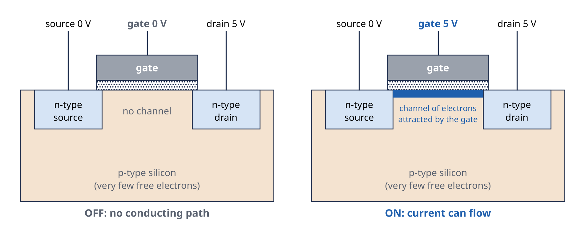
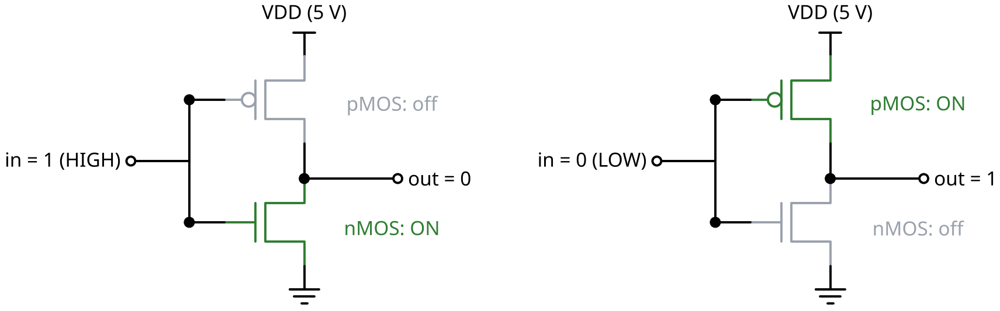
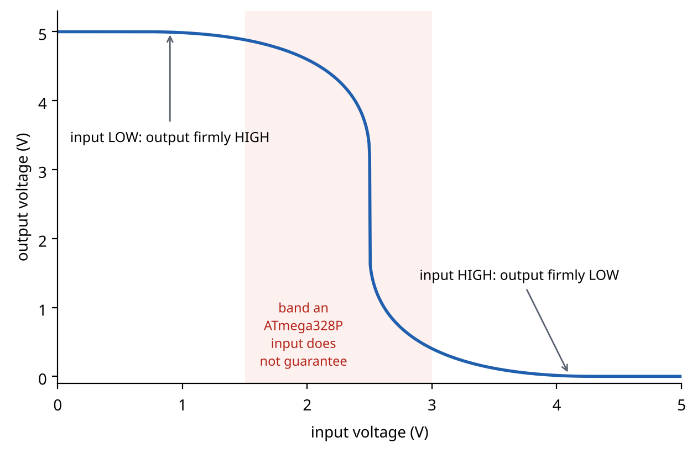
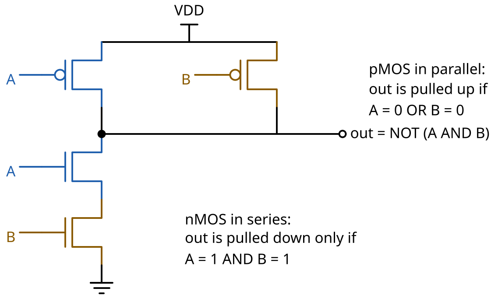
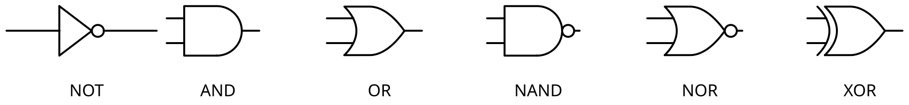
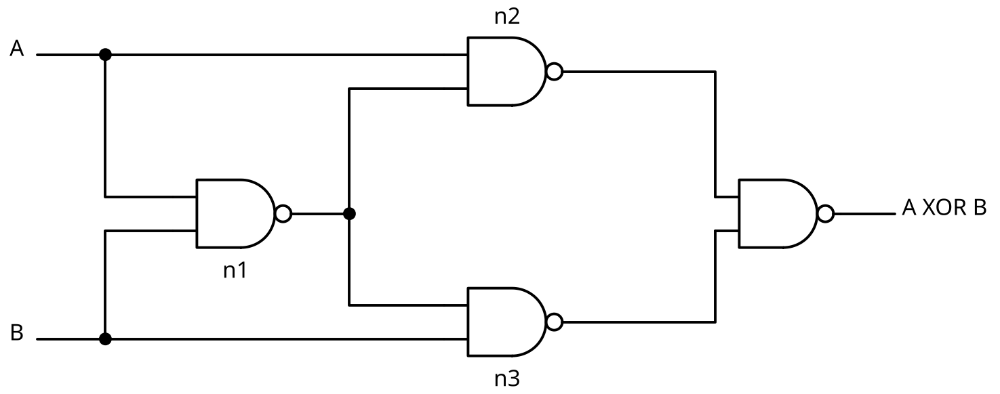

ref: 01.02
title: Switches That Compute: From Transistors to Logic
chapter: Chapter 01 — What a Computer Physically Is
part: Part I — The Machine Beneath C
builds: §01.01
---
## The question

§01.01 left us with bits held as voltages: a wire is LOW or HIGH, and margins of noise immunity keep the two apart. But a voltage that merely *sits* on a wire is storage, not computation. A computer must do more. It must take bits and produce new bits from them: add two numbers, compare them, decide that if this is true then that must happen.

So the question for this section is:

- How can one voltage *control* another? What physical device lets a bit on one wire decide what happens on a different wire?
- How can such devices be combined to compute something, even something as simple as "both of these are 1"?
- Is there a smallest set of building blocks from which *every* computation can be made?
- And what does any of this have to do with the `&&`, `||` and `!` you will write in C?

The answers carry us from a single switch to the foundations of all digital logic. At the end of this section you will know what the processor in your laptop, the ATmega328P and the ESP32 are actually built from, and you will have built a working logic circuit yourself, first in C and then, if you wish, on a breadboard.

## The journey

### A switch that another switch can operate

Begin with the simplest controllable thing: a light switch. It has two states, *open* (no connection, no current) and *closed* (connected, current flows). Wire a lamp through it, and the switch's state decides the lamp's state. Information has moved from the switch to the lamp.

But a hand must operate a light switch. To compute, we need a switch that *electricity* operates, so that the output of one switch can operate the next, and chains of switches can work without anyone touching them.

The first such device was the **relay**: an electromagnet that, when current flows through its coil, pulls a metal contact closed. The electrical output of one relay can drive the coil of another. Telephone exchanges were built from relays in the early twentieth century, and so were some of the first computers: Konrad Zuse's Z3 of 1941 used about 2,600 of them. Relays work, but they are slow (a few thousandths of a second to move), noisy and power-hungry, and because they contain moving parts, they wear out.

The **vacuum tube** replaced the moving contact with a stream of electrons in a vacuum, controlled by a voltage on a wire mesh. It was a thousand times faster, but hot, large and fragile; ENIAC's thousands of tubes failed often enough that keeping the machine running was a daily task.

The device that made modern computing possible is the **transistor**: a switch made from a solid crystal, with no moving parts and no vacuum, controlled by a voltage, and small enough that billions now fit on a single chip.

:::history
The first transistor was demonstrated at Bell Telephone Laboratories in December 1947 by John Bardeen and Walter Brattain; William Shockley, who led their group, soon designed an improved form. The three shared the 1956 Nobel Prize in Physics. The kind of transistor used in almost every chip today, the MOSFET, was first demonstrated at Bell Labs in 1959 by Mohamed Atalla and Dawon Kahng. In 1963 Frank Wanlass, at Fairchild Semiconductor, devised a way of pairing two complementary kinds of MOSFET so that a logic circuit draws almost no power while it is idle. That technique, CMOS, is what your laptop, the ATmega328P and the ESP32 are all built with.
:::

### The MOSFET: a voltage-controlled switch

To understand the transistor without treating it as a black box, we need three facts about silicon.

**First, pure silicon conducts poorly.** In a crystal of pure silicon, almost every electron is held in a bond between neighboring atoms, so there are very few free to carry current.

**Second, adding a tiny amount of another element changes that.** This is called **doping**. Add a little phosphorus, whose atoms each have one more outer electron than silicon's, and the crystal gains free electrons: it becomes **n-type** (*n* for the negative charge of the electrons). Add a little boron, whose atoms have one fewer, and the crystal gains gaps where an electron is missing; these gaps, called **holes**, behave like positive charges that can move: the crystal becomes **p-type**.

**Third, a voltage across an insulator can attract charge to a surface without any current flowing through the insulator**, just as a charged comb attracts scraps of paper without touching them. This effect of an electric *field* gives the transistor we are about to meet its name: the *field-effect* transistor.

A **MOSFET** (*metal–oxide–semiconductor field-effect transistor*) puts these facts together, as Figure 01.02-1 shows. Two islands of n-type silicon, the **source** and the **drain**, sit in a body of p-type silicon. Between them lies a stretch of p-type silicon. It has almost no free electrons to carry current from one island to the other, and the holes it does have cannot cross into the n-type islands: source-to-body and body-to-drain form two diodes facing opposite ways, so whichever way a voltage is applied, one of them blocks. No current flows from source to drain: the switch is *open*. Above that stretch, separated from it by a very thin layer of insulating oxide, lies the **gate** (originally made of metal, hence the *M* in the name).

{w=16.5}

Now raise the gate's voltage. The positive gate attracts electrons toward the surface just beneath the oxide. When the gate voltage exceeds a certain level, the **threshold voltage**, enough electrons gather there to form a thin conducting **channel** joining source to drain. The switch is *closed*. Lower the gate voltage, and the channel disappears.

Notice what makes this ideal for building logic:

- **The gate is controlled by voltage, and takes almost no current.** It is insulated, so in a steady state essentially nothing flows into it. One output can therefore drive many gates without being loaded down.
- **There are no moving parts**, so a MOSFET can switch in a tiny fraction of a nanosecond and does not wear out with use.
- **It can be made extremely small**, so a chip can hold billions.

The transistor just described is an **nMOS** transistor: its channel is made of electrons, and it turns on when its gate is HIGH. Swapping every n-type region for p-type and vice versa gives a **pMOS** transistor, whose channel is made of holes, and which turns on when its gate is *LOW* (more exactly, when the gate is sufficiently below the source, which in an inverter is connected to the supply). For designing logic, we can describe both by a simple **switch model**:

Table: Table 01.02-1  The switch model of the two kinds of MOSFET
<!-- widths: 22,26,26,26 -->
| Transistor | Gate LOW (0) | Gate HIGH (1) | Good at connecting the output to |
|---|---|---|---|
| nMOS | open (off) | closed (on) | ground (pulling LOW) |
| pMOS | closed (on) | open (off) | the supply (pulling HIGH) |

The last column records a fact of physics that shapes every logic circuit: an nMOS transistor passes a strong LOW but only a weak HIGH, and a pMOS transistor passes a strong HIGH but only a weak LOW. The reason is the threshold. An nMOS transistor conducts only while its gate is at least a threshold voltage above its source. When it passes a HIGH, the output node *is* its source, so as the output rises toward the supply, the gate's lead over it shrinks, and the transistor turns itself off about one threshold below the supply. When it pulls the output to ground, its source stays at 0 V, and nothing limits it. The pMOS transistor is the mirror image. So in a standard CMOS gate, nMOS transistors connect the output toward ground, and pMOS transistors connect it toward the supply.

:::precise
The switch model is a simplification, and this book will say so whenever it matters. A real MOSFET is not perfectly open or closed: when "on" it has some resistance, and when "off" a very small **leakage current** still flows. Between fully off and fully on there is a range where it behaves like a variable resistor, not a switch. Digital circuits are designed so that each transistor spends almost all its time at one extreme or the other, passing through the middle only briefly while switching. The leakage, tiny for one transistor, becomes significant across billions, and is a major part of the power a modern processor uses while idle.
:::

### The first logic gate: NOT

Put one pMOS and one nMOS transistor in series between the supply (here 5 V, labeled V<sub>DD</sub>; MOS circuits name the supply after the drain, and the ATmega328P datasheet's V<sub>CC</sub> is the same rail) and ground, join their gates to a single input, and take the output from the point between them. Figure 01.02-2 shows the circuit in both of its states.

{w=16.5}

Reason it through with the switch model:

- **Input HIGH (1).** The nMOS is on, the pMOS off. The output is connected to ground and disconnected from the supply. **Output LOW (0).**
- **Input LOW (0).** The pMOS is on, the nMOS off. The output is connected to the supply and disconnected from ground. **Output HIGH (1).**

The output is always the opposite of the input. This circuit is the **inverter**, or **NOT gate**, the simplest logic gate there is. A **logic gate** is a circuit that computes an output bit from one or more input bits according to a fixed rule.

Two properties of this tiny circuit are worth dwelling on, because they explain why the whole digital world is built this way.

**It draws almost no power while it is still.** In either steady state, one of the two transistors is off, so there is never a closed path from the supply straight to ground. Current flows only for the brief moment of switching, to charge or discharge the wire connected to the output. This pairing of *complementary* transistors, one pMOS pulling up and one nMOS pulling down, is what **CMOS** (*complementary* MOS) means.

**It restores clean levels.** §01.01 argued that digital circuits work because each stage turns a slightly degraded input into a fresh, full-strength output. The inverter is where that happens. Figure 01.02-3 shows how the output voltage depends on the input voltage. It was computed from the standard simple mathematical model of a MOSFET, for a 5 V inverter with matched transistors.

{w=13}

Look at the flat regions. Any input from 0 V to about 1.5 V gives an output within about 0.12 V of 5 V; any input above about 3.5 V gives an output within about 0.12 V of 0 V. A sloppy input becomes a crisp output. And look at the steep middle: in the model's numbers, moving the input from 2.3 V to 2.7 V, a change of only 0.4 V, swings the output from 4.2 V down to 0.8 V. That steepness, the circuit's **gain**, is what pushes every signal decisively to one side or the other. Each gate's actual switching region (here about 2.3 V to 2.7 V) is narrow, so it fits comfortably inside the band that §01.01's datasheet leaves unguaranteed (shaded in the figure), and the outputs land far outside that band. (In this idealized model the curve is exactly vertical at 2.5 V; real transistors give a steep but finite slope.)

:::orbit
CMOS consumes power mainly when it switches. For a whole chip, the power spent this way is approximately *P* ≈ α *C* *V*<sup>2</sup> *f*, where *C* is the total capacitance of the wires and gates being charged and discharged, *V* is the supply voltage, *f* is the clock frequency (how many times per second the circuit switches), and α is the fraction of the circuit that actually switches each time. The *square* on *V* matters greatly: lowering the supply from 5 V to 3.3 V cuts this power by more than half at the same speed (Experiment 01.02-6 asks you to find the factor). That is one reason spacecraft electronics, living on a budget set by solar panels and batteries, favor low voltages and modest clock speeds. But §01.01 showed the price: lower voltage means smaller noise margins. Engineering is the art of choosing such trade-offs knowingly.
:::

### Gates with two inputs: NAND and NOR

A NOT gate has one input. To compute anything interesting we need gates that combine two or more bits. The CMOS idea extends naturally.

Figure 01.02-4 shows a gate with two inputs, A and B. Between the output and ground are *two* nMOS transistors **in series**, one after the other, so the output is pulled LOW only if *both* are on: only if A = 1 **and** B = 1. Between the output and the supply are two pMOS transistors **in parallel**, side by side, so the output is pulled HIGH if *either* is on: if A = 0 **or** B = 0. Exactly one of the two networks conducts for every combination of inputs, so, as with the inverter, no current flows straight from supply to ground.

{w=14}

The output is 0 only when A and B are both 1. That is the opposite, the *negation*, of "A and B", so this gate is called **NAND** (*not and*).

Swap the arrangement, putting the nMOS transistors in parallel and the pMOS in series, and the output is pulled LOW if *either* input is 1, and HIGH only when both are 0. That gate is **NOR** (*not or*).

We can now record what each gate does in a **truth table**, which lists the output for every possible combination of inputs. With two inputs there are 2<sup>2</sup> = 4 combinations:

Table: Table 01.02-2  Truth tables of the basic two-input gates
<!-- widths: 10,10,14,14,14,14,24 -->
| A | B | AND | OR | NAND | NOR | XOR (exclusive or) |
|---|---|---|---|---|---|---|
| 0 | 0 | 0 | 0 | 1 | 1 | 0 |
| 0 | 1 | 0 | 1 | 1 | 0 | 1 |
| 1 | 0 | 0 | 1 | 1 | 0 | 1 |
| 1 | 1 | 1 | 1 | 0 | 0 | 0 |

**AND** is 1 only when both inputs are 1. **OR** is 1 when at least one is 1. **XOR**, *exclusive or*, is 1 when exactly one is 1, that is, when the inputs *differ*. NAND and NOR are AND and OR with their outputs inverted. Figure 01.02-5 shows the standard symbols that engineers use to draw these gates; the small circle on NOT, NAND and NOR marks an inversion.

{w=16}

Something here deserves a question. Why does CMOS naturally make NAND and NOR, the *inverted* gates, rather than AND and OR? Because of the last column of Table 01.02-1: nMOS transistors, which respond to 1s, are good at pulling the output *down* to 0, and pMOS transistors, which respond to 0s, are good at pulling it *up* to 1. A single stage of CMOS therefore always inverts. To make AND, a designer uses NAND followed by NOT; to make OR, NOR followed by NOT.

Table: Table 01.02-3  Transistors needed for each gate in standard CMOS
<!-- widths: 30,20,50 -->
| Gate | Transistors | How |
|---|---|---|
| NOT | 2 | one pMOS, one nMOS |
| NAND (2 inputs) | 4 | Figure 01.02-4 |
| NOR (2 inputs) | 4 | NAND's networks swapped |
| AND (2 inputs) | 6 | NAND + NOT |
| OR (2 inputs) | 6 | NOR + NOT |

:::hood
NAND and NOR need the same number of transistors, yet chip designers generally prefer NAND. The reason is physical. Electrons move through silicon more easily than holes do (roughly two to three times as easily), so a pMOS transistor conducts less well than an nMOS transistor of the same size. NOR places its *pMOS* transistors in series, so its pull-up path suffers twice from this weakness; NAND places its stronger nMOS transistors in series instead. To be equally fast, a NOR gate's pMOS transistors must be made considerably larger. This is why a fact about how charge moves in a crystal shows up at the scale of a whole processor as a design preference.
:::

### Boole's algebra and Shannon's discovery

We have been reasoning about circuits with words like "and" and "or". Those words had been studied with mathematical precision long before any circuit existed.

:::history
In 1854 the English mathematician George Boole published *An Investigation of the Laws of Thought*, in which he treated logical statements, true or false, with an algebra of their own. For eighty years it was a branch of logic and philosophy. Then, in 1937, Claude Shannon, a 21-year-old student at the Massachusetts Institute of Technology, wrote a master's thesis, *A Symbolic Analysis of Relay and Switching Circuits* (published in 1938), showing that circuits of switches obey exactly Boole's algebra. Shannon wrote it in terms of a circuit's *hindrance*, with 0 for a closed circuit and 1 for an open one, so in his notation series connection appeared as +. In today's equivalent form, switches in **series** behave like AND, and switches in **parallel** behave like OR. From then on, a circuit could be *designed* on paper with algebra, and simplified by algebra, before a single wire was connected. It has been called one of the most important master's theses ever written. It is the same Shannon who, eleven years later, founded information theory and put the word "bit" into print (§01.01).
:::

You saw Shannon's discovery in Figure 01.02-4 without being told: the nMOS transistors in series computed "A and B", and the pMOS transistors in parallel computed "A is 0 or B is 0".

**Boolean algebra** works with values that are only 0 or 1, and three basic operations. Engineers usually write them like this:

- **AND** as multiplication: A · B, or simply AB. (For 0s and 1s, ordinary multiplication gives exactly the AND table.)
- **OR** as addition: A + B, with the important difference that 1 + 1 = 1.
- **NOT** with a bar or a prime: Ā, or A′. Read it as "not A".

These operations obey laws, some familiar from ordinary algebra and some not. Each can be checked by trying every combination of 0s and 1s, which is how you should convince yourself of any you doubt.

Table: Table 01.02-4  The main laws of Boolean algebra
<!-- widths: 30,35,35 -->
| Law | AND form | OR form |
|---|---|---|
| Identity | A · 1 = A | A + 0 = A |
| Null (domination) | A · 0 = 0 | A + 1 = 1 |
| Idempotence | A · A = A | A + A = A |
| Complement | A · A′ = 0 | A + A′ = 1 |
| Double negation | (A′)′ = A | |
| Commutative | A · B = B · A | A + B = B + A |
| Associative | (A · B) · C = A · (B · C) | (A + B) + C = A + (B + C) |
| Distributive | A · (B + C) = AB + AC | A + BC = (A + B)(A + C) |
| Absorption | A · (A + B) = A | A + AB = A |
| De Morgan | (A · B)′ = A′ + B′ | (A + B)′ = A′ · B′ |

Two of these deserve attention. The second distributive law, A + BC = (A + B)(A + C), is *false* in ordinary arithmetic but true here; try A = 1, B = 0, C = 0 on both sides. And **De Morgan's laws**, named after Augustus De Morgan, a contemporary of Boole, say that you can push a NOT through an AND or an OR by flipping the operation: "not (A and B)" is the same as "(not A) or (not B)". You will use De Morgan's laws constantly when writing conditions in C (§12.02), and in a moment they will let us build OR out of NAND.

:::myth
"The `+` in Boolean algebra is ordinary addition." It is not. In ordinary arithmetic 1 + 1 = 2; in Boolean algebra 1 + 1 = 1, because "true or true" is simply "true". There is no 2 in Boolean algebra. When engineers *do* want to add binary digits, keeping the carry, they need a different circuit, the adder, which is the subject of §01.03.
:::

### One gate to build them all

Here is a remarkable fact: **NAND alone is enough to build every possible logic circuit.** A gate with this property is called **universal**. The proof is short and constructive, meaning it shows how to do it.

1. **NOT from NAND.** Connect both inputs of a NAND to the same signal A. The output is (A · A)′ = A′. That is NOT.
2. **AND from NAND.** Follow a NAND with a NOT (step 1). The output is ((A · B)′)′ = A · B.
3. **OR from NAND.** By De Morgan, A + B = ((A′) · (B′))′. That is a NAND whose inputs are A′ and B′, each made by step 1.
4. **Every function from AND, OR and NOT.** Take any truth table. For each row whose output is 1, write an AND of the inputs, with each input inverted where its value in that row is 0; then OR all those terms together. The result is 1 exactly on those rows. (This is called the **sum-of-products** form. If no row is 1, the function is the constant 0, which is A · A′.) Since AND, OR and NOT can all be built from NAND, so can every function.

For example, XOR is 1 on the rows (A = 0, B = 1) and (A = 1, B = 0), so step 4 gives XOR = A′B + AB′. Built literally from NANDs, that takes several gates. But engineers have found a neater way that uses only four NANDs, shown in Figure 01.02-6.

{w=14}

The same argument works for NOR: it too is universal. Rather than take the NAND claim on trust, let us check it by building the gates in C. C has no gates, of course, but it has operators that act on truth values. In C, the expression `a && b` is 1 when both `a` and `b` are non-zero and 0 otherwise, and `!a` is 1 when `a` is 0 and 0 otherwise. So the function below behaves exactly like a NAND gate on inputs 0 and 1, and every other gate in the program is built *only* by connecting NANDs, as the steps above describe.

```c Listing 01.02-1  Every gate from NAND, checked in C
// gates.c
// Logic gates as C functions on 0 and 1, all built from NAND alone.
#include <stdio.h>

int gate_nand(int a, int b) {       // the one gate we take as given
    return !(a && b);
}

int gate_not(int a) {               // NOT: tie both NAND inputs together
    return gate_nand(a, a);
}

int gate_and(int a, int b) {        // AND: NAND followed by NOT
    return gate_not(gate_nand(a, b));
}

int gate_or(int a, int b) {         // OR: by De Morgan's law
    return gate_nand(gate_not(a), gate_not(b));
}

int gate_xor(int a, int b) {        // XOR: the classic four-NAND circuit
    int n1 = gate_nand(a, b);
    int n2 = gate_nand(a, n1);
    int n3 = gate_nand(b, n1);
    return gate_nand(n2, n3);
}

int main(void) {
    printf(" a b | NAND NOTa  AND   OR  XOR | a^b\n");
    printf("-----+--------------------------+----\n");
    for (int a = 0; a <= 1; ++a) {
        for (int b = 0; b <= 1; ++b) {
            printf(" %d %d | %4d %4d %4d %4d %4d | %3d\n",
                   a, b, gate_nand(a, b), gate_not(a), gate_and(a, b),
                   gate_or(a, b), gate_xor(a, b), a ^ b);
        }
    }
}
```

Each function from line 5 to line 26 is one gate. Lines 22 to 25 follow Figure 01.02-6 exactly: `n1`, `n2` and `n3` are the outputs of the first three NAND gates, and the last NAND combines them. The `main` function tries all four combinations of `a` and `b` and prints every gate's output in a row. The last column, `a ^ b`, uses C's own built-in exclusive-or operator, so that the NAND-built XOR can be checked against it.

```terminal
$ gcc -std=c23 -Wall -Wextra -pedantic gates.c -o gates
$ ./gates
```

```output
 a b | NAND NOTa  AND   OR  XOR | a^b
-----+--------------------------+----
 0 0 |    1    1    0    0    0 |   0
 0 1 |    1    1    0    1    1 |   1
 1 0 |    1    0    0    1    1 |   1
 1 1 |    0    0    1    1    0 |   0
```

Every two-input column matches Table 01.02-2, NOTa is the inverse of a, and the NAND-built XOR agrees with C's `^` on all four rows.

:::precise
C's `&&`, `||` and `!` are *logical* operators. They treat zero as false and any non-zero value as true, and they always produce `int` 0 or 1. There is one important way in which `&&` and `||` are *not* gates: they **short-circuit**. In `a && b`, if `a` is 0 the result must be 0, so C does not evaluate `b` at all; in `a || b`, if `a` is non-zero, `b` is not evaluated. A hardware gate always looks at both inputs. With plain variables, as in Listing 01.02-1, the difference is invisible; when `b` is a function call or an expression with side effects, it matters a great deal (§12.02). C also has *bitwise* operators, `&`, `|`, `^` and `~`, which apply a gate to every bit of a number at once (§13.01). The `^` in the listing is one of them.
:::

### Combinational logic

Every circuit in this section shares one property: its outputs depend **only on its present inputs**. Give a NAND gate 1 and 1, and it gives 0, now and every time, whatever it did a moment ago. Circuits with this property are called **combinational logic**. They are, in a precise sense, pure functions: mathematical rules from inputs to outputs, with no memory and no history.

The C functions of Listing 01.02-1 are pure functions in exactly the same sense. `gate_nand(1, 1)` always returns 0; it reads nothing but its arguments and changes nothing outside itself. This correspondence between combinational circuits and side-effect-free functions is no accident, and it will return when we study expressions and their side effects (§09.01) and the freedom that the "as-if" rule gives compilers (§02.03, §39.02).

Combinational logic is not the whole story, for two reasons.

**First, it takes time.** When an input changes, the transistors inside a gate need a short time to charge or discharge the wires, so the output changes a little later. This delay is called the **propagation delay**: typically a small fraction of a nanosecond inside a modern chip, and around ten nanoseconds for a discrete logic chip on a breadboard. When gates are chained, the delays add up, and while the signals are still traveling, an output may briefly show a wrong value, a **glitch**, before it settles. How long a chain of gates takes to settle limits how fast a processor can run, which is why §01.03 cares about how the carry travels through an adder.

**Second, it cannot remember.** A combinational circuit has no way of holding a value after its inputs change. Yet a computer must remember: the number it is counting, the instruction it is executing, the contents of every variable. Circuits whose outputs depend on their *history* as well as their present inputs are called **sequential logic**, and they are built, remarkably, by feeding the outputs of gates back into their own inputs. That is the subject of §01.04.

:::metal
The ATmega328P and the ESP32 are CMOS chips, built from the same complementary pairs of transistors described here. Their I/O pins show it. The datasheet for the ATmega328P describes its port pins as able both to *sink* current (pull LOW) and to *source* it (pull HIGH), which is the behavior of an output stage with a pMOS transistor to the supply and an nMOS transistor to ground, like a large inverter. That also explains a detail from §01.01: the guaranteed V<sub>OH</sub> falls as the pin supplies more current, because the "on" pMOS transistor has some resistance, and more current through a resistance means more voltage lost across it. (This reading of the output stage is the author's inference from the datasheet's specifications; §36.03 examines the pin circuitry the datasheet actually draws.)
:::

:::history
The Apollo Guidance Computer, which steered the Apollo spacecraft to the Moon and back, was one of the first computers built from integrated circuits, and its processor logic was built entirely from a single kind of gate: NOR. Each chip held two three-input NOR gates, and each computer used several thousand of these chips. The gates were not CMOS; they used an earlier technique, resistor–transistor logic. But the principle is the one you have just proved: since NOR is universal, a computer needs no other gate. Building from one standard part meant that one part could be tested and screened exhaustively, which mattered when there would be no way to repair the computer on the way to the Moon.
:::

:::orbit
CMOS has a hidden weakness that matters greatly in space. The layers of n-type and p-type silicon in a CMOS chip happen to form, by accident, a four-layer structure that behaves like a latching switch between the supply and ground. Normally it stays off. But a heavy charged particle passing through the chip can turn it on, and once on it stays on, drawing a large current until the power is removed. This is called **single-event latch-up**. Unlike the bit flip of §01.01, it can destroy the chip by overheating. Spacecraft designs guard against it with chips manufactured to resist it and with circuits that detect a sudden rise in current and cut and restore the power within milliseconds (§35.01).
:::

## Terms introduced

- **Relay**: a switch closed by an electromagnet; an early electrically controlled switch.
- **Vacuum tube**: a glass bulb in which a voltage on a grid controls a current of electrons through a vacuum; the switch of the first electronic computers.
- **Transistor**: a solid-state device in which a small signal controls a larger current; used in logic as a voltage-controlled switch.
- **Doping**: adding small amounts of another element to silicon to give it free electrons (**n-type**) or **holes** (**p-type**).
- **Hole**: the absence of an electron in a crystal, which moves and behaves like a positive charge.
- **MOSFET**: metal–oxide–semiconductor field-effect transistor; current between **source** and **drain** is controlled by the voltage on an insulated **gate**.
- **Threshold voltage**: the gate voltage at which a MOSFET's channel forms and it begins to conduct.
- **Channel**: the thin conducting layer that forms beneath a MOSFET's gate and joins source to drain.
- **nMOS / pMOS**: MOSFETs that turn on when the gate is HIGH / LOW respectively.
- **Switch model**: treating each transistor as simply open or closed; a simplification of its real behavior.
- **Leakage current**: the small current a transistor passes even when "off".
- **Logic gate**: a circuit that computes an output bit from input bits by a fixed rule.
- **Inverter (NOT gate)**: a gate whose output is the opposite of its input.
- **CMOS**: complementary MOS; logic built from pMOS pull-up and nMOS pull-down networks, drawing power mainly when switching.
- **Gain**: how strongly a change in input changes the output; high gain in the middle of the inverter's range restores clean levels.
- **AND, OR, NAND, NOR, XOR**: two-input gates defined by Table 01.02-2.
- **Truth table**: a list of a circuit's output for every combination of its inputs.
- **Boolean algebra**: the algebra of the values 0 and 1 with AND, OR and NOT.
- **De Morgan's laws**: (A · B)′ = A′ + B′ and (A + B)′ = A′ · B′.
- **Universal gate**: a gate from which every logic function can be built; NAND and NOR are both universal.
- **Sum-of-products form**: an OR of AND terms, one for each truth-table row whose output is 1.
- **Short-circuit evaluation**: C's rule that `&&` and `||` do not evaluate their right operand when the left one already decides the result.
- **Majority function**: a function of three bits that is 1 when at least two of them are 1.
- **Floating input**: an input connected to nothing, whose voltage drifts with stray charge.
- **Combinational logic**: logic whose outputs depend only on its present inputs.
- **Propagation delay**: the time between an input changing and the output settling.
- **Glitch**: a brief wrong output while signals are still settling.
- **Sequential logic**: logic whose outputs depend on its history as well as its present inputs (§01.04).
- **Single-event latch-up**: a particle-triggered short circuit inside a CMOS chip that persists until power is removed.

## Self-check

1. Why could a hand-operated switch never be the basis of a computer, while a relay could? What property must the controlling device have?
2. In your own words, explain how a voltage on the gate of an nMOS transistor makes current able to flow between source and drain, although no current flows through the gate itself.
3. Using the switch model, explain why the CMOS inverter draws almost no current when its input is steady, whichever value the input has.
4. In Figure 01.02-3, an input of 1.5 V gives an output very close to 5 V. Explain how this relates to the claim in §01.01 that digital circuits do not accumulate noise.
5. In the CMOS NAND gate, why must the nMOS transistors be in series and the pMOS transistors in parallel? What would happen to the output if both networks could conduct at the same time?
6. Why does a single CMOS stage naturally produce NAND or NOR rather than AND or OR?
7. Verify the second distributive law, A + BC = (A + B)(A + C), by completing its truth table for all eight combinations of A, B and C.
8. Show, step by step, how to build OR using only NAND gates. Which Boolean law does the construction rely on?
9. In C, the expression `f() && g()` might not call `g` at all. Why is this not true of a hardware AND gate, and when does the difference matter?
10. What is the difference between combinational and sequential logic? Give one example of a task a computer must do that combinational logic alone cannot.

## Experiments

**Experiment 01.02-1. NAND builds everything.** Type Listing 01.02-1, compile it and run it. Before running, fill in the expected output table by hand from Table 01.02-2 (NOTa is simply the inverse of a). Then change `gate_xor` to compute XOR from the sum-of-products form instead, as `gate_or(gate_and(gate_not(a), b), gate_and(a, gate_not(b)))`, and confirm that the output does not change. Count how many NAND gates this version uses, compared with four.

**Experiment 01.02-2. A three-input gate.** The **majority** function of three bits is 1 when at least two of them are 1. Write its truth table (eight rows). Then add a function `int majority(int a, int b, int c)` to a copy of Listing 01.02-1 that builds it from `gate_and` and `gate_or`, using the sum-of-products idea or a simpler form you discover, and print its table with three nested loops. Keep the result: the majority function reappears in §01.03 as the carry of a binary adder.

**Experiment 01.02-3. De Morgan in C.** Predict, then check, the output of this program:

```c Listing 01.02-2  Checking De Morgan's laws in C
// demorgan.c
#include <stdio.h>

int main(void) {
    printf(" a b | !(a&&b)  !a||!b  | !(a||b)  !a&&!b\n");
    for (int a = 0; a <= 1; ++a) {
        for (int b = 0; b <= 1; ++b) {
            printf(" %d %d |    %d        %d    |    %d        %d\n",
                   a, b, !(a && b), !a || !b, !(a || b), !a && !b);
        }
    }
}
```

What do you expect to see when you compare the third column with the fourth, and the fifth with the sixth?

**Experiment 01.02-4. Drawing a NOR gate.** On paper, draw the CMOS circuit of a two-input NOR gate, by analogy with Figure 01.02-4. Mark which transistors conduct for each of the four input combinations, and derive its truth table from your drawing. Then explain, using the *Under the hood* box, why this gate is slower than NAND unless its pMOS transistors are made larger.

**Experiment 01.02-5. NOR is universal too.** Show, on paper, how to build NOT, OR and AND using only NOR gates. Then, if you wish, write `gate_nor` in C and check your constructions the way Listing 01.02-1 checks NAND.

**Experiment 01.02-6. The price of voltage.** Using *P* ≈ α *C* *V*<sup>2</sup> *f*, by what factor does a chip's switching power change if its supply is lowered from 5 V to 3.3 V, all else equal? From 3.3 V to 1.8 V? What does §01.01 say you lose in exchange?

## Hands-on (AVR / ESP32): a real NAND gate, tested by the Uno

A **74HC00** is an inexpensive chip containing four independent two-input NAND gates, built in CMOS. ("HC" stands for high-speed CMOS; the chip runs from 2 V to 6 V, so the Uno's 5 V suits it.) In this project the Uno becomes an automatic tester: it drives the NAND gate's inputs, reads its output, and prints the truth table.

You will need an Arduino Uno, a 74HC00 in a DIP package, a breadboard and jumper wires.

**The chip's pins.** Hold the chip with its notch at the top; pin 1 is top left and the pins are numbered counterclockwise. For the 74HC00: pins 1 and 2 are the inputs of gate 1 and pin 3 its output; pins 4 and 5 the inputs of gate 2 and pin 6 its output; pin 7 is ground; pins 9 and 10 the inputs of gate 3 and pin 8 its output; pins 12 and 13 the inputs of gate 4 and pin 11 its output; pin 14 is the supply. Check this against the datasheet of the exact chip you buy.

**Wiring.**

1. Chip pin 14 to the Uno's **5V**; chip pin 7 to the Uno's **GND**. Place a 100 nF ceramic capacitor across pins 14 and 7, as close to the chip as you can: it supplies the brief bursts of current the gates draw when they switch (the α*CV*<sup>2</sup>*f* power above), so that the supply wire does not dip.
2. Uno pin **2** to chip pin 1 (input A); Uno pin **3** to chip pin 2 (input B); chip pin 3 (output) to Uno pin **4**.
3. Connect every *unused* input (pins 4, 5, 9, 10, 12 and 13) to GND.

The third step is not tidiness; it is physics. A CMOS input is the insulated gate of a transistor. Left unconnected, it **floats**: its voltage drifts with stray charge, often into the band between the chip's own input thresholds, the one its datasheet does not guarantee (for the 74HC00 at 4.5 V, between V<sub>IL</sub> = 1.35 V and V<sub>IH</sub> = 3.15 V; compare §01.01), where both the pMOS and nMOS transistors of that gate are partly on at once. Current then flows straight from supply to ground through that gate, wasting power and warming the chip, and its output may oscillate. Unused CMOS inputs must always be tied to a defined level.

```c Listing 01.02-3  The Uno as an automatic truth-table tester
// nand_tester.ino  (Arduino Uno + 74HC00)
const int PIN_A = 2;   // to 74HC00 pin 1 (gate 1, input A)
const int PIN_B = 3;   // to 74HC00 pin 2 (gate 1, input B)
const int PIN_Y = 4;   // from 74HC00 pin 3 (gate 1, output)

void setup(void) {
    Serial.begin(9600);
    pinMode(PIN_A, OUTPUT);
    pinMode(PIN_B, OUTPUT);
    pinMode(PIN_Y, INPUT);
    Serial.println("A B | Y");
    for (int a = 0; a <= 1; ++a) {
        for (int b = 0; b <= 1; ++b) {
            digitalWrite(PIN_A, a);
            digitalWrite(PIN_B, b);
            delay(5);                  // let the output settle
            Serial.print(a);
            Serial.print(" ");
            Serial.print(b);
            Serial.print(" | ");
            Serial.println(digitalRead(PIN_Y));
        }
    }
}

void loop(void) {
}
```

Upload it and open the Serial Monitor at 9600 baud. **Predict** the four lines before you look. Press the Uno's reset button to run the test again.

**Going further: XOR on the chip.** The 74HC00's four gates are exactly the four NANDs of Figure 01.02-6. Rewire so that: A goes to pins 1 and 4; B goes to pins 2 and 10; pin 3 (`n1`) goes to pins 5 and 9; pin 6 (`n2`) goes to pin 12; pin 8 (`n3`) goes to pin 13; and pin 11 is the output, read by Uno pin 4. (With all eight inputs now in use, none needs tying to ground.) Run the same sketch. It now prints the truth table of XOR, computed by four NAND gates that you wired together yourself. (Inside the chip each gate has more than the four transistors of Figure 01.02-4: 74HC gates add buffer stages to their outputs, and one maker's datasheet gives the chip's complexity as 32 transistors, eight per gate.)

**On the ESP32.** The 74HC00 runs from 2 V, so it also works powered from an ESP32 board's 3V3 pin. The same sketch then runs on the ESP32 once the three pin numbers are changed to free GPIO pins, for example 25, 26 and 27. At 3.3 V the chip's thresholds scale down with its supply, and the ESP32's output levels (§01.01) clear them comfortably.

## Answers

**Self-check 1.** A hand-operated switch must be moved by a person, so its output cannot operate another switch automatically; computation would need a human at every step. A relay is operated by electric current, so the output of one relay can operate the next. The controlling device must be operated by the same kind of signal that it produces.

**Self-check 2.** The gate is separated from the silicon by an insulator, so no current flows through it. But its voltage creates an electric field across the insulator, which attracts electrons to the silicon surface beneath. Above the threshold voltage, enough gather to form a conducting channel of electrons between the n-type source and drain.

**Self-check 3.** In either steady state, exactly one transistor is on: with input HIGH the nMOS is on and the pMOS off; with input LOW the reverse. So there is never a closed path from the supply to ground, and no steady current flows (apart from tiny leakage). Current flows only briefly, during switching.

**Self-check 4.** The input of 1.5 V is a degraded LOW, yet the output is almost exactly 5 V, a full-strength HIGH. Each gate thus discards most of the noise on its input and produces a clean output, so noise does not build up through a chain of gates, as §01.01 required.

**Self-check 5.** The output must go LOW only when A and B are both 1, which series nMOS transistors achieve, since both must be on; and it must go HIGH when either is 0, which parallel pMOS transistors achieve, since either one suffices. If both networks conducted at once, the supply would be connected directly to ground through them: a large current would flow and the output voltage would be somewhere in between, a value neither 0 nor 1. The arrangement guarantees exactly one network conducts for every input.

**Self-check 6.** nMOS transistors are good at pulling the output to 0 and turn on when their inputs are 1; pMOS transistors are good at pulling it to 1 and turn on when their inputs are 0. So inputs of 1 tend to produce an output of 0: every single stage inverts.

**Self-check 7.** Both sides give 0 for (A, B, C) = (0,0,0), (0,0,1) and (0,1,0), and 1 for the other five combinations. For instance, with A = 1, B = 0, C = 0: left side 1 + 0 = 1; right side (1 + 0)(1 + 0) = 1 · 1 = 1.

**Self-check 8.** Make A′ with a NAND whose inputs are both A; make B′ the same way; feed A′ and B′ into a third NAND. Its output is (A′ · B′)′, which by De Morgan's law equals A + B. Three NAND gates in all.

**Self-check 9.** A gate is a physical circuit permanently connected to both inputs; both are always present and the output always depends on both. C's `&&` is defined as a rule about the *order of evaluation*: it evaluates the left operand first and skips the right one when the result is already decided. The difference matters when evaluating the right operand has an effect, such as calling a function that prints, changes a variable or reads input.

**Self-check 10.** Combinational logic's outputs depend only on its present inputs; sequential logic's outputs also depend on its past. Any task that needs memory requires sequential logic: counting how many times a button has been pressed, remembering which instruction comes next, or holding the value of a variable.

**Experiment 01.02-1.** The output is exactly as shown in the journey. The sum-of-products XOR gives the same table. It uses two NOTs (one NAND each), two ANDs (two NANDs each) and an OR (three NANDs): 2 + 4 + 3 = 9 NAND gates, against four for the circuit of Figure 01.02-6. Both compute the same function; good design finds the cheaper circuit.

**Experiment 01.02-2.** The majority function can be written as AB + AC + BC. A version consistent with the listing is:

```c Listing 01.02-4  The majority function, built from NAND-based gates
int majority(int a, int b, int c) {     // 1 when at least two inputs are 1
    int ab = gate_and(a, b);
    int ac = gate_and(a, c);
    int bc = gate_and(b, c);
    return gate_or(gate_or(ab, ac), bc);
}
```

Printed with three nested loops (`a`, `b` and `c` each running from 0 to 1), using `printf(" %d %d %d |    %d\n", a, b, c, majority(a, b, c))` after a header line, the author's run gave:

```output
 a b c | majority
 0 0 0 |    0
 0 0 1 |    0
 0 1 0 |    0
 0 1 1 |    1
 1 0 0 |    0
 1 0 1 |    1
 1 1 0 |    1
 1 1 1 |    1
```

**Experiment 01.02-3.** The third and fourth columns are identical, and so are the fifth and sixth, demonstrating both of De Morgan's laws for all inputs. The author's output was:

```output
 a b | !(a&&b)  !a||!b  | !(a||b)  !a&&!b
 0 0 |    1        1    |    1        1
 0 1 |    1        1    |    0        0
 1 0 |    1        1    |    0        0
 1 1 |    0        0    |    0        0
```

**Experiment 01.02-4.** Two nMOS transistors in *parallel* between output and ground (either input HIGH pulls the output LOW); two pMOS transistors in *series* between the supply and output (both inputs must be LOW to pull it HIGH). The output is 1 only for A = B = 0: the NOR table. Its pull-up path passes through two pMOS transistors in series, and pMOS conducts less well than nMOS because holes move less easily than electrons, so the pull-up is weak and slow unless those transistors are made larger.

**Experiment 01.02-5.** NOT A = NOR(A, A). OR: A + B = NOT(NOR(A, B)), that is, NOR(NOR(A, B), NOR(A, B)). AND: by De Morgan, A · B = (A′ + B′)′ = NOR(A′, B′) = NOR(NOR(A, A), NOR(B, B)).

**Experiment 01.02-6.** (3.3 / 5)<sup>2</sup> ≈ 0.44, so power falls to about 44%. (1.8 / 3.3)<sup>2</sup> ≈ 0.30, so it falls to about 30% of the 3.3 V figure. The cost, from §01.01, is smaller noise margins, because the thresholds and output levels all scale down with the supply voltage.

**Hands-on.** The logic of the circuit predicts these lines (the sketch was not run by the author on real hardware; a simulation of the Uno with a modeled NAND gate printed exactly the first table):

```output
A B | Y
0 0 | 1
0 1 | 1
1 0 | 1
1 1 | 0
```

After the XOR rewiring, the same sketch should print 0, 1, 1, 0 in the Y column.

## Sources and verification

- **Toolchain.** Listings 01.02-1, 01.02-2 and 01.02-4 (within a complete program) were compiled with GCC 14.2.0 (`-std=c23 -Wall -Wextra -pedantic`) on x86-64 Ubuntu Linux 24.04; every output shown is from those runs. The programs' results do not depend on the compiler, since they involve only the values 0 and 1. Listing 01.02-3 was **not** run by the author, since it needs a physical board and chip.
- **Figure 01.02-3** was computed by the author from the standard long-channel ("square-law") MOSFET equations, for V<sub>DD</sub> = 5 V, threshold voltages of ±0.7 V and matched transistors, by solving for the output voltage at which the nMOS and pMOS currents are equal. It illustrates the shape of the curve; it is not a measurement of any particular chip. Its program is kept in the book's `_build` folder.
- **History.** Standard histories of computing and electronics: Z3 (1941); the Bell Labs transistor (1947) and the 1956 Nobel Prize in Physics; Atalla and Kahng's MOSFET (1959); Wanlass's CMOS (1963). G. Boole, *An Investigation of the Laws of Thought* (1854). C. E. Shannon, *A Symbolic Analysis of Relay and Switching Circuits*, MIT master's thesis (1937), published in *Transactions of the AIEE* (1938); the thesis defines 0 as the hindrance of a closed circuit and 1 as that of an open circuit, with + for series connection.
- **Apollo Guidance Computer.** Smithsonian National Air and Space Museum, catalog entry "Integrated Circuit, Dual 3 Input, Apollo Guidance Computer" (designed by Fairchild, manufactured by Philco; several thousand chips per computer); K. Shirriff, "A computer built from NOR gates: inside the Apollo Guidance Computer" (2019), for the CPU being built entirely from NOR gates. The resistor–transistor logic of these chips is from standard descriptions of the AGC.
- **Device physics.** The relative mobility of electrons and holes in silicon (electrons roughly two to three times more mobile), the switching-power relation *P* ≈ α*CV*<sup>2</sup>*f*, and latch-up are standard results of semiconductor and VLSI textbooks.
- **74HC00.** The standard pin assignment of the quad two-input NAND in a 14-pin DIP package; verify it against your own chip's datasheet before wiring. Supply range of 2 V to 6 V, typical delay of 8 ns and "buffered outputs": onsemi (formerly Fairchild), *MM74HC00 Quad 2-Input NAND Gate* datasheet. Input thresholds V<sub>IH</sub> = 3.15 V and V<sub>IL</sub> = 1.35 V at V<sub>CC</sub> = 4.5 V: Texas Instruments, *SN54HC00, SN74HC00* datasheet (SCLS181H). "Chip complexity: 32 FETs": onsemi, *74HC00* datasheet. The ESP32 variant of the hands-on project was not run by the author.
- **Simulation.** Listing 01.02-3 was also built with avr-g++ 7.3.0 for the ATmega328P against a small stand-in for the Arduino library and a software model of one NAND gate, and run in simavr 1.6; it printed the table given in the Answers. This checks the program's logic, not the real chip.
- **Inference in this section.** The description of the ATmega328P's output stage as a pMOS–nMOS pair is the author's inference from the datasheet's sink and source specifications. The reason given for the Apollo computer's single gate type (ease of testing and screening one part) is the author's summary of the engineering motive, not a quotation of its designers.
