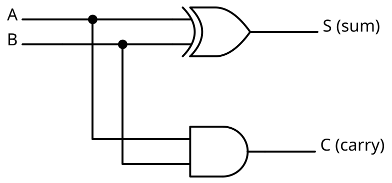
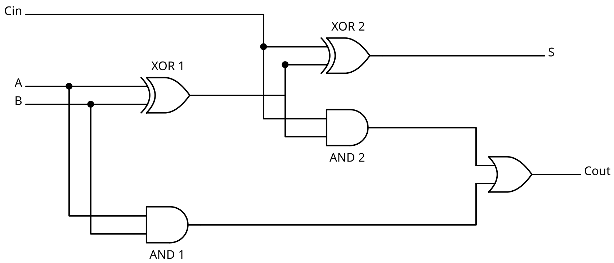
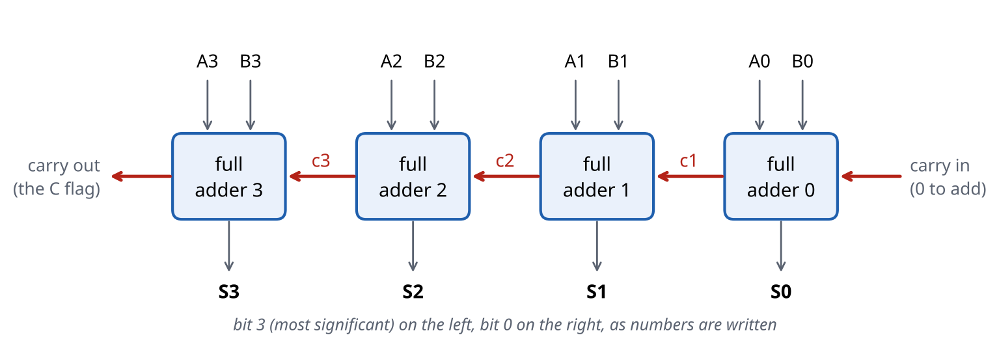
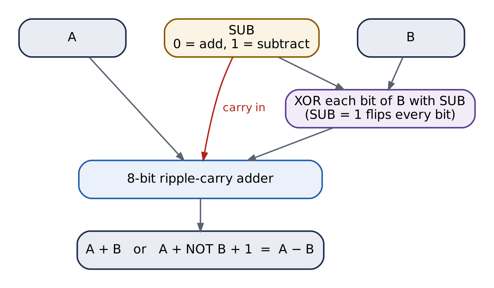
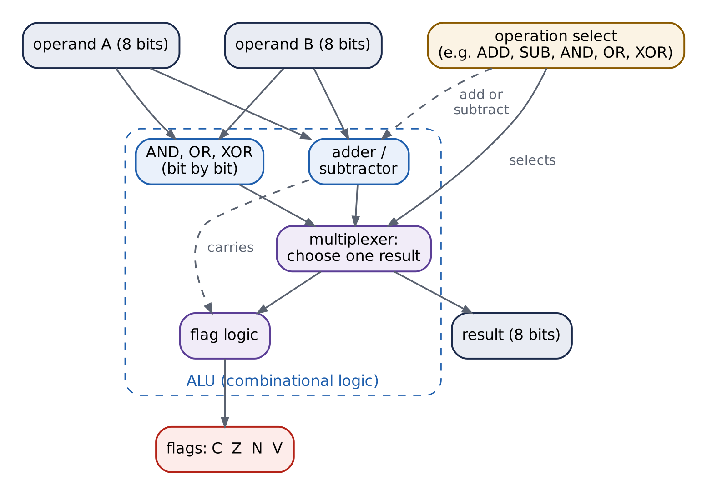

ref: 01.03
title: Building Arithmetic from Logic
chapter: Chapter 01 — What a Computer Physically Is
part: Part I — The Machine Beneath C
builds: §01.02
---
## The question

Here is the simplest piece of arithmetic a C program can contain:

```c Listing 01.03-1  The simplest arithmetic
// add16.c
int add16(int a, int b) {
    return a + b;
}
```

Ask the AVR compiler what the ATmega328P will actually do with it (`avr-gcc -mmcu=atmega328p -Os -S add16.c`), and among its output you find three instructions:

```text
add16:
    add r24,r22
    adc r25,r23
    ret
```

Ask GCC on your laptop the same question, and you get something different again:

```text
add16:
    leal (%rdi,%rsi), %eax
    ret
```

(These are the author's runs, with avr-gcc 7.3.0 and GCC 14.2 using `-O2`; the details of the second listing are explained in the *Under the hood* box later in this section.)

The AVR needs *two* instructions to add two `int`s, and the second one is called `adc`, "add with carry". Where does a carry come from? Why does an addition need one? And how, physically, does a chip made of the gates of §01.02 *add* at all? A gate computes AND or XOR of single bits; addition works on whole numbers, and every school child knows that adding numbers means carrying digits from one column to the next.

There are more questions hiding here:

- If a chip can only add, how does it subtract? There is no `sub` circuit in the list of gates.
- What happens when a sum is too large for the bits available, such as 255 + 1 in eight bits?
- How does the processor tell the *next* instruction what happened, so that a program can decide "if the result was zero" or "if it overflowed"?

By the end of this section you will have built an adder and a subtractor out of gates, checked them against C's own arithmetic on every possible pair of 8-bit numbers, and seen the very flags that the AVR sets after every addition.

## The journey

### Adding as a child learns it

Start with decimal, the arithmetic you already trust. To add 47 and 85, you add the units column first: 7 + 5 = 12. Twelve does not fit in one decimal digit, so you write 2 and **carry** 1 into the tens column. Then 4 + 8 + 1 = 13: write 3, carry 1. Finally the carried 1 stands alone: the answer is 132.

Why does carrying work? Because of **place value**: each column is worth ten times the column to its right, so ten units *are* one ten. When a column overflows past 9, the excess is not lost; it is moved one column left, where it is worth exactly the same amount. Carrying is simply the rule that keeps the value correct when a digit runs out of room.

Binary works in exactly the same way, with one change: each column is worth *two* times the column to its right. Reading from the right, the columns are worth 1, 2, 4, 8, 16 and so on, so the binary number 0110 means 4 + 2 = 6, and 0111 means 4 + 2 + 1 = 7. (Section §04.01 develops binary notation fully; this much is enough here.) There are only four facts of binary addition to learn:

Table: Table 01.03-1  The whole of binary addition for one column
<!-- widths: 25,25,50 -->
| | | Result |
|---|---|---|
| 0 + 0 | = 0 | write 0, carry 0 |
| 0 + 1 = 1 + 0 | = 1 | write 1, carry 0 |
| 1 + 1 | = 2, written 10 | write 0, carry 1 |
| 1 + 1 + 1 (with a carry in) | = 3, written 11 | write 1, carry 1 |

Here is 6 + 7 worked by hand, with the carries written above:

```text
 carries in:   1 1 0 0
 6              0 1 1 0
 7            + 0 1 1 1
               ---------
 13             1 1 0 1
```

Work it from the right. Column 0: 0 + 1 = 1, no carry. Column 1: 1 + 1 = 10, write 0, carry 1. Column 2: 1 + 1 + the carry 1 = 11, write 1, carry 1. Column 3: 0 + 0 + the carry 1 = 1. The result, 1101, is 8 + 4 + 1 = 13. Every step was one of the four facts in Table 01.03-1.

Now notice what each column needed: **two digits from the numbers, plus a carry from the column to its right**, and it produced **one digit of the answer plus a carry to the column on its left**. If we can build a circuit that does exactly that for one column, we can build an adder for numbers of any size by placing copies side by side.

### The half adder

Begin with the simpler case: one column with no carry coming in, two input bits A and B. Its two outputs are the **sum** bit S and the **carry** bit C. Their truth table is the first three rows of Table 01.03-1:

Table: Table 01.03-2  The half adder
<!-- widths: 20,20,30,30 -->
| A | B | S (sum) | C (carry) |
|---|---|---|---|
| 0 | 0 | 0 | 0 |
| 0 | 1 | 1 | 0 |
| 1 | 0 | 1 | 0 |
| 1 | 1 | 0 | 1 |

Compare those output columns with the gates of §01.02. The S column is 1 exactly when A and B *differ*: that is XOR. The C column is 1 only when both are 1: that is AND. So:

S = A ⊕ B        C = A · B

(The symbol ⊕ is the usual way of writing XOR in Boolean algebra.) Two gates, shown in Figure 01.03-1, add two bits. This circuit is called a **half adder**, because it does only half the job of a column: it has no input for a carry from the right.

{w=9}

### The full adder

A real column has three inputs: A, B and the carry in, C<sub>in</sub>. Its truth table has 2<sup>3</sup> = 8 rows:

Table: Table 01.03-3  The full adder
<!-- widths: 16,16,16,26,26 -->
| A | B | C<sub>in</sub> | S | C<sub>out</sub> |
|---|---|---|---|---|
| 0 | 0 | 0 | 0 | 0 |
| 0 | 0 | 1 | 1 | 0 |
| 0 | 1 | 0 | 1 | 0 |
| 0 | 1 | 1 | 0 | 1 |
| 1 | 0 | 0 | 1 | 0 |
| 1 | 0 | 1 | 0 | 1 |
| 1 | 1 | 0 | 0 | 1 |
| 1 | 1 | 1 | 1 | 1 |

Read the columns as patterns rather than as numbers to memorise.

The **sum** S is 1 when an *odd* number of the inputs are 1 (one or three of them). XOR has exactly this property: A ⊕ B is 1 when an odd number of A and B are 1, and XOR-ing in a third bit keeps counting oddness. So S = A ⊕ B ⊕ C<sub>in</sub>.

The **carry** C<sub>out</sub> is 1 when *at least two* of the inputs are 1. You have met this function before: it is the **majority** function of Experiment 01.02-2, which can be written AB + AC<sub>in</sub> + BC<sub>in</sub>. Designers usually prefer an equivalent form that reuses a gate already present:

C<sub>out</sub> = A · B + C<sub>in</sub> · (A ⊕ B)

Read it as a sentence: *a carry goes out if this column generates one by itself (both A and B are 1), or if a carry comes in and this column passes it on (exactly one of A and B is 1, so the column holds 1 + 1 = 10 with the incoming carry).* The two forms are equal: the second differs from the majority form only where A = B = 1, and there the term A · B already makes the result 1.

Both formulas can be built from two half adders and an OR gate, as Figure 01.03-2 shows. The first half adder adds A and B; the second adds the carry in to their sum; a carry out arises if either half adder produced one. This is the **full adder**, the one-column circuit we set out to build.

{w=16}

### The ripple-carry adder

To add numbers of many bits, place one full adder per column and connect each carry out to the next column's carry in, exactly as the carry moves leftwards when you add by hand. For column 0 the carry in is simply 0. Figure 01.03-3 shows four columns; eight, sixteen, thirty-two or sixty-four are made the same way.

{w=16}

Because the carry *ripples* through the chain from one adder to the next, this design is called a **ripple-carry adder**. It is the most direct translation of the schoolroom method into silicon, and it is correct for every input. Its weakness lies in time, not in correctness.

### The carry's journey takes time

Every gate needs a little time to respond, its propagation delay (§01.02). Look at what the carry out of one full adder must wait for. C<sub>out</sub> = A · B + C<sub>in</sub> · (A ⊕ B), and A ⊕ B can be computed in advance, as soon as the inputs arrive. But C<sub>in</sub> · (A ⊕ B) cannot be finished until C<sub>in</sub> arrives, and then the OR adds one more gate. So each stage adds about **two gate delays** to the carry's journey.

In the worst case, a carry generated in column 0 must travel through every column. Add 1 to 11111111 (255 + 1), and the carry born in column 0 flips every bit on its way to the far end. An *n*-bit ripple-carry adder therefore needs roughly 2*n* gate delays before its last output is certain to be correct.

That is acceptable for small widths and slow clocks, but consider a 64-bit adder in a laptop processor. Suppose, purely for illustration, that one gate takes 20 picoseconds (20 trillionths of a second). Then 128 gate delays take about 2.6 nanoseconds. A processor running at 4 GHz has only 0.25 nanoseconds per clock cycle. A ripple-carry adder would be ten times too slow.

The hardware cannot wait only as long as a particular addition needs, because it does not know in advance which inputs it will receive. It must be designed for the worst case. (Experiment 01.03-3 shows how rare the worst case actually is.)

The cure is to compute the carries *in parallel* instead of one after another. For each column, define two signals that depend only on that column's inputs:

- **generate**: g = A · B, "this column makes a carry by itself";
- **propagate**: p = A ⊕ B, "this column passes an incoming carry on".

Then each carry is c<sub>i+1</sub> = g<sub>i</sub> + p<sub>i</sub> · c<sub>i</sub>, and substituting one equation into the next expresses every carry directly in terms of the inputs, for example:

c<sub>2</sub> = g<sub>1</sub> + p<sub>1</sub> · g<sub>0</sub> + p<sub>1</sub> · p<sub>0</sub> · c<sub>0</sub>

No carry has to wait for its neighbour. Written out naively the formulas grow long, but they can be organised as a tree, combining pairs of columns, then pairs of pairs, and so on, so that a 64-bit carry is ready after a number of levels that grows only with log<sub>2</sub> 64 = 6, rather than with 64. Such designs are called **carry-lookahead** and **parallel-prefix** adders; the Kogge–Stone adder, published in 1973, is a well-known example. They use more gates to save time, a trade that recurs throughout computer design.

:::metal
The ATmega328P runs at 16 MHz on the Uno, so one clock cycle lasts 62.5 nanoseconds: an age compared with the delay of eight full adders. How Microchip actually built the AVR's adder is not described in its public documentation, but at such a clock speed even a simple design has ample time to settle. What the datasheet does document is the behaviour you will measure later in this section: an 8-bit `ADD` completes in a single clock cycle, and it sets the status flags as it does so.
:::

### What happens when the sum does not fit

An 8-bit adder has eight sum outputs and one carry out. What if the true sum needs nine bits? Add 255 and 1:

```text
 carries in:   1 1 1 1 1 1 1 1
 255            1 1 1 1 1 1 1 1
 1            + 0 0 0 0 0 0 0 1
               -----------------
              1 0 0 0 0 0 0 0 0
```

The true answer, 256, is the binary number 1 0000 0000, nine bits long. The eight sum outputs show 0000 0000; the ninth bit leaves through the final carry out. If nothing catches it, it is simply lost, and 255 + 1 "equals" 0.

This is not a fault. It is the behaviour of any counter with a fixed number of digits, like a car's odometer that rolls from 999 999 to 000 000. An 8-bit adder computes sums **modulo 256**: it gives the remainder after dividing the true sum by 256. Section §04.02 shows that C's unsigned integer types are *defined* to behave in exactly this way, a rule that comes straight from the hardware you have just built.

But the lost bit is not always lost. The adder's final carry out is saved, as a bit called the **carry flag**, and that is the whole secret of the AVR's `adc` instruction. The ATmega328P's adder is only 8 bits wide, but an `int` on that chip is 16 bits. So the compiler adds the low bytes with `add`, which saves the carry out in the carry flag, and then adds the high bytes with `adc`, which uses the saved carry flag as the carry *in* of its own column 0. Two 8-bit additions, linked by one saved bit, behave exactly like one 16-bit adder, just as two columns of a schoolroom sum are linked by the carry written above them. That is the two-instruction listing that opened this section.

:::hood
Why does the laptop's listing use `leal` instead of an add instruction? `lea` ("load effective address") is an x86-64 instruction designed to compute memory addresses, which are often of the form "one register plus another". GCC notices that the same circuitry can add two numbers and place the result in a third register in one step, without disturbing the status flags, so with optimisation enabled it uses `lea` for plain addition. Compile the same function with `-O0` and you see an ordinary `addl` instead. The listing also uses 32-bit registers (`%edi`, `%esi`, `%eax`) because `int` is 32 bits on your laptop: the x86-64 adder is 64 bits wide, so one instruction suffices. Chapter 03 shows you how to produce and read such listings yourself, and §39.01 returns to them in depth. (The author compiled with the option `-fcf-protection=none`, because Ubuntu's GCC otherwise adds a security instruction, `endbr64`, at the start of each function; your Fedora output may or may not contain it.)
:::

### Subtraction without a subtractor

We could design a separate subtracting circuit, with *borrows* instead of carries. Processors do not. They subtract with the adder they already have, using a piece of arithmetic so neat that it deserves to be followed step by step.

Take any 8-bit number B and flip every one of its bits, so that every 1 becomes 0 and every 0 becomes 1. Call the result NOT B. Now add B and NOT B: in every column, exactly one of the two bits is 1, so the sum is 1111 1111 = 255 with no carries at all. So, in eight bits:

NOT B = 255 − B

Now add A, NOT B and an extra 1:

A + NOT B + 1 = A + (255 − B) + 1 = A − B + 256

Since an 8-bit adder discards multiples of 256 (it computes modulo 256), the result it shows is exactly **A − B**. So to subtract, a processor needs only two small additions to its adder:

1. A row of XOR gates on the B inputs, controlled by a signal SUB. XOR with 0 leaves a bit unchanged; XOR with 1 flips it. When SUB = 1, B becomes NOT B.
2. The carry into column 0, which is 0 for addition, is set to SUB. When SUB = 1, it supplies the "+ 1".

Figure 01.03-4 shows the arrangement. One adder, one row of XOR gates, and a single control signal give both addition and subtraction.

{w=11}

Try it with 5 − 3. In binary, 5 is 0000 0101 and 3 is 0000 0011, so NOT 3 is 1111 1100. Adding 0000 0101 + 1111 1100 + 1 gives 1 0000 0010: the eight result bits are 0000 0010, which is 2, and a carry of 1 goes out. Now try 3 − 5: 0000 0011 + 1111 1010 + 1 = 1111 1110, which is 254, and no carry goes out.

Two observations follow, and both matter later.

**The result 254 is "−2" in disguise.** As an 8-bit pattern, 254 is exactly what you must add to 2 to get 256, that is, to get 0 in eight bits. So 1111 1110 behaves like −2: add it to 5 and you get 3. This way of representing negative numbers, called **two's complement**, is the one every processor in this book uses, and §04.03 explains it fully. For now, notice that the hardware did nothing special to produce it: negative numbers fell out of the adder by themselves.

**The carry out tells you whether a borrow happened.** When A ≥ B, as in 5 − 3, the adder produces a carry out of 1; when A < B, as in 3 − 5, it produces 0. In other words, the raw carry out after subtraction is the *opposite* of a borrow.

:::precise
Processors do not agree on how to report this. On ARM processors, the carry flag after a subtraction holds the adder's raw carry out: 1 means "no borrow". The AVR and x86 processors *invert* it, so that their carry flag after a subtraction means "a borrow occurred": the ATmega328P's datasheet describes its C flag after `SUB` as set when the second operand is larger than the first. Both designs use the same adder; they differ only in what they store. You will see the AVR convention for yourself in the hands-on experiment at the end of this section.
:::

### The ALU: arithmetic and logic in one circuit

A processor needs more than addition and subtraction. It must also compute AND, OR and XOR of whole bytes, bit by bit, to test and set individual bits (Chapter 13). All of these can be computed side by side from the same two inputs, and the right one chosen for each instruction.

The circuit that does the choosing is a **multiplexer**: a circuit with several data inputs, one output, and one or more *select* inputs that decide which data input is passed through. A multiplexer choosing between two bits X and Y with a select signal S is simply (S′ · X) + (S · Y): when S = 0 the left term passes X; when S = 1 the right term passes Y. Wider multiplexers are built from the same idea.

Put the adder–subtractor, the bitwise logic and a multiplexer together, and you have an **arithmetic logic unit**, or **ALU**: the part of a processor that actually computes. Figure 01.03-5 shows its structure.

{w=12}

The ALU is pure combinational logic, exactly in the sense of §01.02: give it two operands and an operation code, and a short time later the result and the flags appear. It has no memory. The registers that hold its operands, and the circuitry that decides which operation to request next, are the subject of §01.04 and §01.05.

### The flags: what the ALU tells the next instruction

Besides its result, the ALU produces a few single bits that describe the result. They are called **status flags**, because each one flags a property that a later instruction may want to know. Four of them appear on almost every processor:

Table: Table 01.03-4  The four common status flags
<!-- widths: 15,40,45 -->
| Flag | Set to 1 when | Used for |
|---|---|---|
| **C** carry | the addition carried out of the top bit (for subtraction, see the box above) | unsigned overflow; chaining bytes with `adc`; unsigned comparison |
| **Z** zero | every bit of the result is 0 | "are these equal?" (subtract, then test Z) |
| **N** negative | the top bit of the result is 1 | the sign, when the result is read as two's complement |
| **V** overflow | the result read as signed is wrong | signed overflow; signed comparison |

Each is computed by a small piece of extra logic. **C** is just the final carry out. **Z** is a NOR of all the result bits: it is 1 only if none of them is 1. **N** is a copy of the top bit.

**V** needs more thought. Read 8-bit patterns as signed numbers, in the range −128 to 127 (the 3 − 5 example showed that 1111 1110 behaves as −2). Then 100 + 50 should be 150, which does not fit in that range; the adder produces 1001 0110, whose top bit says "negative": it reads as −106. The signed answer is wrong, though the unsigned answer, 150, is perfectly correct. The ALU detects this with a simple rule: **V is 1 when the carry *into* the top column differs from the carry *out of* it.** An equivalent way to say it: overflow happens only when two numbers of the same sign produce a result of the opposite sign. Adding a positive and a negative number can never overflow, because the result always lies between them.

So the same eight result bits can be correct as an unsigned number and wrong as a signed one (100 + 50), or wrong as unsigned and correct as signed (200 + 100 = 44 with a carry out; as signed numbers this is −56 + 100 = 44, which is right). The adder does not know which interpretation you intend. It computes both sets of facts at once, and the *program* chooses which flags to believe. That choice is made by the instructions your compiler emits, according to the types you declared in C. It is the first sign of a theme that runs through the whole book: **the meaning of bits is decided by their type, not by the hardware**.

### Checking everything in C

Claims like these deserve proof, and with only 256 × 256 = 65 536 possible pairs of 8-bit inputs, we can try them *all*. The program below builds the 8-bit ripple-carry adder–subtractor from the full adder's two formulas, computes the four flags exactly as described above, and compares every result and flag with what C's own arithmetic says the answer should be, for every pair of inputs, both adding and subtracting.

```c Listing 01.03-2  A gate-level 8-bit adder–subtractor, checked exhaustively
// adder8.c
// An 8-bit ripple-carry adder and subtractor built from logic gates,
// checked against C's own arithmetic for every possible pair of inputs.
#include <stdio.h>

int flag_c, flag_z, flag_n, flag_v;     // the status flags

int sum_bit(int a, int b, int cin) {    // full adder: sum output
    return (a ^ b) ^ cin;
}

int carry_bit(int a, int b, int cin) {  // full adder: carry output
    return (a & b) | (cin & (a ^ b));
}

int alu_add(int x, int y, int subtract) {   // x and y are 0..255
    int carry = subtract;               // carry into bit 0
    int carry_into_top = 0;
    int result = 0;
    for (int i = 0; i < 8; ++i) {
        int a = (x >> i) & 1;           // bit i of x
        int b = ((y >> i) & 1) ^ subtract;  // flipped when subtracting
        if (i == 7) {
            carry_into_top = carry;
        }
        result = result | (sum_bit(a, b, carry) << i);
        carry = carry_bit(a, b, carry);
    }
    flag_c = carry;
    flag_z = (result == 0);
    flag_n = (result >> 7) & 1;
    flag_v = carry_into_top ^ carry;
    return result;
}

int as_signed(int x) {                  // read an 8-bit pattern as -128..127
    if (x >= 128) {
        return x - 256;
    }
    return x;
}

int main(void) {
    long mismatches = 0;
    for (int x = 0; x < 256; ++x) {
        for (int y = 0; y < 256; ++y) {
            int s = alu_add(x, y, 0);
            int sum = x + y;
            int ssum = as_signed(x) + as_signed(y);
            if (s != sum % 256 || flag_c != (sum > 255)
                    || flag_v != (ssum < -128 || ssum > 127)) {
                ++mismatches;
            }
            int d = alu_add(x, y, 1);
            int sdiff = as_signed(x) - as_signed(y);
            if (d != (x - y + 256) % 256 || flag_c != (x >= y)
                    || flag_v != (sdiff < -128 || sdiff > 127)) {
                ++mismatches;
            }
        }
    }
    printf("Checked 131072 additions and subtractions: %ld mismatches\n\n",
           mismatches);

    const int xs[]  = {6, 255, 100, 200, 5, 3};
    const int ys[]  = {7,   1,  50, 100, 3, 5};
    const int sub[] = {0,   0,   0,   0, 1, 1};
    printf("  operation   result | C Z N V | unsigned | signed\n");
    for (int k = 0; k < 6; ++k) {
        int r = alu_add(xs[k], ys[k], sub[k]);
        printf("%4d %c %3d  = %3d    | %d %d %d %d |   %3d    | %4d\n",
               xs[k], sub[k] ? '-' : '+', ys[k], r,
               flag_c, flag_z, flag_n, flag_v, r, as_signed(r));
    }
}
```

The program uses a few features of C that later chapters explain fully: `^`, `&` and `|` apply XOR, AND and OR to bits (§13.01), `>>` and `<<` shift bits right and left (§13.02), and the flags are variables declared outside any function so that every function can see them (§20.02). For now, follow the structure:

- Lines 8 to 14 are the full adder: the sum and carry formulas of this section, letter for letter.
- In `alu_add`, the loop on lines 20 to 28 is the ripple-carry chain: line 21 takes bit `i` of `x`; line 22 takes bit `i` of `y` and XORs it with `subtract`, exactly as Figure 01.03-4 does; line 26 places the sum bit in position `i` of the result; and line 27 passes the carry on to the next column. Line 17 sets the carry into column 0 to `subtract`, the "+ 1" of subtraction.
- Lines 29 to 32 compute the four flags.
- In `main`, lines 45 to 61 try every pair of inputs, compare each result and flag with what ordinary arithmetic says, and count any disagreement. The function `as_signed` (lines 36 to 41) reads a pattern as a signed number, the way the 3 − 5 example did.
- Lines 65 to 74 then print six instructive cases.

```terminal
$ gcc -std=c23 -Wall -Wextra -pedantic adder8.c -o adder8
$ ./adder8
```

```output
Checked 131072 additions and subtractions: 0 mismatches

  operation   result | C Z N V | unsigned | signed
   6 +   7  =  13    | 0 0 0 0 |    13    |   13
 255 +   1  =   0    | 1 1 0 0 |     0    |    0
 100 +  50  = 150    | 0 0 1 1 |   150    | -106
 200 + 100  =  44    | 1 0 0 0 |    44    |   44
   5 -   3  =   2    | 1 0 0 0 |     2    |    2
   3 -   5  = 254    | 0 0 1 0 |   254    |   -2
```

Zero mismatches in 131 072 operations: the gates compute arithmetic, the flags mean what Table 01.03-4 says, and the subtraction trick works for every possible pair. The six sample rows show each case discussed in this section. (In this listing, as in the pure hardware, C = 1 after a subtraction means "no borrow".)

:::orbit
On 4 June 1996, the first flight of the European Ariane 5 rocket ended about forty seconds after lift-off, when the rocket veered off course and was destroyed. The inquiry board found that software in the inertial reference system, reused from Ariane 4, converted a 64-bit floating-point value related to the rocket's horizontal velocity into a 16-bit signed integer. Ariane 5 flew a faster trajectory than Ariane 4, the value exceeded the largest number a 16-bit signed integer can hold, and the conversion failed. Its error was not handled, and both the main and the backup units, running identical software, shut down. The arithmetic hardware worked perfectly; the failure lay in assuming that a number would always fit in the bits given to it. The program was written in Ada, not C, but the lesson is universal, and Chapters 04 and 10 are devoted to it.
:::

### The AVR's status register

The ATmega328P keeps its flags in an 8-bit register called **SREG**, the status register. Its datasheet defines its bits as follows, from bit 7 down to bit 0:

Table: Table 01.03-5  The ATmega328P status register, SREG
<!-- widths: 10,10,80 -->
| Bit | Name | Meaning |
|---|---|---|
| 7 | I | Global interrupt enable (not an arithmetic flag; Chapter 37) |
| 6 | T | A single spare bit that two instructions can copy bits into and out of |
| 5 | H | Half carry: a carry out of bit 3 into bit 4 |
| 4 | S | Sign: N ⊕ V, the true sign of a signed result even after overflow |
| 3 | V | Two's complement overflow |
| 2 | N | Negative: the top bit of the result |
| 1 | Z | Zero |
| 0 | C | Carry (after subtraction: borrow) |

Two of these were not in Table 01.03-4. **H**, the half carry, records a carry from the lower four bits into the upper four. It exists for arithmetic on decimal digits stored four bits each, a format called *binary-coded decimal*, still used by clocks and calculators. **S** is a clever addition: when signed overflow occurs, N shows the wrong sign, and N ⊕ V corrects it, so S tells a program whether a signed result is truly negative. The AVR uses S for its signed comparison instructions.

The hands-on project below lets you run real `ADD` and `SUB` instructions on your Uno and read SREG straight after each one.

## Terms introduced

- **Place value**: the rule that each column of a number is worth a fixed multiple (ten in decimal, two in binary) of the column to its right.
- **Carry**: the excess moved from a column that overflowed into the next column to the left.
- **Half adder**: a circuit adding two bits, giving a sum (A ⊕ B) and a carry (A · B).
- **Full adder**: a circuit adding two bits and an incoming carry, giving a sum and an outgoing carry.
- **Ripple-carry adder**: full adders in a chain, each carry passing to the next.
- **Generate / propagate**: per-column signals g = A · B and p = A ⊕ B used to compute carries in parallel.
- **Carry-lookahead (parallel-prefix) adder**: an adder that computes carries in parallel, in time growing with the logarithm of the width.
- **Modulo arithmetic**: arithmetic that keeps only the remainder after division by a fixed number, such as 256 for eight bits.
- **NOT B (bitwise complement)**: B with every bit flipped; equal to 255 − B in eight bits.
- **Two's complement**: representing −B as NOT B + 1, so that subtraction is addition (§04.03).
- **Borrow**: the opposite of a carry in subtraction; needed when subtracting a larger number from a smaller one.
- **Multiplexer**: a circuit that passes one of several inputs to its output, according to select inputs.
- **ALU (arithmetic logic unit)**: the combinational circuit that performs a processor's arithmetic and logical operations.
- **Status flags (C, Z, N, V)**: bits describing the last result: carry, zero, negative, signed overflow.
- **Signed overflow**: a result that does not fit the signed range; detected when the carry into the top bit differs from the carry out.
- **SREG**: the AVR's status register, holding I, T, H, S, V, N, Z and C.
- **Half carry (H)**: a carry from bit 3 into bit 4.
- **Binary-coded decimal (BCD)**: storing each decimal digit in four bits.

## Self-check

1. Explain, using place value, why carrying produces the correct answer in decimal addition, and why the same reasoning works in binary.
2. Why is a half adder not enough to build a multi-bit adder? What does the full adder add?
3. Show that the sum output of a full adder is 1 exactly when an odd number of its inputs are 1.
4. Prove that A · B + C · (A ⊕ B) equals the majority function AB + AC + BC by checking the cases A = B and A ≠ B separately.
5. Why must a ripple-carry adder be given time for the worst case, even though most additions need much less?
6. Using the identity NOT B = 255 − B, explain why A + NOT B + 1 gives A − B in an 8-bit adder. Where do the "extra" 256 go?
7. After the 8-bit subtraction 3 − 5, the result is 254. What signed value does that pattern represent, and why?
8. 200 + 100 sets C but not V, and 100 + 50 sets V but not C. Explain each, saying which interpretation (unsigned or signed) is wrong in each case.
9. Why can the addition of a positive and a negative number never cause signed overflow?
10. Why does the AVR need two instructions, `add` and `adc`, to add two `int` values, while your laptop needs one?

## Experiments

**Experiment 01.03-1. Run the adder.** Type Listing 01.03-2, compile it and run it. Before running, predict the four flags for each of the six sample rows. Then add a seventh case of your own, 128 + 128, and predict its result and flags before running.

**Experiment 01.03-2. Binary by hand.** Add, in 8-bit binary, with the carries written above: 45 + 27, and 130 + 140. Then compute 27 − 45 by the method A + NOT B + 1. For each, state the result, and the C and V flags. Check your answers by adding them to the sample rows in Listing 01.03-2.

**Experiment 01.03-3. How far does a carry travel?** The program below measures, for a given addition, the longest run of columns through which a carry travels without stopping. Predict its first four lines, then run it.

```c Listing 01.03-3  Measuring the longest carry chain
// chain.c
// How many stages in a row does a carry travel through?
#include <stdio.h>

int longest_chain(int x, int y) {
    int carry = 0;
    int run = 0;
    int longest = 0;
    for (int i = 0; i < 8; ++i) {
        int a = (x >> i) & 1;
        int b = (y >> i) & 1;
        carry = (a & b) | (carry & (a ^ b));
        if (carry) {
            ++run;
            if (run > longest) {
                longest = run;
            }
        } else {
            run = 0;
        }
    }
    return longest;
}

int main(void) {
    printf("255 + 1   : %d\n", longest_chain(255, 1));
    printf(" 15 + 1   : %d\n", longest_chain(15, 1));
    printf("128 + 128 : %d\n", longest_chain(128, 128));
    printf(" 85 + 170 : %d\n", longest_chain(85, 170));
    long count[9] = {0};
    for (int x = 0; x < 256; ++x) {
        for (int y = 0; y < 256; ++y) {
            ++count[longest_chain(x, y)];
        }
    }
    for (int k = 0; k <= 8; ++k) {
        printf("longest chain %d: %5ld pairs\n", k, count[k]);
    }
}
```

Its last nine lines count how many of the 65 536 pairs produce each chain length. Before you run it, try to *calculate* the number of pairs with no carry at all, and the number whose carry travels all eight stages. (Hint: for each column, how many of the four combinations of A and B generate a carry, and how many pass one on?)

**Experiment 01.03-4. Two machines, one line of C.** Compile Listing 01.03-1 for both machines and compare:

```terminal
$ avr-gcc -mmcu=atmega328p -Os -S add16.c -o add16_avr.s
$ gcc -std=c23 -O2 -S add16.c -o add16_x86.s
$ gcc -std=c23 -O0 -S add16.c -o add16_x86_O0.s
```

Open the three `.s` files in VS Code. Find the instructions that do the adding in each. Fedora's newer avr-gcc should produce the same `add` and `adc` as the author's version 7.3.0; record whether it does. Then change `int` to `long` (32 bits on the AVR) and predict how many add instructions the AVR version will need before you look.

**Experiment 01.03-5. Signed overflow by reasoning.** Without running anything, give the 8-bit result and the C and V flags for: 127 + 1; 128 + 128 (or, read as signed, −128 + −128); 0 − 1. Then check them with Listing 01.03-2.

## Hands-on (AVR / ESP32): watching the flags

This sketch runs a single real AVR `ADD` or `SUB` instruction and copies SREG into a variable immediately afterwards, before any other instruction can change it. It does this with a few lines of **inline assembly**: machine instructions written directly inside C. You need not understand the syntax yet (§39.03 explains it). It is used here because ordinary C gives no way to say "read the flags left by *this* addition"; the compiler may reorder or replace instructions as it sees fit.

```c Listing 01.03-4  Reading the AVR's status register after ADD and SUB
// flags.ino  (Arduino Uno)
// Run one AVR ADD or SUB instruction and print the status register after it.
uint8_t result;
uint8_t sreg;

void add_and_read(uint8_t a, uint8_t b) {
    result = a;
    asm volatile("add %0, %2\n\t"
                 "in  %1, __SREG__"
                 : "+r" (result), "=r" (sreg)
                 : "r" (b));
}

void sub_and_read(uint8_t a, uint8_t b) {
    result = a;
    asm volatile("sub %0, %2\n\t"
                 "in  %1, __SREG__"
                 : "+r" (result), "=r" (sreg)
                 : "r" (b));
}

void show(uint8_t a, const char *op, uint8_t b) {
    Serial.print(a);
    Serial.print(op);
    Serial.print(b);
    Serial.print(" = ");
    Serial.print(result);
    Serial.print("    I T H S V N Z C = ");
    for (int bit = 7; bit >= 0; --bit) {
        Serial.print((sreg >> bit) & 1);
        Serial.print(" ");
    }
    Serial.println();
}

void setup(void) {
    Serial.begin(9600);
    add_and_read(6, 7);
    show(6, " + ", 7);
    add_and_read(255, 1);
    show(255, " + ", 1);
    add_and_read(100, 50);
    show(100, " + ", 50);
    add_and_read(200, 100);
    show(200, " + ", 100);
    sub_and_read(5, 3);
    show(5, " - ", 3);
    sub_and_read(3, 5);
    show(3, " - ", 5);
}

void loop(void) {
}
```

Upload it, open the Serial Monitor at 9600 baud, and press the Uno's reset button if the output has already scrolled past. **Before you look, predict** each line's flags from Table 01.03-4 and Table 01.03-5, paying special attention to the two subtractions and to the H flag.

**What to compare.** Check each line against the "C Z N V" columns of Listing 01.03-2's output. They should agree for the four additions. For the two subtractions, the C flag should be the *opposite* of the listing's, because the AVR reports a borrow (see the *Precisely speaking* box on processor conventions). The I flag should read 1 on every line: the Arduino environment enables interrupts before `setup()` runs.

## Answers

**Self-check 1.** Each column is worth ten times the one to its right, so ten units of one column equal exactly one unit of the next. When a column's total exceeds 9, moving ten of it one column left as a carry of 1 keeps the total value unchanged. In binary each column is worth twice the one to its right, so two units of one column equal one unit of the next; a column total of 2 or 3 is written as 0 or 1 with a carry of 1.

**Self-check 2.** Every column except the rightmost must also add the carry coming from the column to its right. A half adder has only two inputs and cannot accept it. The full adder adds a third input, the carry in.

**Self-check 3.** A ⊕ B is 1 exactly when one of A and B is 1, that is, when an odd number of them are. XOR-ing in C<sub>in</sub> flips the result when C<sub>in</sub> is 1, which changes an odd count to even and vice versa. So A ⊕ B ⊕ C<sub>in</sub> is 1 exactly when the total number of 1s among the three is odd; Table 01.03-3 confirms this row by row.

**Self-check 4.** If A = B, then A ⊕ B = 0 and the left side is A · B; the right side is AB + C(A + B), and with A = B this is A + CA = A = AB (both are A). If A ≠ B, then A · B = 0 and A ⊕ B = 1, so the left side is C; on the right, AB = 0 and AC + BC = C(A + B) = C · 1 = C. Equal in both cases.

**Self-check 5.** A circuit's outputs are read at a fixed moment set by the clock, and the circuit cannot know in advance which inputs it will receive or how far their carry will travel. To be correct for *every* input, it must allow time for the longest possible carry chain.

**Self-check 6.** A + NOT B + 1 = A + (255 − B) + 1 = A − B + 256. An 8-bit adder keeps only the remainder modulo 256, so adding 256 changes nothing in the eight result bits; the 256 appears as the carry out of the top column.

**Self-check 7.** −2. The pattern 1111 1110 is 254, and 254 + 2 = 256, which is 0 in eight bits. So 1111 1110 is the number that, added to 2, gives 0: it behaves as −2.

**Self-check 8.** 200 + 100 = 300, which needs nine bits, so the carry goes out (C = 1) and the unsigned result 44 is wrong. Read as signed, 200 is −56, and −56 + 100 = 44 is correct, so V = 0. For 100 + 50 = 150, the unsigned sum fits in eight bits (C = 0) and is correct. But 150 exceeds 127, so as a signed number the result reads as −106, which is wrong, and V = 1.

**Self-check 9.** The sum of a positive and a negative number lies between the two numbers, and both lie within the signed range, so the sum does too.

**Self-check 10.** The ATmega328P's ALU and registers are 8 bits wide, but `int` on that chip is 16 bits. The compiler adds the low bytes with `add`, which records the carry in the C flag, then the high bytes with `adc`, which adds that carry in. The laptop's adder is 64 bits wide, so a 32-bit `int` needs only one instruction.

**Experiment 01.03-1.** The six rows are as shown in the journey. For 128 + 128 (adding 128 to each of the three arrays and changing `6` to `7` in the loop), the author's run printed `128 + 128  =   0    | 1 1 0 1 |     0    |    0`: the result is 0 with a carry out (256 does not fit in eight bits), and V = 1, because read as signed this is −128 + −128 = −256, which is far outside the range −128 to 127. The two negative operands produced a result whose sign bit is 0, the tell-tale sign of signed overflow.

**Experiment 01.03-2.** 45 + 27 = 72: 0010 1101 + 0001 1011 = 0100 1000; C = 0, V = 0. 130 + 140 = 270, which does not fit: the 8-bit result is 270 − 256 = 14 (0000 1110), C = 1; as signed numbers this is −126 + −116 = −242, which overflows, so V = 1. 27 − 45: 0001 1011 + 1101 0010 + 1 = 1110 1110 = 238, which is −18 as a signed number. The adder's raw carry out is 0, meaning a borrow (C = 0 in Listing 01.03-2's convention; on the AVR, C = 1). V = 0, because −18 is within range.

**Experiment 01.03-3.** The author's run printed:

```output
255 + 1   : 8
 15 + 1   : 4
128 + 128 : 1
 85 + 170 : 0
longest chain 0:  6561 pairs
longest chain 1: 10336 pairs
longest chain 2: 12972 pairs
longest chain 3: 11691 pairs
longest chain 4:  8748 pairs
longest chain 5:  5994 pairs
longest chain 6:  4131 pairs
longest chain 7:  2916 pairs
longest chain 8:  2187 pairs
```

85 + 170 is 0101 0101 + 1010 1010: in every column exactly one bit is 1, so every column *propagates* but none *generates*, and with no carry in there is nothing to propagate. The counts can be calculated exactly. In a column, a carry is generated only by (1, 1); the other three combinations, (0, 0), (0, 1) and (1, 0), generate none. With no generation in any of the eight columns there is no carry at all, so 3<sup>8</sup> = 6561 pairs have chain length 0. For a chain of length 8, column 0 must generate (one choice, (1, 1)), and each of the other seven columns must pass a carry on, which (0, 1), (1, 0) and (1, 1) all do: 3<sup>7</sup> = 2187 pairs. Only one pair in thirty needs the full length, but the hardware must still allow time for it.

**Experiment 01.03-4.** The author's avr-gcc 7.3.0 produced `add r24,r22` and `adc r25,r23`; GCC 14.2 with `-O2` produced `leal (%rdi,%rsi), %eax`, and with `-O0` an `addl` among instructions that copy the arguments to and from memory. For `long`, which is 32 bits on the AVR, the author's avr-gcc produced four instructions: one `add` followed by three `adc`, one for each of the four bytes.

**Experiment 01.03-5.** 127 + 1 = 128 (1000 0000): C = 0, V = 1, since two non-negative numbers produced a result with the sign bit set (as signed, −128). 128 + 128 = 0 with C = 1 and V = 1 (Experiment 01.03-1). 0 − 1 = 255 (1111 1111), which is −1 as a signed number: V = 0, and there is a borrow, so Listing 01.03-2 shows C = 0 while the AVR would show C = 1.

**Hands-on.** The author ran the code of Listing 01.03-4 on a simulated ATmega328P (the simulator simavr, with a small stand-in for `Serial` that writes to the chip's serial port). The output was:

```output
6 + 7 = 13    I T H S V N Z C = 0 0 0 0 0 0 0 0
255 + 1 = 0    I T H S V N Z C = 0 0 1 0 0 0 1 1
100 + 50 = 150    I T H S V N Z C = 0 0 0 0 1 1 0 0
200 + 100 = 44    I T H S V N Z C = 0 0 0 0 0 0 0 1
5 - 3 = 2    I T H S V N Z C = 0 0 0 0 0 0 0 0
3 - 5 = 254    I T H S V N Z C = 0 0 1 1 0 1 0 1
```

On a real Uno the I column will show 1 in every line, because the Arduino environment enables interrupts before `setup()`, whereas the simulated program never did. Everything else should match. Notice: for 255 + 1, H = 1 because the low four bits 1111 + 0001 carried into bit 4. For 100 + 50, N = V = 1 and so S = N ⊕ V = 0: the true sign of the signed sum 150 is positive, even though the overflowed result shows a sign bit of 1. For the subtractions, C is 0 for 5 − 3 and 1 for 3 − 5: the AVR reports a borrow, the opposite of the adder's raw carry out. For 3 − 5, H = 1 because the low four bits needed a borrow (3 − 5 in the lowest four bits), and S = N ⊕ V = 1 correctly reports the negative result −2.

## Sources and verification

- **Toolchains.** Listings 01.03-2 and 01.03-3 were compiled with GCC 14.2.0 (`-std=c23 -Wall -Wextra -pedantic`) on x86-64 Ubuntu Linux 24.04; all their outputs are from those runs, and do not depend on the compiler, since they use only small non-negative integers. The assembly listings were produced with avr-gcc 7.3.0 (`-mmcu=atmega328p -Os -S`) and GCC 14.2.0 (`-O2 -fcf-protection=none -S`), with assembler directives removed for clarity.
- **Hands-on.** Listing 01.03-4 was compiled with avr-g++ 7.3.0 together with a minimal stand-in for Arduino's `Serial` object and run on the simulator simavr 1.6, emulating an ATmega328P at 16 MHz. It was not run on a physical Uno with the Arduino libraries; the difference in the I flag is explained in the Answers.
- **ATmega328P.** Microchip, *ATmega328P Datasheet*: the definitions of the SREG bits, and the instruction descriptions of `ADD`, `ADC` and `SUB` (including the C flag after `SUB` being set when the second operand is larger), as summarised in the *AVR Instruction Set Manual*.
- **Ariane 5.** J.-L. Lions (chairman), *ARIANE 5 Flight 501 Failure: Report by the Inquiry Board*, European Space Agency, July 1996.
- **Adders.** P. M. Kogge and H. S. Stone, "A Parallel Algorithm for the Efficient Solution of a General Class of Recurrence Equations", *IEEE Transactions on Computers*, 1973. Carry-lookahead adders and the ARM carry convention are described in standard texts on computer arithmetic and processor architecture.
- **Inference and assumptions in this section.** The 20-picosecond gate delay used to compare a ripple-carry adder with a 4 GHz clock is an illustrative assumption, not a measured figure. The statement that the AVR's internal adder design is undocumented is the author's reading of the public documentation.
