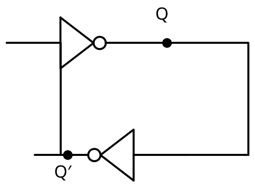
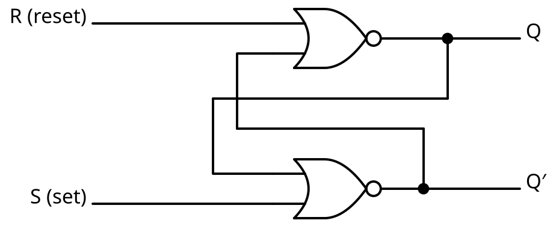
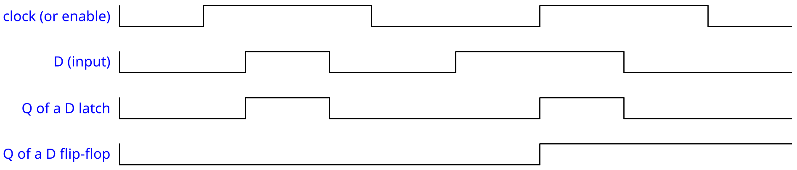
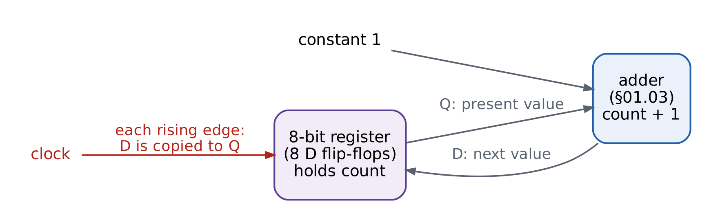
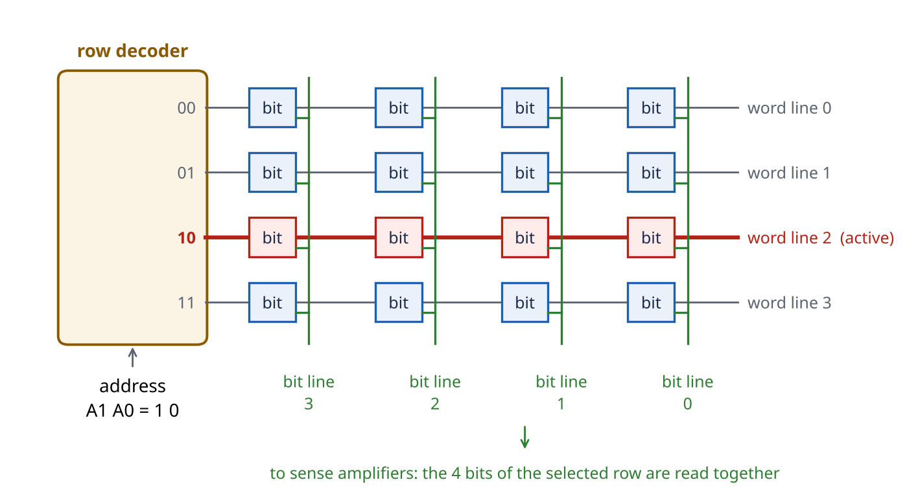
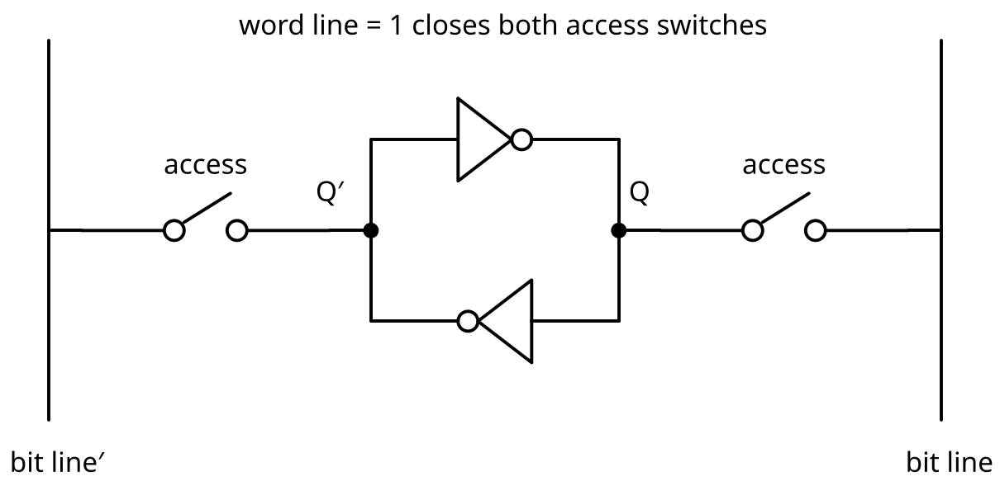
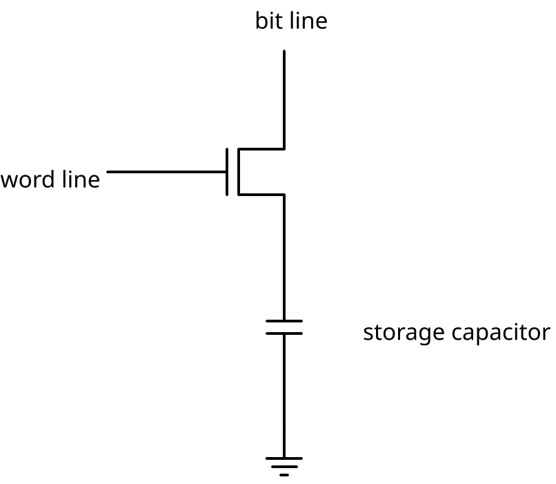
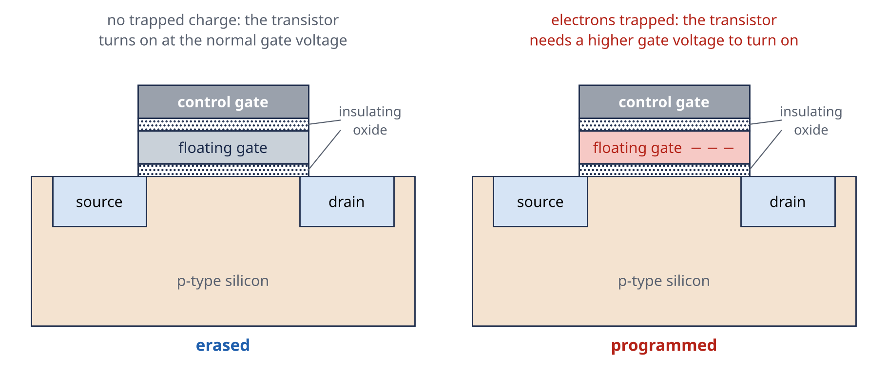

ref: 01.04
title: Remembering: Latches, Registers and Memory
chapter: Chapter 01 — What a Computer Physically Is
part: Part I — The Machine Beneath C
builds: §01.02, §01.03
---
## The question

Every circuit we have built so far has the same weakness: it forgets. The adder of §01.03 produces 13 from 6 and 7, but the instant its inputs change, the 13 is gone. Combinational logic, as §01.02 put it, depends only on its *present* inputs.

Yet the simplest C program demands memory:

```c Listing 01.04-1  A variable that must be remembered
// counter.c
#include <stdint.h>

uint8_t count;

void tick(void) {
    count = count + 1;
}
```

Between one call of `tick` and the next, `count` must keep its value. Something in the machine must hold eight bits steady while the processor does other work, for a microsecond or for a year. So:

- How can a circuit made only of gates *remember* anything at all?
- How does the processor read `count`, add 1 to it, and put it back, without the result racing around and around the adder?
- Where, physically, does `count` live, and how does the chip find it among thousands of other bytes?
- Why does an Arduino lose its variables when you press reset, yet keep its program, and keep data stored in EEPROM even with the power off?

The answers rest on one idea that looks almost like a trick, and turns out to be the basis of every register, every byte of RAM and every bit your programs will ever store: **feedback**.

## The journey

### Feedback: a circuit that holds itself

Take two inverters and connect them in a ring: the output of the first drives the input of the second, and the output of the second drives the input of the first, as Figure 01.04-1 shows.

{w=5.5}

Suppose the point marked Q is 1. The lower inverter turns that 1 into 0 at Q′. The upper inverter turns that 0 back into 1 at Q, which is exactly what we supposed. The circuit *agrees with itself*: each inverter's output is precisely what keeps the other inverter's output where it is. Now suppose instead that Q is 0. Then Q′ is 1, which makes Q 0 again. That too is self-consistent.

So this little loop has **two stable states**, Q = 1 and Q = 0, and it will stay in whichever one it is in for as long as power is supplied. A circuit with two stable states is called **bistable**. It is the physical form of a stored bit.

Recall from §01.02 why it is so stable. Each inverter has high gain in its middle range and pushes its output firmly toward one extreme. If noise nudges Q slightly downward, the lower inverter barely notices, and the upper inverter restores Q to full strength. The restoring property that made long chains of gates reliable now makes a loop of gates *hold* its value.

:::hood
There is in principle a third, balanced condition, with both Q and Q′ sitting exactly in the middle, halfway between 0 and 1. It is like a pencil balanced on its point: possible in theory, but the smallest disturbance tips it one way or the other, and the loop's gain makes it tip quickly. A loop that is caught near this balance point for a moment before falling is said to be **metastable**. It matters in practice, as we shall see when we come to flip-flops.
:::

### The SR latch: memory you can set

A loop that holds a bit is not yet useful: we need a way to *put* a value into it. Replace the two inverters with two NOR gates, and use each gate's second input as a control, as in Figure 01.04-2.

{w=11}

Here Q′ (read "Q prime") names the lower gate's output, which should always be the opposite of Q; the programs below, which print plain text, write it as Q'. Recall that a NOR gate outputs 1 only when both its inputs are 0. Reason through each case:

- **S = 0, R = 0.** A NOR gate with one input at 0 behaves exactly like an inverter on its other input. So the two gates form the loop of Figure 01.04-1, and the latch **holds** whatever it held before.
- **S = 1, R = 0 (set).** The lower gate has an input of 1, so Q′ is forced to 0. The upper gate then sees 0 and 0, so Q becomes 1. When S returns to 0, the loop holds Q = 1.
- **S = 0, R = 1 (reset).** By the mirror-image argument, Q is forced to 0 and Q′ to 1, and the loop holds that after R returns to 0.
- **S = 1, R = 1.** Both gates have an input of 1, so both outputs are 0. Q and Q′ are no longer opposites, which breaks the very meaning of the circuit. This combination is called **forbidden**, for a reason that becomes clear when it is released.

This circuit, which you *set* with S and *reset* with R and which otherwise remembers, is the **SR latch**. It is the first circuit in this book whose output depends on its history as well as its present inputs: the first piece of **sequential logic**.

Rather than trust this reasoning, let us watch it happen. The program below models the two NOR gates of Figure 01.04-2. At each step, *both* gates compute their new outputs from the old ones at the same moment, which is how two real gates with equal delays behave. It applies a sequence of inputs and reports how many steps the latch takes to settle after each change.

```c Listing 01.04-2  Simulating the SR latch
// sr_latch.c
// Two NOR gates wired in a loop: a circuit that remembers.
#include <stdio.h>

int q = 0;                      // output of the upper NOR gate
int qbar = 1;                   // output of the lower NOR gate

int nor(int a, int b) {
    return !(a || b);
}

// Let both gates respond to the inputs S and R. Each step, both gates
// compute their new outputs from the old ones at the same moment.
// Returns the number of steps taken to settle, or -1 if it never settles.
int settle(int s, int r) {
    for (int step = 0; step < 10; ++step) {
        int new_q = nor(r, qbar);
        int new_qbar = nor(s, q);
        if (new_q == q && new_qbar == qbar) {
            return step;
        }
        q = new_q;
        qbar = new_qbar;
    }
    return -1;
}

int main(void) {
    const int s_in[] = {0, 1, 0, 0, 1, 0, 1, 0};
    const int r_in[] = {0, 0, 0, 1, 0, 0, 1, 0};
    const char *what[] = {"start", "set", "hold", "reset",
                          "set", "hold", "both 1", "release"};
    printf("  event    S R | Q Q' | steps to settle\n");
    for (int k = 0; k < 8; ++k) {
        int steps = settle(s_in[k], r_in[k]);
        printf("  %-8s %d %d | %d %d  | ",
               what[k], s_in[k], r_in[k], q, qbar);
        if (steps >= 0) {
            printf("%d\n", steps);
        } else {
            printf("never settles\n");
        }
    }
}
```

Lines 5 and 6 hold the two gates' outputs; they are the latch's memory. Lines 17 and 18 are the two NOR gates of Figure 01.04-2: Q is the NOR of R and Q′, and Q′ is the NOR of S and Q. Both new values are computed before either is stored (lines 22 and 23), so neither gate gets ahead of the other. The loop stops as soon as nothing changes, or gives up after ten steps.

```terminal
$ gcc -std=c23 -Wall -Wextra -pedantic sr_latch.c -o sr_latch
$ ./sr_latch
```

```output
  event    S R | Q Q' | steps to settle
  start    0 0 | 0 1  | 0
  set      1 0 | 1 0  | 2
  hold     0 0 | 1 0  | 0
  reset    0 1 | 0 1  | 2
  set      1 0 | 1 0  | 2
  hold     0 0 | 1 0  | 0
  both 1   1 1 | 0 0  | 1
  release  0 0 | 0 0  | never settles
```

Read it line by line. Setting and resetting each take two steps: first one gate changes, then the other. In the two "hold" lines, with both inputs back at 0, the latch keeps the value it was given: that is memory. With both inputs at 1, both outputs fall to 0. And when that forbidden condition is released, the simulated latch **never settles**: both gates see 0 and 0, both switch to 1, then both see 1 and switch to 0, and so on forever, because neither is faster than the other. (The Q and Q′ printed on that line are simply where the simulation stopped after its ten steps; with a different limit they would differ.)

A real latch does not oscillate forever, because no two real gates are perfectly identical. One is a few picoseconds faster, wins the race, and decides the outcome. But *which* one wins depends on manufacturing variation and temperature, not on anything the designer controls. That unpredictability is why S = R = 1 is forbidden. Experiment 01.04-2 lets you decide the race each way and see the result.

### The D latch: one input, no forbidden state

The forbidden combination is a nuisance, and in practice we rarely want to set and reset separately. What we usually want is simpler: *store this bit*. So designers put a little logic in front of the SR latch, giving it two inputs instead:

- **D** (*data*): the bit to be stored;
- **E** (*enable*): when 1, the latch copies D; when 0, it holds.

Internally, S = D · E and R = D′ · E. When E = 1, D = 1 sets the latch and D = 0 resets it; when E = 0, both S and R are 0, and it holds. S and R can never both be 1, so the forbidden state is impossible. This is the **D latch**.

While E = 1 a D latch is said to be **transparent**: its output simply follows its input, as if it were a wire. When E falls to 0, it *closes*, and keeps whatever value D had at that moment.

Transparency sounds harmless, but it is a serious problem in the one place we most need memory. Think again about `count = count + 1`. In hardware this is a loop: a storage element holds `count`, its output feeds an adder, and the adder's output must go back into the storage element. If the storage element is a transparent latch, then while E = 1 the new value flows straight through the latch, back into the adder, and is incremented again, and again, as fast as the adder can work, for as long as E stays 1. Instead of adding 1, the circuit adds an unpredictable number that depends on how long E was high. We need a storage element that takes in exactly one new value per step, and then refuses to listen until the next step.

### The clock and the D flip-flop

The solution is to make the storage element respond not to a *level* but to an *instant*: the moment when a control signal changes from 0 to 1.

That control signal is the **clock**: a signal that rises and falls at a steady rate, millions or billions of times a second. On the Arduino Uno it comes from a 16 MHz ceramic resonator, a cheaper cousin of the quartz crystal; in your laptop, from an on-chip circuit that multiplies the frequency of a slower crystal many times over. Each change from 0 to 1 is a **rising edge**, and the time from one rising edge to the next is the **clock period**.

A **D flip-flop** captures its input D at the rising edge of the clock, and holds it until the next rising edge, ignoring D completely in between. One common way to build it uses two D latches in a row, called *master* and *slave*, enabled by opposite phases of the clock. While the clock is 0, the master is transparent and follows D, while the slave holds. When the clock rises, the master closes, freezing the value D had at that instant, and the slave opens and passes the frozen value to the output. At no moment is there a transparent path from D straight through to Q.

Figure 01.04-3 shows the difference in behavior. The D input carries a short pulse while the clock is high, then rises again while the clock is low.

{w=16}

Follow each output. The latch, transparent while the clock is high, passes the short pulse straight through to its output. While the clock is low, it holds, so it ignores D's second rise until the clock goes high again. The flip-flop changes only at the rising edges. At the first edge D is 0, so Q stays 0; at the second edge D is 1, so Q becomes 1 and stays there. The pulse in between never reaches its output at all.

With flip-flops, the counter loop works perfectly, as Figure 01.04-4 shows. Between rising edges, the adder has the whole clock period to compute `count + 1` from the register's steady output. At the rising edge, the register captures that result, *once*. The new value then flows into the adder, which begins computing the next result, but the register will not look at it until the next edge.

{w=13}

This arrangement, **storage elements updated together on a clock edge, with combinational logic settling in between**, is called **synchronous design**, and almost every processor ever built works this way. It also explains why §01.03 worried about how long the carry takes to ripple. The clock period must be longer than the slowest path through the combinational logic, plus the flip-flops' own small delays (the time from the clock edge to a new output, and the setup time described below), so that every result has settled before the next edge captures it. The longest such path, the **critical path**, sets the fastest clock a design can use.

:::precise
A flip-flop has timing rules of its own. Its input must be stable for a short **setup time** before the clock edge and a short **hold time** after it. If D changes inside that window, the flip-flop may be caught near the balance point described in the earlier *Under the hood* box, and become **metastable**: its output may hover between 0 and 1 for an unpredictable time before falling to one side. Within a synchronous design, a long enough clock period guarantees the setup time, and careful design of the shortest paths guarantees the hold time, which no choice of clock period can fix. But signals from the outside world, a button pressed by a person or a message arriving from another chip, have no respect for your clock. Such signals are therefore passed through two or more flip-flops in a row, a **synchronizer**, which makes the chance of metastability reaching the rest of the circuit vanishingly small, though never exactly zero. Chapter 37 (§37.03) meets the software counterpart of this problem: interrupts that arrive at moments the program does not choose.
:::

### Registers: rows of flip-flops

One flip-flop stores one bit. Place eight side by side, with a common clock, and you have a **register**: a group of flip-flops that store a multi-bit value together and update together. To let a register keep its value on some clock edges and load a new one on others, a multiplexer (§01.03) is placed in front of each flip-flop. It chooses between the new value and the register's own present output, under a *load* signal.

Registers are the fastest storage in a computer: their outputs are always present, ready to feed the ALU, and they can be written on every clock edge. They are also the most expensive storage per bit, because a flip-flop needs many transistors, typically twenty or more in CMOS. A processor therefore has only a few that a program can name.

- The ATmega328P has **32 general-purpose registers**, named r0 to r31, each 8 bits wide.
- An x86-64 processor has **16 general-purpose registers**, each 64 bits wide, besides many special ones.
- Every processor also has special registers with fixed purposes, such as the AVR's status register SREG from §01.03, and the program counter of §01.05.

When the compiler turned `a + b` into `add r24,r22` in §01.03, the names `r24` and `r22` were registers: the values to be added had already been placed in them.

### Memory: many cells, one address

A program needs far more storage than a few registers. The ATmega328P provides 2048 bytes of RAM for variables; your laptop, many billions. Building all of that from flip-flops would be impossibly large, so main memory is built differently: as a grid of very small cells that share wiring, as in Figure 01.04-5.

{w=15}

The cells are arranged in **rows** and **columns**. All the cells in one row share a wire called a **word line**; when that word line is 1, every cell in the row is connected to the wires that run down the columns, the **bit lines**. To read a row, the memory activates its word line, and each cell in the row places its bit on its bit line, where a *sense amplifier* detects it. To write, the memory drives the bit lines with the new values while the word line is active.

How does the memory know which word line to activate? It is given an **address**: a number, presented as a pattern of bits on a set of wires. A circuit called a **decoder** turns those *n* address bits into 2<sup>*n*</sup> separate lines, of which exactly one is 1. The decoder is ordinary combinational logic. Line number *k* is simply an AND of the address bits, with each bit inverted wherever *k* has a 0 in that position. For example, with two address bits A1 and A0, line 2 (binary 10) is A1 · A0′: it is 1 only when A1 = 1 and A0 = 0. In Figure 01.04-5 the address 10 has activated word line 2, and the four bits of that row flow down the bit lines together.

This is the physical meaning of a memory address. An address is not a location written somewhere. It is a pattern of voltages on wires, which a decoder turns into one active line, which connects one row of cells to the outside. The ATmega328P's 2048 bytes need 11 address bits inside the SRAM array, since 2<sup>11</sup> = 2048 (§27.03 shows how the chip places those bytes at data addresses 0x0100 to 0x08FF). Your laptop's pointers are 64-bit numbers, as wide as its word (§01.01), although fewer of those bits actually reach the memory chips. When you meet pointers in Chapter 24, a pointer on the ATmega328P will be exactly such a number, ready to be placed on the address wires; on your laptop, the processor first translates it (§27.02).

### How a cell holds a bit

The grid of Figure 01.04-5 can be built with very different kinds of cell, each a different physical answer to the question of §01.01: how to hold a state that can be set, held and read. Three kinds matter to this book.

**SRAM: a loop of inverters.** A *static* RAM cell is the inverter loop of Figure 01.04-1, with two transistors acting as switches that connect it to a pair of bit lines when its word line is active (Figure 01.04-6). Each inverter needs two transistors, so the cell needs six in all. It holds its bit for as long as power is supplied, with no attention, which is what *static* means. It is fast, but it takes more silicon than the alternatives. The ATmega328P's 2 KB of data memory is SRAM, and so are the fast caches inside your laptop's processor.

{w=13}

**DRAM: charge in a tiny bucket.** A *dynamic* RAM cell is just one transistor and one capacitor, as in Figure 01.04-7. A **capacitor** is a component that stores electric charge, like a tiny bucket that holds water. A charged capacitor represents 1, an empty one 0. When the word line is active, the transistor connects the capacitor to the bit line to be read or written. With only two components, DRAM cells are tiny, which is why your laptop's main memory, many gigabytes of it, is DRAM.

{w=7}

The price is that the bucket leaks. The weakest cells can lose their charge in tens of milliseconds, and reading a cell disturbs it as well. So DRAM must be **refreshed**: every row is read and rewritten, over and over, automatically, by circuitry the program never sees. DDR4 memory, for example, must refresh every row at least once every 64 milliseconds, or every 32 milliseconds when the chip is hotter than 85 °C. This constant upkeep is what the word *dynamic* refers to.

**Flash and EEPROM: electrons trapped behind insulation.** Both SRAM and DRAM lose everything when the power is removed. Programs must survive power-off, so they are kept in **non-volatile** memory: memory that keeps its contents without power. The ATmega328P has two kinds, both built on the same idea, shown in Figure 01.04-8. A transistor is given an extra gate, the **floating gate**, sealed completely inside insulating oxide, between the ordinary (control) gate and the channel. Electrons can be forced onto the floating gate, through the insulator, by applying a high voltage. Once there, they have no path to leave, and they stay for years. Their negative charge opposes the control gate's attempt to form a channel, so the transistor now needs a higher gate voltage to turn on. Reading the cell means testing whether it turns on at the normal voltage: the trapped charge has become a readable bit.

{w=16}

Forcing electrons through an insulator is slow and gradually damages it, which gives non-volatile memory two characteristic limits: writing is far slower than reading, and every cell survives only a limited number of write–erase cycles. In **flash** memory, cells are erased in large blocks at once, which makes it dense and cheap. **EEPROM** (*electrically erasable programmable read-only memory*) can erase and rewrite individual bytes, at the cost of more silicon per bit.

Table: Table 01.04-1  The ATmega328P's three memories
<!-- widths: 18,14,34,34 -->
| Memory | Size | Holds | Survives power-off? Endurance |
|---|---|---|---|
| Flash | 32 KB | the program (and constant data) | yes; rated for 10,000 write–erase cycles |
| SRAM | 2 KB | variables, the stack | no; unlimited writes |
| EEPROM | 1 KB | data the program chooses to keep | yes; rated for 100,000 write–erase cycles |

The datasheet rates the non-volatile contents to be kept for 20 years at 85 °C, or 100 years at 25 °C. Table 01.04-1 answers the questions that opened this section. When you upload a sketch, it is written into flash, so it survives reset and power-off. When it runs, its variables live in SRAM. Pressing reset does not wipe SRAM, but the program's start-up code gives every variable its initial value again, and SRAM loses everything when the power goes. Anything that must outlive both has to be written deliberately to EEPROM, as the hands-on project at the end of this section does.

:::metal
The Arduino IDE reports exactly these memories each time it compiles a sketch: "Sketch uses … bytes of program storage space" is flash, and "Global variables use … bytes of dynamic memory" is SRAM. On the Uno, the flash maximum it reports is 32,256 bytes rather than 32,768, because 512 bytes at the top of flash are occupied by the *bootloader*, the small program that receives new sketches over the chip's serial line, which a second chip on the Uno connects to USB. Inside the chip, the ATmega328P places its 32 registers, then its I/O registers, then its 2048 bytes of SRAM, in a single sequence of data addresses: the registers r0 to r31 really do have addresses 0x00 to 0x1F, and SRAM begins at 0x0100. §27.03 returns to this map.
:::

### Variables are cells: the C connection

Return now to Listing 01.04-1. Ask the AVR compiler what it makes of `count = count + 1` (`avr-gcc -mmcu=atmega328p -Os -S counter.c`), and the body of `tick` is:

```text
tick:
    lds  r24,count
    subi r24,lo8(-(1))
    sts  count,r24
    ret
```

Each line now has a physical meaning. `lds` ("load direct from data space") places the address of `count` on the SRAM's address wires, and copies the selected byte into register r24. `subi` ("subtract immediate") computes r24 − (−1), which is r24 + 1. The AVR has no general "add immediate" instruction for a single 8-bit register: it has `inc`, which adds exactly 1, and `adiw`, which adds a small constant to certain *pairs* of registers, as Experiment 01.04-4 reveals. Here the compiler chose to subtract minus one instead, a choice that §01.03's adder–subtractor makes free of cost. Finally, `sts` ("store direct to data space") writes register r24 back into the SRAM cell. Load, compute, store: a variable lives in memory, but arithmetic happens only in registers.

The author's GCC 14.2 (`-O2`) produced a single instruction for the same line on x86-64:

```text
tick:
    addb $1, count(%rip)
    ret
```

x86-64 processors allow an instruction to read memory, add and write back in one step. But inside the processor the same three stages still happen, one after another: one instruction in the program does not mean one indivisible action in the hardware. Chapter 38 shows why that distinction matters greatly once two processor cores share the same variable.

:::orbit
§01.01 showed how a passing particle can flip a stored bit, a single-event upset. Memory is where that danger concentrates, because a memory chip holds an enormous number of small cells, each storing very little charge. Spacecraft protect it in two complementary ways. First, every memory word is stored together with extra **check bits** computed from it, so that the memory hardware can detect a flipped bit and correct it when the word is read; such memory is called **EDAC** memory (*error detection and correction*). §13.05 begins the mathematics of error detection, and §35.03 returns to EDAC and scrubbing. A common code corrects any single flipped bit in a word and detects, but cannot correct, two. Second, because upsets accumulate over time and two flips in one word would defeat the code, flight software or hardware **scrubs** the memory: it reads every word at regular intervals and writes back the corrected value, which removes single errors before a second one can arrive. Some spacecraft also use non-volatile memories that store bits magnetically or in ferroelectric materials rather than as charge, which makes them far less sensitive to such upsets.
:::

## Terms introduced

- **Feedback**: connecting a circuit's output back to its own input.
- **Bistable**: having two stable states; the physical basis of a stored bit.
- **Metastable**: caught near the balance point between two stable states, so that the eventual outcome and its timing are unpredictable.
- **SR latch**: two cross-coupled gates with set and reset inputs; S = R = 1 is forbidden.
- **Sequential logic**: logic whose outputs depend on its history as well as its present inputs.
- **D latch**: a latch with a data input D and an enable E; transparent while E = 1, holding while E = 0.
- **Transparent**: passing the input straight through to the output, as a latch does while enabled.
- **Clock**: a signal that rises and falls at a steady rate, timing a synchronous circuit.
- **Rising edge / clock period**: the change from 0 to 1 / the time from one rising edge to the next.
- **D flip-flop**: a storage element that captures D at the rising clock edge and ignores it otherwise.
- **Master and slave**: the two D latches of a flip-flop, open on opposite phases of the clock.
- **Setup and hold time**: how long before and after the clock edge a flip-flop's input must be stable.
- **Synchronizer**: two or more flip-flops in series that tame signals arriving at arbitrary times.
- **Synchronous design**: storage updated together on clock edges, with combinational logic settling in between.
- **Critical path**: the slowest path through a circuit's combinational logic; it limits the clock speed.
- **Register**: a group of flip-flops storing a multi-bit value, updated together.
- **Counter**: a register whose next value is its present value plus one.
- **Word line / bit line**: the wire that selects a row of memory cells / a wire that carries one bit of the selected row.
- **Sense amplifier**: a circuit that detects the small signal a memory cell places on its bit line.
- **Address**: a number, presented as bits on wires, that selects a location in memory.
- **Decoder**: a circuit that turns *n* address bits into 2<sup>*n*</sup> lines, exactly one of which is 1.
- **SRAM**: static RAM; six-transistor cells holding bits in inverter loops; fast, volatile.
- **DRAM**: dynamic RAM; one transistor and one capacitor per cell; dense, volatile, needs refresh.
- **Capacitor**: a component that stores electric charge.
- **Refresh**: periodically reading and rewriting DRAM cells before their charge leaks away.
- **Volatile / non-volatile**: losing / keeping stored contents when power is removed.
- **Floating gate**: an insulated gate on which trapped electrons store a bit in flash and EEPROM.
- **Flash**: non-volatile memory erased in blocks; holds the ATmega328P's program.
- **EEPROM**: non-volatile memory erasable byte by byte.
- **Endurance**: the number of write–erase cycles a non-volatile cell is rated to survive.
- **Bootloader**: a small resident program that loads new programs into flash.
- **EDAC memory**: memory that stores check bits with each word, to detect and correct errors.
- **Scrubbing**: periodically reading all memory and writing back corrected values, before errors accumulate.

## Self-check

1. Explain, without using the word "memory", why the two-inverter loop stays in whichever state it is in.
2. In an SR latch made of NOR gates, why does a NOR gate with one input held at 0 behave like an inverter? Why does this make S = R = 0 the "hold" condition?
3. Explain why S = R = 1 is forbidden. What happens, in a real circuit, when both inputs return to 0 together?
4. How does the D latch make the forbidden state impossible?
5. Why would a transparent latch fail as the register in a counter that computes `count = count + 1`?
6. What does a D flip-flop do at the rising edge of the clock, and what does it do the rest of the time?
7. What is the critical path of a circuit, and why does it limit the clock speed? Connect your answer to the ripple-carry adder of §01.03.
8. How many address bits are needed for 32 KB of flash? For 1 KB of EEPROM? Explain how a decoder uses them.
9. Why does DRAM need refreshing, and why does SRAM not?
10. Why does an Arduino sketch survive a power cut, while its variables do not?
11. The AVR compiler implements `count + 1` as `subi r24,lo8(-(1))`. Explain why subtracting −1 adds 1, using §01.03's adder–subtractor.
12. Why is memory scrubbing needed in addition to EDAC?

## Experiments

**Experiment 01.04-1. Watching the latch.** Type Listing 01.04-2, compile it and run it. Before running, predict the Q and Q′ columns for every line. Then add a ninth event to the arrays: "set" after "release", with S = 1 and R = 0, and change the 8 in the `for` loop to 9. Predict whether the latch recovers from its oscillation, and why, then run it.

**Experiment 01.04-2. Who wins the race?** When S = R = 1 is released, the outcome depends on which gate reacts first. This program lets each gate go first in turn:

```c Listing 01.04-3  The race after the forbidden state
// sr_order.c
// Release the latch from S = R = 1, but let one gate react before the other.
#include <stdio.h>

int nor(int a, int b) {
    return !(a || b);
}

int main(void) {
    // Upper gate faster: it computes Q first, then the lower gate uses it.
    int q = 0, qbar = 0;
    q = nor(0, qbar);
    qbar = nor(0, q);
    printf("upper gate first: Q = %d, Q' = %d\n", q, qbar);

    // Lower gate faster: it computes Q' first.
    q = 0;
    qbar = 0;
    qbar = nor(0, q);
    q = nor(0, qbar);
    printf("lower gate first: Q = %d, Q' = %d\n", q, qbar);
}
```

Predict both lines before running it. What does the result tell you about relying on the state of a latch after S = R = 1?

**Experiment 01.04-3. A decoder.** The program below builds a 3-to-8 decoder: for each of the eight addresses, it prints the eight output lines, each computed as an AND of the address bits or their inverses, as described in the journey.

```c Listing 01.04-4  A 3-to-8 decoder
// decoder.c
// A 3-to-8 decoder built from AND and NOT: exactly one output is 1.
#include <stdio.h>

int main(void) {
    printf("A2 A1 A0 | outputs 7..0\n");
    for (int addr = 0; addr < 8; ++addr) {
        int a2 = (addr >> 2) & 1;
        int a1 = (addr >> 1) & 1;
        int a0 = addr & 1;
        printf(" %d  %d  %d | ", a2, a1, a0);
        for (int line = 7; line >= 0; --line) {
            int want2 = (line >> 2) & 1;    // the address this line wants
            int want1 = (line >> 1) & 1;
            int want0 = line & 1;
            int t2 = want2 ? a2 : !a2;      // the input itself, or its NOT
            int t1 = want1 ? a1 : !a1;
            int t0 = want0 ? a0 : !a0;
            printf("%d", t2 && t1 && t0);   // a three-input AND
        }
        printf("\n");
    }
}
```

Predict the shape of the output before you run it. Then write down, as a Boolean expression, the AND term for output line 5.

**Experiment 01.04-4. Two compilers, one variable.** Compile Listing 01.04-1 for both machines and compare the assembly:

```terminal
$ avr-gcc -mmcu=atmega328p -Os -S counter.c -o counter_avr.s
$ gcc -std=c23 -O2 -fcf-protection=none -S counter.c -o counter_x86.s
```

Find the instructions that load, add and store in each. (The option `-fcf-protection=none` stops GCC adding a security instruction, `endbr64`, at the start of each function, as §01.03 explained.) Then change `uint8_t` to `uint16_t` and predict how the AVR version changes before looking.

**Experiment 01.04-5. Counting the cost.** Suppose a flip-flop needs 24 transistors, an SRAM cell 6, and a DRAM cell 1 transistor and 1 capacitor. How many transistors would 2 KB of storage need in each technology? Explain from your answer why registers are few, SRAM is used for small fast memories, and DRAM for large ones.

## Hands-on (AVR / ESP32)

### A: a latch you can touch

The 74HC00 from the hands-on project of §01.02 contains four NAND gates, and two of them cross-coupled make a latch. A NAND latch behaves like the NOR latch of this section with its inputs inverted: its inputs, written S̄ and R̄ (the bar marks an input that acts when it is 0), are *active-low*, meaning that a 0 sets or resets it and both inputs rest at 1 to hold. Its forbidden state is S̄ = R̄ = 0, which forces both outputs to 1.

Wire, with the 74HC00 powered from the Uno's 5V and GND (pins 14 and 7), with its 100 nF capacitor, as before:

1. Uno pin **2** to chip pin 1 (S̄); Uno pin **3** to chip pin 4 (R̄).
2. Chip pin 3 (Q) to chip pin 5, and to Uno pin **4**.
3. Chip pin 6 (Q′) to chip pin 2, and to Uno pin **5**.
4. The unused inputs, pins 9, 10, 12 and 13, to GND.
5. A 10 kΩ resistor from chip pin 1 to 5V, and another from chip pin 4 to 5V. These *pull-up* resistors hold S̄ and R̄ at 1 while the Uno is starting, when its pins are not yet driving anything; without them the inputs would float (§01.02) and could set or reset the latch by accident.

Gate 1 (pins 1, 2 → 3) computes Q = NAND(S̄, Q′), and gate 2 (pins 4, 5 → 6) computes Q′ = NAND(R̄, Q): the cross-coupling of Figure 01.04-2, with NAND in place of NOR.

```c Listing 01.04-5  Setting, resetting and holding a real latch
// nand_latch.ino  (Arduino Uno + 74HC00)
const int PIN_SBAR = 2;   // to 74HC00 pin 1
const int PIN_RBAR = 3;   // to 74HC00 pin 4
const int PIN_Q    = 4;   // from 74HC00 pin 3
const int PIN_QBAR = 5;   // from 74HC00 pin 6

void report(const char *event) {
    delay(5);
    Serial.print(event);
    Serial.print("  Q = ");
    Serial.print(digitalRead(PIN_Q));
    Serial.print("  Q' = ");
    Serial.println(digitalRead(PIN_QBAR));
}

void pulse_low(int pin) {          // a brief 0, then back to the resting 1
    digitalWrite(pin, LOW);
    delay(5);
    digitalWrite(pin, HIGH);
}

void setup(void) {
    Serial.begin(9600);
    pinMode(PIN_Q, INPUT);
    pinMode(PIN_QBAR, INPUT);
    report("power-up      ");      // read before touching the inputs
    digitalWrite(PIN_SBAR, HIGH);  // HIGH first, so that the pins
    digitalWrite(PIN_RBAR, HIGH);  // never drive a 0 by accident
    pinMode(PIN_SBAR, OUTPUT);     // now drive the resting 1: hold
    pinMode(PIN_RBAR, OUTPUT);
    pulse_low(PIN_SBAR);
    report("after set     ");
    report("still holding ");
    pulse_low(PIN_RBAR);
    report("after reset   ");
    report("still holding ");
}

void loop(void) {
}
```

**Predict** the five lines, then upload and open the Serial Monitor at 9600 baud. The first line is the most interesting one. The sketch reads the latch before it touches the inputs, so after the power has just been connected, nobody has set the latch: which state did it fall into? Unplug and reconnect the USB cable several times, and record the power-up line each time. You are watching the race of Experiment 01.04-2, decided by your particular chip. Then press the reset button instead, and predict the power-up line before you look: the button restarts the Uno, but never removes power from the 74HC00. (The order of the two steps in `setup` matters: on the AVR, `pinMode(pin, OUTPUT)` makes a pin drive whatever value was last written to it, which after a reset is 0. Writing HIGH first means that the pins go from "held at 1 by the resistors" straight to "driven to 1", never passing through 0.)

### B: memory that survives the power cut

This sketch keeps two counters: one in an ordinary variable, which lives in SRAM, and one in the EEPROM, at address 0.

```c Listing 01.04-6  A boot counter in EEPROM
// boot_counter.ino  (Arduino Uno)
#include <EEPROM.h>

int ram_count = 0;                  // in SRAM: set to 0 at every start

void setup(void) {
    Serial.begin(9600);
    byte boots = EEPROM.read(0);    // in EEPROM: survives power-off
    boots = boots + 1;
    EEPROM.update(0, boots);        // writes only if the value changed
    ram_count = ram_count + 1;
    Serial.print("SRAM counter:   ");
    Serial.println(ram_count);
    Serial.print("EEPROM counter: ");
    Serial.println(boots);
}

void loop(void) {
}
```

Upload it, open the Serial Monitor, and then press reset a few times, and unplug and reconnect the board. **Predict** both numbers each time. Remember that the sketch also runs once right after uploading, and that opening the Serial Monitor resets the Uno: each of those is a start too.

Two things deserve thought. First, an EEPROM byte that has never been written reads as 255, because the erased state of the cell is all ones. So on a fresh board the first run computes 255 + 1, which in a `byte`, an 8-bit unsigned type, is 0: the modulo-256 behavior of §01.03, in your own program. Second, notice `EEPROM.update` rather than a plain write: it first reads the byte and writes only if the value differs, sparing the cell a write–erase cycle. (In this sketch the value always changes, so `update` always writes; it pays off when a value is often rewritten unchanged.) Each EEPROM write takes about 3.3 milliseconds, so a sketch that wrote the EEPROM on every pass of `loop()` would write about 300 times a second, and would pass the rated endurance of 100,000 cycles in about five and a half minutes. Never put an unconditional EEPROM write in `loop()`.

**On the ESP32.** The original ESP32 has no EEPROM. Its Arduino `EEPROM` library imitates one in a small region of the board's flash memory, and needs two extra calls: `EEPROM.begin(size)` to reserve the bytes before first use, and `EEPROM.commit()` to save changes to flash. Its variables, as on the Uno, live in on-chip SRAM. The author did not run an ESP32 version of this sketch.

## Answers

**Self-check 1.** Each inverter produces the input that makes the other inverter produce *its* input. If Q is 1, the lower inverter makes Q′ 0, and the upper inverter turns that 0 into Q = 1. The configuration reproduces itself, and the inverters' gain restores it if noise disturbs it.

**Self-check 2.** NOR(0, x) = NOT(0 OR x) = NOT x, so a NOR gate with one input at 0 is an inverter on its other input. With S = R = 0, both gates become inverters, and the latch becomes the two-inverter loop, which holds its state.

**Self-check 3.** With S = R = 1, both outputs are forced to 0, so Q and Q′ are no longer complements. When both inputs return to 0 together, both gates try to switch to 1 at once. In a real circuit one gate is slightly faster, and which one it is depends on manufacturing variation and temperature, not on the design, so the final state cannot be predicted, and the latch may linger near metastability before settling.

**Self-check 4.** The D latch derives S = D · E and R = D′ · E from a single data input. Since D and D′ can never both be 1, S and R can never both be 1.

**Self-check 5.** While enabled, a transparent latch passes the adder's output straight back to the adder's input, so the value is incremented repeatedly, as fast as the adder can work, for the whole time the latch is enabled. The number of increments depends on timing, not on the program.

**Self-check 6.** At the rising edge it captures the value of D and presents it at Q. At all other times it ignores D and holds Q steady.

**Self-check 7.** The critical path is the slowest route through the combinational logic between flip-flops. The clock period must be longer than it (plus the flip-flops' own small delays), or a flip-flop would capture a result that has not finished settling. In a ripple-carry adder, the carry chain through every column is such a path, which is why fast processors need faster adders to run faster clocks.

**Self-check 8.** 32 KB = 32,768 = 2<sup>15</sup> bytes, so 15 address bits (the AVR actually fetches its program as 16-bit words, so its program counter needs only 14 bits; §01.05 meets the program counter); 1 KB = 1024 = 2<sup>10</sup>, so 10. The decoder turns the address bits into 2<sup>15</sup> (or 2<sup>10</sup>) selection lines, exactly one of which is active, selecting one location. (In a real chip the decoding is split between rows and columns, so that a single decoder does not need tens of thousands of outputs.)

**Self-check 9.** A DRAM cell stores its bit as charge on a capacitor, which can leak away within tens of milliseconds and is disturbed by reading, so it must be read and rewritten regularly. An SRAM cell holds its bit in an active inverter loop that continuously restores itself while power is applied.

**Self-check 10.** The sketch is stored in flash, which keeps its contents without power, as electrons trapped on floating gates. The variables live in SRAM, whose inverter loops lose their state when the power is removed.

**Self-check 11.** §01.03 showed that the ALU subtracts B by adding NOT B + 1, which is the two's-complement negation of B. Subtracting −1 therefore adds the negation of −1, which is +1. The AVR has `subi` (subtract immediate) but no general add-immediate for a single 8-bit register (only `inc`, which adds exactly 1), so the compiler expresses r24 + 1 as r24 − (−1).

**Self-check 12.** The common code described can correct only one flipped bit per word, and reading a word through EDAC corrects only the copy delivered to the processor, not the cell. Upsets accumulate over time, so a word left alone for long enough might suffer a second flip and become uncorrectable. Scrubbing reads every word regularly and writes back the corrected value, removing single errors while they are still correctable.

**Experiment 01.04-1.** The output is as shown in the journey. The added "set" line recovers the latch: with S = 1 and R = 0, the lower gate's output is forced to 0 whatever Q is, which breaks the oscillation, and the latch settles to Q = 1, Q′ = 0. The author's run of the extended program printed `set      1 0 | 1 0  | 1` as its ninth line: the latch settled in a single step, because the oscillation had stopped, after its ten steps, with both outputs at 0, and from there only Q needed to change. With an odd step limit the oscillation would have stopped at 1 1, and the recovery would take two steps; either way, the latch recovers.

**Experiment 01.04-2.** The author's run printed:

```output
upper gate first: Q = 1, Q' = 0
lower gate first: Q = 0, Q' = 1
```

The final state is decided entirely by which gate happened to react first. A design that depended on the state after S = R = 1 would behave differently from chip to chip, and even from day to day. That is why the combination is forbidden, and why the D latch removes it.

**Experiment 01.04-3.** The author's run printed a diagonal of single 1s, one per address:

```output
A2 A1 A0 | outputs 7..0
 0  0  0 | 00000001
 0  0  1 | 00000010
 0  1  0 | 00000100
 0  1  1 | 00001000
 1  0  0 | 00010000
 1  0  1 | 00100000
 1  1  0 | 01000000
 1  1  1 | 10000000
```

Line 5 is binary 101, so its term is A2 · A1′ · A0.

**Experiment 01.04-4.** The AVR version is `lds`, `subi`, `sts`, as shown in the journey; the x86-64 version is a single `addb $1, count(%rip)` (preceded by `endbr64` if you leave out `-fcf-protection=none`). With `uint16_t`, the author's avr-gcc 7.3.0 produced:

```text
tick:
    lds  r24,count
    lds  r25,count+1
    adiw r24,1
    sts  count+1,r25
    sts  count,r24
    ret
```

It loads the two bytes of `count` into the register pair r25:r24, adds 1 with `adiw` ("add immediate to word"), an instruction that adds a constant from 0 to 63 to one of four particular register pairs, carrying from the low byte into the high byte inside the instruction, and stores both bytes back. So the AVR does have a general add-constant instruction after all, but only for these 16-bit pairs. Your newer avr-gcc may choose differently; record what you see.

**Experiment 01.04-5.** 2 KB = 16,384 bits. Flip-flops: 16,384 × 24 = 393,216 transistors. SRAM: 16,384 × 6 = 98,304 transistors. DRAM: 16,384 transistors and 16,384 capacitors. The ratios, roughly 24 : 6 : 1, explain the memory hierarchy of almost every computer: the fastest storage is the most expensive per bit, so it is used most sparingly.

**Hands-on A.** After "set", Q = 1 and Q′ = 0, and the next "still holding" line is the same; after "reset", Q = 0 and Q′ = 1, held likewise. After the power has just been connected, the power-up line is not determined by the design: it depends on which of your chip's two gates wins the race as the supply rises, and you may find that your chip usually, but not always, falls the same way. After the reset button, the power-up line shows Q = 0 and Q′ = 1: the latch kept the state that the previous run's final reset left it in, because its power never went away. That is memory, seen directly.

**Hands-on B.** Each run, the SRAM counter shows 1, because `ram_count` is set to 0 every time the program starts. The EEPROM counter increases by one at every start, whether by reset, by power-up or by opening the Serial Monitor, and continues where it left off after the power is restored. On a board whose EEPROM byte 0 was never written, the first run, right after uploading, computes 0 (255 + 1 in eight bits); since opening the Serial Monitor starts the sketch again, the first value you actually see is probably 1. On a board where some earlier sketch used that byte, it starts from whatever was stored there. (The sketch was not run by the author on a real Uno.)

## Sources and verification

- **Toolchains.** Listings 01.04-2, 01.04-3 and 01.04-4 were compiled with GCC 14.2.0 (`-std=c23 -Wall -Wextra -pedantic`) on x86-64 Ubuntu Linux 24.04, and all their outputs are from those runs. The extended Experiment 01.04-1 was also run by the author. The assembly of Listing 01.04-1 was produced with avr-gcc 7.3.0 (`-mmcu=atmega328p -Os -S`) and GCC 14.2.0 (`-O2 -fcf-protection=none -S`), with assembler directives removed and spacing normalized.
- **Not run by the author.** Listings 01.04-5 and 01.04-6 need a physical Uno and, for the first, a 74HC00; they were not run, and their results are yours to record. The Answers describe what the circuits' logic and the datasheet predict.
- **ATmega328P.** Microchip, *ATmega328P Datasheet*: 32 KB flash, 2 KB SRAM, 1 KB EEPROM; write–erase endurance of 10,000 cycles for flash and 100,000 for EEPROM; EEPROM programming time of about 3.3 ms (3.4 ms for an erase and write in one operation); data retention of 20 years at 85 °C and 100 years at 25 °C; 32 general-purpose working registers; the data memory map with registers at 0x00–0x1F and internal SRAM from 0x0100. The 32,256-byte sketch limit is reported by the Arduino IDE for the Uno and reflects its 512-byte bootloader. The Uno R3 clocks its ATmega328P from a 16 MHz ceramic resonator, and resets it each time software opens a connection over USB. The AVR Instruction Set Manual: `inc`, `subi` and `adiw`.
- **DRAM refresh.** The JEDEC DDR4 standard (JESD79-4) specifies the refresh window; a typical DDR4 datasheet, such as Micron's 8 Gb DDR4 SDRAM, gives "64ms, 8192-cycle refresh up to 85°C" and 32 ms above 85 °C. Newer DDR5 memory specifies a shorter window of 32 ms.
- **General.** The SR latch, D latch, master–slave flip-flop, metastability and synchronizers, six-transistor SRAM, one-transistor DRAM and floating-gate memory are described in standard textbooks of digital design and semiconductor memory.
- **Inference and approximations in this section.** "Twenty or more transistors" for a CMOS flip-flop, and the figure of 24 in Experiment 01.04-5, are typical values, not properties of a particular chip. The figure of five and a half minutes for EEPROM writes in `loop()` is the author's arithmetic from the 100,000-cycle rating and the 3.3 ms write time; the rating is a guaranteed minimum, and a real cell usually lasts longer. The power-up behavior of Hands-on A was reasoned from the Arduino pin functions and the latch's logic, and checked with a small model on the author's computer, not on a real board. The remarks on magnetic and ferroelectric memories in spacecraft are general, not a description of any particular mission.
