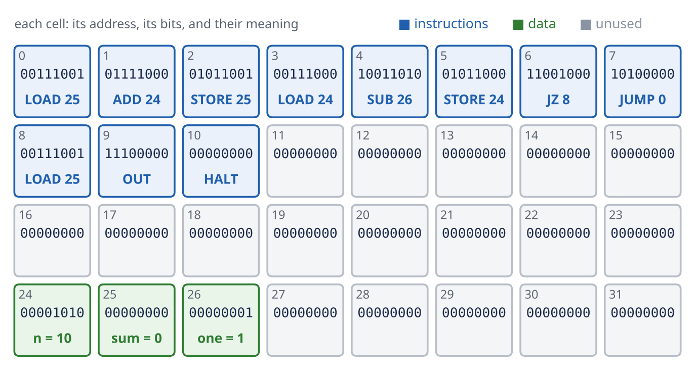
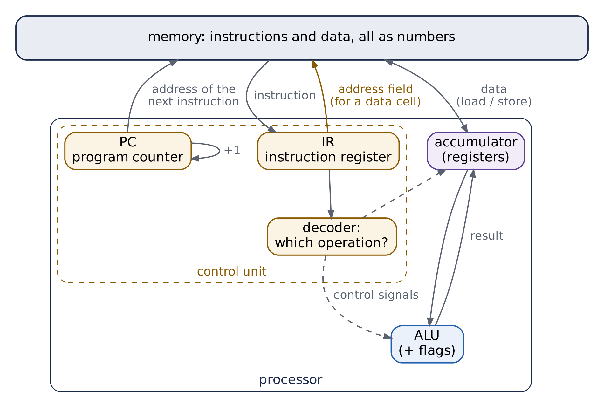
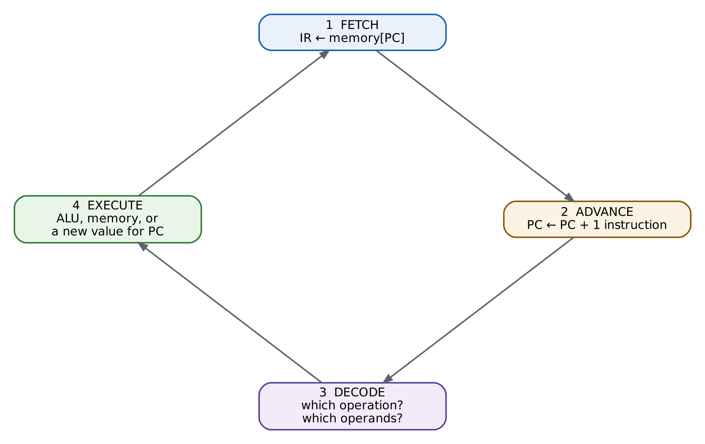
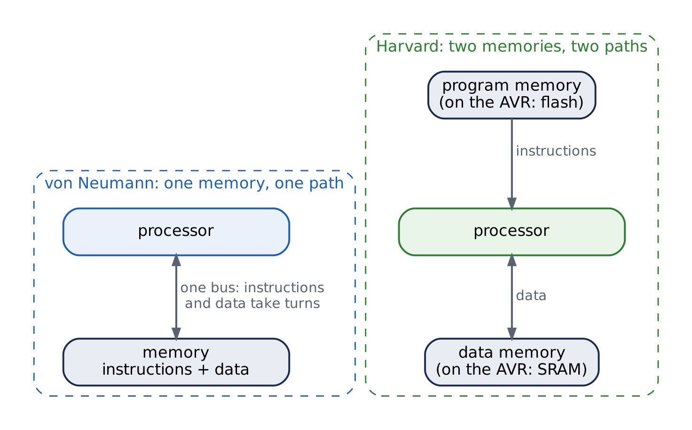

ref: 01.05
title: The Stored-Program Machine
chapter: Chapter 01 — What a Computer Physically Is
part: Part I — The Machine Beneath C
builds: §01.02, §01.03, §01.04
---
## The question

By the end of §01.04 we owned every part a computer needs. Gates compute (§01.02). Gates arranged as an adder add, and with a few more gates subtract (§01.03). Flip-flops arranged as registers, and arrays of storage cells arranged as memory, remember (§01.04). And yet nothing we have built so far *does* anything on its own. The adder adds whatever happens to sit on its inputs. The memory holds whatever was last written into it. Nothing decides *which* numbers go into the adder, *where* the result goes, or *what happens next*.

Near its end, §01.04 compiled a C statement that needs exactly that decision-making:

```c Listing 01.05-1  Three steps hiding in one line
count = count + 1;      // read count, add 1, write count back
```

On the AVR, the compiler turned this into three instructions: `lds` (read the byte from memory into a register), `subi` (add 1, by subtracting −1), and `sts` (write it back). Three steps, in that order, performed by the same adder and the same memory that would, a moment later, perform completely different steps for a different line of C. So:

- Who, or what, tells the hardware to perform *this* step now and *that* step next?
- Where are those steps kept while the program runs, and in what form?
- How can one unchanging piece of silicon run a blinking-LED sketch today and a weather station tomorrow, without a single wire being moved?
- On a Fedora laptop a program can read its own instructions as if they were data. On the Uno, instructions live in flash and variables in SRAM, in separate memories. Why the difference, and why do both designs exist?
- And what exactly does a processor family promise, so that a program compiled years ago still runs on a processor built today?

All five questions have one answer, an idea so complete that every computer you will ever program is built on it: **the program is stored in memory, as numbers, just like the data**. This section builds that idea, runs a whole computer of our own in a C program, breaks it on purpose, and then finds the same idea, and the same dangers, inside the three real machines of this book.

## The journey

### Before the stored program: when programming meant wiring

The first large automatic calculators of the 1940s already had what §01.03 and §01.04 gave us: circuits that add and circuits that hold numbers. What they lacked was a good way to tell those circuits what to do.

The Harvard Mark I, completed by IBM and Harvard University in 1944, read its instructions one after another from a long strip of **punched paper tape**: each row of holes was one instruction, and the machine stepped through the tape as a pianola steps through its roll. Its numbers lived somewhere else entirely, in electromechanical counters. To repeat a calculation, operators glued the ends of the tape together into a loop. To choose between two calculations depending on a result, they had almost no good mechanism at all, because a tape can only move forward past the reader.

ENIAC, completed in Pennsylvania in 1945, was electronic and therefore thousands of times faster, but its program was not stored anywhere: it *was* the wiring. Operators connected its units with patch cables and set rows of switches, and changing from one problem to another could take days of re-plugging. The machine could add numbers in a fraction of a millisecond, and then wait idle while people rewired it.

Look at the mismatch. In both machines the arithmetic was fast and automatic, but the program was a physical object outside the arithmetic: holes in paper, or cables in sockets. Programs could not be changed at electronic speed, could not jump backward or forward freely, and could not be produced or modified by the machine itself.

:::history
In June 1945 the mathematician John von Neumann circulated the *First Draft of a Report on the EDVAC*, describing a successor to ENIAC whose instructions would be held, as numbers, in the same memory as its data. The ideas had grown out of discussions with ENIAC's designers J. Presper Eckert and John Mauchly, and the draft carried only von Neumann's name, which caused a lasting dispute over credit. Alan Turing had described a universal machine, reading its instructions from the same tape on which it worked, as pure mathematics in 1936, and in 1945–46 he wrote his own detailed design for a stored-program computer, the ACE. The first machine actually to run a program held in electronic memory was the Manchester "Baby" (officially the Small-Scale Experimental Machine), built by Frederic Williams, Tom Kilburn and Geoff Tootill, on June 21, 1948. The first practical stored-program computer to offer a regular computing service was EDSAC, built by Maurice Wilkes's team at Cambridge, which ran its first program in May 1949.
:::

### The idea: an instruction is just a number

The stored-program idea fits in one sentence: **encode each instruction as a number, and keep the instructions in the same memory as the data.** Everything else follows from it, so let us build it ourselves, starting from the smallest possible machine.

Suppose our memory has 32 cells of 8 bits each, like a tiny slice of the SRAM of §01.04. An address that picks one of 32 cells needs 5 bits, since 2<sup>5</sup> = 32. Now invent a code: let an instruction be one byte, in which

- the top 3 bits say **what to do** (the operation), giving 2<sup>3</sup> = 8 possible operations; and
- the low 5 bits say **which memory cell** to do it with (the address).

Table: Table 01.05-1  The instruction set of our toy computer
<!-- widths: 10,12,14,64 -->
| Code | Bits | Name | Meaning |
|---|---|---|---|
| 0 | `000` | HALT | stop the machine |
| 1 | `001` | LOAD *a* | copy memory cell *a* into the accumulator |
| 2 | `010` | STORE *a* | copy the accumulator into memory cell *a* |
| 3 | `011` | ADD *a* | accumulator ← accumulator + cell *a* |
| 4 | `100` | SUB *a* | accumulator ← accumulator − cell *a* |
| 5 | `101` | JUMP *a* | take the next instruction from cell *a* |
| 6 | `110` | JZ *a* | if the accumulator is 0, take the next instruction from cell *a* |
| 7 | `111` | OUT | display the accumulator |

The **accumulator** is a single 8-bit register, a row of eight flip-flops from §01.04, which holds the number currently being worked on. Every calculation passes through it: you load a number into it, add to it or subtract from it, and store the result somewhere.

Here is how one instruction is encoded. "ADD 24" has operation 3 (`011`) and address 24 (`11000`), so its byte is:

```text
     operation   address
       0 1 1   1 1 0 0 0      =  01111000 binary  =  0x78  =  120
       ─────   ─────────
        ADD       24
```

The byte `0x78` *is* the instruction "ADD 24". Nothing else marks it as one. Write it into a memory cell and you have stored that instruction, exactly as you would store the number 120.

Now a whole program. Let us add the numbers from 10 down to 1, the task a C programmer would write as a loop:

```c Listing 01.05-2  The task, as C would say it
sum = 0;
for (n = 10; n != 0; n = n - 1) {
    sum = sum + n;
}
// display sum
```

In our toy instruction set, with `n` kept in cell 24, `sum` in cell 25 and the constant 1 in cell 26, the program and its data fill memory as Figure 01.05-1 shows.

{w=16}

Look at cell 1 and ask the question this whole section turns on: **is `01111000` the number 120, or the instruction "ADD 24"?** The memory cannot tell you, because the memory does not know. It is eight storage cells, each holding a voltage. The bits mean "ADD 24" only if the processor fetches them as an instruction, and they mean 120 only if some instruction reads them as data. Meaning is not stored in the cell; it comes from how the cell is used.

Notice also the unused cells. They hold `00000000`, which our code defines as HALT. If the machine ever wandered into them, it would stop. Real processors are similar, with worse consequences: almost every bit pattern decodes as *some* instruction, and the few that do not either stop the program with an "illegal instruction" fault (x86-64 does this) or do something undocumented (the AVR).

### The machine that follows the numbers

To make the bytes in Figure 01.05-1 *do* something, the processor needs only two registers beyond the accumulator, and one circuit we have already built.

1. The **program counter** (PC) is a register holding the *address* of the next instruction to perform. It is a set of flip-flops (§01.04), here five of them, since addresses are five bits.
2. The **instruction register** (IR) is a register holding the instruction currently being performed, a copy of the byte fetched from memory.
3. The **decoder** is the circuit of §01.04 that turns *n* bits into 2<sup>*n*</sup> lines, exactly one of which is 1. Fed the top 3 bits of the IR, it produces eight lines, one per operation. The line that is 1 switches on the paths that operation needs: for ADD, it routes the memory's output and the accumulator into the adder of §01.03 and the adder's output back into the accumulator; for STORE, it enables writing the accumulator into memory.

Together the PC, the IR, the decoder and the small circuit that sequences them form the **control unit**: the part of the processor that decides what happens, as opposed to the registers and the ALU, which hold and transform numbers. Figure 01.05-2 shows how they connect.

{w=13}

Follow the arrows in the figure. The PC's output is connected to the memory's **address** inputs: the PC literally selects which memory cell is read, by driving the word lines of §01.04 through the decoder inside the memory. The memory's output goes to the IR. The IR's operation bits drive the decoder, whose lines (dashed) control everything else. The IR's address bits go back to the memory's address inputs when an instruction needs a data cell. So the "address" of §01.04, a pattern of voltages on wires, comes from two places: from the PC when fetching an instruction, and from the instruction itself when reading or writing data.

### Fetch, decode, execute: the cycle that never stops

The processor does the same four things, in the same order, for every instruction, from the moment power arrives until it stops. Figure 01.05-3 shows the cycle.

{w=10}

1. **Fetch.** Copy the memory cell whose address is in the PC into the IR.
2. **Advance.** Add 1 to the PC, so that it points to the next instruction. (The adder of §01.03, with one input fixed at 1, does this. A circuit that only adds 1 is called an **incrementer**.)
3. **Decode.** Split the IR into its fields, and let the decoder light the line for this operation.
4. **Execute.** Perform the operation: an ALU calculation, a memory read or write, or, for a jump, writing a new value into the PC.

Then back to step 1, forever. A processor is, at heart, nothing more than this loop, built in hardware.

The best way to understand the loop is to build it. Listing 01.05-3 is a complete simulator of our toy computer. The memory is a C array, the registers are C variables, and the cycle is a `while` loop.

```c Listing 01.05-3  A complete stored-program computer in 32 bytes
// tiny.c
// A complete stored-program computer in 32 bytes of memory.
// Each instruction is one byte: the top 3 bits are the operation,
// the low 5 bits are a memory address (0..31).
#include <stdio.h>
#include <stdint.h>

enum { HALT, LOAD, STORE, ADD, SUB, JUMP, JZ, OUT };   // operations 0..7
const char *names[] = {"HALT", "LOAD", "STORE", "ADD",
                       "SUB", "JUMP", "JZ", "OUT"};

uint8_t mem[32] = {             // program and data, side by side
    0x39,   //  0: LOAD  25     acc = sum
    0x78,   //  1: ADD   24     acc = acc + n
    0x59,   //  2: STORE 25     sum = acc
    0x38,   //  3: LOAD  24     acc = n
    0x9A,   //  4: SUB   26     acc = acc - 1
    0x58,   //  5: STORE 24     n = acc
    0xC8,   //  6: JZ    8      if acc == 0, go to 8
    0xA0,   //  7: JUMP  0      otherwise repeat
    0x39,   //  8: LOAD  25     acc = sum
    0xE0,   //  9: OUT          print acc
    0x00,   // 10: HALT
    [24] = 10,                  // n
    [25] = 0,                   // sum
    [26] = 1,                   // the constant 1
};

int main(void) {
    uint8_t pc = 0;             // program counter
    uint8_t ir = 0;             // instruction register
    uint8_t acc = 0;            // accumulator
    long steps = 0;
    int running = 1;

    while (running) {
        ir = mem[pc];                   // FETCH the instruction at pc
        pc = (pc + 1) % 32;             // point to the next one
        int op = ir >> 5;               // DECODE: the top 3 bits...
        int addr = ir & 0x1F;           // ...and the low 5 bits
        if (steps < 9) {
            printf("pc=%2d  ir=0x%02X  %-5s %2d   acc=%3d\n",
                   (pc + 31) % 32, ir, names[op], addr, acc);
        }
        switch (op) {                   // EXECUTE
        case HALT:  running = 0;                     break;
        case LOAD:  acc = mem[addr];                 break;
        case STORE: mem[addr] = acc;                 break;
        case ADD:   acc = acc + mem[addr];           break;
        case SUB:   acc = acc - mem[addr];           break;
        case JUMP:  pc = addr;                       break;
        case JZ:    if (acc == 0) { pc = addr; }     break;
        case OUT:   printf("OUT: %d\n", acc);        break;
        }
        ++steps;
    }
    printf("halted after %ld instructions\n", steps);
}
```

A few C details appear here before their chapters, so read them for their meaning now; each is taught properly later.

- Line 8 gives the names `HALT` … `OUT` to the numbers 0 … 7 (an `enum`, §29.03). Lines 9–10 are a table of the operations' names, used only for printing.
- Line 12 is the memory. The braces list initial values for cells 0, 1, 2 and so on; `[24] = 10` places a value in cell 24 directly, and every cell not mentioned starts as 0. The comments are the human reading of each byte; the machine sees only the hexadecimal numbers. (`0x39` is hexadecimal, base 16, which §04.01 explains; each hexadecimal digit stands for exactly four bits, so `0x39` is `0011 1001`.)
- Lines 30–32 are the processor's three registers, each an 8-bit unsigned variable.
- Line 37 is the **fetch**: read the memory cell selected by the PC into the IR.
- Line 38 is the **advance**. The `% 32` ("remainder after dividing by 32") makes the PC wrap from 31 back to 0, as a real 5-bit register would (§01.03, §01.04).
- Lines 39–40 are the **decode**. `ir >> 5` shifts the byte five places right, so only the top 3 bits remain: the operation. `ir & 0x1F` keeps only the low 5 bits (`0x1F` is `00011111`), which is the AND gate of §01.02 applied to each bit: the address. Both are explained fully in §13.02 and §13.03; physically, the decode needs no computation at all, because the operation and address bits are simply different *wires* of the IR.
- Lines 41–44 print the first nine instructions performed, so that we can watch the cycle. Line 43 subtracts 1 from the already-advanced PC to show where the instruction came from.
- Lines 45–54 are the **execute**: one case per operation. Look at lines 51 and 52. A jump does nothing but put a new number into the PC; the next fetch then comes from somewhere else. A conditional jump does that only if the accumulator is 0.

Compile and run it:

```terminal
$ gcc -std=c23 -Wall -Wextra -pedantic tiny.c -o tiny
$ ./tiny
```

```output
pc= 0  ir=0x39  LOAD  25   acc=  0
pc= 1  ir=0x78  ADD   24   acc=  0
pc= 2  ir=0x59  STORE 25   acc= 10
pc= 3  ir=0x38  LOAD  24   acc= 10
pc= 4  ir=0x9A  SUB   26   acc= 10
pc= 5  ir=0x58  STORE 24   acc=  9
pc= 6  ir=0xC8  JZ     8   acc=  9
pc= 7  ir=0xA0  JUMP   0   acc=  9
pc= 0  ir=0x39  LOAD  25   acc=  9
OUT: 55
halted after 82 instructions
```

Each trace line shows the state *before* the instruction executes. Follow the accumulator. The first LOAD brings in `sum`, which is 0. ADD 24 adds `n`, giving 10, which the next line shows. STORE puts 10 into `sum`. LOAD 24 brings in `n` (10), SUB 26 subtracts the constant 1, giving 9, and STORE 24 writes 9 back into `n`. JZ 8 tests the accumulator: 9 is not 0, so nothing happens, and the PC simply moves on to 7. JUMP 0 writes 0 into the PC, and the ninth line shows the machine fetching from address 0 again. The loop has closed.

The machine goes around the loop ten times. On the tenth pass, SUB leaves 0 in the accumulator, JZ sees it and sends the PC to 8, and the last three instructions load `sum`, display 55 (which is 10 + 9 + … + 1) and halt.

Even the instruction count can be predicted, and doing so is a good test of understanding. A full pass through cells 0 to 7 is 8 instructions. The first nine passes are full passes: 72 instructions. The tenth pass stops at JZ, after 7 instructions, and then the final LOAD, OUT and HALT add 3. Total: 72 + 7 + 3 = 82.

:::why
Why have a JZ at all? Because without some instruction whose effect depends on data, a program could only ever do the same fixed sequence of things. The conditional jump is the one ingredient that lets a program *decide*. Every `if`, every `while` and every `for` you write in C usually ends up, after compilation, as a test and a conditional jump. On the AVR and the x86-64 the test sets a flag (the Z flag of §01.03 says "the result was zero") that the jump then reads; on the ESP32's Xtensa, which keeps no flags, a single compare-and-branch instruction does both. In hardware, JZ is almost embarrassingly simple: an eight-input NOR gate on the accumulator gives 1 when all its bits are 0, and an AND gate combines that with the decoder's "JZ" line to decide whether the PC is loaded with the new address. A decision, in a computer, is an AND gate.
:::

:::hood
Our simulator performs fetch, advance, decode and execute one after another in C statements, but in hardware they are timed by the clock of §01.04. In the simplest design, a small counter in the control unit steps through the phases on successive clock edges. On one rising edge, the IR captures the memory output selected by the PC, and the PC captures PC + 1. Between edges, the decoder's lines settle, because the decoder is combinational logic: it simply responds to the IR's bits, as all gates do, within nanoseconds. On the next edge, the result of the operation is captured into the accumulator, or into memory, or into the PC. Each instruction thus takes a few clock cycles, and nothing ever "reads" the instruction in any sense beyond this: its bits are voltages on the IR's output wires, and those voltages open some paths and close others. Real processors overlap these phases for successive instructions, as we shall see for the AVR below.
:::

:::myth
**"The computer understands binary."** It understands nothing. When the byte `0x78` sits in the IR, the voltages on three of its wires make one of the decoder's eight output lines go high, and that line opens the path from the memory through the adder into the accumulator. There is no comprehension anywhere, only gates doing what gates do (§01.02). The meaning of `0x78`, "add the contents of cell 24", exists in the designer's table and in our heads. This is not a philosophical quibble: it is why a single wrong bit in an instruction does not produce an error message but a different instruction, executed with complete confidence.
:::

### One machine, any program

Now the payoff. Change one *data* cell, the value of `n`, from 10 to 100:

```c Listing 01.05-4  A data-only change
    [24] = 100,                 // n
```

The same instructions now run 100 passes and halt after 802 instructions (99 × 8 + 7 + 3). The output is `OUT: 186`, not 5050, and you already know why: the accumulator has 8 bits, and 5050 = 19 × 256 + 186. The sum wrapped around nineteen times, exactly as `uint8_t` arithmetic did in §01.03. The machine did not warn us, because an 8-bit adder has nowhere to put a ninth bit except the carry flag, which our toy machine does not even keep.

More important is what we did *not* change: the machine. Change the *instruction* cells instead, and the same simulator multiplies, counts, or does anything else that fits in 32 bytes (Experiment 01.05-3 has it multiply 6 by 7). Nothing in `main` changes, just as nothing in the silicon of your Uno changes when you upload a different sketch. A program is no longer wiring. It is data that happens to be used as instructions, and so it can be loaded, copied, sent over a cable, stored in a file, and even produced by another program. That last possibility is the foundation of this entire book: a **compiler** is a program whose output is the numbers that another program's instructions consist of.

:::metal
When you press Upload in the Arduino IDE, this is what physically happens. The tool `avrdude` sends your program over the USB cable as a stream of bytes. The bootloader of §01.04, a small program already resident at the top of the flash, receives them over the chip's serial line and writes them into the flash cells, page by page, using a special instruction (`SPM`, "store program memory") that only code in that boot section of flash is allowed to execute. Then the chip is reset, which sets the PC to an address the hardware chooses: on an Uno, a configuration bit makes it start in the bootloader, which waits briefly for a new upload and otherwise jumps to address 0, the beginning of your program. From there, fetch, decode, execute. The first instruction at address 0 is a jump in the *vector table* that the toolchain adds to every program. For the plain C blink program of §00.02 it is `0c 94 34 00`, which `avr-objdump` shows as `jmp 0x68`: a jump to start-up code that prepares memory and then calls `main` (§03.07, §36.05). In an Arduino sketch, `main` is supplied by the Arduino core, and it is that `main` which calls your `setup()` (§16.06).
:::

### When data becomes code

The stored-program idea has a price, and our toy machine can show it. Suppose that while typing the program we mistype one instruction: STORE 7 (`0x47`) instead of STORE 24 (`0x58`) at address 5. Before you look below, predict what happens.

```output
pc= 0  ir=0x39  LOAD  25   acc=  0
pc= 1  ir=0x78  ADD   24   acc=  0
pc= 2  ir=0x59  STORE 25   acc= 10
pc= 3  ir=0x38  LOAD  24   acc= 10
pc= 4  ir=0x9A  SUB   26   acc= 10
pc= 5  ir=0x47  STORE  7   acc=  9
pc= 6  ir=0xC8  JZ     8   acc=  9
pc= 7  ir=0x09  HALT   9   acc=  9
halted after 8 instructions
```

The machine printed nothing and stopped after eight instructions. Read line 6: STORE 7 wrote the accumulator, 9, into cell 7. But cell 7 held the instruction JUMP 0. Two instructions later the PC reached cell 7 and fetched the new contents, `0x09` = `000 01001`, which decodes as operation 0: HALT. A number had been written over an instruction, and the machine, which cannot tell the two apart, faithfully executed the number. Program and data share one memory, so a mistake in the data can rewrite the program.

Early programmers used this ability on purpose. The first stored-program machines had no convenient way to step through a list of numbers in memory, so a program would add 1 to the address field of one of its *own* instructions each time around a loop: **self-modifying code**. It worked, but programs that rewrite themselves are hard to understand and harder to debug, and in 1949 the Manchester Mark 1, the Baby's successor, introduced special registers for addressing lists, called **index registers**, which made the trick unnecessary. Their descendants are the registers through which every C pointer and array index reaches memory: the AVR's pointer registers X, Y and Z, and the base and index registers of x86-64 addressing, such as the `(%rdi,%rsi,1)` you will see below (Chapter 24).

Today the danger is not mostly accidental. If an attacker can make a program store bytes of the attacker's choosing somewhere in memory, for example by sending more input than a buffer can hold, and can then make the processor jump to them, those bytes run as instructions with all the program's privileges. This is **code injection**; §23.03 shows how it happens in C, and §34.06 how to write C that avoids it. The first line of defense is in hardware, and you can watch it work on your laptop.

```c Listing 01.05-5  Reading, and then writing, a program's own code
// selfcode.c
// On a von Neumann machine, a program can read its own instructions as
// ordinary bytes. Can it also change them?
#include <stdio.h>
#include <stdint.h>

int add(int a, int b) {
    return a + b;
}

int main(void) {
    // Turn the function's address into a byte address.
    // (Implementation-defined in C; GCC on Linux allows it.)
    unsigned char *code = (unsigned char *)(uintptr_t)add;

    printf("add() lives at %p\n", (void *)code);
    printf("its first bytes:");
    for (int i = 0; i < 4; ++i) {
        printf(" %02x", code[i]);
    }
    printf("\nadd(6, 7) = %d\n", add(6, 7));

    printf("now trying to overwrite the first byte...\n");
    fflush(stdout);
    code[0] = 0xC3;                     // write into our own code
    printf("it worked: the code was changed\n");
}
```

Line 14 takes the address at which the function `add` begins and treats it as the address of ordinary bytes. Converting a function's address in this way is not guaranteed by the C standard to mean anything, which is why the comment says *implementation-defined*: the standard leaves it to each compiler to document. On GCC for Linux it gives exactly the byte address of the function's first instruction. Lines 18–20 read four bytes there, and line 25 tries to write one. (Pointers, `%p` and the conversions on line 14 are the subject of Chapter 24; for now, read `code[i]` as "the byte at the address `code`, plus `i`".)

```terminal
$ gcc -std=c23 -Wall -Wextra -pedantic -O1 -fcf-protection=none \
      selfcode.c -o selfcode
$ ./selfcode
```

```output
add() lives at 0x55597317e149
its first bytes: 8d 04 37 c3
add(6, 7) = 13
now trying to overwrite the first byte...
```

The shell then reports **Segmentation fault** (Fedora adds "(core dumped)"), and `echo $?` prints 139: the program was killed by the operating system's signal number 11, `SIGSEGV`, and 128 + 11 = 139. (The address will differ on every run, because Linux deliberately places programs at a random address each time, which makes the attacks described above harder to aim.) The flag `-fcf-protection=none` only stops some compilers from adding a 4-byte marker instruction at the start of every function; leave it out and you may see `f3 0f 1e fa` first.

Two facts have been demonstrated, and they pull in opposite directions.

1. **Reading worked.** The bytes `8d 04 37 c3` are the machine code of `add`. You can confirm it with `objdump -d selfcode`, which shows `8d 04 37` as `lea (%rdi,%rsi,1),%eax`, the x86 instruction §01.03 met as "add the two arguments", and `c3` as `ret`, "return to the caller". On the x86-64, the program's instructions sit in the same address space as its data, and a pointer can reach both. The machine is a stored-program machine in the sense of the 1945 report.
2. **Writing was refused.** The operating system had marked the memory holding the code as *readable and executable, but not writable*. When line 25 tried to store into it, the processor's memory-management hardware detected the forbidden write and refused it, raising a fault, and the operating system then killed the program with `SIGSEGV`; the byte never changed. The same hardware can mark data memory as *not executable*: the **NX bit** ("no execute"), added to x86 processors in the early 2000s. The policy that no memory should be both writable and executable at once is called **W^X** ("write xor execute"). It turns the toy machine's danger, data becoming code, into a crash instead of a takeover.

You can see these permissions directly. Linux describes each running program's memory in a file called `/proc/self/maps`, and a program can read its own. Compile Listing 01.05-6 as before (the author added `-O1`; the layout is the same without it), and remember that your addresses will differ from these on every run:

```c Listing 01.05-6  Asking the operating system where code and data live
// maps.c
// Where do code and data live? Ask the operating system.
#include <stdio.h>
#include <stdint.h>

int counter = 5;                        // a variable: data

int main(void) {
    printf("main    is at %#jx\n", (uintmax_t)(uintptr_t)main);
    printf("counter is at %#jx\n", (uintmax_t)(uintptr_t)&counter);

    FILE *m = fopen("/proc/self/maps", "r");    // this process's map
    char line[256];
    for (int i = 0; i < 5 && fgets(line, sizeof line, m); ++i) {
        printf("%.30s\n", line);        // address range and permissions
    }
    fclose(m);
}
```

```output
main    is at 0x5567cca501c9
counter is at 0x5567cca53010
5567cca4f000-5567cca50000 r--p
5567cca50000-5567cca51000 r-xp
5567cca51000-5567cca52000 r--p
5567cca52000-5567cca53000 r--p
5567cca53000-5567cca54000 rw-p
```

Each line is a range of addresses and its permissions: `r` readable, `w` writable, `x` executable (and `p`, private to this program). The code of `main`, at …`a501c9`, falls in the range …`a50000`–…`a51000`, marked `r-xp`: readable and executable, not writable. The variable `counter`, at …`a53010`, falls in the last range, marked `rw-p`: readable and writable, not executable. One address space, two kinds of memory, and the hardware enforcing the difference. (Each range here is 4096 bytes, the size of a **page**, the unit in which the hardware assigns permissions; §27.02 explains pages.)

### Von Neumann and Harvard: one memory or two?

We now have the two designs that the questions at the start contrasted, and Figure 01.05-4 sets them side by side.

{w=15}

A **von Neumann architecture** has one memory holding both instructions and data, reached over one path. This is the design of the 1945 report and of our toy machine. It is simple and flexible: memory can be divided between program and data however each program needs, and programs can be loaded, generated and inspected as data, as Listing 01.05-5 inspected itself. But one path has a cost. To execute STORE, our toy machine must use the memory twice, once to fetch the instruction and once to write the data, and those two uses must take turns. In 1977 John Backus, who led the creation of FORTRAN, named this the **von Neumann bottleneck**: however fast the processor, it can go no faster than the traffic through the single path to memory allows.

A **Harvard architecture** has two memories, one for instructions and one for data, each with its own path. The name honors the Harvard Mark I, whose instructions came from tape and data from counters. Two paths allow the processor to fetch the next instruction *while* the current one reads or writes data, and the two memories can even differ in width and technology.

The ATmega328P is a Harvard machine, and its datasheet says so plainly: to maximize performance and parallelism, the AVR uses separate memories and buses for program and data. The reason is visible in the memories of §01.04 (Table 01.04-1).

- **Program memory** is the 32 KB of flash, organized as 16,384 **words** of 16 bits each, because most AVR instructions are exactly 16 bits long (a few are 32). Each fetch brings one whole instruction word in a single access.
- **Data memory** is the 2 KB of SRAM, together with the registers, organized in 8-bit bytes, because the AVR computes 8 bits at a time.

With two buses the chip overlaps its work: while one instruction executes, the next is already being fetched from flash over its own bus. The datasheet calls this **single-level pipelining**. Together with a register file that delivers two operands to the ALU in a single cycle, it lets most of the AVR's 131 instructions, those that work on registers, complete in one clock cycle, 62.5 ns at the Uno's 16 MHz. Instructions that read or write data memory, such as `lds` and `sts`, take two.

:::precise
Because the AVR's program memory is a memory of 16-bit words, its program counter counts **words, not bytes**. The ATmega328P's PC has 14 bits, since 2<sup>14</sup> = 16,384 words = 32,768 bytes. When you take the address of a function in C on the AVR, you get a word address; the byte address used by tools such as `avr-objdump` is twice as large. The debugger shows both: in Experiment 01.05-6 it reports the PC as `0x48`, which it also displays as byte address `0x90 <main>`. Keep this in mind whenever an AVR address seems to be off by a factor of two.
:::

The AVR is not a *pure* Harvard machine, however, and the ways in which it is not are instructive. It is usually called a **modified Harvard architecture**.

1. **Program memory can be read as data.** The instruction `LPM` ("load program memory") copies a byte from flash into a register. This is how constant tables and strings are kept in flash instead of scarce SRAM: in Arduino code, `PROGMEM` and the `F("...")` macro both rely on it.
2. **Program memory can be written,** with the instruction `SPM`, but only by code running in the boot section of flash. That is how the bootloader installs your sketch.
3. **Data memory can never be executed.** There is no path from the SRAM to the instruction register at all. The PC addresses flash and nothing else.

The third point means that on the AVR, unlike in our toy machine, a stray store can never overwrite an instruction, and bytes in data memory can never be fetched as instructions. The only way for data to become code is for boot-section code to write it into flash with `SPM`, which is exactly what the bootloader does with your sketch. Listing 01.05-7 uses the first point to have an ATmega328P read its own code.

```c Listing 01.05-7  The AVR reads its own machine code through LPM
// selfread.c  (simulator version)
// The AVR reads its own machine code, as data, through LPM.
#include <avr/io.h>
#include <avr/pgmspace.h>
#include <avr/sleep.h>
#include <avr/interrupt.h>
#include <stdio.h>

static int uart_putchar(char c, FILE *f) {      // send one character
    (void)f;
    while (!(UCSR0A & (1 << UDRE0))) {}
    UDR0 = c;
    return 0;
}
static FILE out = FDEV_SETUP_STREAM(uart_putchar, NULL,
                                    _FDEV_SETUP_WRITE);

__attribute__((noinline))
uint8_t add8(uint8_t a, uint8_t b) {
    return a + b;
}

int main(void) {
    UCSR0B = 1 << TXEN0;                        // enable the transmitter
    stdout = &out;                              // printf goes to the UART
    uint16_t word_addr = (uint16_t)add8;        // flash counts words
    uint16_t byte_addr = word_addr * 2;         // two bytes per word
    printf("add8 word %04X byte %04X:", word_addr, byte_addr);
    for (uint8_t i = 0; i < 4; ++i) {
        printf(" %02X", pgm_read_byte(byte_addr + i));  // LPM
    }
    printf(" sum=%u\n", add8(6, 7));
    cli();                                      // end of the simulation
    SMCR = 1 << SE;
    sleep_cpu();
}
```

This version is written for the simulator, so it sends its text through the chip's serial port directly instead of through Arduino's `Serial`; Hands-on A gives the Arduino version. The essential lines are 26–31: take `add8`'s word address, double it to get the byte address, and read four bytes of flash with `pgm_read_byte`, which compiles to an `LPM` instruction. Lines 33–35 end the simulation: simavr stops when the chip goes to sleep with interrupts disabled, so these lines disable interrupts (`cli`), allow sleep (`SE`, "sleep enable") and sleep. Built and run under simavr, an AVR simulator, here emulating an ATmega328P:

```terminal
$ avr-gcc -mmcu=atmega328p -Os selfread.c -o selfread.elf
$ simavr -m atmega328p -f 16000000 selfread.elf
```

it printed:

```output
add8 word 005C byte 00B8: 86 0F 08 95 sum=13
```

And the disassembly of the same program shows what those bytes are:

```text
000000b8 <add8>:
  b8:   86 0f    add  r24, r22
  ba:   08 95    ret
```

The chip has read, as data, the instruction `add r24, r22`, the very 8-bit `ADD` whose flags §01.03 examined, followed by `ret`. Notice that each instruction is two bytes, one flash word, and that the low byte of each word comes first (`86 0F` for the word `0x0F86`); §01.06 takes these bits apart one by one.

The other two machines of this book complete the picture.

- The **x86-64** in your laptop presents a von Neumann memory to programs: one address space, as Listing 01.05-6 showed. But inside the processor, the small fast memories closest to the core, the level-1 **caches**, are split into one for instructions and one for data, each typically a few tens of kilobytes, so that an instruction fetch and a data access can proceed at the same time. It is von Neumann to the programmer and Harvard at its core.
- The **ESP32**'s Xtensa LX6 cores have separate instruction and data buses, as Harvard machines do, but one 128 KB block of the ESP32's 520 KB of internal RAM (called SRAM1), and the small RTC fast memory, can be reached through *both* buses, at two different addresses. Espressif's documentation calls the executable views **IRAM** and **IROM** (instruction RAM, and code in flash fetched through a cache) and the data views **DRAM** and **DROM**. Instruction memory is executable but can only be read or written as whole, aligned 32-bit words, while data memory can be accessed byte by byte but is not executable. Hands-on B lets you see the address ranges.

:::myth
**"Von Neumann is old; Harvard is better."** Neither is better in general. Harvard separation buys speed and safety where the program is fixed, as in a microcontroller whose program sits in flash for years. Von Neumann sharing buys flexibility where programs come and go, as on a laptop that loads a new program every time you run one. Modern high-performance processors combine the two: a single shared memory for flexibility, split caches for speed, and page permissions for safety. The question to ask of any machine is not "which kind is it?" but "where exactly are code and data kept, which paths connect them to the core, and what is each path allowed to do?"
:::

### The instruction set: a contract between software and hardware

Our toy machine's Table 01.05-1 deserves a name. The complete list of a processor's instructions, their encodings as bits, the registers they use, the ways they find their operands in memory and the exact effect of each on registers, memory and flags is the processor's **instruction set architecture**, or **ISA**.

An ISA is a **contract**. On one side are the compilers and programs that produce and contain instructions; on the other, the chips that execute them. The contract says: *if you give me these bits, I will produce this effect*. It deliberately does *not* say how. Think of the standard shape of an electric plug and socket: any appliance with the right plug works in any socket made to the standard, whether the socket's wiring is old or new, and whatever power station supplies it. The ISA is the plug's shape; the circuitry behind it, called the **microarchitecture**, is free to differ.

This separation is what makes the whole software industry possible.

- **One ISA, many machines.** Intel and AMD design their x86-64 processors quite independently, with very different internal structures, and both run the same machine code. A program compiled for the baseline x86-64 instruction set a decade ago still runs on a processor designed this year, because the contract has been kept. (Programs that use optional extensions are another matter: a few extensions have since been withdrawn.)
- **One family, many chips.** The AVR instruction set is shared, with small variations, by a whole family of Microchip chips. When you compile with `-mmcu=atmega328p`, the compiler selects the variant of the AVR instruction set that this chip implements, so that it uses only instructions the chip honors.
- **Different ISAs, different code.** Code compiled for one ISA is meaningless on another. The bytes `86 0F` mean "add r22 to r24" to an AVR and something entirely unrelated, or nothing valid, to an x86. That is why the same C program must be compiled separately for each machine, and why, as §01.06 shows, programs written directly in one machine's instructions are tied to that machine forever.

Table 01.05-2 compares the three ISAs of this book on the points this chapter has raised.

Table: Table 01.05-2  The three instruction set architectures of this book
<!-- widths: 22,26,26,26 -->
| | AVR (ATmega328P) | x86-64 (laptop) | Xtensa LX6 (ESP32) |
|---|---|---|---|
| Natural data width | 8 bits | 64 bits | 32 bits |
| General-purpose registers | 32 of 8 bits | 16 of 64 bits | 64 of 32 bits, 16 visible at a time |
| Instruction length | 16 bits (a few 32) | 1 to 15 bytes | 24 bits (16 with the density option) |
| Code and data | separate memories (modified Harvard) | one address space, split L1 caches | separate buses, overlapping memories |
| Can data become code? | only via `SPM` from the boot section | only if a page is made executable | only from executable regions |

Two entries deserve a word now; §39.01 returns to them. The x86-64's **variable-length** instructions, anything from 1 to 15 bytes, descend from a design begun in the 1970s when memory was expensive and short instructions saved it; the price is a decoder that must work out where each instruction ends before it can decode the next. The Xtensa's **register window** gives it 64 physical registers while each instruction names only 16, using 4 bits per register field: a function call rotates the window by 4, 8 or 12 registers, so the called function gets fresh registers, overlapping the caller's just enough to pass the arguments, without saving any to memory. Both are answers to the same pressure we met in our toy machine, where 3 bits of operation and 5 bits of address had to share one byte: an instruction has only so many bits, and every ISA is a set of choices about how to spend them.

### Where C fits

C was created at Bell Labs in the early 1970s to write an operating system for exactly this kind of machine, and its basic constructs map onto the stored-program cycle with very little in between.

- A **variable** is a memory cell (§01.04), and the compiler chooses its address.
- **Assignment** is a STORE; using a variable's value is a LOAD.
- **Arithmetic** is an ALU instruction.
- **`if`**, **`while`** and **`for`** become tests followed by conditional jumps (§14.02, §15.02, §16.09).
- **`for (;;)`**, the loop with no condition, is a single unconditional jump backward (§16.06).

You can see the last two points in the code of a real chip. Here is a tiny AVR program and what the compiler made of it, with `avr-gcc -Os`:

```c Listing 01.05-8  A small program for single-stepping
// step.c: a tiny program to single-step on the simulated AVR
#include <stdint.h>

volatile uint8_t result;

int main(void) {
    uint8_t a = 6;
    uint8_t b = 7;
    result = a + b;
    for (;;) {}
}
```

```text
00000090 <main>:
  90:   8d e0          ldi   r24, 0x0D     ; 13
  92:   80 93 00 01    sts   0x0100, r24
  96:   ff cf          rjmp  .-2           ; 0x96 <main+0x6>
```

Three instructions. `for (;;) {}` became `rjmp .-2`, "jump to 2 bytes before the *next* instruction" (0x98 − 2 = 0x96), a jump to itself at address `0x96`: the toy machine's JUMP, aimed at its own cell. `result = a + b` became `sts`, a STORE into the SRAM cell at data address `0x0100`. But where is the addition? There is none. The compiler saw that `a + b` must be 13 and loaded the 13 directly with `ldi` ("load immediate", a number carried inside the instruction itself). Hold on to that surprise: **C describes what must happen, not which instructions must perform it.** The compiler is free to choose any instructions with the same visible effect; §02.03 explains why this freedom exists, and §39.02 why it sometimes astonishes C programmers.

:::orbit
The stored-program idea once saved a spacecraft 24 billion kilometers away. Voyager 1 carries three onboard computers, manufactured in the 1970s by General Electric to the specifications of NASA's Jet Propulsion Laboratory; one of them, the **flight data subsystem** (FDS), collects the readings of the instruments and of the spacecraft's own health sensors and packages them for the radio. On November 14, 2023, Voyager 1 began sending back data that made no sense, although it was clearly still receiving commands. In March 2024, engineers sent a command that made the FDS read out its own memory, its program included, and found that about 3% of that memory was corrupted: a single chip storing part of the FDS's memory, including some of its software code, had failed. The cause was never confirmed; a high-energy particle (§01.01) or simple aging are both possible. The chip could not be repaired. But the program was only numbers in memory, so it could be moved. No single free area was large enough for the affected code, so the team split it into pieces and placed them in other parts of the FDS memory, adjusting the code so that the pieces still worked together. The first piece, for engineering data, was sent on April 18, 2024. Radio signals take about 22½ hours each way at that distance, so no reply could come for nearly two days, and on April 20 the spacecraft's health data returned. Commands sent on May 17 restored science data from two instruments, and the remaining two followed in June. Experiment 01.05-4 lets you try a small version of the same repair, and shows why "adjusting the code" is not optional: a program that is moved must have every address it uses moved with it.
:::

## Terms introduced

- **Stored-program computer**: a computer whose instructions are kept in memory as numbers, alongside its data.
- **Instruction**: a number that, when fetched by the processor, causes one operation to be performed.
- **Operation code (opcode)**: the field of an instruction that says which operation to perform.
- **Address field**: the field of an instruction that says which memory cell (or register) the operation uses.
- **Accumulator**: a register that holds the value currently being worked on, in machines built around a single such register.
- **Program counter (PC)**: the register holding the address of the next instruction to fetch.
- **Instruction register (IR)**: the register holding the instruction currently being executed.
- **Control unit**: the part of the processor that fetches, decodes and sequences instructions and produces the signals that control everything else.
- **Incrementer**: a circuit that adds 1 to a number.
- **Instruction cycle (fetch–decode–execute cycle)**: the repeated sequence of fetching an instruction, advancing the PC, decoding and executing.
- **Jump / conditional jump**: an instruction that loads a new value into the PC, always / only if a condition holds.
- **Self-modifying code**: a program that changes its own instructions while running.
- **Index register**: a register used to form addresses, introduced so that programs need not modify their own instructions.
- **Code injection**: making a program execute bytes supplied as data.
- **Segmentation fault**: the error that occurs when a program accesses memory that is not mapped, or accesses it in a way its permissions forbid.
- **NX bit / W^X**: hardware marking of memory as not executable / the policy that no memory is both writable and executable.
- **Page**: the unit of memory (4096 bytes on these Linux systems) to which permissions are assigned.
- **Von Neumann architecture**: one memory and one path for both instructions and data.
- **Von Neumann bottleneck**: the limit on performance set by the single path between processor and memory.
- **Harvard architecture**: separate memories and paths for instructions and data.
- **Modified Harvard architecture**: a Harvard design with controlled ways to read (and sometimes write) program memory as data.
- **Word**: on the AVR, the 16-bit unit of program memory, and the unit counted by the PC.
- **Single-level pipelining**: fetching the next instruction while the current one executes.
- **LPM / SPM**: the AVR instructions that read / write program memory as data.
- **Cache**: a small fast memory close to the processor core that holds copies of recently used memory contents.
- **IRAM, IROM, DRAM, DROM**: on the ESP32, the instruction-bus and data-bus views of internal RAM and of flash.
- **Instruction set architecture (ISA)**: the complete specification of a processor's instructions, encodings, registers and their effects; the contract between software and hardware.
- **Microarchitecture**: the internal design by which a particular processor implements an ISA.
- **Immediate**: a number carried inside an instruction itself.

## Self-check

1. What limitations did the punched tape of the Harvard Mark I and the patch cables of ENIAC share, and how does storing the program in memory remove them?
2. In our toy computer, why does an instruction have exactly 3 bits of operation and 5 bits of address? What would have to change to give the machine 64 cells of memory?
3. Cell 1 holds `01111000`. Is that the number 120 or the instruction ADD 24? Explain what decides.
4. Name the three registers of the toy processor and say what each holds. Which of them drives the memory's address inputs during a fetch?
5. Describe the four steps of the instruction cycle. In which step does a JUMP do its work, and what is that work?
6. Explain how JZ could be built from a NOR gate and an AND gate.
7. Predict the output and the instruction count of `tiny.c` if `n` starts at 3.
8. Why did STORE 7 make the program halt without printing anything?
9. In Listing 01.05-5, why did reading the code succeed but writing it fail? Which part of the system stopped the write?
10. Give two reasons the AVR uses separate memories for program and data.
11. An AVR function's address, printed from C, is `0x005C`. At what byte address does `avr-objdump` show it, and why?
12. What does an ISA specify, and what does it deliberately leave unspecified? Why does that separation matter?
13. In Listing 01.05-8, where did the addition `a + b` go?

## Experiments

**Experiment 01.05-1. Running the toy computer.** Type Listing 01.05-3, compile and run it. Then change line 41 to `if (steps < 82)` so that every instruction is traced, and follow the accumulator through all ten passes. Check that the value written into cell 25 at each pass is 10, 19, 27, 34, 40, 45, 49, 52, 54, 55.

**Experiment 01.05-2. Breaking it.** Make the data-only change of Listing 01.05-4 (`n` = 100) and confirm `OUT: 186` and 802 instructions. Then restore `n` = 10 and replace the byte at address 5 with `0x47` (STORE 7). Before running, predict the trace, then compare with the output shown in this section. Finally, try STORE 9 (`0x49`) at address 5 instead. Predict what happens, then run it; if it never stops, press **Ctrl+C**, and explain why it never stops.

**Experiment 01.05-3. Your first machine-code program.** Without changing `main`, make the toy computer multiply 6 by 7 by repeated addition, displaying 42. Keep 6 in cell 24, the running product in cell 25, the constant 1 in cell 26, and the count 7 in cell 27. Write the program in the toy instruction set first, then encode each instruction as a byte by hand, using Table 01.05-1. Predict the instruction count before running. (One solution is in the Answers.)

**Experiment 01.05-4. Moving a program.** As Voyager's engineers had to, move the original program to new addresses: place its eleven instructions in cells 4 to 14 instead of 0 to 10, and start the PC at 4 (line 30). First move the bytes *without* changing any of them, and predict what happens. Then make the program work at its new address. Which instructions had to change, and which did not? Why?

**Experiment 01.05-5. Code and data on your laptop.** Compile and run Listings 01.05-5 and 01.05-6. Then:

1. Confirm the bytes of `add` with `objdump -d selfcode | grep -A3 "<add>:"`.
2. Run `maps` twice and note which parts of the addresses change and which do not.
3. In `maps.c`, add a line printing the address of a *string* such as `"hello"`. Which permission line does it fall in, and why is that sensible?

**Experiment 01.05-6. Single-stepping a real instruction cycle (optional, simulator).** If your Fedora repositories provide the simulator and the AVR debugger (`dnf info simavr avr-gdb` will tell you), you can watch the AVR's PC advance one instruction at a time. Compile Listing 01.05-8 with debugging information, start the simulator waiting for a debugger, and in a second terminal give the debugger these commands from a file:

```terminal
$ avr-gcc -mmcu=atmega328p -Os -g step.c -o step.elf
$ simavr -g -m atmega328p -f 16000000 step.elf
# ...and in a second terminal:
$ avr-gdb -q -batch -x step.gdb step.elf
```

```text
target remote :1234
break main
continue
info registers pc
stepi
info registers pc r24
stepi
info registers pc
print result
```

The file `step.gdb` above connects to the simulator, stops at `main`, and then executes one machine instruction at a time (`stepi`), showing the PC after each. Run on the author's machine (avr-gcc 7.3.0, simavr 1.6, avr-gdb 15), the debugger printed (its closing messages omitted):

```output
0x00000000 in __vectors ()
Breakpoint 1 at 0x90: file step.c, line 9.
Note: automatically using hardware breakpoints for read-only addresses.

Breakpoint 1, main () at step.c:9
9	    result = a + b;
pc             0x48                0x90 <main>
0x00000092	9	    result = a + b;
pc             0x49                0x92 <main+2>
r24            0xd                 13
0x00000096	9	    result = a + b;
pc             0x4b                0x96 <main+6>
$1 = 13 '\r'
```

Explain why the PC rose from `0x48` to `0x49` after the first instruction but from `0x49` to `0x4b` after the second. (Look at the byte lengths of the instructions in the disassembly above.) Then type `stepi` a few more times in an interactive session and explain why the PC stops changing.

## Hands-on (AVR / ESP32)

### A: the Uno reads its own program

This sketch makes your Uno do what Listing 01.05-7 did in the simulator: read the machine code of one of its own functions out of flash, through `LPM`, and print it.

```c Listing 01.05-9  Reading flash as data on a real Uno
// selfread.ino
// The Uno reads its own machine code out of flash, as ordinary data.
#include <avr/pgmspace.h>

__attribute__((noinline))       // keep add8 a real, separate function
byte add8(byte a, byte b) {
  return a + b;
}

volatile byte x = 6, y = 7;     // volatile: the compiler may not precompute

void setup() {
  Serial.begin(9600);
  uint16_t word_addr = (uint16_t)add8;  // the AVR counts flash in words
  uint16_t byte_addr = word_addr * 2;   // ...two bytes per word
  Serial.print("add8 starts at flash byte 0x");
  Serial.println(byte_addr, HEX);
  Serial.print("its first four bytes:");
  for (byte i = 0; i < 4; ++i) {
    byte b = pgm_read_byte(byte_addr + i);  // LPM: read flash as data
    Serial.print(b < 16 ? " 0" : " ");
    Serial.print(b, HEX);
  }
  Serial.println();
  Serial.print("add8(6, 7) = ");
  Serial.println(add8(x, y));
}

void loop() {}
```

Line 5 asks the compiler to keep `add8` as a separate function instead of copying its body into `setup`, which it would otherwise do; and, as Listing 01.05-8 showed, it might then fold the whole computation into a constant. Line 10's `volatile`, explained in §36.04, stops the compiler from computing `add8(6, 7)` at compile time, so that the call really happens. Upload it and open the Serial Monitor at 9600 baud.

The address you see depends on everything else the Arduino libraries put in flash, so it will differ from any value printed here. The bytes should be `86 0F 08 95`, the same `add r24, r22` and `ret` as in the simulator, if your Arduino AVR toolchain is the usual avr-gcc 7.3.0; a different compiler version could choose different instructions. Record what your board prints.

### B: where the ESP32 keeps code and data

```c Listing 01.05-10  Code and data addresses on the ESP32
// where.ino  (ESP32)
// Where does the ESP32 keep code and data? Print some addresses.
int counter = 5;                         // a variable
const char message[] = "hello";          // constant data

int IRAM_ATTR fast_add(int a, int b) {   // code placed in internal RAM
  return a + b;
}

int slow_add(int a, int b) {             // code left in flash
  return a + b;
}

void setup() {
  Serial.begin(115200);
  delay(500);
  Serial.printf("slow_add (code, flash): 0x%08X\n",
                (unsigned)(uintptr_t)slow_add);
  Serial.printf("fast_add (code, IRAM):  0x%08X\n",
                (unsigned)(uintptr_t)fast_add);
  Serial.printf("counter  (data, DRAM):  0x%08X\n",
                (unsigned)(uintptr_t)&counter);
  Serial.printf("message  (const data):  0x%08X\n",
                (unsigned)(uintptr_t)message);
  Serial.println(fast_add(6, 7) + slow_add(0, 0));
}

void loop() {}
```

`IRAM_ATTR` on line 6 is an ESP32 marker asking the build tools to place `fast_add` in internal instruction RAM, as is done for code that must run fast or while the flash is busy. Upload the sketch with your board set to an ESP32 Dev Module and open the Serial Monitor at 115,200 baud. According to Espressif's documentation of the ESP32's memory map, you should see four quite different regions: `slow_add` in the range where flash is mapped for instruction fetches, starting at `0x400D0000`; `fast_add` between `0x40080000` and `0x400A0000`, the IRAM; `counter` between `0x3FFB0000` and `0x3FFF0000`, the DRAM; and `message` from `0x3F400000` upwards, where flash is mapped for data reads. The `0x40…` addresses belong to the instruction bus and the `0x3F…` addresses to the data bus. This sketch was not run by the author; record your four addresses, and check each against those ranges.

## Answers

**Self-check 1.** Both kept the program outside the electronic memory, as a physical object, so it could not be changed at electronic speed, could not be easily jumped around in (tape moves one way), and could not be produced or modified by the machine. Stored as numbers in memory, the program can be fetched in any order at electronic speed, and changed by writing memory.

**Self-check 2.** 3 bits give 2<sup>3</sup> = 8 operations, enough for Table 01.05-1; 5 bits give 2<sup>5</sup> = 32 addresses, one per memory cell. For 64 cells the address field would need 6 bits, leaving only 2 bits (4 operations) in a byte; the instruction would have to grow beyond 8 bits, or the machine would have to give up operations. This is the same trade-off that every real ISA faces.

**Self-check 3.** Neither, in itself. If the PC holds 1 and the processor fetches that cell into the IR, the bits act as ADD 24; if an instruction such as LOAD 1 reads the cell, they are the number 120. The use decides, not the cell.

**Self-check 4.** The PC holds the address of the next instruction; the IR holds the instruction being executed; the accumulator holds the value being worked on. The PC drives the address inputs during a fetch.

**Self-check 5.** Fetch the instruction at the address in the PC into the IR; advance the PC by one instruction; decode the IR's fields; execute the operation. A JUMP does its work in the execute step, by writing its address field into the PC, so that the next fetch comes from there.

**Self-check 6.** An 8-input NOR gate on the accumulator's bits outputs 1 exactly when all eight bits are 0. AND that with the decoder's JZ line: the result is 1 only when the instruction is JZ *and* the accumulator is zero, and it is used to load the PC with the address field.

**Self-check 7.** `OUT: 6` (3 + 2 + 1), after 2 × 8 + 7 + 3 = 26 instructions.

**Self-check 8.** STORE 7 wrote the accumulator, 9, into cell 7, which held JUMP 0. When the PC reached cell 7 it fetched `00001001`, whose operation bits `000` mean HALT. The machine halted before reaching OUT. (Note also that `n` in cell 24 was never decremented.)

**Self-check 9.** On the x86-64 code and data share one address space, so a pointer can read the code's bytes. But the operating system had set the code's pages to readable and executable, not writable, and the processor's memory-management hardware refused the write and signaled the operating system, which killed the program.

**Self-check 10.** Any two of: an instruction fetch and a data access can happen at the same time, which lets the AVR fetch the next instruction while executing the current one (single-level pipelining, which with the register file lets most register instructions finish in one cycle); the two memories can have different widths and technologies (16-bit flash words for instructions, 8-bit SRAM bytes for data); and data can never be executed, so stray writes cannot corrupt instructions.

**Self-check 11.** At `0x00B8`. The AVR's program memory and PC count 16-bit words; tools count bytes, two per word, so the byte address is twice the word address.

**Self-check 12.** It specifies the instructions, their bit encodings, the registers, the ways operands are addressed, and the exact effect of each instruction. It leaves unspecified how the processor implements them: its internal structure, speed and technology (the microarchitecture). That separation lets many different processors run the same programs, and lets programs outlive the chips they were first compiled for.

**Self-check 13.** The compiler did it at compile time: it knew `a` was 6 and `b` was 7, so it loaded the result 13 directly into a register with `ldi`. No ADD instruction remains in the program.

**Experiment 01.05-1.** Cell 25 receives 10, 19, 27, 34, 40, 45, 49, 52, 54, 55: each pass adds the current `n` (10, 9, …, 1).

**Experiment 01.05-2.** The `n` = 100 run and the STORE 7 run are shown and explained in the section. With STORE 9, the accumulator is written into cell 9 instead of cell 24, so `n` is never decremented: every pass adds 10 to `sum` (wrapping in 8 bits), loads 10, subtracts 1 and stores 9 into cell 9, and the accumulator is never 0 at JZ. The loop never ends, and OUT, though its cell has been overwritten, is never reached anyway.

**Experiment 01.05-3.** One solution changes cells 3 and 5 of the original program, so that the counter lives in cell 27, puts 6 in cell 24, and adds the count 7 in cell 27:

```text
 0: LOAD  25   0x39        8: LOAD  25   0x39       24: 6   (the number)
 1: ADD   24   0x78        9: OUT        0xE0       25: 0   (product)
 2: STORE 25   0x59       10: HALT       0x00       26: 1
 3: LOAD  27   0x3B                                 27: 7   (count)
 4: SUB   26   0x9A
 5: STORE 27   0x5B
 6: JZ    8    0xC8
 7: JUMP  0    0xA0
```

The author's run printed `OUT: 42` and `halted after 58 instructions`: 6 full passes of 8, then 7, then 3.

**Experiment 01.05-4.** Moved without changes, the program runs from cell 4 until JUMP 0, which now sends the PC to cell 0, which is empty (`00000000`, HALT): the author's run halted after 9 instructions without printing. JZ 8 would also have been wrong. To make it work, the two instructions that contain *program* addresses must change: JZ 8 becomes JZ 12 (`0xCC`) and JUMP 0 becomes JUMP 4 (`0xA4`). The instructions that contain *data* addresses (24, 25, 26) need no change, because the data did not move. With those two changes the author's run printed `OUT: 55` after 82 instructions. This is the essence of **relocation**, which the linker performs for every C program (§03.05, §21.03): every address inside a program that refers to something which moves must be adjusted when it moves.

**Experiment 01.05-5.** `objdump` shows `8d 04 37` as `lea (%rdi,%rsi,1),%eax` and `c3` as `ret`. Between runs the high part of every address changes, because the program is placed at a random base each time, but the low three hexadecimal digits and the distances between `main`, `counter` and the ranges stay the same, because the program's layout is fixed when it is linked. A string literal such as `"hello"` is read-only data: it falls in one of the `r--p` ranges, readable but neither writable nor executable, which suits text that must neither change nor run.

**Experiment 01.05-6.** `ldi r24, 0x0D` is one word (2 bytes), so the PC rose by 1 word: `0x48` to `0x49`. `sts 0x0100, r24` is two words (4 bytes), so it rose by 2: `0x49` to `0x4b`. The third instruction, `rjmp .-2`, jumps to itself, so after it the PC is `0x4b` again, forever: that is the compiled `for (;;) {}`. Note also `print result` showing `13 '\r'`: the debugger displays a one-byte integer both as a number and as the character whose code is that number, and 13 is the code of a carriage return. §08.01 explains character codes.

**Hands-on A.** The bytes are expected to be `86 0F 08 95` and `add8(6, 7) = 13`; the starting address depends on your sketch and libraries.

**Hands-on B.** The expected ranges are given with the listing. If an address falls outside them, check that the board selected is a classic ESP32 (not an S2, S3 or C3, whose memory maps differ).

## Sources and verification

- **Toolchains.** Listings 01.05-3, 01.05-5 and 01.05-6, and the variants used in Experiments 01.05-2, 01.05-3 and 01.05-4, were compiled with GCC 14.2.0 (`-std=c23 -Wall -Wextra -pedantic`, plus `-O1 -fcf-protection=none` for Listing 01.05-5 and `-O1` for Listing 01.05-6) on x86-64 Ubuntu Linux 24.04, and all their outputs are from those runs. The outputs of Listing 01.05-3 and its variants do not depend on the compiler. **For the reader to confirm on GCC 15 or 16:** the four bytes printed by Listing 01.05-5 (a different GCC version may choose a different but equivalent instruction for `add`). The addresses printed by Listings 01.05-5 and 01.05-6 change on every run by design.
- **AVR results.** Listings 01.05-7 and 01.05-8 were compiled with avr-gcc 7.3.0 (`-mmcu=atmega328p -Os`, with `-g` for Listing 01.05-8), disassembled with avr-objdump, and run on simavr 1.6 emulating an ATmega328P at 16 MHz; the debugger session of Experiment 01.05-6 used avr-gdb 15. Listing 01.05-9 was compiled with avr-g++ 7.3.0 (`-Os -flto -std=gnu++11`) together with a minimal stand-in for Arduino's `Serial`, and run on simavr, where it printed the bytes `86 0F 08 95` and the sum 13; it was not run on a physical Uno with the Arduino libraries. The reset vector `0c 94 34 00` (`jmp 0x68`) is from the disassembly of the plain C blink program of §00.02 built with the same toolchain; the jump target in an Arduino sketch was not checked.
- **Not run by the author.** Listing 01.05-10 needs an ESP32 board and was not run; its expected address ranges come from Espressif's ESP-IDF programming guide: *Memory Types* (IRAM at 0x40080000–0x400A0000; the 32-bit access rule for instruction memory; RTC fast memory reachable as both instruction and data memory) and, in ESP-IDF v4.1, *General Notes About ESP-IDF Programming* (static data in DRAM at 0x3FFB0000–0x3FFF0000, from 0x3FFC0000 when Bluetooth is used; code in flash from 0x400D0000; constant data in flash from 0x3F400000). Espressif's article *ESP32 Memory Map 101* describes SRAM1 (128 KB) as reachable through both the data and the instruction bus. Check all of these against the *ESP32 Technical Reference Manual*. Whether `simavr` and `avr-gdb` are packaged for your Fedora release was not verified.
- **ATmega328P.** Microchip, *ATmega328P Datasheet*: Harvard architecture with separate memories and buses for program and data; single-level pipelining; 131 instructions, most executing in a single clock cycle. Microchip, *AVR Instruction Set Manual*: two cycles for `lds`, `sts`, `ld` and `st`; 32 × 8 general-purpose registers; program memory of 16K × 16 bits, each address holding a 16- or 32-bit instruction; the boot section and the restriction of `SPM` to it.
- **Xtensa LX6 and x86-64.** Tensilica/Cadence and Espressif documentation describe Xtensa's 24-bit standard and 16-bit "code density" instructions and its 64 physical address registers seen through a 16-register window (the ESP32 core configuration has 64). The x86-64 instruction length limit of 15 bytes and its 16 general-purpose 64-bit registers are from the Intel and AMD architecture manuals.
- **History.** The Harvard Mark I (1944), ENIAC (1945), the *First Draft of a Report on the EDVAC* (June 1945) and its disputed credit, Turing's 1936 paper and ACE design, EDSAC (May 1949) and Backus's 1977 Turing Award lecture, *Can Programming Be Liberated from the von Neumann Style?*, are described in standard histories of computing. The Manchester Baby's first program on June 21, 1948 is documented by the University of Manchester; the IEEE milestone for the Baby records that its successor, the Manchester Mark 1 of 1949, pioneered index registers.
- **Voyager 1.** NASA's Voyager blog (April 2024) and NASA's announcement of April 22, 2024: the FDS as one of three onboard computers; the loss of readable data from November 14, 2023; the failed chip holding part of the FDS memory, including software code; the relocation of the code in pieces because no single location could hold it; the engineering-data patch sent on April 18 and the data received on April 20, 2024. The memory readout ("poke") and the figure of about 3% corrupted memory are as reported in press coverage of NASA's statements (for example, *Universe Today*); the manufacture of the computers by General Electric to JPL's specifications is from JPL's Voyager FAQ and *IEEE Spectrum*. Commands sent on May 17, 2024 restored science data from two instruments (NASA Voyager blog, May 22, 2024), and NASA announced on June 13, 2024 that all four were returning data.
- **Inference in this section.** The description of how a toy control unit would sequence its phases on clock edges, and of JZ as a NOR and an AND gate, is the author's illustration of a simple design, not a description of any particular processor. The statement that Voyager's relocated code required adjusting its addresses is the author's explanation of the general principle; NASA's statements say that the team had to ensure the relocated pieces still worked as a whole.
