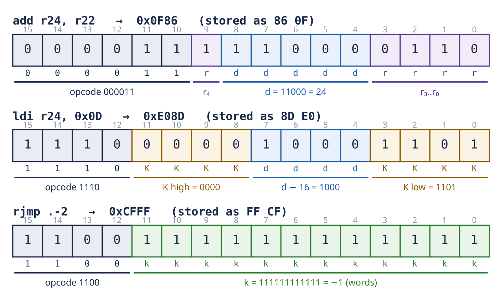
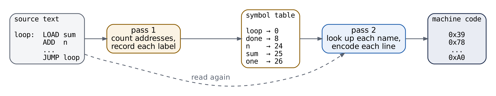
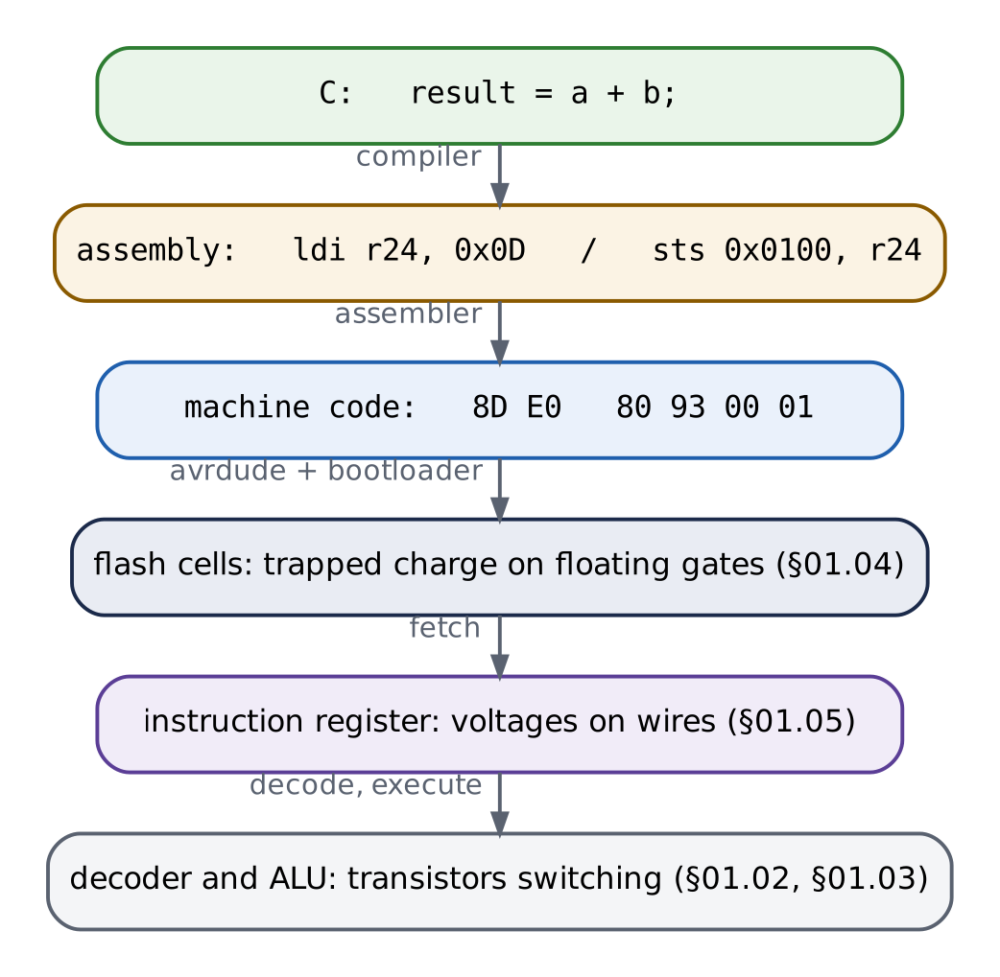

ref: 01.06
title: Machine Code and Assembly Language
chapter: Chapter 01 — What a Computer Physically Is
part: Part I — The Machine Beneath C
builds: §01.05
---
## The question

In §01.05 your ATmega328P read four bytes of its own flash and printed them: `86 0F 08 95`. A disassembler called them `add r24, r22` and `ret`. And in Experiment 01.05-3 you did a disassembler's job in reverse, by hand: you wrote the toy computer's program as words, "LOAD 25", "ADD 24", and turned each into a byte with Table 01.05-1. It worked, but you will remember what it felt like. Every byte had to be worked out bit by bit, a single slip produced a different instruction without any warning, and in Experiment 01.05-4, moving the program by four cells meant finding and recalculating every jump address inside it.

Real processors make all of this harder. The AVR has 131 instructions and 32 registers, its instructions are 16 or 32 bits long, and its jumps measure distances in words counted from the *next* instruction. So:

- How exactly are `add r24, r22` and `ldi r24, 0x0D` laid out as bits, and why are they laid out that way?
- Who, in practice, turns the words people write into those bits, and how does that translator know the address of a label it has not reached yet?
- What does a complete program look like when it is written directly in a machine's own instructions, with nothing between the programmer and the processor?
- If a program can be written that way, why does almost nobody write programs that way anymore?

This section answers them in that order. It ends Chapter 01 exactly where C begins: at the problem C was invented to solve.

## The journey

### Two people, one machine, two languages

There have always been two languages in a computer room. The machine's language is **machine code**: the numbers, bit patterns in memory, that the processor fetches and executes. The programmer's language is made of words and names: "add the next number to the total", "jump back to the start of the loop". The first programmers translated from the second into the first by hand, on paper, with a table like Table 01.05-1 beside them. It was slow, and it was where most of their mistakes were made.

The remedy came very early, and it is obvious once stated: **let the computer do the translation**. If a program is just numbers in memory (§01.05), then a program can *produce* a program. Write the instructions using short names, called **mnemonics** (from the Greek for "memory aid"), such as `ADD` and `LOAD`; write addresses using names, called **labels**, such as `loop` and `sum`; and let a program called an **assembler** translate this text into machine code. The text is **assembly language**.

:::history
Kathleen Booth (then Kathleen Britten), working with Andrew Booth on the ARC computer of Birkbeck College in London, set out a symbolic notation for programming it in their 1947 report *Coding for A.R.C.*, and she is generally credited with creating the first assembly language. At Cambridge, David Wheeler, a research student at the Mathematical Laboratory, wrote EDSAC's **initial orders** in 1949: 31 instructions, permanently wired into the machine on banks of rotary switches, that read a program punched on paper tape as letters and decimal numbers and converted it into binary as they loaded it into memory. It was both the first program to run whenever the machine started and, in effect, an assembler. In 1951 Wheeler, Maurice Wilkes and Stanley Gill published *The Preparation of Programs for an Electronic Digital Computer*, the first textbook on programming.
:::

Note what an assembler does *not* do. It does not decide what the program does. Each instruction line of assembly language becomes one machine instruction, chosen by the programmer. The assembler replaces names with the numbers they stand for and computes addresses and distances, but it adds no instructions of its own. (Real assemblers bend this rule a little: some offer a few *pseudo-instructions* that stand for a fixed short sequence, and on machines where one instruction has two possible encodings the assembler picks one. The principle holds.) That one-to-one correspondence is what makes assembly language different from every language that came after it, C included.

Before we build an assembler, we need to know precisely what it must produce. So let us take a real instruction apart.

### A real instruction, bit by bit: ADD

The AVR's `ADD` instruction adds one register to another: `add Rd, Rr` means Rd ← Rd + Rr, with the flags set as §01.03 described. "Rd" is the **destination** register, which receives the result, and "Rr" the second, unchanged, register. Both may be any of the 32 registers r0 to r31, so naming each needs 5 bits (2<sup>5</sup> = 32). Two register numbers take 10 bits of the 16-bit instruction word, which leaves 6 bits to say "this is ADD".

Microchip's *AVR Instruction Set Manual* gives the layout as a pattern of letters and fixed bits:

```text
   ADD   Rd, Rr        0000 11rd dddd rrrr
```

The fixed bits `000011` identify ADD. Each `d` is one bit of the destination register's number, each `r` one bit of the other register's number. The five `d` bits sit together, but the five `r` bits are split: the highest one sits at bit 9 and the other four at the right-hand end. Figure 01.06-1 fills in the pattern for `add r24, r22`.

{w=16}

Work through it, because this is exactly what the processor's decoder does in hardware.

1. Register 24 in binary is `11000`. These five bits fill the `d` positions, bits 8 to 4.
2. Register 22 is `10110`. Its top bit, `1`, goes to bit 9; its lower four, `0110`, to bits 3 to 0.
3. Reading all sixteen bits from the left: `0000 1111 1000 0110`, which is `0x0F86`.

The AVR stores each 16-bit word with its **low byte first**: `86` at the lower address, then `0F`. That is exactly the `86 0F` your chip printed. (The order in which the bytes of a multi-byte number are stored is called **byte order**, or *endianness*; §06.03 studies it.)

Why split the `r` bits? The manual does not explain its designers' reasons, so what follows is inference from the encodings themselves, not documented fact. Many AVR instructions that name two registers keep the low four bits of each register number in the same two places, the lowest four bits and bits 7 to 4. Decoding hardware is simplest when a field is always on the same wires, whatever the instruction, because then those wires can feed the register file directly while the decoder is still working out what the operation is. The fifth bit of each register number then goes wherever space remains. An instruction set is designed for the convenience of the decoder, not of the human reader.

:::hood
Recall the register file of §01.04 and the decoder that selects one of many cells. Inside the AVR, the `d` bits of the instruction register are wires that run to a 5-to-32 decoder, which selects which of the 32 registers is read as the first input to the ALU and later written with the result. The `r` bits run to a second decoder selecting the second input. The opcode bits run to the control logic that sets the ALU to add. Nothing reads `0x0F86` as a number at any point. Its bits are voltages on sixteen wires, and different groups of those wires go to different circuits.
:::

### LDI: a number carried inside the instruction

The instruction `ldi r24, 0x0D` ("load immediate") puts the constant 13 into r24. The constant is an **immediate**: it is part of the instruction itself, not fetched from data memory. An 8-bit constant needs 8 bits of the 16, and the operation needs some bits to identify it. The manual's layout:

```text
   LDI   Rd, K         1110 KKKK dddd KKKK       (16 ≤ d ≤ 31)
```

Count the bits. `1110` is 4 bits of opcode, the constant `K` takes 8, and that leaves only **4 bits** for the register. Four bits can name only 16 registers. So the AVR's designers chose that `LDI` can load only registers r16 to r31, and the `dddd` field holds d − 16. For r24, d − 16 = 8 = `1000`. The constant 13 is `0000 1101`, split into its high half `0000` (bits 11 to 8) and low half `1101` (bits 3 to 0). The result, in the second row of Figure 01.06-1, is `1110 0000 1000 1101` = `0xE08D`, stored as `8D E0`: the first bytes of `main` in Listing 01.05-8.

This restriction is not a detail. It shapes every AVR program. Ask the assembler to break it:

```terminal
$ printf '        ldi   r5, 1\n' > bad.S
$ avr-gcc -mmcu=atmega328p -c bad.S -o bad.o
```

```output
bad.S: Assembler messages:
bad.S:1: Error: register number above 15 required
```

There is simply no bit pattern meaning "load 1 into r5". To put a constant into one of the lower sixteen registers, a program usually loads it into an upper register first and then copies it with a second instruction (for the constants 0 and 1 there are other two-instruction tricks, such as `clr r5` followed by `inc r5`). The AVR compiler's conventions, which you met in §01.03 and §01.05 and which §19.03 sets out, pass small arguments and results in r24, r22 and their neighbors, all within reach of `LDI` and the other immediate instructions. The avr-gcc documentation gives the conventions, not the reasons for them; but it is hard to believe that the choice was unrelated to the 16-bit format of `LDI`, made by the designers of the instruction set in the 1990s.

### RJMP: jumping by distance, not to an address

The toy machine's JUMP held an absolute address: "take the next instruction from cell 0". In Experiment 01.05-4 that was the trouble: when the program moved, the address inside JUMP did not move with it. The AVR's most common jump works differently:

```text
   RJMP  k             1100 kkkk kkkk kkkk       PC ← PC + 1 + k
```

`RJMP` is a **relative jump**. Its 12-bit field `k` holds not an address but a *distance*, in words, measured from the instruction after the jump (the "+ 1"), because by the time the jump executes, the PC has already advanced past it (§01.05). And `k` is a *signed* number in two's complement (§01.03, and §04.03 in full), so it can jump backward. Twelve bits give distances from −2048 to +2047 words.

The third row of Figure 01.06-1 is the compiled `for (;;) {}` of Listing 01.05-8, `ff cf` in memory, which is the word `0xCFFF`. Its `k` field is `111111111111`, which in 12-bit two's complement is −1. So the jump goes to PC + 1 − 1 = PC: to itself, forever. The disassembler writes it as `rjmp .-2`, meaning "to the address 2 *bytes* before the next instruction": the same distance, measured in bytes instead of words.

Now see what relative jumps buy. If a whole block of code moves, every distance *within* it stays the same, so every `RJMP` within it stays correct without being changed. The problem of Experiment 01.05-4 disappears for every jump that stays inside the moved code. Code whose correctness does not depend on where it is placed is called **position-independent**, and it is so useful that whole operating systems are designed around it (§21.06).

The AVR also has instructions too large for one word. `sts 0x0100, r24` ("store direct to data space") must carry a full 16-bit data address, which cannot share one word with an opcode and a register number. So `STS` is a two-word instruction: the first word `1001 001r rrrr 0000` holds the opcode and register (`80 93` for r24), and the whole second word holds the address (`00 01`, that is `0x0100` with its low byte first). Table 01.06-1 collects the instructions this section uses.

Table: Table 01.06-1  The AVR instructions used in this section
<!-- widths: 16,28,32,11,13 -->
| Instruction | Meaning | Encoding (bit 15 … bit 0) | Words | Cycles |
|---|---|---|---|---|
| `add Rd, Rr` | Rd ← Rd + Rr | `0000 11rd dddd rrrr` | 1 | 1 |
| `ldi Rd, K` | Rd ← K (Rd = r16 … r31) | `1110 KKKK dddd KKKK` | 1 | 1 |
| `subi Rd, K` | Rd ← Rd − K (Rd = r16 … r31) | `0101 KKKK dddd KKKK` | 1 | 1 |
| `sbci Rd, K` | Rd ← Rd − K − C | `0100 KKKK dddd KKKK` | 1 | 1 |
| `sbi A, b` | set bit b of I/O register A (A < 32) | `1001 1010 AAAA Abbb` | 1 | 2 |
| `brne k` | if Z = 0, PC ← PC + 1 + k | `1111 01kk kkkk k001` | 1 | 1 or 2 |
| `rjmp k` | PC ← PC + 1 + k | `1100 kkkk kkkk kkkk` | 1 | 2 |
| `sts k, Rr` | data memory[k] ← Rr | `1001 001r rrrr 0000` + `k` | 2 | 2 |

The "Cycles" column comes from the same manual and is the time each instruction takes, in clock cycles of 62.5 ns on the Uno. `brne` takes 2 cycles if it jumps and 1 if it does not, because a taken jump discards the instruction that the pipeline of §01.05 had already fetched.

### The assembler: translating names into numbers

Now we can say exactly what an assembler must do. For every line it must look up the mnemonic, find the operation's bit pattern, convert each operand into bits and place them in the right fields. Most of that is table lookup. The interesting difficulty is the labels.

Look at the toy program again. Its seventh instruction is "JZ done", and `done` is the label of the ninth line. When the assembler reaches line 7 it has not yet seen line 9, so it cannot know which address `done` stands for. This is the problem of the **forward reference**, and the classic solution is to read the program twice.

1. **Pass 1** reads every line and only counts: how many bytes does each line occupy, and therefore at what address does each line begin? Each time it meets a label, it records the name and the current address in a **symbol table**.
2. **Pass 2** reads every line again and translates it. Every label is now in the table, so every operand can be looked up.

Figure 01.06-2 shows the two passes, and Listing 01.06-1 is a complete two-pass assembler for the toy computer of §01.05.

{w=16}

```c Listing 01.06-1  A two-pass assembler for the toy computer
// toyasm.c
// A two-pass assembler for the toy computer of §01.05.
// It turns lines such as "loop: ADD n" into the bytes of Figure 01.05-1.
#include <stdio.h>
#include <stdlib.h>
#include <string.h>

const char *source[] = {        // the program, as a person writes it
    "loop:  LOAD  sum",
    "       ADD   n",
    "       STORE sum",
    "       LOAD  n",
    "       SUB   one",
    "       STORE n",
    "       JZ    done",
    "       JUMP  loop",
    "done:  LOAD  sum",
    "       OUT",
    "       HALT",
    "       ORG   24",          // place what follows at address 24
    "n:     DATA  10",
    "sum:   DATA  0",
    "one:   DATA  1",
};
const int nlines = sizeof source / sizeof source[0];

const char *ops[] = {"HALT", "LOAD", "STORE", "ADD",
                     "SUB", "JUMP", "JZ", "OUT"};

char sym_name[32][16];          // the symbol table: names...
int sym_addr[32];               // ...and the addresses they stand for
int nsyms = 0;

int lookup(const char *name) {  // address of a label, or -1
    for (int i = 0; i < nsyms; ++i) {
        if (strcmp(sym_name[i], name) == 0) { return sym_addr[i]; }
    }
    return -1;
}

// Split a line into label, mnemonic and operand; any may be empty.
void split(const char *line, char *label, char *mnem, char *operand) {
    char buf[64];
    strcpy(buf, line);
    label[0] = mnem[0] = operand[0] = '\0';
    char *rest = buf;
    char *colon = strchr(buf, ':');
    if (colon != NULL) {
        *colon = '\0';
        sscanf(buf, "%15s", label);
        rest = colon + 1;
    }
    sscanf(rest, "%15s %15s", mnem, operand);
}

int main(void) {
    char label[16], mnem[16], operand[16];

    // Pass 1: walk the program, noting the address of every label.
    int addr = 0;
    for (int i = 0; i < nlines; ++i) {
        split(source[i], label, mnem, operand);
        if (strcmp(mnem, "ORG") == 0) { addr = atoi(operand); continue; }
        if (label[0] != '\0') {
            strcpy(sym_name[nsyms], label);
            sym_addr[nsyms++] = addr;
        }
        ++addr;                     // every other line fills one byte
    }

    // Pass 2: walk it again, translating each line into a byte.
    addr = 0;
    for (int i = 0; i < nlines; ++i) {
        split(source[i], label, mnem, operand);
        if (strcmp(mnem, "ORG") == 0) { addr = atoi(operand); continue; }
        int byte = -1;
        if (strcmp(mnem, "DATA") == 0) {
            byte = atoi(operand);
        } else {
            for (int op = 0; op < 8; ++op) {
                if (strcmp(mnem, ops[op]) == 0) {
                    int target = operand[0] ? lookup(operand) : 0;
                    if (target < 0) {
                        printf("line %d: unknown label '%s'\n", i + 1,
                               operand);
                        return 1;
                    }
                    byte = (op << 5) | target;  // opcode, then address
                }
            }
        }
        if (byte < 0) {
            printf("line %d: unknown operation '%s'\n", i + 1, mnem);
            return 1;
        }
        printf("%2d: 0x%02X   %s\n", addr, byte, source[i]);
        ++addr;
    }
}
```

Much of the C here (strings, `strcmp`, `sscanf`, arrays of arrays) belongs to Chapters 23, 25 and 31, so read for the idea and return to the details later.

- Lines 8–24 hold the program as a person would write it, one line of text per array element. Besides the eight operations, the assembler understands two **directives**: instructions to the assembler itself, which produce no machine instruction. `ORG 24` ("origin") says "place what follows at address 24"; `DATA 10` says "place the number 10 here". Assemblers for real machines have dozens of directives; you will meet `.equ` and `.global` shortly.
- Lines 30–39 are the symbol table and the function that searches it.
- Lines 41–54 split one line into its label (whatever comes before a colon), mnemonic and operand.
- Lines 59–69 are pass 1. Notice that they never translate anything: they only advance `addr` by one for each line that will occupy a byte, and record labels.
- Lines 71–98 are pass 2. Line 82 is where the forward reference is resolved: `lookup("done")` finds 8, because pass 1 recorded it. Line 88 assembles the byte from its two fields, the opcode shifted into the top 3 bits and the address in the low 5, exactly the layout of Table 01.05-1.

```terminal
$ gcc -std=c23 -Wall -Wextra -pedantic toyasm.c -o toyasm
$ ./toyasm
```

```output
 0: 0x39   loop:  LOAD  sum
 1: 0x78          ADD   n
 2: 0x59          STORE sum
 3: 0x38          LOAD  n
 4: 0x9A          SUB   one
 5: 0x58          STORE n
 6: 0xC8          JZ    done
 7: 0xA0          JUMP  loop
 8: 0x39   done:  LOAD  sum
 9: 0xE0          OUT
10: 0x00          HALT
24: 0x0A   n:     DATA  10
25: 0x00   sum:   DATA  0
26: 0x01   one:   DATA  1
```

Compare it, byte by byte, with Figure 01.05-1 and with the array in Listing 01.05-3: they are identical. This output format, an address, the bytes, and the source line that produced them, is called a **listing**, and real assemblers produce one too.

Now see what has been gained. Insert one more line, an `OUT` after the first `STORE sum`, so that the program displays its running total. By hand, that would mean recalculating every address after the insertion. Here, you add one line and run the assembler again; the label `done` moves from 8 to 9, and pass 2 automatically encodes `JZ done` as `0xC9` instead of `0xC8`. Put `ORG 4` at the very top, and every instruction moves to its new address with JZ and JUMP corrected to `0xCC` and `0xA4`: precisely the repair you made by hand in Experiment 01.05-4, now done by a program. And mistype a label, and you get a message instead of a silently wrong program (Experiment 01.06-2 tries all three).

:::metal
The real assembler on your Fedora machine, GNU `as` (run for you by `avr-gcc` and `gcc`), works on the same principles with one more layer. When a program is built from several files, a label used in one file may be defined in another, so the assembler cannot know its address at all. It therefore writes an **object file** containing the machine code with the unknown fields left as zero, plus a list of notes, called **relocations**, saying "when you know the address of `f`, put it into these bits". Assemble a file containing `rjmp f` with `avr-gcc -c` and disassemble the object file, and the jump appears as `00 c0`, `rjmp .+0`: a jump with its distance not yet filled in. A later program, the **linker**, gathers all the object files, decides every address, and fills in every relocation. That is pass 2 spread across several programs, and Chapter 03 follows it from source text to running program (§03.05, §03.06, and §21.03 in more depth).
:::

### A complete program in AVR assembly

Now let us write, in the AVR's own instructions, the program every Arduino owner writes first: blinking the LED on pin 13. On the Uno, pin 13 is bit 5 of the ATmega328P's **port B**, written PB5. Three of the chip's I/O registers control port B, and §36.03 explains them fully; for now we need only two facts from the datasheet.

- Setting bit 5 of the register **DDRB** ("data direction register B", I/O address `0x04`) makes PB5 an output.
- Writing a 1 to bit 5 of the register **PINB** (I/O address `0x03`) **toggles** PB5: if the pin was high it goes low, and if low it goes high. (PINB is normally read, to see the pins' input levels; this toggling on write is a convenience the ATmega328P provides.)

Between toggles, the program must wait half a second. There is no "wait" instruction, so the program waits the way the compiler made `_delay_ms(500)` wait in §00.02: by counting down a number large enough that counting takes half a second.

```c Listing 01.06-2  Blinking the LED in AVR assembly
; blink.S
; Blink the Uno's LED (pin 13 = port B, bit 5) in AVR assembly.
; Every instruction line below becomes one machine instruction.

        .equ  PINB, 0x03        ; I/O address of PINB
        .equ  DDRB, 0x04        ; I/O address of DDRB

        .global main
main:
        sbi   DDRB, 5           ; bit 5 of DDRB = 1: PB5 is an output
loop:
        sbi   PINB, 5           ; writing 1 to PINB bit 5 toggles PB5
        ldi   r18, 0x00         ; r20:r19:r18 = 0x186A00 = 1,600,000
        ldi   r19, 0x6A
        ldi   r20, 0x18
delay:
        subi  r18, 1            ; subtract 1 from the 24-bit count...
        sbci  r19, 0            ; ...borrowing from the middle byte
        sbci  r20, 0            ; ...and from the top byte
        brne  delay             ; until all 24 bits are 0
        rjmp  loop              ; then toggle again, forever
```

In this assembler a semicolon begins a comment. Lines 5 and 6 are **directives**: `.equ` gives a name to a number, so that `DDRB` can be written instead of `0x04`, exactly as labels name addresses. Line 8, `.global main`, makes the label `main` visible to the linker. Every other line that is not a label is one instruction.

- Line 10 makes PB5 an output.
- Line 12 toggles the LED, and lines 13–15 load the 24-bit count 1,600,000 into three registers, r20 holding the top byte (`0x18`), r19 the middle (`0x6A`) and r18 the bottom (`0x00`). A single 8-bit register can count only to 255, so the count is spread across three, like the digits of a number.
- Lines 17–20 are the countdown loop. `subi` subtracts 1 from the bottom byte. If that borrows, because the byte was 0, the C flag of §01.03 is 1, and the first `sbci` ("subtract immediate with carry") subtracts 0 *and the borrow* from the middle byte; the second carries any borrow into the top byte. This is the ripple of borrows of §01.03, done one byte at a time in software. `brne` ("branch if not equal") jumps back while the Z flag says the result was not zero.
- Line 21 jumps back to toggle the LED again.

:::precise
How can `brne` know that *all 24 bits* are zero, when the last instruction, `sbci r20, 0`, produced only the top byte? Because `SBCI` treats the Z flag specially. The instruction set manual specifies that after `SBC` or `SBCI`, Z is cleared if the result is non-zero, and otherwise *left unchanged*. So Z stays 1 only if `subi` gave zero *and* both `sbci` gave zero: Z describes the whole 24-bit result. The flag was designed precisely so that multi-byte arithmetic, one byte at a time, ends with a correct zero test. This is the kind of detail a C compiler knows so that you need not, and one more reason to read the manual before trusting your intuition about an instruction.
:::

Build it with `avr-gcc` and look at what came out:

```terminal
$ avr-gcc -mmcu=atmega328p -nostartfiles blink.S -o blink.elf
$ avr-objdump -d blink.elf
$ avr-size blink.elf
```

```output
blink.elf:     file format elf32-avr


Disassembly of section .text:

00000000 <__ctors_end>:
   0:	25 9a       	sbi	0x04, 5	; 4

00000002 <loop>:
   2:	1d 9a       	sbi	0x03, 5	; 3
   4:	20 e0       	ldi	r18, 0x00	; 0
   6:	3a e6       	ldi	r19, 0x6A	; 106
   8:	48 e1       	ldi	r20, 0x18	; 24

0000000a <delay>:
   a:	21 50       	subi	r18, 0x01	; 1
   c:	30 40       	sbci	r19, 0x00	; 0
   e:	40 40       	sbci	r20, 0x00	; 0
  10:	e1 f7       	brne	.-8      	; 0xa <delay>
  12:	f7 cf       	rjmp	.-18     	; 0x2 <loop>
   text	   data	    bss	    dec	    hex	filename
     20	      0	      0	     20	     14	blink.elf
```

Ten instructions, **twenty bytes**: the entire program. The flag `-nostartfiles` tells `avr-gcc` to leave out the start-up code and the interrupt vector table that every C program receives (§36.05), so our first instruction sits at flash address 0, where a bare ATmega328P begins after reset, and where the Uno's bootloader jumps after its brief wait (§01.05). (`__ctors_end` is simply another name that the linker gave to address 0; the disassembler picked it instead of `main`.) Compare this with the C blink of §00.02, built with the usual start-up code: in the author's build its `main` began at address `0x80`, after 128 bytes of vector table and start-up code.

Check a few encodings against Table 01.06-1. `sbi 0x04, 5` is `1001 1010` followed by the 5-bit address `00100` and the 3-bit bit number `101`: `1001 1010 0010 0101` = `0x9A25`, stored `25 9a`. `brne .-8` at address `0x10` is `0xF7E1` = `1111 0111 1110 0001`; its 7-bit `k` field `1111100` is −4 words, and PC + 1 − 4 lands on word 5, byte address `0xa`, the label `delay`. The assembler did all of this arithmetic, and Experiment 01.06-1 asks you to do some of it once by hand, so that you know what it did.

Now the timing, which in assembly you can *calculate*, because every instruction's cycle count is known.

1. The countdown runs 1,600,000 times. Each pass costs `subi` (1) + `sbci` (1) + `sbci` (1) + `brne` taken (2) = 5 cycles, except the last, where `brne` falls through in 1 cycle: 5 × 1,600,000 − 1 = 7,999,999 cycles.
2. Each trip around `loop` adds `sbi` (2), three `ldi` (3) and `rjmp` (2): 7 cycles.
3. Total per toggle: 8,000,006 cycles. At 16 MHz, that is 8,000,006 ÷ 16,000,000 = 0.500000375 seconds.

So the LED changes state every 8,000,006 clock cycles, which is half a second to within less than a millionth of a second, and it blinks once a second. That precision, knowing to the cycle what the processor will do, is the great strength of assembly language. (The real time is only as accurate as the clock itself: the Uno's ceramic resonator may be off by a few tenths of a percent, a millisecond or so in every half-second.) Run under the simulator, the program toggled PB5 as intended; and a variant that read the chip's 16-bit timer (counting once per 1024 cycles) at each toggle measured 7812, 7813 and 7812 timer counts per half-period, that is 8,000,000 cycles to within the timer's resolution, agreeing with the calculation.

### What the same C becomes on two machines

Assembly language is a readable form of one machine's code, so it is exactly as tied to that machine as the code itself. To see how completely, give the same C to two compilers:

```c Listing 01.06-3  The same C, for comparison on two machines
// lengths.c: three functions whose x86-64 instructions differ in length
#include <stdint.h>

uint8_t add8(uint8_t a, uint8_t b) {
    return a + b;
}

long add_big(long x) {
    return x + 0x123456789;     // a constant too big for 32 bits
}

long times10(long x) {
    return x * 10;
}
```

```terminal
$ gcc -std=c23 -O2 -fcf-protection=none -c lengths.c -o lengths.o
$ objdump -d lengths.o
```

The disassembly, without its header lines:

```output
0000000000000000 <add8>:
   0:	8d 04 3e             	lea    (%rsi,%rdi,1),%eax
   3:	c3                   	ret
   4:	66 66 2e 0f 1f 84 00 	data16 cs nopw 0x0(%rax,%rax,1)
   b:	00 00 00 00 
   f:	90                   	nop

0000000000000010 <add_big>:
  10:	48 b8 89 67 45 23 01 	movabs $0x123456789,%rax
  17:	00 00 00 
  1a:	48 01 f8             	add    %rdi,%rax
  1d:	c3                   	ret
  1e:	66 90                	xchg   %ax,%ax

0000000000000020 <times10>:
  20:	48 8d 04 bf          	lea    (%rdi,%rdi,4),%rax
  24:	48 01 c0             	add    %rax,%rax
  27:	c3                   	ret
```

And for the AVR, `add8` compiles, as you have seen twice already, to `86 0f` (`add r24, r22`) and `08 95` (`ret`).

Several lessons are packed into this output.

- **Nothing is shared.** The same function `add8` is `86 0F 08 95` on the AVR and `8D 04 3E C3` on the x86-64. Not one instruction, not one encoding rule, not even the number of bytes per instruction carries over. A program written in AVR assembly is, to an x86 processor, meaningless numbers, and the reverse.
- **x86-64 instructions vary in length,** from 1 byte up to a limit of 15. Here they are 1 byte (`c3`), 2 bytes (`66 90`), 3 bytes, 4 bytes, 10 bytes (`movabs`, carrying the whole 8-byte constant `0x123456789` as an immediate, low byte first: `89 67 45 23 01 00 00 00`) and even 11 bytes. The instructions after each `ret` (the 11-byte and 1-byte ones after `add8`, the 2-byte one after `add_big`) are never executed: they are **padding**, instructions that do nothing (`nop` means "no operation"), placed so that the next function begins at an address divisible by 16, which some x86 processors fetch more efficiently.
- **The same work can be encoded in different bytes.** In §01.05, compiled with `-O1`, `add` began `8d 04 37`, `lea (%rdi,%rsi,1)`; here, with `-O2`, it is `8d 04 3e`, `lea (%rsi,%rdi,1)`, the same addition with the two registers named in the other order. Different bytes, identical effect. Even one and the same instruction can have two encodings: `add %rdi,%rax` can be written `48 01 f8` or `48 03 c7`, and the compiler and assembler choose. This is why §01.05 asked you to check those bytes on your own compiler.
- **The compiler chooses instructions, not you.** `times10` contains no multiplication. The compiler computed x × 10 as 2 × (x + 4x), using `lea` to form x + x × 4 = 5x, and then 5x + 5x = 10x with `add`, presumably because on these processors that is at least as fast as a multiply. §10.02 explains how hardware multiplies.

:::why
Why does it matter that assembly is tied to one machine? Because programs outlive machines. A program written in AVR assembly must be rewritten, from the first line, to run on the ESP32, whose Xtensa instructions, registers and even ways of reaching its pins are all different; and rewritten again for whatever processor comes next. Each rewrite is a new program with new mistakes. In the 1950s, when every new computer model had a new instruction set, organizations found themselves rewriting their software every few years, and the cost of programming began to exceed the cost of the machines. That economic fact, more than any elegance of notation, is what made high-level languages necessary.
:::

### The cost of writing in assembly

Portability is only the first cost. Look back over Listing 01.06-2 and notice how much of it is bookkeeping that has nothing to do with blinking an LED.

1. **Every value lives where you put it.** You chose r18, r19 and r20 for the count, and had to know that `LDI` cannot reach r0 to r15. In a program of thousands of lines, choosing and tracking registers by hand is a large, error-prone task. A compiler does it automatically, and §19.03 shows its rules on the AVR.
2. **Arithmetic is broken into machine-sized pieces.** A 24-bit countdown took three instructions plus a carefully chosen flag behavior. In C it is `count = count - 1` on a `uint32_t`, whatever the machine's word size.
3. **Structure is invisible.** A loop is a label and a jump somewhere below it; an `if` is a conditional branch around some instructions. Nothing in the text shows the program's shape, and nothing stops a jump from going anywhere at all. The assembler checks that each line is a valid instruction, never that the program makes sense.
4. **Nothing protects you.** Assembly has no types. The instruction `add` will add two registers whether they hold counts, characters or halves of an address. If the program means something else, only the programmer can know.

Yet some things in assembly cannot be had any other way: exact control of every instruction, every register and every cycle. The 0.500000375-second figure above came from that control. This is why assembly survives today in small, essential places: the first instructions after reset, interrupt entry, some cryptographic and signal-processing loops, and anywhere a programmer must use an instruction that the compiler never generates (§39.03).

:::orbit
The Apollo Guidance Computer, which navigated the Apollo spacecraft to the Moon and landed them on it, was programmed by the MIT Instrumentation Laboratory in assembly language, together with an interpreted language for its navigation mathematics. Its fixed program memory, 36,864 words of 16 bits, was **core rope**: thousands of tiny magnetic rings with wires threaded through them by hand at Raytheon, where a wire passing *through* a ring stored a 1 and a wire passing *around* it stored a 0. Its read–write memory held only 2048 words. A program woven into wire cannot be changed with a cable and a bootloader, so the software had to be finished, checked and frozen long before each flight, and every instruction had to earn its place in roughly 70 KB of program memory, a little over twice the flash of your Uno. It worked: but it took a large team of exceptionally careful people to write it, and almost no space mission today is programmed that way. Modern flight software is written mostly in C and similar languages, compiled for radiation-tolerant processors, so that it can be reviewed, tested and reused; Chapter 35 looks at how.
:::

### The problem high-level languages solve

Gather what this chapter has shown. A processor understands only numbers, in one instruction set. Assembly language makes those numbers readable and lets a program, the assembler, compute addresses; but it keeps one instruction per line, one machine per program, and all the bookkeeping in the programmer's head. What programmers needed was a language in which they could write *what* to compute, `total = total + n`, and let a program decide *which instructions* compute it on a given machine.

That program is a **compiler**, and the language it reads is a **high-level language**. The first to be widely used was FORTRAN, created at IBM by a team led by John Backus and delivered in 1957; one of its central goals was to produce machine code nearly as efficient as hand-written assembly, because without that, programmers of the day would not have used it. A compiler goes beyond an assembler in exactly the four places listed above: it allocates registers, breaks arithmetic into machine-sized pieces, turns structured statements into labels and jumps, and checks types. And because the source no longer names any machine's instructions, the same program can be compiled for many machines.

C belongs to this family, but with a particular character, which Chapter 02 traces from its origins: it stays close enough to the machine that a programmer can still predict, as you now can, roughly which instructions each line will become, while remaining portable enough that the same source builds for an AVR, an x86-64 and an ESP32. Figure 01.06-3 sets out the whole road from one line of C down to the switching transistors that Chapter 01 began with.

{w=12}

### Chapter 01 in one view

Figure 01.06-3 shows the road from the top. Here it is again, section by section, from the bottom up.

1. **§01.01**: information is a physical state, and two well-separated voltage ranges make a bit that resists noise.
2. **§01.02**: transistors are voltage-controlled switches, and switches arranged as gates compute logic.
3. **§01.03**: gates arranged as adders compute arithmetic, and the same adder subtracts, wraps around and sets flags.
4. **§01.04**: feedback makes gates remember, giving latches, flip-flops and registers; stored charge gives larger memories, volatile and non-volatile.
5. **§01.05**: a program stored in memory as numbers, fetched, decoded and executed in an endless cycle, turns that hardware into a general-purpose computer.
6. **§01.06**: those numbers have exact formats; assembly language names them, the assembler translates the names, and the limits of assembly language are the reason high-level languages, and C, exist.

Every C program you write in the rest of this book will travel down that ladder. When something surprises you, a value that wraps around, a variable that loses its value at reset, a function whose bytes differ between compilers, the explanation will be on one of these six steps.

## Terms introduced

- **Machine code**: the instructions of a program as the numbers the processor executes.
- **Mnemonic**: a short name for an operation, such as `ADD` or `LDI`.
- **Label**: a name for an address in a program.
- **Assembly language**: a textual form of machine code, one line per instruction, using mnemonics and labels.
- **Assembler**: a program that translates assembly language into machine code.
- **Initial orders**: EDSAC's built-in loading and translating program (1949), an early assembler.
- **Destination register**: the register that receives an instruction's result.
- **Byte order (endianness)**: the order in which the bytes of a multi-byte value are stored; the AVR stores instruction words low byte first.
- **Immediate**: a constant carried inside an instruction.
- **Relative jump**: a jump whose operand is a distance from the current position rather than an absolute address.
- **Position-independent code**: code that runs correctly wherever it is placed in memory.
- **Forward reference**: a use of a label before the line that defines it.
- **Two-pass assembler**: an assembler that first records label addresses, then translates.
- **Symbol table**: the table of names and the addresses or values they stand for.
- **Directive**: an instruction to the assembler itself, which produces no machine instruction (`ORG`, `DATA`, `.equ`, `.global`).
- **Listing**: an assembler's output showing each address, the bytes placed there and the source line that produced them.
- **Object file**: an assembler's output with some addresses still unknown.
- **Relocation**: a note in an object file saying which bits must be filled in once an address is known.
- **Linker**: the program that combines object files, assigns addresses and fills in relocations.
- **Padding (nop)**: instructions that do nothing, inserted to place following code at a convenient address.
- **Core rope memory**: read-only memory storing bits by threading wires through or around magnetic rings.
- **Compiler**: a program that translates a high-level language into machine code, choosing the instructions.
- **High-level language**: a language that describes computations independently of any particular machine's instructions.

## Self-check

1. What does an assembler do, and what does it deliberately *not* do?
2. Encode `add r24, r22` by hand, explaining each field. Why do the bytes appear as `86 0F` in memory?
3. Why can `LDI` load only registers r16 to r31? How can a program put the constant 1 into r5?
4. Why does `rjmp .-2` jump to itself? Explain the "+ 1" in PC ← PC + 1 + k.
5. What advantage does a relative jump have over the absolute JUMP of the toy computer? Connect your answer to Experiment 01.05-4.
6. Why is `sts 0x0100, r24` two words long?
7. What is a forward reference, and how does a two-pass assembler handle it?
8. What are directives? Give two examples from this section.
9. In Listing 01.06-2, why is the count held in three registers, and how does the borrow pass from one to the next?
10. Why does `brne` correctly detect that the whole 24-bit count is zero?
11. Calculate the time between toggles if the count were 320,000 instead of 1,600,000.
12. Give three distinct observations from the x86-64 disassembly of Listing 01.06-3.
13. List four costs of programming in assembly, and one thing assembly gives that C does not.
14. What did FORTRAN have to achieve to be accepted by the programmers of its time?

## Experiments

**Experiment 01.06-1. Assembling by hand.** Encode these AVR instructions by hand, using Table 01.06-1, and give the two bytes in the order they are stored: `add r16, r17`; `ldi r20, 0xFF`; `sbi 0x04, 5`. Then check your answers by assembling them:

```terminal
$ printf 'add r16, r17\nldi r20, 0xFF\nsbi 0x04, 5\n' > ex.S
$ avr-gcc -mmcu=atmega328p -c ex.S -o ex.o
$ avr-objdump -d ex.o
```

**Experiment 01.06-2. Working the toy assembler.** Type Listing 01.06-1, compile and run it, and confirm that its output matches Figure 01.05-1. Then make each change below separately, predicting the output before running:

1. Insert a new line holding the instruction `OUT` (indented like its neighbors) directly after the first `STORE sum` line. Which bytes change, and why?
2. Mistype the label in the `JZ done` line as `dnoe`.
3. Add a line holding the directive `ORG 4` before the first line. Compare the result with your hand repair in Experiment 01.05-4.
4. Change `DATA 10` to `DATA 300`. What does the assembler print for that line, and why is it wrong? Add a check that reports an error for a `DATA` value outside 0 to 255.

**Experiment 01.06-3. Connecting the two halves.** Copy the bytes printed by the toy assembler for change 1 of Experiment 01.06-2 into the memory array of `tiny.c` (Listing 01.05-3), and run it. What does the computer now display, and how many times?

**Experiment 01.06-4. Retiming the blink.** Change the count in Listing 01.06-2 so that the LED toggles every 0.1 s. Work out the new count, its three bytes, and the exact time per toggle in cycles and in seconds, before assembling. If you have an Uno, upload it (Hands-on A) and compare the blinking with the original by eye.

**Experiment 01.06-5. One function, many encodings.** Compile Listing 01.06-3 with `-O0` instead of `-O2` and disassemble it again. How many instructions does `add8` take now, and what are the extra ones doing? (§02.03 and §39.02 explain what the optimizer is permitted to do; for now, simply count.) Then compile it for the AVR and disassemble that:

```terminal
$ avr-gcc -mmcu=atmega328p -Os -Wall -Wconversion -c lengths.c -o lengths_avr.o
$ avr-objdump -d lengths_avr.o
```

On the AVR, `long` has only 32 bits. What does `add_big` become, what happened to the constant `0x123456789`, and what do the warnings say? Why does the AVR code contain subtractions, when the C says `+`?

## Hands-on (AVR / ESP32)

### A: run your assembly program on the Uno

You can program the Uno with Listing 01.06-2 directly, without the Arduino IDE, using `avrdude`, the same tool the IDE runs behind its Upload button. Install it if you have not already (`sudo dnf install avrdude`), connect the Uno, and:

```terminal
$ avr-gcc -mmcu=atmega328p -nostartfiles blink.S -o blink.elf
$ avr-objcopy -O ihex blink.elf blink.hex
$ cat blink.hex
$ avrdude -c arduino -p m328p -P /dev/ttyACM0 -b 115200 -U flash:w:blink.hex:i
```

`avr-objcopy` converts the program into **Intel HEX**, a text format for machine code that `avrdude` reads. The file is so small that you can read it entirely:

```output
:10000000259A1D9A20E03AE648E1215030404040D0
:04001000E1F7F7CF4E
:00000001FF
```

Each line begins with a colon, then the number of data bytes (`10` hexadecimal = 16), the address (`0000`), a record type (`00`, data), the bytes themselves, and a final checksum byte that lets the receiver detect a corrupted line. Find your instructions in it: `25 9A`, `1D 9A`, `20 E0`, … `F7 CF`. The second line carries the last 4 bytes at address `0x0010`, and the third marks the end of the file.

In the `avrdude` command, `-c arduino` names the upload protocol spoken by the Uno's bootloader, `-p m328p` the chip, `-P /dev/ttyACM0` the USB serial port (check its name with `ls /dev/ttyACM*` after plugging in), `-b 115200` the speed, and `-U flash:w:blink.hex:i` means "write this Intel HEX file into flash". If `avrdude` reports that permission is denied on the port, add yourself to the group that owns it with `sudo usermod -aG dialout $USER`, then log out and in again. The bootloader is not overwritten, so you can return to Arduino sketches at any time simply by uploading one from the IDE.

The LED should blink once a second. This program was assembled and run on the simulator by the author, but not on a physical Uno; record what you see.

### B: the ESP32's instructions are different numbers

```c Listing 01.06-4  Reading Xtensa machine code on the ESP32
// xtensa_bytes.ino  (ESP32)
// Print the first bytes of a function's machine code on the ESP32.
int IRAM_ATTR add_int(int a, int b) {   // placed in instruction RAM
  return a + b;
}

void setup() {
  Serial.begin(115200);
  delay(500);
  uintptr_t where = (uintptr_t)add_int;
  Serial.printf("add_int is at 0x%08X\n", (unsigned)where);
  // Instruction RAM can be read only as whole, aligned 32-bit words.
  const volatile uint32_t *word = (const volatile uint32_t *)where;
  Serial.print("first 8 bytes:");
  for (int i = 0; i < 2; ++i) {
    uint32_t w = word[i];
    for (int b = 0; b < 4; ++b) {       // lowest address first
      Serial.printf(" %02X", (unsigned)((w >> (8 * b)) & 0xFF));
    }
  }
  Serial.printf("\nadd_int(6, 7) = %d\n", add_int(6, 7));
}

void loop() {}
```

This is the ESP32's version of Hands-on A of §01.05, with one complication explained in §01.05: the ESP32's instruction RAM may be read only as aligned 32-bit words, so line 16 reads four bytes at a time and lines 17–19 split each word into its bytes. (Shifts and masks are taught in §13.02 and §13.03.) Upload it with your board set to an ESP32 Dev Module and open the Serial Monitor at 115,200 baud.

Expect bytes quite unlike the AVR's. If the compiler produces the shortest code for `add_int`, the author's expectation, from the Xtensa instruction formats, is that it begins `36 41 00`, a 3-byte `entry a1, 32` (the instruction that rotates the register window of §01.05 at the start of a function, and reserves 32 bytes of stack), followed by `3A 22`, a 2-byte `add.n a2, a2, a3`, and `1D F0`, a 2-byte `retw.n` (return, rotating the window back). Different compiler settings in your Arduino core may produce something else. This sketch was not run by the author; record your bytes.

## Answers

**Self-check 1.** It translates each instruction line of assembly language into one machine instruction, replacing mnemonics by operation codes and labels by addresses (and computing distances for relative jumps). It does not choose instructions, allocate registers or change the program's structure; every decision about what the program does remains the programmer's.

**Self-check 2.** ADD is `0000 11rd dddd rrrr`. d = 24 = `11000` fills bits 8–4; r = 22 = `10110` has its top bit at bit 9 and `0110` at bits 3–0. The word is `0000 1111 1000 0110` = `0x0F86`. The AVR stores instruction words low byte first, so memory holds `86` then `0F`.

**Self-check 3.** The 16-bit word must hold a 4-bit opcode and an 8-bit constant, leaving 4 bits for the register, which can name only 16 registers; the designers chose r16–r31. To put 1 into r5, load it into an upper register (`ldi r16, 1`) and copy it (`mov r5, r16`); for this particular constant, `clr r5` followed by `inc r5` also works.

**Self-check 4.** Its 12-bit `k` is `111111111111` = −1 in two's complement, and PC ← PC + 1 + (−1) = PC. The "+ 1" is there because the PC has already advanced to the next instruction when the jump executes, so distances are measured from the next instruction.

**Self-check 5.** A relative jump stores a distance, which does not change when the code containing both the jump and its target is moved. In Experiment 01.05-4 the absolute addresses in JZ and JUMP had to be changed; relative jumps within the moved code would have needed no change.

**Self-check 6.** A 16-bit data address cannot fit in one 16-bit word together with an opcode and a 5-bit register number, so the address occupies a whole second word.

**Self-check 7.** A forward reference uses a label before the line that defines it, so its address is unknown when first met. Pass 1 reads the whole program to record every label's address in the symbol table; pass 2 translates, looking every label up.

**Self-check 8.** Directives are commands to the assembler that produce no machine instruction: `ORG` and `DATA` in the toy assembler; `.equ` and `.global` in Listing 01.06-2.

**Self-check 9.** 1,600,000 needs 21 bits, more than one 8-bit register holds, so it is spread over three bytes. `subi` sets the C flag when the bottom byte borrows; each `sbci` subtracts that borrow along with its constant 0 and produces its own borrow for the next byte.

**Self-check 10.** `SBCI` leaves Z unchanged when its result is zero and clears it otherwise. So Z remains 1 only if all three bytes came out zero.

**Self-check 11.** 5 × 320,000 − 1 + 7 = 1,600,006 cycles, which at 16 MHz is 0.100000375 s.

**Self-check 12.** Any three of: the same C function has completely different bytes on the AVR and the x86-64; x86-64 instructions vary in length (1, 2, 3, 4, 10, 11 bytes here); the 10-byte `movabs` carries an 8-byte immediate, low byte first; padding `nop` instructions align functions to 16-byte boundaries; the same addition is encoded with different bytes at `-O1` and `-O2`; `times10` uses no multiply instruction.

**Self-check 13.** Costs: the program is tied to one machine; registers must be chosen and tracked by hand; arithmetic must be broken into machine-sized pieces; the program's structure is not visible in the text; there are no types or checks. Assembly gives exact control of every instruction, register and cycle.

**Self-check 14.** It had to produce machine code nearly as efficient as code written by hand in assembly; otherwise programmers would have preferred to keep writing assembly.

**Experiment 01.06-1.** `add r16, r17`: d = `10000`, r = `10001`, word `0000 1111 0000 0001` = `0x0F01`, stored `01 0f`. `ldi r20, 0xFF`: d − 16 = 4 = `0100`, word `1110 1111 0100 1111` = `0xEF4F`, stored `4f ef`. `sbi 0x04, 5`: `1001 1010 0010 0101` = `0x9A25`, stored `25 9a`. The author's `avr-objdump` showed exactly these bytes.

**Experiment 01.06-2.**
1. A new byte `0xE0` appears at address 3 and every later instruction moves up by one; `done` becomes 9, so `JZ done` becomes `0xC9`. `JUMP loop` stays `0xA0`, because `loop` did not move. The data at 24–26 is unchanged.
2. The assembler prints the first six lines and then `line 7: unknown label 'dnoe'`, and stops.
3. The instructions occupy addresses 4 to 14, with `JZ done` = `0xCC` and `JUMP loop` = `0xA4`, the same as the hand repair of Experiment 01.05-4.
4. It prints `24: 0x12C   n:     DATA  300`: 300 does not fit in a byte, but the assembler never checks, and prints a three-digit hexadecimal value. Stored into an 8-bit memory cell it would become 300 − 256 = 44. A suitable check, after line 78: if `byte` is less than 0 or greater than 255, print an error such as `line 13: value 300 out of range` and return 1.

**Experiment 01.06-3.** The bytes are `39 78 59 E0 38 9A 58 C9 A0 39 E0 00` at addresses 0 to 11, with the data unchanged. After the nine trace lines, the author's run displayed the running total after each addition, `OUT: 10`, 19, 27, 34, 40, 45, 49, 52, 54, 55, then `OUT: 55` once more from the final OUT, eleven `OUT` lines in all, and halted after 92 instructions (ten more than before: one extra OUT per pass).

**Experiment 01.06-4.** 0.1 s is 1,600,000 cycles; with 7 cycles of overhead and 5 per pass less 1, a count of 320,000 gives 1,600,006 cycles = 0.100000375 s, as in Self-check 11. 320,000 = `0x04E200`: `ldi r18, 0x00`, `ldi r19, 0xE2`, `ldi r20, 0x04`.

**Experiment 01.06-5.** At `-O0` the author's GCC 14 made `add8` 11 instructions: it saved and set up a frame pointer (`push %rbp`, `mov %rsp,%rbp`), stored both arguments into memory on the stack, loaded them back with zero extension (`movzbl`), added, restored `%rbp` and returned. Without optimization the compiler keeps every variable in memory, exactly as written; your count may differ slightly on GCC 15 or 16. On the AVR, `add_big` became four instructions, `subi r22, 0x77`, `sbci r23, 0x98`, `sbci r24, 0xBA` and `sbci r25, 0xDC`, followed by `ret`: a 32-bit addition carried out byte by byte, with borrows rippling as in Listing 01.06-2. The constant was cut to its low 32 bits, `0x23456789`. `-Wconversion` (plain `-Wall` is silent here) gives two warnings: for `add_big`, that the conversion from `long long int` to `long int` may alter the value; and first, for `add8`, that the conversion to `uint8_t` from `int` may alter its value, because C computes `a + b` as an `int` (Chapter 10). The subtractions are the trick of §01.04: adding `0x23456789` is the same, in 32-bit wraparound arithmetic, as subtracting `0x100000000 − 0x23456789` = `0xDCBA9877`, and the AVR has subtract-immediate instructions but no add-immediate for single registers. Chapter 10 explains the conversion rules.

**Hands-on A.** The LED should toggle every 8,000,006 cycles, 0.500000375 s (calculated), and was observed to do so in the simulator.

**Hands-on B.** Expected `36 41 00 3A 22 1D F0` followed by one byte of padding or the start of the next function, and `add_int(6, 7) = 13`; the address should fall in the IRAM range given in Hands-on B of §01.05.

## Sources and verification

- **Toolchains.** Listings 01.06-1 and 01.06-3 and all the variants of Experiment 01.06-2 were compiled with GCC 14.2.0 (`-std=c23 -Wall -Wextra -pedantic` for Listing 01.06-1; `-O2 -fcf-protection=none -c` for Listing 01.06-3) on x86-64 Ubuntu Linux 24.04 and disassembled with GNU objdump; all outputs shown are from those runs. The output of Listing 01.06-1 does not depend on the compiler. **For the reader to confirm on GCC 15 or 16:** the x86-64 bytes of Listing 01.06-3, especially the padding instructions and the choice of registers in `lea`, which may differ between compiler versions.
- **AVR results.** Listing 01.06-2, the `ldi r5, 1` error and Experiment 01.06-1 were assembled with avr-gcc 7.3.0 and GNU as 2.26 for AVR, and disassembled with avr-objdump; the Intel HEX file was produced by avr-objcopy. The relocation example (`rjmp f` assembled to `00 c0` with an `R_AVR_13_PCREL` relocation) was checked with `avr-objdump -dr`. Listing 01.06-2 was run on simavr 1.6 (ATmega328P, 16 MHz) under avr-gdb, where PORTB read `0x20`, `0x00`, `0x20` at successive toggles and the three count registers were 0 at the `rjmp`; a timing variant that read Timer 1 (prescaler 1024) at each toggle measured 7812, 7813 and 7812 counts. It was not run on a physical Uno. The `avrdude` command is the standard form for an Uno with its usual bootloader at 115,200 baud.
- **Not run by the author.** Hands-on A on real hardware, and Listing 01.06-4, which needs an ESP32. The expected Xtensa bytes are the author's encoding of `entry a1, 32`, `add.n a2, a2, a3` and `retw.n` from the Xtensa instruction formats, not an observed result.
- **AVR instruction set.** Microchip, *AVR Instruction Set Manual*: the encodings, word counts and cycle counts in Table 01.06-1; the restriction of `LDI`, `SUBI` and `SBCI` to r16–r31; the definition of `RJMP` and `BRNE` as PC ← PC + k + 1; the treatment of the Z flag by `SBC` and `SBCI`; `CLR` and `INC`. ATmega328P datasheet: I/O addresses of PINB (`0x03`) and DDRB (`0x04`), and the toggling of a port bit by writing 1 to its PIN register.
- **x86-64.** The 15-byte maximum instruction length and the `movabs` and `lea` forms are from the Intel and AMD architecture manuals. The two encodings of `add %rdi,%rax` (opcodes `01` and `03`) are from the same manuals. That multiplication by small constants with `lea` and `add` is at least as fast as a multiply on these processors is the author's general statement, not a measurement.
- **History.** Kathleen Booth's work on the ARC assembly language, in *Coding for A.R.C.* (A. D. Booth and K. H. V. Britten, 1947), is as recorded by Birkbeck, University of London, and standard biographies; EDSAC's initial orders (31 instructions on uniselectors, 1949) and the 1951 textbook of Wilkes, Wheeler and Gill are described in the histories of the Cambridge Mathematical Laboratory and in *Communications of the ACM*; FORTRAN's delivery in 1957 and its efficiency goal are from Backus's own accounts.
- **Apollo Guidance Computer.** 2048 words of erasable core memory and 36,864 words of core rope (16-bit words, including a parity bit), with a wire through a core storing 1 and around it storing 0, woven at Raytheon: from restoration work on an AGC published by Ken Shirriff and from NASA's *Computers in Spaceflight*. The statement that modern flight software is written mostly in C and similar languages is a general one, developed with sources in Chapter 35. The accuracy of the Uno's ceramic resonator (a few tenths of a percent) is from typical resonator datasheets, such as Murata's CSTCE series.
- **Inference in this section.** The explanation of why the AVR's register fields are placed where they are, the link between `LDI`'s reach and the avr-gcc register conventions, and the explanation of why some instructions are padded to 16-byte boundaries, are the author's reasoning from the encodings and general knowledge of processor design, not statements from the manufacturers' or the compiler's documentation.
