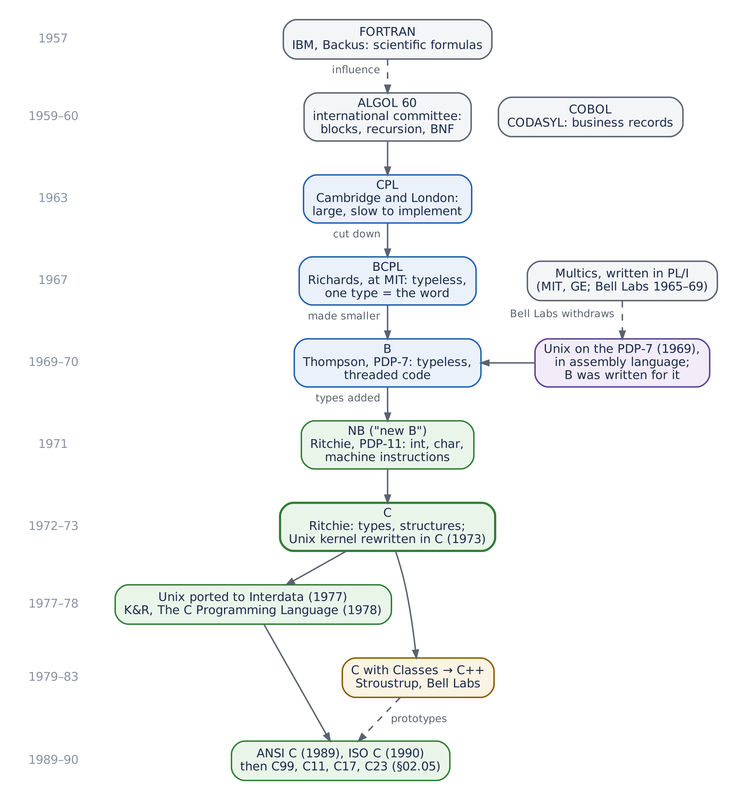
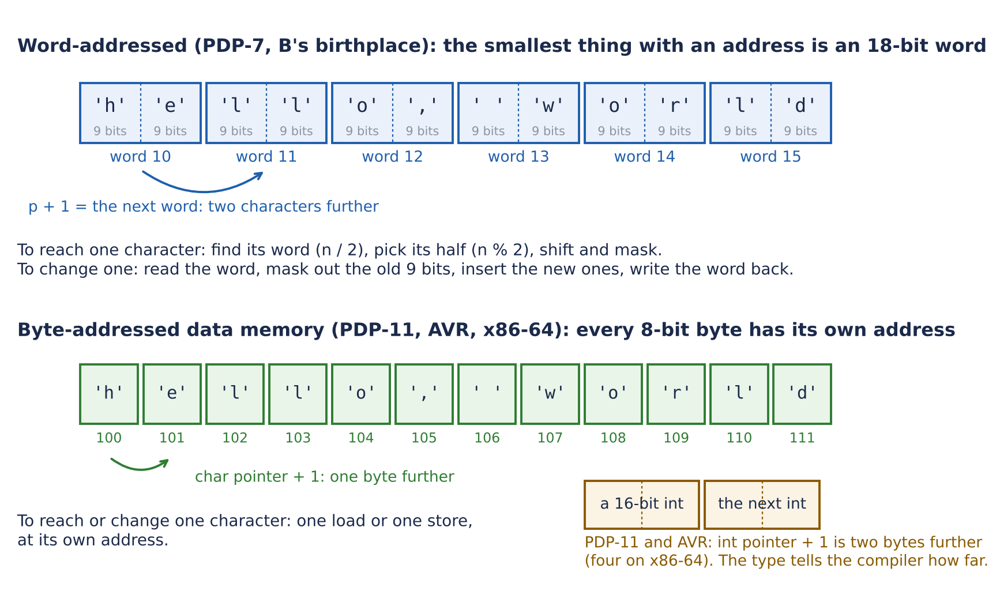
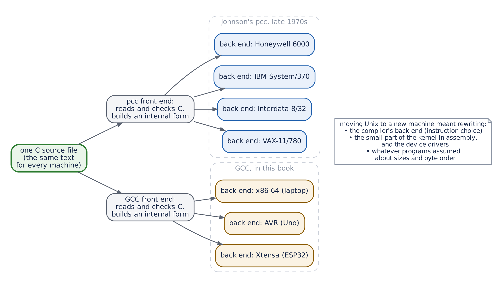

ref: 02.01
title: The Road to C
chapter: Chapter 02 — Why C Exists
part: Part I — The Machine Beneath C
builds: §01.06
---
## The question

Chapter 01 ended with a problem. Assembly language makes a processor's numbers readable, but it keeps one instruction per line, one machine per program, and every piece of bookkeeping in the programmer's head. §01.06 named the remedy, a **high-level language** with a **compiler** to choose the instructions, and named the first widely used one, FORTRAN, delivered in 1957.

So the remedy existed in 1957. Yet C, the language this book teaches, did not appear until 1972, fifteen years later, and in those fifteen years the people who wrote operating systems, compilers and other programs close to the hardware went on writing most of them in assembly language. That raises the questions this section answers:

- If FORTRAN, COBOL and ALGOL already existed, what could they *not* do that a systems programmer needed?
- C's nearest ancestors, BCPL and B, had only one data type. How can a language work with only one type, and why did that stop working on a machine like the one you hold, the ATmega328P?
- What exactly did Dennis Ritchie add to B to make C, and why was Unix rewritten in it in 1973 rather than earlier?
- What does it mean for a program to be **portable**, and how did a language invented for one minicomputer end up compiled, unchanged, for your laptop, your Uno and your ESP32?
- Why does so much of the world's software, including the operating system on your laptop, the firmware library on your Uno and the real-time kernel on your ESP32, still rest on C?

This is a history section, but not a list of dates. Every turn in this history was forced by a physical fact about a machine: how wide its words were, whether each byte had its own address, how much memory it had. You already understand those facts from Chapter 01, so you can follow the reasoning of the people who made each decision, test it with your own programs, and see the same forces acting on the three machines on your desk.

## The journey

### A map of the road

Figure 02.01-1 shows the road from FORTRAN to standard C. Do not try to memorize it. Use it as a map while you read, and come back to it at the end, when every box and arrow should mean something to you.

{w=14}

The main road runs down the middle: from ALGOL 60 through CPL, BCPL and B to C. Above it stands FORTRAN, which influenced ALGOL; beside it stand the languages and systems that shaped it from outside: COBOL, which with FORTRAN showed what high-level languages could do and what they could not; and Multics, the operating system whose difficulties sent a small group at Bell Telephone Laboratories (Bell Labs) in search of something simpler.

### The first high-level languages, and what they were for

Three languages dominated the first years of high-level programming. Each was designed for one kind of work, and each was very good at it.

**FORTRAN** ("FORmula TRANslation") was built at IBM by John Backus's team for the IBM 704 and delivered to customers in April 1957. It existed to let scientists and engineers write formulas, `X = A*B + C`, instead of instruction sequences. Its compiler was one of the first to *optimize*: it worked hard to produce machine code nearly as fast as a skilled programmer's, because, as §01.06 explained, without that nobody would have used it.

**COBOL** ("COmmon Business-Oriented Language") was designed in 1959 by a committee of computer users, manufacturers and the United States Department of Defense, which first met at the Pentagon in May 1959; its first specification was published in 1960. It drew heavily on FLOW-MATIC, a language created by Grace Hopper's team. COBOL existed for business records: payrolls, inventories, accounts. Its programs read almost like English sentences, and its numbers were decimal quantities of money and stock.

**ALGOL 60** ("ALGOrithmic Language") was defined by an international committee of American and European computer scientists at a conference in Paris in January 1960, in a report edited by Peter Naur. It existed to describe algorithms precisely, so that they could be published and understood by anyone. It made standard the ideas that every later language, C included, takes for granted: **blocks** of statements with their own local variables, procedures that may call themselves (**recursion**, which LISP also had), and a precise grammar written in a notation now called **BNF** (Backus–Naur Form), which Backus had introduced in 1959 and which the ALGOL 60 report made famous.

Now look at them with the eyes of a systems programmer in the 1960s, someone writing an operating system, a compiler, a disk driver. What did that person need?

1. **Addresses.** An operating system manages memory. It must be able to say "the word at address 0x0100" and "the next word after this one", and to keep addresses in variables, because its data structures (lists of running programs, tables of open files) are linked together by addresses.
2. **Bits and bytes.** Devices are controlled by individual bits in registers (§01.06 set bit 5 of DDRB). Text is made of characters, each smaller than a machine word. The programmer must be able to reach individual bits and characters cheaply.
3. **Predictable cost.** A disk driver runs thousands of times a second. The programmer must be able to see, roughly, what instructions each line will become, as you can now in assembly.
4. **No hidden machinery.** An operating system *is* the machinery that other programs rely on. It cannot itself rely on a large run-time system that allocates memory or handles input and output behind its back, because nothing exists underneath it to provide those services.

Table 02.01-1 sets the three languages against these needs, as they stood in the 1960s.

Table: Table 02.01-1  The first high-level languages against a systems programmer's needs (as in the 1960s)
<!-- widths: 14,24,62 -->
| Language | Designed for | What it lacked for writing an operating system |
|---|---|---|
| FORTRAN | numerical formulas | No way to hold or compute an address; no recursion; no character type (one arrived only in FORTRAN 77); all storage fixed when the program was compiled |
| COBOL | business records | Decimal records and files, described in English-like statements; no way to name an address, a bit or a machine register |
| ALGOL 60 | publishing algorithms | Elegant and recursive, but no addresses, and no input or output at all in the language itself: each implementation invented its own |

None of these was a failure. They simply answered different questions. A language for formulas has no reason to talk about addresses, and a language for describing algorithms on paper has no reason to say how bits reach a disk. So the people who wrote operating systems kept writing them in assembly, and paid the costs listed at the end of §01.06.

:::myth
"C was the first language in which an operating system was written." It was not. The Burroughs B5000, introduced in 1961, was designed from the start to be programmed in high-level languages, and its operating system, the MCP (Master Control Program), was written in ESPOL, an extended dialect of ALGOL; it is generally credited as the first operating system written entirely in a high-level language. Multics, begun in 1965 by MIT, General Electric and Bell Labs, was written mostly in PL/I, a very large language from IBM. What made C different was not that it could be used for an operating system, but that it could be used for one on *ordinary* machines, with a *small* compiler, and that the result could be *moved* to other machines. The B5000 had hardware built around its language, and PL/I compilers were large and difficult to write. Keep this in mind: the problem C solved was not "can it be done?", but "can it be done cheaply, simply and everywhere?"
:::

### CPL and BCPL: a language for writing compilers

The main road to C begins in England. In 1963 a group at the University of Cambridge Mathematical Laboratory and the University of London Computer Unit, led by Christopher Strachey, described **CPL** (the Combined Programming Language). CPL took ALGOL 60 and tried to extend it to everything: numerical work, text processing, and programming close to the machine. It was ambitious and elegant, and it was also so large that a working compiler took years to appear; the project never produced one that was widely used.

Martin Richards, a research student in the CPL project, needed something more modest: a language small enough to *write compilers in*, including, in principle, a compiler for CPL itself. He cut CPL down to its essentials and called the result **BCPL** ("Basic CPL"). He took it to MIT, where he worked from December 1966, and built the first BCPL compiler there in early 1967 on the IBM 7094 of MIT's time-sharing system; its reference manual is dated July 1967. Rewritten in BCPL itself, that first compiler was, by Richards's account, only about a thousand lines long.

BCPL made one radical simplification: it has **only one data type**, the machine **word** (BCPL calls it a *cell*). A word is just a pattern of bits, as wide as the machine's natural unit of memory. A BCPL variable holds one word, and the language never says what the word *means*. The same word may be used as an integer, as a character code, as a truth value, or as the **address** of another word. The meaning is decided by the operation applied to it:

- `x + 1` treats `x` as a number and adds 1.
- `!x` (written `rv x` in the 1967 manual, for "r-value") treats `x` as an address and fetches the word stored there.
- `v!i` fetches the word at address v + i: the i-th word of a table that starts at v.

A language like this is called **typeless**. The word "typeless" does not mean that the bits have no meaning; it means that the *compiler* keeps no record of their meaning. The programmer alone knows that this variable holds an address and that one holds a count.

Why would anyone want that? Because, on the machines BCPL was designed for, it was exactly the truth. Those machines were **word-addressed**: each address named a whole word, and the word was the only thing the hardware could load, store or add. If everything is a word, a language with only words is not a simplification of the machine; it *is* the machine, described honestly. And it is easy to compile: every variable is one word, every operation works on words, and the compiler never has to ask how big anything is.

BCPL had a second idea, which matters as much as the first. Richards built its compiler in two parts. A **front end** read BCPL and produced a simple intermediate language, **O-code**, the instructions of an imaginary machine; a short **back end** translated O-code into the instructions of a real one. To move BCPL to a new computer, one rewrote only the back end. This is a first, clear form of an idea that runs through the rest of this section: **portability by separating what depends on the machine from what does not.** Your GCC is built on the same principle (§39.05 opens one up).

:::history
BCPL reached Bell Labs while Bell Labs was a partner in Multics. Rudd Canaday, Dennis Ritchie and others carried Richards's compiler to the GE-635 at Bell Labs and to the Multics computer in 1968–69, and it became the language of choice of the group that would later build Unix, Ken Thompson among them. BCPL has also had a long life of its own: Richards later used it to write TRIPOS, a portable operating system for small computers, used at Cambridge and elsewhere from the late 1970s. Two small traces of BCPL survive in your C code today. BCPL grouped statements between a pair of bracket symbols, which its compilers spelled `$(` and `$)`; B and C kept the idea and spelled the brackets `{` and `}`. And BCPL's `//` comment, which B and C replaced with `/* */`, was brought back by C++, and by C99 after it.
:::

### Bell Labs, Multics, and a small machine called the PDP-7

Multics was meant to be a "computing utility", a large time-sharing system that many people could use at once, like a telephone exchange for computation. By 1969 Bell Labs' management, and even its researchers, had come to believe that its promises would be fulfilled too late and at too high a cost, and the company pulled out of the project. Several of its people, Ken Thompson and Dennis Ritchie among them, were left wanting the kind of interactive computing they had glimpsed in Multics, but without a machine or a project to provide it.

Thompson found a **PDP-7**, a minicomputer made by Digital Equipment Corporation (DEC) that was too small and slow for much more than experiments, and in 1969 began writing a small operating system for it: the first version of what became **Unix**. He wrote it in PDP-7 assembly language. The PDP-7 had 8,192 words of memory, and each word was **18 bits** wide. It was word-addressed, like the machines BCPL had been designed for.

An operating system needs tools, and Thompson decided that Unix needed a language for writing them. After a brief attempt at FORTRAN, which he soon abandoned, he created a language of his own, cutting BCPL down until it fit the machine and changing its syntax to suit his own taste; he struggled against the PDP-7's memory limits throughout. He called the result **B**. Ritchie later described B as, in essence, BCPL made small enough for that little machine and reshaped by Thompson's own preferences.

B kept BCPL's single type, the word, and BCPL's model of memory as a row of numbered words. Listing 02.01-1 is a small B function, written for this book in the style of the B manuals of 1971–1972. B cannot be compiled on your laptop, so read it, do not type it.

```c Listing 02.01-1  A function in B: the length of a string
/* length.b: the number of characters in a string, in B */
length(s) {
    auto n;
    n = 0;
    while (char(s, n) != '*e')
        n++;
    return (n);
}
```

Read it line by line and notice what is missing.

- Line 2: the function `length` takes one argument, `s`. Nothing says what `s` is. It is a word. The caller is supposed to pass the address of a string, but the compiler would accept `length(42)` without a murmur.
- Line 3: `auto n;` declares a local variable (one word, on the stack: §19.04 explains the word "auto"). Again, no type, because there is only one.
- Line 5: `char(s, n)` is not part of the language. It is a **library function** that fetches character number n of the string at s. The language itself has no way to name a character, because characters are smaller than words, and the language knows only words.
- Line 5 again: `'*e'` is B's end-of-string character. B used `*` where C uses a backslash, and `*e` stood for the character with code 4, called EOT ("end of transmission"). C later chose the character with code 0, written `'\0'`.
- Line 6: `n++` is already there. Thompson invented `++` and `--` for B.

Listing 02.01-2 is the same function in C, for comparison.

```c Listing 02.01-2  The same function in C
// length.c: the same function in C
int length(char *s) {
    int n = 0;
    while (s[n] != '\0') {
        n++;
    }
    return n;
}
```

The shape is identical. The difference is the words `int` and `char *`. They are **types**: statements to the compiler about what each value *is*. `s` is the address of characters; `n` is an integer; the function returns an integer. Everything else in this section explains why those few words had to be added, and what the compiler does with them. (Modern C would write `const char *s`, a promise that the function will not change the characters; `const` arrived only with the 1989 standard, and §06.06 explains it.)

:::myth
"C's `++` and `--` were invented to use the PDP-11's auto-increment addressing modes." This is often said, and Ritchie himself called it historically impossible: `++` and `--` existed in B, on the PDP-7, before the PDP-11 existed. Ritchie suggested that the PDP-7's few *auto-increment memory cells* (special memory locations that increased by one whenever they were used to reach another word) may have given Thompson the idea, and that the stronger reason was size: in B's implementation, `++x` produced less code than `x = x + 1`. Making the operator work both before and after its operand, `++x` and `x++`, was Thompson's own generalization.
:::

:::history
B also gave C its compound assignment operators, but at first spelled the wrong way round: B wrote `x =+ 1`, borrowing the idea of combined assignment (ALGOL 68 wrote `+:=`) by way of Douglas McIlroy. The trouble is obvious once seen: does `x=-1` mean "x = −1" or "subtract 1 from x"? Ritchie called the spelling a mistake, and in 1976 C reversed it to `+=`, `-=` and the others.
:::

B had one more property that matters for the rest of the story. On the PDP-7, B's compiler did not produce machine instructions. It produced **threaded code**: a list of the addresses of small, ready-made routines, one for each operation ("fetch a variable", "add", "compare"), which a tiny loop called through one after another. Threaded code is compact, which mattered on a machine with 8,192 words, but every operation pays for a jump into a routine and a jump back out. B programs therefore ran considerably slower than the same work done in assembly, and the operating system itself stayed in assembly.

### A word-addressed world, modeled in C

To understand why B's single type eventually failed, you need to feel what it was like to handle text on a word-addressed machine. We cannot run a PDP-7, but we can build a model of its memory in C, using the shifts and masks of §01.06, and handle a string the way B's library had to.

The model is an array of 18-bit words. A character is stored in 9 bits, so each word holds two characters side by side, the first in the upper 9 bits. (On the PDP-7, characters appear to have been packed two to a word in this way, though no manual of the time records the detail. On Bell Labs' larger 36-bit Honeywell 6070, the successor of the GE-635 mentioned above, B packed four 9-bit characters to a word; Experiment 02.01-1 builds that machine.)

```c Listing 02.01-3  A word-addressed memory, and B's string functions
// wordmem.c
// A model of a word-addressed memory like the PDP-7's, on which B was born:
// 18-bit words, and strings packed two 9-bit characters to a word.
#include <stdio.h>
#include <stdint.h>

#define WORD_MASK 0777777u          // eighteen 1 bits, written in octal
#define EOT       04u               // B's end-of-string character, '*e'

uint32_t mem[32];                   // each element models one 18-bit word

// B's char(s, n): character n of the string that begins at word s.
unsigned b_char(unsigned s, unsigned n) {
    uint32_t word = mem[s + n / 2];         // which word holds it?
    unsigned shift = (n % 2 == 0) ? 9 : 0;  // which half of that word?
    return (word >> shift) & 0777u;         // cut out its 9 bits
}

// B's lchar(s, n, c): replace character n, leaving its neighbor alone.
void b_lchar(unsigned s, unsigned n, unsigned c) {
    uint32_t *word = &mem[s + n / 2];
    unsigned shift = (n % 2 == 0) ? 9 : 0;
    uint32_t keep = *word & ~(0777u << shift) & WORD_MASK;
    *word = keep | ((c & 0777u) << shift);  // read, modify, write back
}

// Lay out a string at word s, as B laid out a string constant.
void pack(unsigned s, const char *text) {
    unsigned n = 0;
    while (text[n] != '\0') {
        b_lchar(s, n, (unsigned char)text[n]);
        ++n;
    }
    b_lchar(s, n, EOT);
}

// Listing 02.01-1, translated into C: the length of a string.
unsigned b_length(unsigned s) {
    unsigned n = 0;
    while (b_char(s, n) != EOT) {
        ++n;
    }
    return n;
}

void show(unsigned s, unsigned words) {
    for (unsigned w = s; w < s + words; ++w) {
        printf("  word %2u: %06o\n", w, (unsigned)mem[w]);
    }
}

int main(void) {
    pack(10, "hello, world");
    printf("The string, as 18-bit words in octal:\n");
    show(10, 7);
    printf("length = %u\n", b_length(10));

    b_lchar(10, 7, 'W');                    // character 7 is the 'w'
    printf("After replacing character 7:\n");
    show(13, 1);
    printf("The string now reads: ");
    for (unsigned n = 0; b_char(10, n) != EOT; ++n) {
        putchar((int)b_char(10, n));
    }
    putchar('\n');
}
```

As in §01.06, read for the idea; arrays, pointers and `printf` formats are taught properly in Chapters 23, 24 and 31.

- Lines 7 and 10: the memory is 32 words. Each word is held in a 32-bit C variable, of which we use only the low 18 bits. `0777777` is an **octal** (base-8) constant: a leading `0` in C means octal, and each octal digit stands for exactly 3 bits, so six 7s are eighteen 1 bits.
- Lines 13–17 are B's `char`. To find character n, line 14 finds the word that holds it, `s + n / 2`; line 15 decides which half of that word it is in; line 16 shifts that half down to the bottom and masks off the other 9 bits. Three steps of arithmetic for every character read.
- Lines 20–25 are B's `lchar`, which *replaces* a character. The machine cannot store 9 bits; it can store only a whole word. So line 23 reads the word and clears the 9 bits being replaced, keeping the neighbor's 9 bits, and line 24 inserts the new character and writes the whole word back. This **read–modify–write** is the price of changing anything smaller than the unit of storage.
- Lines 38–44 are Listing 02.01-1, written in C on top of the model.

```terminal
$ gcc -std=c23 -Wall -Wextra -pedantic wordmem.c -o wordmem
$ ./wordmem
```

```output
The string, as 18-bit words in octal:
  word 10: 150145
  word 11: 154154
  word 12: 157054
  word 13: 040167
  word 14: 157162
  word 15: 154144
  word 16: 004000
length = 12
After replacing character 7:
  word 13: 040127
The string now reads: hello, World
```

Look at word 10, `150145`. Because 9 bits are exactly three octal digits, each half of the word reads directly as a character code in octal: `150` is 104 in decimal, the code of `h`, and `145` is 101, the code of `e`. (Chapter 08 explains character codes.) This is why programmers of 18-bit and 36-bit machines thought in octal: the digits fell exactly on the boundaries of the things they cared about. Word 16 holds the terminator `004` and an unused half. And after the replacement, only the lower half of word 13 changed, from `167` (`w`) to `127` (`W`); the space beside it, `040`, survived the read–modify–write untouched.

Figure 02.01-2 sets this model beside the kind of memory that every machine in this book has.

{w=16}

### The PDP-11: when the machine changed under the language

In 1970 the Unix group obtained a new machine, DEC's **PDP-11**, and by February 1971 Unix was running on it. The PDP-11 differed from the PDP-7 in a way that sounds small and turned out to be decisive. Its words were 16 bits wide, but its addresses did not name words. They named **bytes**: every 8-bit byte in memory had its own address, a 16-bit word occupied two consecutive addresses, and the processor had instructions that loaded or stored a single byte. The PDP-11 was **byte-addressed**, as the lower half of Figure 02.01-2 shows, and so is the *data* memory of your ATmega328P, your laptop and your ESP32. (Not every memory in them is: the AVR's flash, as §01.05 showed, is counted in 16-bit words, and the ESP32's instruction RAM can be read only as 32-bit words, §01.06.)

B was moved to the PDP-11, but it fit badly, and Ritchie later set out exactly why. There were four problems, and each one is a physical fact meeting a language that could not express it.

1. **Characters.** On a byte-addressed machine a character *is* a byte, with its own address, reachable with one instruction. But B knew only words, so its strings were still packed into words and reached through library functions like `char`, with the shifting and masking of Listing 02.01-3. The machine could do in one instruction what the language forced into several.
2. **Floating point.** DEC promised floating-point hardware for the PDP-11, with 32-bit and 64-bit numbers. BCPL compilers on larger machines had added special floating-point operators, which worked because a floating-point number fit in one of those machines' words. A 16-bit word cannot hold one. In a language where every value is one word, there was nowhere to put a floating-point number.
3. **Pointers.** In B, a pointer is the *number of a word*, and adding 1 to it means "the next word". But the PDP-11's hardware wanted *byte* addresses, in which the next 16-bit word is 2 further on. So every time a B program followed a pointer, the compiled code first had to convert the word number into a byte address, by multiplying by 2, at run time.
4. **Speed.** B on the PDP-11 still produced threaded code, and the threaded-code penalty meant that the operating system and its central programs could not reasonably be rewritten in it.

Problems 1 and 3 are costs you can measure today, on the same kind of machine. Listing 02.01-4 writes, in C, the operations that B's model of memory would require on a byte-addressed machine, next to the operations C requires, and lets the AVR compiler show what each costs.

```c Listing 02.01-4  The cost of B's model of memory, made visible
// bcost.c
// What B's model of memory would cost on a byte-addressed machine.
// Compile only (-c) and read the instructions; nothing here is run.
#include <stdint.h>

// 1. Fetching character n of a string.
// The B way: two 8-bit characters packed into each 16-bit word.
unsigned b_char(const uint16_t *s, unsigned n) {
    uint16_t word = s[n / 2];
    return (n % 2 == 0) ? (word >> 8) : (word & 0xFF);
}

// The C way: one character per byte, and every byte has an address.
unsigned c_char(const unsigned char *s, unsigned n) {
    return s[n];
}

// 2. Following a pointer to a 16-bit word.
// The B way: a pointer is a word number; the hardware wants a byte address.
int16_t b_deref(uint16_t word_number) {
    return *(const int16_t *)(uintptr_t)(word_number * 2u);
}

// The C way: the pointer already holds the byte address.
int16_t c_deref(const int16_t *p) {
    return *p;
}
```

This is a model, not B's actual PDP-11 implementation; it reproduces the work that B's rules demand, so that we can count it. Line 21 is the heart of problem 3: it takes a word number, multiplies it by 2 to get a byte address, and only then reads memory. (Turning a number into an address, as line 21 does, is something C permits but does not define precisely; Chapter 24 explains when it is meaningful. Here it is meaningful, because AVR addresses are plain 16-bit numbers.)

```terminal
$ avr-gcc -mmcu=atmega328p -Os -Wall -Wextra -c bcost.c -o bcost.o
$ avr-objdump -d bcost.o
```

The disassembly, without its header lines:

```output
00000000 <b_char>:
   0:	9b 01       	movw	r18, r22
   2:	2e 7f       	andi	r18, 0xFE	; 254
   4:	82 0f       	add	r24, r18
   6:	93 1f       	adc	r25, r19
   8:	fc 01       	movw	r30, r24
   a:	80 81       	ld	r24, Z
   c:	91 81       	ldd	r25, Z+1	; 0x01
   e:	60 fd       	sbrc	r22, 0
  10:	00 c0       	rjmp	.+0      	; 0x12 <b_char+0x12>
  12:	89 2f       	mov	r24, r25
  14:	99 27       	eor	r25, r25
  16:	08 95       	ret
  18:	99 27       	eor	r25, r25
  1a:	08 95       	ret

0000001c <c_char>:
  1c:	86 0f       	add	r24, r22
  1e:	97 1f       	adc	r25, r23
  20:	fc 01       	movw	r30, r24
  22:	80 81       	ld	r24, Z
  24:	90 e0       	ldi	r25, 0x00	; 0
  26:	08 95       	ret

00000028 <b_deref>:
  28:	88 0f       	add	r24, r24
  2a:	99 1f       	adc	r25, r25
  2c:	fc 01       	movw	r30, r24
  2e:	80 81       	ld	r24, Z
  30:	91 81       	ldd	r25, Z+1	; 0x01
  32:	08 95       	ret

00000034 <c_deref>:
  34:	fc 01       	movw	r30, r24
  36:	80 81       	ld	r24, Z
  38:	91 81       	ldd	r25, Z+1	; 0x01
  3a:	08 95       	ret
```

Read the two pairs side by side. The AVR passes the first argument in r25:r24 and the second in r23:r22, and returns the result in r25:r24 (§19.03 sets out the rules); `Z` is the register pair r31:r30, which the AVR uses as an address when it reads memory (`ld r24, Z` means "load r24 from the byte whose address is in Z").

- **`c_char`**, the C way, is six instructions: add the index n to the address s (`add`, `adc`: a 16-bit addition done as two 8-bit ones, with the carry of §01.03), copy the sum into Z, load *one byte*, clear the top half of the result, and return.
- **`b_char`**, the B way, is fourteen instructions, of which eleven run on either path. It must compute the address of the *word* holding the character. The compiler was clever here: the byte offset of word n / 2 from `s` is 2 × (n / 2), which is n with its lowest bit cleared, so `andi r18, 0xFE` does the division and the multiplication at once. Then it loads *two* bytes (`ld`, `ldd`), tests bit 0 of n (`sbrc`, "skip if bit in register is clear") to decide which half it wanted, and moves or discards a byte accordingly. Twice the memory traffic and nearly twice the instructions, to fetch one character.
- **`b_deref`** and **`c_deref`** differ by exactly two instructions: `add r24, r24` and `adc r25, r25`, which double the 16-bit word number to make a byte address. That is problem 3, the run-time scale conversion, in its purest form. Two instructions sound cheap, but they are paid on *every* access through *every* pointer, and pointers are how an operating system reaches nearly everything.

(The `rjmp .+0` at address `0x10` is a jump whose distance is still zero because the object file has not been linked. §01.06 explained relocations for labels defined in another file; the AVR assembler leaves even a jump within the same file for the linker to fill in, and `avr-objdump -dr` shows the relocation, a jump to `0x18`, the second `eor`/`ret` pair.)

The deeper lesson is about *where* knowledge lives. A B compiler could not produce `c_char`'s six instructions, because nothing in a B program told it that `s` pointed to bytes rather than words. A typeless language cannot generate good code for a machine whose memory has more than one size of thing in it, because the sizes are exactly the information it refuses to keep.

:::metal
From C's point of view, the ATmega328P in your Uno is a close relative of the PDP-11 on which C was born. Both address individual 8-bit bytes; both keep 16-bit values in two consecutive bytes, low byte first; and in both, a C `int` is 16 bits and a pointer to data is 16 bits. (Listing 02.01-5 confirms the AVR's sizes.) The resemblance is not a coincidence of history but a consequence of the same engineering facts: 16 bits are enough to address 64 KB, and the AVR's data memory is far smaller than that. One consequence, which Experiment 02.01-4 shows: on the AVR, B's habit of treating an integer as an address still compiles without a single warning, because an `int` and a pointer have the same size there. On your laptop, where they do not, GCC objects.
:::

### From NB to C: putting knowledge of the machine into the language

In 1971 Ritchie began to repair B for the PDP-11. He made two changes. He added a **character type**, so that a variable could be declared to hold a single byte, alongside an integer type for whole words; and he rewrote the compiler to produce real PDP-11 machine instructions instead of threaded code. He called the result **NB**, "new B". NB existed so briefly that no full description of it was ever written, but it contained the essential decision: the declarations `int` and `char`, with arrays of them and pointers to them.

Think about what a type *does* for a compiler, with the sizes of the PDP-11 (and your AVR) in mind.

1. **It tells the compiler how many bytes to move.** Reading a `char` means loading one byte; reading an `int` means loading two (`ld` and `ldd` in `c_deref`). Without the type, the compiler cannot choose between these instructions.
2. **It tells the compiler how far "next" is.** If `p` points to a `char`, `p + 1` is the address one byte further on. If `p` points to an `int`, `p + 1` is two bytes further on, the next `int`. The program says "the next one", in units of whatever is pointed to; the compiler multiplies by the size, and when the 1 is a constant it does the multiplication *while compiling*, so the running program pays nothing. Problem 3 disappears: a C pointer simply holds a byte address, and following it costs no conversion at all (`c_deref`).
3. **It tells the compiler which operations make sense.** Adding two floating-point numbers needs different instructions from adding two integers. Once a value's type is known, `a + b` can mean either, chosen by the compiler. Problem 2 disappears: a `double` can occupy 8 bytes because the compiler knows that it is a `double`.

Types, then, were not added to C to make programs tidier or safer, although they do both. They were added because **the hardware had stopped being uniform**, and a compiler that is to produce efficient code for non-uniform hardware must know, for every value, which kind of thing it is. A type is the compiler's knowledge of the machine, written into the program.

The rest of C's type system grew from the same root. Ritchie named the language **C** in 1972 or so, after its type system and compiler had taken shape; he deliberately left it open whether the name continued the alphabet after B or the letters of BCPL. The next difficulty came from **structures**: groups of values of different types kept together, such as the entry for one running program in an operating system's table. In B (and similarly in BCPL), declaring an array of ten words, `auto v[10];`, created the ten words *and one more word*, named `v`, holding the address of the first. That hidden extra word was harmless in a list of variables, but inside a structure it had no sensible place to live and no easy way to be set up. Ritchie's solution, which is still C's rule, was to keep no hidden word at all: the array is just its elements, and when the array's name is used in an expression, the compiler *converts* it to the address of the first element. You will meet this rule, and its consequences, in §24.06.

Structures were the missing piece for the operating system. Thompson tried to rewrite the Unix kernel in an early form of C in 1972, before C had structures, and gave up. By early 1973 C had them, and the essentials of modern C were complete. In the summer of 1973 the Unix kernel was rewritten in C for the PDP-11. When Ritchie and Thompson described the result in 1974, they reported that the new system was about one-third larger than the assembly-language one. The comparison was not like for like, since the C version also added new capabilities, such as running several programs at once (multiprogramming), and they judged the increase acceptable because the new system was also far easier to understand and to change. In the same period C gained its **preprocessor** (§22.01), at first with only `#include` and simple `#define`.

:::precise
What exactly does the C standard promise about the "steps" described above? It says that if `p` points to an element of an array, `p + 1` points to the *next element*, whatever its size; the multiplication by the element's size is the compiler's business (§24.05). It defines a **byte** as an addressable unit of storage large enough to hold any character of the basic character set, makes `sizeof(char)` equal to 1 by definition, and says that a byte has `CHAR_BIT` bits, *at least* 8 (§05.02). It does *not* say that a byte has exactly 8 bits, nor that a pointer holds a numeric byte address. On your three machines both are true. But C runs on machines where they are not: Texas Instruments' C28x processors, widely used in motor control, can address only 16-bit units, so their C compiler makes `char` 16 bits, `CHAR_BIT` 16, and `sizeof(int)` equal to 1. C's rules are written in terms of "elements" and "bytes", not "8-bit bytes", and this generality is what lets the same language serve such machines too.
:::

### Portability: one program for many machines

A program is **portable** to the extent that it can be moved to a new machine with much less effort than writing it again. Assembly-language programs are, for practical purposes, not portable at all (§01.06). The first FORTRAN programs were portable in principle, but only between machines that had a FORTRAN compiler, and only if they avoided each compiler's private extensions. What C made possible, for the first time on a large scale, was a portable *operating system*: not just the programs that run on top of the system, but the system itself.

It happened in steps. C itself moved first. Less than a year after it was developed on the PDP-11, C was running on the Honeywell 6000 at Bell Labs' Murray Hill site, with a compiler written afresh for it; IBM System/370 machines and others followed, with compilers adapted from Ritchie's PDP-11 compiler. Programs began to move with it, and their authors discovered how many hidden assumptions about word sizes, character sets and byte order their "portable" programs contained.

Then, in 1977, came the decisive experiment. Ritchie and Stephen Johnson proposed moving Unix itself to a machine quite unlike the PDP-11. Their machine, an **Interdata 8/32**, a 32-bit minicomputer, arrived in April 1977. They found that most of the system's code could be compiled for it with its source text unchanged. What had to be rewritten was small and well defined: the compiler's code generator, the small part of the kernel that had to be in assembly, the device drivers, and the places where programs had quietly assumed 16-bit integers. Remarkably, Richard Miller at the University of Wollongong in Australia had been doing the same thing, independently, on the closely related Interdata 7/32, and his port booted Unix in April 1977, before the Bell Labs one; neither team knew of the other when it began. A year later Tom London and John Reiser at Bell Labs moved Unix, from the Interdata version, to DEC's new 32-bit VAX-11/780, which became one of the most widely used Unix machines of the following decade.

A tool made this practical: Johnson's **Portable C Compiler** (pcc), described in 1978. Like Richards's BCPL compiler, it separated a large, machine-independent front end, which read and checked C, from a smaller back end that chose instructions for one machine. Moving C to a new processor meant writing a new back end, not a new compiler. According to Ritchie, by the early 1980s nearly every C compiler in use was based on pcc. Johnson also wrote **lint**, a program that read C source and reported suspicious constructions that the compiler accepted but that were likely to be mistakes or to break on another machine; it is an ancestor, in spirit, of GCC's `-Wall` and of the static analyzers of Chapter 34. Figure 02.01-3 shows the arrangement, which your own compiler still follows.

{w=16}

:::why
Why did Johnson and Ritchie care so much about portability, in 1977, when Unix ran happily on the PDP-11? Their paper gives economic reasons, which have only grown stronger. In much of the computer industry the dominant cost had become writing and maintaining software, not buying hardware. An organization with computers from several manufacturers, like the Bell System, wants to run the same program on all of them. And being able to move to another manufacturer's machine means not being wholly dependent on a single supplier. They concluded that essentially all programs should be written well above the level of machine instructions. For you, designing systems that must outlive the processors they first run on, as spacecraft software often must, this is the same argument: the program is the long-lived asset; the processor is a component.
:::

You can repeat the essence of the 1977 experiment in a minute. Listing 02.01-5 is one source file that reports, on whatever machine it is compiled for, how big each basic type is and how far "the next element" is for pointers to each.

```c Listing 02.01-5  One source file for two machines
// steps.c
// One source file, built unchanged for two very different machines.
#include <stdio.h>
#include <stdint.h>

#ifdef __AVR__          // Only for the bare AVR: connect printf to the UART.
#include <avr/io.h>
#include <avr/sleep.h>
static int uart_putchar(char c, FILE *f) {
    (void)f;
    while (!(UCSR0A & (1 << UDRE0))) {}     // wait until the UART is free
    UDR0 = c;                               // send one character
    return 0;
}
static FILE uart = FDEV_SETUP_STREAM(uart_putchar, NULL, _FDEV_SETUP_WRITE);
#endif

int main(void) {
#ifdef __AVR__
    UCSR0A = (1 << U2X0); UBRR0 = 16;       // about 115,200 baud (double speed)
    UCSR0B = (1 << TXEN0);                  // switch the transmitter on
    stdout = &uart;
#endif
    char   c[2];
    int    i[2];
    long   l[2];
    double d[2];

    printf("bytes in: char %u, int %u, long %u, double %u, pointer %u\n",
           (unsigned)sizeof c[0], (unsigned)sizeof i[0],
           (unsigned)sizeof l[0], (unsigned)sizeof d[0],
           (unsigned)sizeof &i[0]);

    // How far, in bytes, is "the next element" from this one?
    printf("p + 1 moves: char %d, int %d, long %d, double %d bytes\n",
           (int)((char *)(&c[0] + 1) - (char *)&c[0]),
           (int)((char *)(&i[0] + 1) - (char *)&i[0]),
           (int)((char *)(&l[0] + 1) - (char *)&l[0]),
           (int)((char *)(&d[0] + 1) - (char *)&d[0]));

    printf("i[0] is at byte address 0x%lx, i[1] at 0x%lx\n",
           (unsigned long)(uintptr_t)&i[0], (unsigned long)(uintptr_t)&i[1]);

#ifdef __AVR__
    while (!(UCSR0A & (1 << TXC0))) {}      // let the last character go out
    __asm__ volatile ("cli");               // then stop the simulation
    sleep_mode();
#endif
    return 0;
}
```

- Lines 24–27 declare two-element arrays of four types. Lines 29–32 print how many bytes one element of each occupies (`sizeof`, §06.02), and the size of a pointer.
- Lines 35–39 compute, for each type, how many bytes lie between an element and the next one: `&i[0] + 1` is "the next `int` after `i[0]`", and converting both addresses to `char *` before subtracting measures the distance in bytes. (Chapter 24 explains every symbol here; for now, read each line as "how far is the next one?")
- Lines 41–42 print the actual byte addresses of `i[0]` and `i[1]`.
- Lines 6–16, 19–23 and 44–48 are the *only* machine-specific part. They exist because a bare ATmega328P has no screen and no operating system, so `printf` must be told how to send each character out through the chip's serial port (the UART, §37.04; §31.06 shows how `printf` is connected to it), and the simulation must be told when to stop. The preprocessor's `#ifdef __AVR__` (§22.05) includes those lines only when compiling for the AVR. This is portability in miniature, and §02.06 explains why a program without an operating system needs them.

Compile and run it on your laptop:

```terminal
$ gcc -std=c23 -Wall -Wextra -pedantic steps.c -o steps
$ ./steps
```

```output
bytes in: char 1, int 4, long 8, double 8, pointer 8
p + 1 moves: char 1, int 4, long 8, double 8 bytes
i[0] is at byte address 0x7ffeba348c38, i[1] at 0x7ffeba348c3c
```

Then compile the *same file* for the ATmega328P and run it on the simulator:

```terminal
$ avr-gcc -mmcu=atmega328p -Os -Wall -Wextra steps.c -o steps.elf
$ simavr -m atmega328p -f 16000000 steps.elf
```

```output
bytes in: char 1, int 2, long 4, double 4, pointer 2
p + 1 moves: char 1, int 2, long 4, double 4 bytes
i[0] is at byte address 0x8f5, i[1] at 0x8f7
```

(simavr prints the program's serial output with its own coloring and line endings; they are omitted here.)

What does this show?

- **The source is portable; the sizes are not.** The same text ran on both machines and gave correct answers on both, but the answers differ. An `int` is 4 bytes on your laptop and 2 on the Uno; a pointer is 8 bytes and 2. C does not hide the machine's natural sizes: as far as the standard allows, it *adopts* them. On your laptop and on the ESP32, a C `int` addition is a single machine instruction. On the 8-bit AVR it cannot be, because C requires an `int` of at least 16 bits, so an `int` addition takes two instructions (`add`, `adc`), as you saw in Listing 02.01-4. §05.03 studies these choices, and §02.02 the philosophy behind them.
- **"The next element" is always one element further.** In every case the step equals the size of the element. Neither program contains a single multiplication by 2, 4 or 8; the compilers inserted them, knowing the types.
- **Addresses are bytes.** On the laptop, `i[1]` is 4 bytes after `i[0]`; on the Uno, 2 bytes after. On the Uno, the address `0x8f5` lies just below `0x08FF`, the top of the chip's 2 KB of SRAM, where the stack begins (§01.04; §27.03 draws the whole map). On the laptop, the address is enormous, and if you run the program twice it changes; §27.02 explains why.
- **One more difference, honestly reported.** On the AVR, avr-gcc 7.3 makes `double` only 4 bytes, the same as `float`. The C standard requires `double` to carry at least 10 decimal digits of precision, which 4 bytes cannot, so in this respect that compiler departs from the standard; Chapter 07 returns to it.

:::hood
Notice what the AVR's `i[0]` address, `0x8f5`, says about the hardware: it is *odd*. On the AVR an `int` may start at any byte address, because the processor reads data one byte at a time in any case. On your laptop, GCC places each `int` at an address divisible by 4, and the addresses printed, ending in `8` and `c`, are. That rule, called **alignment**, exists because a 64-bit processor reads memory in larger aligned blocks, and a value that straddles two of them costs extra work or, on some processors, is not allowed at all (§06.04). Here, again, the compiler's knowledge of types is what lets it obey the machine's rules without your help.
:::

### How C came to underlie everything

In 1978 Brian Kernighan and Dennis Ritchie published *The C Programming Language*, a short book that described the language clearly enough for others to implement it; programmers still call that edition "K&R". In the same years Unix spread to universities, where students learned C by reading the system's own source code, and then carried both into industry. Because C compilers were small and pcc was easy to adapt, almost every new processor of the 1980s soon had one. As more organizations used C on more machines, small differences between compilers became a real cost, and in the summer of 1983 the American National Standards Institute (ANSI) established a committee, X3J11, to standardize the language. Its standard was completed at the end of 1989 and adopted internationally as ISO/IEC 9899:1990. Its most important change to the language, borrowed from C++, was that a function's declaration could state the types of its arguments, so that the compiler could check every call. §02.05 follows the standards from there to C23.

C then became the foundation for a great deal of what came after.

- **Operating systems.** The Linux kernel, which Linus Torvalds began in 1991 and which runs your Fedora laptop, has been written in C, with some assembly, from its first release. In December 2022, with Linux 6.1, Rust became the second language accepted for kernel development, alongside C rather than in place of it.
- **Firmware and small systems.** The libraries under your Arduino sketches (avr-libc, written in C and assembly), the FreeRTOS kernel that runs on your ESP32, and Espressif's ESP-IDF framework around it are written in C. Most microcontroller vendors supply their hardware libraries in C.
- **Other languages.** C++ began at Bell Labs in 1979 as "C with Classes", Bjarne Stroustrup's extension of C, and was renamed C++ in 1983; Arduino sketches are C++ (§39.04). Many later languages borrowed C's braces, operators and expression syntax. And many languages are *implemented* in C: the standard interpreter for Python, for example, is a C program.
- **The meeting point of languages.** When a program in one language calls a library written in another, the two usually agree to meet at the conventions of C: how arguments are passed in registers and on the stack, and how values are returned (§19.02 and §19.03 show these conventions on x86-64 and the AVR). C has become, in effect, the common electrical connector between languages.

:::orbit
Space systems followed the same path. NASA's Goddard Space Flight Center developed the **core Flight System** (cFS), a reusable framework of flight software, in C, and released it as open source in stages, completing the release in 2015; it was developed under NASA's process for Class B (mission-critical) software and has flown on operational spacecraft. Its design is the portability idea of this section applied to spacecraft: an *operating system abstraction layer* separates the flight applications from the particular real-time operating system and processor underneath, so that the same applications can move from one mission's hardware to the next. C's weaknesses are equally familiar to flight-software teams: Gerard Holzmann of NASA's Jet Propulsion Laboratory published his "Power of Ten" rules in 2006 precisely to keep C programs analyzable and safe in critical systems. §35.02 studies those rules, and §02.02 begins with the price that C's freedom carries.
:::

Ritchie, looking back in 1993, called C quirky, flawed, and an enormous success. All three words are earned, and this book will show you each one. The *success* you have now seen: a small language, close to machines that address bytes, that a compiler can translate into efficient instructions for nearly any processor. The *quirks* include the spelling of declarations and the conversion of arrays to pointers, both survivors of the road from B. The *flaws* include the very freedom that made C fast: it trusts the programmer with addresses and checks almost nothing, which is the subject of §02.02.

### What this road teaches an engineer

Step back from the names and dates, and the same reasoning appears at every turn.

1. **A language is a model of a machine.** BCPL and B modeled a word-addressed machine perfectly. They failed not because they were badly designed but because the machine changed and the model did not.
2. **Types are knowledge the compiler needs.** C's types were introduced to tell the compiler the sizes and kinds of things in a byte-addressed memory, so that it could pick the right instructions. Safety came as a welcome consequence, not as the first motive.
3. **Portability is a separation.** BCPL's O-code, pcc's front and back ends, the `#ifdef` lines of Listing 02.01-5, and the cFS abstraction layer are the same idea: keep what depends on the machine small and in one place.
4. **Every decision has a cost that someone pays.** B's simplicity was paid for in shifts and masks; C's efficiency is paid for in the care its programmers must take.

If you one day design a language, or a processor that a language must target (Chapter 39), you will face these same trade-offs: what the language should know about the machine, and what it should leave to the programmer.

## Terms introduced

- **High-level language**: a language that describes computations independently of any one machine's instructions, translated by a compiler (from §01.06).
- **Block**: a group of statements with its own local variables, introduced by ALGOL 60.
- **Recursion**: a procedure or function calling itself.
- **BNF (Backus–Naur Form)**: a precise notation for writing a language's grammar, introduced by Backus in 1959 and made famous by the ALGOL 60 report.
- **Typeless language**: a language whose compiler keeps no record of what values mean; BCPL and B had only the machine word.
- **Word-addressed memory**: memory in which each address names a whole word, so nothing smaller than a word can be loaded or stored directly.
- **Byte-addressed memory**: memory in which each address names one 8-bit byte; larger values occupy several consecutive addresses. The data memory of every machine in this book is byte-addressed.
- **Intermediate language (O-code)**: the instructions of an imaginary machine, produced by a compiler's front end and translated by a back end for each real machine.
- **Front end and back end**: the machine-independent and machine-dependent halves of a portable compiler.
- **Threaded code**: compiled code made of a list of addresses of small ready-made routines, executed by a loop that calls each in turn.
- **Octal**: base 8; each octal digit stands for exactly 3 bits. In C, a constant beginning with `0` is octal.
- **Read–modify–write**: changing part of a storage unit by reading the whole unit, changing the part, and writing the whole unit back.
- **Run-time scale conversion**: multiplying a word number by the word size, while the program runs, to obtain the byte address the hardware needs.
- **Type**: the compiler's knowledge of what a value is, which decides its size, the instructions that act on it, and the step of a pointer to it.
- **Structure**: a group of values of different types kept together as one object (Chapter 28).
- **Portable program**: a program that can be moved to another machine with much less effort than rewriting it.
- **Portable C Compiler (pcc)**: Stephen Johnson's C compiler of the late 1970s, with a separate machine-dependent back end.
- **lint**: a program that reports suspicious or non-portable constructions in C source.
- **Alignment**: a rule that a value of a given type must start at an address divisible by some number, usually its size (§06.04).
- **`CHAR_BIT`**: the number of bits in a C byte; at least 8.

## Self-check

1. Name the four needs of a systems programmer listed in this section, and for each say why FORTRAN, COBOL or ALGOL 60 could not meet it.
2. What does "typeless" mean in BCPL and B? Who, in a typeless language, keeps track of what each value means?
3. Why was a single-type language a reasonable design on the machines BCPL and B were first written for?
4. In Listing 02.01-3, explain exactly what `b_char(10, 7)` computes, word by word and bit by bit. What value does it return before the replacement, and why?
5. Why must `b_lchar` read a word before writing it? What is this pattern called?
6. Why does `150145` in octal show the characters `h` and `e` so plainly, when the same word in hexadecimal (`0xD065`) does not?
7. Give Ritchie's four problems with B on the PDP-11, each in one sentence.
8. In the AVR disassembly of Listing 02.01-4, which two instructions are the "run-time scale conversion", and why does `c_deref` not need them?
9. Why could a B compiler not have produced the six instructions of `c_char`, even in principle?
10. State three things a type tells the compiler, with an example of each from this section.
11. Why did the hidden pointer word of B's arrays become a problem once C had structures, and what rule did C adopt instead?
12. What had to be rewritten when Unix was moved to the Interdata 8/32, and what did not?
13. Listing 02.01-5 printed different sizes on the two machines. Is that a failure of portability? Explain.
14. Correct this statement: "C's `++` operator was invented to use the PDP-11's auto-increment addressing."

## Experiments

**Experiment 02.01-1. A 36-bit machine.** At Bell Labs, B also ran on the 36-bit Honeywell 6070, where four 9-bit characters were packed into each word. Copy Listing 02.01-3 to `wordmem36.c` and change it to model that machine: words held in `uint64_t`, a word mask of thirty-six 1 bits, the word index `n / 4`, and the shift `27 - 9 * (n % 4)` (the first character in the top 9 bits). You will also need to widen the constants that are shifted, print with `%012llo` and a cast to `unsigned long long`, show 4 words, and show word 11 after the replacement. Before running it, predict the contents of the four words in octal. How many words does "hello, world" occupy now, and why does character 7 fall in word 11?

**Experiment 02.01-2. The cost of changing a character.** Write two functions in the style of Listing 02.01-4 that *store* character c at position n: `b_lchar`, which must update one half of a 16-bit word without disturbing the other half, and `c_lchar`, which simply stores a byte. Compile them for the AVR with `-Os`, disassemble, and compare the number of instructions and of memory accesses (`ld`, `ldd`, `st`, `std`) in each.

**Experiment 02.01-3. More types, two machines.** Add `short` and `long long` to Listing 02.01-5, in both the size line and the step line. Predict the results on both machines before running them. Then look at the addresses. On the laptop, every `int` address is a multiple of 4. On the AVR, the original program put `i[0]` at the odd address 0x8f5; after your change it may well be even. Explain why the AVR's compiler is free to use either, while the laptop's compiler is not.

**Experiment 02.01-4. B's habit in modern C.** Compile Listing 02.01-6 for both machines, with warnings on:

```c Listing 02.01-6  Treating a number as an address, in modern C
// typeless.c: B's habit, written in modern C
int fetch(int p) {
    return *(int *)p;       // treat a number as an address, as B did
}
```

```terminal
$ gcc -std=c23 -Wall -Wextra -c typeless.c -o typeless.o
$ avr-gcc -mmcu=atmega328p -Os -Wall -Wextra -c typeless.c -o typeless_avr.o
```

Which compiler warns, and which does not? Explain the difference from the sizes printed by Listing 02.01-5, and say why code like this, written for a machine where it worked silently, could break when moved to a 64-bit machine.

**Experiment 02.01-5. Reading the primary sources.** Ritchie's paper *The Development of the C Language* (1993) and Thompson's *Users' Reference to B* (1972) are both freely available on the Nokia Bell Labs website. Read Ritchie's sections on B and on the PDP-11 problems, and find in Thompson's manual the description of how strings are stored and terminated. Then check three statements in this section against them, and note any place where this section simplifies what they say.

## Hands-on (AVR / ESP32)

### A: the same question, asked on the Uno

Listing 02.01-5 ran on a simulated ATmega328P. To ask your real Uno, use the Arduino version in Listing 02.01-7, which uses `Serial` instead of connecting `printf` to the UART by hand.

```c Listing 02.01-7  Sizes and steps, as an Arduino sketch
// steps.ino  (Arduino Uno or ESP32)
// The Arduino version of Listing 02.01-5: one sketch, two machines.
void setup() {
  Serial.begin(115200);
  delay(500);
  int i[2];
  Serial.print("bytes in: char ");
  Serial.print((int)sizeof(char));
  Serial.print(", int ");
  Serial.print((int)sizeof(int));
  Serial.print(", long ");
  Serial.print((int)sizeof(long));
  Serial.print(", double ");
  Serial.print((int)sizeof(double));
  Serial.print(", pointer ");
  Serial.print((int)sizeof(&i[0]));
  Serial.println();
  Serial.print("p + 1 moves an int pointer by ");
  Serial.print((int)((char *)(&i[0] + 1) - (char *)&i[0]));
  Serial.print(" bytes");
  Serial.println();
}

void loop() {}
```

Upload it to the Uno and open the Serial Monitor at 115,200 baud. Run under the simulator with a minimal stand-in for `Serial`, it printed:

```output
bytes in: char 1, int 2, long 4, double 4, pointer 2
p + 1 moves an int pointer by 2 bytes
```

Remember that the Arduino IDE compiles a sketch as C++ (§00.02), with its own avr-gcc. The sizes are a property of the compiler and the machine, not of the language C or C++, so they should agree; if they do not, you have found something worth investigating.

### B: the same sketch on the ESP32

Upload the *same* sketch, unchanged, to the ESP32 (board: ESP32 Dev Module). This is the 1977 experiment in your hands: one source, a 32-bit processor with a different instruction set, a different compiler back end. The sketch was not run by the author on an ESP32. From the documented sizes for the ESP32's GCC, the expected output is:

```output
bytes in: char 1, int 4, long 4, double 8, pointer 4
p + 1 moves an int pointer by 4 bytes
```

Notice that on the ESP32 `long` is 4 bytes, like `int`, while on your laptop it is 8. Three machines, three different sets of sizes, one source file. Record what your board prints.

## Answers

**Self-check 1.** Addresses: none of the three could hold or compute an address, which an operating system needs for its tables and lists. Bits and bytes: FORTRAN had no character type until 1977 and none of them could name a bit of a device register. Predictable cost: COBOL's records and ALGOL's general procedures hid how much work a statement did. No hidden machinery: their input and output, storage and procedure mechanisms relied on run-time support that an operating system must itself provide; ALGOL 60 did not even define input and output.

**Self-check 2.** The compiler keeps no record of what any value means; every value is a machine word, and the operation applied decides whether it is used as a number, a character or an address. Only the programmer keeps track of meanings.

**Self-check 3.** Those machines were word-addressed: the word was the only unit the hardware could load, store or compute with, so a language with only words described the machine exactly and was simple to compile.

**Self-check 4.** n = 7: the word is 10 + 7 / 2 = 13; 7 % 2 = 1, so the shift is 0 and the character is the lower 9 bits. Word 13 is `040167`; its lower 9 bits are octal `167` = 119 decimal, the code of `w`. It returns 119.

**Self-check 5.** The hardware can store only whole words, so to change 9 bits without destroying the other character in the same word, it must read the word, change those bits, and write the whole word back: read–modify–write.

**Self-check 6.** Each octal digit is 3 bits, so the 9-bit character fields fall exactly on boundaries of three octal digits. Hexadecimal digits are 4 bits, and 9 is not a multiple of 4, so the characters straddle hex digits.

**Self-check 7.** Characters: B reached characters through library functions with shifts and masks, while the PDP-11 could load a byte directly. Floating point: a 16-bit word could not hold a floating-point number. Pointers: B pointers were word numbers, so every use needed a run-time multiplication by 2 to make a byte address. Speed: B's threaded code was too slow to rewrite the operating system in it.

**Self-check 8.** `add r24, r24` and `adc r25, r25`, which double the 16-bit word number. A C pointer already holds the byte address, so it is copied straight into Z and used.

**Self-check 9.** Because nothing in a B program says that a string's elements are bytes; everything is a word. The compiler must assume words, and so must produce the packing arithmetic. The information needed for the shorter code is exactly a type.

**Self-check 10.** How many bytes to move (a `char` is loaded with one `ld`, an AVR `int` with `ld` and `ldd`); how far "next" is (`&i[0] + 1` is 2 bytes on in the AVR, 4 on the laptop); which operations to use (a `double` addition needs different instructions from an `int` addition, and a `double` needs more than one 16-bit word).

**Self-check 11.** In B, `auto v[10];` created the ten words plus a hidden word holding their address. Inside a structure there was no natural place for that word and no easy way to initialize it. C keeps no hidden word: an array is just its elements, and its name is converted to the address of the first element when used in an expression.

**Self-check 12.** Rewritten: the compiler's code generator, the small assembly-language part of the kernel, the device drivers, and code that assumed 16-bit integers or other PDP-11 properties. Unchanged: most of the C source of the kernel and of the programs.

**Self-check 13.** No. Portability means that the same source can be compiled and run correctly on both machines, which it was. C deliberately lets each implementation use its machine's natural sizes; a portable program is one whose correctness does not depend on those sizes, or that, like this one, reports them.

**Self-check 14.** `++` and `--` were invented by Thompson for B on the PDP-7, before the PDP-11 existed. Ritchie suggested that the PDP-7's auto-increment memory cells may have inspired them, and that their smaller generated code was the stronger motive.

**Experiment 02.01-1.** The author's run printed words 10–13 as `150145154154`, `157054040167`, `157162154144` and `004000000000`, `length = 12`, word 11 after the replacement `157054040127`, and `hello, World`. "hello, world" now occupies three words plus a fourth for the terminator, since each word holds four characters. Character 7 is in word 10 + 7 / 4 = 11, at position 7 % 4 = 3, the lowest 9 bits (shift 27 − 27 = 0). The B tutorial for that machine gave its `char` function in exactly this form of division, remainder, shift and mask. (The heading printed by the program still says "18-bit words" unless you change it too.)

**Experiment 02.01-2.** With avr-gcc 7.3 at `-Os`, the author's `b_lchar` (updating one byte of a 16-bit word with masks) took 15 instructions in total, about a dozen on either path, with two loads (`ld`, `ldd`) and two stores (`std`, `st`): it reads and writes the whole word. `c_lchar` took 5 instructions with a single store (`st`) and no load.

**Experiment 02.01-3.** On both machines `short` is 2 bytes and `long long` 8 bytes, and the steps equal the sizes. The AVR reads data one byte at a time and imposes no alignment, so the compiler may place an `int` at any address, odd or even, wherever its arrangement of the stack puts it (after the change, the author's AVR build put `i[0]` at 0x8f4, an even address, while the sizes printed were `short` 2 and `long long` 8). x86-64 GCC aligns a 4-byte `int` to an address divisible by 4 for efficient access (§06.04).

**Experiment 02.01-4.** GCC on x86-64 warns `cast to pointer from integer of different size [-Wint-to-pointer-cast]`, because an `int` is 4 bytes and a pointer 8. avr-gcc compiles it silently, because there an `int` and a pointer are both 2 bytes. Code written on a machine where the two were the same size could store addresses in `int` variables without any visible problem; on a 64-bit machine the upper half of every such address is lost, and the program reads the wrong memory or crashes.

**Experiment 02.01-5.** Your own reading. Among the simplifications you may find: this section treats "B on the PDP-11" as one stage, while Ritchie describes several intermediate steps; it gives the conversion of `char` strings in a simplified model rather than B's actual PDP-11 library; and it summarizes the reasons for C's success, which Ritchie discusses at greater length.

**Hands-on A.** Expected as shown; the simulator output is above.

**Hands-on B.** Expected `char 1, int 4, long 4, double 8, pointer 4` and a step of 4 bytes, from the ESP32's documented data sizes; not observed by the author.

## Sources and verification

- **Toolchains.** Listings 02.01-2, 02.01-3, 02.01-5 and 02.01-6, and the variant of Experiment 02.01-1, were compiled with GCC 14.2.0 (`-std=c23 -Wall -Wextra -pedantic`, or as shown) on x86-64 Ubuntu Linux 24.04; all x86-64 outputs shown are from those runs (the laptop addresses in Listing 02.01-5's output change on every run). Listings 02.01-4 and 02.01-5, Experiment 02.01-2 and the AVR half of Experiment 02.01-4 used avr-gcc 7.3.0 with avr-libc, and avr-objdump; Listing 02.01-5 and Listing 02.01-7 (the latter with a minimal stand-in for Arduino's `Serial`, compiled with avr-g++ 7.3.0, `-std=gnu++11`) were run on simavr emulating an ATmega328P at 16 MHz. Neither was run on a physical Uno. **For the reader to confirm on GCC 15 or 16 and Fedora's avr-gcc:** the outputs of Listings 02.01-3 and 02.01-5 on x86-64 should not change; the size of `double` reported for the AVR may differ with a newer avr-gcc, which can be configured to make `double` 8 bytes; the AVR instruction sequences of Listing 02.01-4 may differ in detail.
- **Not run by the author.** Listing 02.01-1 (B) cannot be compiled with modern tools. Hands-on B needs an ESP32; its expected sizes are those of the Xtensa ESP32 GCC toolchain (32-bit `int`, `long` and pointers, 64-bit `double`), not an observed result.
- **The history of B and C.** Dennis M. Ritchie, *The Development of the C Language* (ACM HOPL-II, 1993; online at Nokia Bell Labs): BCPL's single type; B's derivation from BCPL on the PDP-7, with its 8K 18-bit words, and its threaded code; the PDP-11's arrival in 1970; the four problems of B on the PDP-11; NB in 1971 with `int` and `char`; the naming of C; the hidden array pointer and its replacement because of structures; Thompson's failed 1972 attempt and the rewriting of the kernel in summer 1973; the preprocessor; the `++`/`--` myth and the PDP-7 auto-increment cells; `=+` and its origin in ALGOL 68 via McIlroy; pcc and lint; K&R (1978); X3J11 (1983) and the standard of 1989/1990; and the phrase "quirky, flawed, and an enormous success". Ritchie dates the reversal of `=+` to 1976, and records Thompson's brief attempt at FORTRAN before B.
- **B's strings.** Ken Thompson, *Users' Reference to B* (Bell Labs, January 1972) and Kernighan's *A Tutorial Introduction to the Language B*: strings terminated by `*e` (EOT, code 4), the `char` and `lchar` library functions, and the Honeywell 6070 `char` function packing four 9-bit characters per 36-bit word. The packing of two characters per 18-bit word on the PDP-7 is from recollections on the Unix Heritage Society mailing list about the PDP-7 Unix text, not from a manual or from B's documentation, and the text hedges it accordingly.
- **Unix.** D. M. Ritchie and K. Thompson, *The UNIX Time-Sharing System*, Communications of the ACM 17(7), 1974, and its 1978 revision in the Bell System Technical Journal: PDP-11 Unix operational in February 1971; the C version about one-third larger than the assembly version. S. C. Johnson and D. M. Ritchie, *Portability of C Programs and the UNIX System*, BSTJ 57(6), 1978, and Ritchie's notes on the portability papers: C on the Honeywell 6000 within a year and on IBM 370 machines; the Interdata 8/32 arriving in April 1977; the economic arguments for portability; Miller's independent Wollongong port to the Interdata 7/32 (booting in April 1977); London and Reiser's VAX-11/780 port. The list of what had to be rewritten for the Interdata is a summary of that paper.
- **BCPL and CPL.** Martin Richards, *How BCPL evolved from CPL* and *Christopher Strachey and the Development of CPL* (University of Cambridge); the BCPL Reference Manual, MIT Project MAC Memorandum M-352, July 21, 1967; the Computer History Museum's BCPL collection (the first compiler on the IBM 7094 under CTSS, about 1000 lines when rewritten in BCPL; Ritchie's own recollection of helping to port BCPL at Bell Labs in 1968–69); Richards, *The portability of the BCPL compiler*, Software: Practice and Experience 1(2), 1971 (O-code); D. W. Barron et al., *The Main Features of CPL*, The Computer Journal 6(2), 1963. That a usable CPL compiler appeared only around 1970, if at all, follows Richards's own account; sources differ on the detail.
- **Early languages.** IBM and the Lawrence Livermore National Laboratory history pages (FORTRAN delivered April 1957 for the IBM 704); the CODASYL record and the US National Bureau of Standards Handbook 106 (COBOL planned at the Pentagon in May 1959, COBOL 60 published 1960, FLOW-MATIC's influence); the *Report on the Algorithmic Language ALGOL 60* (Communications of the ACM, May 1960, ed. P. Naur), and the general record that ALGOL 60 defined no input or output. Table 02.01-1 is the author's summary of the 1960s forms of these languages, not a statement about their modern versions.
- **Burroughs and Multics.** The Burroughs B5000 (1961) and its MCP written in ESPOL, "generally credited" as the first operating system written entirely in a high-level language: Computer History Museum material and standard references. Multics written in PL/I, with Bell Labs a partner from 1965 to 1969: Corbató and Vyssotsky (1965) and Corbató, Saltzer and Clingen, *Multics: the first seven years* (1972).
- **Modern use.** Linux 6.1 (December 2022) accepting Rust as a second kernel language: LWN.net and the kernel release announcements. C++ from 1979 and renamed in 1983: Stroustrup, *A History of C++: 1979–1991* (HOPL-II) and the Computer History Museum's C++ collection. cFS: NASA Goddard (open-source release in 2015, Class B process, NASA technical reports by McComas et al.) and the cFS repositories on GitHub. The statements that avr-libc, FreeRTOS, ESP-IDF and the standard Python interpreter are written mainly in C are the author's general knowledge of these projects; check their repositories. The "Power of Ten" rules: G. J. Holzmann, *The Power of Ten: Rules for Developing Safety-Critical Code*, IEEE Computer, June 2006 (§35.02 treats it with full sources).
- **TI C28x.** Texas Instruments, *TMS320C28x Optimizing C/C++ Compiler User's Guide* (SPRU514): `char` is 16 bits, `CHAR_BIT` is 16, and `sizeof(int)` is 1.
- **Inference in this section.** The four "systems programmer's needs" are the author's framing, not a historical list. The explanation of why a typeless language suits word-addressed machines, the analysis of the AVR instruction sequences in Listing 02.01-4, the description of the ATmega328P as a "close relative" of the PDP-11 from C's point of view, the description of C as a "common connector" between languages, and the lessons in the closing subsection are the author's reasoning from the sources and the experiments, not statements made in the sources.
