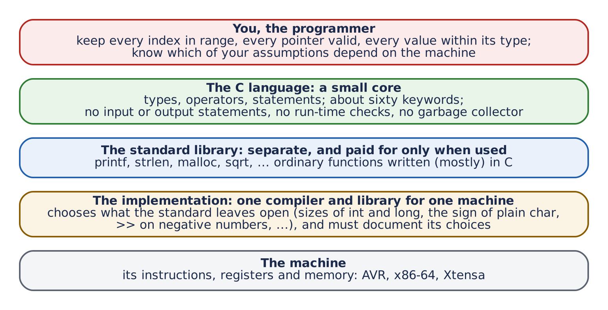
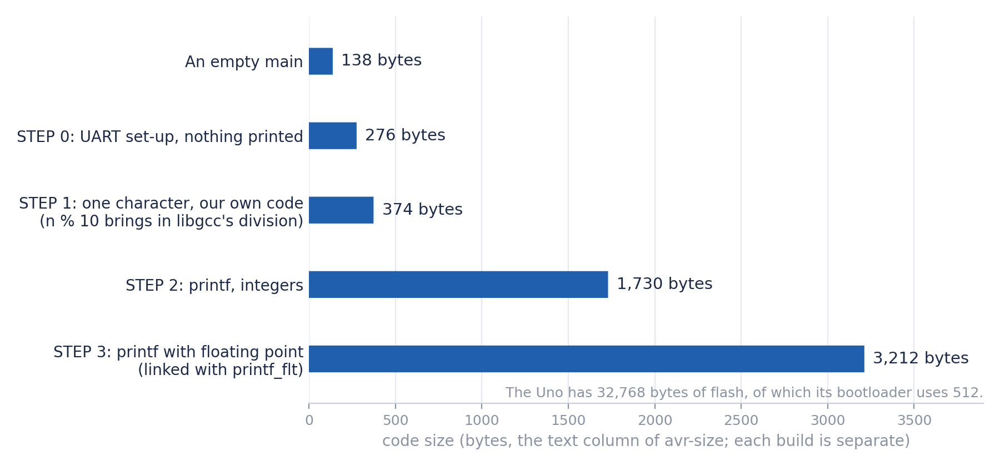

ref: 02.02
title: The Design Philosophy of C
chapter: Chapter 02 — Why C Exists
part: Part I — The Machine Beneath C
builds: §02.01
---
## The question

§02.01 followed the road to C, from the first high-level languages to the first standard, and showed what forced each step: a byte-addressed machine, a need for types, a wish to move Unix to new hardware. What came out of that road is a language with a very particular character. Here is the whole idea in two lines (Listing 02.02-2 makes them into a program you can run):

```text
int readings[4];
readings[4] = 7;        // there is no readings[4]
```

C compiles this. It does not stop you, and when the program runs, nothing tells you that the 7 went somewhere it should not. Most languages designed since the 1990s would reject it or stop the program. C was designed, on purpose, to do neither. So:

- What does it mean for a language to be "close to the machine, yet portable", and what does each half of that phrase demand?
- Why does C check so little? What would checks cost, and who pays for their absence?
- Why is C's core so small, and why is so much of what you use every day, `printf` included, not part of the language at all?
- Why does the standard leave some answers, such as whether a `char` can be negative, to each compiler?
- And, for the work you intend to do: is a language with this character a good one to fly in space?

This section answers these questions from the C committee's own statement of its principles, and tests each principle on your three machines. You will see an index run off the end of an array and change a different variable; the same program give two different answers at two optimization levels; a bounds check cost three instructions; `printf` cost about 1,450 bytes of the Uno's flash; and why your ESP32 is expected to disagree with your laptop about whether a character can be negative.

## The journey

### Two masters: the machine and portability

§02.01 showed C serving two masters at once. It must be **close to the machine**: a programmer writing a disk driver or the firmware of a satellite must be able to say exactly what happens to bits, addresses and registers, and to predict roughly what instructions each line becomes. And it must be **portable**: the same source must compile for an AVR, an x86-64 and an Xtensa, and run correctly on each.

These two demands pull in opposite directions. Each machine has its own word size, its own way of loading a byte, its own rules for shifting a negative number. A language that described one machine exactly would fit no other; a language that hid every machine completely would no longer be close to any. Most of C's design can be read as a set of decisions about where to stand between the two. Spell out what the two demands require, and six design decisions follow, which together give most of C's character:

1. **Types that are the machine's own.** An `int` is "the natural size suggested by the architecture", as the standard puts it, within limits. That is why §02.01's Listing 02.01-5 printed 4 bytes on your laptop and 2 on your Uno.
2. **Operators that are instructions.** `+`, `&`, `<<`, `*p` and `p[i]` were chosen because they correspond closely to what processors do. Where a processor lacks an operation (the AVR has no divide instruction, and no instruction that shifts by a variable number of places), the compiler emits a short loop or calls a small support routine, but only for an operator you wrote.
3. **Addresses as values.** Pointers hold addresses, and a program may compute with them (§02.01, and Chapter 24).
4. **No hidden work beyond what the operation itself requires.** No checks inserted behind your back, no memory reclaimed behind your back. (A short start-up routine does run before `main`, to prepare memory; §36.05 shows it.)
5. **A small core with a separate library.** Whatever does not need to be in the language is a function, written in C, that you include only if you call it.
6. **A standard that leaves room.** Where machines genuinely differ, the standard lets each implementation do what its machine does best, and requires it to say what it chose.

The first four decisions are what "close to the machine" demands; the last two are how C remains portable in spite of them. Figure 02.02-1 shows the resulting division of labor: who is responsible for what when a C program runs.

{w=15}

Notice the top box. A language that checks little must leave a great deal to the programmer. That is not an accident of history; it is the price of the four boxes below it, and the rest of this section is about that price.

First, see demand 2 with your own eyes. Listing 02.02-1 is five one-line functions.

```c Listing 02.02-1  C operations and the instructions they become
// ops.c
// Each C operation below maps onto very few machine instructions.
#include <stdint.h>

uint8_t mask(uint8_t a)  { return a & 0x0F; }       // keep the low 4 bits
uint8_t twice(uint8_t a) { return (uint8_t)(a << 1); }
int     add(int a, int b) { return a + b; }
uint8_t fetch(const uint8_t *p) { return *p; }
void    set_bit5(volatile uint8_t *reg) { *reg |= 1u << 5; }
```

```terminal
$ avr-gcc -mmcu=atmega328p -Os -Wall -Wextra -c ops.c -o ops.o
$ avr-objdump -d ops.o
```

The disassembly, without its header lines:

```output
00000000 <mask>:
   0:	8f 70       	andi	r24, 0x0F	; 15
   2:	08 95       	ret

00000004 <twice>:
   4:	88 0f       	add	r24, r24
   6:	08 95       	ret

00000008 <add>:
   8:	86 0f       	add	r24, r22
   a:	97 1f       	adc	r25, r23
   c:	08 95       	ret

0000000e <fetch>:
   e:	fc 01       	movw	r30, r24
  10:	80 81       	ld	r24, Z
  12:	08 95       	ret

00000014 <set_bit5>:
  14:	fc 01       	movw	r30, r24
  16:	90 81       	ld	r25, Z
  18:	90 62       	ori	r25, 0x20	; 32
  1a:	90 83       	st	Z, r25
  1c:	08 95       	ret
```

Every function is one to four instructions plus `ret`. `a & 0x0F` is one `andi`; `a << 1` is one `add r24, r24` (adding a number to itself is the same as shifting it left by one bit; the AVR's "logical shift left" instruction, `lsl r24`, is literally this instruction under another name, which is why the disassembler prints `add`); `a + b` on a 16-bit `int` is `add` and `adc`, the two-byte addition of §01.03; `*p` is "put the address in Z, load one byte"; and `*reg |= 1u << 5` is load, `ori` with `0x20` (binary `0010 0000`, bit 5), store. The compiler even worked out `1u << 5` itself while compiling, so no shift is done at run time. (Experiment 02.02-2 asks you to predict the x86-64 version.)

This is what programmers mean when they call C a "high-level assembler". The C committee uses the phrase itself, in its charter, as a use of C that the standard must not prevent. You write in terms of types and expressions, and you can still see the instructions underneath.

:::precise
"Natural size", but only within limits. C23 requires an `int` to be at least 16 bits wide, so that it holds at least −32,768 to +32,767 (earlier standards, which still allowed other representations of negative numbers, said −32,767). The ATmega328P is an 8-bit processor, so its natural size would be 8 bits, and the requirement forces a 16-bit `int`, which costs two instructions per addition, as `add` shows above. Close to the machine, then, means "as close as the standard allows". There is a revealing exception: avr-gcc offers an option, `-mint8`, that makes `int` 8 bits. It produces smaller code, and GCC's manual warns that it does not conform to the C standards. Here, in one compiler switch, you can see the two masters pulling against each other.
:::

### The committee's own words: the spirit of C

When ANSI's committee standardized C in the 1980s, it did not only write rules; it wrote down the principles it used to judge every proposal, in a companion document called the **Rationale**. Among them is a list it called "the spirit of C", which it described as the community's shared sense of what the language is for. Later revisions of the standard (C99, C11, C23) kept the list in their charters, the documents in which the committee sets out how it will work. Table 02.02-1 gives the list, with what each facet means in practice.

Table: Table 02.02-1  The spirit of C, as listed by the C committee, and what each facet means in practice
<!-- widths: 30,40,30 -->
| Facet (paraphrased from the Rationale and charters) | What it means in practice | Where you see it |
|---|---|---|
| (a) Trust the programmer | The language assumes you meant what you wrote | No bounds checks (Listing 02.02-2) |
| (b) Do not stop the programmer from doing what must be done | Even dangerous operations are available | Converting a number into an address (§02.01) |
| (c) Keep the language small and simple | A small core; everything else is a library | About sixty keywords; `printf` is a function |
| (d) Provide only one way to do an operation | Few overlapping features | (Honored only loosely, as you will see) |
| (e) Make it fast, even if it is not guaranteed to be portable | The machine's natural choices win over uniformity | `int` sizes; signed or unsigned `char` |
| (f) Make support for safety and security demonstrable (added for C11) | Programmers need ways to check their work | `static_assert`; Annex K, optional bounds-checked functions such as `strcpy_s` (not provided by glibc) |

Read the first five facets together and they describe a deal: the language gives you speed, small size and full access to the machine, and in exchange you take responsibility for correctness. The sixth facet is newer, and its history is instructive. When the committee prepared C11, it wrote into its charter that "trust the programmer", as a goal, had become outdated in the eyes of the communities concerned with security and safety, and that programmers needed the ability to check their work. In 2024 the committee went further: its new charter (WG14 document N3280) lists among its guiding principles enabling secure programming and enabling functional safety, by enlarging the part of the language that tools can analyze and removing unbounded undefined behavior. The spirit of C has not been abandoned, but it is being amended, slowly and carefully, because the price of the original deal turned out to be high.

To understand that price, we must look at what C does not check.

### Trusting the programmer: no bounds checks

Listing 02.02-2 is the preview from the beginning of this section, made into a complete program. A `struct` (Chapter 28) groups four readings and a checksum, and a loop stores 7 into the readings, but runs one step too far.

```c Listing 02.02-2  Writing one element past the end of an array
// overrun.c
// C trusts the programmer: an index one past the end is not caught.
#include <stdio.h>

struct record {
    int readings[4];
    int checksum;
};

void store(struct record *r, int i, int value) {
    r->readings[i] = value;             // no check that 0 <= i < 4
}

int main(void) {
    struct record r = { {0, 0, 0, 0}, 1234 };
    for (int i = 0; i <= 4; ++i) {      // one step too many: i reaches 4
        store(&r, i, 7);
    }
    printf("checksum = %d\n", r.checksum);
}
```

- Lines 5–8 declare the structure: an array of four `int`s, then one more `int`. In memory they lie side by side, as Figure 02.02-2 shows.
- Lines 10–12: `store` writes `value` into element `i`. C does not check that `i` is between 0 and 3, and nothing in the language requires it to (a compiler option can add a check here for testing, as the box below shows).
- Line 16 is the mistake: `i <= 4` should be `i < 4`, so the last call writes to `readings[4]`, an element that does not exist.
- Line 19 prints the checksum, which nothing in the program meant to change.

![Figure 02.02-2  Where readings[4] would be: the bytes of checksum](fig_overrun.png){w=15}

Compile it without optimization and run it:

```terminal
$ gcc -std=c23 -Wall -Wextra -pedantic -O0 overrun.c -o overrun
$ ./overrun
```

```output
checksum = 7
```

The program ran to the end and reported nothing wrong. The array's address plus 4 elements of 4 bytes is offset 16 from the start of the structure, and offset 16 is where `checksum` lives. So `readings[4] = 7` stored 7 into the checksum. Now compile the *same file* with optimization:

```terminal
$ gcc -std=c23 -Wall -Wextra -pedantic -O2 overrun.c -o overrun
$ ./overrun
```

```output
In function 'store',
    inlined from 'main' at overrun.c:17:9:
overrun.c:11:20: warning: iteration 4 invokes undefined behavior [-Waggressive-loop-optimizations]
   11 |     r->readings[i] = value;             // no check that 0 <= i < 4
      |     ~~~~~~~~~~~~~~~^~~~~~~
overrun.c: In function 'main':
overrun.c:16:23: note: within this loop
   16 |     for (int i = 0; i <= 4; ++i) {      // one step too many: i reaches 4
      |                     ~~^~~~
checksum = 1234
```

This time GCC noticed something while optimizing and warned that the loop's fifth iteration "invokes undefined behavior". And the program printed **1234**: the checksum untouched. The ATmega328P does the same. Built with avr-gcc 7.3 and run on the simulator, with `printf` connected to the serial port by a few extra lines like the `#ifdef __AVR__` lines of Listing 02.01-5 (kept in a separate file, so the listing is unchanged), it gave `checksum = 7` at `-O0` and `checksum = 1234` at `-Os`. (As in §02.01, simavr's coloring and line endings are omitted from outputs in this section.)

How can one source file give two answers? Because, in the C standard's terms, writing outside an array is **undefined behavior**: the standard places *no requirements at all* on what the program does. At `-O0` the compiler translated each line literally, and the store landed on the checksum. At `-O2` the compiler was entitled to assume that a correct program never writes past the end of an array; it counts iterations from 0, so "iteration 4" is the fifth, the one that writes `readings[4]`. Working from that assumption, it removed the loop entirely: the assembly language it generated for `main` (see it with `gcc -O2 -S overrun.c`) contains no loop and no stores, only the constant 1234 passed straight to `printf`. Neither result is "right". The program has no meaning, and any behavior is permitted. §02.04 is devoted to this idea, and Chapter 34 to defending against it; for now, notice two things. The language did not stop you. And the outcome depended on what the compiler was allowed to assume, not on what you intended.

:::hood
Why does C not simply check every index? Because an array in C, once passed to a function, is only an address (§02.01: an array's name is converted to the address of its first element). Inside `store`, the compiler knows `r->readings` has 4 elements, because that is part of the structure's type. But in the common case of a function receiving `int *a`, nothing in the pointer records how many elements follow it. To check an index, the program would have to carry the length alongside every pointer, making every pointer twice as large, and test it on every access. C's designers chose to carry nothing. GCC's optional checker shows the limit clearly: compiled with `-fsanitize=bounds`, Listing 02.02-2 reports `runtime error: index 4 out of bounds for type 'int [4]'`, because the array's size is visible in its type; but the same option inserts no check at all into a function that receives a plain pointer (Experiment 02.02-3), and by default it does not check an array that is the *last* member of a structure, for a historical reason Experiment 02.02-1 uncovers.
:::

### What a check would cost

If checks are so useful, why not insert them anyway? Because a check is not free, and C's designers refused to make anyone pay for one they had not asked for. Listing 02.02-3 measures the price of the simplest possible check.

```c Listing 02.02-3  The same access, with and without a bounds check
// checked.c
// The price of one bounds check, counted in instructions.
#include <stddef.h>

// The C way: trust the caller to pass 0 <= i < n.
int get(const int *a, size_t n, size_t i) {
    (void)n;                        // n is not even looked at
    return a[i];
}

// The checked way: test the index first, and return 0 if it is outside.
int get_checked(const int *a, size_t n, size_t i) {
    if (i < n) {
        return a[i];
    }
    return 0;
}
```

`size_t` (line 6) is the standard's unsigned type for sizes and indexes (§06.02); `(void)n;` on line 7 tells the compiler that ignoring `n` is deliberate, which silences a warning.

```terminal
$ avr-gcc -mmcu=atmega328p -Os -Wall -Wextra -c checked.c -o checked.o
$ avr-objdump -d checked.o
```

```output
00000000 <get>:
   0:	44 0f       	add	r20, r20
   2:	55 1f       	adc	r21, r21
   4:	48 0f       	add	r20, r24
   6:	59 1f       	adc	r21, r25
   8:	fa 01       	movw	r30, r20
   a:	80 81       	ld	r24, Z
   c:	91 81       	ldd	r25, Z+1	; 0x01
   e:	08 95       	ret

00000010 <get_checked>:
  10:	46 17       	cp	r20, r22
  12:	57 07       	cpc	r21, r23
  14:	00 f4       	brcc	.+0      	; 0x16 <get_checked+0x6>
  16:	44 0f       	add	r20, r20
  18:	55 1f       	adc	r21, r21
  1a:	48 0f       	add	r20, r24
  1c:	59 1f       	adc	r21, r25
  1e:	fa 01       	movw	r30, r20
  20:	80 81       	ld	r24, Z
  22:	91 81       	ldd	r25, Z+1	; 0x01
  24:	08 95       	ret
  26:	90 e0       	ldi	r25, 0x00	; 0
  28:	80 e0       	ldi	r24, 0x00	; 0
  2a:	08 95       	ret
```

- `get` is eight instructions. The first two double the index (`add r20, r20`, `adc r21, r21`), because each `int` is 2 bytes: this is the pointer scaling of §02.01, done at run time because `i` is a variable. The next two add the array's address, then Z is loaded and two bytes read.
- `get_checked` is the same eight, preceded by three more: `cp` and `cpc` compare `i` with `n` as 16-bit numbers (§01.03's subtraction, keeping only the flags), and `brcc` ("branch if carry clear") jumps to the `return 0` path at `0x26` if `i` is not less than `n`. (`.+0` is a jump the linker has not yet filled in, as in §02.01.)

Three instructions, three or four clock cycles on the AVR, out of about eleven, and six more instructions (12 bytes) of code once the `return 0` path is counted: in a tight loop, a check like this can add roughly a quarter to the cost of every access. On your laptop the same check costs three short instructions too, though a modern processor predicts the branch and often hides much of the cost. Compilers can sometimes prove that an index is always in range and remove a check altogether, but not always. And there is a second cost that instruction counts do not show: when a check fails, *something* must happen. Should the program stop? Return a default value, as `get_checked` does? Report an error to whom? A language that checks automatically must choose an answer for every program, and the choice may be wrong for yours.

:::history
The rocket Ariane 5 failed on its first flight, on June 4, 1996, when it lost its guidance about 37 seconds after its main engine started, and the inquiry board's report shows both costs at once. Its inertial reference software was written not in C but in Ada, a language that *does* check conversions at run time. A conversion of a 64-bit floating-point value, the "horizontal bias", into a 16-bit signed integer received a value too large to fit, and the check fired. Not every such conversion had been given a handler of its own, the report explains, because a maximum workload target of 80% had been set for the computer. So the system-wide rule for any exception applied, as specified: report the failure and shut the processor down. Both inertial reference units, running identical software, did exactly that. The checking language detected the error perfectly; what failed was the engineering decision about what to do when the check fired, and the budget that had removed some of the protection. Checks are tools, not guarantees. §04.05 and §10.05 return to this failure and to the arithmetic behind it.
:::

### Trusting the programmer: no garbage collector

The second thing C deliberately leaves out is a **garbage collector**: a part of a language's run-time system that finds memory the program no longer uses and reclaims it automatically. Languages such as Java, Python and Go have one, and their programmers can create objects freely, knowing that unused ones will eventually be recycled.

To work exactly, a garbage collector must be able to look at memory while the program runs and tell which words are pointers, so that it can follow them and find everything still reachable; such a collector is called **precise**. That requires the type of every value to be known at run time, and it requires the collector to run, at moments the program does not choose, for durations that depend on how much memory is in use. These requirements conflict with C's design:

- C values carry no type information at run time. A word of memory is just bits (§02.01's lesson about BCPL, in a new form); only the compiler, while compiling, knew what they meant. (A *conservative* collector, such as the Boehm collector, can still be added to a C program as a library: it treats every word that looks like an address as a pointer, so it sometimes keeps garbage alive. But it is optional, it is not part of C, and it still pauses the program.)
- C programs must be able to run without any run-time system, on a bare chip with 2 KB of RAM (and 32 KB of flash), as your Uno does.
- C programs must be able to predict their own timing. A satellite's attitude-control loop that must run every 10 milliseconds cannot pause for an unpredictable time to reclaim memory.

So C gives you three kinds of storage and leaves their management to you: memory fixed for the whole run of the program, memory on the stack that appears and disappears with each function call (Chapter 19), and memory you request with `malloc` and must give back with `free` (Chapter 26). Forgetting to give memory back wastes it; giving it back and then using it again corrupts the program. Both are among the most common serious faults in C programs, and both are possible precisely because the language does not watch.

Flight software often answers by not using the third kind at all. One of the rules Gerard Holzmann of NASA's Jet Propulsion Laboratory proposed in 2006 for safety-critical C forbids dynamic memory allocation after initialization: allocate everything once at start-up, and never again. A program with no allocation in flight cannot exhaust its heap in flight and cannot leak memory; and with recursion also forbidden (another of the same rules), the stack can be bounded too (§35.04), so the program's memory use can be verified before launch. That is "trust the programmer" answered by a programmer who has decided not to trust himself.

:::myth
"C is unsafe, so serious engineers should never use it", and its opposite, "C is perfectly safe in careful hands." Both are wrong. C is *unchecked*: it performs no checks that you did not write, so every guarantee comes from the programmer's discipline, from the tools used around the language, and from the way the program is tested. Careful engineers working in C, with a restricted subset of the language, static analysis and rigorous testing, have built systems that have run reliably for many years in space and in medical devices. Careful engineers have also shipped C programs with buffer overflows that were exploited for years. The honest statement is that C moves responsibility from the language to the engineer and the engineering process; whether that is acceptable depends on whether the process is good enough. Chapter 34 and Chapter 35 are about making it good enough.
:::

### A small language with a separate library

The third facet is smallness. C89 had 32 **keywords** (the reserved words such as `int`, `if`, `while` and `return`), and even after C99, C11 and C23 added new ones, C23 has about sixty, counting older alternative spellings that remain reserved. A careful programmer can know the whole language.

Part of the secret is that much of what other languages build in, C leaves to a **library**: a collection of ordinary functions, written mostly in C, that a program uses by calling them. C has no statement for printing, reading a file or computing a square root. `printf`, `fopen`, `strlen` and `sqrt` are functions, declared in headers such as `<stdio.h>`, compiled once, and joined to your program only if you call them. FORTRAN and COBOL built input and output into their statements, and ALGOL 60 defined none at all, so each of its implementations invented its own. C kept the approach of its ancestors BCPL and B, whose input and output were already library routines (B even had a `printf`). What the 1989 standard added was a library defined once, which every **hosted** implementation (one that runs programs under an operating system, or something that plays its role; §02.06 makes this precise) must supply in the same form.

The consequence that matters most on a small machine is that **you pay only for what you use**: when the library is linked into the program file itself, as on the Uno, only the functions you call are copied in. (On your laptop the C library is usually a shared file, loaded alongside every program, so there the saving is in each program's own size rather than in memory.) Listing 02.02-4 measures it on the Uno, building one program four ways.

```c Listing 02.02-4  Measuring what the library adds
// libcost.c
// What does the library add? Build with -DSTEP=0, 1, 2 or 3 and compare sizes.
#include <stdio.h>
#include <avr/io.h>

static int uart_putchar(char c, FILE *f) {
    (void)f;
    while (!(UCSR0A & (1 << UDRE0))) {}
    UDR0 = c;
    return 0;
}
static FILE uart = FDEV_SETUP_STREAM(uart_putchar, NULL, _FDEV_SETUP_WRITE);

int main(void) {
    UCSR0A = (1 << U2X0); UBRR0 = 16;       // about 115,200 baud
    UCSR0B = (1 << TXEN0);
    stdout = &uart;
    volatile int    n = 42;                 // volatile: computed at run time
    volatile double x = 3.25;
#if STEP == 0
    (void)n; (void)x;                       // no library function called
#elif STEP == 1
    (void)x;
    uart_putchar((char)('0' + n % 10), NULL);   // our own code; % needs libgcc
#elif STEP == 2
    (void)x;
    printf("%d\n", n);                      // the library's printf, integers only
#elif STEP == 3
    printf("%d %.2f\n", n, x);              // printf with floating point
#endif
    for (;;) {}
}
```

- Lines 6–12 and 15–17 are the serial-port connection of §02.01's Listing 02.01-5, present in all four versions.
- Lines 18–19 declare two variables `volatile`, which forces the compiler to read their values from memory at run time, so that work done with them is really done by the program and not folded into constants while compiling (§36.04 explains `volatile` fully). It matters most in STEP 1: without it, the compiler would work out `'0' + n % 10` itself and need no division at all.
- Lines 20–30 use the preprocessor (§22.05) to choose one of four bodies; `-DSTEP=2` on the command line selects the third.

```terminal
$ avr-gcc -mmcu=atmega328p -Os -Wall -Wextra -DSTEP=0 libcost.c -o lc0.elf
$ avr-size lc0.elf
$ avr-gcc -mmcu=atmega328p -Os -Wall -Wextra -DSTEP=3 libcost.c -o lc3.elf
$ avr-gcc -mmcu=atmega328p -Os -Wall -Wextra -DSTEP=3 \
      -Wl,-u,vfprintf -lprintf_flt -lm libcost.c -o lc3f.elf
```

The `text` column of `avr-size` for each build, together with an empty `int main(void) {}` for comparison. (Flash also holds the small `data` column, the initial values of variables and, on the AVR, every string literal, which the start-up code copies into RAM; here it is only 14 to 24 bytes, so `text` is a fair measure, but note that on the AVR even format strings occupy scarce RAM.)

Table: Table 02.02-2  Code size of Listing 02.02-4 on the ATmega328P (avr-gcc 7.3.0, -Os; avr-size text)
<!-- widths: 52,18,30 -->
| Build | Code (bytes) | Prints |
|---|---|---|
| An empty `main`, for comparison | 138 | nothing |
| STEP 0: UART set-up, nothing printed | 276 | nothing |
| STEP 1: our own code sends one character | 374 | `2` (simavr shows nothing until a newline) |
| STEP 2: `printf("%d\n", n)` | 1,730 | `42` |
| STEP 3: `printf("%d %.2f\n", n, x)`, default library | 1,740 | `42 ?` |
| STEP 3, linked with the floating-point `printf` | 3,212 | `42 3.25` |

{w=15}

Read it from the top, with Figure 02.02-3. Even an empty `main` occupies 138 bytes: the table of interrupt vectors at address 0 (104 bytes on this chip) and the short start-up code that prepares memory and calls `main` (§36.05). STEP 0 adds our UART set-up and `uart_putchar`, for 276 bytes. STEP 1 adds 98 bytes, and 80 of them are not ours: the AVR has no divide instruction, so `n % 10` calls `__divmodhi4`, a routine from GCC's support library, **libgcc** (`avr-nm lc1.elf` shows it). Even an operator can bring in library code. Compared with STEP 0, calling `printf` (STEP 2) adds 1,454 bytes, because `printf` is a substantial program that interprets its format string at run time. And look at the first STEP 3 row: the default `printf` in avr-libc, the AVR's C library, *cannot print floating-point numbers at all*; it prints `?`. Its authors left floating-point formatting out of the default version, because it would cost every program that uses `printf` another 1.5 KB of a 32 KB chip, and most programs on such a chip never print a fraction. If you want it, you ask the linker for the larger version (`-lprintf_flt`), and you pay for it. Nothing could illustrate the philosophy more exactly: not only is the library separate from the language, but within the library you choose the size of what you get.

(The Arduino environment, for its part, offers `Serial.print`, a set of printing functions written in C++ and likewise linked only if used.)

The standard even allows an implementation that provides only a handful of headers and leaves the way a program starts to the implementation; it calls such an implementation **freestanding**. That describes many bare-chip toolchains, though not all: avr-gcc on your bare ATmega328P reports itself as hosted and supplies `printf`. §02.06 explains the difference between hosted and freestanding implementations, and why the program's start is not really `main`.

### What C deliberately leaves to the implementation

The sixth demand of our list, a standard that leaves room, is the most subtle part of C's design, and the one that most surprises programmers who move between machines. The standard distinguishes several kinds of behavior, which §02.04 treats in full. The one that matters here is **implementation-defined behavior**: something the standard does not fix, but which each implementation must choose and document. GCC, for example, devotes a chapter of its manual to its choices.

Why leave anything open? The committee's charter explains with an example that has followed C since the PDP-11: whether a `char` widens to a signed or an unsigned value "typically depends on which byte operation is more efficient on the target machine." On the PDP-11, the instruction that loaded a byte into a register (`MOVB`) copied the byte's top bit into all the upper bits (**sign extension**): a byte holding `11001000` became the 16-bit value `1111111111001000`, which is −56. Making `char` signed meant that every character load was one instruction; making it unsigned would have needed an extra instruction to clear the upper bits each time. So on the PDP-11, `char` was signed. Machines whose byte loads naturally fill the upper bits with zeros made the opposite choice. (Henry Spencer, a well-known C expert of the time, recalled in 1986 that Ritchie had come to regret this concession to the hardware.)

A second example shows the standard tightening over time. In C89, when one operand of `/` was negative, whether `-7 / 2` gave −3 or −4 was implementation-defined, so that each implementation could use its processor's division instruction directly, without extra code to adjust the result. FORTRAN, however, had always required division to round toward zero, and by the 1990s nearly all hardware did the same. So C99 fixed the rule: integer division rounds toward zero, and `-7 / 2` is −3 everywhere. A freedom that no machine needed any longer was withdrawn.

Listing 02.02-5 asks your implementation some of the questions the standard leaves open.

```c Listing 02.02-5  Asking the implementation what it chose
// choices.c
// Ask the implementation some questions the C standard leaves to it.
#include <stdio.h>
#include <limits.h>

int main(void) {
    printf("bits in a byte (CHAR_BIT): %d\n", CHAR_BIT);
    printf("plain char is:             %s\n", CHAR_MIN < 0 ? "signed" : "unsigned");
    printf("bytes in an int:           %u\n", (unsigned)sizeof(int));
    printf("largest int (INT_MAX):     %ld\n", (long)INT_MAX);

    char c = (char)200;             // 200 does not fit in a signed 8-bit char
    printf("(char)200 reads back as:   %d\n", c);

    int n = -7;
    printf("-7 >> 1 gives:             %d\n", n >> 1);
    printf("-7 / 2 and -7 %% 2 give:    %d and %d\n", n / 2, n % 2);
}
```

- Line 4: `<limits.h>` is the standard header in which each implementation records its choices for the integer types, as named constants such as `CHAR_BIT`, `CHAR_MIN` and `INT_MAX` (§05.02, §05.03).
- Line 8: if the smallest value a `char` can hold is below zero, `char` is signed.
- Line 12 converts 200 into a `char`. If `char` is unsigned it fits; if `char` is signed (range −128 to 127) it does not, and the result is, again, implementation-defined. GCC documents that it keeps the low 8 bits, which as a signed byte mean 200 − 256 = −56.
- Line 16: shifting a *negative* number right is implementation-defined, because some processors have only a shift that fills the vacated top bits with zeros.
- Line 17: division and remainder, fixed since C99.

On your laptop, then with GCC told to make `char` unsigned, then on the simulated ATmega328P:

```terminal
$ gcc -std=c23 -Wall -Wextra -pedantic choices.c -o choices
$ ./choices
```

```output
bits in a byte (CHAR_BIT): 8
plain char is:             signed
bytes in an int:           4
largest int (INT_MAX):     2147483647
(char)200 reads back as:   -56
-7 >> 1 gives:             -4
-7 / 2 and -7 % 2 give:    -3 and -1
```

```terminal
$ gcc -std=c23 -Wall -Wextra -pedantic -funsigned-char choices.c -o choices
$ ./choices
```

```output
bits in a byte (CHAR_BIT): 8
plain char is:             unsigned
bytes in an int:           4
largest int (INT_MAX):     2147483647
(char)200 reads back as:   200
-7 >> 1 gives:             -4
-7 / 2 and -7 % 2 give:    -3 and -1
```

On the ATmega328P, built with avr-gcc 7.3 and run on the simulator (the program's text is unchanged; a small harness connects `printf` to the serial port):

```output
bits in a byte (CHAR_BIT): 8
plain char is:             signed
bytes in an int:           2
largest int (INT_MAX):     32767
(char)200 reads back as:   -56
-7 >> 1 gives:             -4
-7 / 2 and -7 % 2 give:    -3 and -1
```

Three things deserve attention.

1. **The sign of `char` is a compiler setting, not a law of nature.** One option, `-funsigned-char`, changed it on the same machine. That option exists because code written for one convention must sometimes be compiled for a machine with the other.
2. **Your three machines do not agree.** On x86-64 and on the AVR, GCC makes `char` signed. On the ESP32, GCC's configuration for the Xtensa processor makes plain `char` *unsigned* (it sets its internal `DEFAULT_SIGNED_CHAR` to 0), as GCC does for ARM processors too. The PDP-11's argument, reversed, suggests why: the Xtensa's only instruction for loading a single byte, `L8UI` ("load 8-bit unsigned immediate"), fills the upper bits with zeros, and early ARM processors' byte load did the same, so on them an unsigned `char` is the cheap one. A program that stores 200 in a `char` and tests whether it is greater than 100 will answer differently on your laptop and on your ESP32 (Experiment 02.02-5), with no warning on either. The cure is simple: when the sign matters, say `signed char` or `unsigned char` (or `uint8_t`), never plain `char`.
3. **`>>` is not division.** `-7 >> 1` gave −4, but `-7 / 2` gave −3. In two's complement (§01.03), −7 is `...11111001`. GCC's right shift copies the sign bit into the vacated position (an **arithmetic shift**), giving `...11111100`, which is −4: shifting rounds toward minus infinity, while division rounds toward zero. A programmer who "optimizes" `x / 2` into `x >> 1` by hand changes the answer for negative odd numbers. The compiler, which knows both rules, does not make that mistake: for a signed `x / 2` it emits a shift plus a small correction.

Table 02.02-3 gathers the answers for your three machines.

Table: Table 02.02-3  Some implementation choices on the three machines of this book
<!-- widths: 28,24,24,24 -->
| Question | x86-64 (GCC) | AVR (avr-gcc) | ESP32 (Xtensa GCC) |
|---|---|---|---|
| Bits in a byte | 8 | 8 | 8 |
| Plain `char` is | signed | signed | unsigned |
| Bytes in an `int` | 4 | 2 | 4 |
| `-7 >> 1` | −4 | −4 | expected −4 |
| `-7 / 2` | −3 (required since C99) | −3 | −3 |

(The ESP32 column comes from GCC's Xtensa configuration and documented sizes, not from a run; Hands-on B asks you to check it.)

### C in spacecraft and embedded systems

You intend to work on systems that fly. How does C's character serve them? Table 02.02-4 sets out the balance, and the paragraphs after it explain the main entries.

Table: Table 02.02-4  C's strengths and weaknesses for spacecraft and embedded systems
<!-- widths: 50,50 -->
| Strengths | Weaknesses |
|---|---|
| Translation you can predict, line by line, down to the instructions (Listing 02.02-1); timing can be analyzed | No bounds checks: one wrong index silently corrupts other data (Listing 02.02-2) |
| No hidden run-time machinery: no garbage collector, no pauses; runs on a bare chip | Manual memory management: leaks and use after free are possible |
| Direct access to hardware registers and to individual bits | Undefined behavior: a faulty program may behave differently at different optimization levels |
| Compilers exist for almost every processor, including radiation-tolerant ones | Implementation-defined choices that differ between machines (Table 02.02-3) |
| Decades of stability: most old code still compiles; large body of tools and expertise | Few guarantees from the language itself: safety must come from the process |
| You pay only for the library functions you call (Table 02.02-2) | Easy to write code that compiles cleanly and is still wrong |

The strengths are exactly what flight software needs. A radiation-tolerant processor such as ESA's LEON family, a SPARC design built for European spacecraft, is supported by GCC-based C compilers, among them Gaisler's BCC for programs with no operating system. RTEMS, an open-source real-time operating system written in C, runs on LEON processors, and ESA has funded its qualification for space use; an improved, qualified version is used in ESA missions including Galileo's FOC satellites and Solar Orbiter. NASA's core Flight System, which §02.01 introduced, is written in C. Timing can be bounded because there is no hidden work, and memory use can be bounded because nothing allocates behind the programmer's back.

The weaknesses are equally real, and the space and safety communities have answered them not by abandoning C but by **restricting** it and **checking** it:

- **Coding standards that define a safer subset.** MISRA C, first published in 1998 for the motor industry, now in its 2025 edition, is a set of rules that forbid or restrict the constructs most likely to cause undefined or surprising behavior. Holzmann's ten rules of 2006 are a shorter, stricter set, written to make code checkable by tools. (§35.02 studies both, with the reason behind each rule.)
- **Tools that check what the language does not.** Compiler warnings, static analyzers that examine every path through a program without running it, and run-time checkers such as the sanitizers you met above, used during testing.
- **Designs that avoid the dangerous features.** No dynamic allocation in flight, every loop with a fixed upper bound, every function's return value checked.

:::orbit
Two of Holzmann's rules show how a team turns C's trust into verifiable discipline. One requires every loop to have a fixed upper bound that a checking tool can establish without running the program. Another forbids allocating memory from the heap after initialization. Neither is a feature of C; both are promises made by the programmers, and both make it possible to prove, before launch, that the software cannot run forever in one loop or run out of memory in flight. The language gives freedom; the mission takes most of it back, on purpose, and keeps only what it can verify. This is the most important engineering lesson of this section: C's philosophy places the responsibility for correctness on people and processes, and in space those processes must be designed as carefully as the hardware.
:::

### The philosophy as a contract

Return to Figure 02.02-1. C's design is best understood as a contract with four parties. The language promises a small, predictable core whose operations map closely onto the machine. The library promises standard functions that you pay for only when you call them. The implementation promises to choose sensibly where the standard leaves room, and to document what it chose. And you, the programmer, promise everything else: that every index is in range, every pointer valid, every value within its type, and that every assumption you make about the machine is either guaranteed by the standard or knowingly tied to one implementation.

The rest of this book is, in a sense, a long explanation of that last promise: what exactly you are promising, how to keep it, and how to use tools to check that you have. The next section takes the first step, by asking precisely what the C standard describes, if not your processor.

## Terms introduced

- **Close to the machine**: having types, operators and addresses that correspond closely to what processors provide, so that translation into instructions is direct and predictable.
- **High-level assembler**: an informal name for C used in this sense, which the C committee's charter itself uses.
- **Rationale**: the document published with a C standard explaining the committee's reasons.
- **Charter**: the document in which the C committee sets out the principles and plan for a revision of the standard.
- **Spirit of C**: the committee's list of the principles behind C, beginning with "trust the programmer".
- **Bounds check**: a test, made while the program runs, that an index lies within an array.
- **Undefined behavior**: behavior for which the C standard imposes no requirements (§02.04).
- **Sanitizer**: a compiler option that inserts run-time checks for certain errors during testing, such as `-fsanitize=bounds` or `-fsanitize=address`.
- **Garbage collector**: run-time machinery that finds and reclaims memory a program no longer uses.
- **Keyword**: a word reserved by the language, such as `int` or `while`.
- **Standard library**: the functions and headers that every hosted C implementation must provide, such as `printf` and `strlen`.
- **Hosted implementation**: one that supplies the whole standard library and starts the program at `main`; typically, but not necessarily, under an operating system (§02.06).
- **Freestanding implementation**: one that need provide only a few headers, and in which the way the program starts is implementation-defined; typical of, but not the same as, running without an operating system (§02.06).
- **libgcc**: GCC's support library of small routines for operations a processor lacks, such as division on the AVR.
- **Conservative garbage collector**: a collector that treats any word that might be an address as a pointer; it can work without type information, at the cost of sometimes keeping garbage alive.
- **Implementation-defined behavior**: behavior the standard leaves open but each implementation must choose and document.
- **Sign extension**: filling the upper bits of a wider value with copies of a narrower value's top (sign) bit.
- **Arithmetic shift**: a right shift that fills the vacated top bits with copies of the sign bit; it rounds toward minus infinity.
- **MISRA C**: a widely used set of coding guidelines restricting C for critical systems.
- **Static analysis**: examining a program's source for errors without running it.

## Self-check

1. State the two demands that pull C in opposite directions, and give two features of C that serve each.
2. Why must an `int` on the ATmega328P be at least 16 bits, when the processor is 8-bit? What does avr-gcc's `-mint8` show?
3. In Listing 02.02-2, why does `readings[4] = 7` change `checksum` at `-O0`? Why may the program print 1234 at `-O2`?
4. Why can a C function that receives `int *a` not check its indexes automatically? What would the language have to add?
5. How many instructions did the bounds check of Listing 02.02-3 add on the AVR, and what does each do?
6. Besides the instructions, what second cost does an automatic check carry? Illustrate it with the Ariane 5 failure.
7. Give three reasons why a garbage collector does not fit C's design.
8. What does "you pay only for what you use" mean for C's library? Give the measured example from Table 02.02-2.
9. Why does avr-libc's default `printf` print `?` for `%.2f`?
10. What is implementation-defined behavior, and why does the standard allow it? Use the PDP-11's `MOVB` in your answer.
11. Why did C99 fix the rounding of integer division, when C89 had left it open?
12. Explain, bit by bit, why `-7 >> 1` gives −4 with GCC while `-7 / 2` gives −3.
13. A program stores 200 in a plain `char` and tests `c > 100`. What does it do on your laptop and on your ESP32, and how should it be written?
14. Name three strengths and three weaknesses of C for spacecraft, and two ways flight-software teams compensate for the weaknesses.

## Experiments

**Experiment 02.02-1. Sanitizers and their limits.** Compile Listing 02.02-2 with `-O0 -fsanitize=bounds` and then with `-O0 -fsanitize=address`, and run each. Which reports the error, and which does not? Then move `checksum` *before* `readings` in the structure (changing the initializer to `{ 1234, {0, 0, 0, 0} }`), and run both builds again. Explain the difference, using Figure 02.02-2.

**Experiment 02.02-2. Listing 02.02-1 on your laptop.** Before compiling, predict how many x86-64 instructions each function of Listing 02.02-1 will need. Then check:

```terminal
$ gcc -std=c23 -O2 -fcf-protection=none -c ops.c -o ops.o
$ objdump -d ops.o
```

Which C operations cost one instruction on x86-64 but two on the AVR, and why?

**Experiment 02.02-3. Where a bounds checker can and cannot look.** Compile Listing 02.02-3 with `-O2 -fsanitize=bounds -c`, and Listing 02.02-2 the same way. Disassemble each with `objdump -dr` (the `-r` shows the names of called functions that the linker has yet to fill in, as in §02.01) and search for `ubsan`. Explain why one file contains such calls and the other contains none.

**Experiment 02.02-4. Paying for features.** Build Listing 02.02-4 for STEP 3 with and without `-Wl,-u,vfprintf -lprintf_flt -lm`, compare the sizes with `avr-size`, and run both under the simulator (`simavr -m atmega328p -f 16000000 lc3.elf`; stop it with Ctrl+C). What does each print? What fraction of the Uno's 32 KB of flash does floating-point printing cost?

**Experiment 02.02-5. A portability bug in three lines.** Predict, then check, what this program (Listing 02.02-6) prints with plain `gcc`, with `gcc -funsigned-char`, and (if you have one) on an ESP32 using `Serial.println` instead of `puts`:

```c Listing 02.02-6  The sign of char as a hidden assumption
#include <stdio.h>
int main(void) {
    char c = (char)200;
    if (c > 100) puts("big"); else puts("small");
}
```

Rewrite it so that it prints the same on every machine.

**Experiment 02.02-6. Reading the charters.** Read the C23 charter (WG14 N2611) and the 2024 charter (WG14 N3280) on the open-std.org website. Find the "spirit of C" facets and the principles about safety and security. Which principles of Table 02.02-1 survive in N3280, and which new ones did the committee add?

## Hands-on (AVR / ESP32)

### A: ask your Uno

Listing 02.02-7 is the Arduino version of Listing 02.02-5. Upload it to the Uno and open the Serial Monitor at 115,200 baud.

```c Listing 02.02-7  The implementation's choices, as an Arduino sketch
// choices.ino  (Arduino Uno or ESP32)
// The Arduino version of Listing 02.02-5: ask each board the same questions.
#include <limits.h>

void line(const char *label, long value) {
  Serial.print(label);
  Serial.print(value);
  Serial.println();
}

void setup() {
  Serial.begin(115200);
  delay(500);
  Serial.print("plain char is: ");
  Serial.println(CHAR_MIN < 0 ? "signed" : "unsigned");
  line("bytes in an int: ", (long)sizeof(int));
  line("largest int: ", (long)INT_MAX);
  char c = (char)200;
  line("(char)200 reads back as: ", (long)c);
  int n = -7;
  line("-7 >> 1 gives: ", (long)(n >> 1));
  line("-7 / 2 gives: ", (long)(n / 2));
  line("-7 % 2 gives: ", (long)(n % 2));
}

void loop() {}
```

Run under the simulator, with a minimal stand-in for `Serial`, it printed:

```output
plain char is: signed
bytes in an int: 2
largest int: 32767
(char)200 reads back as: -56
-7 >> 1 gives: -4
-7 / 2 gives: -3
-7 % 2 gives: -1
```

### B: ask your ESP32

Upload the same sketch, unchanged, to the ESP32. This sketch was not run by the author on an ESP32. From GCC's configuration for the Xtensa processor (plain `char` unsigned, 32-bit `int`), the expected output is:

```output
plain char is: unsigned
bytes in an int: 4
largest int: 2147483647
(char)200 reads back as: 200
-7 >> 1 gives: -4
-7 / 2 gives: -3
-7 % 2 gives: -1
```

If your board prints `signed`, your Arduino core passes an option such as `-fsigned-char` to its compiler, and the result is still a lesson: the answer belongs to the implementation, not to the chip. Record what you see.

## Answers

**Self-check 1.** Close to the machine: types of the machine's natural sizes, operators that map onto instructions, pointers holding addresses, no hidden work. Portable: a small core with a separate standard library, and a standard that leaves some choices to each implementation while requiring them to be documented.

**Self-check 2.** C23 requires `int` to be at least 16 bits wide (range at least −32,768 to +32,767). `-mint8` makes `int` 8 bits for smaller code, and GCC's manual states that it does not conform to the C standards: the machine's natural size and the standard's minimum are in direct conflict.

**Self-check 3.** `readings[4]` would be at offset 16 bytes from the start of the structure, the same bytes as `checksum`, and the unoptimized build simply stores there. Writing outside the array is undefined behavior, so at `-O2` the compiler may assume it never happens; GCC removed the loop and printed the constant 1234. Neither output is guaranteed.

**Self-check 4.** A pointer records only an address, not how many elements follow it. Automatic checking would require every pointer to carry a length (or the language to track one) and every access to test it. (A sanitizer can check only where the array's size is visible in its type.)

**Self-check 5.** Three: `cp` and `cpc` compare `i` with `n` as 16-bit unsigned numbers by subtraction, setting the flags; `brcc` jumps to the `return 0` code if no borrow occurred, that is, if `i >= n`.

**Self-check 6.** Deciding what to do when a check fails. Ariane 5's Ada software detected the out-of-range conversion, but that conversion had no handler of its own, partly because protection had been limited to meet a processor workload target; the system-wide response to any exception, shutting the processor down, then shut down both inertial units.

**Self-check 7.** C values carry no type information at run time, so a precise collector could not tell pointers from other data (a conservative one can only guess, and is an optional library); C must run with no run-time system on very small machines; and collection would introduce pauses at moments the program cannot predict, which real-time and flight software cannot accept.

**Self-check 8.** Library code is copied into a statically linked program only if the program calls it. On the Uno, calling `printf` for an integer raised the program from 276 bytes (STEP 0) to 1,730 bytes; floating-point formatting raised it to 3,212 bytes.

**Self-check 9.** avr-libc's default `vfprintf` omits floating-point conversion to save flash on small chips; the full version is selected at link time with `-Wl,-u,vfprintf -lprintf_flt -lm`.

**Self-check 10.** Behavior the standard leaves open, which each implementation must choose and document. It lets each implementation use its machine's cheapest operations: the PDP-11's `MOVB` sign-extended a byte when loading it into a register, so a signed `char` cost one instruction per load and an unsigned one more.

**Self-check 11.** Because the freedom was no longer needed: FORTRAN already required rounding toward zero, nearly all hardware did it, and a single rule made programs portable. The C89 freedom had existed to avoid extra code on machines that rounded differently.

**Self-check 12.** −7 in two's complement ends in `...11111001`. An arithmetic right shift drops the last bit and copies the sign bit into the top, giving `...11111100`, which is −4 (rounding toward minus infinity). Division rounds toward zero, giving −3.

**Self-check 13.** On the laptop (signed `char`), `c` is −56, so it prints `small`; on the ESP32 (unsigned `char`), `c` is 200, so it prints `big`. Write `unsigned char c` (or `uint8_t c`) if 200 is meant, so that every machine agrees.

**Self-check 14.** Strengths, any three of: predictable translation and timing; no garbage collector or hidden run-time; direct hardware access; compilers for radiation-tolerant processors; stability; paying only for the library used. Weaknesses, any three of: no bounds checks; manual memory management; undefined behavior; implementation-defined differences; few language-level guarantees. Compensations: coding standards that restrict the language (MISRA C, the Power of Ten rules); static analysis and run-time checking tools in testing; designs that avoid dynamic allocation and unbounded loops.

**Experiment 02.02-1.** With `-fsanitize=bounds`, the author's build printed `overrun.c:11:16: runtime error: index 4 out of bounds for type 'int [4]'` and then `checksum = 7`. With `-fsanitize=address` it printed only `checksum = 7`: AddressSanitizer watches the boundaries between separate objects, and `readings[4]` is still inside the structure `r`, so it sees nothing wrong. With `checksum` first, `readings[4]` lies beyond the end of the structure: the unsanitized build printed `checksum = 1234` (the 7 went into whatever lay after `r`, undetected), and AddressSanitizer reported `stack-buffer-overflow` with a `WRITE of size 4`. `-fsanitize=bounds` now reported nothing. GCC treats an array at the *end* of a structure as possibly a "flexible" array, an old idiom in which a structure's last member is deliberately declared too small and memory is allocated for more elements (Chapter 28), so by default it does not check it. Adding `-fstrict-flex-arrays=3` restores the check: the author's build then printed `runtime error: index 4 out of bounds for type 'int [4]'`.

**Experiment 02.02-2.** With GCC 14.2 at `-O2`: `mask` is `mov` and `and` (2 instructions); `twice` is one `lea`; `add` is one `lea`; `fetch` is one `movzbl`; `set_bit5` is `movzbl`, `or`, `mov` (3); each followed by `ret`. Two operations cost one instruction on x86-64 but two on the AVR: `a + b`, because x86-64 adds 32-bit values directly while the 8-bit AVR adds a 16-bit `int` one byte at a time with a carry; and `*p`, because the AVR must first copy the address into its pointer register Z, while x86-64 can use any register as an address. (`mask` goes the other way: two instructions on x86-64, one on the AVR.)

**Experiment 02.02-3.** `overrun.c` contains calls to `__ubsan_handle_out_of_bounds` (its array type `int [4]` gives the size); `checked.c` contains none, because `get` and `get_checked` receive only a pointer, and the pointer's type says nothing about how many elements exist. (The test inside `get_checked` is your own code, not the sanitizer's.)

**Experiment 02.02-4.** 1,740 bytes printing `42 ?` without the option; 3,212 bytes printing `42 3.25` with it. The difference, 1,472 bytes, is about 4.5% of 32,768 bytes (and a little more of the 32,256 bytes left beside the Uno's bootloader).

**Experiment 02.02-5.** Plain `gcc` on x86-64: `small` (the author's run). `gcc -funsigned-char`: `big` (the author's run). ESP32: expected `big`, since its GCC makes plain `char` unsigned. Writing `unsigned char c = 200;` (or `uint8_t`) makes every machine print `big`; writing `signed char` makes every machine print `small`; either way, the program now says what it means.

**Experiment 02.02-6.** Your own reading. In N3280 the ideas of "trust the programmer" and "don't prevent the programmer from doing what needs to be done" survive as a principle of programming freedom, "keep the language small and simple" survives almost unchanged, and "make it fast" survives as attention to performance; new principles include enabling secure programming, enabling functional safety, easing library independence and facilitating interoperability with other languages.

**Hands-on A.** As shown above, from the simulator.

**Hands-on B.** Expected as shown, from GCC's Xtensa configuration; not observed by the author.

## Sources and verification

- **Toolchains.** Listings 02.02-2, 02.02-5 and 02.02-6, and the variants of Experiments 02.02-1 and 02.02-3, were compiled with GCC 14.2.0 on x86-64 Ubuntu Linux 24.04 (`-std=c23 -Wall -Wextra -pedantic` and the options shown); all x86-64 outputs shown, the x86-64 instructions given in the answer to Experiment 02.02-2, and the three-instruction check on the laptop are from those runs. Listings 02.02-1 to 02.02-5 were also compiled with avr-gcc 7.3.0 and avr-libc, and disassembled or measured with avr-objdump and avr-size; Listings 02.02-2, 02.02-4 and 02.02-5 were run on simavr emulating an ATmega328P at 16 MHz. For Listings 02.02-2 and 02.02-5, a separate harness file (not part of the listings) connected `stdout` to the simulated UART before `main` and stopped the simulator after it. Listing 02.02-7 was compiled with avr-g++ 7.3.0 (`-std=gnu++11`) against a minimal stand-in for Arduino's `Serial` and run on simavr. None was run on a physical Uno. **For the reader to confirm on GCC 15 or 16:** whether `-O2` still prints `checksum = 1234` for Listing 02.02-2 (undefined behavior may be handled differently by a newer compiler) and whether the warning text is the same; and the sizes in Table 02.02-2 with Fedora's avr-gcc and avr-libc, which may differ.
- **Not run by the author.** Hands-on B and the ESP32 column of Table 02.02-3, and the ESP32 prediction of Experiment 02.02-5. The expectation that Xtensa GCC makes plain `char` unsigned and `int` and `long` 32 bits is from GCC's source file `gcc/config/xtensa/xtensa.h` (`DEFAULT_SIGNED_CHAR 0`, `INT_TYPE_SIZE 32`, `LONG_TYPE_SIZE 32`); for comparison, `gcc/config/avr/avr.h` sets `DEFAULT_SIGNED_CHAR 1` and makes `int` 8 bits only under `-mint8`. The Arduino ESP32 core's own compiler options were not checked.
- **The spirit of C.** WG14 N2611, *Programming Language C — C23 Charter* (D. Keaton, 2020), which repeats the original Rationale's principles: facets (a)–(f), principle 12 on "trust the programmer" being outdated for the security and safety communities, the "high-level assembler" passage, and the example of `char` widening (the quotation in this section). WG14 N3280, *The C Standard charter* (2024): the sixteen guiding principles, including programming freedom, secure programming, functional safety, library independence and interoperability. Table 02.02-1 paraphrases the facets; the "where you see it" column is the author's.
- **Division and `char`.** WG14 N613 (C9X proposal to specify truncation for signed integer division, citing Fortran and the C89 Rationale's reason: avoiding run-time overhead). The PDP-11's `MOVB` sign-extending into a register: PDP-11 architecture references. That PDP-11 C made `char` signed because of `MOVB`, and that Ritchie later regretted it, are reported in Usenet and TUHS discussions by people who knew him (for example Henry Spencer, 1986); they are secondhand.
- **C standard and GCC.** The minimum range of `int`, `CHAR_BIT >= 8`, right shift of a negative value being implementation-defined, out-of-range conversion to a signed type being implementation-defined, and division truncating toward zero: ISO/IEC 9899:2024 (C23), §§5.2.4.2.1, 6.3.1.3, 6.5.5, 6.5.7, as numbered in its working draft N3096 (later drafts and the published text number some clauses differently, so search by title). GCC's documented choices (modulo reduction on conversion, sign-extending right shift) and the `-mint8` warning: the GCC manual, "C Implementation-Defined Behavior" and "AVR Options". The keyword counts (32 in C89; 59 in C23, counting the alternative spellings such as `_Bool`) are the author's count from the keyword lists of the standards.
- **Ariane 5.** *Ariane 5 Flight 501 Failure: Report by the Inquiry Board* (J. L. Lions, chairman), Paris, July 19, 1996: the date, the conversion of the horizontal bias from 64-bit floating point to a 16-bit signed integer, the Ada code, unprotected conversions, the 80% workload target, and both inertial reference units shutting down.
- **Flight software.** G. J. Holzmann, *The Power of 10: Rules for Developing Safety-Critical Code*, IEEE Computer 39(6), 2006 (fixed loop bounds; no dynamic allocation after initialization). MISRA: edition history from misra.org.uk (MISRA C:1998 to MISRA C:2025, published March 2025). ESA software engineering pages on LEON tools (BCC and RCC by Gaisler) and on RTEMS; ESA's RTEMS LEON Upgrade activity (qualified RTEMS used in missions including Galileo FOC and Solar Orbiter); RTEMS written in C.
- **avr-libc.** The minimal default `vfprintf` (printing `?` for floating-point conversions) and the `-Wl,-u,vfprintf -lprintf_flt -lm` linking option are documented in the avr-libc manual (`<stdio.h>`); both were confirmed by the runs above. The Uno's 512-byte bootloader is the standard Optiboot configuration.
- **Inference in this section.** The six design decisions and their grouping, the reading of Table 02.02-1's third column, the estimate that a check adds "roughly a quarter" to a simple access, the explanation that ARM and Xtensa make `char` unsigned because their byte loads zero-extend, the description of C as a "contract with four parties", and the lessons drawn from Ariane 5 and from the flight rules are the author's reasoning, not statements of the sources.
