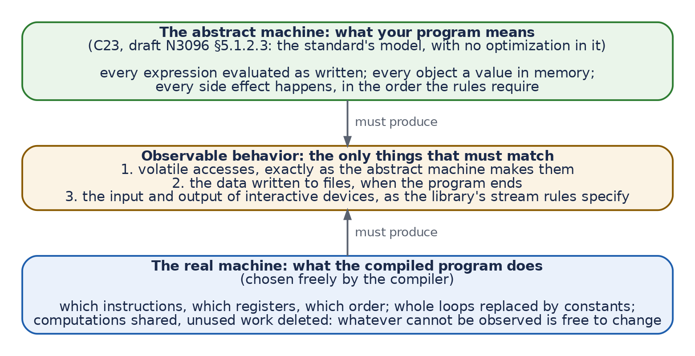
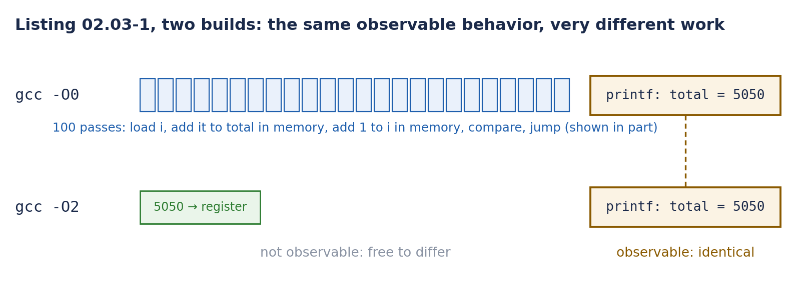

ref: 02.03
title: The C Abstract Machine
chapter: Chapter 02 — Why C Exists
part: Part I — The Machine Beneath C
builds: §02.02
---
## The question

Three times already, this book has caught the compiler doing something other than what the C source seemed to say.

- In §01.05, the AVR program `result = a + b;`, with `a` equal to 6 and `b` equal to 7, compiled to no addition at all: the compiler loaded the number 13 directly.
- In §01.06, the one-line function `add8` became 2 instructions on your laptop with `-O2`, and 11 instructions with `-O0` (Experiment 01.06-5).
- In §02.02, the same faulty program printed `checksum = 7` when compiled without optimization and `checksum = 1234` with it.

And here is a fourth, which every embedded programmer meets sooner or later. A beginner writes a delay for the Uno by counting to 200,000 and doing nothing:

```text
for (uint32_t i = 0; i < 200000; ++i) { }
```

Compiled the way the Arduino IDE compiles it, with `-Os`, this loop takes **no time at all**. The compiler deleted it.

Is the compiler disobeying the program? If not, then what exactly does a C program promise, and to whom? The questions of this section are:

- If the C standard does not describe your processor, what *does* it describe?
- Which parts of a program's behavior must every compiler reproduce exactly, and which may it change?
- Why does that division give compilers such freedom, and why did the standard choose it?
- How do you reason about a program when "what C means" and "what the CPU does" can differ so widely, and how do you force the compiler to do something it would otherwise remove?

The answer to all four is one idea from the standard: the **abstract machine**.

## The journey

### A machine that exists only on paper

Open the C standard looking for a description of registers, instruction sets or memory chips, and you will not find one. The standard was written to serve machines as different as the AVR, the x86-64 and the Xtensa, and machines not yet built (§02.01, §02.02), so it cannot describe any of them. Instead, it describes an imaginary computer that executes C directly, and defines the meaning of every C program as what that imaginary computer would do. In its own words, its descriptions are of an abstract machine in which "issues of optimization are irrelevant" (C23, §5.1.2.3 in the working draft N3096; this section cites clause numbers from that draft, and the Sources note at the end gives their numbers in later documents).

Think of the abstract machine as the perfectly literal reader of your program. It has:

- **objects**: regions of storage, each holding a value of some type. Every variable you declare is an object.
- **evaluation**: it computes every expression exactly as the language's rules say, in the order the rules require.
- **side effects**: changes that an evaluation makes to the state of the world, as defined below.

It has no registers, no cache, no instruction set and, importantly, no clock. It is a description of *meaning*, not of a mechanism. When `total += i` runs a hundred times in the abstract machine, the variable `total` really takes the values 1, 3, 6, 10, … 5050, one after another.

The abstract machine is not entirely fixed. It has **parameters**, the implementation-defined choices of §02.02: on your laptop's implementation, its `int` is 32 bits; on the AVR's, 16. And in a few places it leaves the order of events open (which of `f()` and `g()` is called first in `f() + g()`, §09.03). Each implementation fixes and documents its parameters. Where the order is left open, it need not document its choice, and may even choose differently each time, so a correct program must give acceptable results for every permitted order (§02.04). The implementation must then behave *as if* it were the abstract machine. But only in certain respects.

### Side effects: changes to the world

The standard defines a **side effect** precisely. The following are all side effects:

1. accessing an object through a `volatile` type (a **volatile access**: reading counts as well as writing);
2. modifying any object;
3. modifying a file;
4. calling a function that does any of these.

Evaluating an expression in general involves two things: computing its value, and starting its side effects. `x + 1` has a value and no side effects. `x = 5` has a value (5) and a side effect (the object `x` is modified). `printf("hi")` has a value (the number of characters printed) and side effects (it modifies the output stream). Chapter 09 builds expressions on exactly these ideas (§09.01).

Notice how much of a program consists of side effects of the second kind, modifications of ordinary objects, and how little of it consists of the first and third. That proportion turns out to be the key to everything that follows.

### Observable behavior: where the two machines must meet

If a real compiler had to reproduce every action of the abstract machine, every modification of every object at the right moment, it could never keep a variable in a register, never skip a calculation whose result is not needed, never replace a loop by a constant. Programs would run much slower, as `-O0` builds, which come close to this, typically do. So the standard does not require that. It requires much less, in a short list it calls the **least requirements** on a conforming implementation:

1. **Volatile accesses** to objects are carried out strictly according to the rules of the abstract machine: every one, in order.
2. **At program termination**, all data written into files is identical to what the abstract machine would have produced.
3. **The input and output of interactive devices** take place as the library's rules for streams specify (§31.01). The standard states the intent behind this item: that prompting output actually appear before the program waits for the user's input. What counts as an interactive device is implementation-defined; a terminal is the usual example.

These three, the standard says, are the program's **observable behavior**. Figure 02.03-1 shows their role. The abstract machine defines what your program means. The real machine, the instructions your compiler chose, may do anything at all, provided it produces the same observable behavior.

{w=13}

Everything not on that list is invisible to the standard, and therefore free. Whether a variable lives in memory or only in a register; whether a loop runs a hundred times or not at all; whether a function is called or its body copied into the caller; how long anything takes: none of these is observable behavior.

:::precise
The standard states the permission directly, in a normative paragraph of the same clause: an actual implementation need not evaluate part of an expression if it can deduce that its value is not used and that no needed side effects are produced, including those of calling a function or of a volatile access (N3096, §5.1.2.3). Programmers call the whole principle the **as-if rule**: the implementation may do anything, as long as the observable behavior is as if it had executed the abstract machine. (The C++ standard uses that name in a footnote; the C standard states the principle without naming it.) Two details matter. First, these are *least* requirements: an implementation may promise more, and some do, for instance to make debugging predictable; the standard's own first example in that clause describes an implementation in which the actual and abstract semantics correspond one to one. Second, *what counts as an access* to a `volatile` object is itself implementation-defined (N3096, §6.7.3), so the exact meaning of item 1 on a given machine is found in that compiler's documentation, as §02.04 explains.
:::

### Watching the freedom being used

Listing 02.03-1 adds the numbers 1 to 100.

```c Listing 02.03-1  A loop whose result is known in advance
// sum.c
// What the program means, and what the machine is made to do.
#include <stdio.h>

int main(void) {
    int total = 0;
    for (int i = 1; i <= 100; ++i) {
        total += i;
    }
    printf("total = %d\n", total);
}
```

In the abstract machine, lines 6–9 perform 100 additions, 100 increments and 101 comparisons, and modify `total` and `i` hundreds of times. Line 10 is the only observable behavior: it writes `total = 5050` to the terminal. Compile it twice, and ask GCC to stop after producing assembly language (`-S`, §03.04), so that you can read what it chose:

```terminal
$ gcc -std=c23 -O0 -S -fno-asynchronous-unwind-tables -fcf-protection=none \
      -fno-stack-protector -U_FORTIFY_SOURCE sum.c -o sum0.s
$ gcc -std=c23 -O2 -S -fno-asynchronous-unwind-tables -fcf-protection=none \
      -fno-stack-protector -U_FORTIFY_SOURCE sum.c -o sum2.s
```

The four options after `-S` remove the unwind-table bookkeeping that GCC emits by default on x86-64 Linux, and the protection code that Ubuntu adds by default (the `-fcf-protection` checks, the stack protector and `_FORTIFY_SOURCE`), so that the output is short. Your Fedora compiler may still differ in small details. In particular, if you see `movl $.LC0, %edi` and `call printf` without `@PLT`, your GCC is not generating position-independent code by default (§21.06); that changes nothing in what follows. Here is `main` from `sum0.s`:

```output
main:
	pushq	%rbp
	movq	%rsp, %rbp
	subq	$16, %rsp
	movl	$0, -4(%rbp)
	movl	$1, -8(%rbp)
	jmp	.L2
.L3:
	movl	-8(%rbp), %eax
	addl	%eax, -4(%rbp)
	addl	$1, -8(%rbp)
.L2:
	cmpl	$100, -8(%rbp)
	jle	.L3
	movl	-4(%rbp), %eax
	movl	%eax, %esi
	leaq	.LC0(%rip), %rax
	movq	%rax, %rdi
	movl	$0, %eax
	call	printf@PLT
	movl	$0, %eax
	leave
	ret
```

This is the abstract machine, translated almost word for word. `total` is an object in memory at `-4(%rbp)` (4 bytes below the address held in register `rbp`), and `i` is another at `-8(%rbp)`. The loop at `.L3` loads `i`, adds it into `total` *in memory*, adds 1 to `i` *in memory*, and at `.L2` compares `i` with 100 and jumps back while it is less than or equal (`jle`). It does all of that 100 times. Then it passes `total` to `printf`. Now `main` from `sum2.s`:

```output
main:
	subq	$8, %rsp
	movl	$5050, %esi
	leaq	.LC0(%rip), %rdi
	xorl	%eax, %eax
	call	printf@PLT
	xorl	%eax, %eax
	addq	$8, %rsp
	ret
```

There is no loop, no `total` and no `i`. The compiler worked out, while compiling, that `total` must end at 5050 (computing a value while compiling is called **constant folding**, §09.05), and generated a single instruction to put 5050 where `printf` expects its second argument (`%esi`). Both programs print `total = 5050`; both are correct implementations of Listing 02.03-1. Figure 02.03-2 shows the two side by side.

{w=16}

This is §01.05's surprise, `a + b` becoming 13, on a larger scale, and now you can say exactly why it is permitted: the values of `total` and `i` along the way are not observable behavior, so nothing obliges the program to compute them. Only the printed text is observable, and it is the same. (How GCC finds 5050 is a separate question. Roughly, its optimizer analyzes how `total` changes on each pass of the loop, computes its value after the last pass, and then deletes the loop, which has nothing left to do. §09.05 and §39.02 look at such optimizations more closely.)

:::hood
If you compile without the four extra options, the `-O2` code on Ubuntu calls `__printf_chk` instead of `printf`. That is a checking version of `printf` from the GNU C library, selected by a macro called `_FORTIFY_SOURCE` that Ubuntu's GCC turns on by default whenever optimization is enabled. Fedora's GCC does not turn it on by default, so on your laptop you will see `printf` with or without the options. This is a small example of a large truth: "the compiler" is not one fixed thing. The same GCC version, configured differently by two distributions, emits different code for the same source.
:::

### Functions without side effects

§01.02 observed that a logic gate is like a C function that reads only its arguments and changes nothing outside itself: a function with no side effects. Such a function has a special status under the as-if rule. Calling it produces no observable behavior; its only result is its return value. So if the compiler can see what it computes, it may compute that value itself, merge two calls with the same arguments into one, or, if the value is not used, delete the call entirely. Listing 02.03-2 tests the first and the third; Listing 02.03-5 will show the second.

```c Listing 02.03-2  A function with no side effects, and what the compiler may do with it
// nand.c
// A function with no side effects, like the gates of §01.02.
#include <stdio.h>

static int gate_nand(int a, int b) {
    return !(a && b);               // reads only its arguments, changes nothing
}

int main(void) {
    int table = 0;
    for (int a = 0; a <= 1; ++a) {
        for (int b = 0; b <= 1; ++b) {
            table = table * 2 + gate_nand(a, b);    // build 1110 bit by bit
        }
    }
    gate_nand(1, 1);                // result thrown away
    printf("truth table as a number: %d\n", table);
}
```

- Lines 5–7: `static` makes `gate_nand` private to this file (internal linkage, §20.03), which tells the compiler that it can see every call. `!(a && b)` is 0 only when both are nonzero: NAND.
- Lines 11–15 run through the four input combinations (0,0), (0,1), (1,0), (1,1) and build the outputs 1, 1, 1, 0 into one number by doubling and adding: binary `1110`, which is 14.
- Line 16 calls the function and ignores its value.

Both builds print `truth table as a number: 14`. With `-O0`, the assembly contains two `call gate_nand` instructions, one in the loop and one for line 16, and the loop runs four times. With `-O2` (the same options as before), `main` becomes:

```output
main:
	subq	$8, %rsp
	movl	$14, %esi
	leaq	.LC0(%rip), %rdi
	xorl	%eax, %eax
	call	printf@PLT
	xorl	%eax, %eax
	addq	$8, %rsp
	ret
```

The four calls inside the loop became the constant 14, and the call on line 16 has vanished without trace, because its only effect was a value nobody used. Contrast `printf`: its call stays in every build, because writing to the terminal is observable behavior. A function with side effects must be called as the abstract machine calls it; a function without them is, to the compiler, just a formula. (§39.02 returns to this with GCC's attributes `pure` and `const`, which let a programmer promise that a function in another file has no side effects.)

### What -O0 really is

Now Experiment 01.06-5 can be explained. Here is `add8` from Listing 01.06-3, `return a + b;` for two `uint8_t` arguments, compiled with `-O0` and then `-O2` (same options):

```output
add8:
	pushq	%rbp
	movq	%rsp, %rbp
	movl	%edi, %edx
	movl	%esi, %eax
	movb	%dl, -4(%rbp)
	movb	%al, -8(%rbp)
	movzbl	-4(%rbp), %edx
	movzbl	-8(%rbp), %eax
	addl	%edx, %eax
	popq	%rbp
	ret
```

```output
add8:
	leal	(%rsi,%rdi), %eax
	ret
```

The arguments arrive in registers (`%edi` and `%esi`, by x86-64's calling rules, §19.02). The `-O0` code nevertheless stores each one into memory (`movb ... -4(%rbp)`), as the abstract machine's parameters `a` and `b` are objects, then loads them back with zero extension (`movzbl`, "move zero-extended byte to long", widening an 8-bit value to 32 bits, as C's rules require before adding), and only then adds. Every object really is in memory, and every use of it really is a load. The `-O2` code keeps everything in registers, does the addition in one `lea`, and skips the zero extension: only the low 8 bits of the result are returned, and the calling rules let the upper bits of `%eax` hold anything.

Why would a compiler ever generate the first version? Because it is the version you can *debug*. GCC's manual states that without optimization its goals are to compile quickly and to make debugging produce the expected results: statements are independent, so if you stop the program between two statements you can change any variable, or jump to any other statement, and get exactly what the source code leads you to expect. In other words, `-O0` makes the real machine follow the abstract machine closely at every statement, which is exactly what a debugger needs. `-O0` is GCC's default. GCC also offers `-Og`, which it describes as the optimization level of choice for the edit-compile-debug cycle: some optimization, while keeping most of what a debugger relies on (at `-Og` a debugger can still report some variables as "optimized out").

:::myth
"The `-O0` program is what my C really means, and `-O2` is an approximation of it." No. What your C means is defined by the abstract machine, which neither build is. Both builds are implementations of it, and both are equally correct if the program is correct. `-O0` is simply the implementation whose internal steps are designed to resemble the abstract machine's, which makes it convenient for debugging. If a program prints different results at `-O0` and `-O2`, as Listing 02.02-2 did, the fault is almost always in the program, not in the optimizer. Either its behavior is undefined, so it has no single meaning and its builds have nothing to agree on (§02.04), or it depends on something the standard leaves unspecified, such as an order of evaluation, so several different outputs are all correct. Compiler bugs exist, but suspect the program first.
:::

### What is not observable

Table 02.03-1 sorts the things a C programmer might care about into the two classes. It is worth reading slowly, because almost every surprise an optimizer can give you comes from the right-hand column.

Table: Table 02.03-1  What the standard guarantees, and what it leaves free
<!-- widths: 50,50 -->
| Observable (must match the abstract machine) | Not observable (the compiler may change it) |
|---|---|
| Every read and write of a `volatile` object, in order | Every read and write of an ordinary object: they may be merged, moved or removed |
| The data written to files, at the end of the program | The values of variables while the program runs |
| Prompts and replies on an interactive device, in the right order | How long anything takes: the abstract machine has no clock |
| | Which instructions are used, and how many |
| | Whether a function without side effects is called at all |
| | Where variables are stored, and in what order on the stack |
| | Whether a computation done twice is actually done twice |

The middle of the right-hand column deserves a moment. *The abstract machine has no clock.* Time is not observable behavior, and nothing in the core language can demand that a computation take a certain time. (A hosted C library offers clocks, and with threads the function `thrd_sleep`, but how accurate they are is up to the implementation; avr-libc does not provide them for this purpose.) That fact, more than any other, explains the delay loop of the opening question.

### Time is not observable

Listing 02.03-3 is the beginner's delay, and a second version of it with one word changed.

```c Listing 02.03-3  A busy-wait delay, with and without volatile
// delay.c
// A busy-wait delay, as beginners often write one.
#include <stdint.h>

void delay_plain(void) {
    for (uint32_t i = 0; i < 200000; ++i) { }     // count, doing nothing
}

void delay_volatile(void) {
    for (volatile uint32_t i = 0; i < 200000; ++i) { }
}
```

```terminal
$ avr-gcc -mmcu=atmega328p -Os -Wall -Wextra -S delay.c -o delay.s
```

In `delay.s` (assembler directives removed), `delay_plain` is a single instruction:

```output
delay_plain:
	ret
```

The loop modifies only `i`, an ordinary object that nobody reads afterward; it produces no observable behavior; so, under the as-if rule, the whole loop may be omitted, and is. `delay_volatile` is different. Its counter is `volatile`, so every read and write of `i` is observable behavior and must happen, all 200,000 times. The compiler keeps the counter in four bytes of memory on the stack and, on each pass, loads all four bytes, compares them with 200,000, loads them again, adds 1, and stores all four back: 21 instructions per pass in `delay.s`. (Experiment 02.03-5 asks you to find them.)

How long do the two take? Built with a small harness that starts the ATmega328P's Timer 1 (counting once every 1024 clock cycles, that is every 64 µs at 16 MHz), calls each function and reads the timer, the simulated chip reported:

```output
plain: 0 ticks, volatile: 7031 ticks (1 tick = 64 us)
```

The plain loop took no measurable time. The `volatile` loop took 7,031 × 64 µs ≈ 0.45 s, which is 36 clock cycles per pass: exactly the cycle count of those 21 instructions (on the ATmega328P, `ldd`, `std`, `adiw`, `rjmp` and a taken `brlo` take two cycles each; the others take one). So `volatile` "fixed" the delay. But notice *how*: not by making time observable, which the language cannot do, but by making each access to `i` observable, so that the work could not be skipped. The time that work takes is still not guaranteed. A faster chip, a different compiler, or different options would give a different delay. That is why a busy loop is the wrong tool for an accurate delay.

The right tools take their time from the hardware, not from counting C operations. avr-libc's `_delay_ms`, which you used in §00.02, is built on a GCC built-in function for the AVR, `__builtin_avr_delay_cycles`, which tells the compiler to emit a sequence of instructions taking *exactly* the requested number of clock cycles: a promise about the real machine, made by the compiler for this one processor, not by the language. Arduino's `delay()` stays within C's rules: it repeatedly reads a hardware timer, through `volatile` accesses, until enough ticks have passed (§37.02). Both are reliable because they are tied to the hardware, not to the abstract machine.

### Something outside the program

The second great use of `volatile` is the one that gives it its name: a value that may change *volatilely*, without the program changing it. Suppose a flag is set by something outside the code you are reading, an interrupt routine (Chapter 37), or a hardware register. Listing 02.03-4 waits for it.

```c Listing 02.03-4  Waiting for a flag, with and without volatile
// flag.c
// Waiting for a flag that something outside this code will set.
#include <stdint.h>

uint8_t ready;                      // set elsewhere, e.g. by an interrupt
volatile uint8_t ready_v;           // the same, declared volatile

void wait_plain(void) {
    while (!ready) { }              // wait until ready becomes nonzero
}

void wait_volatile(void) {
    while (!ready_v) { }
}
```

```terminal
$ avr-gcc -mmcu=atmega328p -Os -Wall -Wextra -S flag.c -o flag.s
```

From `flag.s` (comments and assembler directives removed):

```output
wait_plain:
	lds r24,ready
	cpse r24,__zero_reg__
	rjmp .L5
.L4:
	rjmp .L4
.L5:
	ret
wait_volatile:
.L7:
	lds r24,ready_v
	tst r24
	breq .L7
	ret
```

Read `wait_plain` with care. It loads `ready` from memory **once** (`lds`, "load direct from data space"). `cpse r24, __zero_reg__` ("compare, skip if equal"; avr-gcc keeps the value 0 in register r1 at all times between instructions, and calls it `__zero_reg__`) skips the next instruction if `ready` is 0. If `ready` was nonzero, `rjmp .L5` goes to `ret`. If it was 0, the skip lands on `.L4: rjmp .L4`: a jump to itself, forever. The compiler reasoned, correctly by the rules of the abstract machine, that nothing inside the loop modifies `ready`, so if it is 0 once it is 0 always, and reading it again would be pointless. If an interrupt later sets `ready` to 1, this program will never notice. `wait_volatile`, by contrast, reloads `ready_v` on every pass (`.L7: lds ...`; `tst r24` sets the flags from r24, and `breq .L7`, "branch if equal", that is, if zero, jumps back), because each read is observable behavior. (The standard goes further than GCC did here: a loop like `wait_plain`'s, whose condition is not a constant and whose body performs no input or output, no volatile access and no synchronization, may be *assumed to terminate* (N3096, §6.8.5), so a compiler could even delete it. §34.01 returns to such surprises.)

This is why every hardware register in `<avr/io.h>` (PORTB, PINB, UDR0, the timer counts) is declared through a `volatile` type: reading a status register twice must really read it twice, and writing a port twice must really write it twice. §36.04 proves it in the assembly, and also states what `volatile` does *not* promise.

### When the compiler's reasoning meets the engineer's intent

So far the compiler's freedom has saved time and memory. But the abstract machine is a *model*, and every model leaves things out. When the thing an engineer cares about is something the model leaves out, the compiler, reasoning perfectly within the model, will remove it. Two examples show the pattern in fields you intend to work in.

**Fault detection.** On a spacecraft, a high-energy particle can flip a bit in a register or in memory while a program runs (§01.01, §35.01). One software defense is to compute a critical value twice and compare the two results: if they differ, a fault occurred. Listing 02.03-5 tries this, three ways.

```c Listing 02.03-5  Computing twice to detect a fault, and what the optimizer makes of it
// twice.c
// Compute the same result twice and compare, to detect a fault
// (a common idea in software meant to survive radiation upsets).
static int compute(int x) {
    return x * x + 3 * x + 1;
}

int checked_compute(int x, int *fault) {
    int a = compute(x);
    int b = compute(x);             // the same calculation, a second time
    *fault = (a != b);              // 1 if the two results disagree
    return a;
}

int checked_compute_v(int x, int *fault) {
    volatile int a = compute(x);    // volatile: both values must really
    volatile int b = compute(x);    // be stored and read back
    *fault = (a != b);
    return a;
}

int checked_compute_vin(int x, int *fault) {
    volatile int in = x;            // volatile input: read it twice, and
    int a = compute(in);            // the computation must really be done
    int b = compute(in);            // twice, once from each read
    *fault = (a != b);
    return a;
}
```

Compiled with `-O2` (same options), `checked_compute` becomes:

```output
checked_compute:
	movl	%edi, %edx
	leal	(%rdi,%rdi,2), %eax
	movl	$0, (%rsi)
	imull	%edi, %edx
	leal	1(%rdx,%rax), %eax
	ret
```

`movl $0, (%rsi)`: the compiler wrote 0 into `*fault` directly, computed `x * x + 3 * x + 1` *once* (`imull` is the multiplication; the first `leal` computes `3 * x`, and the second adds the parts and the 1), and deleted the comparison. Within the abstract machine it is right: `compute` has no side effects, the same input always gives the same output, so `a != b` is always false. The abstract machine has no radiation. The fault the engineer wanted to detect is precisely the event the model says cannot happen.

The second version, with `a` and `b` `volatile`, is the instinctive repair, and it is not enough: the generated code (Experiment 02.03-3) still computes `compute(x)` once, then stores that one value into both `a` and `b`, and compares the two stored copies. The stores and loads are observable, so they happen; the computation is not, so it is shared. The third version makes the *input* `volatile`. Each of lines 24 and 25 must now read `in` separately, the two reads are observable and may in principle return different values, so the compiler can no longer prove that the two results are equal, and it computes twice and compares (two `imull` instructions in the output). Look closely, though: it compares the two values of `x * x + 3 * x`, and adds the final 1 only once, after the comparison, because that step is provably the same for both. Even here, whatever can be shared is shared.

Even the third version is a compromise. An upset that strikes before the input is stored, or after the comparison (in the shared final addition, or in the returned value), still escapes it; and the duplication slows the code. This is one reason why published software fault-tolerance techniques, such as EDDI (2002) and SWIFT (2005), insert their duplicated instructions *inside the compiler*, late in compilation, rather than in C source, where an optimizer would undo them. §35.03 studies triple modular redundancy in software, with this lesson in hand.

**Erasing a secret.** Listing 02.03-6 is a pattern from security-sensitive code: after using a password, wipe it from memory, so that a later fault or attack cannot find it there.

```c Listing 02.03-6  Wiping a secret, and the optimizer's view of the wipe
// secret.c
// Wiping a password from memory before returning.
#include <string.h>

void read_password(char *buf, size_t size);     // defined elsewhere
void check_password(const char *buf);           // defined elsewhere

void login(void) {
    char secret[64];
    read_password(secret, sizeof secret);
    check_password(secret);
    memset(secret, 0, sizeof secret);           // wipe it before returning
}
```

Line 12 calls the standard library's `memset`, which sets every byte of `secret` to 0. Compiled with `-O2` (same options), `login` becomes:

```output
login:
	pushq	%rbx
	movl	$64, %esi
	subq	$64, %rsp
	movq	%rsp, %rdi
	call	read_password@PLT
	movq	%rsp, %rdi
	call	check_password@PLT
	addq	$64, %rsp
	popq	%rbx
	ret
```

There is no `memset`. The array `secret` ceases to exist when `login` returns, so in the abstract machine nobody can ever read the zeros: the stores are **dead stores**, modifications of an object whose value is never used again, and they are deleted. (GCC knows what the standard `memset` does, which is why it may treat the call as ordinary stores; with `-O0` the call is there.) The password stays in memory, exactly where the programmer tried to erase it. The cure, again, is to step outside the ordinary rules. The GNU C library provides `explicit_bzero`, a wipe it promises will not be removed. C23 added a standard function for the purpose, `memset_explicit`, whose purpose, the standard says, is to make the data inaccessible; a footnote states the intention that its stores are never removed. Since stores are not observable behavior, the standard can state this only as an intention; the guarantee in practice comes from the library and the compiler. `memset_explicit` reached glibc only in version 2.43 (January 2026), so a system with that version or later has it, while older systems, such as the Ubuntu 24.04 (glibc 2.39) used for this book's listings, offer only `explicit_bzero` (Experiment 02.03-4; `ldd --version` shows your glibc version).

:::orbit
The same pattern appears wherever flight software looks after its own hardware. A memory **scrubbing** task, which periodically reads every word of memory (and, where the hardware does not do it, writes the corrected value back) so that bits flipped by radiation are repaired (§35.03), reads values and does nothing with them; to the abstract machine that loop has no effect, and an optimizer may delete it unless the reads are `volatile`. A watchdog that must be "kicked" by writing to a hardware register (or, on the AVR, by executing the `wdr` instruction) works only because that access cannot be removed. A self-test that writes a pattern into RAM and reads it back is, to the compiler, a guaranteed success that need not be run. In each case the engineer's purpose lies outside the model, so the engineer must say so in the program, with `volatile`, with functions designed for the purpose, or in assembly, and then confirm it by reading the generated code. Flight-software teams test and analyze the code at the optimization level they will fly, for exactly this reason.
:::

### Reasoning across the gap

You now have the tools to reason about any C program across the two machines. The method has five steps.

1. **Ask what the abstract machine does.** This is what your program *means*: every expression, every side effect, in the order the rules require. The rest of this book is largely a description of this machine's rules.
2. **Ask which of it is observable.** Volatile accesses, the final contents of files, interactive input and output. Everything else is the compiler's to rearrange.
3. **Assume that anything not observable may change.** Variables may never be stored, loops may vanish, computations may be shared, calls may disappear, time may shrink to nothing.
4. **If something not observable must happen, make it observable, or leave the model.** Use `volatile` for accesses that must occur; use functions designed for the job (`_delay_ms`, `explicit_bzero`, `memset_explicit`); or write the critical part in assembly (§39.03).
5. **Check what the real machine does.** Read the output of `gcc -S` or `objdump -d` (§03.04), at the optimization level you will actually use. And when you measure performance, make the result observable, by printing it, or the compiler may delete the very work you are timing.

There is one condition under which this whole method fails: when the program's behavior is *undefined*. The as-if rule promises that the real machine reproduces the abstract machine's observable behavior; but if the program does something for which the abstract machine has no defined behavior, such as writing past the end of an array, there is nothing to reproduce, and the compiler may assume that it never happens. That is how Listing 02.02-2 printed 1234 at `-O2`: its loop's fifth pass had no meaning, so the compiler built a program in which that pass did not exist. §02.04 sorts behavior into its four kinds and explains why undefined behavior exists at all.

## Terms introduced

- **Abstract machine**: the imaginary computer whose behavior the C standard describes; it defines what a program means, with no regard to optimization.
- **Object**: a region of storage holding a value of some type; every variable is an object.
- **Side effect**: a change to the state of the execution environment: a volatile access, the modification of an object or a file, or a call to a function that does any of these.
- **Volatile access**: a read or write of an object through a `volatile`-qualified type.
- **Least requirements**: the standard's list of what every conforming implementation must reproduce exactly.
- **Observable behavior**: volatile accesses, the data written to files at program termination, and the input and output of interactive devices.
- **Interactive device**: an implementation-defined class of devices, such as a terminal, whose input and output must follow the library's rules for streams.
- **As-if rule**: the principle that an implementation may produce any code whose observable behavior is the same as the abstract machine's.
- **Optimization level**: a compiler setting (`-O0`, `-Og`, `-O2`, `-Os`, …) controlling how freely the compiler uses the as-if rule.
- **Constant folding**: computing an expression's value while compiling (§09.05).
- **Dead store**: a write to an object whose value is never read again, which the compiler may remove.
- **Busy-wait loop**: a loop that wastes time by doing nothing useful.
- **Memory scrubbing**: periodically reading memory so that error-correcting hardware repairs flipped bits.

## Self-check

1. What does the C standard describe, if not your processor? Why was it written that way?
2. List the four kinds of side effect this section listed.
3. State the three least requirements, and the name the standard gives them collectively.
4. In your own words, what is the as-if rule?
5. In Listing 02.03-1, which part of the program is observable behavior? Why may the `-O2` build contain no loop?
6. Why does `-O0` code store function arguments into memory and load them back, even though they arrived in registers?
7. Why did the call `gate_nand(1, 1);` in Listing 02.03-2 disappear at `-O2`, while the call to `printf` did not?
8. Why does `delay_plain` compile to `ret`? Does making the counter `volatile` guarantee a delay of a particular length? Explain.
9. Explain, instruction by instruction, why `wait_plain` in Listing 02.03-4 can loop forever even after `ready` becomes 1.
10. Why did the comparison in `checked_compute` disappear? Why does `checked_compute_v` still compute only once, while `checked_compute_vin` computes twice?
11. Why was `memset` removed from Listing 02.03-6, and what should be used instead?
12. Correct this statement: "A program that prints different results at `-O0` and `-O2` has exposed a compiler bug."

## Experiments

**Experiment 02.03-1. Making the work observable.** In Listing 02.03-1, declare `total` as `volatile int total = 0;` and compile with `-O2 -S` again. Is the loop back? Which instructions touch `total`, and how often are they executed? Then restore it and try `-O1` and `-Og`: does either still compute 5050 while compiling?

**Experiment 02.03-2. A side effect keeps a call alive.** Add the line `printf("nand(%d, %d)\n", a, b);` at the start of `gate_nand` in Listing 02.03-2. Predict what the program prints at `-O0` and at `-O2`, then check. Is the work of line 16 still removed? Why not?

**Experiment 02.03-3. Counting the computations.** Compile Listing 02.03-5 with `-O2 -S` and the four usual options. For each of the three functions, count the `imull` instructions, and find the comparison (`cmpl`) if there is one. Explain each count from the rules of this section.

**Experiment 02.03-4. A wipe that stays.** Replace the `memset` on line 12 of Listing 02.03-6 with `explicit_bzero(secret, sizeof secret);` and compile with `-O2 -S` and the four usual options. Compile once with `-std=c23` and once with `-std=gnu23`. What happens with `-std=c23`, and why? Is the wipe in the `-std=gnu23` output? If your glibc is version 2.43 or later (`ldd --version`), try `memset_explicit(secret, 0, sizeof secret);` with `-std=c23` too.

**Experiment 02.03-5. Inside the volatile delay.** In `delay.s` from Listing 02.03-3, find the loop of `delay_volatile`. Mark each instruction that reads or writes the counter `i`, and count the instructions executed on one pass. Then add up their clock cycles using the AVR instruction set manual (Table 01.06-1 of §01.06 has `sbci` and `rjmp`; find the rest in the manual), and compare your total with the 36 cycles per pass measured in this section.

## Hands-on (AVR / ESP32)

### A: a delay that takes no time, on the Uno

Listing 02.03-7 times both delays with Arduino's `micros()` function, which reports the time since the board started, in microseconds.

```c Listing 02.03-7  Timing the two delays, as an Arduino sketch
// delayloop.ino  (Arduino Uno or ESP32)
// Time a do-nothing loop, with and without volatile.
void delay_plain() {
  for (uint32_t i = 0; i < 200000; ++i) { }
}

void delay_volatile() {
  for (volatile uint32_t i = 0; i < 200000; ++i) { }
}

void setup() {
  Serial.begin(115200);
  delay(500);
  unsigned long t0 = micros();
  delay_plain();
  unsigned long t1 = micros();
  delay_volatile();
  unsigned long t2 = micros();
  Serial.print("plain loop: ");
  Serial.print(t1 - t0);
  Serial.println(" us");
  Serial.print("volatile loop: ");
  Serial.print(t2 - t1);
  Serial.println(" us");
}

void loop() {}
```

Upload it and open the Serial Monitor at 115,200 baud. Compiled with avr-g++ 7.3 at `-Os` and run on the simulator, with minimal stand-ins for `Serial` and for `micros()` (reading Timer 1 in steps of 64 µs; the real `micros()` counts in steps of 4 µs), it printed:

```output
plain loop: 0 us
volatile loop: 437504 us
```

Notice that this is not quite the 0.45 s of Listing 02.03-3. In the sketch's build, avr-g++ laid the same loop out slightly differently: its exit test (`brsh`) is *not* taken on each pass and costs one cycle, where `delay.s`'s `brlo` is taken and costs two. Each pass therefore takes 35 cycles: 7,000,000 cycles in all, or 437,500 µs, which the 64 µs steps of the stand-in timer report as 437,504. The same source, laid out differently, takes a different time. On a real Uno, expect `0` or a few microseconds for the plain loop and roughly 0.44 s for the `volatile` one; the exact figure depends on the instructions the Arduino IDE's compiler chooses.

### B: the same sketch on the ESP32

Upload the same sketch to the ESP32. This was not run by the author. Expect the plain loop to take essentially no time, as on the Uno, because the same rules permit it, and the ESP32's GCC, optimizing, uses that permission. The `volatile` loop's time will be far shorter than on the Uno, since the ESP32's processor runs at up to 240 MHz and executes most instructions in one cycle; record the figure you see, and compare the ratio of the two boards' times with the ratio of their clock frequencies (16 MHz against 240 MHz). If the ratio differs much from 15, that difference is the work each processor needs per pass: a property of the real machines, not of the C program.

## Answers

**Self-check 1.** An abstract machine: an imaginary computer that executes C directly, in which optimization plays no part. A description of any real processor would tie C to that processor; the abstract machine lets one definition serve every machine, each implementation choosing its parameters.

**Self-check 2.** A volatile access (read or write); modifying an object; modifying a file; calling a function that does any of these.

**Self-check 3.** Volatile accesses occur strictly as in the abstract machine; at program termination, the data written to files is as the abstract machine would produce; the input and output of interactive devices follow the library's rules for streams, the intent being that prompts appear before input is awaited. Together they are the program's observable behavior.

**Self-check 4.** A compiler may generate any code at all, provided the program's observable behavior is the same as the abstract machine's would be.

**Self-check 5.** Only the output of line 10, `total = 5050`. The values of `total` and `i` during the loop are not observable, so the compiler may compute the final value while compiling and omit the loop.

**Self-check 6.** At `-O0`, GCC keeps every object (parameters included) in memory and loads it at each use, so that the real machine follows the abstract machine statement by statement and a debugger can inspect and change any variable.

**Self-check 7.** `gate_nand` has no side effects; the value of the call on line 16 is unused, so the call produces nothing observable and may be omitted. `printf` writes to the terminal, which is observable behavior, so its call must remain.

**Self-check 8.** The loop modifies only an ordinary object whose value is never used, so it has no observable behavior and may be omitted entirely. A `volatile` counter forces every access to occur, so the work cannot be skipped, but the time that work takes depends on the processor, compiler and options; the language guarantees no duration.

**Self-check 9.** `lds` reads `ready` once into r24. `cpse` skips the next instruction if r24 is 0. If `ready` was nonzero, `rjmp .L5` reaches `ret`. If it was 0, execution reaches `.L4: rjmp .L4`, a jump to itself, which never reads `ready` again. The compiler may do this because, in the abstract machine, nothing in the loop changes `ready`.

**Self-check 10.** `compute` has no side effects and receives the same `x` twice, so in the abstract machine both results are always equal and `a != b` is always 0. In `checked_compute_v`, only the stores to and loads from `a` and `b` are observable; the computation is not, so it is done once and stored twice. In `checked_compute_vin`, the two reads of `in` are separate observable accesses, which could in principle return different values, so the compiler cannot prove the results equal and must compute twice and compare (though it still shares the final `+ 1`, done once after the comparison).

**Self-check 11.** `secret` is never read after the `memset`, and ceases to exist when `login` returns, so the stores have no observable effect and are removed as dead stores. Use a function whose purpose is a wipe that must happen: `explicit_bzero` on glibc, or C23's `memset_explicit` where available.

**Self-check 12.** Usually it has exposed a program with undefined behavior: such a program has no defined observable behavior, so different builds may legitimately differ. Or the program depends on unspecified behavior, such as an order of evaluation, and both outputs are correct. Compiler bugs exist, but they are rare by comparison; suspect the program first (§02.04, §34.01).

**Experiment 02.03-1.** With `volatile int total`, the author's `-O2` build contained a loop again: on each of the 100 passes it loaded `total`, added `i`, and stored `total` back, while `i` itself lived only in a register (`i` is not `volatile`, so its accesses need not occur). At `-O1`, GCC 14.2 also passed the constant 5050 to `printf`, but left behind an empty loop that counts down from 100 and does nothing: it computed the result without deleting the now-useless loop. The as-if rule permits removal; it never requires it. At `-Og` it did not compute 5050 while compiling: the loop remained, with `total` and `i` kept in registers rather than in memory, a compromise that keeps the program's structure visible to a debugger. Which calculations are done while compiling depends on the optimization level and the compiler version, so check your own output.

**Experiment 02.03-2.** Both builds print the four lines `nand(0, 0)`, `nand(0, 1)`, `nand(1, 0)`, `nand(1, 1)`, then a fifth, `nand(1, 1)`, from line 16, then `truth table as a number: 14`. The fifth `nand(1, 1)` line appears in both builds. At `-O2` GCC still copies the function's body into `main` (there is no `call gate_nand` in the output), but the `printf` inside it is observable behavior and must happen, even though the return value is still unused.

**Experiment 02.03-3.** `checked_compute`: one `imull`, no comparison (`*fault` set to 0 directly). `checked_compute_v`: one `imull`, and a `cmpl` comparing the two values loaded back from `a` and `b`. `checked_compute_vin`: two `imull`s, one for each read of `in`, and a `cmpl` comparing the two results.

**Experiment 02.03-4.** With `-std=c23`, the compilation fails: `explicit_bzero` is not part of ISO C, so glibc's `<string.h>` does not declare it in strict standard mode, and GCC 14 treats the call to an undeclared function as an error (`implicit declaration of function 'explicit_bzero'`). With `-std=gnu23`, which enables the GNU extensions, it compiles and the `-O2` output contains `call explicit_bzero@PLT`: the wipe stays. (Alternatively, keep `-std=c23` and write `#define _DEFAULT_SOURCE` before the first `#include`.) (Without `-U_FORTIFY_SOURCE`, Ubuntu shows the checking version, `call __explicit_bzero_chk@PLT`.) The author's C library, glibc 2.39, did not provide `memset_explicit`; with glibc 2.43 or later it is declared under `-std=c23`, and its call should likewise remain in the output.

**Experiment 02.03-5.** In the author's `delay.s`, one pass consists of a test block (4 `ldd` loading the counter, `cpi`, two `sbci`, `cpc`, and a taken `brlo`: 9 instructions) and an increment block (4 `ldd`, `adiw`, two `adc`, 4 `std` storing the counter, and `rjmp`: 12 instructions), 21 in all. Cycles: test block 4 × 2 + 4 × 1 + 2 = 14; increment block 4 × 2 (`ldd`) + 2 (`adiw`) + 1 + 1 (`adc`) + 4 × 2 (`std`) + 2 (`rjmp`) = 22; total 36, matching the measurement.

**Hands-on A.** As above, from the simulator, with 35 cycles per pass; on a real Uno the `volatile` figure may differ slightly.

**Hands-on B.** Not observed by the author.

## Sources and verification

- **Toolchains.** All x86-64 assembly listings were produced with GCC 14.2.0 on x86-64 Ubuntu Linux 24.04, with `-std=c23` and the options shown; the programs were also compiled with `-Wall -Wextra -pedantic` without warnings, and Listings 02.03-1 and 02.03-2 were run at `-O0` and `-O2`, printing the outputs shown. AVR assembly was produced with avr-gcc 7.3.0 (`-mmcu=atmega328p -Os`). The timing of Listing 02.03-3 used a separate harness (not shown) that runs Timer 1 at clock/1024 around each call and prints the count through the UART, run on simavr emulating an ATmega328P at 16 MHz. Listing 02.03-7 was compiled with avr-g++ 7.3.0 (`-std=gnu++11 -Os`) with minimal stand-ins for `Serial`, `delay` and `micros` (Timer 1 at clock/1024) and run on simavr; not on a physical Uno. **For the reader to confirm on GCC 15 or 16:** the x86-64 listings, which may differ in register choice and in small details, though the points they illustrate (the constant 5050 and 14, the missing comparison, the missing `memset`) should hold; and which of `-O1` and `-Og` fold Listing 02.03-1 to 5050, and whether `-O1` still leaves an empty loop (Experiment 02.03-1). The 35-cycle layout of the sketch's loop was confirmed by compiling the loop with avr-g++ 7.3.0 at `-Os`.
- **Not run by the author.** Hands-on B (ESP32).
- **The C standard.** ISO/IEC 9899:2024 (C23), working draft N3096, §5.1.2.3 "Program execution": the abstract machine (the quoted phrase), side effects, the permission not to evaluate unused parts of expressions, the least requirements and the definition of observable behavior; the implementation-defined meaning of interactive device. §6.7.3 (type qualifiers), paragraph 8: what constitutes an access to a `volatile` object is implementation-defined. §6.8.5 (iteration statements): loops that may be assumed to terminate. Footnote to §7.26.6.2 (`memset_explicit`): the intention that its stores are never removed. Clause numbers in this section are those of N3096. In the later working draft N3220, which is closer to the published text, the material appears as §5.1.2.4 "Program semantics" and §6.7.4 "Type qualifiers"; the published ISO/IEC 9899:2024 also numbers some clauses differently, so search by title when you look these up. In C99 and C11 the material was §5.1.2.3; C99 required volatile objects to be stable at sequence points, C11 required accesses to volatile objects to be evaluated strictly by the rules of the abstract machine, and C23 rephrased this in terms of volatile accesses. The name "as-if rule" is from the C++ standard ([intro.abstract]); the C standard states the principle without the name.
- **GCC.** GCC manual, "Options That Control Optimization": the goals of compiling without optimization (fast compilation, debugging producing the expected results, statements independent); `-O0` as the default; `-Og` as the level for the edit-compile-debug cycle. Ubuntu's defaults (`_FORTIFY_SOURCE`, level 3 since 24.04, only when optimizing; the stack protector; `-fcf-protection`; position-independent code): Ubuntu's "ToolChain/CompilerFlags" page. Fedora's: Red Hat's "Recommended compiler and linker flags for GCC" (2018) and redhat-rpm-config's build-flags documentation, which describe Fedora's compiler as close to GCC's own defaults, with hardening applied in package builds. Whether Fedora's current GCC generates position-independent code by default is reported inconsistently in the sources consulted, so the text describes both outcomes. The substitution of `__printf_chk`, and of `__explicit_bzero_chk`, was observed in the author's build. The internal name "final value replacement" for GCC's loop analysis is not used in the text; the description of how GCC found 5050 is a simplified account, labeled as such.
- **avr-libc.** `<util/delay.h>`: `_delay_ms` and `_delay_us` are implemented with `__builtin_avr_delay_cycles` when the compiler provides it (avr-libc manual). The `volatile` declaration of I/O registers: `<avr/sfr_defs.h>` (`_MMIO_BYTE`).
- **Fault tolerance.** N. Oh, P. P. Shirvani and E. J. McCluskey, "Error Detection by Duplicated Instructions in Super-Scalar Processors" (EDDI), IEEE Transactions on Reliability, 2002; G. A. Reis et al., "SWIFT: Software Implemented Fault Tolerance", CGO 2005, whose duplication is performed by a SWIFT-enabled compiler. That SWIFT and EDDI insert duplication inside the compiler is from these papers; that avoiding the optimizer's removal of redundancy written in source is *one reason* for this is the author's reading, consistent with Listing 02.03-5.
- **Secure erasure.** `explicit_bzero`: glibc manual and `explicit_bzero(3)`. `memset_explicit`: C23, `<string.h>`; added in glibc 2.43, released in January 2026 (glibc 2.43 release announcement, NEWS: "Major new features"). Manual pages may lag behind the library, so check the glibc version (`ldd --version`) rather than the manual page.
- **Inference in this section.** The "perfectly literal reader" image, Table 02.03-1's grouping, the five-step method, the space examples in the "In orbit" box (scrubbing loops, watchdogs, memory self-tests as things an optimizer may remove without `volatile`), the statement that flight-software teams test at the optimization level they fly, and the ESP32 expectations are the author's reasoning from the standard's rules and the experiments above, not statements from the sources.
