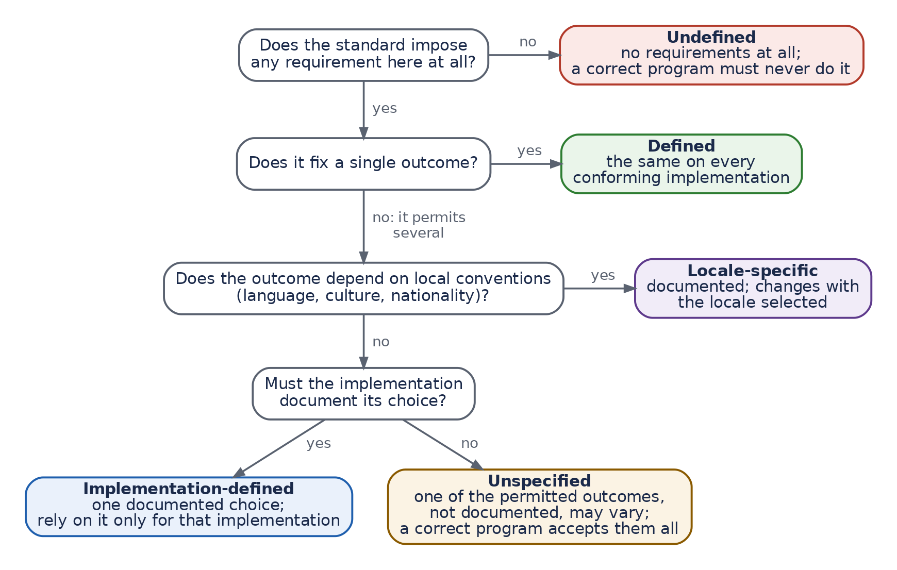
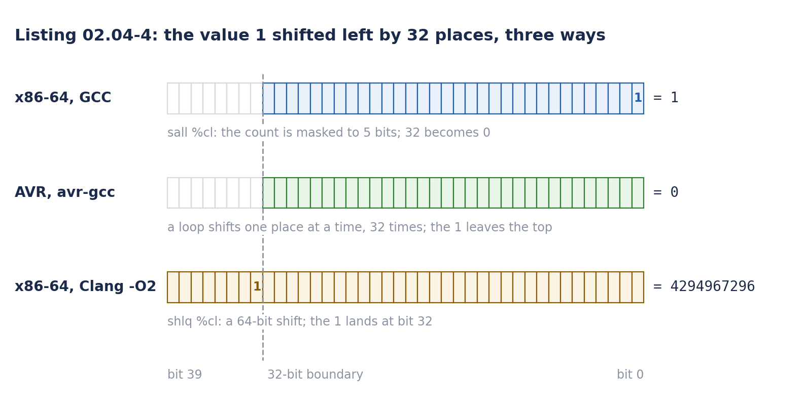

ref: 02.04
title: Four Kinds of Behavior
chapter: Chapter 02 — Why C Exists
part: Part I — The Machine Beneath C
builds: §02.03
---
## The question

Two results from the last two sections are still waiting for an explanation.

- In §02.02, one source file, Listing 02.02-2, printed `checksum = 7` when compiled without optimization and `checksum = 1234` with it. GCC's warning said that one pass of the loop "invokes undefined behavior".
- In §02.03, the as-if rule promised that every build of a program reproduces the abstract machine's observable behavior, and then the section admitted one exception: a program whose behavior is *undefined* has no observable behavior to reproduce.

Here is a third puzzle, which this section will solve. The one-line C expression `x << n`, with `x` equal to 1 and `n` equal to 32, gave **three different answers** when the same source file was built four ways: 1 on your laptop with GCC, 0 on the ATmega328P, 1 again with the Clang compiler without optimization, and 4,294,967,296 with Clang at `-O2`, a number that cannot even fit in the 32-bit type of `x`.

None of them is wrong. That sentence should feel strange, and the purpose of this section is to make it feel inevitable. The questions are:

- What different kinds of behavior does the C standard distinguish, and what exactly does it promise for each?
- Why would a standard leave anything *undefined*, rather than choosing an answer?
- What do compilers do with that freedom, and why did Listing 02.02-2 print 1234?
- Where are an implementation's choices written down, and how does an engineer protect a program from the kinds of behavior it must not rely on?

## The journey

### What the standard promises, and to whom

§02.02 described C's design as a contract with four parties. The standard itself is the written part of that contract, and it binds two of them: the **programmer**, who writes a program, and the **implementation** (a compiler, its libraries and the machine they target), which runs it. For most constructs of the language, the contract states exactly what must happen: `2 + 3` is 5 on every implementation, forever. But a contract written for every machine, past and future, cannot fix everything, and C's contract is unusually honest about where it stops. For every construct, it says one of five things, and each of the five is a different kind of **behavior** (which the standard defines simply as external appearance or action, C23 draft N3096, §3.4; as in §02.03, clause numbers are those of that draft).

Table 02.04-1 lists the five. Read it once now; the rest of the section explains each row. Two more rules complete the picture. Some requirements are **constraints**: breaking one (assigning a structure to an `int`, say) obliges the compiler to issue a diagnostic, a warning or error message (C23, §5.1.1.3), so such a mistake cannot pass silently. And undefined behavior is indicated in three ways: by the words "undefined behavior", by breaking a "shall" requirement that is not a constraint, or simply by the absence of any definition of the behavior (C23, §4).

Table: Table 02.04-1  The five kinds of behavior in the C standard
<!-- widths: 19,25,18,38 -->
| Kind | What the standard says | Documented? | What a careful programmer may do |
|---|---|---|---|
| Defined | one outcome, fixed | by the standard | rely on it everywhere |
| Implementation-defined | several outcomes allowed; the implementation picks one | yes, by the implementation | rely on it on that implementation, after reading its documentation |
| Unspecified | several outcomes allowed; the implementation picks one, possibly a different one each time | no | write the program so that every allowed outcome is acceptable |
| Locale-specific | the outcome depends on local conventions of language and culture | yes, by the implementation | rely on it once the program has chosen its locale |
| Undefined | no requirements at all | no (an implementation may choose to) | never let it happen |

Why, then, is this section called "Four Kinds of Behavior"? Because programmers usually count four: defined, implementation-defined, unspecified and undefined, treating locale-specific behavior as a documented variety of the second. The first four rows all describe a *program that has a meaning*; only the last describes a program that has none. "Defined behavior" is the programmers' name for the first row; the standard simply states those rules. It defines the other four terms in its clause 3 (§3.4.1 to §3.4.4 in N3096), and gathers their instances in its Annex J, an informative overview: J.1 for unspecified behavior, J.2 for undefined, J.3 for implementation-defined and J.4 for locale-specific.

Figure 02.04-1 turns the table into the question an engineer asks about any line of C.

{w=15}

### Defined behavior: the part you can carry everywhere

Most of C is defined. Integer arithmetic on values that fit, comparisons, assignment, function calls with the right arguments, the order of statements: these mean the same thing on your laptop, your Uno, your ESP32 and any machine the standard has never heard of. One example will matter in a moment. Arithmetic on **unsigned** integers is defined to wrap around: an unsigned type of N bits computes every result modulo 2^N, so adding 1 to the largest unsigned value gives 0, on every implementation, by rule (C23, §6.2.5). The rule fits binary hardware perfectly, which is why the standard could afford to fix it.

### Implementation-defined behavior: one documented choice

§02.02 met this kind already, through the sign of plain `char`, the right shift of a negative number and the size of `int`. Each of these is a **parameter** of the abstract machine (§02.03): every implementation must choose a value and write it down, and the choice then holds for every program it compiles. The standard's own example of the kind is the right shift of a negative number.

Three points deepen that picture.

1. **The permitted outcomes are often listed.** Converting an out-of-range value to a signed integer type, for instance, gives an implementation-defined result *or* raises an implementation-defined signal (C23, §6.3.1.3). A **signal** is a notification the system delivers to a running program, which by default ends it; SIGFPE, below, is one. GCC's manual records its choice: the value is reduced modulo 2^N, and no signal is raised.
2. **The documentation is the contract.** A program that depends on an implementation-defined choice is correct only on the implementations that made that choice. The careful engineer therefore states the assumption in the program, where the compiler checks it. C23 makes this easy with `static_assert`, which stops the compilation if a condition is false: `static_assert(CHAR_BIT == 8);` placed in a file that assumes 8-bit bytes turns a silent assumption into a checked one.
3. **"Implementation" includes the options.** As §02.02 showed with `-funsigned-char`, one compiler can be several implementations. The choice is fixed for a given compiler, target and set of options, not for "GCC" in general.

### Unspecified behavior: several right answers, and no promise which

Listing 02.04-1 asks the implementation a question the standard deliberately leaves open: in what order are the parts of an expression evaluated?

```c Listing 02.04-1  Which operand is evaluated first?
// order.c
// Which operand is evaluated first? The standard does not say.
#include <stdio.h>

static int trace(const char *name, int value) {
    printf("%s ", name);            // a visible side effect
    return value;
}

int main(void) {
    int sum = trace("a", 1) + trace("b", 2);
    printf("-> sum %d\n", sum);
    printf("-> %d %d\n", trace("c", 3), trace("d", 4));
}
```

- Lines 5–8: `trace` prints its name, a side effect (§02.03) that lets us *see* when it runs, then returns its value.
- Line 11 adds two calls. The sum is 3 whatever happens; the question is which call runs first.
- Line 13 passes two calls as arguments to `printf`. Again the values are fixed (3 and 4, printed in that order by the format); the question is the order of the calls.

```terminal
$ gcc -std=c23 -Wall -Wextra -pedantic order.c -o order
$ ./order
```

```output
a b -> sum 3
d c -> 3 4
```

GCC evaluated the operands of `+` left to right, and the arguments of the call right to left. Now the same file, compiled with **Clang**, the other major open-source C compiler (built on the LLVM project, and available for most Linux systems as the command `clang`):

```terminal
$ clang -std=c23 -Wall -Wextra -pedantic order.c -o order
$ ./order
```

```output
a b -> sum 3
c d -> 3 4
```

The arguments were evaluated in the opposite order. No warning appeared from either compiler, because neither program is wrong: the standard permits both orders, and this is its own example of unspecified behavior (C23, §3.4.4). Three facts make unspecified behavior different from the implementation-defined kind.

- **Nobody documents it.** GCC's manual does not promise right-to-left argument evaluation; it is simply what this compiler, at these settings, happened to do.
- **It need not be consistent.** An implementation may choose differently for two calls in the same program, at different optimization levels, or in the next version.
- **The burden is on the program.** A correct program must give acceptable results for *every* permitted choice. Listing 02.04-1 is correct only if you do not care whether it prints `c d` or `d c`. If you do care, the cure is to make the order explicit with separate statements: `int c = trace("c", 3); int d = trace("d", 4);`. A statement boundary fixes the order; an operator usually does not.

:::precise
Unspecified behavior must not be confused with its dangerous neighbor. In `trace("a", 1) + trace("b", 2)`, the two calls may happen in either order, but one finishes before the other starts: the standard calls them *indeterminately sequenced*, and either order is a correct execution. In `i++ + i++`, by contrast, two modifications of the same object are *unsequenced*: neither is required to finish before the other, and the standard makes that **undefined** (§09.03 explains sequencing in full, and GCC's `-Wall` warns about this case with `-Wsequence-point`). A related term is the **unspecified value**: a valid value of the right type, but with no requirement on which one (§3.19.3). The bytes of padding inside a structure hold unspecified values, for instance. An **indeterminate representation** (§3.19.2) is worse: it is either an unspecified value or a *non-value representation*, a bit pattern that represents no value of the type at all, and using some indeterminate objects, such as an uninitialized automatic variable in certain cases, is listed in Annex J.2 as undefined behavior (Chapter 06 returns to this).
:::

### Locale-specific behavior: when the answer depends on where you are

Some outputs ought to differ from country to country. In Germany the decimal separator is a comma, so pi to two places is written 3,14; in Bangladesh, as in Britain and the United States, it is 3.14. The standard calls behavior that depends on local conventions of nationality, culture and language **locale-specific**, and requires each implementation to document it. A **locale** is a named set of such conventions (number formats, the classification of letters, sorting order, currency), and the function `setlocale` from `<locale.h>` selects one. Listing 02.04-2 prints the same number under two locales.

```c Listing 02.04-2  The same number, printed under two locales
// locale.c
// The same number, printed under two locales.
#include <stdio.h>
#include <locale.h>

int main(void) {
    printf("C locale:      %.2f\n", 3.14159);

    if (setlocale(LC_ALL, "de_DE.UTF-8") == NULL) {
        printf("the German locale is not installed\n");
        return 0;
    }
    printf("German locale: %.2f\n", 3.14159);
}
```

```terminal
$ gcc -std=c23 -Wall -Wextra -pedantic locale.c -o locale
$ ./locale
```

```output
C locale:      3.14
German locale: 3,14
```

- Line 7 runs before any `setlocale` call. Every C program starts in the locale named `"C"`, whatever the user's settings: the standard requires the equivalent of `setlocale(LC_ALL, "C")` at startup (§7.11.1.1). So by default a C program's output does not change with the country it runs in.
- Line 9 asks for the German locale by the name glibc uses for it; `setlocale` returns a null pointer if the system does not have it. (On Fedora, `locale -a` lists the installed locales, and the German one comes with the package `glibc-langpack-de`.) Calling `setlocale(LC_ALL, "")` instead adopts whatever locale the user's environment specifies.
- Line 13 prints the same value, formatted by the German conventions.

The same program on the ATmega328P does not even build: avr-libc's `<locale.h>` declares `setlocale`, but marks it unimplemented, so the linker reports an undefined reference to `setlocale`. An implementation may support only the `"C"` locale, but a hosted one must still provide the function; avr-gcc calls itself hosted (§02.02), so this is a gap in its conformance. For an embedded engineer, locale-specific behavior is mostly a reason to keep firmware in the `"C"` locale and format numbers yourself when a display needs a particular convention.

### Undefined behavior: no requirements at all

The fifth kind is different in nature from the other four. The standard defines **undefined behavior** as behavior, upon use of a nonportable or erroneous program construct or of erroneous data, for which the standard "imposes no requirements" (§3.4.3). A note attached to the definition describes what may happen in practice: anything from ignoring the situation with unpredictable results, through behaving in some documented way characteristic of the machine, to stopping the compilation or the program with a message. The standard's own example is dereferencing a null pointer.

"No requirements" is meant literally, and three consequences follow from it.

1. **Not "some value".** An undefined operation is not required to produce a wrong value of the right type, or any value at all. It may crash; it may produce a value the type cannot hold (the 4,294,967,296 of this section's opening); or it may cause the compiler to build a program in which the operation, and code around it, does not exist.
2. **Not confined to one line.** Since §02.03, you know that the compiler reasons about whole functions and programs. If it may assume that an undefined operation never happens, that assumption can change the code *around* the operation, as Listings 02.04-6 and 02.02-2 will show.
3. **Not a property of the source alone.** Undefined behavior is often triggered by data: `a / b` is perfectly correct until `b` is 0. A program can run correctly for years and then meet the input that makes it undefined.

Listing 02.04-3 contrasts defined and undefined behavior in a single question: is `x + 1` greater than `x`?

```c Listing 02.04-3  The same question, asked of a signed and an unsigned integer
// overflow.c
// One question, asked of a signed and of an unsigned integer.
#include <stdio.h>
#include <limits.h>

int next_is_bigger(int x) {
    int next = x + 1;               // signed: overflow is undefined
    return next > x;
}

int next_is_bigger_u(unsigned x) {
    unsigned next = x + 1;          // unsigned: wraps around to 0, by rule
    return next > x;
}

int main(void) {
    printf("signed:   %d\n", next_is_bigger(INT_MAX));
    printf("unsigned: %d\n", next_is_bigger_u(UINT_MAX));
}
```

- Lines 6–9: `next_is_bigger` asks the question of an `int`. When `x` is `INT_MAX`, the largest `int` (2,147,483,647 on your laptop), `x + 1` cannot be represented in `int`. That is **signed overflow**, and it is undefined (C23, §6.5).
- Lines 11–14 ask the same question of an `unsigned`. When `x` is `UINT_MAX`, `x + 1` wraps to 0 by the defined rule above, so `next > x` is false: 0.
- Lines 17–18 ask both functions about the largest value of their type.

```terminal
$ gcc -std=c23 -Wall -Wextra -pedantic -O0 overflow.c -o overflow
$ ./overflow
```

```output
signed:   0
unsigned: 0
```

```terminal
$ gcc -std=c23 -Wall -Wextra -pedantic -O2 overflow.c -o overflow
$ ./overflow
```

```output
signed:   1
unsigned: 0
```

The unsigned answer is 0 in both builds, as the standard requires. The signed answer changed. At `-O0`, the processor's `addl` instruction added 1 to 2,147,483,647 and, like every two's complement adder (§01.03), produced −2,147,483,648, which is not greater than `x`: 0. At `-O2` (with the four options of §02.03), `next_is_bigger` became a single instruction:

```output
next_is_bigger:
	movl	$1, %eax
	ret
```

GCC reasoned that for every `x` for which the program has a meaning, `x + 1 > x` is true, and the cases in which it is false are exactly the cases with undefined behavior, which it may assume never occur. So it returns 1 without adding or comparing anything. Compare `next_is_bigger_u` in the same `-O2` build: it compares `x` with −1 (the bit pattern of `UINT_MAX`) and returns 0 for that one value, because for unsigned arithmetic the wraparound is part of the meaning.

The ATmega328P agrees with the laptop: built with avr-gcc 7.3 and run on the simulator, Listing 02.04-3 printed `signed: 0` at `-O0` and `signed: 1` at `-Os`, and `unsigned: 0` in both.

:::hood
If you shorten lines 7 and 8 into one line, `return x + 1 > x;`, GCC 14 returns 1 *even at `-O0`*. GCC simplifies some expressions as it reads them, before any optimization level applies, and `x + 1 > x` for a signed `x` is one of the patterns it simplifies. (avr-gcc 7.3 does not simplify it at `-O0`; which patterns are simplified this early depends on the compiler version.) That is why Listing 02.04-3 stores the sum in a variable first: to let `-O0` show what the hardware does. It is also a warning against a common belief: there is no compilation mode in which a compiler promises to "just do what the hardware does" with undefined behavior. `-O0` merely makes it likelier.
:::

:::myth
"Undefined behavior means the result is some unpredictable value, so if I never use that value, nothing bad can happen." No. The standard places no requirements on the *program*, not merely on a value. The examples in this section include a value that does not fit its type, a program killed by the operating system after a processor exception, a safety check silently deleted, and a loop whose stores vanished. A second, equally dangerous myth is "it worked when I tested it". An undefined construct that happens to do what you hoped, with today's compiler, options and inputs, has only not yet met the compiler version, option or input under which it does something else.
:::

### Why undefined behavior exists (1): the machines disagree

If undefined behavior is so dangerous, why did the standard not simply choose an answer for each case? The first reason is the one §02.02 gave for implementation-defined behavior, in a stronger form: for some operations the machines C runs on disagree so deeply that any single answer would make some of them slow, and for some operations the disagreement is not even a value but whether the program survives.

Listing 02.04-4 shifts a 32-bit value by 32 places.

```c Listing 02.04-4  Shifting a 32-bit value by its full width
// shift.c
// Shifting a 32-bit value by 32 places.
#include <stdio.h>
#include <stdint.h>

int main(void) {
    volatile int n = 32;            // volatile: the compiler cannot know n
    uint32_t x = 1;
    printf("1 << %d = %lu\n", n, (unsigned long)(x << n));
}
```

- Line 7 makes `n` `volatile` (§02.03), so the compiler must read it at run time and cannot work out the shift while compiling. The program then tests the machine, not the compiler's arithmetic.
- Line 9 shifts. The standard says that if the shift count is negative, or is greater than or equal to the width of the (promoted) left operand, the behavior is undefined (C23, §6.5.7). A 32-bit `x` shifted by 32 is exactly that case. The result is converted to `unsigned long` so that one format, `%lu`, prints it on every machine.

Table 02.04-2 shows what four builds of this one file printed, together with what a second undefined operation, Listing 02.04-5, did.

```c Listing 02.04-5  Dividing by zero
// divzero.c
// Dividing by zero.
#include <stdio.h>

int main(void) {
    volatile int a = 7, b = 0;      // volatile: no division while compiling
    printf("about to divide\n");
    int q = a / b;
    printf("7 / 0 = %d\n", q);
}
```

On the laptop, run in a terminal:

```terminal
$ gcc -std=c23 -Wall -Wextra -pedantic divzero.c -o divzero
$ ./divzero
```

```output
about to divide
Floating point exception
```

```terminal
$ echo $?
```

```output
136
```

The program never reached line 9. The message comes from the shell, which reports how the program ended (your shell may add "(core dumped)"), and `echo $?` prints the program's exit status. On the simulated ATmega328P, the same source printed `about to divide` and then `7 / 0 = -1`, and carried on.

Table: Table 02.04-2  Two undefined operations, four builds, five different outcomes
<!-- widths: 28,36,36 -->
| Build | `1 << 32` (Listing 02.04-4) | `7 / 0` (Listing 02.04-5) |
|---|---|---|
| x86-64, GCC 14, any level | 1 | program killed by signal SIGFPE |
| ATmega328P, avr-gcc 7.3, any level | 0 | −1, and the program continues |
| x86-64, Clang 18, `-O0` | 1 | program killed by signal SIGFPE |
| x86-64, Clang 18, `-O2` | 4294967296 | program killed by signal SIGFPE |

Figure 02.04-2 shows where the three shift answers come from.

{w=16}

:::metal
**The shift.** The x86-64 instruction `sall %cl, %edx` ("shift arithmetic left") uses only the low 5 bits of the count in register `cl` for a 32-bit operand (6 bits for a 64-bit one): Intel's manual specifies this masking. The count 32 is binary `100000`; its low 5 bits are `00000`, so the processor shifts by 0, and the 1 stays where it was. The AVR has no instruction that shifts by a variable count at all; avr-gcc builds a loop around a one-place shift (`lsl` then three `rol`s, carrying the bit through four registers), executed once for each unit of the count. Thirty-two passes march the 1 out of the top of the 32-bit value, leaving 0. (The loop counts down only the low byte of `n`, so some larger counts behave differently again: a count of 200 or 256 leaves 1. The AVR, too, has its own way of handling impossible counts.) Clang at `-O2` did something cleverer: the 32-bit shift is followed by a widening of the result to the 64-bit `unsigned long`, and Clang merged the two operations into one 64-bit shift (`shlq`). For every shift count the standard allows (0 to 31), the merged operation gives exactly the same answer, so the rewrite is legitimate; for the count 32, which the standard does not allow, the 1 landed at bit 32. **The division.** The x86-64 `idivl` instruction raises a **divide error**, a hardware exception, when the divisor is 0 (and also for `INT_MIN / -1`, whose quotient does not fit); Linux turns that exception into the signal SIGFPE, number 8, which ends the program, and the shell reports exit status 128 + 8 = 136. The ATmega328P has no divide instruction: avr-gcc calls a library routine from libgcc, `__divmodhi4`, which divides by repeated shifting and subtracting, and with a divisor of 0 that procedure simply produces a meaningless quotient (−1, all bits 1, for a positive dividend such as 7; +1 for a negative one) and a remainder equal to the dividend.
:::

Now imagine the committee choosing *one* answer for `x << 32`. If it chose 0, every variable shift on x86 would need an extra comparison and branch to catch large counts, though correct programs never use them. If it chose "the count is reduced modulo the width", the AVR's loop would need an extra masking instruction. For division by zero, there is no cheap answer at all: to make the AVR trap, or the x86 return a value, the compiler would have to test every divisor before every division. Leaving the operation undefined lets each machine use its natural instruction, at full speed, for every case a correct program can produce. Signed overflow has the same origin: in 1989 C still ran on machines that represented negative numbers in **ones' complement** or **sign and magnitude** rather than two's complement, and on processors whose add instruction could trap on overflow (the MIPS processors' `add` raises an exception on signed overflow; their `addu` does not). No single result would have suited them all.

:::why
**Why not "implementation-defined" instead?** It would seem kinder to say "the result of `x << 32` is implementation-defined", so that each compiler had to document an answer. It would even have been possible for division by zero: implementation-defined behavior may include an implementation-defined signal, as the conversion rule of §6.3.1.3 shows, and SIGFPE exists for exactly this case. What such a rule would cost is the optimizer's freedom. A documented outcome must actually happen whenever the operation is reached, so the compiler could never again assume that the operation does not occur. Clang's 64-bit shift trick above would be forbidden, because it does not give the documented answer for every count; and a division whose result is unused could no longer be deleted, since its divisor might be 0 and the documented trap must then occur. "Undefined" was the only category that let every machine, and every optimizer, keep its natural behavior. That the price is paid by programs that get it wrong is the trust-the-programmer philosophy of §02.02, in its most extreme form.
:::

### Why undefined behavior exists (2): room for the optimizer

C23 finally requires two's complement for signed integers (all three of your machines use it, as do nearly all C implementations in use today). If machine diversity were the only reason, signed overflow could now have been defined to wrap, like unsigned arithmetic. It was not. The C++ proposal that made the same change (P0907, the companion of C's N2412) records why: compilers have come to *depend* on the freedom to assume that overflow never happens; tools such as sanitizers need overflow to remain an error they may report; and data gathered at Google suggested that the great majority of overflows are bugs, which defining a wrapping result would not have fixed.

You saw the dependence in Listing 02.04-3: knowing that signed overflow cannot happen, GCC replaced an addition and a comparison by the constant 1. That example is small, but the same reasoning applies to the counters of loops. Consider a loop `for (int i = 0; i <= n; ++i)`. If `i` were allowed to wrap, the loop would never end when `n` is `INT_MAX`, since `i` would pass from `INT_MAX` to `INT_MIN` and remain `<= n`; the compiler would have to generate code that allows for that. A compiler that may assume `i + 1` never overflows can conclude that the loop runs exactly `n + 1` times and that `i` only grows, which lets it widen `i` into a 64-bit register for addressing, unroll the loop, or process several elements at once. (With GCC 14 at `-O2`, such a loop indeed compiles differently with and without `-fwrapv`; the simpler `i < n` loop compiles identically either way, because there the bound alone stops `i` before it can wrap.) Compiler writers cite loops as the main beneficiary of undefined signed overflow; how much speed it buys depends heavily on the code, and is a subject of argument.

Listing 02.04-6 shows a second assumption, with a famous history.

```c Listing 02.04-6  A null-pointer check that comes too late
// nullcheck.c
// A null-pointer check that comes too late.
#include <stddef.h>

int read_sensor(const int *p) {
    int value = *p;                 // use the pointer...
    if (p == NULL) {                // ...then check it
        return -1;
    }
    return value;
}
```

Line 6 reads through `p`; line 7 then checks whether `p` was a null pointer. The order is backwards, a mistake that is easy to make when a function grows over time. Compiled for x86-64 with `-O2` (and the four options of §02.03):

```output
read_sensor:
	movl	(%rdi), %eax
	ret
```

The check has vanished. GCC's reasoning: reading through a null pointer is undefined (it is the standard's own example), so if line 6 executes, `p` is not null; so the test on line 7 is always false, and lines 7–9 can be deleted. (At `-O0` the check is present.) On a desktop system this rarely matters, because reading address 0 kills the program anyway. But in 2009 the Linux kernel's network-tunnel driver contained exactly this pattern: a pointer was used, then checked. GCC deleted the check, and since a user program could arrange for address 0 to hold data of its choosing, the deleted check became a way for an ordinary user to gain full control of the system (CVE-2009-1897). The kernel has since been compiled with `-fno-delete-null-pointer-checks`, an option that forbids this particular deduction.

Now the same function for the ATmega328P, with avr-gcc at `-Os` (assembler directives removed):

```output
read_sensor:
	movw r30,r24
	ld r24,Z
	ldd r25,Z+1
	or r30,r31
	brne .L1
	ldi r24,lo8(-1)
	ldi r25,lo8(-1)
.L1:
	ret
```

The check is still there: `or r30,r31` combines the two bytes of the pointer, and `brne` ("branch if not equal", that is, if not zero) skips the `return -1` when the pointer is nonzero. avr-gcc never deletes a null check on the grounds that the pointer was used before it, even if you ask it to with `-fdelete-null-pointer-checks`, because on the AVR **address 0 is real memory**: the ATmega328P's data space begins with its 32 working registers, at addresses 0 to 31, so address 0 is register r0 (§27.03 draws the whole map), and reading it does not fault. GCC's maintainers switched the deduction off for the AVR in 2007 for exactly that reason. The same rule, applied by the same compiler, produces different code on different machines, because it rests on an assumption about the hardware.

### Why undefined behavior exists (3): errors too costly to catch, and room to extend

The C99 committee's Rationale, the document that explains the standard's decisions, gives the reason in a sentence: undefined behavior gives the implementor "license not to catch certain program errors that are difficult to diagnose". §02.02 measured what catching one class of them, indexes out of bounds, would cost; the others (overflow, invalid shifts, null and dangling pointers, data races between threads) would cost more, some of them (dangling pointers, data races) much more. The standard chose to make such errors the programmer's responsibility, and to let implementations check for them when they wish.

The Rationale adds a second purpose: undefined behavior marks areas where an implementation may extend the language, by defining what the standard leaves undefined. GCC does this in several documented ways, and each is a deliberate promise beyond the standard:

- **`-fwrapv`** makes signed overflow wrap, like unsigned arithmetic. With it, Listing 02.04-3 prints `signed: 0` at `-O2` too. The price is that the optimizations above are lost.
- **`-fno-delete-null-pointer-checks`**, as above, keeps checks the standard would let GCC remove.
- **Signed left shifts.** C23 makes `x << n` undefined for a negative `x`, or when the result does not fit in the type; GCC's manual states that GCC does not use that latitude to treat such shifts as undefined, so with GCC they are defined (the sanitizer below can still report them, for code meant to be portable).
- **Sanitizers.** `-fsanitize=undefined` makes GCC insert run-time checks for many undefined operations and print a message when one occurs. Listing 02.04-3 built with it prints `runtime error: signed integer overflow: 2147483647 + 1 cannot be represented in type 'int'`; Listing 02.04-4 prints `runtime error: shift exponent 32 is too large for 32-bit type 'unsigned int'`. The checks cost time and memory, so they are a testing tool, not a cure (Chapter 34).

Notice what these have in common: each is a property of *one implementation with particular options*. A program that relies on `-fwrapv` is correct with GCC and that option, and undefined everywhere else.

### Listing 02.02-2 explained

Now §02.02's puzzle can be solved properly. Recall `overrun.c`: a structure holds `int readings[4]` and then `int checksum`, and a loop runs `i` from 0 to 4, storing 7 into `r->readings[i]` through a small function `store`. The fifth pass writes `readings[4]`, which does not exist: undefined behavior, by the rule that an index must stay within its array.

At `-O0`, GCC translated each line literally. `readings[4]` is 16 bytes past the start of the structure, which is where `checksum` lies, so the store changed the checksum to 7.

At `-O2`, two of the ideas of this chapter combined. GCC's intermediate output (which you can ask it to print with `-fdump-tree-esra` and `-fdump-tree-fre1`; the internal details below are simplified from them) shows the sequence.

1. **The undefined-behavior assumption.** After `store` is copied into `main`, the loop's store is `r.readings[i] = 7`. GCC assumes that any access to `r.readings[i]` stays inside `readings`, because any other index would be undefined. Therefore no pass of the loop can change `r.checksum`, which GCC can then treat as a separate variable that still holds the 1234 it was given. GCC substitutes the constant 1234 into the `printf` call.
2. **The as-if rule (§02.03).** Now nothing ever reads `r.readings`. The stores into it are dead stores, which are not observable behavior, so they are deleted; the loop, with nothing left to do, is deleted too. What remains is `printf("checksum = %d\n", 1234)`.

The warning `iteration 4 invokes undefined behavior` came from a *different* part of GCC, its analysis of how many times loops run. That part did not produce the 1234: compiling with `-fno-aggressive-loop-optimizations` silences the warning, and the program still prints 1234 (Experiment 02.04-4). And Clang, a different implementation with different reasoning, prints `checksum = 7` at both `-O0` and `-O2`. All three builds' outputs are permitted. None is "the real one". A program with undefined behavior has no meaning, so it has nothing to be correct *about*.

:::history
The C of 1978, described by Kernighan and Ritchie's book, did not have these categories in this form: much was simply left to the machine, and in practice the definition of the language was the book's reference manual together with what the Bell Labs compilers (Ritchie's compiler for the PDP-11 and Johnson's Portable C Compiler) did. When the ANSI committee (X3J11) wrote the first standard, C89, it had to describe a language already running on dozens of machines with conflicting behaviors, and it gave the different degrees of freedom the names that are still used. Its Rationale explained each one. The phrase programmers use for the most extreme case, that undefined behavior could make "demons fly out of your nose", is usually traced to a joke on the Usenet newsgroup comp.std.c in 1992; it caught on because it states the definition exactly. Over time the standard has moved cases between categories (§02.02 told how C99 fixed integer division), and the work continues: the committee that is preparing the next standard, C2y, has a study group examining each undefined behavior in Annex J.2 to see whether it can be defined or diagnosed instead.
:::

### Where the choices are written down

An engineer who must know what *his* implementation does looks in four places.

1. **The standard's Annex J.** J.1 lists unspecified behaviors, J.2 undefined ones (218 numbered entries in N3096), J.3 the implementation-defined behaviors each implementation must document, and J.4 the locale-specific ones. It is informative, an overview organized by topic rather than the rules themselves, and it is the best checklist available, though not a complete one: behavior can also be undefined simply because the standard gives it no definition.
2. **The compiler's manual.** GCC's manual has a chapter, "C Implementation-Defined Behavior", arranged under the same headings as Annex J.3 (translation, environment, identifiers, characters, integers, floating point, arrays and pointers, and so on). Its page on integers, for example, records the modulo conversion and the sign-extending right shift of §02.02, and its page on qualifiers answers a question §02.03 left open: what counts as an access to a `volatile` object.
3. **The ABI document for the target.** An **ABI** (application binary interface) is the agreement, for one processor and operating system, on the sizes and alignments of types, the sign of `char`, how functions receive arguments and return results, and how the stack is laid out (§19.02). For your laptop it is the *System V Application Binary Interface, AMD64 Architecture Processor Supplement*; for the AVR, the avr-gcc ABI described in GCC's wiki; for the ESP32, the Xtensa ABI that Espressif's documentation refers to. Many implementation-defined choices are made here, once, so that code compiled by different compilers can be linked together.
4. **The headers and the library's manual.** `<limits.h>` and `<float.h>` record the choices for the arithmetic types as named constants (§05.02, §05.03). The C library's own manual (the GNU C Library manual on your laptop, the avr-libc manual on the Uno) documents its choices: what `printf("%p")` prints, which locales exist, what happens on errors.

Undefined behavior appears in none of these as a promise, except where an implementation has chosen to extend the language: in the description of an option such as `-fwrapv`, or in a documented choice such as GCC's treatment of signed `<<`.

### The engineer's habit: which kind of behavior is this?

Every line of C you write, read or review can be put through Figure 02.04-1. With practice the question becomes automatic, and it is one of the most valuable habits a C programmer can have. The method in five steps:

1. **For each operation, ask what the standard says.** Is the result fixed? Are several outcomes allowed? Is it undefined under some inputs? (Most of this book is, in effect, the list of answers.)
2. **For implementation-defined behavior, find the documentation, and state the assumption in the code.** Use `static_assert`, the constants of `<limits.h>`, or fixed-width types such as `uint8_t` and `int32_t` that remove the question of width (though not the promotions of Chapter 10).
3. **For unspecified behavior, make sure every permitted outcome is acceptable,** or remove the freedom (separate statements fix an order).
4. **For undefined behavior, find the inputs that trigger it, and make them impossible.** Check the divisor before dividing, the shift count before shifting, the index before indexing, the pointer before using it, and the range before an addition that might overflow. The check must come *before* the operation: as Listing 02.04-6 showed, a check placed after it may be deleted.
5. **Let the tools look too.** Compile with `-Wall -Wextra`, test with `-fsanitize=undefined` (and, from Chapter 34, `-fsanitize=address`), and build at the optimization level you will ship, because undefined behavior often shows itself only there.

:::orbit
Flight software meets the undefined-behavior question in its most physical form. Consider division by zero on three processors you may one day program. On the x86-64 it ends the program. On the AVR it quietly returns a meaningless quotient (−1 for 7 / 0). On the ESP32, the Xtensa core's integer divide instruction raises an `IntegerDivideByZero` exception, which ESP-IDF reports as a "Guru Meditation Error" and, by default, answers by restarting the chip. And the SPARC V8 architecture, on which the European Space Agency's LEON flight processors are built, defines a hardware trap for division by zero, so what happens next depends on the trap handler the flight software installed. A sensor reading that is 0 once in a million samples, divided into a calibration constant, can therefore mean a silent wrong value on one spacecraft computer and a processor reset on another, from the same C source. This is why rules for critical software, such as MISRA C, forbid relying on undefined behavior and require the checks of step 4 to be written explicitly. A spacecraft cannot be debugged by hoping the compiler did the convenient thing.
:::

## Terms introduced

- **Behavior**: in the standard's sense, external appearance or action.
- **Defined behavior**: behavior the standard fixes for every implementation (an informal but common term).
- **Implementation-defined behavior**: unspecified behavior where each implementation documents how the choice is made.
- **Unspecified behavior**: behavior that results from the use of an unspecified value, or behavior for which the standard provides two or more possibilities and imposes no requirement on which is chosen in any instance.
- **Locale-specific behavior**: behavior that depends on local conventions of nationality, culture and language, documented by each implementation.
- **Locale**: a named set of such conventions, selected with `setlocale`.
- **Constraint**: a requirement whose violation the compiler must diagnose.
- **Signal**: a notification delivered to a running program, which by default ends it (SIGFPE is one).
- **Undefined behavior**: behavior for which the standard imposes no requirements.
- **Unspecified value**: a valid value of the right type, with no requirement on which.
- **Indeterminate representation**: an unspecified value, or a bit pattern that represents no value of the type.
- **Indeterminately sequenced / unsequenced**: two evaluations that happen in some order, but either order / with no ordering at all (§09.03).
- **Signed overflow**: a signed integer operation whose mathematical result cannot be represented in its type; undefined.
- **Clang**: a C compiler built on the LLVM project, the second major open-source C compiler.
- **Sanitizer**: a compiler option that adds run-time checks for a class of errors, such as `-fsanitize=undefined`.
- **ABI (application binary interface)**: the agreement, for one processor and operating system, on type sizes, alignment, calling rules and similar machine-level conventions.
- **Divide error / SIGFPE**: the x86 hardware exception raised by an impossible division, and the signal Linux sends the program in response.

## Self-check

1. Name the five kinds of behavior the standard distinguishes. For which of them must the implementation document its choice?
2. What is the difference between implementation-defined and unspecified behavior? Give one example of each.
3. Why did Listing 02.04-1 give `d c` with GCC and `c d` with Clang, and why did neither compiler warn?
4. How would you change line 13 of Listing 02.04-1 so that it always prints `c d`?
5. Why does a C program print `3.14` on a German computer unless it calls `setlocale`?
6. In Listing 02.04-3, why is the unsigned answer the same in every build, while the signed answer changes?
7. Explain, instruction by instruction, why `1 << 32` gave 1 with GCC on x86-64 and 0 on the AVR.
8. How can Clang's `-O2` build print 4,294,967,296 for a 32-bit shift, and why is that not a compiler bug?
9. Why did the null check in Listing 02.04-6 disappear on x86-64 at `-O2`, but not on the AVR?
10. Why did the standard make division by zero undefined rather than implementation-defined?
11. Give the two steps by which GCC turned Listing 02.02-2 into a program that prints 1234.
12. Classify each of the following as defined, implementation-defined, unspecified or undefined (on an implementation whose `char` has 8 bits and whose `int` has 32 bits): (a) `UINT_MAX + 1u`; (b) `INT_MAX + 1`; (c) `-7 >> 1`; (d) the order in which `f()` and `g()` are called in `f() - g()`; (e) `(signed char)200`; (f) `i = i++ + 1;`.

## Experiments

**Experiment 02.04-1. Two compilers, one program.** If Clang is installed (`clang --version`; on Fedora `sudo dnf install clang`), build Listing 02.04-1 with both compilers at `-O0` and `-O2`. Does either change its order with the optimization level? Then rewrite line 13 with two separate statements and confirm that both compilers now agree.

**Experiment 02.04-2. Overflow under three regimes.** Build Listing 02.04-3 at `-O2` with `-fwrapv`, and then at `-O0` with `-fsanitize=undefined`. What does each print, and on which stream does the sanitizer's message appear (try `./overflow 2>/dev/null`)? Then shorten lines 7–8 to `return x + 1 > x;` and build at `-O0`: what does `signed:` show now, and why?

**Experiment 02.04-3. Catch the shift.** Build Listing 02.04-4 with `-fsanitize=undefined` and run it. Then change line 7 to `volatile int n = 31;` and run all your builds again: do they now agree? What does that tell you about where the disagreement came from?

**Experiment 02.04-4. Which assumption printed 1234?** Build Listing 02.02-2 at `-O2` with `-fno-aggressive-loop-optimizations`. Does the warning disappear? Does the output change? Then build it with `-O2 -fno-inline -fno-ipa-modref`, which stops GCC from copying `store` into `main` and from analyzing which memory `store` may modify. What does it print, and why?

**Experiment 02.04-5. Keep the check.** Compile Listing 02.04-6 with `-O2 -S` and the four usual options, then again adding `-fno-delete-null-pointer-checks`. Find the check (`testq` and `je`) in the second output. Then move the check above line 6 and compile without the option: is the check kept now?

**Experiment 02.04-6. Read your implementation's choices.** Open GCC's manual, chapter "C Implementation-Defined Behavior", page "Integers" (`info gcc` or the GCC website), and find the sentences that explain the output of `(char)200` and `-7 >> 1` in §02.02's Listing 02.02-5. Then list your installed locales with `locale -a`, and run Listing 02.04-2 with line 9 changed to `setlocale(LC_ALL, "")`.

## Hands-on (AVR / ESP32)

### A: ask the Uno

Listing 02.04-7 asks the processor in front of you the two undefined questions of Table 02.04-2.

```c Listing 02.04-7  Two undefined operations, asked of the board
// ub.ino  (Arduino Uno or ESP32)
// Ask the processor in front of you two questions C leaves undefined.
void setup() {
  Serial.begin(115200);
  delay(500);

  volatile int n = 32;              // volatile: decided only when the code runs
  uint32_t x = 1;
  Serial.print("1 << 32 = ");
  Serial.println((unsigned long)(x << n));

  volatile int a = 7, b = 0;
  Serial.println("dividing 7 by 0 ...");
  Serial.flush();                   // let the message leave before the risk
  Serial.print("7 / 0 = ");
  Serial.println(a / b);
}

void loop() {}
```

- Line 14: `Serial.flush()` waits until every character already given to `Serial` has actually been sent. Without it, a crash on line 16 could destroy the message before it leaves the chip, as the buffered `about to divide` would be lost if Listing 02.04-5's output went to a file on your laptop (§31.01).

Compiled with avr-g++ 7.3 at `-Os` and run on the simulator, with minimal stand-ins for `Serial` and `delay`, it printed:

```output
1 << 32 = 0
dividing 7 by 0 ...
7 / 0 = -1
```

Expect the same on a real Uno, since both results come from the instructions avr-gcc generates, which the board executes exactly as the simulator does.

### B: ask the ESP32

Upload the same sketch to the ESP32. This was not run by the author. Expect the shift line to print a value that depends on how the Xtensa compiler implements a variable shift; record it. Expect the division to stop the program: the ESP32 Arduino core is built on ESP-IDF, which reports the processor's divide-by-zero exception with a message beginning `Guru Meditation Error` and naming `IntegerDivideByZero`, prints the processor's registers, and restarts the chip, after which `setup` runs again and the cycle repeats. The line `dividing 7 by 0 ...` should appear before the crash, because of `Serial.flush()`. You will then have three boards' answers to one line of C, and none of them is the standard's, because the standard gave none.

## Answers

**Self-check 1.** Defined, implementation-defined, unspecified, locale-specific and undefined. The implementation must document implementation-defined and locale-specific behavior.

**Self-check 2.** Both allow several outcomes; for implementation-defined behavior the implementation must choose one and document it, while for unspecified behavior it need not document anything and may choose differently each time. Examples: the right shift of a negative number (implementation-defined); the order of evaluation of function arguments (unspecified).

**Self-check 3.** The order of evaluation of function arguments is unspecified: GCC happened to evaluate them right to left, Clang left to right. Both orders are permitted, the program is valid, so there is nothing to warn about.

**Self-check 4.** Evaluate the calls in separate statements, for example `int c = trace("c", 3); int d = trace("d", 4); printf("-> %d %d\n", c, d);`. The end of a statement fixes the order.

**Self-check 5.** Every C program starts in the `"C"` locale, as if `setlocale(LC_ALL, "C")` had been called at startup, whatever the user's settings. Only a call to `setlocale` (for instance with `""`) changes that.

**Self-check 6.** Unsigned arithmetic is defined to wrap modulo 2^N, so `UINT_MAX + 1` is 0 everywhere and the comparison is false. Signed overflow is undefined, so the compiler may assume it never happens: at `-O0` the hardware's wraparound shows, giving 0, while at `-O2` GCC concludes that `x + 1 > x` is always true and returns 1.

**Self-check 7.** x86-64: `sall %cl` uses only the low 5 bits of the count; 32 is `100000`, whose low 5 bits are 0, so the shift is by 0 and the value stays 1. AVR: there is no variable-count shift instruction, so the compiler loops 32 times around a one-place shift of the four bytes; after 32 single shifts the 1 has left the 32-bit value, leaving 0.

**Self-check 8.** Clang merged the 32-bit shift and the widening of its result to `unsigned long` into one 64-bit shift, which gives the same result for every count the standard allows (0 to 31). A count of 32 is undefined, so the standard imposes no requirement, and the 1 simply landed at bit 32 of the 64-bit register. The compiler broke no rule.

**Self-check 9.** On x86-64, GCC reasons that line 6 would be undefined if `p` were null, so after line 6 `p` cannot be null, and the check is always false and is deleted. On the AVR, address 0 is a real location (register r0 in data space) and reading it does not fault, so GCC never makes that deduction for the AVR (`-fdelete-null-pointer-checks` is permanently disabled there).

**Self-check 10.** Machines disagree not only on the result but on whether the program continues: x86 stops the program with a hardware exception, the AVR's library routine returns a meaningless quotient, the ESP32 raises an exception. An implementation-defined rule (even one allowing a documented signal) would oblige every implementation to make its documented outcome happen whenever a division by zero is reached: some machines would need a test before every division, slowing every correct program, and no compiler could assume divisions by zero never occur, for instance to delete a division whose result is unused.

**Self-check 11.** (1) Assuming that any access `r.readings[i]` stays inside `readings` (anything else is undefined), GCC concluded that no store in the loop can change `r.checksum`, so `checksum` still holds 1234, and substituted that constant into the `printf` call. (2) The stores into `readings` were then never read, so under the as-if rule they were dead and deleted, and the empty loop with them.

**Self-check 12.** (a) Defined: unsigned arithmetic wraps, giving 0. (b) Undefined: signed overflow. (c) Implementation-defined (GCC gives −4). (d) Unspecified. (e) Implementation-defined: an out-of-range conversion to a signed type (GCC gives −56). (f) Undefined: `i` is modified twice without sequencing (§09.03).

**Experiment 02.04-1.** In the author's builds, GCC 14 evaluated the arguments right to left and Clang 18 left to right, at both `-O0` and `-O2`; with separate statements both print `c d`. Neither order is promised for future versions.

**Experiment 02.04-2.** With `-fwrapv` at `-O2`: `signed: 0`, `unsigned: 0`, because GCC now defines signed overflow to wrap. With `-fsanitize=undefined` at `-O0`, the program prints `overflow.c:7:9: runtime error: signed integer overflow: 2147483647 + 1 cannot be represented in type 'int'` on the standard error stream (it vanishes with `2>/dev/null`), then the same two lines. With `return x + 1 > x;` at `-O0`, GCC 14 prints `signed: 1`: it simplifies that expression as it reads it, before optimization.

**Experiment 02.04-3.** The sanitizer reports `shift.c:9:52: runtime error: shift exponent 32 is too large for 32-bit type 'unsigned int'`. With `n = 31`, every build prints `1 << 31 = 2147483648`: the shift is defined, so every implementation must agree. The disagreement came entirely from the undefined case.

**Experiment 02.04-4.** With `-fno-aggressive-loop-optimizations` the warning disappears but the program still prints `checksum = 1234`, so the loop analysis that issued the warning was not what produced 1234. With `-O2 -fno-inline -fno-ipa-modref` it prints `checksum = 7`: GCC can no longer see, inside `main`, that the store is to `readings` alone, so it must assume `store` may change `checksum`, reads it after the loop, and finds the 7 that the fifth store put there.

**Experiment 02.04-5.** With `-fno-delete-null-pointer-checks` the output contains `movl (%rdi), %eax`, then `testq %rdi, %rdi` and `je` to a block that returns −1. With the check moved above the dereference, GCC keeps it without the option: now the check guards the read, and nothing implies that `p` is non-null before it.

**Experiment 02.04-6.** GCC's "Integers" page states that conversion to a narrower signed type reduces the value modulo 2^N, and that signed `>>` acts on negative numbers by sign extension. With `setlocale(LC_ALL, "")`, the program uses your environment's locale; in an English or Bangladeshi locale the second line will show `3.14`.

**Hands-on A.** As above, from the simulator.

**Hands-on B.** Not observed by the author.

## Sources and verification

- **Toolchains.** x86-64 programs were compiled with GCC 14.2.0 on x86-64 Ubuntu Linux 24.04 (`-std=c23 -Wall -Wextra -pedantic`, without warnings unless shown) and with Clang 18.1.3 (Ubuntu build); assembly listings used the four options of §02.03 (`-fno-asynchronous-unwind-tables -fcf-protection=none -fno-stack-protector -U_FORTIFY_SOURCE`). AVR programs were compiled with avr-gcc 7.3.0 (`-mmcu=atmega328p`, at `-O0` and `-Os`, the compiler's default language mode) and run on simavr emulating an ATmega328P at 16 MHz, with the harness of §02.02 connecting `printf` to the UART; Listing 02.04-7 was compiled with avr-g++ 7.3.0 (`-std=gnu++11 -Os`) with minimal stand-ins for `Serial` and `delay`. simavr's coloring and line-ending marks are omitted from the outputs. The German locale was generated on the verification machine with `locale-gen de_DE.UTF-8`. The account of how GCC produced 1234 for Listing 02.02-2 is simplified from GCC's tree dumps (`-fdump-tree-einline`, `-fdump-tree-esra`, `-fdump-tree-fre1`) and from the option experiments of Experiment 02.04-4. The `i <= n` versus `i < n` loop comparison with and without `-fwrapv` was compiled with GCC 14.2 at `-O2`. **For the reader to confirm on GCC 15 or 16 (and Clang, if installed):** the evaluation orders of Listing 02.04-1; the `-O0`/`-O2` outputs of Listing 02.04-3 (including whether `return x + 1 > x;` is still folded at `-O0`); the Clang `-O2` result of Listing 02.04-4; the deletion of the check in Listing 02.04-6; and the four outputs of Experiment 02.04-4.
- **Not run by the author.** Hands-on B (ESP32); Hands-on A on a physical Uno.
- **The C standard.** C23 working draft N3096: §3.4 (behavior), §3.4.1 (implementation-defined behavior, with its example of the right shift), §3.4.2 (locale-specific behavior), §3.4.3 (undefined behavior, its note on the range of possible behavior, and its example of the null pointer; the quoted phrase), §3.4.4 (unspecified behavior, with its example of argument evaluation order), §3.19.2 and §3.19.3 (indeterminate representation, unspecified value); §6.2.5 (unsigned arithmetic modulo 2^N); §6.3.1.3 (conversion to a signed type: an implementation-defined result or signal); §6.5 (exceptional conditions in expressions, including signed overflow); §6.5.7 (shift counts); §7.11.1.1 (`setlocale`, and the `"C"` locale at program startup); Annex J (J.1 to J.4). The requirement of two's complement representation is new in C23 (from proposal N2412). In the later draft N3220 and the published standard some clauses are numbered differently; search by title. §4 (the three ways undefined behavior is indicated); §5.1.1.3 (diagnostics for constraint violations). N3096's J.2 has 218 numbered entries (counted lists of C11 and C17 have 203 and 211). The C2y study of undefined behavior is documented in WG14 papers N3529 and N3861. P0907 (JF Bastien, "Signed Integers are Two's Complement", WG21, 2018) records the reasons overflow stayed undefined: performance, leeway for tools such as sanitizers, and data from Google that most overflow is a bug.
- **C99 Rationale** (WG14, version 5.10, 2003), §3: the purposes of undefined behavior (the quoted phrase; also conforming extensions), unspecified behavior and implementation-defined behavior.
- **GCC.** GCC manual: "C Implementation-Defined Behavior", page "Integers" (modulo conversion without a signal; sign-extending `>>`; GCC's decision not to treat certain signed `<<` as undefined, and `-fsanitize=shift`); "Options That Control Optimization" (`-fdelete-null-pointer-checks`, `-fwrapv`, `-fno-aggressive-loop-optimizations`); "Program Instrumentation Options" (`-fsanitize=undefined`). That avr-gcc disables `-fdelete-null-pointer-checks` because the AVR does not fault on a null dereference: GCC patches of 2007 (A. Sokolov) and 2014 (comment added at the GCC maintainers' request), and its later reorganization in 2018 and 2024; confirmed with `avr-gcc -Q -O2 --help=optimizers`.
- **Hardware.** Intel 64 and IA-32 Architectures Software Developer's Manual: SAL/SHL (count masked to 5 bits, or 6 with a 64-bit operand); IDIV (divide error #DE for a zero divisor or a quotient too large). AVR: the instruction set manual (`lsl`, `rol`); the division routine `__divmodhi4` from libgcc, whose results for a zero divisor were observed on the simulator. MIPS `add` and `addu`: MIPS32 architecture manuals. ESP32: ESP-IDF Programming Guide, "Fatal Errors" (the `IntegerDivideByZero` cause of a Guru Meditation Error). SPARC: *The SPARC Architecture Manual, Version 8* (division-by-zero trap); the LEON processors' SPARC V8 basis is from ESA and Gaisler documentation.
- **CVE-2009-1897.** The National Vulnerability Database entry and the Red Hat bug report: the `tun_chr_poll` function in Linux 2.6.30 and 2.6.30.1, exploitable when GCC removes the null check; the Linux kernel's adoption of `-fno-delete-null-pointer-checks`.
- **History.** The categories in C89 and the X3J11 committee: the C99 Rationale's introduction and §3; the "nasal demons" phrase: the Jargon File and common attribution to comp.std.c, 1992 (folklore, not verified from the original post).
- **Inference in this section.** The counting of "four kinds" with locale-specific behavior as a variety of implementation-defined behavior (a common convention, not the standard's), Figure 02.04-1's ordering of questions, the "Why not implementation-defined?" argument, the statement that loop optimizations are the main beneficiary of undefined signed overflow (labeled as compiler writers' common claim), the argument about what an implementation-defined division rule would cost, the five-step method, the expectations for the ESP32 and the flight-software scenario of the "In orbit" box are the author's reasoning, not statements from the sources.
