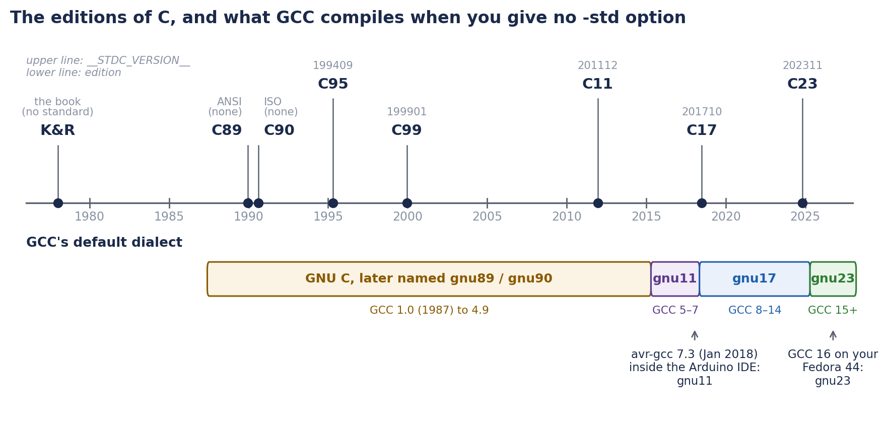

ref: 02.05
title: Standards and Dialects: K&R to C23
chapter: Chapter 02 — Why C Exists
part: Part I — The Machine Beneath C
builds: §02.04
---
## The question

The word "edition" has followed this book for some time without an explanation.

- In §00.02, the same small program reported `__STDC_VERSION__` as 202000 on the author's machine, 202311 on your Fedora laptop, and 201112 with the compiler inside the Arduino IDE.
- In §02.02, C89 had 32 keywords and C23 has 59, and integer division was "fixed in C99".
- In §02.03, `explicit_bzero` would not compile with `-std=c23`, yet compiled with `-std=gnu23`, though both are "C23".
- In §02.04, C23 "finally" required two's complement.

So C is not one fixed language. It has editions, and each compiler also offers its own **dialects** of each edition. That raises practical questions an engineer cannot avoid:

- Why does a language need editions at all, and what did each one change, and why?
- What exactly is the difference between `-std=c23` and `-std=gnu23`?
- Why do your laptop and the Arduino IDE compile different editions of C, and how can a program find out which one it is being compiled as?
- Which edition is this book written in, and how will it tell you when something depends on the edition?

## The journey

### Why a language needs editions

§02.04 described the C standard as the written part of a contract between programmers and implementations. A contract between millions of programmers and hundreds of compilers cannot be renegotiated casually. Yet the machines underneath keep changing: processors gained 64-bit registers, then several cores; programs began to handle every alphabet in the world; security became a matter of national importance. A standard that never changed would slowly describe a world that no longer exists. One that changed constantly would break the programs it was meant to protect.

C's answer is the **edition**: a complete revision of the standard, published after years of work by a committee, and then left unchanged until the next one. Since C90, the standard has been an ISO document, maintained by ISO's working group for C, known as **WG14**. Each edition replaces the previous one officially, but compilers keep supporting the old ones, because the programs written for them still exist. That is why a compiler has an option, `-std=`, to choose the edition, and why the choice matters.

Programmers name editions by year: C89, C99, C11, C17, C23. The year in the name is the year the technical work was finished, which is also the year encoded in the value of `__STDC_VERSION__`; the ISO document that makes it official may appear later. C17 was published by ISO in 2018 as ISO/IEC 9899:2018, which is why it is also called **C18** (GCC accepts both names), and C23 was published on October 31, 2024 as ISO/IEC 9899:2024. Before its year is known, an edition in preparation goes by a provisional name with an X or Y in place of the last digit: C9X became C99, C1X became C11, C2X became C23, and the next is C2Y. Older compilers know only the provisional names: GCC 13, for example, accepts `-std=c2x` but not `-std=c23`. Figure 02.05-1 places the editions in time, together with the edition GCC compiles when you do not ask for one.

{w=16}

### Before any standard: K&R C (1978)

§02.01 told how Kernighan and Ritchie's book of 1978 became the first description of C that others could implement. Its appendix, a reference manual, was in practice the language definition for a decade, together with the Bell Labs compilers themselves. The C it describes is recognizably the C you write, with one large difference, which Listing 02.05-1 shows: a function's declaration said nothing about its parameters.

```c Listing 02.05-1  C as it was written before prototypes
/* oldstyle.c
   C as it was written before prototypes, still accepted until C23. */
#include <stdio.h>

int area();                     /* empty parentheses: arguments unchecked */

int main(void) {
    printf("%d\n", area(6, 7));
    printf("%d\n", area(6));    /* a mistake: one argument missing */
    return 0;
}

int area(w, h)                  /* a definition in the style of 1978 */
int w, h;
{
    return w * h;
}
```

- Line 5 declares `area` with empty parentheses. Before C23, that meant "a function returning `int`, taking some arguments, number and types unknown".
- Lines 13–17 are a definition in the 1978 style: the parameter *names* in the parentheses, their *types* declared separately on line 14, before the body.
- Line 9 contains a deliberate mistake: one argument instead of two.

The comments use `/* */` rather than `//`, because `//` comments did not exist in standard C until 1999 (many compilers accepted them earlier, as an extension). Compile it as C17:

```terminal
$ gcc -std=c17 -Wall -Wextra -pedantic oldstyle.c -o oldstyle
$ ./oldstyle
```

```output
42
-1857145568
```

No error, and not even a warning, despite `-Wall -Wextra -pedantic`. The first line is right. The second is nonsense, and it changes every time you run the program (the next two runs printed −2070171520 and −848109120). Since the compiler knew nothing about `area`'s parameters, it passed one argument and `area` read two; the second came from wherever the calling rules (§19.02) put a second argument, which held something unrelated. In the author's reading, that leftover value was part of a memory address, which changes on every run (§27.02 explains why). This is undefined behavior (§02.04), and before 1989 every C programmer lived with it: a call with the wrong number or wrong types of arguments was not checked by the compiler (only a separate tool, lint, §02.01, could check it). As the C17 run shows, the same is still true today for any function declared without a prototype.

Now the same file as C23:

```terminal
$ gcc -std=c23 -Wall -Wextra -pedantic oldstyle.c -o oldstyle
```

```output
oldstyle.c: In function 'main':
oldstyle.c:8:20: error: too many arguments to function 'area'
    8 |     printf("%d\n", area(6, 7));
      |                    ^~~~
oldstyle.c:5:5: note: declared here
    5 | int area();                     /* empty parentheses: arguments unchecked */
      |     ^~~~
```

(followed by the same error for line 9, a warning about the old-style definition, and two errors because that definition no longer matches the declaration). In C23, `int area();` means exactly `int area(void);`: a function taking *no* arguments, so even the one-argument call has "too many". And the 1978-style definition is gone from the language. Notice, though, that GCC 14 reports the definition itself only with a *warning*: the standard requires a **diagnostic** for it, and a warning is a diagnostic, so GCC may still accept such a definition by itself (with `-pedantic-errors`, or with the Clang compiler, it is an error). The errors above come from the clash with the declaration. Either way, the program that ran silently wrong under C17 does not compile under C23. Between those two outcomes lies most of the history of this section, and §18.04 returns to prototypes and old-style declarations in full.

### C89 and C90: the first standard

The first standard, produced by the ANSI committee whose founding §02.01 described, was approved at the end of 1989 (hence **C89**, or **ANSI C**) and adopted by ISO in 1990 as ISO/IEC 9899:1990 (**C90**). The two documents have the same technical content; ISO renumbered the sections. Its purpose was to describe a language already running on dozens of machines, with conflicting behaviors, so that one program could be compiled by any of them. It did that in three ways.

1. **It invented checks the language lacked.** Its most important change, borrowed from C++, was the **function prototype**: a declaration that names the parameters' types, `int area(int w, int h);`. With a prototype in view, the compiler checks every call, converts arguments to the right types, and rejects Listing 02.05-1's mistake. It also added the type `void` (for functions that return nothing, and `void *` for pointers to anything), and the qualifiers `const` and `volatile` (§02.03).
2. **It standardized the library.** `printf`, `malloc`, `strcpy` and the rest had existed on Unix; C89 defined them, with their headers, for every hosted implementation (§02.06).
3. **It named the freedoms.** The kinds of behavior of §02.04 (implementation-defined, unspecified, undefined, locale-specific) were given their names and definitions here, along with the Rationale that explained each decision.

C89 did not define `__STDC_VERSION__`; it defined only `__STDC__`, with the value 1, to say "this compiler conforms to the standard". To keep existing programs working, it also kept the 1978 forms of Listing 02.05-1 as legal, though marked **obsolescent**: still part of the language, but liable to be removed in a future edition. C23, 34 years later, removed the definitions and redefined the empty parentheses.

### C95: the world's alphabets

A small amendment in 1995 (formally ISO/IEC 9899/AMD1:1995, informally **C95**) dealt with a problem that, in the author's reading, the first standard had treated only lightly: most of the world does not write in English. C89 already had the type `wchar_t` for **wide characters**, values larger than a byte that can hold the characters of Japanese, Chinese or Bengali, but few functions to work with them; C95 added a full library for them (`<wchar.h>`, `<wctype.h>`), and spellings for programmers whose national keyboards and character sets lacked `[`, `]`, `{`, `}` or `|`: the header `<iso646.h>`, which defines `and`, `or` and `not` as alternatives to `&&`, `||` and `!`, and **digraphs** such as `<:` for `[`. It was also the first part of the standard to define `__STDC_VERSION__`, as `199409L`. Chapter 08 returns to characters and their encodings.

### C99: catching up with practice

The second edition, ISO/IEC 9899:1999 (`199901L`), was a large one. Its additions are easiest to understand grouped by the problem each group solved.

- **What programmers already did.** `//` comments (borrowed back from C++, which had taken them from C's ancestor BCPL); declarations anywhere in a block, including inside `for (int i = 0; ...)`; `inline` functions; a boolean type `_Bool`, with `<stdbool.h>` defining `bool`, `true` and `false`.
- **Exact sizes, at last.** `long long`, at least 64 bits; and `<stdint.h>`, with `uint8_t`, `int16_t`, `uint32_t` and their relatives, whose widths are exact (each is provided wherever the machine has a type of that width, which in practice is everywhere; §05.04). Before C99, an embedded programmer who needed exactly 16 bits had to guess which of `short` and `int` provided them on each compiler. Chapter 05 makes these types the book's daily tools.
- **Numerical computing.** C99 tried to win back numerical programmers who used Fortran: `restrict` pointers (a promise that lets the optimizer assume two pointers do not overlap), complex numbers, variable-length arrays (arrays whose size is computed at run time), hexadecimal floating-point constants and a precise binding to IEEE floating point (Annex F, §00.01).
- **Convenience in initialization.** **Designated initializers** (`struct point p = { .y = 2, .x = 1 };`, or `int a[8] = { [3] = 7 };`) and compound literals.
- **Closing holes.** The "implicit `int`" of 1978 (a declaration with no type meant `int`) and calls to undeclared functions were removed; integer division was required to round toward zero (§02.02); and reaching the end of `main` was defined to return 0.

### C11: many cores, and security

By 2011 (`201112L`), the ordinary processor had several cores, and C, like every older language, had been specified as if only one thing happened at a time. C11's central addition was therefore a **memory model**: rules for what one thread may observe of another's writes, with **atomic** types and operations (`<stdatomic.h>`) and an optional thread library (`<threads.h>`). Chapter 38 is built on them.

Other additions served the programmer directly: `_Static_assert`, a compile-time check; `_Generic`, which chooses an expression according to a type; `_Alignas` and `_Alignof` for alignment (§06.04); `_Noreturn`; anonymous structures and unions inside other structures; and `char16_t` and `char32_t` for Unicode. Security entered the standard too. The function `gets`, which reads a line into an array without knowing the array's size and had been the entry point of countless attacks, was removed, a rare case of the standard taking something away. An optional Annex K added "bounds-checking" versions of library functions. In the other direction, variable-length arrays, compulsory in C99, became optional, and an implementation without them defines `__STDC_NO_VLA__`.

:::why
**Why did C99 and C11 give their new keywords such ugly names?** `_Bool`, `_Static_assert`, `_Alignas`, `_Noreturn`, `_Generic`, `_Atomic`: each begins with an underscore and a capital letter. The reason is the contract of §02.04. Since C89, every name beginning with an underscore followed by a capital letter has been **reserved** for the implementation and future standards; a correct program could not already be using it. A new keyword named `bool` or `static_assert` would have broken every existing program that happened to use that name for a variable or a macro, and there were many. So the committee chose names no correct program could contain, and offered the pleasant spelling through a header (`<stdbool.h>` defines `bool` as a macro for `_Bool`, and C11's `<assert.h>` defines `static_assert` as a macro for `_Static_assert`), which a program includes only if it wants it. C99 did add two plain-named keywords, `inline` and `restrict`, judging them rare as identifiers; for a name as common as `bool`, the risk was too great. Only in C23, after more than two decades of `<stdbool.h>`, did the committee judge that `bool`, `true`, `false`, `static_assert`, `alignas`, `alignof` and `thread_local` could become real keywords.
:::

### C17: a repair edition

C17 (`201710L`, published by ISO in 2018) added no features at all. It collected the corrections to C11 that the committee had accepted in response to **defect reports**, questions from implementers and users about places where the text was unclear or contradictory. It is the edition GCC compiled by default from GCC 8 to GCC 14, so much code written in the last decade assumes it.

### C23: modernizing, and removing the past

C23 (`202311L`) is the largest revision since C99. Grouped by purpose:

- **Promoting the reserved names.** `bool`, `true`, `false`, `static_assert`, `alignas`, `alignof` and `thread_local` became keywords, as the box above explained.
- **Adopting existing practice.** `typeof` (long a GNU extension); binary constants such as `0b1010` (also a GNU extension, used in §00.01); the **digit separator** `'`, so that a million can be written `1'000'000`; `nullptr`, a null pointer constant with its own type; `constexpr` objects, whose values are fixed while compiling; `auto` to let the compiler infer a variable's type from its initializer; **attributes** in double brackets, such as `[[nodiscard]]` (warn if a function's result is ignored) and `[[fallthrough]]`; `#embed`, which includes a file's bytes as data; and `_BitInt(N)`, integers of any width N up to an implementation limit (`BITINT_MAXWIDTH`), useful when software must model hardware registers of unusual widths.
- **Removing the past.** Function definitions in the 1978 style were removed, and empty parentheses in a declaration now mean `(void)`, as Listing 02.05-1 showed. Signed integers must be two's complement (§02.04); no new machine had used another representation for decades.
- **Library additions.** Among others, `memset_explicit` (§02.03), `strdup`, and `unreachable`, which tells the compiler that a point in the program can never be reached.

The next edition, provisionally called **C2y**, is in preparation; GCC 15 and later accept `-std=c2y` for its experimental parts.

Table 02.05-1 condenses the editions. Table 02.05-2 then tests the claims: each feature was written as a small program, and GCC 14 was asked to compile it under each edition with `-pedantic-errors`, which turns the diagnostics that the chosen edition requires, and GCC's warnings about its extensions, into errors (not every departure from the standard, as the *Precisely speaking* box below explains).

Table: Table 02.05-1  The editions of C at a glance
<!-- widths: 13,20,13,54 -->
| Edition | Official document | `__STDC_VERSION__` | Main changes, and why |
|---|---|---|---|
| K&R | the book (1978) | (none) | the first description others could implement |
| C89 / C90 | ANSI X3.159-1989; ISO/IEC 9899:1990 | (none; `__STDC__` is 1) | prototypes, `void`, `const`, `volatile`, the library, the kinds of behavior: one language for many compilers |
| C95 | ISO/IEC 9899/AMD1:1995 | `199409L` | wide characters, `<iso646.h>`, digraphs: the world's alphabets and keyboards |
| C99 | ISO/IEC 9899:1999 | `199901L` | `//`, declarations anywhere, `<stdint.h>`, `long long`, `_Bool`, `inline`, `restrict`, designated initializers, variable-length arrays: catching up with practice and with 64-bit machines |
| C11 | ISO/IEC 9899:2011 | `201112L` | memory model, atomics, threads, `_Static_assert`, `_Generic`, alignment; `gets` removed: multicore processors and security |
| C17 | ISO/IEC 9899:2018 | `201710L` | corrections only |
| C23 | ISO/IEC 9899:2024 | `202311L` | `bool` and others as keywords, `nullptr`, `constexpr`, `typeof`, `auto`, attributes, `#embed`, `_BitInt`; old-style definitions removed; two's complement required |

Table: Table 02.05-2  When each feature became legal: GCC 14.2 with -pedantic-errors
<!-- widths: 46,9,9,9,9,9,9 -->
| Feature (tested as a small program) | c89 | c99 | c11 | c17 | c23 | added in |
|---|---|---|---|---|---|---|
| `//` comment | no | yes | yes | yes | yes | C99 |
| declaration after a statement; `for (int i = ...)` | no | yes | yes | yes | yes | C99 |
| `long long` | no | yes | yes | yes | yes | C99 |
| designated initializers | no | yes | yes | yes | yes | C99 |
| variable-length array | no | yes | yes | yes | yes | C99 (optional from C11) |
| `_Static_assert`, `_Generic`, anonymous unions | no | no | yes | yes | yes | C11 |
| `bool`, `static_assert` without any header | no | no | no | no | yes | C23 |
| `nullptr`, `typeof`, `constexpr`, `[[nodiscard]]` | no | no | no | no | yes | C23 |
| binary constant `0b1010`; digit separator `1'000'000` | no | no | no | no | yes | C23 |
| `auto x = 5;` | yes | no | no | no | yes | see text |
| `#embed` | no | no | no | no | no | C23 (GCC 15 and later) |
| definition in the 1978 style; `int f();` called with arguments | yes | yes | yes | yes | no | removed in C23 |
| implicit `int` (`f(void) { ... }`); calling an undeclared function | yes | no | no | no | no | removed in C99 |

Two rows deserve a closer look. `auto x = 5;` is legal in C89 for a reason that has nothing to do with C23: `auto` was C's oldest storage-class keyword, meaning "an ordinary local variable", and C89's implicit `int` supplied the missing type, so the line meant `auto int x = 5;`. When C99 removed implicit `int`, the line became an error; C23 gave `auto` its new meaning of type inference. The `#embed` row records a fact about GCC 14, not about C23: the feature is in the standard, but GCC implements it only from version 15. A compiler's support for an edition is often incomplete for years. (That is not, however, what GCC 14's provisional value 202000 means: GCC chose that value before C23's final value was fixed, and its developers changed it to 202311 for GCC 15, before GCC had completed its C23 support.)

:::hood
Not every C99 *header* failed in `-std=c89` mode in this test: `#include <stdbool.h>` followed by `bool ok = true;` compiled even with `-pedantic-errors`, although writing `_Bool` directly in the program is rejected (`ISO C90 does not support boolean types`). The difference is where the `_Bool` is written. GCC treats the headers installed with the compiler and the system as **system headers**, and suppresses its pedantic diagnostics for code inside them, because the implementation is allowed to use its own extensions there. So `<stdbool.h>`'s `#define bool _Bool` passed unremarked. (The same happened with `<stdint.h>`.) The table therefore records the feature as written in the program, not the header. This is a small instance of a general warning: passing `-std=c89` does not turn your compiler into a 1989 compiler. It turns on a mode that rejects much of what C89 did not have, as faithfully as its authors chose to make it.
:::

### The GNU dialects

GCC offers two modes for each edition: the ISO mode (`c89`, `c99`, `c11`, `c17`, `c23`) and the **GNU dialect** (`gnu89`, `gnu99`, `gnu11`, `gnu17`, `gnu23`). A dialect is the edition plus GCC's own **extensions**, features GNU developers added because they found them useful, some of which later entered the standard (`typeof` and binary constants are both former GNU extensions). Three differences between the modes matter in practice.

**1. Names the GNU dialect takes from you.** GCC's manual explains that an ISO mode turns off the GNU features that *conflict* with ISO C, such as the keywords `asm` (standard in no edition) and `typeof` (standard only from C23), while a GNU dialect enables everything, even features that change the meaning of a correct ISO program. Listing 02.05-2 shows one such change.

```c Listing 02.05-2  A name that the GNU dialect takes
// gnu.c
// A name that ISO C leaves to the programmer, and the GNU dialect takes.
#include <stdio.h>

int main(void) {
    int linux = 1;              // an ordinary variable name in ISO C
    printf("linux = %d\n", linux);
}
```

```terminal
$ gcc -std=c23 -Wall -Wextra -pedantic gnu.c -o gnu
$ ./gnu
```

```output
linux = 1
```

```terminal
$ gcc -std=gnu23 -Wall -Wextra -pedantic gnu.c -o gnu
```

```output
gnu.c: In function 'main':
gnu.c:6:9: error: expected identifier or '(' before numeric constant
    6 |     int linux = 1;              // an ordinary variable name in ISO C
      |         ^~~~~
```

In the GNU dialect on Linux, GCC predefines two macros named `linux` and `unix`, each with the value 1, a convention older than the standard. The preprocessor (§22.01) therefore turned line 6 into `int 1 = 1;`, which is not C. In ISO mode GCC defines only reserved spellings, such as `__linux__` and `__unix__`, which no correct program can use for its own purposes, and `linux` is yours again. You can see the difference yourself: `gcc -std=gnu23 -dM -E - < /dev/null` lists every predefined macro (Experiment 02.05-4).

**2. What the library shows you.** An ISO mode also defines the macro `__STRICT_ANSI__`, and the C library's headers react to it. glibc's `<features.h>` enables its default extensions (the set it calls `_DEFAULT_SOURCE`: the POSIX functions plus BSD and System V additions) only when neither `__STRICT_ANSI__` nor another feature test macro is defined, so under `-std=c23` the header `<string.h>` stops declaring functions that ISO C does not define. One of those is `explicit_bzero`, and this explains §02.03's puzzle:

1. With `-std=c23`, glibc's `<string.h>` hid `explicit_bzero`, so the call on line 12 of Listing 02.03-6 was a call to an undeclared function.
2. Calling an undeclared function was legal, with an implicit declaration, in C89; C99 removed that permission. GCC long reported it only as a warning, but GCC 14 made it an **error** by default, in every mode except the C89 ones (`-std=c89`, `-std=gnu89`, `-ansi`), as GCC's "Porting to GCC 14" notes explain. GCC 13 reports the same call only with a warning.

With `-std=gnu23`, nothing is hidden. With `-std=c23`, you can ask for the extra declarations explicitly by defining `_DEFAULT_SOURCE` before the first `#include`, or with the option `-D_DEFAULT_SOURCE`; this keeps the language strict while enlarging the library. Macros like `_DEFAULT_SOURCE` and `_POSIX_C_SOURCE`, which a program defines to request parts of a library, are called **feature test macros**; the book uses them where a section needs a function outside ISO C.

**3. Extensions that do not conflict stay on.** An ISO mode does *not* forbid GNU extensions that have no meaning in ISO C. A **statement expression**, `({ int t = 6; t * 7; })`, which evaluates a block of statements and yields the value of the last, or a **case range**, `case 40 ... 45:`, compiles under `-std=c23` as well as `-std=gnu23`. Only `-pedantic` warns about them (`ISO C forbids braced-groups within expressions`, `range expressions in switch statements are non-standard`), and only `-pedantic-errors` rejects them. This is why the book always pairs `-std=c23` with `-pedantic` (§00.02): together they hold the compiler to the standard as closely as GCC allows.

:::precise
"C23" in a compiler option does not mean "the C23 standard and nothing else". `-std=c23` selects the ISO dialect of C23 as GCC implements it: conflicting GNU features off, non-conflicting extensions on, and the implementation's level of C23 support (complete or not) unchanged. `-pedantic` adds the diagnostics the standard requires and warns about extensions. Even together they do not detect every program that steps outside ISO C (GCC's manual says so), and some departures, such as undefined behavior (§02.04), no compiler option can detect in general.
:::

### Compiler defaults over time

When you give no `-std` option, GCC chooses for you, and its choice has changed three times. Up to GCC 4.9 the default was `gnu89` (C89 with GNU extensions, which included some C99 features). GCC 5, in 2015, made it `gnu11`; GCC 8, in 2018, `gnu17`; and GCC 15, in 2025, `gnu23`. The reasoning, in the author's reading, is the same each time: once an edition is well supported, the default should let new programs use it without asking. The changes to `gnu11` and `gnu23` broke some old programs, and GCC's "Porting to GCC 5" and "Porting to GCC 15" notes give advice; the change to `gnu17`, an edition of corrections only, needed none.

So "what does `gcc file.c` compile?" has no fixed answer. It depends on which compiler, and which version of it, you are running. Table 02.05-3 lists the compilers that appear in this book.

Table: Table 02.05-3  The editions your compilers use by default
<!-- widths: 40,22,38 -->
| Compiler | Default | Source of the fact |
|---|---|---|
| GCC 14.2 (the author's verification machine) | `gnu17` | observed: Listing 02.05-3 prints C17, and `gcc -dM -E` shows `linux` defined and no `__STRICT_ANSI__` |
| GCC 16.2 (your Fedora 44) | `gnu23` | GCC's documentation (your run in §00.02, with `-std=c23`, printed 202311) |
| avr-gcc 7.3 (inside the Arduino IDE) | `gnu11`; it does not accept `-std=c17` at all | observed |
| The Arduino IDE's builds for the Uno | `-std=gnu11` for C files, `-std=gnu++11` for sketches | the AVR core's `platform.txt` (version 1.8.8) |
| avr-gcc 15 (Fedora's, for bare-metal C) | `gnu23` | GCC's documentation |
| ESP-IDF | `gnu17` in versions 5.x, `gnu23` from version 6 | Espressif's documentation |

Now the disagreement between your laptop and the Arduino IDE can be explained precisely. It has three causes, one inside the other.

1. **The IDE's compiler is old.** avr-gcc 7.3 was released in January 2018, before GCC supported C17 or C23. It does not even recognize `-std=c17` (it suggests `-std=c11` instead). No option can give it an edition it was built before.
2. **The Arduino platform chooses explicitly.** The AVR core's configuration file, `platform.txt`, passes `-std=gnu11` for C files and `-std=gnu++11` for sketches on every compilation, whatever the compiler's default. Arduino's evident reason for keeping this fixed is that a library written years ago should still compile today; changing it could break some of the thousands of libraries users install.
3. **A sketch is C++, not C.** As §00.02 noted, and §39.04 explains, the IDE compiles `.ino` files with the C++ compiler. In C++, the edition is reported by a different macro, `__cplusplus` (201103 for C++11), and `__STDC_VERSION__` is not the right question at all. Only `.c` files added to a sketch are compiled as C.

:::orbit
Why would a manufacturer keep shipping a compiler nearly nine years old? The Arduino case is a mild form of a principle that flight software applies strictly: **the compiler is part of the design**. A flight-software team fixes one exact compiler version, with one exact set of options and one edition of C, under configuration control, and every test of the software, including the verification of the object code the compiler produced, is evidence about *that* combination only; upgrading the compiler means repeating the evidence. Coding standards are written for particular editions too: MISRA C:2012, widely used in aerospace and automotive software, was written for C90 and C99, and C11 and C17 were added to it only in later amendments. In the author's view this is the strongest argument for the habit this section teaches: always know which edition, which dialect and which compiler version produced your program, because on a spacecraft "it compiled" is a statement about one specific toolchain.
:::

### Checking the edition in a program

A program can ask which edition it is being compiled as, and choose its code accordingly. Listing 02.05-3 does so with the preprocessor's conditional directives, which §22.05 explains in full; for now, read `#if` as "compile the following lines only if", `#elif` as "else if", and `defined(X)` as "the macro X exists".

```c Listing 02.05-3  Asking which edition the compiler is following
/* version.c
   Which edition of C is this compiler following?
   (Comments in this file use the old form, because C89 has no //.) */
#include <stdio.h>

int main(void) {
#if !defined(__STDC_VERSION__)
    puts("C89/C90: __STDC_VERSION__ is not defined");
#elif __STDC_VERSION__ > 201710L
    printf("C23 or later: %ld\n", (long)__STDC_VERSION__);
#elif __STDC_VERSION__ == 201710L
    puts("C17");
#elif __STDC_VERSION__ == 201112L
    puts("C11");
#elif __STDC_VERSION__ == 199901L
    puts("C99");
#else
    puts("C95 (C90 with Amendment 1)");
#endif
    return 0;
}
```

- Line 7 comes first because C89 does not define `__STDC_VERSION__` at all. (In `#if`, an undefined name counts as 0, so the later tests would quietly treat C89 as "C95"; testing `defined` first says what is meant.)
- Line 9 tests `> 201710L`, not `== 202311L`. GCC 14 reports the provisional 202000 for its incomplete C23, and an exact comparison would misclassify it. When you test editions, test "at least" or "later than", never equality with a value from the future.
- Line 10 prints the value with `%ld`; the cast to `long` makes the match between value and conversion explicit, whatever the implementation's spelling of the constant.
- Line 20, `return 0;`, is needed only in C89, where falling off the end of `main` returns an undefined status; since C99 it returns 0 automatically.

Compiled with GCC 14.2 under each option in turn, it printed the following (the option used is shown at the left of each line; each line is the whole output of one build):

```text
-std=c89             C89/C90: __STDC_VERSION__ is not defined
-std=iso9899:199409  C95 (C90 with Amendment 1)
-std=c99             C99
-std=c11             C11
-std=c17             C17
-std=c23             C23 or later: 202000
-std=gnu89           C89/C90: __STDC_VERSION__ is not defined
-std=gnu23           C23 or later: 202000
(no option)          C17
```

The GNU dialects report the same values as the ISO modes: `__STDC_VERSION__` names the edition, not the dialect. (`__STRICT_ANSI__` is how a program can tell them apart.) Built with avr-gcc 7.3 and run on the simulated ATmega328P, Listing 02.05-3 printed `C11` with no option.

In real programs, the edition test usually guards a choice between two ways of saying the same thing, so that one source file serves old and new compilers:

```text
#if defined(__STDC_VERSION__) && __STDC_VERSION__ > 201710L
    static_assert(sizeof(int) >= 2);           /* C23 spelling */
#else
    _Static_assert(sizeof(int) >= 2, "int");   /* C11 spelling */
#endif
```

For features that an implementation may omit, the standard provides more precise tests than the edition number: `__STDC_NO_VLA__` and `__STDC_NO_THREADS__` (defined when the feature is absent), and in C23 `__has_include`, which asks whether a header exists, and `__has_c_attribute`, which asks whether an attribute is supported. Asking about the feature you need is more reliable than inferring it from the edition, because, as the `#embed` row of Table 02.05-2 showed, a compiler may claim an edition before supporting all of it.

### The book's baseline, and how it marks differences

Now the book can state its own contract with you precisely.

- **The language is ISO C23.** Every listing for your laptop is compiled with `gcc -std=c23 -Wall -Wextra -pedantic` (§00.02), so it uses no GNU extension unless the text says otherwise, as this section did when it compiled Listings 02.05-1 and 02.05-2 with other options to show the differences.
- **Verification uses two compilers.** The author runs every listing with GCC 14.2, whose C23 support is incomplete (it lacks `#embed`, for example) and which reports the provisional value 202000; you run them with GCC 16. Where the difference could change an output, the section's *Sources and verification* lists the item "for the reader to confirm on GCC 15 or 16".
- **AVR code keeps to C11 unless marked.** Bare-metal AVR programs are meant for Fedora's avr-gcc 15, which defaults to C23, but the author verifies them with avr-gcc 7.3, which stops at C11. So AVR listings use only what both accept, which in practice means C11; when a C23 feature would help, the text says so and shows the C11 form.
- **Sketches are C++11.** Arduino sketches are compiled as GNU C++11 on the Uno; the book writes them in the common subset of C and C++ wherever it can, and §39.04 explains the differences that matter.

And the book marks the editions in four ways, extending the conventions of §00.01:

1. **The edition that introduced a feature is named when the feature first appears,** as "(C99)" or "since C11" or "new in C23", and the feature's chapter tells what older code does instead.
2. ***Precisely speaking* boxes name the edition** whenever the editions differ on the point being stated (§00.01).
3. **A listing that needs C23 says so** in its explanation, and where an older form is common in existing code (`_Static_assert` beside `static_assert`, `<stdbool.h>` beside the keyword `bool`), the older form is shown too, because you will read far more code than you write.
4. **Compiler-dependent results name the compiler,** as every Output block already does, and items that may differ on your GCC are listed for you to confirm.

## Terms introduced

- **Edition**: a complete revision of the C standard, such as C99 or C23.
- **WG14**: the ISO working group (ISO/IEC JTC 1/SC 22/WG 14) that maintains the C standard.
- **K&R C**: the language described by Kernighan and Ritchie's book of 1978, before any standard.
- **ANSI C, C89, C90**: the first standard (ANSI 1989; ISO 1990).
- **Function prototype**: a function declaration that states the types of its parameters, so that every call can be checked.
- **Obsolescent**: a feature still in the standard but liable to be removed from a future edition.
- **Wide character**: a character value wider than a byte, for writing systems with many characters (`wchar_t` since C89; its full library since C95).
- **Digraph**: a two-character spelling of a punctuation character, such as `<:` for `[`.
- **Reserved identifier**: a name, such as one beginning with an underscore and a capital letter, that a program must not define, because it belongs to the implementation and to future editions.
- **Defect report**: a question to the committee about an error or ambiguity in the standard's text.
- **Dialect**: a compiler's mode for an edition: GCC's ISO dialect (`c23`, conflicting extensions off) or GNU dialect (`gnu23`, all extensions on).
- **C18**: another name for C17, after the year of its ISO publication.
- **Diagnostic**: a message the compiler must issue for certain errors; a warning counts as one.
- **Extension**: a feature an implementation provides beyond the standard.
- **Statement expression, case range**: two GNU extensions (`({ ... })`; `case a ... b:`).
- **Feature test macro**: a macro a program defines, such as `_DEFAULT_SOURCE`, to request parts of a library that are not declared by default.
- **`__STDC_VERSION__`, `__STDC__`, `__STRICT_ANSI__`, `__cplusplus`**: macros reporting the edition of C, conformance, GCC's ISO mode, and the edition of C++.

## Self-check

1. Why does C have editions, rather than one standard changed whenever needed?
2. Why is C17 called C17, though ISO published it in 2018?
3. What did a declaration like `int area();` mean before C23, and what does it mean in C23? Why did Listing 02.05-1 print a different second number on every run when compiled as C17?
4. Which problem did the function prototype solve, and in which edition was it introduced?
5. Which edition introduced `<stdint.h>`, and why does it matter to an embedded programmer?
6. Why did C11 name its new keyword `_Static_assert` rather than `static_assert`?
7. Explain why `auto x = 5;` compiles with `-std=c89`, fails with `-std=c17` and compiles with `-std=c23`.
8. What are the three practical differences between `-std=c23` and `-std=gnu23` described in this section?
9. Explain, in two steps, why `explicit_bzero` failed to compile with `-std=c23` in §02.03.
10. Give the three reasons why your laptop and the Arduino IDE compile different editions of C.
11. Why does Listing 02.05-3 test `__STDC_VERSION__ > 201710L` rather than `== 202311L`? Why does it test `defined(__STDC_VERSION__)` first?
12. A colleague says: "My code is C23, because I compiled it with `-std=c23` and it worked." What does that statement establish, and what does it not?

## Experiments

**Experiment 02.05-1. Your compiler's editions.** Compile Listing 02.05-3 with no option and with each of `-std=c89`, `-std=c99`, `-std=c11`, `-std=c17`, `-std=c23`, `-std=gnu23` and `-ansi`. Compare your results with those above. If your GCC is 15 or later, try `-std=c2y` too.

**Experiment 02.05-2. Warnings that C17 did not give.** Compile Listing 02.05-1 with `-std=c17 -Wall -Wextra -pedantic -Wstrict-prototypes -Wold-style-definition`. Which warnings appear now? Then rewrite `area` with a prototype, `int area(int w, int h);`, and a modern definition, and compile with `-std=c17`: what does the compiler now say about line 9?

**Experiment 02.05-3. The life of `auto`.** Write the one-line program `int main(void) { auto x = 5; return x - 5; }` and compile it with `-std=c89 -pedantic-errors`, `-std=c17 -pedantic-errors` and `-std=c23 -pedantic-errors`. Which build fails, and what does the error say? In each successful build, what type does `x` have?

**Experiment 02.05-4. What the dialect predefines.** Run `gcc -std=c23 -dM -E - < /dev/null | sort > c23.txt` and the same with `-std=gnu23` into `gnu23.txt`, then `diff c23.txt gnu23.txt`. Which macros differ? Then compile Listing 02.05-2 with `-std=gnu23 -Ulinux`: what does `-U` do, and does the program compile now?

**Experiment 02.05-5. Three ways to get `explicit_bzero`.** Take §02.03's Listing 02.03-6 with `explicit_bzero` in place of `memset`. Compile it with `-c` (it has no `main`) and `-std=c23`, then `-std=gnu23`, then `-std=c23 -D_DEFAULT_SOURCE`. Which succeed? If GCC 13 is available on any machine you use, compile the strict version with it, using its provisional name `-std=c2x` (GCC 13 does not know `-std=c23`), and add `-c` to compile without linking, since the listing has no `main`. Compare the message.

**Experiment 02.05-6. Extensions in ISO mode.** Write a program containing the statement expression `int x = ({ int t = 6; t * 7; });` and the case range `case 40 ... 45:`. Compile it with `-std=c23` alone, with `-std=c23 -pedantic`, and with `-std=c23 -pedantic-errors`. What changes?

## Hands-on (AVR / ESP32)

### A: ask the Uno's two compilers

A sketch can contain more than one file: in the Arduino IDE, the menu beside the tabs offers **New Tab**, and a tab whose name ends in `.c` is compiled as C, while the `.ino` file is compiled as C++. Listing 02.05-4 is the sketch; Listing 02.05-5 is a second tab named `cver.c`.

```c Listing 02.05-4  A sketch that asks both of its compilers for their editions
// stdver.ino  (Arduino Uno or ESP32)
// Which editions do the board's two compilers follow?
extern "C" long c_version(void);    // defined in cver.c, compiled as C

void setup() {
  Serial.begin(115200);
  delay(500);
  Serial.print("C++ (this sketch): ");
  Serial.println(__cplusplus);
  Serial.print("C   (cver.c):      ");
  Serial.println(c_version());
}

void loop() {}
```

```c Listing 02.05-5  The second tab, compiled as C
// cver.c  (a second tab of the same sketch, compiled as C)
long c_version(void) {
    return __STDC_VERSION__;
}
```

- Line 3 of the sketch declares a function that lives in the C file. `extern "C"` tells the C++ compiler to call it by C's rules for names (§39.04 explains why C++ needs telling); without it, the program would compile but fail to link.
- Line 9 prints `__cplusplus`, the C++ compiler's edition. Line 11 prints the value that the C file's compiler put into `__STDC_VERSION__`.

Built as the Arduino IDE builds it for the Uno (avr-gcc 7.3 with `-std=gnu11` for the C file, avr-g++ 7.3 with `-std=gnu++11` for the sketch, and minimal stand-ins for `Serial` and `delay`) and run on the simulator, it printed:

```output
C++ (this sketch): 201103
C   (cver.c):      201112
```

C++11 for the sketch, C11 for the C file: exactly the options in `platform.txt`. Expect the same on a real Uno with the Arduino IDE's AVR core 1.8.

### B: and the ESP32's

Upload the same sketch, with its second tab, to the ESP32. This was not run by the author. The ESP32 core for Arduino takes its compiler options from the version of ESP-IDF it is built on, so the values depend on the core version you installed. With the current core, 3.x, expect a C++ value of 201703 or later (users have reported 202100 and similar values, which GCC uses for C++ editions not yet finished when that GCC was released); with the older core 2.x, users have reported 201103. Expect a C value of 201710 if your core is built on ESP-IDF 5.x. Record both, together with the core version shown in the IDE's Boards Manager, and compare them with the Uno's: two boards, both programmed from "the Arduino IDE", compiling two different editions of two languages.

## Answers

**Self-check 1.** A standard binds millions of programs and hundreds of compilers; it must be stable for long periods, yet follow changes in machines and needs. Complete revisions published years apart, each left unchanged until the next, give both stability and progress, while compilers keep supporting the older editions.

**Self-check 2.** Editions are named after the year their technical work was completed, the year encoded in `__STDC_VERSION__` (201710L); ISO's publication followed in 2018.

**Self-check 3.** Before C23, `int area();` declared a function returning `int` with unspecified parameters, so calls were not checked; in C23 it means `int area(void);`. In C17 the call `area(6)` passed one argument where `area` read two; the second was whatever was in the place the calling rules use for a second argument, which differed from run to run (the author's reading: part of an address that changes on every run). The call has undefined behavior.

**Self-check 4.** A call with the wrong number or types of arguments went unchecked. The prototype, in C89 (borrowed from C++), lets the compiler check and convert every argument.

**Self-check 5.** C99. It provides types of exact width (`uint8_t`, `int16_t`, `uint32_t`), so a program that needs exactly 16 bits no longer has to guess which of `short` and `int` provides them on each compiler.

**Self-check 6.** Names beginning with an underscore and a capital letter are reserved, so no correct existing program could be using `_Static_assert`; a new keyword `static_assert` could have broken programs that used that name. C11 offered the pleasant spelling as a macro in `<assert.h>`; C23 made it a keyword.

**Self-check 7.** In C89, `auto` is a storage-class keyword and implicit `int` supplies the missing type: `auto int x = 5;`. C99 removed implicit `int`, so from C99 to C17 the declaration has no type and is an error. C23 gave `auto` the meaning "infer the type from the initializer", so `x` is an `int` again, for a different reason.

**Self-check 8.** (1) The GNU dialect enables features that conflict with ISO C, such as the predefined macros `linux` and `unix`; (2) the ISO mode defines `__STRICT_ANSI__`, and glibc's headers then hide functions ISO C does not define; (3) non-conflicting GNU extensions stay available in both modes, and only `-pedantic` warns about them.

**Self-check 9.** (1) `-std=c23` defines `__STRICT_ANSI__`, so glibc's `<string.h>` does not declare `explicit_bzero`; (2) GCC 14 treats a call to an undeclared function as an error by default (in all modes except the C89 ones).

**Self-check 10.** (1) The IDE's avr-gcc 7.3 (2018) predates GCC's support for C17 and C23; (2) the Arduino AVR core passes `-std=gnu11` for C and `-std=gnu++11` for C++ explicitly, whatever the compiler's default; (3) sketches are compiled as C++, whose edition is reported by `__cplusplus`, not `__STDC_VERSION__`.

**Self-check 11.** A compiler with incomplete C23 support, such as GCC 14, reports a provisional value (202000) below 202311, and an equality test would misclassify it; "later than C17" is the robust test. `defined` comes first because C89 does not define `__STDC_VERSION__`, and in `#if` an undefined name counts as 0, which the later tests would misread.

**Self-check 12.** It establishes that one compiler, at one version, in its implementation of the ISO C23 mode, accepted the program without errors with the options used. It does not establish that the program avoids extensions (that needs `-pedantic`, and even then not completely), that it has no undefined behavior, or that another C23 compiler, or this one at another version or optimization level, will accept it or produce the same results.

**Experiment 02.05-1.** With GCC 14.2: the results shown above; `-ansi` prints the C89 line, since it is equivalent to `-std=c90` in C mode. With GCC 16, expect `202311` for `-std=c23`, `-std=gnu23` and no option; `-std=c2y` should print "C23 or later" with a value above 202311, a provisional value for the next edition. GCC 14 rejects `-std=c2y`.

**Experiment 02.05-2.** GCC 14.2 then warns `function declaration isn't a prototype` for lines 5 and 13, and `old-style function definition` for line 13. With a prototype, the call `area(6)` on line 9 becomes an error: `too few arguments to function 'area'`.

**Experiment 02.05-3.** The `-std=c17` build fails: `type defaults to 'int' in declaration of 'x'`. In the C89 build `x` is an `int` by implicit `int`; in the C23 build `x` is an `int` inferred from the constant 5.

**Experiment 02.05-4.** With GCC 14.2, exactly three lines differ: `__STRICT_ANSI__` (only in the ISO mode), and `linux` and `unix` (only in the GNU dialect). Other versions may differ in more lines. `-Ulinux` removes the predefined macro `linux`, and the program compiles and prints `linux = 1`.

**Experiment 02.05-5.** Compiled with `-c` (the listing has no `main`), `-std=gnu23` and `-std=c23 -D_DEFAULT_SOURCE` succeed; `-std=c23` alone fails with `implicit declaration of function 'explicit_bzero'`. GCC 13 with `-std=c2x -c` reports the same message as a warning and produces the object file.

**Experiment 02.05-6.** `-std=c23` alone compiles the program without any message; `-pedantic` adds the two warnings quoted in the text and still produces the program; `-pedantic-errors` turns them into errors, so no program is produced.

**Hands-on A.** As above, from the simulator.

**Hands-on B.** Not observed by the author.

## Sources and verification

- **Toolchains.** x86-64 programs were compiled with GCC 14.2.0 on x86-64 Ubuntu Linux 24.04 with the options shown, and GCC 13.3.0 for the comparison of Experiment 02.05-5; Table 02.05-2 was produced by compiling one small program per feature with `gcc-14 -std=<edition> -pedantic-errors`. AVR programs were compiled with avr-gcc 7.3.0 and avr-libc 2.0.0 and run on simavr emulating an ATmega328P at 16 MHz, with the harness of §02.02 connecting `printf` to the UART; the sketch was compiled with avr-g++ 7.3.0 (`-std=gnu++11 -Os`) and the C tab with avr-gcc 7.3.0 (`-std=gnu11 -Os`), with minimal stand-ins for `Serial` and `delay`. simavr's coloring and line-ending marks are omitted. The output of Listing 02.05-1's second line is from one run; it differs from run to run. Experiment 02.05-5's GCC 13 step was run with GCC 13.3.0 (`-std=c2x -c`). **For the reader to confirm on GCC 15 or 16:** the values printed by Listing 02.05-3 (202311 expected for C23); the rows of Table 02.05-2 (with GCC 15 or later, `#embed` should compile under `-std=c23`); the messages of Listing 02.05-1 and Experiments 02.05-2, 02.05-3 and 02.05-5; and the macro differences of Experiment 02.05-4.
- **Not run by the author.** Hands-on B (ESP32); Hands-on A on a physical Uno.
- **Editions and dates.** ISO catalog entries for ISO/IEC 9899:1990, 9899/AMD1:1995, 9899:1999, 9899:2011, 9899:2018 and 9899:2024 (the last published October 31, 2024, edition 5); the values of `__STDC_VERSION__` from each edition (C23 draft N3096, §6.10.9.1 for 202311L). C89 as ANSI X3.159-1989 and its adoption by ISO in 1990: as in §02.01. The contents of each edition: the forewords of C99, C11 and C17, which list the major changes, and for C23 the list of changes in Annex M of N3096; the removal of `gets` and the optionality of variable-length arrays (C11 foreword); C17 as corrections only (C17 foreword, and GCC's manual); the obsolescence of old-style definitions since C89 and their removal in C23 (N3096, §6.9.1 and Annex M). GCC 14's treatment of an old-style definition under `-std=c23` (a warning, an error only with `-pedantic-errors`) and Clang 18's (an error) were observed. GCC's change of the C23 `__STDC_VERSION__` from 202000 to 202311 for GCC 15: GCC commit r15-62 (April 2024). System headers and the suppression of pedantic warnings in them: GCC manual, "System Headers". Reserved identifiers: N3096, §7.1.3.
- **GCC.** GCC manual, "Options Controlling C Dialect": the `-std` values, the GNU dialects, the default (`gnu23` from GCC 15), the statement that ISO modes turn off conflicting features such as the `asm` and `typeof` keywords while leaving non-conflicting extensions, and `-ansi` as `-std=c90`. GCC 5 release notes: the default changed from `gnu89` to `gnu11`. GCC's C status page: `gnu17` the default from GCC 8 to 14, C23 the default from 15, `#embed` in GCC 15, C99 substantially supported from GCC 4.5 and C11 from 4.9. "Porting to GCC 14": implicit function declarations and implicit `int` became errors, with `-fpermissive`, `-std=gnu89` or `-std=c89` restoring the old behavior. The `-std=c2y` option: GCC 15 documentation (not accepted by GCC 14.2, observed). The predefined macros `linux`, `unix` and `__STRICT_ANSI__`: observed with `gcc-14 -dM -E`.
- **glibc.** `<features.h>` of glibc 2.39: `_DEFAULT_SOURCE` is defined by default only if `__STRICT_ANSI__` and the other feature test macros are not defined; `explicit_bzero` is declared under it in `<string.h>`.
- **Arduino and Espressif.** ArduinoCore-avr `platform.txt`, version 1.8.8 (GitHub, checked November 26, 2026): `compiler.c.flags` contains `-std=gnu11` and `compiler.cpp.flags` contains `-std=gnu++11`. The release date of GCC 7.3 (January 2018): GCC releases page. ESP-IDF Programming Guide, "C Support", versions 5.3–5.5 (`gnu17` as the default) and 6.1 (`gnu23`). The `__cplusplus` values reported by ESP32 Arduino core 3.x users: Arduino and Espressif forum posts (anecdotal, hence "reported").
- **MISRA C.** MISRA C:2012 and its Amendment 2 (2020), which added support for C11 and C18: MISRA's published descriptions.
- **Inference in this section.** The grouping of each edition's changes by purpose, the statements of *why* each change was made where not stated in the forewords (for instance, that C99's numerical features aimed to win back Fortran programmers, that C89 had treated non-English writing only lightly, that GCC's default changes follow one reasoning, and that Arduino fixes its options to keep old libraries compiling), the reading of Listing 02.05-1's leftover value as part of an address, the flight-software argument of the "In orbit" box, the book's rule that AVR listings keep to C11, and the ESP32 expectations are the author's reasoning, not statements from the sources.
