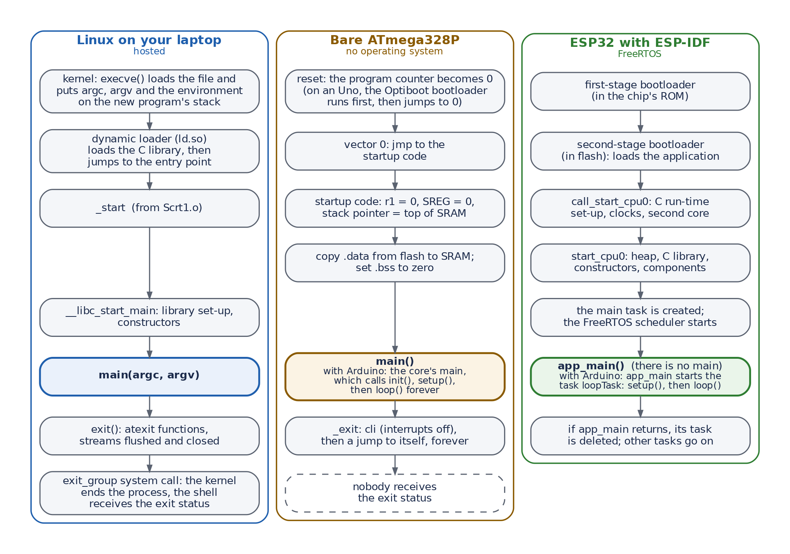

ref: 02.06
title: Hosted and Freestanding Implementations
chapter: Chapter 02 — Why C Exists
part: Part I — The Machine Beneath C
builds: §02.05
---
## The question

Several loose threads from the earlier sections lead to this one.

- In §00.02, avr-gcc reported `__STDC_HOSTED__` as 1, "hosted", for a bare ATmega328P that has no operating system at all.
- In §02.01, the program steps.c needed a dozen extra lines on the AVR before `printf` could print anything, and two more at the end to stop. On your laptop it needed none.
- In §02.02, the standard was said to allow a **freestanding** implementation, with only a few headers and a start that is "implementation-defined".
- In §02.05, an Arduino sketch had `setup` and `loop` but no `main`, and yet every C program is supposed to start at `main`.

The questions of this section are:

- What does a C program receive from an operating system, and what changes when there is none?
- What must a C implementation still provide when there is no operating system?
- What does `__STDC_HOSTED__` actually tell you?
- What *is* `main` on Linux, on a bare ATmega328P and on an ESP32, what runs before it, and where does control go when it returns?

## The journey

### What an operating system does for a C program

When you run `./steps` on your laptop, a great deal happens that the program never mentions. Linux, the **operating system**, finds the file on the disk, gives the program its own memory, loads its instructions, and lets it share the processor with hundreds of other programs. While the program runs, the operating system does on its behalf everything that touches the outside world: when `printf` finally writes characters, it asks the kernel, through a **system call**, to send them to the terminal (§32.05 follows that path). When the program ends, the operating system takes its memory back and passes its exit status to whoever started it, usually the shell.

The C standard describes this situation as a **hosted environment** (C23 draft N3096, §5.1.2.2; as in the earlier sections, clause numbers are those of that draft). In it, the standard makes three promises that a program may simply rely on.

1. **The program starts at `main`.** The function called at program startup is named `main`, and it is defined either with no parameters, `int main(void)`, or with two, `int main(int argc, char *argv[])`, through which the program receives the words typed after its name, or in another way the implementation documents (§5.1.2.2.1).
2. **The full library is there.** Every header of the standard, from `<assert.h>` to `<wctype.h>`, with every function in it, except the parts the standard marks optional (such as `<threads.h>` and `<complex.h>`).
3. **The streams are already open.** At program startup three text streams exist and need not be opened: standard input, standard output and standard error (§7.23.3). That is why `printf` on your laptop works on the first line of `main`.

And when the program ends, returning from the initial call of `main` is equivalent to calling `exit` with the returned value (except that `main`'s local variables no longer exist), and reaching the closing brace of `main` returns 0 (§5.1.2.2.3).

### The freestanding environment

Now take the operating system away, as on a bare ATmega328P. There is no disk, no file, no terminal, and nobody to receive an exit status. A standard that required `fopen` and a terminal for standard output could not be met there, so the standard defines a second kind of environment, the **freestanding environment** (§5.1.2.1), and promises much less in it.

- **The start is implementation-defined.** The name and type of the function called at program startup are chosen by the implementation, as is what happens when the program ends.
- **The library is small.** A conforming freestanding implementation is obliged to provide only the headers listed in Table 02.06-1, and, since C23, most of `<string.h>` and the function `memalignment` from `<stdlib.h>` (§4). (C23 adds one condition: a freestanding implementation that claims IEC 60559 floating point, §00.01, must also provide much of `<fenv.h>` and `<math.h>` and the string-to-number conversions of `<stdlib.h>`.) Anything more is the implementation's choice.

Table: Table 02.06-1  What a C23 freestanding implementation must provide, and why these
<!-- widths: 30,70 -->
| Header | What it contains |
|---|---|
| `<float.h>`, `<limits.h>` | constants describing the arithmetic types (Chapters 05 and 07) |
| `<stdint.h>`, `<stddef.h>`, `<stdbool.h>` | type names and macros: `uint8_t`, `size_t`, `NULL` (in C23 `<stdbool.h>` keeps only an obsolescent macro, since `bool` is now a keyword) |
| `<stdarg.h>` | access to a variable number of arguments (§31.03) |
| `<stdalign.h>`, `<stdnoreturn.h>`, `<iso646.h>` | alternative spellings and macros |
| `<stdbit.h>` (new in C23) | operations on bits: counting ones and zeros, finding the first or leading one, testing for a single one |
| `<string.h>` (new for freestanding in C23) | `memcpy`, `memset`, `strlen` and the rest, except `strdup`, `strndup`, `strcoll`, `strxfrm` and `strerror` |

Look at what the list has in common. Every item is either pure information about the implementation (sizes, limits, type names) or pure computation on memory the program already owns. None of them needs anything from the outside world: no device, no file, no clock, no allocation of new memory, no knowledge of the user's language. The excluded string functions are exactly those that need something more: `strdup` and `strndup` allocate memory, and `strcoll`, `strxfrm` and `strerror` depend on the locale (§02.04). That is the principle of the freestanding environment, in the author's reading: the standard requires of it only what any processor can do by itself.

:::precise
"Freestanding" and "without an operating system" are related but not the same. The standard's two terms describe what the *implementation* promises, not what the machine has. An operating-system kernel runs in a freestanding environment even though the machine has an operating system (it *is* the operating system): it cannot use the C library, because the library is built on the services the kernel itself provides. GCC's manual gives the kernel as its example of a freestanding environment. Conversely, an implementation for a bare chip may choose to provide the whole library and call `main`, and claim to be hosted. A further point: a compiler alone is never the whole implementation. GCC's manual states that GCC requires the freestanding environment to supply `memcpy`, `memmove`, `memset` and `memcmp` itself; the reason, in the author's understanding, is that the compiler may generate calls to them on its own initiative, for instance to copy a large structure. With GCC, the headers of Table 02.06-1 that contain only macros and types come with the compiler; `<stdbit.h>`, which declares functions, and the functions of `<string.h>` must come from a library (glibc 2.39 has `<stdbit.h>`; avr-libc 2.0 does not).
:::

### `__STDC_HOSTED__`: a claim, not a measurement

The standard gives a program one way to ask which kind of implementation is compiling it: the predefined macro `__STDC_HOSTED__` (§6.10.9) is the integer constant 1 if the implementation is hosted, and 0 if it is not. Listing 02.06-1 prints it, together with `argc`, `argv` and an `atexit` function, which a hosted environment provides, and a constructor, which is a GCC extension.

```c Listing 02.06-1  What runs before main, and after it
// life.c
// What runs before main starts, and after it returns.
#include <stdio.h>
#include <stdlib.h>

__attribute__((constructor))        // a GCC extension: run before main
static void before(void) {
    puts("1. before main: a constructor");
}

static void after(void) {
    puts("4. after main: a function registered with atexit");
}

int main(int argc, char *argv[]) {
    atexit(after);
    printf("2. main: argc = %d, argv[0] = %s\n", argc, argv[0]);
    printf("3. main: __STDC_HOSTED__ = %d\n", __STDC_HOSTED__);
    return 0;
}
```

- Lines 6–9: `__attribute__((constructor))` is a GCC extension (§02.05) that asks for `before` to be called *before* `main`. Standard C has no way to say this; C++ does it routinely, to construct global objects.
- Lines 11–13 and 16: `atexit`, from the standard library, registers a function to be called *after* `main` returns, when the program exits.
- Line 15: `main` with the two parameters. `argc` counts the words of the command line, including the program's own name, and `argv` points to them as strings (§25.07 explains `char *argv[]` and its layout in memory).

```terminal
$ gcc -std=c23 -Wall -Wextra -pedantic life.c -o life
$ ./life one two
```

```output
1. before main: a constructor
2. main: argc = 3, argv[0] = ./life
3. main: __STDC_HOSTED__ = 1
4. after main: a function registered with atexit
```

Two lines of output came from code that ran while `main` was not running. Now compile the same file with `-ffreestanding`, the option that makes GCC act as a freestanding implementation:

```terminal
$ gcc -std=c23 -Wall -Wextra -pedantic -ffreestanding life.c -o life
$ ./life
```

```output
1. before main: a constructor
2. main: argc = 1, argv[0] = ./life
3. main: __STDC_HOSTED__ = 0
4. after main: a function registered with atexit
```

The program reports "not hosted", and yet it ran exactly as before, with a constructor, `main`, `printf` and `atexit`, because the same C library and the same Linux are still there. `-ffreestanding` changed the compiler's *claim* and its assumptions; it did not take anything away from the environment. What exactly did it change? GCC's manual says that it stops the compiler from assuming that functions named like the library's (`printf`, `strlen`) behave as the library's do, with the exception just noted: GCC still relies on `memcpy`, `memmove`, `memset` and `memcmp` existing. You can see the difference: in a hosted build at `-O2`, GCC turns `printf("hello\n")` into the cheaper `puts("hello")`, because it knows what `printf` does; with `-ffreestanding` it leaves the `printf` call alone, because in a freestanding environment that name could belong to any function (Experiment 02.06-1). This is why code that provides its own library functions, as bare-metal programs often do, is compiled with `-ffreestanding`: its `printf`, if it has one, is its own.

The ATmega328P shows the mirror image. avr-gcc reports `__STDC_HOSTED__` as 1 by default (§00.02), and as 0 with `-ffreestanding`, though the chip has no operating system either way. So `__STDC_HOSTED__` is not a measurement of the machine. It is a statement by the implementation about the promises it intends to keep. GCC makes the statement "hosted" on every target unless told `-ffreestanding`, and, as you will see shortly, on the AVR that promises more than the library delivers.

### main on Linux, and what surrounds it

What actually called `main` in Listing 02.06-1? A program file on Linux records an **entry point**: the address where the kernel starts executing it. Ask `readelf`:

```terminal
$ readelf -h life | grep Entry
$ objdump -d --no-show-raw-insn life | sed -n '/<_start>:/,/hlt/p'
```

```output
  Entry point address:               0x10a0
00000000000010a0 <_start>:
    10a0:	endbr64
    10a4:	xor    %ebp,%ebp
    10a6:	mov    %rdx,%r9
    10a9:	pop    %rsi
    10aa:	mov    %rsp,%rdx
    10ad:	and    $0xfffffffffffffff0,%rsp
    10b1:	push   %rax
    10b2:	push   %rsp
    10b3:	xor    %r8d,%r8d
    10b6:	xor    %ecx,%ecx
    10b8:	lea    0xfe(%rip),%rdi        # 11bd <main>
    10bf:	call   *0x2f13(%rip)        # 3fd8 <__libc_start_main@GLIBC_2.34>
    10c5:	hlt
```

The entry point is not `main` but a function called `_start`, which `gcc` asked the linker to add to your program from a small **startup file** (`Scrt1.o` on these systems; §03.06 shows the files the linker adds). `_start` takes from the stack what the kernel left there (`pop %rsi` takes `argc`; `%rdx` then points to `argv`), aligns the stack to 16 bytes (`and $-16, %rsp`, as the calling rules of §19.02 require), loads the address of `main` into `%rdi`, and calls `__libc_start_main`, a function of the C library, passing it `main` as an argument. `__libc_start_main` sets up the library, runs the constructors, calls `main(argc, argv, ...)`, and finally passes `main`'s return value to `exit`. The `hlt` after the call is never reached: `exit` does not return.

The left column of Figure 02.06-1 shows the whole sequence. Before `_start`, the kernel has loaded the file and placed `argc`, `argv` and the environment on the new program's stack. Because this program uses a shared C library, the kernel actually starts the **dynamic loader** `ld.so` first; the loader loads the library, connects the program to it (§21.06), and then jumps to the program's entry point, `_start`. After `main`, `exit` calls the functions registered with `atexit`, flushes and closes the open streams, and finally makes the system call `exit_group` (through the function `_exit`), with which the kernel ends the process and hands the status to the shell. §03.07 follows this journey step by step with tools.

{w=16}

### The library is the hosted environment

How much of that is the C library's work, and how much the operating system's? Listing 02.06-2 removes the library completely. It has no `main`, no `printf` and no `exit`: it defines `_start` itself and talks to the kernel directly.

```c Listing 02.06-2  A Linux program with no C library
// bare.c
// A Linux program with no C library: no main, no printf, no exit.
static long sys_write(long fd, const void *buf, unsigned long n) {
    long ret;
    __asm__ volatile ("syscall"                 // ask the kernel directly
                      : "=a"(ret)
                      : "a"(1L), "D"(fd), "S"(buf), "d"(n)  // 1 = write
                      : "rcx", "r11", "memory");
    return ret;
}

[[noreturn]] static void sys_exit(long code) {
    __asm__ volatile ("syscall" : : "a"(60L), "D"(code));   // 60 = exit
    __builtin_unreachable();
}

void _start(void) {                             // where the kernel jumps
    static const char msg[] = "hello, with no C library\n";
    sys_write(1, msg, sizeof msg - 1);          // 1 = standard output
    sys_exit(0);
}
```

- Lines 3–10: `sys_write` executes the x86-64 `syscall` instruction, which transfers control to the kernel. Linux's rules for system calls say which register holds what: `rax` the number of the service (1 means "write"), `rdi`, `rsi` and `rdx` its three arguments, and the result comes back in `rax`. The `__asm__` statement, a GCC extension that §39.03 explains in full, puts each value in its register. This is all `printf` ultimately does, after formatting the text.
- Lines 12–15: `sys_exit` asks for service 60, "exit". `[[noreturn]]` (C23) tells the compiler the function never returns, and `__builtin_unreachable()` promises the compiler that control never reaches that point; without it, GCC, which cannot know that this `syscall` never comes back, would warn that a `[[noreturn]]` function can return.
- Lines 17–21: `_start` itself. File descriptor 1 is standard output, which the shell opened before starting the program.

```terminal
$ gcc -std=c23 -Wall -Wextra -pedantic -ffreestanding -nostdlib -static -O2 bare.c -o bare
$ ./bare
$ size bare
```

```output
hello, with no C library
   text	   data	    bss	    dec	    hex	filename
    173	      0	      0	    173	     ad	bare
```

The option `-nostdlib` tells GCC not to link the C library or the startup files; `-static` produces a program that needs no dynamic loader. The whole program occupies 173 bytes in `size`'s "text" column, which counts its instructions (35 bytes), its message and some bookkeeping. Listing 02.06-1 linked statically for comparison (`gcc -std=c23 -O2 -static life.c`) is 680,006: most of that is the C library's `printf`, its buffering, its locale support and its startup and exit machinery.

Notice what Listing 02.06-2 still has: the operating system. It opened standard output, it accepted the `write`, it ended the process. This program is freestanding *on* Linux. And notice what it had to do for itself because there was no library: provide `_start`, never return from it (Experiment 02.06-2 shows the crash if it does: there is no caller to return to), and end the process by asking the kernel. That is the division of labor in a hosted environment, now visible: **the operating system provides the services, and the C library turns them into the standard's promises** (`main`, open streams, `exit`).

### main on a bare ATmega328P

On the ATmega328P there is no kernel, no loader and no file. When the chip is powered or reset, the hardware sets the program counter to 0, and at address 0 of flash lies the **interrupt vector table**: one jump instruction for each event the chip can respond to, of which the first, **vector 0**, is the reset. Listing 02.06-3 is a tiny program, compiled only to look at what avr-gcc and avr-libc place around it.

```c Listing 02.06-3  A tiny bare-metal program, to see what runs before main
// avrstart.c
// A tiny bare-metal program, to see what runs before main.
#include <stdint.h>

uint8_t counter = 5;            // initialized: its 5 must be copied from flash
uint8_t total;                  // not initialized: must be set to 0

int main(void) {
    total = counter + 1;
    return 0;
}
```

```terminal
$ avr-gcc -mmcu=atmega328p -Os -Wall -Wextra avrstart.c -o avrstart.elf
$ avr-objdump -d avrstart.elf
```

The output begins with the vector table, 26 four-byte entries:

```output
00000000 <__vectors>:
   0:	0c 94 34 00 	jmp	0x68	; 0x68 <__ctors_end>
   4:	0c 94 51 00 	jmp	0xa2	; 0xa2 <__bad_interrupt>
   8:	0c 94 51 00 	jmp	0xa2	; 0xa2 <__bad_interrupt>
```

Vector 0 jumps to address 0x68; every other vector, since this program handles no interrupts, to `__bad_interrupt`, which jumps back to 0 and restarts the program (Chapter 37 fills these entries in). At 0x68 begins the **startup code**. Its first part comes, with the vector table, from avr-libc's startup file for this chip (`crtatmega328p.o`); the copy and clear loops and `_exit` come from libgcc, the compiler's own support library:

```output
00000068 <__ctors_end>:
  68:	11 24       	eor	r1, r1
  6a:	1f be       	out	0x3f, r1	; 63
  6c:	cf ef       	ldi	r28, 0xFF	; 255
  6e:	d8 e0       	ldi	r29, 0x08	; 8
  70:	de bf       	out	0x3e, r29	; 62
  72:	cd bf       	out	0x3d, r28	; 61
00000074 <__do_copy_data>:
  ...
0000008a <__do_clear_bss>:
  ...
  9a:	0e 94 53 00 	call	0xa6	; 0xa6 <main>
  9e:	0c 94 5b 00 	jmp	0xb6	; 0xb6 <_exit>
  ...
000000b6 <_exit>:
  b6:	f8 94       	cli
000000b8 <__stop_program>:
  b8:	ff cf       	rjmp	.-2      	; 0xb8 <__stop_program>
```

Read it as a list of everything C assumes about the machine before `main` runs.

1. `eor r1, r1` clears register r1, which avr-gcc assumes always holds 0 (`__zero_reg__`, §02.03).
2. `out 0x3f, r1` clears the status register, SREG, which also leaves interrupts disabled.
3. The next four instructions set the **stack pointer** (the I/O registers 0x3d and 0x3e) to 0x08FF, the last byte of SRAM: the stack, where function calls keep their return addresses (Chapter 19), grows downward from the top of memory.

   On the ATmega328P a reset already clears SREG and sets the stack pointer to 0x08FF, as the datasheet states. The startup code sets them anyway because address 0 can also be reached by a jump, as `__bad_interrupt` does, with the machine in any state; and, in the author's understanding, because the same startup code serves AVR models whose reset values differ.
4. `__do_copy_data` copies the initial values of initialized variables (`counter`'s 5) from flash, where they survive without power, into SRAM, where the variables live. `__do_clear_bss` sets every variable without an initializer (`total`) to 0, as C requires of variables that exist for the whole program (§20.02). These two loops appear only when the program has such variables: the compiler marks a program that needs them, and the linker then takes them from libgcc (Experiment 02.06-3).
5. `call main`: only now does `main` run.
6. If `main` returns, `jmp _exit`: interrupts are disabled with `cli`, and `rjmp .-2` jumps to itself forever.

Step 6 answers a question the steps.c program of §02.01 raised. There is nobody to return to. A hosted program's return value goes to the shell; here the startup code receives it and throws it away, then parks the processor in a loop from which only a reset can take it. That is why bare-metal programs, and Arduino's own `main`, are written so that `main` never returns. (§02.01's steps.c ended with `cli` and the `sleep` instruction rather than returning, to tell the simulator the program was done.) On a real Uno there is one more link at the front of this chain: the chip's fuses make every reset start Arduino's bootloader, Optiboot, in the last 512 bytes of flash, which waits briefly for a new program to be uploaded and then jumps to address 0. (The simulator, which has no bootloader, starts at address 0 directly.) §03.07 follows the AVR's journey to `main` with tools, §36.05 writes a startup routine like this one from scratch, and §27.03 draws the memory map it prepares.

### The library on a bare chip, and the steps.c lines explained

avr-gcc claims to be hosted, and avr-libc does provide `<stdio.h>`, `printf`, `malloc` and much of the rest. So why did steps.c in §02.01 need its UART lines? Listing 02.06-4 tries `printf` without them.

```c Listing 02.06-4  printf on a bare ATmega328P, with nothing connected
// noout.c
// printf on a bare ATmega328P, with nothing connected to stdout.
#include <stdio.h>
#include <avr/io.h>

int main(void) {
    int n = printf("hello from the ATmega328P\n");
    DDRB = (1 << DDB5);                 // pin 13 (the Uno's LED) as an output
    if (n < 0) {
        PORTB = (1 << PORTB5);          // LED on: printf reported failure
    }
    for (;;) { }                        // nowhere to return to
}
```

Built with avr-gcc and run on the simulator, which prints each complete line the UART transmits, the program printed nothing at all. (A second program, which saved `stdout` and the value returned by `printf`, then connected the UART and reported them, printed `stdout was 0; printf returned -1`.) Whether the LED on pin 13 of a real Uno lights depends on an accident explained in the box below, so do not treat it as a prediction.

The reason is stated in avr-libc's own documentation: the standard streams exist, but, *contrary to the C standard*, they are not set up when the program starts, because avr-libc knows nothing about the devices of the board it runs on; and since avr-libc has no notion of a file, it has no `fopen` either. `stdout` is a null pointer until the program connects it to something. On your laptop the operating system provides a terminal, and the C library opens the streams before `main`. On the bare chip there is no terminal, only a serial port (the UART) that could be connected to one, and nothing connects it except the program. The lines in steps.c did exactly that: they set the UART's speed, switched on its transmitter, and made `stdout` point to a stream whose "put one character" function writes the character into the UART's data register. §31.06 explains that mechanism; §37.04 explains the UART itself.

:::metal
Why did `printf` return −1 rather than crash, when `stdout` was a null pointer? avr-libc's `printf` calls `vfprintf(stdout, ...)`. In the disassembly, `vfprintf` first stores 0 into a two-byte count at offsets 6 and 7 of the stream structure, and then checks the stream's flags, a byte at offset 3 (after a two-byte buffer pointer and a one-byte "unget" field), for permission to write. With `stdout` null, those offsets are data addresses: it wrote zeros into addresses 6 and 7, which on the ATmega328P are registers r6 and r7, and read the flags from address 3. On your laptop, reading near address 0 kills the program (§02.04); on the ATmega328P, address 3 is register r3 (§02.04 again: address 0 is real memory there). Register r3 happened not to have the "may write" bit set, so `printf` returned −1, having already overwritten two registers. A different value in r3 would have made `printf` go on writing through a stream at address 0, into the registers. The −1 was an accident of the register's contents, not a designed error report; using `printf` before `stdout` is set is a mistake, on any implementation that does not promise otherwise.
:::

So avr-gcc with avr-libc presents itself as hosted, and provides much of the hosted library, but does not keep all of a hosted implementation's promises: the streams are not open at startup, there are no files, and, as §02.04 found, `setlocale` is not implemented. In the author's judgment it is best understood as a freestanding environment with a generous library. It reports 1 simply because GCC reports "hosted" on every target unless told `-ffreestanding`, not because anyone checked the library against the standard's list. The practical rule for the engineer: on a bare chip, believe the library's documentation, not `__STDC_HOSTED__`.

### main in an Arduino sketch

The Arduino core adds one more layer. A sketch has no `main` because the core already contains one, in a file named `main.cpp`. Its body, from the AVR core used by the Arduino IDE, is short:

```text
int main(void)
{
	init();
	initVariant();
#if defined(USBCON)
	USBDevice.attach();
#endif
	setup();
	for (;;) {
		loop();
		if (serialEventRun) serialEventRun();
	}
	return 0;
}
```

It calls `init()`, which configures the chip's timers (one of them counts the milliseconds that `millis()` and `delay()` report) and enables interrupts; then `initVariant()`, an empty hook a particular board may replace; then your `setup()` once; then your `loop()` forever, checking after each pass whether serial data has arrived for a `serialEvent()` function, if you wrote one. The `return 0;` is never reached. (The same file also defines `atexit` as a function that does nothing and returns 0, so on the Uno functions registered with `atexit` never run.) So on an Uno, the chain from reset is: the Optiboot bootloader, vector 0, the startup code, Arduino's `main`, Arduino's `init`, your `setup`, your `loop`. Hands-on A shows what happens when a sketch removes one link of that chain. §21.07 reconstructs this arrangement, in which a framework owns `main` and calls your functions, and §36.05 takes `init()` apart.

### main under ESP-IDF and FreeRTOS

The ESP32's software takes the chain further still. According to Espressif's documentation of the startup flow, three programs run before yours:

1. The **first-stage bootloader**, built into the chip's ROM, examines why the chip started and, for a normal boot, loads the second-stage bootloader from flash.
2. The **second-stage bootloader** reads the partition table in flash, chooses which application to run (there may be several, for example for updates over the air), and loads it.
3. The application's own startup code sets up the C run-time environment, the clocks and the second processor core, then the heap, the C library and the C++ constructors, and initializes the software components. Last, it creates a FreeRTOS **task** (an independently scheduled thread of execution, §38.03) called the main task, and starts the FreeRTOS **scheduler**, which shares the cores among tasks.

The main task then calls your function, and that function is not called `main` at all: it is `app_main`. This is the kind of choice the standard leaves to a freestanding environment, where the name and type of the startup function are the implementation's to decide; ESP-IDF's compiler, being GCC, presumably still reports `__STDC_HOSTED__` as 1 (the author did not check), so here too the macro and the reality differ. And `app_main` may return. Espressif's documentation states that the main task need not run forever; when `app_main` returns, its task is cleaned up and the other tasks continue, so an `app_main` may simply start a few tasks and end. §38.03 returns to `app_main` as another framework that owns `main`.

The Arduino core for the ESP32 builds on this. Its `app_main` initializes the Arduino layer and creates a task named `loopTask`, with priority 1 and, by default, 8 KB of stack, which calls `setup()` once and `loop()` forever. So on the ESP32 your `loop` is not a program's main loop at all; it is the body of one FreeRTOS task among several, and Hands-on B asks it for its name.

Table 02.06-2 sets the three machines side by side.

Table: Table 02.06-2  Where a C program starts and ends on your three machines
<!-- widths: 22,26,26,26 -->
| | Linux (hosted) | Bare ATmega328P | ESP32 with ESP-IDF |
|---|---|---|---|
| First code to run | kernel, then `ld.so`, then `_start` | on an Uno, the Optiboot bootloader; then vector 0 and the startup code | ROM bootloader, second-stage bootloader, startup code |
| Function the standard calls "startup" | `main` | `main` (Arduino's own, with a sketch) | `app_main`, in a FreeRTOS task |
| Before it runs | library set-up, constructors | stack, `.data`, `.bss` set up; with Arduino, `init()` | heap, library, constructors, components, scheduler |
| Standard streams | open | not open: the program connects them | set up by the startup code (console on a UART) |
| When it returns | `exit`: atexit functions, flush, the shell gets the status | `cli`, then a jump to itself forever (Arduino's `main` never returns) | its task is deleted; other tasks continue |

### "The program starts at main": a convenient simplification

The sentence every C course begins with is therefore true in a narrow sense and false in every physical sense. It is true of the abstract machine (§02.03): in a hosted environment, the standard defines program execution as beginning with the call of `main`, and everything that happens earlier is the implementation's business, outside the language. It is false of the real machine: by the time `main` runs, a kernel, a loader, a startup file and a library initialization have run on Linux; a vector, a startup routine and copy loops on the AVR; two bootloaders, a startup routine and an operating system kernel on the ESP32. Something also runs after `main`, and on the AVR and ESP32 "the program ends" may not mean anything at all.

The simplification is worth keeping, because most of the time the code before `main` does its job silently. But an engineer must know when it breaks:

- **Global objects with constructors** (in C++ sketches, and in C with GCC's extension) run before `main`, in an order between files that is not guaranteed, before `Serial` or other facilities may be ready.
- **Variables' initial values are put there by code.** If the startup code does not copy `.data` (a broken linker script, an image loaded by a debugger without it, a hand-written startup), a variable declared `uint8_t counter = 5;` begins with whatever was in SRAM. §27.04 and §36.05 show how the copy depends on the linker.
- **Time passes before `main`.** On the ESP32, bootloaders and initialization take measurable time after reset; a system that must react quickly after power-on must account for it.
- **"Returning from `main`" means different things.** On Linux it ends the process; on the AVR it stops the program with interrupts off; on the ESP32 it ends one task while the others go on. Code that depends on what happens after `main` is not portable.

:::orbit
On a spacecraft the chain before `main` is not a detail; it is often the most carefully designed software on board. A flight computer typically starts from a small **boot program** held in memory that cannot be rewritten in flight, which tests the processor and memory, checks the integrity of the application images (usually more than one, so that a corrupted image can be replaced by a spare, often called the "golden" image), and only then starts one of them. The application's startup code then initializes memory (on systems with error-correcting memory, every word must be written once before it is read, or the correction logic will report errors on garbage), starts watchdog timers that will reset the computer if the software stops responding, and starts the real-time operating system's tasks. In the author's view, the habit this section teaches, asking "what runs before `main`, and what happens if it fails?", is one a space-systems engineer will apply on the first day of work, because a fault in the boot chain is one that no code in `main` can repair.
:::

### Chapter 02 in one picture

This section ends the chapter, and it is worth seeing what the six sections built. C was born to write an operating system, Unix, and to move it between machines (§02.01), and designed to trust the programmer and stay close to the machine (§02.02). Its standard describes an abstract machine whose observable behavior every implementation must reproduce (§02.03), with four kinds of behavior: fixed by the standard, chosen and documented by each implementation, left open without documentation, and outside any requirement at all (§02.04); and it does so in editions that change over decades (§02.05). And now this section has shown that the implementation includes far more than a compiler: a library, startup code, perhaps an operating system, and the agreement between them about where a program begins and ends. Chapter 03 follows one program through that implementation, from the text you type to the instructions the processor runs.

## Terms introduced

- **Operating system**: the software that manages a computer's hardware and runs programs on it, providing their access to devices and files.
- **System call**: a request from a program to the operating system's kernel, made with a special instruction (`syscall` on x86-64).
- **Hosted environment**: an environment in which a program starts at `main`, the full standard library is available, and the standard streams are open at startup.
- **Freestanding environment**: an environment in which the startup function and the effect of termination are implementation-defined, and only a small set of headers is required.
- **`__STDC_HOSTED__`**: a predefined macro, 1 if the implementation claims to be hosted and 0 if not.
- **`-ffreestanding`**: GCC's option to act as a freestanding implementation, making no assumptions about functions with library names.
- **Entry point**: the address at which execution of a program file begins.
- **`_start`**: the conventional name of the entry point on Linux, supplied by a startup file.
- **Startup file / startup code**: code added to every program that prepares the machine and the library before calling the startup function.
- **Dynamic loader**: the program (`ld.so` on Linux) that loads shared libraries and connects a program to them before it starts.
- **Constructor**: a function run automatically before `main` (a GCC extension in C; ordinary in C++).
- **Interrupt vector table**: the table at the start of an AVR's flash holding one jump for each event the chip responds to; vector 0 is the reset.
- **Stack pointer**: the register holding the address of the top of the stack.
- **Bootloader**: a program that runs at power-on to load and start another program.
- **Task (FreeRTOS)**: an independently scheduled thread of execution, with its own stack and priority.
- **Scheduler**: the part of an operating system that decides which task runs on each processor core.

## Self-check

1. Name three things the operating system does for a C program on your laptop that the program never asks for explicitly.
2. What three promises does the standard make to a program in a hosted environment?
3. What two things does the standard leave to the implementation in a freestanding environment?
4. What do the headers a freestanding implementation must provide have in common? Why are `strdup` and `strcoll` excluded from the freestanding part of `<string.h>`?
5. Why is "freestanding" not the same as "without an operating system"? Give an example in each direction.
6. Listing 02.06-1 printed `__STDC_HOSTED__ = 0` when compiled with `-ffreestanding`, and yet `printf` and `atexit` worked. Explain.
7. What does `-ffreestanding` change in the code GCC generates? Give an example.
8. On Linux, which function does the kernel start, and how does `main` end up being called?
9. What did Listing 02.06-2 have to do for itself because it had no C library? What did it still receive from the operating system?
10. List, in order, what avr-libc's startup code does before calling `main`, and what happens if `main` returns.
11. Why did `printf` print nothing in Listing 02.06-4? Why was its return value of −1 an accident?
12. What does an ESP32 run before `app_main`, and what happens when `app_main` returns?

## Experiments

**Experiment 02.06-1. What -ffreestanding changes.** Write `int main(void) { printf("hello\n"); return 0; }` (with `#include <stdio.h>`) and compile it with `-std=c23 -O2 -S`, once without and once with `-ffreestanding`. Find the `call` instruction in each output. Which function does each call, and why? (On Ubuntu, add `-U_FORTIFY_SOURCE`, as in §02.03.)

**Experiment 02.06-2. Returning from _start.** Delete the line `sys_exit(0);` from Listing 02.06-2, rebuild it with the same command (GCC now warns that `sys_exit` is defined but not used), run it, then `echo $?`. What happens, and why? (The exit status 139 is 128 + 11, and signal 11 is SIGSEGV: §27.02 explains what a segmentation fault is, and §33.02 the signal.)

**Experiment 02.06-3. When the copy loop disappears.** In Listing 02.06-3, remove the initializer (`uint8_t counter;`) and rebuild. Is `__do_copy_data` still in the disassembly? Then remove `total` too and use only a local variable in `main`: is `__do_clear_bss` still there? What does that tell you about who decides which startup code a program receives?

**Experiment 02.06-4. The startup files on your laptop.** Run `gcc -### life.c -o life` (the `-###` option prints the commands GCC would run, without running them). In the command that runs the linker (it begins with the path of a program named `collect2`), find the files ending in `.o` besides your own, which appears under a temporary name such as `/tmp/ccXXXXXX.o`. §03.06 explains each one.

**Experiment 02.06-5. Count the vectors.** In `avr-objdump -d avrstart.elf`, count the `jmp` instructions between `<__vectors>:` and the startup code. Compare your count with the table of interrupt vectors in the ATmega328P datasheet (chapter "Interrupts"). Note that the datasheet numbers the vectors from 1, not 0, and gives their addresses in 16-bit words (0x0000, 0x0002, ...), while `avr-objdump` shows byte addresses (0, 4, ...). Which source is at the first address, and which are the next two?

**Experiment 02.06-6. Hosted, by the compiler's own account.** For each compiler you have, print `__STDC_HOSTED__` with and without `-ffreestanding` using `gcc -dM -E - < /dev/null | grep HOSTED` (and `avr-gcc -mmcu=atmega328p ...`). Then read avr-libc's documentation of `<stdio.h>` ("Standard IO facilities") and list the differences from the C standard that it admits.

## Hands-on (AVR / ESP32)

### A: take main away from Arduino

Listing 02.06-5 is an ordinary sketch that measures, with `millis()`, how long a busy loop takes. Listing 02.06-6 does exactly the same work, but defines `main` itself.

```c Listing 02.06-5  An ordinary sketch, started by Arduino's main
// normal.ino  (Arduino Uno)
// An ordinary sketch: Arduino's own main() calls setup() and loop().
void setup() {
  Serial.begin(115200);
  Serial.println("setup(), called by Arduino's main() after init()");
  unsigned long t0 = millis();
  for (volatile long i = 0; i < 100000; ++i) { }   // waste some time
  Serial.print("millis() before and after the wait: ");
  Serial.print(t0);
  Serial.print(" ");
  Serial.println(millis());
}

void loop() {}
```

```c Listing 02.06-6  The same work, in a sketch that defines main itself
// ownmain.ino  (Arduino Uno)
// The same work, in a sketch that defines main() itself.
int main(void) {
  Serial.begin(115200);
  Serial.println("main(), defined by the sketch: init() never ran");
  unsigned long t0 = millis();
  for (volatile long i = 0; i < 100000; ++i) { }   // waste some time
  Serial.print("millis() before and after the wait: ");
  Serial.print(t0);
  Serial.print(" ");
  Serial.println(millis());
  Serial.flush();
  for (;;) { }
}
```

- Listing 02.06-6 can define `main` because of how the core is linked: the Arduino IDE compiles the core into a library archive, and the linker takes `main.cpp` from it only if nothing else has defined `main` (§21.05 explains this extraction rule). With the sketch's own `main`, Arduino's `main` is never linked, so nothing calls `init()`. (The file that contains `init()` is still linked, because it also contains `millis()`; the linker option `--gc-sections`, which the IDE uses, then discards `init()` as unused.)
- Line 12, `Serial.flush()`, is essential here. Without `init()` interrupts are off, and the core's serial code then sends characters itself only when its 64-byte buffer is full, or inside `flush()`; without line 12, the last characters would stay in the buffer forever, since nothing else would send them.

Both sketches were compiled as the Arduino IDE compiles them (the AVR core 1.8.8 built from its source with avr-gcc 7.3.0 and the options of its `platform.txt`, without link-time optimization) and run on the simulator. Listing 02.06-5 printed:

```output
setup(), called by Arduino's main() after init()
millis() before and after the wait: 0 220
```

and Listing 02.06-6:

```output
main(), defined by the sketch: init() never ran
millis() before and after the wait: 0 0
```

Without `init()`, the timer that `millis()` reads was never started, and interrupts were never enabled, so for this program time stood still: `millis()` returned 0 forever, and a `delay(1000)` would never end. `Serial` still worked, because `Serial.begin` configures the UART itself, and, with interrupts off, the core's serial code sends characters by polling the UART when its buffer fills and in `flush()`. Upload both to your Uno and compare; expect the same two lines from each, with a figure near 220 in the first.

### B: ask the ESP32 who is running

Listing 02.06-7 asks FreeRTOS which task is executing `setup` and `loop`, and on which core.

```c Listing 02.06-7  Which task runs setup and loop on the ESP32?
// whoruns.ino  (ESP32)
// Which FreeRTOS task, on which core, runs setup() and loop()?
void setup() {
  Serial.begin(115200);
  delay(500);
  Serial.printf("setup() runs in task \"%s\" on core %d\n",
                pcTaskGetName(NULL), xPortGetCoreID());
}

void loop() {
  Serial.printf("loop()  runs in task \"%s\" on core %d\n",
                pcTaskGetName(NULL), xPortGetCoreID());
  delay(2000);
}
```

- `pcTaskGetName(NULL)` is a FreeRTOS function that returns the name of the task calling it (`NULL` means "the calling task"); `xPortGetCoreID()` is ESP-IDF's function returning the number of the core executing the call.
- `Serial.printf` is an addition of the ESP32 core, not available on the Uno.

This was not run by the author. Based on the Arduino-ESP32 core's source, expect both lines to name the task `loopTask`, and, on a dual-core ESP32 with the default settings, core 1. The answer shows that your `setup` and `loop` are the body of one FreeRTOS task among several that the system is running.

## Answers

**Self-check 1.** Any three of: it loads the program into memory and starts it; it gives the program its own memory; it performs input and output on the program's behalf through system calls; it shares the processor with other programs; it reclaims the memory and passes the exit status to the shell when the program ends.

**Self-check 2.** The program starts at `main` (with no parameters, or with `argc` and `argv`); the full standard library is available; the three standard streams are open at startup. (And returning from `main` is equivalent to calling `exit`.)

**Self-check 3.** The name and type of the function called at startup, and the effect of program termination. (Also any library beyond the required headers.)

**Self-check 4.** They contain only information about the implementation or pure computation on memory the program already has; none needs a device, file, clock, new memory or locale. `strdup` allocates memory; `strcoll` depends on the locale.

**Self-check 5.** The terms describe what the implementation promises, not what the machine has. An operating-system kernel is a freestanding program on a machine with an operating system (indeed it is the operating system); avr-gcc with avr-libc claims to be hosted on a bare chip.

**Self-check 6.** `-ffreestanding` changes only the compiler's claim and assumptions. The program was still linked with the startup files and the C library, and ran under Linux, so everything the hosted environment provides was still present.

**Self-check 7.** GCC stops assuming that functions with library names behave as the library's do (except that it still relies on `memcpy`, `memmove`, `memset` and `memcmp` existing). For example, at `-O2` a hosted build turns `printf("hello\n")` into `puts("hello")`; with `-ffreestanding` the `printf` call is left unchanged.

**Self-check 8.** For this dynamically linked program, the kernel first starts the dynamic loader `ld.so`, which loads the C library and then jumps to the program's entry point, `_start`, from a startup file. `_start` collects `argc` and `argv` from the stack, aligns the stack, and calls the C library's `__libc_start_main`, passing it the address of `main`; that function sets up the library, runs constructors, calls `main`, and passes its result to `exit`.

**Self-check 9.** It had to define its own entry point `_start`, write by making the `write` system call itself, and end by making the `exit` system call, never returning from `_start`. The operating system still loaded it, provided the already-open standard output, carried out the system calls and ended the process.

**Self-check 10.** Clear r1; clear SREG; set the stack pointer to the top of SRAM (0x08FF), values a reset already gives but a jump to address 0 does not; copy `.data` from flash to SRAM; clear `.bss`; call `main`. If `main` returns: jump to `_exit`, which disables interrupts (`cli`) and jumps to itself forever.

**Self-check 11.** avr-libc does not set up the standard streams at startup, so `stdout` was a null pointer, connected to no device. The −1 came from `vfprintf` reading the stream's flags from data address 3, register r3, whose bit for "may write" happened to be clear (after it had already written zeros into r6 and r7); with a different register value the result would differ.

**Self-check 12.** The first-stage bootloader in ROM, the second-stage bootloader from flash, and the application's startup code (C run-time, clocks, second core, heap, library, constructors, components), which then creates the main task and starts the FreeRTOS scheduler. When `app_main` returns, its task is deleted and the other tasks continue.

**Experiment 02.06-1.** Without `-ffreestanding`: `call puts@PLT`, because GCC knows that `printf` of a constant string ending in a newline does what `puts` does, more cheaply. With `-ffreestanding`: `call printf@PLT`, because GCC no longer assumes anything about a function named `printf`.

**Experiment 02.06-2.** The program prints its line, then crashes with a segmentation fault; `echo $?` shows 139. `_start` was not called by any function, so when it returns, the `ret` instruction takes as its return address whatever is at the top of the stack (the value `argc`, placed there by the kernel), and jumps to an address where there is no code.

**Experiment 02.06-3.** Without an initialized variable, `__do_copy_data` disappears; without variables of static storage duration that need zeroing, `__do_clear_bss` disappears too. The compiler marks each object file that needs these loops, and the linker includes them from libgcc only then, so the program's contents decide its startup code.

**Experiment 02.06-4.** On the author's Ubuntu system: `Scrt1.o`, `crti.o`, `crtbeginS.o`, `crtendS.o` and `crtn.o`, around the program's own object file. Fedora's should be similar.

**Experiment 02.06-5.** 26 `jmp` instructions. The first, at address 0 (the datasheet's vector 1), is RESET; the next two are INT0 and INT1, the two external interrupt pins.

**Experiment 02.06-6.** GCC: 1, and 0 with `-ffreestanding`; avr-gcc 7.3: 1, and 0 with `-ffreestanding`. avr-libc's documentation states that the standard streams are not pre-initialized at startup, contrary to the C standard, and that there is no `fopen`, since there is no notion of a file; it also lists other differences in the details of its stdio functions.

**Hands-on A.** As above, from the simulator.

**Hands-on B.** Not observed by the author.

## Sources and verification

- **Toolchains.** x86-64 programs were compiled with GCC 14.2.0 and binutils on x86-64 Ubuntu Linux 24.04 with glibc 2.39, with the options shown; the `_start` disassembly and the startup file names are those of this system (Fedora uses the same glibc mechanism; addresses and file names may differ slightly). AVR programs were compiled with avr-gcc 7.3.0 and avr-libc 2.0.0 and run on simavr emulating an ATmega328P at 16 MHz. The Arduino sketches were built against ArduinoCore-avr 1.8.8, cloned from GitHub on November 26, 2026, compiled with avr-gcc 7.3.0 and the compiler options of its `platform.txt` (without `-flto`), with the IDE's preprocessing reproduced by hand (an `#include <Arduino.h>` added at the top). The `printf` return value and `stdout` of Listing 02.06-4 were read by a second program (not shown) that saved them, then connected the UART and printed them. simavr's coloring and line-ending marks are omitted. The behavior of `Serial` without `init()` and without `Serial.flush()` was checked in the simulator. **For the reader to confirm on GCC 15 or 16:** Listing 02.06-1's output and the `_start` disassembly (addresses and the startup file's name will differ); the sizes of Listing 02.06-2 and of the static build of Listing 02.06-1; Experiment 02.06-1's `puts`/`printf` difference. **And with Fedora's avr-gcc 15 and avr-libc 2.2:** the AVR disassembly addresses, and the behavior of Listing 02.06-4.
- **Not run by the author.** Hands-on B (ESP32); Hands-on A and Listing 02.06-4 on a physical Uno.
- **The C standard.** C23 draft N3096: §4 (the two forms of conforming implementation; the headers required of a freestanding implementation, and, new in C23, `<string.h>` except `strdup`, `strndup`, `strcoll`, `strxfrm` and `strerror`, and `memalignment`; extensions); §5.1.2.1 (freestanding environment: startup function and termination implementation-defined); §5.1.2.2.1 (program startup: `main` and its two forms); §5.1.2.2.3 (program termination; reaching `}` returns 0); §6.10.9 (predefined macro names, `__STDC_HOSTED__`); §7.23.3 (three text streams predefined at program startup).
- **GCC.** GCC manual, "Language Standards Supported by GCC": hosted and freestanding environments, the operating-system kernel as an example of a freestanding program, the headers GCC provides for freestanding use, and the requirement that the environment provide `memcpy`, `memmove`, `memset` and `memcmp`; "Options Controlling C Dialect": `-ffreestanding` (implies `-fno-builtin`, and that `main` has no special requirements). `-nostdlib`: "Options for Linking".
- **Linux and glibc.** The `syscall` calling convention and the numbers 1 (`write`) and 60 (`exit`) for x86-64: the Linux kernel's system call table and the `syscall(2)` manual page. `__libc_start_main`: glibc source and the Linux Standard Base specification. The `_start` code was observed in the author's build; glibc's `_exit` making the `exit_group` system call: `_exit(2)` manual page. The dynamic loader starting before `_start` for a dynamically linked program: `ld.so(8)` manual page.
- **avr-libc.** The avr-libc manual, `<stdio.h>` "Standard IO facilities": the streams are not pre-initialized at startup, contrary to the C standard, and there is no `fopen` (stated in `stdio.h` of avr-libc 2.0.0). The structure `struct __file` (buffer pointer, unget byte, flags) from the same header; `vfprintf`'s read of the flags at offset 3 observed in the disassembly. The startup code observed with `avr-objdump`; the origin of each part (vectors and first steps from avr-libc's `crtatmega328p.o`; `__do_copy_data`, `__do_clear_bss` and `_exit` from libgcc) from the linker's map file (`-Wl,-Map=`); its description: the avr-libc manual, "Memory Sections" (`.init` sections). The 26 vectors, their numbering from 1, the reset values of SREG and the stack pointer: Microchip, *ATmega328P Datasheet*. The Uno's Optiboot bootloader and its 512-byte boot section: the Uno's fuse settings in ArduinoCore-avr `boards.txt`. That `vfprintf` first writes offsets 6–7 and then reads offset 3 was observed in the disassembly.
- **Arduino.** ArduinoCore-avr `cores/arduino/main.cpp` (GitHub, version 1.8.8): `main` calls `init()`, `initVariant()`, `setup()`, then `loop()` and `serialEventRun` forever; `atexit` is defined to do nothing. The polling behavior of `HardwareSerial` with interrupts disabled: `cores/arduino/HardwareSerial.cpp`. What `init()` does (timers, interrupts enabled): `cores/arduino/wiring.c`, summarized here and examined in §36.05. Arduino-ESP32 `cores/esp32/main.cpp` (GitHub master, checked November 26, 2026): `app_main` calls `initArduino()` and creates the task `loopTask` with priority 1 and a default stack of 8192 bytes, which calls `setup()` then `loop()`.
- **Espressif.** ESP-IDF Programming Guide, "Application Startup Flow": first- and second-stage bootloaders, `call_start_cpu0`, `start_cpu0`, the main task and the scheduler, and the statement that `app_main` may return, after which its task is cleaned up and the system continues.
- **Inference in this section.** The principle that the freestanding headers are those needing nothing from the outside world, the judgment that avr-gcc with avr-libc is best understood as a freestanding environment with a generous library, the explanation of why the −1 was an accident (inferred from the disassembly and the structure layout, not documented), the reasons given for GCC's `memcpy` requirement and for the startup code's repeating what a reset already does, the expectations for Hands-on B, and the description of spacecraft boot chains in the "In orbit" box (a general description, not a statement about a particular mission) are the author's reasoning, not statements from the sources.
