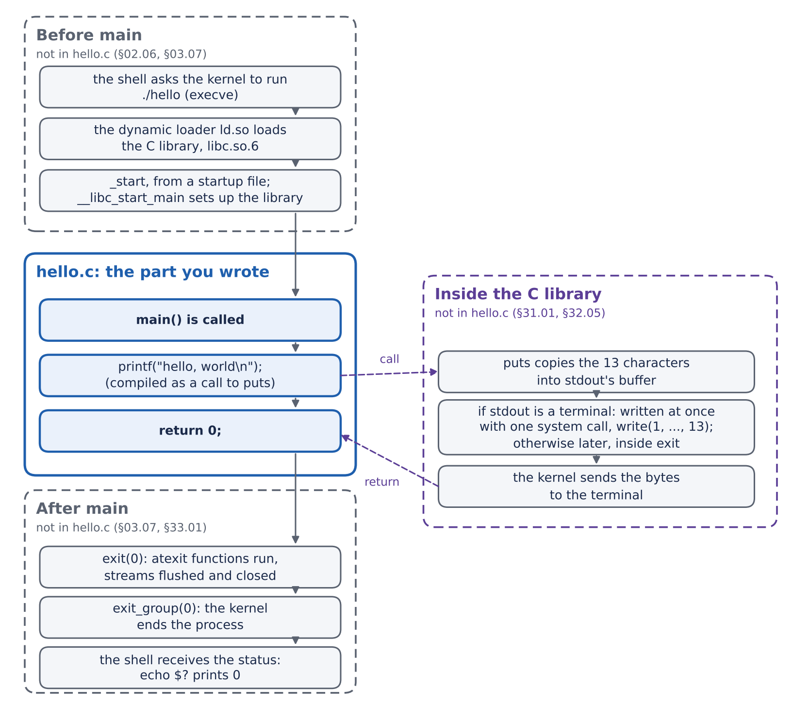

ref: 03.01
title: The First Program, Dissected
chapter: Chapter 03 — From Source Text to Running Program
part: Part I — The Machine Beneath C
builds: §02.06, §00.02
---
## The question

Almost every course in C begins with the same five lines, and almost every course moves past them within a page. The student types them, sees `hello, world` appear, and learns to treat them as a ritual: "put `#include <stdio.h>` at the top, write `int main(void)`, end with `return 0`". A ritual is a black box, and this book does not keep black boxes.

This chapter follows one small program from the text you type to the electrical activity of a running process. This first section does not yet ask how the program is translated; it asks what it *says*. The questions are:

- What is every character of the program, and to which of the three languages in the file does it belong: the preprocessor's, C's, or the library's?
- How does the compiler see the text, and what does it ignore?
- Why does `main` return an `int`, and who receives it?
- What does the program *not* say, though it happens every time the program runs?

## The journey

### The program

```c Listing 03.01-1  The first program
// hello.c
// The first program: every character of it is examined in §03.01.
#include <stdio.h>

int main(void) {
    printf("hello, world\n");
    return 0;
}
```

Create a folder for this section (the same way as in §00.02, with `03-01` in place of `00-02`), type the listing into `hello.c`, and build and run it with the book's usual command:

```terminal
$ gcc -std=c23 -Wall -Wextra -pedantic hello.c -o hello
$ ./hello
$ echo $?
```

```output
hello, world
0
```

The second line of output was printed not by the program but by the shell, and it is the first clue that this program has a conversation with its surroundings that its text does not show. We shall come back to it.

:::history
The words "hello, world" come from Brian Kernighan at Bell Labs. Their first known appearance is in his tutorial on B, the language that preceded C (§02.01), usually dated 1972, where they illustrate external variables: three variables held `'hell'`, `'o, w'` and `'orld'`, and the program printed them one after another with `putchar`, followed by `'!*n'`, B's way of writing an exclamation mark and a newline. The message had to be cut into four-character pieces because a B character constant could hold only as many characters as one machine word, and on the 36-bit Honeywell machine for which the tutorial was written a word held four (Experiment 02.01-1 modeled that machine). Kernighan's 1974 tutorial on C has the program almost in today's form, `main( ) { printf("hello, world"); }`, still without a newline. (Some modern retellings print the 1974 version with `\n`; the tutorial itself has none.) The book Kernighan wrote with Dennis Ritchie in 1978, *The C Programming Language*, added the `\n` and made the program famous, and a great many introductions to programming languages since then have begun with an equivalent. Notice what the 1978 version lacked: no `#include`, no `int`, no `void` and no `return`. Each of these was added later, for a reason, and this section explains all four.
:::

### Three languages in one file

Eight lines, but not one language. Read the listing again with this question in mind: who is each part addressed to?

- **Line 3, `#include <stdio.h>`, is addressed to the preprocessor.** It is not a C statement: it has no semicolon, it must stand on a line of its own, and it is carried out before the compiler proper sees the program. It is an instruction to edit the text: "replace this line with the contents of the header `stdio.h`". §03.03 shows the result, and Chapter 22 is devoted to the preprocessor.
- **`int`, `main`, `void`, the parentheses, the braces, `return`, `0` and the semicolons belong to C itself.** Their meaning is fixed by the language standard, and no header or library can change it.
- **`printf` belongs to the library.** C's core language has no way to print anything. `printf` is an ordinary function, written in C (or partly in assembly language) by the authors of the C library, and compiled long before you wrote `hello.c`. The standard describes what it must do, but the rules of the language do not oblige the compiler to know it: a program must declare a function before calling it, and line 3 does that, supplying its name, the types of its parameters and the type of its result. (GCC in fact knows more, as you will see below; a program may not rely on that.)

Lines 1 and 2, the comments, are addressed to none of these. They are addressed to people, and the compiler replaces each by a space at the moment it cuts the text into tokens, before any meaning is considered.

:::why
Why does a language as small as C not have a print statement, as BASIC and Fortran have, or built-in output procedures, as Pascal has? Because the designers wanted the language to describe only what every machine can do, and to leave everything that depends on the surroundings to functions. A print statement assumes a terminal; a C program may run on a machine with no terminal at all, such as the ATmega328P (§02.06). By putting input and output into a library, C let each environment supply its own: the Linux C library sends `printf`'s characters to the kernel; avr-libc sends them to whatever function the program connects to `stdout`; a flight computer might send them to a telemetry link or nowhere. The cost of this freedom is line 3: since the language does not oblige the compiler to know `printf`, the program must declare it.
:::

Table 03.01-1 takes the program apart, piece by piece.

Table: Table 03.01-1  The pieces of hello.c, and who they are for
<!-- widths: 24,18,58 -->
| Piece | Belongs to | Meaning |
|---|---|---|
| `// hello.c` | people | a comment: replaced by a space when the text is cut into tokens |
| `#include <stdio.h>` | preprocessor | paste in the declarations of the standard input/output library |
| `int` | C | the type of the value `main` gives back to its caller |
| `main` | C (a name) | the function the hosted environment calls first (§02.06) |
| `(void)` | C | `main` takes no arguments |
| `{` ... `}` | C | the body of the function: a block of statements |
| `printf` | library | the name of a function defined in the C library |
| `( ... )` after `printf` | C | the function-call operator: call `printf` with these arguments |
| `"hello, world\n"` | C | a string literal: an array of 14 characters stored in memory |
| `;` | C | ends the statement |
| `return 0;` | C | end `main` and give the value 0 to whoever called it |

### How the compiler reads: tokens

You see words, spaces and lines. The compiler sees neither words nor lines. It sees a stream of characters, and the first thing it does with them is to cut the stream into **tokens**, recognizing comments in the same pass and replacing each by a space. Tokens are the smallest pieces of text that have a meaning in the language, as words and punctuation marks are the smallest pieces of an English sentence. The standard sorts tokens into five kinds (C23 draft N3096, §6.4; as in the earlier sections, clause numbers are those of that draft):

- **keywords**, words reserved by the language: `int`, `void`, `return`;
- **identifiers**, names chosen by programmers: `main`, `printf`;
- **constants**: the `0` after `return`;
- **string literals**: `"hello, world\n"`;
- **punctuators**, symbols with a meaning of their own: `(` `)` `{` `}` `;`.

You can watch the cutting happen. GCC does not print its tokens, but Clang, the other major C compiler on Linux, does when asked. The command below asks it for the tokens of `hello.c` and shows only those that came from `hello.c` itself (the others came from `stdio.h`, as will be explained in a moment); the last command, `tr -s ' '`, squeezes each run of spaces into one, so that the lines fit on the page:

```terminal
$ clang -std=c23 -fsyntax-only -Xclang -dump-tokens hello.c 2>&1 | grep 'hello.c:' | tr -s ' '
```

```output
int 'int' Loc=<hello.c:5:1> [StartOfLine]
identifier 'main' Loc=<hello.c:5:5> [LeadingSpace]
l_paren '(' Loc=<hello.c:5:9>
void 'void' Loc=<hello.c:5:10>
r_paren ')' Loc=<hello.c:5:14>
l_brace '{' Loc=<hello.c:5:16> [LeadingSpace]
identifier 'printf' Loc=<hello.c:6:5> [StartOfLine] [LeadingSpace]
l_paren '(' Loc=<hello.c:6:11>
string_literal '\"hello, world\\n\"' Loc=<hello.c:6:12>
r_paren ')' Loc=<hello.c:6:28>
semi ';' Loc=<hello.c:6:29>
return 'return' Loc=<hello.c:7:5> [StartOfLine] [LeadingSpace]
numeric_constant '0' Loc=<hello.c:7:12> [LeadingSpace]
semi ';' Loc=<hello.c:7:13>
r_brace '}' Loc=<hello.c:8:1> [StartOfLine]
eof '' Loc=<hello.c:8:2>
```

Read one line: `identifier 'main' Loc=<hello.c:5:5> [LeadingSpace]` says "an identifier, spelled `main`, found at line 5, column 5, preceded by white space". (Clang prints the backslashes and quotation marks inside the string literal with an extra backslash before each, its way of showing them literally; the literal in `hello.c` is exactly as you typed it.) The program you wrote is these **15 tokens** (the last line, `eof`, only marks the end of the input). Everything else in the file, the comments, the spaces, the line breaks and the indentation, survives only as the notes `[StartOfLine]` and `[LeadingSpace]`, which Clang keeps for the preprocessor (for example, to recognize a `#` that begins a directive, and to space its `-E` output), not for the meaning of the program.

Notice also what the list does *not* contain: line 3. By the time tokens are produced, the `#include` line has already been carried out, and the tokens it brought in are reported as coming from `stdio.h`, not from `hello.c`. Count all the tokens, and the proportion is striking:

```terminal
$ clang -std=c23 -fsyntax-only -Xclang -dump-tokens hello.c 2>&1 | wc -l
```

```output
1898
```

Of 1,897 tokens (one line of the output is `eof`), your program contributed 15. The rest are the declarations of `stdio.h` and the headers it includes in turn. The count depends on the version of the C library whose headers are read: on the author's Ubuntu workspace, with an older glibc, it was 1,867.

:::precise
How does the compiler decide where one token ends? The rule is simple and greedy: at each point, the next *preprocessing token* is the *longest* sequence of characters that could form one (§6.4; §03.02 explains how preprocessing tokens become the tokens listed above; the rule is often called **maximal munch**). So `intmain` is one identifier, not the keyword `int` followed by `main`, and `return0` is one identifier, not `return` followed by `0`. The space in `int main` is therefore not decoration: it is the only thing that stops the two words from becoming one. The same rule explains a famous surprise you will meet in §11.03: `x+++y` is read as `x++ + y`, because `++` is the longest token that can start at the first `+`.
:::

### Line 3: `#include <stdio.h>`

The **preprocessor** is a text-editing stage that runs before the compiler proper (§03.02 places it among the phases of translation). A line that begins with `#` is a **directive** to it, and `#include` means: replace this line with the entire contents of the named **header** (§6.10.2). The angle brackets say "search the system's own directories"; on Fedora, `stdio.h` is the file `/usr/include/stdio.h`. GCC's option `-E` stops after preprocessing and prints the result, so you can see exactly what the compiler proper receives:

```terminal
$ gcc -std=c23 -E hello.c | wc -l
$ gcc -std=c23 -E hello.c | grep -n 'printf (const'
```

```output
573
380:extern int printf (const char *__restrict __format, ...);
395:extern int vprintf (const char *__restrict __format, __gnuc_va_list __arg);
```

Your 8 lines became 573, and line 380 of them is the reason line 3 exists (the second match is `vprintf`, a relative of `printf` whose declaration happens to contain the same text). It is a **declaration** of `printf`: it tells the compiler that somewhere there is a function named `printf`, that it returns an `int`, that its first parameter is a pointer to constant characters (the format string), and that further arguments of any type may follow (the `...`, explained in §31.03). It does *not* contain `printf`'s code. The header promises that the function exists; the C library, joined to your program by the linker (§03.06), keeps the promise. The distinction between a header (declarations) and a library (definitions) is the subject of §03.03, because confusing them is one of the most common misunderstandings in C.

What happens without the declaration? Delete line 3:

```c Listing 03.01-2  hello.c without its first line
// noinclude.c
// hello.c without its first line.
int main(void) {
    printf("hello, world\n");
    return 0;
}
```

```output
noinclude.c: In function ‘main’:
noinclude.c:4:5: error: implicit declaration of function ‘printf’ [-Wimplicit-function-declaration]
    4 |     printf("hello, world\n");
      |     ^~~~~~
noinclude.c:1:1: note: include ‘<stdio.h>’ or provide a declaration of ‘printf’
  +++ |+#include <stdio.h>
    1 | // noinclude.c
noinclude.c:4:5: warning: incompatible implicit declaration of built-in function ‘printf’ [-Wbuiltin-declaration-mismatch]
    4 |     printf("hello, world\n");
      |     ^~~~~~
noinclude.c:4:5: note: include ‘<stdio.h>’ or provide a declaration of ‘printf’
```

The compiler refuses, and its message contains a piece of history. In the C of 1978, and in the first standard of 1989, calling an undeclared function was allowed: the compiler silently assumed a declaration `int printf()`, meaning "a function returning `int`, with parameters unknown". That is why the 1978 "hello, world" needed no `#include`. (Strictly, from 1989 on, `printf` was an exception: calling a function that takes a variable number of arguments without a declaration in view was undefined behavior, and the 1988 second edition of Kernighan and Ritchie's book added `#include <stdio.h>` to its first program.) The assumption was dangerous, because a wrong guess about a function's parameters or result compiles without complaint and fails only when the program runs (§18.04 shows how). C99 removed this **implicit declaration** from the language, but for decades GCC still accepted it with a warning, to keep old programs compiling. GCC 14, released in 2024, finally made it an error by default. The second message, about a "built-in function", shows that GCC has its own knowledge of `printf` independent of any header; you will see that knowledge at work below.

### Line 5: `int main(void)`

Line 5 begins a **function definition** (§6.9.1; §18.02 treats definitions fully). Read it from left to right.

- `int` is the type of the result: `main` will hand back an integer.
- `main` is the function's name. Grammatically it is an ordinary identifier; its special role comes from the rules for a hosted environment, where the standard says that the function called at program startup is named `main` (§5.1.2.2.1) and gives it a few privileges of its own, such as returning 0 if it reaches its closing brace; §02.06 showed what calls it.
- `(void)` is the parameter list. The keyword `void`, "nothing", says that `main` takes no arguments. The other standard form, `int main(int argc, char *argv[])`, receives the words of the command line (§25.07).

:::precise
In C23, `int main()` and `int main(void)` mean the same thing: an empty pair of parentheses now declares a function with no parameters (§6.7.6.3). Before C23 they did not quite mean the same. In C89 to C17, empty parentheses in a declaration that was not a definition meant "parameters unspecified", a leftover of the pre-standard C in which declarations never listed parameters. In a definition such as `int main() { ... }` they meant "no parameters", but still gave the compiler no **prototype**, a declaration listing the parameters' types, so the arguments of a call were not checked against it. C23 removed that old form. This book writes `(void)` throughout, for two reasons: the AVR listings keep to C11, where the difference still exists (§02.05 set that rule), and `(void)` says "no parameters" in every edition of C.
:::

Why `int`? Because a C program on a hosted system is a **process** started by another process, usually the shell, and when a process ends it hands back a small integer, its **exit status**, to the process that started it. The convention of Unix, which Linux follows, is that 0 means "succeeded" and any other value means "failed", with different values available to distinguish different failures. The standard expresses this in its own terms: returning from the first call of `main` is equivalent to calling `exit` with the returned value (§5.1.2.2.3), and `exit(0)` or `exit(EXIT_SUCCESS)` reports success, `exit(EXIT_FAILURE)` failure, and the meaning of any other value is implementation-defined (§7.24.4.4).

### The braces: the body

The braces on lines 5 and 8 enclose the function's **body**, a **compound statement** or **block** (§6.8.2): a sequence of statements to be carried out in order, from the first to the last, unless a statement transfers control elsewhere. Blocks are the unit from which every larger structure of a C program is built; §14.01 examines them, and §20.01 shows that a block also limits where a name can be seen. The positions of the braces on the page carry no meaning for the compiler. This book puts the opening brace of a function at the end of the line that names it; Kernighan and Ritchie put it on a line of its own. Both are tokens `{`, and nothing else.

### Line 6: `printf("hello, world\n");`

Line 6 is the only line that does any work, and it consists of three parts.

**The call.** `printf` followed by `(` ... `)` is a **function call**: the parentheses after a name are an operator, the function-call operator, which transfers control to the function, passes it the values between the parentheses as its **arguments**, and, when the function returns, produces the value the function returned. A call is an **expression**: something that computes a value (Chapter 09).

**The string literal.** `"hello, world\n"` is a **string literal** (§6.4.5). Between the quotation marks are 14 characters as you typed them, but `\n` is two characters of source text that stand for one character in memory, the **newline**, which ends a line of text. The backslash begins an **escape sequence** (§6.4.4.4): a way to write a character that cannot be typed directly between the quotes, since a string literal may not continue across a line break. §08.02 explains what a newline actually is, a single byte, with the value 10 on your machines,, and why it means "end of line". The compiler stores the literal's characters in memory as an array, and adds one more byte with the value 0, the **null character**, to mark where the string ends (§25.01 explains why C marks the end this way rather than recording the length). So the literal occupies 13 + 1 = 14 bytes, as Listing 03.01-3 confirms. The literal exists for the whole run of the program, and, on Linux, in memory that the program may not modify (§25.02; §03.05 shows the section of the object file where it is kept).

**The semicolon.** An expression followed by `;` becomes an **expression statement** (§6.8.3): "evaluate this expression for its effects, and discard its value". And `printf` *has* a value. It returns the number of characters it transmitted, or a negative number if an error occurred (§7.23.6.3). `hello.c` throws that number away without a glance. Listing 03.01-3 keeps it.

```c Listing 03.01-3  printf returns a value, which hello.c threw away
// count.c
// printf returns a value, which hello.c silently threw away.
#include <stdio.h>

int main(void) {
    int n = printf("hello, world\n");
    printf("printf reported %d characters\n", n);
    printf("the literal occupies %zu bytes\n", sizeof "hello, world\n");
    return 0;
}
```

```terminal
$ gcc -std=c23 -Wall -Wextra -pedantic count.c -o count
$ ./count
```

```output
hello, world
printf reported 13 characters
the literal occupies 14 bytes
```

- Line 6: the call's value, 13, is stored in a variable `n` (§06.01) instead of being discarded.
- Line 7: `%d` in the format string is replaced by the value of the next argument, written as a decimal number (§31.02).
- Line 8: `sizeof` gives the size of the literal in bytes, including the null character that ends it; `%zu` prints a value of the type `sizeof` produces (§06.02).

Thirteen characters transmitted (h-e-l-l-o, the comma, the space, w-o-r-l-d, and the newline), fourteen bytes stored (the null character is not printed). Ignoring a function's result is legal in C and often harmless, but in a program that must not fail it is a decision, not a habit. And `printf`'s result alone is not enough: because the characters first go into a buffer (see "What the program does not show" below), `printf` usually reports success even when the eventual write to a full disk fails (Experiment 03.01-5), and a write to a closed pipe kills the program with a signal instead. §34.03 returns to this.

### Line 7: `return 0;`

The **return statement** ends the execution of `main` and makes 0 the value of the call that started it. Who made that call, and what happens to the 0? §02.06 traced the path: `__libc_start_main` calls `main` and passes its result to `exit`, which flushes the output and asks the kernel to end the process with that status. The kernel keeps the status until the parent process, the shell, collects it; the shell stores it in its variable `?`, which `echo $?` printed as the `0` at the start of this section.

Listing 03.01-4 lets you choose the status from the command line.

```c Listing 03.01-4  main's return value becomes the exit status
// status.c
// main's return value becomes the program's exit status.
#include <stdlib.h>

int main(int argc, char *argv[]) {
    if (argc < 2) {
        return EXIT_FAILURE;        // no number given
    }
    return atoi(argv[1]);           // return the number typed after the name
}
```

- Line 5 uses the second form of `main`; `argv[1]` is the first word typed after the program's name (§25.07).
- Lines 6–7: with no word typed, `argc` is 1, and the program reports failure with the standard's macro `EXIT_FAILURE` from `<stdlib.h>`.
- Line 9: `atoi` converts text such as `"3"` into the number 3 (§25.05 explains it, and why it is not a careful way to do so).

```terminal
$ gcc -std=c23 -Wall -Wextra -pedantic status.c -o status
$ ./status; echo $?
$ ./status 3; echo $?
$ ./status 300; echo $?
$ ./status -1; echo $?
```

```output
1
3
44
255
```

The first two lines are what you would expect: `EXIT_FAILURE` is 1 on Linux, and 3 came back as 3. The other two show that the exit status is not an `int` at all on its way to the shell. Linux passes on only the lowest 8 bits of the value, a number from 0 to 255 (the `exit(3)` manual page states that the parent receives "the least significant byte of status", that is, the value modulo 256). So 300 became 300 − 256 = 44, and −1, whose lowest 8 bits are all ones (§04.03 explains why), became 255. A program that reports the number of errors it found as its exit status will therefore announce "success" after exactly 256 errors, or 512, or any multiple of 256. Keep exit statuses between 0 and 125: values from 126 up have special meanings to the shell, such as 127 for "command not found", and statuses above 128 are what the shell reports when a program is killed by a signal (§02.06 met 139, which is 128 + 11).

Why does any of this matter? Because programs are combined by other programs, and the exit status is how they talk. The shell runs the second command of `a && b` only if the first succeeded:

```terminal
$ ./hello && echo succeeded
$ ./status 1 && echo succeeded || echo failed
```

```output
hello, world
succeeded
failed
```

`make` (§21.08) stops a build at the first command that fails, and it knows that a command failed only by its exit status. A compiler that printed an error but returned 0 would let a broken build continue. So `int main` is not a formality: it is the program's one-number report to whoever started it.

:::myth
"`void main(void)` is fine; it is what my old textbook used." It is not one of the two forms the standard requires a hosted implementation to accept (§5.1.2.2.1). The standard does allow "some other implementation-defined manner" of declaring `main`, so a compiler *may* accept `void main` and document what it means. GCC accepts it with a warning:

```output
voidmain.c:5:6: warning: return type of ‘main’ is not ‘int’ [-Wmain]
    5 | void main(void) {
      |      ^~~~
```

On Linux the shell then receives an exit status the program never chose, whatever happened to be left behind. The habit costs nothing to avoid: write `int main`. (Omitting `return 0;` from `int main` is different and allowed: since C99, reaching the closing brace of `main` returns 0, as §02.06 noted. This book writes the `return` anyway, so that the report is visible.)
:::

### What the compiler ignores: white space and comments

Everything in Table 03.01-1 is now explained except what lies between the tokens. The standard defines **white space** as spaces, tabs, line breaks, and two characters you will rarely meet, the vertical tab and the form feed (§6.4). Comments count as white space too: in the third of the phases of translation, which §03.02 lists, each comment is replaced by a single space. After that, in ordinary program text, white space has three jobs.

1. **It separates tokens that would otherwise run together** (the maximal-munch rule above): `int main`, `return 0`.
2. **Inside a string literal or a character constant it is part of the value**: the space in `"hello, world"` is printed.
3. **A line break ends a preprocessing directive**: `#include <stdio.h>` must be alone on its line, because the preprocessor works line by line.

(The preprocessor gives it a few more, small ones, such as the line break that ends a `//` comment, and the difference between `#define f(x)` and `#define f (x)`; Chapter 22 shows them.) Everywhere else in ordinary program text, the compiler does not care. You can test the claim, not merely believe it. The listing below is `hello.c` with every optional space and line break removed (only the line break that ends the directive is kept):

```c Listing 03.01-5  hello.c with all optional white space removed
#include<stdio.h>
int main(void){printf("hello, world\n");return 0;}
```

Save it as `squashed.c`, and compare the assembly language that GCC produces for the two files (`-S` stops after compiling and writes the assembly to a file, §03.04):

```terminal
$ gcc -std=c23 -Wall -Wextra -pedantic -S hello.c -o hello.s
$ gcc -std=c23 -Wall -Wextra -pedantic -S squashed.c -o squashed.s
$ diff hello.s squashed.s
```

```output
1c1
< 	.file	"hello.c"
---
> 	.file	"squashed.c"
```

`diff` lists the lines that differ, and only one does: the name of the source file, which GCC records for debugging tools. Every instruction is identical. The experiment at the end of the section goes to the other extreme, and puts every token of `hello.c` on a line of its own, with the same result. And removing white space that *is* needed is not harmless:

```c Listing 03.01-6  Two spaces removed from hello.c
// glued.c
// Two spaces removed from hello.c.
#include <stdio.h>

intmain(void) {
    printf("hello, world\n");
    return0;
}
```

```output
glued.c:5:1: error: return type defaults to ‘int’ [-Wimplicit-int]
    5 | intmain(void) {
      | ^~~~~~~
glued.c: In function ‘intmain’:
glued.c:7:5: error: ‘return0’ undeclared (first use in this function)
    7 |     return0;
      |     ^~~~~~~
glued.c:7:5: note: each undeclared identifier is reported only once for each function it appears in
glued.c:8:1: warning: control reaches end of non-void function [-Wreturn-type]
    8 | }
      | ^
```

Read the messages as the compiler meant them. It did not see a misspelled `int main`; it saw a function named `intmain` with no type at all. Pre-standard C allowed that, and assumed `int` (the 1978 `main()` relied on it), but C99 removed this **implicit int** too, and since GCC 14 it is an error by default; that is the first message. Then it saw an expression statement consisting of an identifier `return0` that was never declared: the second. The warning on line 8 follows from the first error: a function that returns `int` reached its end without returning anything. Each message is exactly right about the tokens; none of them says "you forgot a space", because to the compiler there was never a space to forget. §03.08 is devoted to reading such messages.

### Comments

C has two forms of comment, both visible in Listing 03.01-7.

- `/*` ... `*/` may span many lines. It is the original form, inherited from B, whose tutorial describes comments as enclosed in `/*` ... `*/`, "just as in PL/I".
- `//` to the end of the line is the form of BCPL, B's own ancestor (§02.01). B dropped it, and C followed B; C++ brought it back; and C99 adopted it from C++.

```c Listing 03.01-7  What is, and what is not, a comment
// comments.c
// What is, and what is not, a comment.
#include <stdio.h>

int main(void) {
    printf("/* not a comment */\n");      // a comment
    int x = 10 /* a comment */ + 5;        /* also a comment */
    printf("%d\n", x);
    return 0;
}
```

```output
/* not a comment */
15
```

- Line 6: inside a string literal, `/*` is just two characters of the string. The comment rule applies only outside string literals and character constants (§6.4.9), because the text is cut into tokens and comments in a single left-to-right pass, and once a string literal has begun, everything up to its closing quote belongs to it.
- Line 7: a `/* */` comment may stand between two tokens, in the middle of a line. It is replaced by one space, and `10 + 5` remains.

One rule surprises nearly everyone: `/* */` comments do not nest. The first `*/` ends the comment, however many `/*` came before it, so commenting out a block of code that already contains a comment leaves the rest of the code exposed. Experiment 03.01-4 shows the error, and GCC's warning `"/*" within comment`, which `-Wall` enables. §22.05 shows the right way to disable a block of code, `#if 0` ... `#endif`, which does nest.

### Layout is for people, and people can be misled

If the compiler ignores layout, why do programmers argue about it so fiercely? Because the reader of a program is not only the compiler. A person reads the shape of the code (indentation shows which statements belong to which), and a person trusts the shape more than the tokens. When the two disagree, the person is wrong and the compiler is right, and nothing warns either of them unless a tool compares them.

```c Listing 03.01-8  The layout says one thing, the tokens another
// indent.c
// The layout says one thing, the tokens another.
#include <stdio.h>

int check(int err) {
    if (err != 0)
        printf("first check failed\n");
        return 1;
    printf("all checks passed\n");
    return 0;
}

int main(void) {
    return check(0);
}
```

The indentation of lines 7 and 8 suggests that both belong to the `if`. They do not: without braces, an `if` controls exactly one statement (§15.01), so line 8 runs whatever `err` is. Called with 0, "no error", `check` prints nothing, never reaches line 9, and reports failure:

```terminal
$ ./indent; echo $?
```

```output
1
```

This is not an invented danger. In February 2014 Apple released urgent security updates for iOS (February 21) and OS X (February 25), for a flaw cataloged as CVE-2014-1266. In the function of its TLS library that checked the server's signature during the opening handshake of a secure connection, a line `goto fail;` had been duplicated beneath an `if`. Indented like its neighbor, the second copy looked conditional and was not; it jumped past the final signature check every time, while the error variable still held 0, "success". Connections that should have been rejected were accepted. A program that compiled cleanly, and looked correct to the people who read it, was wrong by one duplicated line. Today GCC, given that layout, warns, because `-Wall` includes the warning `-Wmisleading-indentation`, which compares the indentation with the structure of the tokens:

```output
indent.c: In function ‘check’:
indent.c:6:5: warning: this ‘if’ clause does not guard... [-Wmisleading-indentation]
    6 |     if (err != 0)
      |     ^~
indent.c:8:9: note: ...this statement, but the latter is misleadingly indented as if it were guarded by the ‘if’
    8 |         return 1;
      |         ^~~~~~
```

Two lessons follow, and both are part of an engineer's discipline. First, compile with warnings on and read every one (§03.08). Second, many coding standards for critical software (§35.02) require braces around the body of every `if` and loop, even a one-statement body, precisely so that a statement added or duplicated later cannot slip outside the condition while looking as if it is inside it. This book follows that rule from Chapter 15 onward.

### What the program does not show

Eight lines describe what *you* asked for. Far more happens when the program runs, and none of it is in the file. Figure 03.01-1 sets your part beside the rest.

{w=16}

**Before `main`.** §02.06 followed this part: the kernel loads the program, the dynamic loader `ld.so` loads the C library, and the startup code `_start` and the library function `__libc_start_main` prepare everything before calling `main`. §03.07 follows it step by step with tools.

**The library's code.** Where is `printf`'s code? Not in `hello`. Ask the tool `nm`, which lists the names a program file defines and uses (§03.05):

```terminal
$ nm hello | grep -E ' (main|puts|printf)'
```

```output
0000000000401136 T main
                 U puts@GLIBC_2.2.5
```

Two surprises in two lines. (The number before `T main` is the address at which `main` will be placed in memory, §03.06.) `T main` says that `main` is defined here, in the program's code (its "text"). `U` means *undefined*: the program uses a function it does not contain, and the dynamic loader must find it, at run time, in the C library (`GLIBC_2.2.5` names the version of the library's interface, §21.06). And the undefined function is not `printf` at all, but `puts`. The disassembly of `main` confirms it:

```terminal
$ objdump -d --no-show-raw-insn hello | sed -n '/<main>:/,/ret/p'
```

```output
0000000000401136 <main>:
  401136:	push   %rbp
  401137:	mov    %rsp,%rbp
  40113a:	mov    $0x4004b0,%edi
  40113f:	call   401030 <puts@plt>
  401144:	mov    $0x0,%eax
  401149:	pop    %rbp
  40114a:	ret
```

GCC knows what `printf` does, as the message about a "built-in function" earlier revealed. A `printf` whose format contains no `%` conversion and ends in a newline, and whose result is thrown away, has the same effect as `puts`: `puts` prints a string and then a newline. (The results differ: `puts` returns only "a nonnegative value" on success, not the count. In count.c, where the result is kept, GCC leaves `printf` alone.) `puts` is cheaper, because it does not examine the string for conversions, so GCC called `puts` with the string `"hello, world"`, its newline removed, since `puts` adds one. It does this even without optimization options. This is allowed because the program's observable behavior, the 13 characters on standard output, is unchanged (§02.03); §39.02 examines the freedom this gives a compiler. You will read these seven instructions one by one in §03.04 (the third, `mov $0x4004b0,%edi`, passes `puts` the address of the string), and see the string itself in §03.05. For now, notice the size of what you wrote: `main` occupies the addresses 0x401136 to 0x40114a, 21 bytes of machine code.

**The output's path.** `puts` does not send characters to the screen. It copies them into a **buffer**, an area of memory belonging to the stream `stdout`, and the buffer is handed to the operating system later, all at once, with one **system call** (§02.06). The tool `strace` shows the system calls a program makes; asked to show only `write`:

```terminal
$ strace -o write.trace -e trace=write ./hello
$ cat write.trace
```

```output
hello, world
write(1, "hello, world\n", 13)          = 13
+++ exited with 0 +++
```

The option `-o write.trace` sends `strace`'s report to a file, so that it does not mix with the program's own output on the terminal (try the command without it and see the two interleave). The report shows one call, to file descriptor 1, standard output, carrying 13 bytes, and then the end of the process with status 0. When standard output is a terminal, glibc sends the buffer as soon as a newline is placed in it; when it is a file or a pipe, only when the buffer fills, when the program calls `fflush`, or when it exits (§31.01 explains why, and §32.05 follows the system call into the kernel).

**After `main`.** `exit` runs the functions registered with `atexit`, flushes and closes the streams, and makes the system call that ends the process; the kernel passes the status to the shell (§03.07, §33.01).

**And the size of it all.**

```terminal
$ ls -l hello.c hello
$ size hello
```

```output
-rwxr-xr-x. 1 serajus21 serajus21 12624 Nov 26 10:59 hello
-rw-r--r--. 1 serajus21 serajus21   162 Nov 26 10:59 hello.c
   text	   data	    bss	    dec	    hex	filename
   1068	    532	      4	   1604	    644	hello
```

162 bytes of source became a program file of 12,624 bytes. Of that, 21 bytes are your `main`, and 13 your string (`hello, world` and its null character: the newline left with the change to `puts`); `size` counts 1,068 bytes of code and read-only data, 532 of writable data and 4 that will be set to zero (§27.01 explains the three columns). The rest of the file is structure and padding: about 6 KB of it are zero bytes that place the code and the data at 4 KB boundaries in the file, so that the kernel can map each part directly into memory (§27.02); the remainder is the startup code, the information the dynamic loader needs to find `puts`, a table of names, and headers describing how to load the program (§03.05 and §03.06 take it apart). And `printf`, `puts`, their buffering and the whole of `exit` are not even in those 12,624 bytes: they are in the C library, a separate file of about two and a half megabytes, shared by every program on the system (§03.06, §21.06).

:::hood
Everything in this section can be stated in one sentence: a C program is not a description of everything the computer does, but of the part that differs from one program to the next. The rest, the start, the input and output, the end, is the same for every program, so it is written once, in the startup files and the library, and joined to each program by the linker. That division of labor is why `hello.c` can be eight lines long. It is also why the engineer cannot stop at the seven lines: when the program misbehaves before `main`, inside `printf` or after `return`, the fault lies in a part the source text never mentions.
:::

:::orbit
On a spacecraft, the exit status of a program is a matter of operations, not of style. An on-board computer typically runs many tasks, and a supervising program, the flight software's equivalent of the shell, starts them and decides what to do when one ends: restart it, switch to a spare, or put the spacecraft into a safe mode and wait for the ground. Those decisions can rest only on what the task reported, so a task that reports success after failing, as `void main` or a discarded error code makes possible, defeats the machinery built to protect the mission. In the author's view, the habit worth taking from this section is to treat every result a function returns, starting with `printf`'s and `main`'s, as information that someone downstream may depend on.
:::

## Terms introduced

- **Token**: the smallest piece of program text that has a meaning in the language: a keyword, identifier, constant, string literal or punctuator.
- **Keyword**: a word reserved by the language, such as `int`, `void` or `return`.
- **Identifier**: a name chosen by a programmer, such as `main` or `printf`.
- **Punctuator**: a symbol with a meaning of its own, such as `(`, `{` or `;`.
- **Maximal munch**: the rule that the next token is the longest sequence of characters that can form a token.
- **White space**: spaces, tabs, line breaks, vertical tabs, form feeds, and comments, which separate tokens.
- **Preprocessor directive**: a line beginning with `#`, an instruction to the preprocessor.
- **Header**: a collection of declarations named in an `#include` directive, on Linux a file such as `/usr/include/stdio.h`.
- **Declaration**: a statement of a name's existence and type, without its definition (for a function: name, result type and parameters, but no code).
- **Function definition**: a function's declaration together with its body.
- **Compound statement (block)**: a sequence of statements enclosed in braces.
- **Function call**: an expression that transfers control to a function with arguments, and produces its result.
- **String literal**: a sequence of characters in double quotation marks, stored as an array with a null character added at the end.
- **Escape sequence**: a backslash followed by characters, standing for one character that cannot be typed directly, such as `\n` for the newline.
- **Expression statement**: an expression followed by a semicolon, evaluated for its effects with its value discarded.
- **Return statement**: a statement that ends a function and gives its caller a value.
- **Exit status**: the small integer a process hands back to the process that started it; 0 means success.
- **Implicit declaration / implicit int**: pre-C99 rules that assumed an undeclared function, or a declaration without a type, to be of type `int`.
- **Buffer**: an area of memory where a stream collects characters before passing them to the operating system.

## Self-check

1. Sort the parts of Listing 03.01-1 by who they are addressed to: people, the preprocessor, the C language, the library.
2. Why does C have no print statement? What does it gain, and what does line 3 of `hello.c` cost in return?
3. How many tokens does `hello.c` contain? Why is `#include <stdio.h>` not among the tokens Clang reported as coming from `hello.c`?
4. Explain, with the maximal-munch rule, why `intmain(void)` does not mean `int main(void)`. What did GCC take it to mean?
5. What does the declaration of `printf` in `stdio.h` tell the compiler, and what does it not contain?
6. Why did the 1978 "hello, world" need no `#include`, and why does today's GCC refuse the same program?
7. The string literal `"hello, world\n"` contains 14 characters between its quotes as typed. How many bytes does it occupy in memory, and how many characters does `printf` transmit? Explain each number.
8. What does the semicolon do to the expression `printf("hello, world\n")`? What is discarded?
9. Where does the 0 of `return 0;` go, step by step, until `echo $?` prints it?
10. A program returns 512 from `main`. What does `echo $?` print on Linux, and what would a script conclude?
11. What three jobs does white space have in ordinary C program text? Name one place in `hello.c` where removing a space changes the meaning.
12. Why did `nm` report `puts`, not `printf`? Is this a change in the program's behavior?
13. Why can `/* ... */` not be used to comment out a block of code that already contains a `/* ... */` comment?
14. In Listing 03.01-8, which statements does the `if` control? What does the program print, and what does it return?

## Experiments

**Experiment 03.01-1. The other extreme of layout.** Type `layout.c`, which is `hello.c` with every token on a line of its own (keep the `#include` line whole). Compile it with `-S` and compare its assembly with `hello.s` using `diff`. Then compile both with `-c` (§03.02), and compare the two object files with `cmp`. Why do the object files differ, although the instructions are the same? (Hint: `objcopy -O binary -j .text hello.o main.bin` extracts only the machine code; compare that.)

**Experiment 03.01-2. Count your own tokens.** Write a program of your own, a few lines long, and predict how many tokens it contains. Check your count with Clang's `-dump-tokens`, filtering for your file's name as in this section. Where did you disagree with Clang, and why?

**Experiment 03.01-3. The cost of the header.** Run `gcc -std=c23 -H -fsyntax-only hello.c`. The option `-H` prints the name of every header file that is opened, indented by depth. How many lines does it print, and why do some file names appear more than once? Then compare `gcc -std=c23 -E hello.c | wc -l` with `wc -l /usr/include/stdio.h`. Which is larger on your system? Explain why the preprocessed output could be either larger or smaller than the header it came from.

**Experiment 03.01-4. Comments do not nest.** Compile a file containing `int main(void){ /* nested /* comment */ */ return 0; }`. Read the warning and the error. Which `*/` ended the comment, and what did the compiler then see?

**Experiment 03.01-5. Return what printf returned.** Write a program whose `main` ends with `return printf("hello, world\n");`. What does `echo $?` print, and why? Then redirect the output to a file that cannot be written: `./a.out > /dev/full; echo $?` (`/dev/full` is a special file on Linux that reports "disk full" for every write). Does the program notice? Explain, using what this section said about buffering.

**Experiment 03.01-6. Where the program fails silently.** Change `return 1;` in Listing 03.01-8 into a block `{ printf("first check failed\n"); return 1; }` by adding braces around both lines. Recompile: has the warning gone? Run it with `check(0)` and `check(5)`. Then explain in one sentence why a rule "always use braces" would have prevented the 2014 failure.

## Hands-on (AVR / ESP32)

### A: what reaches the chip

On a microcontroller with 32 KB of flash, a common worry is that comments and long, descriptive names "take up memory". This section claims that they cannot: comments are replaced by spaces when the text is cut into tokens, and names disappear when the program is translated into machine code, unless the program itself turns a name into text, as `assert` does (§34.02). On the ATmega328P you can check this exactly, because what reaches the chip is a single file, the **Intel HEX** image that the uploader writes into flash.

Listing 03.01-9 is "hello, world" for a bare ATmega328P. It cannot use `printf` without first connecting `stdout` (§02.06), so it sends each character to the UART itself.

```c Listing 03.01-9  hello, world on a bare ATmega328P
// avr_hello.c  (ATmega328P, bare metal)
// hello, world on a chip with no screen: each character is sent
// through the UART, the serial port the Uno's USB cable carries.
#include <avr/io.h>

static void send(char c) {
    while (!(UCSR0A & (1 << UDRE0))) { }   // wait until the UART is free
    UDR0 = c;                              // hand it one character
}

int main(void) {
    UCSR0A = (1 << U2X0);                  // about 115200 baud at 16 MHz:
    UBRR0 = 16;                            //   see §37.04
    UCSR0B = (1 << TXEN0);                 // switch the transmitter on
    for (const char *p = "hello, world\r\n"; *p != '\0'; ++p) {
        send(*p);
    }
    for (;;) { }                           // nowhere to return to
}
```

- Lines 6–9: `send` waits until the UART's "data register empty" flag is set, then writes one character into its data register, from which the hardware shifts it out bit by bit (§37.04 explains the registers).
- Lines 12–14: set the speed and switch on the transmitter, as steps.c did in §02.01.
- Line 15: the loop walks through the string one character at a time, stopping at the null character that ends it (§24.02 explains `p` and `*p`, and §24.05 the step `++p`). The string ends in `\r\n`, carriage return and newline, the pair that serial terminals expect (§08.02).
- Line 18: `main` never returns, for the reason §02.06 gave: there is nobody to return to.

Now make a second file, `avr_verbose.c`: the same program, with sixty lines of comment added after the `#include` and the name `send` replaced by the 65-character `send_one_character_through_the_universal_asynchronous_transmitter`. Build both, and convert each to the HEX image an uploader would write:

```terminal
$ avr-gcc -mmcu=atmega328p -std=c11 -Os -Wall -Wextra -pedantic avr_hello.c -o avr_hello.elf
$ avr-objcopy -O ihex -R .eeprom avr_hello.elf avr_hello.hex
$ avr-gcc -mmcu=atmega328p -std=c11 -Os -Wall -Wextra -pedantic avr_verbose.c -o avr_verbose.elf
$ avr-objcopy -O ihex -R .eeprom avr_verbose.elf avr_verbose.hex
$ ls -l avr_hello.c avr_verbose.c avr_hello.elf avr_verbose.elf avr_hello.hex avr_verbose.hex
$ cmp avr_hello.hex avr_verbose.hex && echo HEX-IDENTICAL
$ avr-size avr_hello.elf avr_verbose.elf
```

```output
-rw-r--r--. 1 serajus21 serajus21   746 Nov 26 11:53 avr_hello.c
-rwxr-xr-x. 1 serajus21 serajus21 10356 Nov 26 11:53 avr_hello.elf
-rw-r--r--. 1 serajus21 serajus21   639 Nov 26 11:53 avr_hello.hex
-rw-r--r--. 1 serajus21 serajus21  4901 Nov 26 11:53 avr_verbose.c
-rwxr-xr-x. 1 serajus21 serajus21 10356 Nov 26 11:53 avr_verbose.elf
-rw-r--r--. 1 serajus21 serajus21   639 Nov 26 11:53 avr_verbose.hex
HEX-IDENTICAL
   text	   data	    bss	    dec	    hex	filename
    206	     16	      0	    222	     de	avr_hello.elf
    206	     16	      0	    222	     de	avr_verbose.elf
```

The source grew more than six times; the HEX images are identical, byte for byte. The `.elf` files have the same size but are not identical, and not because of the long name. An ELF file keeps a table of names for tools such as `nm` and debuggers, and the only name in it that changed is the source file's: `avr_verbose.c` is two characters longer than `avr_hello.c`, which here fit into padding that was already there. The 65-character name is not in the table at all: `send` is `static` and so short that the compiler copied its body into `main` instead of calling it (this is called *inlining*, §39.02), and no trace of the name remained. Even a name that does stay in the table, such as `main`, never leaves your laptop, because the table is not part of the HEX image. Comments, names and layout cost nothing on the chip. (Uploaded to an Uno, either file should print `hello, world` once after each reset in the Serial Monitor at 115200 baud; the author ran it only on the simulator.)

The last line holds a lesson of its own. The `data` column counts 16 bytes: the 15 bytes of the string, `hello, world`, carriage return, newline and the null character, plus one byte of padding. Those bytes are stored twice, in flash, where they survive without power, and in SRAM, where the startup code copies them before `main` runs (§02.06). On your laptop a string literal stays in read-only memory; on the ATmega328P, which has 32 KB of flash but only 2 KB of SRAM, every string literal quietly costs SRAM as well, unless the program asks for it to stay in flash (§25.02 and §27.03 show how and why).

### B: printf on the ESP32

On the ESP32, ESP-IDF's startup code connects `stdout` to the chip's first UART before `app_main` runs (§02.06), so `printf` works in a sketch with no preparation. Listing 03.01-10 uses that, and returns to the question of `printf`'s result.

```c Listing 03.01-10  printf and its result on the ESP32
// hello_esp32.ino  (ESP32)
// printf works at once: the startup code connected stdout to UART0.
void setup() {
  Serial.begin(115200);
  delay(500);
  int n = printf("hello, world\n");
  printf("printf returned %d\n", n);
}

void loop() {}
```

This was not run by the author. On a classic ESP32 board, where the Serial Monitor and the ESP-IDF console share the first UART, expect `hello, world` followed by `printf returned 13`. On boards whose USB port is built into the chip (such as the ESP32-S3 or C3 in some configurations), `printf` and `Serial` may go to different ports, and the first line may appear elsewhere or not at all: then, as on the AVR, where `stdout` leads depends on how the startup code connected it.

## Answers

**Self-check 1.** People: the comments, lines 1–2. Preprocessor: line 3. C: `int`, `main`, `void`, the parentheses, braces, string literal, `return`, `0`, the semicolons and the function-call parentheses. Library: the function `printf` itself (only its name appears in the file).

**Self-check 2.** A print statement would assume a terminal; C leaves everything that depends on the surroundings to library functions, so each environment can supply its own input and output, including environments with no terminal. The cost: the language does not oblige the compiler to know `printf`, so the program must declare it, which line 3 does.

**Self-check 3.** 15 tokens. The `#include` line is carried out by the preprocessor before tokens are produced for the compiler; it is replaced by the contents of `stdio.h`, whose tokens are reported as coming from that header.

**Self-check 4.** The next token is always the longest sequence of characters that can form a token, and `intmain` is a valid identifier, so it is one token. GCC took it as a function named `intmain` declared without a type, which is the obsolete implicit int, an error in GCC 14 and later.

**Self-check 5.** That a function named `printf` exists, that it returns `int`, that its first parameter is a pointer to constant characters, and that any further arguments may follow. It does not contain the function's code, which is in the C library.

**Self-check 6.** Before C99, calling an undeclared function was allowed: the compiler assumed it returned `int`. C99 removed this implicit declaration; GCC tolerated it with a warning for compatibility until GCC 14 made it an error by default.

**Self-check 7.** 14 bytes: 13 characters (the two characters `\n` stand for one newline character) plus the null character the compiler adds at the end. `printf` transmits 13: the null character marks the end and is not printed.

**Self-check 8.** It makes the call an expression statement: the call is carried out for its effect (printing), and its value, the number of characters transmitted, is discarded.

**Self-check 9.** `main` returns 0 to `__libc_start_main`, which passes it to `exit`; `exit` flushes the streams and asks the kernel to end the process with that status; the kernel keeps it until the shell collects it, and the shell stores it in `?`, which `echo $?` prints.

**Self-check 10.** 0, because only the lowest 8 bits are passed on, and 512 is 2 × 256. A script would conclude that the program succeeded.

**Self-check 11.** To separate tokens that would otherwise run together; as part of a string literal or character constant; and, as a line break, to end a preprocessing directive. Removing the space in `int main` or in `return 0` changes the meaning (the space inside `"hello, world"` changes the output).

**Self-check 12.** Because GCC replaced the call: a `printf` whose format has no conversions and ends with a newline, and whose result is not used, has the same effect as `puts` of the string minus its newline, more cheaply. The observable behavior, the 13 characters on standard output, is unchanged, so this is allowed.

**Self-check 13.** Because comments do not nest: the first `*/` ends the comment, so the inner comment's `*/` ends the outer one, and the rest of the "commented-out" code is compiled, followed by a stray `*/`.

**Self-check 14.** Only `printf("first check failed\n");`. The `return 1;` runs whatever `err` is, so with `check(0)` the program prints nothing and returns 1.

**Experiment 03.01-1.** The assemblies differ only in the `.file` line. The object files differ (on the reader's machine `cmp` reported the first difference at byte 353) because each records its source file's name (in its symbol table, §03.05), but the extracted machine code, 21 bytes, is identical.

**Experiment 03.01-2.** Typical disagreements: forgetting that `#include` lines produce no tokens of your file, counting a string literal as several tokens, or counting `++` or `<=` as two tokens instead of one.

**Experiment 03.01-3.** On the reader's Fedora, `-H` printed 39 lines: 31 header names, then a list headed "Multiple include guards may be useful for:". A name appears again only when a header is included again *and is reopened*. A header protected by an *include guard* (§21.02) is not even reopened: GCC remembers the guard and skips the file, so `bits/types.h`, included three times, is listed once. The names that repeat, such as `bits/wordsize.h`, have no guard; they contain only definitions that may harmlessly be repeated, and are read in full each time. `stdio.h` had 979 lines and the `-E` output 573. The output gains the contents of every included header and the line markers (lines beginning with `#`) that record where each part came from; it loses every comment, and every part of every header that conditional compilation excluded (§22.05). Which effect wins depends on the system's headers.

**Experiment 03.01-4.** The first `*/` ended the comment. The compiler then saw the remaining `*/` as two tokens, `*` and `/`. A `*` can begin an expression (as the indirection operator, §24.02), but a `/` cannot follow it, so GCC reported `expected expression before '/' token`. With `-Wall` it first warned `"/*" within comment` at the inner `/*`.

**Experiment 03.01-5.** 13, the number of characters `printf` transmitted. With `> /dev/full`, it still prints 13: the characters went into the buffer, which is not written until the program exits, so `printf` succeeded; the write fails later, inside `exit`, where the program can no longer react. (glibc's `exit` does not change the exit status in that case.) Detecting the failure needs `fflush(stdout)` and a check of its result (only after the flush does `ferror(stdout)` report the error), or a check of the result of `fclose(stdout)`, before `main` returns (§32.04).

**Experiment 03.01-6.** The warning disappears. `check(0)` prints `all checks passed` and returns 0; `check(5)` prints `first check failed` and returns 1. With braces required around every controlled statement, a duplicated line would have been either inside the braces, and so conditional, or visibly outside them.

**Hands-on A.** As shown above (built with avr-gcc 7.3 and run on the simulator, which printed `hello, world`). Not run on a physical Uno by the author.

**Hands-on B.** Not observed by the author.

## Sources and verification

- **Toolchains.** Every x86-64 program and command was run on the reader's own machine, through the lab runner described in the revision log: Fedora Linux 45, GCC 16.2.1 (Red Hat 16.2.1-3), binutils 2.47, glibc 2.44, Clang 23.1.5 and strace 7.3; the outputs are shown exactly as they were printed there, including GCC's curly quotation marks. The AVR programs were compiled on the same machine with avr-gcc 15.3.0 and avr-libc 2.2.1. Fedora has no package for the simulator simavr, so Listing 03.01-9 was run in the author's workspace on simavr emulating an ATmega328P at 16 MHz, built with avr-gcc 7.3.0 and avr-libc 2.0.0, where its HEX images were also identical. Everything was cross-checked in the author's workspace (Ubuntu 24.04, GCC 14.2.0, Clang 18.1.3, glibc 2.39). The results agreed except where the systems themselves differ: Ubuntu's GCC builds *position-independent* executables by default and Fedora's does not, so on Ubuntu `main` began with `endbr64` and loaded the string's address with `lea ...(%rip)`, occupying 30 bytes, and `hello` was 15,960 bytes (§03.04 and §03.06 explain the difference); the older glibc's headers gave 557 lines after preprocessing and 1,867 tokens. Experiment 03.01-5's `ferror`/`fflush` behavior and `/dev/full` result were also run on the reader's machine.
- **Not run by the author.** Listing 03.01-9 on a physical Uno; Hands-on B (ESP32).
- **The C standard.** C23 draft N3096: §5.1.1.2 (phases of translation; each comment replaced by one space); §5.1.2.2.1 (program startup, the two forms of `main`, and "some other implementation-defined manner"); §5.1.2.2.3 (returning from `main` equivalent to calling `exit`; reaching `}` returns 0); §6.4 (the five kinds of token; white space; the longest-sequence rule); §6.4.4.4 (escape sequences); §6.4.5 (string literals, null character appended); §6.4.9 (comments, not recognized inside string literals); §6.7.6.3 (in C23 an empty parameter list declares no parameters); §6.8.2 (compound statement); §6.8.3 (expression statement evaluated as a void expression for its side effects); §6.9.1 (function definitions); §6.10.2 (source file inclusion); §7.23.6.3 (`printf` returns the number of characters transmitted, or a negative value); §7.24.4.4 (`exit`: 0 and `EXIT_SUCCESS` mean success, `EXIT_FAILURE` failure, other values implementation-defined).
- **History.** B. W. Kernighan, *A Tutorial Introduction to the Language B* (Bell Labs), section on external variables, with `'hell'`, `'o, w'`, `'orld'` and `putchar`; the tutorial describes B on the Honeywell 6070 (H6070) at Murray Hill. B. W. Kernighan, *Programming in C: A Tutorial* (Bell Labs, 1974): `main( ) { printf("hello, world"); }`. Kernighan and Ritchie, *The C Programming Language* (Prentice Hall, 1978): `main() { printf("hello, world\n"); }`, with no `#include`. The comment forms: Kernighan's B tutorial (comments enclosed in `/* */`, "just as in PL/I"); D. M. Ritchie, "The Development of the C Language" (1993): B uses `/* */` where BCPL uses `//`, and C++ "resurrected the BCPL comment convention"; C99's foreword lists `//` comments among its changes. The rule that calling a variadic function such as `printf` without a prototype is undefined: C89 §3.3.2.2 (C99 §6.5.2.2). The second edition of *The C Programming Language* (1988) begins with `#include <stdio.h>`.
- **GCC.** "Porting to GCC 14" (gcc.gnu.org): implicit function declarations and implicit int are errors by default since GCC 14. GCC manual, "Warning Options": `-Wmisleading-indentation` is enabled by `-Wall`; `-Wmain`; `-Wcomment`. "Other Builtins": `printf` and `puts` among the functions GCC handles as built-ins (disabled by `-fno-builtin`). The replacement of `printf` by `puts` at the default optimization level was observed with `nm` and `objdump`.
- **Linux.** `exit(3)` manual page: the parent receives the least significant byte of status (written `status & 0xFF`; older editions of the page write `status & 0377`). Bash manual, "Exit Status": statuses 126 and 127, and 128 + N for a fatal signal N. `strace(1)`. glibc's buffering of `stdout` (line-buffered for a terminal, fully buffered otherwise): glibc manual, "Buffering Concepts"; the C standard §7.23.3 requires only that standard output be fully buffered when it is not an interactive device.
- **CVE-2014-1266.** Apple's security updates of February 21, 2014 (iOS 7.0.6) and February 25, 2014 (OS X 10.9.2); the duplicated `goto fail;` in `SSLVerifySignedServerKeyExchange` of Apple's `sslKeyExchange.c`, as published by Apple and analyzed by A. Langley (imperialviolet.org, February 22, 2014) and D. A. Wheeler, "The Apple goto fail vulnerability: lessons learned".
- **avr-libc and the Uno.** Intel HEX produced with `avr-objcopy -O ihex -R .eeprom`, as the Arduino IDE does; the copy of `.data` to SRAM, §02.06. UART register names and the baud setting (U2X0, UBRR0 = 16 for about 115200 baud at 16 MHz): Microchip, *ATmega328P Datasheet*, USART chapter.
- **ESP32.** ESP-IDF Programming Guide, "Application Startup Flow" and "Standard I/O and Console Output" (the console connected to `stdin`, `stdout` and `stderr`, `CONFIG_ESP_CONSOLE_UART_DEFAULT`); the Kconfig reference for `ESP_CONSOLE_UART_NUM` (default UART0).
- **Inference in this section.** The reason given for C's lack of a print statement, the purpose given for Clang's `[StartOfLine]` and `[LeadingSpace]` notes, the "one sentence" of the "Under the hood" box, the expectation for a physical Uno in Hands-on A, the expectations for Hands-on B, and the description of on-board supervision in the "In orbit" box (a general description, not a statement about a particular mission) are the author's reasoning, not statements from the sources.
