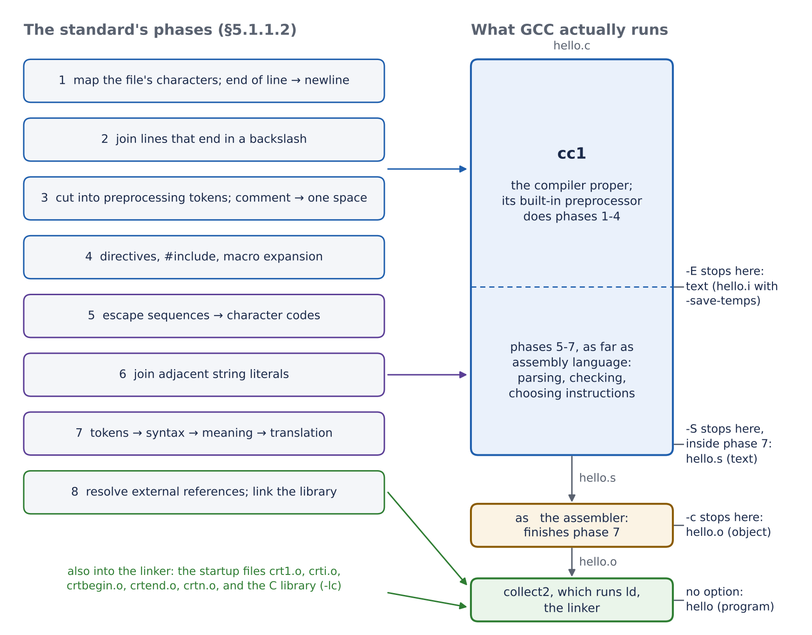

ref: 03.02
title: The Phases of Translation
chapter: Chapter 03 — From Source Text to Running Program
part: Part I — The Machine Beneath C
builds: §03.01
---
## The question

§03.01 left several loose ends. You wrote `printf`, and `nm` found `puts`. The `#include` line produced no tokens of `hello.c` at all. A comment became a space. And the bit patterns a processor executes (§01.06) appeared nowhere in what you typed. This section adds three more puzzles, and explains all of them:

- a comment that changes what a program returns (Listing 03.02-3);
- `0x1E+1`, which is an error, while `0x1F+1` is 32 (Listing 03.02-4);
- a program that compiles without a single complaint and still cannot be built (Listing 03.02-6).

All of them come from one fact: between the text in `hello.c` and the bits stands a chain of transformations, each with its own rules, and a single command, `gcc hello.c -o hello`, hides all of it. This section opens the chain. The questions are:

- What steps does the C standard say a translation must go through, and why are there so many?
- Why must the steps come in exactly that order?
- Which programs does GCC actually run to carry them out, and how can you watch them?
- How can you stop the chain after any step and look at what it has produced so far?

## The journey

### Why translation is divided into steps

Turning text into a running program is one large problem made of several small ones of different kinds. Some are about characters (where does a line end?), some about words (where does a token end?), some about text editing (paste in this header, replace this macro), some about grammar and meaning (is this a valid statement, and what does it compute?), some about the processor (which instructions compute it?), and some about combining separately prepared pieces (where is `printf`?). Solving all of them at once, in one tangle of code, would be hard to write and harder to trust.

The engineering answer is the one you met in Chapter 01, where transistors were built into gates, gates into adders and adders into a processor: divide the problem into layers, give each layer one job, and let each take the output of the one before it as its input. Each layer can then be understood, tested and replaced on its own.

:::history
The first C compilers were divided for a more pressing reason as well. Dennis Ritchie's PDP-11 compiler consisted of separate programs: a first pass, `c0`, which read the source and wrote syntax trees to an intermediate file, and a second pass, `c1`, which read the trees and generated code. By the Seventh Edition of Unix (1979), the manual page for `cc` listed a whole family of programs that the command ran in turn: the preprocessor `/lib/cpp`, the two compiler passes `/lib/c0` and `/lib/c1`, an optional optimizer `/lib/c2`, and then the assembler and the linker, which joined the result with the start-up file `/lib/crt0.o`. A PDP-11 program could address only 64 KB of memory at a time (a 16-bit address, §01.05; the larger models allowed 64 KB of instructions and 64 KB of data), and splitting the compiler into passes that each fitted in that space was, in the author's understanding, as much a necessity as a design choice. The division has outlived the necessity, because it is also a good design: today's GCC still runs separate programs for compiling, assembling and linking, as you will see below.
:::

### The standard's eight phases

When the committee that wrote the first C standard (X3J11, 1983–1989) came to translation, it found compilers that disagreed, above all about the preprocessor. It settled the disagreements by listing eight **phases of translation** (C23 draft N3096, §5.1.1.2; as in the earlier sections, clause numbers are those of that draft), and by defining each phase only by what it does to the output of the one before, so that no particular arrangement of programs was required. Table 03.02-1 lists them; the subsections that follow take them one at a time, each with an experiment you can run.

:::why
Why describe translation as a list of phases at all? Not to describe a compiler. The Rationale that the committee published to explain the 1989 standard gives the reason in one sentence: the phases "are spelled out to resolve the numerous questions raised about the precedence of different parses". Before the standard, compilers gave different answers to questions such as these: Can a `#define` begin a comment? May a backslash and a newline appear inside a trigraph? Must a comment end in the same file it began in? (No, no and yes, the committee decided.) Ritchie, looking back, put the same problem from the other side: the preprocessor's interaction with the compiler "had never been well-described", and the committee set out to remedy that. So the order of the phases settles arguments about *which rule wins* when two rules could apply to the same characters. Listing 03.02-3 below shows one such settlement at work: joining lines wins over recognizing comments, because phase 2 comes before phase 3.
:::

Table: Table 03.02-1  The eight phases of translation, in plain words
<!-- widths: 8,46,46 -->
| Phase | What happens | Its output |
|---|---|---|
| 1 | The file's bytes are read as characters of the source character set; each end of line becomes one newline character. | characters, in lines |
| 2 | Every backslash immediately followed by a newline is deleted, joining two physical lines into one logical line. | logical lines |
| 3 | The text is cut into **preprocessing tokens** and white space; each comment is replaced by one space. | preprocessing tokens |
| 4 | Preprocessing directives are carried out, macros expanded and `_Pragma` operators executed; an `#include`d file goes through phases 1 to 4 itself; then all directives are deleted. | preprocessing tokens, with no directives left |
| 5 | Escape sequences and characters in character constants and string literals are converted to the codes of the **execution character set**, the encoding the running program uses. | the same, with literals as character codes |
| 6 | Adjacent string literals are joined into one. | the same, with literals joined |
| 7 | White space stops mattering; preprocessing tokens become **tokens**; the tokens are parsed, checked for meaning and translated. | a translated **translation unit** |
| 8 | References to objects and functions defined elsewhere are resolved, and library components are linked in, producing the **program image**. | a program that can run |

:::precise
The standard does not require a compiler to have eight separate stages, or any intermediate files. The phases' order of precedence is what §5.1.1.2 lays down (when two rules could apply to the same characters, the rule of the earlier phase wins), and a footnote to it spells out the consequence: implementations must behave *as if* the phases occurred separately, even though in practice many of them are usually folded together. The phases are a specification of meaning, not a description of GCC's internals. This is the same "as if" idea as the abstract machine of §02.03: the standard describes what must come out, and leaves the method to the implementation. Two words in the table also deserve definitions. A **translation unit** is one source file together with everything its `#include` lines brought in, after preprocessing (§5.1.1.1); `hello.c` with all of `stdio.h` is one translation unit, and §21.01 shows programs made of several. The **program image** is the finished program, ready to be loaded and run (§03.07).
:::

### Phase 1: characters and lines

A file on a disk is a sequence of bytes. Phase 1 decides which characters those bytes represent, and where the lines end. Different systems mark the end of a line differently: Linux with one byte, the newline (10), Windows with two, a carriage return (13) followed by a newline. Phase 1 turns the end of each line into one newline character, so that the later phases never need to care; how an end of line is recognized is left to each implementation. GCC goes further than the standard requires: it accepts a newline, a carriage return followed by a newline, or a lone carriage return as an end of line on every system, so a file written on Windows compiles unchanged on Linux. You can check it:

```terminal
$ printf '#include <stdio.h>\r\nint main(void) {\r\n    printf("crlf\\n");\r\n    return 0;\r\n}\r\n' > crlf.c
$ file crlf.c
$ gcc -std=c23 -Wall -Wextra -pedantic crlf.c -o crlf && ./crlf
```

```output
crlf.c: C source, ASCII text, with CRLF line terminators
crlf
```

The first command writes a small program with Windows line endings (`\r\n` in `printf`'s format, a carriage return and a newline); `file` confirms them; GCC compiles the file as if they were ordinary Linux newlines (an implementation's choice, which GCC documents in its preprocessor manual).

Until C23, phase 1 had a second job, now removed: it replaced **trigraphs**, three-character sequences beginning with `??`, by single characters. They were invented for keyboards and character sets of the 1970s and 1980s that lacked characters such as `#`, `[` or `|`: `??=` stood for `#`, `??!` for `|`. Few programmers ever needed them, and many were surprised by them, because they acted even inside string literals. Listing 03.02-1 shows the surprise and its removal.

```c Listing 03.02-1  A trigraph, under C17 and under C23
// tri.c
// Trigraphs: removed from the language in C23.
#include <stdio.h>

int main(void) {
    printf("Is it true??!\n");
    return 0;
}
```

```terminal
$ gcc -std=c17 -Wall -Wextra -pedantic tri.c -o tri17 && ./tri17
$ gcc -std=c23 -Wall -Wextra -pedantic tri.c -o tri23 && ./tri23
```

```output
tri.c: In function ‘main’:
tri.c:6:23: warning: trigraph ‘??!’ converted to ‘|’ [-Wtrigraphs]
    6 |     printf("Is it true??!\n");
Is it true|
tri.c: In function ‘main’:
tri.c:6:23: warning: trigraph ‘??!’ ignored, use ‘-trigraphs’ to enable [-Wtrigraphs]
    6 |     printf("Is it true??!\n");
Is it true??!
```

Under C17, phase 1 turned `??!` into `|` before anything else could see it, so the program printed a sentence its author never wrote. Under C23 the three characters stay as they are; GCC warns that it ignored a trigraph and names the option, `-trigraphs`, that would restore the old behavior. (GCC also ignores trigraphs in its default GNU modes, even under older editions; it converts them only when a strict `-std=c89` to `-std=c17` is given, as here, or with `-trigraphs`.) This is an example of §02.05's rule that the edition of the standard changes what a program means; here it changes the very first phase.

### Phase 2: joining lines

Phase 2 does one thing: wherever a backslash is followed immediately by the end of a line, it deletes both, joining the two lines into one **logical line**. The device is older than the standard. Programmers used a backslash at the end of a line to continue a long string literal, and a long preprocessing directive, which must be a single line (§22.04 uses it for long macros). The committee that wrote the first standard then deliberately extended it to every token: its Rationale says that it "generalized this mechanism to permit *any* token to be continued", to make it easier for programs to generate C and to carry code to machines whose lines had a fixed maximum length. Phase 2 therefore needs to know nothing about tokens, strings or comments, which do not exist yet; it acts everywhere. It has one more rule: a file that is not empty must end with a newline, not preceded by a backslash, so that a join can never run off the end of a file. (Breaking that rule is undefined behavior; GCC quietly supplies the missing newline, and printed nothing about it on the reader's machine even with `-pedantic`.)

```c Listing 03.02-2  Phase 2 joins lines, even in the middle of a name
// splice.c
// Phase 2 joins a line ending in a backslash to the next, even inside a name.
#include <stdio.h>

int main(void) {
    pri\
ntf("hello, \
world\n");
    return 0;
}
```

```terminal
$ gcc -std=c23 -Wall -Wextra -pedantic splice.c -o splice && ./splice
$ gcc -std=c23 -E splice.c | tail -6
```

```output
hello, world
int main(void) {
    printf("hello, world\n");


    return 0;
}
```

- Lines 6–8: the name `printf` is split across two lines, and so is the string literal. Phase 2 joins all three physical lines into one logical line before any token is formed, so the compiler never sees a split name or a split string. The split string is the historical use of the backslash; the split name is the committee's generalization. Notice also the price of the old method: the continuation of the string, `world\n");`, must start in the first column of line 8, because any spaces there would become part of the string. Phase 6, below, was invented to avoid exactly that.
- The `-E` output shows the result of the first four phases (more on `-E` below). The three lines became one; GCC then prints two empty lines. The full `-E` output contains a line marker, `# 5 "splice.c"`, just before `int main` (§03.03 explains such markers), and the lines after it are counted from there; the two empty lines keep `return 0;` at the position counted as line 9 of `splice.c`, so error messages after it keep their correct line numbers.

That phase 2 comes before phase 3, which recognizes comments, has one trap that catches real programmers:

```c Listing 03.02-3  A comment that swallows the next line
// trap.c
// A comment that swallows the next line.
int main(void) {
    int status = 0;
    // the backup copy is in C:\temp\
    status = 1;
    return status;
}
```

```terminal
$ gcc -std=c23 -Wall -Wextra -pedantic trap.c -o trap; ./trap; echo $?
```

```output
trap.c: In function ‘main’:
trap.c:5:5: warning: multi-line comment [-Wcomment]
    5 |     // the backup copy is in C:\temp\
      |     ^
0
```

The program returned `0`, not `1`. Line 5 ends with a backslash (the last character of a Windows path), so phase 2 joined line 6 onto it; then phase 3 found a `//` comment, which runs to the end of the *logical* line and so swallowed `status = 1;`. GCC's `-Wcomment`, part of `-Wall`, catches it; without warnings, the assignment would silently vanish. GCC departs from the standard's wording here, in the direction that widens the trap: it also treats a backslash followed by spaces and then the end of the line as a join, warning `backslash and newline separated by space`, so a stray space after the backslash does not save you.

### Phase 3: preprocessing tokens

Phase 3 cuts the logical lines into **preprocessing tokens**, separated by white space, and replaces each comment by one space, as §03.01 described. Why "preprocessing" tokens, and not simply the tokens of §03.01? Because at this point the preprocessor has not yet run, and the preprocessor works with a slightly different and simpler vocabulary (§6.4): header names such as `<stdio.h>`, identifiers, **preprocessing numbers**, character constants, string literals, punctuators, and, as a last resort, any single non-white-space character (or universal character name, §08.03) that fits none of these. Notice one thing the list does *not* contain: keywords. To phases 3 to 6, `int` and `return` are identifiers like `main`; they become keywords only in phase 7, as you will see there.

Why is each comment replaced by one space, and not simply deleted? Because deleting it would join the tokens on either side, and some preprocessors before the standard did exactly that. Programmers exploited it, writing `a/**/b` to build the single name `ab`; Ritchie says that token concatenation had been "previously available only by accidents of implementation". The standard made a comment one space, so that a comment can never change where a token ends, and gave the job of pasting tokens together to an explicit operator, `##` (§22.04). GCC still keeps an imitation of the old preprocessors, `-traditional-cpp`, and the difference shows in one line:

```terminal
$ cat old.c
$ gcc -E -P old.c
$ gcc -E -P -traditional-cpp old.c | grep -v '^$'
```

```output
#define CAT(a,b) a/**/b
int CAT(foo,bar) = 1;
int foo bar = 1;
int foobar = 1;
```

(`-P` leaves out the line markers.) Under the standard's rules the comment became a space and the result is two names, `foo bar`, which is not a valid declaration; the traditional preprocessor deleted the comment and glued `foobar` together.

The preprocessing number is the interesting one. The preprocessor must cut numbers out of the text without knowing all of C's rules for numbers: what is a valid decimal, octal, hexadecimal or floating constant is decided only in phase 7. So the standard gives it a deliberately generous rule (§6.4.8): a preprocessing number begins with a digit (or a point and a digit), and continues with any letters, digits, underscores and points; with a single quote followed by a digit or letter (C23's digit separator, as in `1'000'000`, §05.06); and also with a `+` or `-` sign when it follows `e`, `E`, `p` or `P`, the letters that introduce the exponent of a floating constant (`1.5e+10`, Chapter 07). The rule is simple and greedy, and it occasionally swallows more than the programmer meant.

Why so generous? The committee's own documents give several reasons, and the first is the least obvious. In its answer to a 1990 complaint that the rule for preprocessing numbers was "a loose description" (published in 1992 as Defect Report #003), it explained that it wanted anything that *begins* like a number to stay one piece, so that "garbage" could not become valid C "through obscure macro replacements". If `12abc` were cut into `12` and `abc`, and `abc` happened to be a macro meaning `+ 1`, a typing mistake would become `12 + 1` and compile:

```terminal
$ cat mac.c
$ gcc -std=c23 -E -P mac.c
$ gcc -std=c23 -c mac.c
```

```output
#define abc + 1
int x = 12abc;
int y = 12 abc;
int x = 12abc;
int y = 12 + 1;
mac.c:2:9: error: invalid suffix ‘abc’ on integer constant
    2 | int x = 12abc;
      |         ^~~~~
```

With a space, `abc` is a separate identifier, and the macro replaces it; without one, `12abc` is a single preprocessing number, which the macro cannot touch, and which phase 7 rejects. A second benefit the committee named: text inside a block switched off with `#if 0` (§22.05) is still cut into preprocessing tokens, and a forgiving rule lets such dead text be skipped without needless errors. A third is that a simple rule leaves room for constants not yet invented: the same answer named binary constants beginning with `0b` as an example, and when C23 added them, three decades later, `0b101` was already a single preprocessing number and the preprocessor did not need to change. The last is the one you would guess: the rule spares the preprocessor from knowing the full syntax of numbers, which is decided in phase 7. The Rationale accepted the price openly: "occasional spurious forms are scanned as preprocessing numbers", and its own example is `0x123E+1`, which, it says, is a single token under the rules. It judged the anomaly no worse than the maximal munch of §03.01, under which `a+++++b` is cut into `a ++ ++ + b`, an invalid expression (§11.03).

```c Listing 03.02-4  A preprocessing number is not yet a number
// ppnum.c
// A preprocessing number is not yet a number.
int main(void) {
    int a = 0x1E + 1;    // three tokens: 0x1E, +, 1
    int b = 0x1E+1;      // one preprocessing token: 0x1E+1
    return a + b;
}
```

```output
ppnum.c: In function ‘main’:
ppnum.c:5:13: error: invalid suffix ‘+1’ on integer constant
    5 |     int b = 0x1E+1;      // one preprocessing token: 0x1E+1
      |             ^~~~~~
```

- Line 4: with spaces, `0x1E`, `+` and `1` are three tokens, and `a` is 30 + 1 = 31 (0x1E is hexadecimal for 30, §04.01).
- Line 5: without spaces, phase 3 sees `E` followed by `+`. The rule allows a sign after any `e` or `E`, because there it might begin an exponent; it knows nothing of hexadecimal, so it makes `0x1E+1` a single preprocessing number. In phase 7 it must become a real constant, and `0x1E+1` is not one: GCC reports the leftover `+1` as an invalid suffix. Change the digit to `F` and the problem disappears (`0x1F+1` is three tokens, worth 32), which shows that the failure is not about arithmetic at all, only about where phase 3 drew a boundary. This is the anomaly the Rationale chose to tolerate.

The lesson generalizes. The early phases work on *text*, by rules that know little of the language, and the meaning arrives only in phase 7; a surprising error is often a phase-3 boundary in the wrong place. §03.01's spaces in `int main` and `return 0` were the same lesson from the other side.

### Phase 4: the preprocessor

Phase 4 is the preprocessor proper. It carries out the directives, the lines that begin with `#`, and expands macros. For each `#include` it takes the named file through phases 1 to 4 itself, recursively, so that a header's own `#include` lines are processed too; this is how `#include <stdio.h>` made GCC open headers 31 times on your machine (Experiment 03.01-3). At the end of phase 4 every directive is deleted. What remains is one long sequence of preprocessing tokens, from which every trace of `#` has gone, except the line markers that GCC adds to tell later stages where each line came from, and any `#pragma` lines, which GCC keeps for the compiler proper (§22.06).

GCC's option `-E` stops after phase 4 and prints that sequence as text, which makes it the most useful window into the early phases. (The standard does not require any compiler to offer this; the Rationale says the committee thought such a requirement outside its mandate. It is a courtesy that GCC, Clang and most others extend.) §03.03 is devoted to what it shows.

### Phases 5 and 6: inside the string literals

Phases 5 and 6 work only on character constants and string literals. Phase 5 converts each character and each escape sequence in them to the code it stands for in the execution character set: `\n` becomes the single code 10 (in the ASCII-based codes GCC uses here), `\x41` becomes 65, which in those codes is `A` (§08.01 explains codes and character sets). Phase 6 then joins string literals that stand next to each other, with only white space between them, into one. Listing 03.02-5 shows both, and also why their order matters.

First, though, a question that phase 5 raises: why does C distinguish the characters of the source file from those of the running program at all? Because the machine that translates a program need not be the machine that runs it. You translate on a laptop for an ATmega328P; and in C's early decades, C programs written on ASCII machines were carried to IBM mainframes, which used a different code, EBCDIC, in which `A` is 193. GCC can still translate for such a machine, and the change happens exactly in phase 5. Three one-line programs, each returning the first byte of a literal as its exit status (§03.01):

```terminal
$ cat ebc.c nl.c hx.c
$ gcc -std=c23 ebc.c -o ebc && ./ebc; echo $?
$ gcc -std=c23 -fexec-charset=IBM1047 ebc.c -o ebc2 && ./ebc2; echo $?
$ gcc -std=c23 -fexec-charset=IBM1047 nl.c -o nl && ./nl; echo $?
$ gcc -std=c23 -fexec-charset=IBM1047 hx.c -o hx && ./hx; echo $?
```

```output
int main(void){ return (unsigned char)"A"[0]; }
int main(void){ return (unsigned char)"\n"[0]; }
int main(void){ return (unsigned char)"\x41"[0]; }
65
193
37
65
```

(`"A"[0]` is the first character of the literal, §24.06; the cast to `unsigned char`, §10.05, keeps the value positive.) The option `-fexec-charset=IBM1047` tells GCC that the running program uses IBM's EBCDIC code page 1047. The letter `A` in a literal is a *character*, so phase 5 converts it, to 193; the escape `\n` stands for the newline *character*, so it becomes whatever code the conversion table gives the newline: 37 in the table GCC uses here. (EBCDIC has two line-ending codes, 21 and 37, and IBM's own compilers on z/OS use 21; the choice belongs to the implementation, which is the point of phase 5.) But `\x41` names a *code*, not a character, so it stays 65 under either option. On your laptop the source and execution codes coincide, which is why phase 5 is usually invisible.

```c Listing 03.02-5  Escape sequences are converted before literals are joined
// escape.c
// Escape sequences are converted (phase 5) before literals are joined (phase 6).
#include <stdio.h>
#define NAME "world"

int main(void) {
    printf("hello, " NAME "\n");             // three literals become one
    printf("%s\n", "\x41" "BC");              // 'A', then "BC"
    printf("%zu\n", sizeof "\x41" "BC");      // the size of the joined literal
    return 0;
}
```

```terminal
$ gcc -std=c23 -Wall -Wextra -pedantic escape.c -o escape && ./escape
```

```output
hello, world
ABC
4
```

- Line 4: `#define` makes `NAME` a macro that phase 4 replaces with the literal `"world"` wherever it appears (Chapter 22).
- Line 7: after phase 4, the call contains three literals in a row, `"hello, " "world" "\n"`, and phase 6 joins them into one. This is how C programs build a long string from pieces, or combine a macro's string with others. Phase 6 was invented by the committee that wrote the first standard, to replace the backslash continuation of Listing 03.02-2: its Rationale says the old method "requires that the continuation of the string start in the first position of the next line", and that joining adjacent literals was added "to permit more flexible layout, and to solve some preprocessing problems". Why no operator, such as `+`? Because, in the Rationale's words, the joining "is a lexical construct rather than a run-time operation": it happens while the text is being read, before the program exists.
- Line 8: two literals, `"\x41"` and `"BC"`. The escape sequence `\x` takes as many hexadecimal digits as follow it, so `\x41` is the one character with code 0x41, the letter `A`.
- Line 9: `sizeof` reports 4: the three characters `A`, `B`, `C` and the null character, so the two literals did become one.

Now watch the phases at work. `-E` shows the text after phase 4, and `-S` shows the assembly language that `cc1` wrote, which is phase 7's result before the assembler encodes it as machine code (§03.04 reads it in full):

```terminal
$ gcc -std=c23 -E escape.c | tail -6
$ gcc -std=c23 -Wall -Wextra -pedantic -S escape.c -o escape.s
$ grep -E 'string|ascii' escape.s
```

```output
int main(void) {
    printf("hello, " "world" "\n");
    printf("%s\n", "\x41" "BC");
    printf("%zu\n", sizeof "\x41" "BC");
    return 0;
}
	.string	"hello, world"
	.string	"ABC"
	.string	"%zu\n"
```

After phase 4 the macro has been replaced, but the literals are still separate and the escape sequences still as typed: phases 5 and 6 have not run yet. In the assembly they are single strings: `"hello, world"` (whose `\n` left with the change to `puts`, as in §03.01) and `"ABC"`. The format `"%s\n"` is missing for the same reason: GCC turned `printf("%s\n", s)` into `puts(s)` as well, and only the third call, with `%zu`, still needs `printf`. (The assembler language writes some characters, such as the newline of `"%zu\n"`, as escape sequences of its own; that is the assembler's notation, not a C escape left unconverted.)

Why must phase 5 come before phase 6? Join the two literals of line 8 first, and the result is `"\x41BC"`. But `\x` takes *every* hexadecimal digit that follows, and `B` and `C` are hexadecimal digits:

```terminal
$ cat one.c
$ gcc -std=c23 -Wall -Wextra -pedantic one.c -o one; ./one; echo $?
```

```output
int main(void){ return sizeof "\x41BC"; }
one.c: In function ‘main’:
one.c:1:39: warning: hex escape sequence out of range
    1 | int main(void){ return sizeof "\x41BC"; }
      |                                       ^
2
```

Written as one literal, `\x41BC` is a single escape sequence with the value 0x41BC, too large for a `char`. That breaks a rule the standard calls a *constraint*, so a diagnostic is required; GCC gives a warning (an error with `-pedantic-errors`), keeps one character, and the literal holds that character and the null character: 2 bytes, not 4. Because phase 5 converts each literal's escapes *before* phase 6 joins them, `"\x41" "BC"` means `A` followed by `BC`, whatever letters follow. Splitting a literal is therefore the standard way to end a hexadecimal escape early; the standard itself gives the example `"\x12" "3"` (§6.4.5), which yields two characters, not one. The order of the phases is not bureaucracy; it is what lets a literal mean the same thing whether or not another literal stands next to it.

### Phase 7: translation proper

Phase 7 is what most people mean by "compiling". White space, which separated preprocessing tokens until now, stops mattering. Each preprocessing token is converted into a token of one of the five kinds of §03.01 (a preprocessing number becomes an integer or floating constant here, or is rejected, as `0x1E+1` was). Only now is each identifier looked up in the list of keywords, which has a startling consequence: before phase 7, a macro may even be named `int`. And a preprocessing token may have no token to become:

```terminal
$ cat kw.c
$ gcc -std=c23 -Wall -Wextra -pedantic kw.c -o kw && ./kw; echo $?
$ cat at.c
$ gcc -std=c23 at.c -o at
```

```output
#define int long
int main(void){ int x = sizeof(int); return x; }
kw.c:2:5: warning: return type of ‘main’ is not ‘int’ [-Wmain]
    2 | int main(void){ int x = sizeof(int); return x; }
      |     ^~~~
8
int main(void){ int a = 1 @ 2; return a; }
at.c: In function ‘main’:
at.c:1:27: error: stray ‘@’ in program
    1 | int main(void){ int a = 1 @ 2; return a; }
      |                           ^
at.c:1:29: error: expected ‘,’ or ‘;’ before numeric constant
    1 | int main(void){ int a = 1 @ 2; return a; }
      |                             ^
```

In `kw.c`, phase 4 replaced every `int` by `long` before phase 7 knew that `int` was a keyword, so `main` returns a `long`, `sizeof(int)` is really `sizeof(long)`, 8 on your laptop, and GCC warns that `main`'s return type is not `int`. (Never write this; it only shows *when* keywords come into existence.) In `at.c`, `@` is a perfectly good preprocessing token, the "any other character" kind, and it survives phases 3 to 6; but phase 7 has no kind of token for it, and reports a `stray ‘@’`. Then the tokens are **parsed**: their arrangement is checked against C's grammar, the rules that say, for example, that the `=` in a declaration must be followed by an initializer: an expression, or a list in braces. The meaning is checked too: whether names are declared, whether types fit together. And finally the translation unit is **translated**, into something closer to the machine. You can glimpse the step between, the compiler's own record of what it understood, before any machine instruction is chosen: GCC's `-fdump-tree-original` writes a file showing `main` as GCC parsed and checked it.

```terminal
$ gcc -std=c23 -fdump-tree-original -c hello.c -o /dev/null
$ cat hello.c.006t.original
```

```output

;; Function main (null)
;; enabled by -tree-original


{
  printf ((const char * restrict) "hello, world\n");
  return 0;
}
return 0;

```

Three things are visible. The checking of meaning inserted a conversion of the string to the type of `printf`'s first parameter, `const char * restrict`, exactly as `stdio.h` declared it (§03.01). The call is still `printf`: §03.01's change to `puts` happens later, inside phase 7, in one of GCC's early passes over this internal form (with `-fdump-tree-all`, GCC 16's dumps on the reader's machine first show `puts` in the pass called `lower`), still well before any instruction is chosen. And there is a second `return 0;`, outside the braces: the one C adds for a `main` that reaches its closing brace (§02.06). (The number in the file name, here `006`, depends on the GCC version. §03.04 and §39.05 look further into the compiler.)

The two kinds of check give two kinds of error, both reported by phase 7. Here are two one-line files, each with one mistake:

```terminal
$ cat syn.c sem.c
$ gcc -std=c23 -Wall -Wextra -pedantic syn.c -o syn
$ gcc -std=c23 -Wall -Wextra -pedantic sem.c -o sem
```

```output
int main(void){ int x = ; return x; }
int main(void){ int x = "five"; return x; }
syn.c: In function ‘main’:
syn.c:1:25: error: expected expression before ‘;’ token
    1 | int main(void){ int x = ; return x; }
      |                         ^
sem.c: In function ‘main’:
sem.c:1:25: error: initialization of ‘int’ from ‘char *’ makes integer from pointer without a cast [-Wint-conversion]
    1 | int main(void){ int x = "five"; return x; }
      |                         ^~~~~~
```

The first is a **syntax error**: the grammar requires an initializer after `=`, and `;` cannot begin one. The second is grammatically perfect, but its **meaning** is wrong: it tries to store the address of a string (a pointer, Chapter 24) in an integer. (Before GCC 14 the second was only a warning, and a program was produced; the standard requires a diagnostic but not that translation stop. Treat such a warning as an error.) Distinguishing the two will help you read messages quickly in §03.08: in GCC's wording, a syntax error usually says "expected ... before ...", because the parser knows what should have come next; a semantic error names types and declarations.

What does phase 7 translate *into*? The standard does not say; it describes only the effect. GCC does it in two steps: `cc1` writes assembly language, the human-readable form of machine code you met in §01.06, and an assembler encodes it as machine code in an object file. The standard has no separate phase for that second step, because it does not say what form phase 7's result takes; in GCC, the assembler is how phase 7 is finished.

### Phase 8: linking

After phase 7, the translation unit still contains references it cannot satisfy by itself. The translated `hello.c` calls `puts` (§03.01), whose code is in the C library; a program of several files calls functions defined in the others. Phase 8 resolves these **external references**, joins in the library components the program uses, and produces the program image. You can watch it fail, which shows most clearly that it is a separate step:

```c Listing 03.02-6  A function that is declared but never defined
// greet.c
// A function that is declared but never defined.
void greet(void);       // a declaration: "greet exists somewhere"

int main(void) {
    greet();
    return 0;
}
```

```terminal
$ gcc -std=c23 -Wall -Wextra -pedantic -c greet.c && ls -l greet.o
$ gcc greet.o -o greet
```

```output
-rw-r--r--. 1 serajus21 serajus21 1368 Nov 26 11:35 greet.o
/usr/bin/ld.bfd: greet.o: in function `main':
greet.c:(.text+0x5): undefined reference to `greet'
collect2: error: ld returned 1 exit status
```

- Line 3 is a declaration, like the declaration of `printf` in `stdio.h` (§03.01): it promises the compiler that a function `greet` exists somewhere, taking no arguments and returning nothing. Nothing in this file keeps the promise.
- The first command, with `-c`, runs phases 1 to 7, the assembler included, and stops: no error at all. Phase 7 was satisfied, because the declaration told it everything it needed to translate the call.
- The second command runs phase 8, and only now is the broken promise discovered. The first two lines come not from the compiler but from the linker, `ld.bfd` (Fedora's `ld`), and the last from `collect2`, which ran it and reports that it failed. In the function `main`, at offset 5 of its machine code, the linker was to write the distance to `greet`, and no file provided `greet`. (Why offset 5, and not the 4 at which the call begins, is shown under "Why this order" below.)

This is the most important practical consequence of the phases: **a program can compile without error and still fail to link**, because the two are separate steps that check different things. "Undefined reference" is always a phase-8 message, and it means that a definition is missing, not that a declaration is (§03.06 and §21.04 follow the linker's search in detail).

### From the standard's phases to GCC's programs

You met the programs behind the `gcc` command in §00.02. GCC's documentation calls `gcc` a **driver**: it does no translating itself, but decides which programs to run, in what order and with what options, and runs them. The option `-v` (verbose) makes it print each command before running it. On the reader's Fedora, the full output for `hello.c` is 33 lines; these are the three commands that matter (each shortened; `...` marks omitted options):

```text
/usr/libexec/gcc/x86_64-redhat-linux/16/cc1 -quiet -v hello.c ... -Wall -Wextra -Wpedantic -std=c23 ... -o /tmp/cc3BOgpy.s
as -v --64 -o /tmp/ccDPmze9.o /tmp/cc3BOgpy.s
/usr/libexec/gcc/x86_64-redhat-linux/16/collect2 -plugin .../liblto_plugin.so -plugin-opt=.../lto-wrapper ... -dynamic-linker /lib64/ld-linux-x86-64.so.2 -o hello .../crt1.o .../crti.o .../crtbegin.o ... /tmp/ccDPmze9.o -lgcc ... -lc ... .../crtend.o .../crtn.o
```

Read them in order, and follow the files.

1. **`cc1`**, the compiler proper (GCC's name for it; in the standard's terms it does far more than phase 7, since the preprocessor is built in), reads `hello.c` and writes assembly language to a temporary file, `/tmp/cc3BOgpy.s` (the random part of the name differs on each run, and the driver deletes the file when it has finished; `-save-temps`, below, keeps it). It receives the book's options, `-pedantic` under its other name `-Wpedantic`. The preprocessor is built into `cc1`, so this one program carries out phases 1 to 7, except the last step of phase 7, the encoding into machine code, which it leaves to the assembler.
2. **`as`**, the assembler, reads that `.s` file and finishes phase 7: it encodes the instructions as machine code in an **object file**, `/tmp/ccDPmze9.o` (§03.05 opens one). `--64` selects x86-64 instructions.
3. **`collect2`**, a helper belonging to GCC, runs the linker `ld` (on Fedora, `ld` is a link to `ld.bfd`, the GNU linker), passing it the object file from step 2 *and* a list of other files: the startup files `crt1.o`, `crti.o`, `crtbegin.o` before it and `crtend.o`, `crtn.o` after it (§02.06 met their role, §03.06 explains each; on systems whose GCC builds position-independent executables by default, such as Ubuntu, you will see `Scrt1.o`, `crtbeginS.o` and `crtendS.o` instead, the names §02.06 showed), and the libraries `-lgcc` and `-lc` (`-lc` is the C library, where `puts` lives). The output is `hello`. This is phase 8.

What does `collect2` itself do? GCC's internals manual describes it as the utility that arranges for initialization functions to be called at start time, if necessary by linking the program twice. On GNU/Linux, whose linker and startup files already provide that service, it runs `ld` once. You can see that by giving `collect2` its own `-v`, through the driver's option `-Wl,` ("pass this to the linking step"):

```terminal
$ gcc -Wl,-v -std=c23 hello.c -o hv 2>&1 | head -3 | cut -c1-200
```

```output
collect2 version 16.2.1 20261029 (Red Hat 16.2.1-3)
/usr/bin/ld -plugin /usr/libexec/gcc/x86_64-redhat-linux/16/liblto_plugin.so -plugin-opt=/usr/libexec/gcc/x86_64-redhat-linux/16/lto-wrapper -plugin-opt=-fresolution=/tmp/ccA1VWT1.res -plugin-opt=-pas
GNU ld version 2.47.20260726
```

`collect2` reports its version, then the single `ld` command it runs, and `ld` reports its own. The `-plugin` arguments that `collect2` passes on load GCC's link-time optimizer into `ld` (see "Why this order", below).

How does the driver know when to stop? The same way the shell's `&&` did in §03.01. Each program it runs returns an exit status, and the driver runs the next only if the last one succeeded: when `cc1` reports an error, `as` and the linker never run. In Listing 03.02-6, `ld` returned 1, `collect2` reported that in the last line, and `gcc` itself then exited with status 1, which is how `make` (§21.08) learns that a build failed.

That `cc1` does the preprocessing too was not always so. The Seventh Edition ran `/lib/cpp` as a program of its own (the history box above), and so did GCC until version 3.0 (2001), whose rewritten preprocessor was built into the compilers. You can still ask for the old arrangement, with `-no-integrated-cpp`:

```terminal
$ gcc -no-integrated-cpp -v -std=c23 hello.c -o hn 2>&1 | grep -E '/cc1 | as |/collect2 ' | cut -c1-110
```

```output
 /usr/libexec/gcc/x86_64-redhat-linux/16/cc1 -E -quiet -v hello.c -mtune=generic -march=x86-64 -mtls-dialect=g
 /usr/libexec/gcc/x86_64-redhat-linux/16/cc1 -fpreprocessed /tmp/ccGuKrJf.i -quiet -dumpdir hn- -dumpbase hell
 as -v --64 -o /tmp/ccm3sXY0.o /tmp/cc4Y7cYy.s
 /usr/libexec/gcc/x86_64-redhat-linux/16/collect2 -plugin /usr/libexec/gcc/x86_64-redhat-linux/16/liblto_plugi
```

Four commands now. `cc1 -E` carries out phases 1 to 4 and writes a temporary `.i` file; a second `cc1`, told `-fpreprocessed` ("phases 1 to 4 are already done"), carries out the rest of the translation; then `as` and `collect2` run as before. It is the same program both times. Joining the two halves, as GCC normally does, saves writing the whole of `stdio.h` out as text and reading it back in.

:::hood
How does the driver know which programs to run, and what to give each one? It follows rules called **specs**, written in a small language of its own, and it will print them with `gcc -dumpspecs`. The rule that chose the startup files is named `startfile`; on the reader's machine it begins:

```text
*startfile:
%{!mandroid|tno-android-ld:%{shared:;      pg|p|profile:%{static-pie:grcrt1.o%s;:gcrt1.o%s};      static:crt1.o%s;      static-pie:rcrt1.o%s;      pie:Scrt1.o%s;      :crt1.o%s} crti.o%s ...
```

Read `static:crt1.o%s; ... pie:Scrt1.o%s; :crt1.o%s` as "with `-static`, `crt1.o`; if the program is position-independent, `Scrt1.o`; otherwise `crt1.o`" (`%s` means "find this file in GCC's own directories"). Fedora's GCC builds position-dependent programs unless asked otherwise, so it took the last branch, `crt1.o`; Ubuntu's rule is written the other way round, with position-independent as the default, which is why it chose `Scrt1.o`. The two drivers are the same program, differing in one default. avr-gcc goes a step further: for each chip it reads a specs file of its own. `avr-gcc -v -mmcu=atmega328p` prints `Reading specs from /usr/lib/gcc/avr/15.3.0/device-specs/specs-atmega328p`, and in that text file the rule `cpp_mcu` holds `-D__AVR_ATmega328P__` and the rule `asm_arch` holds `-mmcu=avr5`, the exact options the driver gave `cc1` and `as` in the AVR section below. The driver is not magic; it is a rule book you can read.
:::

Figure 03.02-1 sets the standard's phases beside these programs.

{w=16}

Notice two things about the mapping. First, it is not one program per phase: `cc1` does nearly seven of the eight, and the standard's division and GCC's are different answers to different questions (what must happen, and how to organize programs that make it happen). Second, there is a program, `as`, that has no phase of its own: as the end of the phase-7 subsection explained, it finishes phase 7's work. Not every compiler makes GCC's choice. Clang, given the same file, runs only two commands:

```terminal
$ clang -### -std=c23 hello.c -o hello_clang 2>&1 | grep -E '^ "' | cut -c1-140
```

```output
 "/usr/bin/clang-23" "-cc1" "-triple" "x86_64-redhat-linux-gnu" "-emit-obj" "-dumpdir" "hello_clang-" "-disable-free" "-clear-ast-before-bac
 "/usr/bin/ld" "--hash-style=gnu" "--build-id" "--eh-frame-hdr" "-m" "elf_x86_64" "-dynamic-linker" "/lib64/ld-linux-x86-64.so.2" "-o" "hell
```

The option `-###` prints the commands without running them (Clang puts each argument in quotation marks; `cut` trims the long lines). Clang's compiler is the `clang` program itself, run a second time with `-cc1`; it is told `-emit-obj`, because it has an assembler built in and writes the object file directly. Then it runs `ld`. And Clang can be told to work like GCC: with `-fno-integrated-as` it writes assembly and runs the GNU assembler, three commands instead of two.

```terminal
$ clang -### -fno-integrated-as -std=c23 hello.c -o hc 2>&1 | grep -E '^ "' | cut -c1-80
```

```output
 "/usr/bin/clang-23" "-cc1" "-triple" "x86_64-redhat-linux-gnu" "-S" "-dumpdir" 
 "/usr/bin/as" "--64" "-o" "/tmp/hello-64cb74.o" "/tmp/hello-a6dba8.s"
 "/usr/bin/ld" "--hash-style=gnu" "--build-id" "--eh-frame-hdr" "-m" "elf_x86_64
```

The arrangement of programs is a switch; the eight phases are the same either way.

:::hood
Why does GCC write assembly text and then pay for a second program to read it back? Because the division keeps each program simpler and lets each be reused. The assembler, `as`, belongs to GNU binutils, a separate project that also serves hand-written assembly (the AVR programs of §01.06), other compilers, and almost every processor GCC supports; GCC itself need only produce text in the assembler's language. The text is also readable by people, which is why `-S` is one of the most useful options an engineer has (§03.04, §39.01). For `hello.c` the cost is a few milliseconds (Experiment 03.02-6 lets you measure it); for very large files it grows, and the option `-pipe` avoids the file altogether by connecting `cc1`'s output directly to `as`'s input: with it, the `as` line of `-v` on the reader's machine read `as -v --64 -o /tmp/cc5dyiHt.o`, with no input file named at all. Clang's builders weighed the same trade the other way, in the author's reading for speed and simplicity of use. Neither is wrong; it is an engineering choice, and the standard deliberately leaves it open.
:::

### Why this order, and no other

§00.02 promised an explanation of why `cc1`, `as` and `collect2` must run in exactly that order. "Each needs the previous one's output" is true, but it only moves the question: why were the outputs designed so that linking comes last? The answer lies in what each program *knows* when it runs, and `greet.o` lets you see it in the machine code. Ask `objdump` (§03.05) for the code, with `-r`, which also prints the notes the assembler left for the linker:

```terminal
$ gcc -std=c23 -Wall -Wextra -pedantic -c greet.c
$ objdump -dr greet.o
```

```output

greet.o:     file format elf64-x86-64


Disassembly of section .text:

0000000000000000 <main>:
   0:	55                   	push   %rbp
   1:	48 89 e5             	mov    %rsp,%rbp
   4:	e8 00 00 00 00       	call   9 <main+0x9>
			5: R_X86_64_PLT32	greet-0x4
   9:	b8 00 00 00 00       	mov    $0x0,%eax
   e:	5d                   	pop    %rbp
   f:	c3                   	ret
```

The call to `greet` is the instruction at offset 4: the byte `e8`, "call", followed by four bytes that should hold the distance from the end of the instruction to `greet`. They hold zeros. The assembler did not know where `greet` would be, so it left a hole of exactly the right size and wrote a note beside it, the **relocation** printed on the next line: "at offset 5, put in the distance to `greet`, worked out from its address" (the `-0x4` and the name `R_X86_64_PLT32` are details for §03.05; `objdump` shows the unfilled call as `call 9`, the next instruction, because a distance of zero leads there). This is the `.text+0x5` of the linker's message in Listing 03.02-6: the linker came to fill the hole at offset 5 and found nothing to fill it with. That hole holds the whole explanation of the order.

**The declaration gives the compiler everything except the address.** From `void greet(void);`, `cc1` knows that the call passes no arguments and expects no result, so it can generate the call completely. Only the destination is unknown, and this form of `call` keeps its destination in four bytes, whatever it turns out to be. So translation can finish without the definition, which is why `gcc -c greet.c` succeeded.

**Each program fixes what has become known by its time, and leaves a marked hole for the rest.** `cc1` does not even compute distances inside its own file. It writes `jmp .L2`, naming a label, and the assembler, which has the whole file in front of it, measures the distance and writes the bytes in; Experiment 03.02-7 shows a loop whose jumps leave no notes behind. What the assembler cannot know, an address in another file, it leaves as a hole with a note. The linker, which has all the files, fills those holes. And on Linux even the linker does not know where the C library will be in memory when the program runs, so for `puts` it leaves one more hole, which the dynamic loader fills when the program starts or at the first call (the `U puts@GLIBC_2.2.5` of §03.01; §03.07). Each step leaves what it cannot know to the first step that can know it.

**So linking must come last, because it is the first point at which every definition exists.** Phases 1 to 7 work on one translation unit and need nothing from any other. Only phase 8 has your object files, the startup files and the libraries together. Inside phases 1 to 7 two kinds of reason fix the order. Some are dependencies of the same kind: phase 4 must precede phase 7, because the parser must see the text *after* `#include` has pasted in the declarations and the macros have been replaced. Others are decisions about which rule wins, made for stated purposes: phase 2 precedes phase 3 so that any token, even a name, can be continued (at the price of Listing 03.02-3), and phase 5 precedes phase 6 so that joining literals never changes what each piece means (`"\x41" "BC"`).

Try the alternatives, and each one fails. Could the pieces be joined *first*, all the source files pasted together and translated at once? That is how B, C's predecessor, began: Ritchie recalls that B at first insisted "that the entire program be presented all at once to the compiler", before B and then C adopted a conventional linker. For your own files it is still possible, and some projects do it deliberately (SQLite's library is distributed as a single C file, which its authors call the "amalgamation"). But the C library on your machine exists only as compiled code: nobody gave you the source of `puts`, and you would not want to compile it again with every program. Something must combine *translated* pieces, so it must come after translation. Could the assembler come before the compiler? It has nothing to read until instructions have been chosen. Could the compiler fill in `greet`'s address itself? Only by seeing every other file, which would end separate compilation.

**That arrangement is what makes separate compilation possible.** Because phases 1 to 7 need only one file, each source file of a large program can be compiled on its own, into its own object file, and kept. When one file changes, only that file is compiled again, and the program is relinked; with thousands of files, this can turn a long rebuild into a short one (§21.01 and §21.08 build on this). And the C library itself is the extreme case: it was compiled once, by the people who built your Fedora, and every program on your machine is linked with the same compiled code. What is forced, then, is the order *translate each unit, then combine*; it follows from where the information needed by each step becomes available. Where exactly the last encoding into machine code happens is an engineering choice: GCC does it in `as`, before the link, while Plan 9's linker, and Go's after it, finish part of the assembler's work during the link. (One modern option bends, but does not break, this arrangement: with `-flto`, *link-time optimization*, `cc1` writes an intermediate form of the program instead of finished code, and the last part of translation runs during the link, when all the files can be seen together. The `-plugin` and `lto-wrapper` arguments of the `collect2` and `ld` commands above are the hooks for it; §39.02 returns to it.)

### Stopping the chain: -E, -S and -c

Since the driver runs the steps in sequence, it can stop after any of them. Three options say where, and GCC recognizes the stage of a file by its suffix (Table 03.02-2):

Table: Table 03.02-2  Where each option stops, and what it leaves behind
<!-- widths: 14,26,26,34 -->
| Option | Stops after | Writes | Contents |
|---|---|---|---|
| `-E` | phase 4 (preprocessing) | the screen, or a `.i` file with `-o` | C text, with headers pasted in and macros expanded |
| `-S` | `cc1`: inside phase 7 (the language work is done; the machine code is not yet encoded) | `name.s` | assembly language text |
| `-c` | the assembler: the end of phase 7, a translated translation unit | `name.o` | machine code in an object file |
| (none) | phase 8 (`ld`) | `a.out`, or the name given with `-o` | the program |

The option `-save-temps` runs the whole chain but keeps every intermediate file:

```terminal
$ gcc -std=c23 -Wall -Wextra -pedantic -save-temps hello.c -o hello
$ ls -l hello.c hello.i hello.s hello.o hello
$ file hello.c hello.i hello.s hello.o hello
```

```output
-rwxr-xr-x. 1 serajus21 serajus21 12624 Nov 26 11:35 hello
-rw-r--r--. 1 serajus21 serajus21   162 Nov 26 11:35 hello.c
-rw-r--r--. 1 serajus21 serajus21 13958 Nov 26 11:35 hello.i
-rw-r--r--. 1 serajus21 serajus21  1512 Nov 26 11:35 hello.o
-rw-r--r--. 1 serajus21 serajus21   457 Nov 26 11:35 hello.s
hello.c: C source, Unicode text, UTF-8 text
hello.i: C source, ASCII text
hello.s: assembler source, ASCII text
hello.o: ELF 64-bit LSB relocatable, x86-64, version 1 (SYSV), not stripped
hello:   ELF 64-bit LSB executable, x86-64, version 1 (SYSV), dynamically linked, interpreter /lib64/ld-linux-x86-64.so.2, BuildID[sha1]=ddb234d9f741fd5bee907a9e3fca18f11cccdc7a, for GNU/Linux 3.2.0, not stripped
```

Follow the sizes, and you see the work of each step. Preprocessing multiplied 162 bytes into 13,958, because `stdio.h` was pasted in. Compiling shrank them to 457 bytes of assembly, because declarations, used or not, produce no code; only the definition of `main` did. Assembling produced 1,512 bytes, of which `main`'s instructions are 21 bytes and its string 13 (§03.01); the rest is bookkeeping that §03.05 opens: headers, a table of names, and the notes that tell the linker which holes to fill. Linking added the startup files and the information for loading the C library, reaching 12,624 bytes. `file` names each stage: C source, assembler source, a "relocatable" ELF file (an object file, whose addresses are not yet fixed: §03.05), and an "executable" ELF file. (`hello.c` is "Unicode text" because its comment contains the character §, which takes two bytes in UTF-8, §08.03; `hello.i` is plain ASCII because that comment, § and all, was replaced by a space in phase 3.)

The driver can also *begin* at any stage, because it recognizes a file's stage by its suffix. Each command below takes the previous one's output:

```terminal
$ gcc -E hello.c -o h.i && gcc -S h.i -o h.s && gcc -c h.s -o h.o && gcc h.o -o h && ./h
```

```output
hello, world
```

And nothing stops you from doing the driver's job yourself, at least for the first two programs. `gcc -print-prog-name=cc1` reports where `cc1` is installed:

```terminal
$ CC1=$(gcc -print-prog-name=cc1)
$ $CC1 -quiet -std=c23 hello.c -o byhand.s
$ as byhand.s -o byhand.o
$ gcc byhand.o -o byhand && ./byhand
```

```output
hello, world
```

The by-hand `byhand.s` and `byhand.o` came out 457 and 1,512 bytes, exactly the sizes of the driver's own files: the driver added nothing that you did not. (This works on Fedora as shown. On Debian and Ubuntu the driver also gives `cc1` the option `-imultiarch x86_64-linux-gnu`, which tells it where the system keeps its machine-specific headers; without it, `cc1` stops with `bits/libc-header-start.h: No such file or directory`. Copy the option from your own `gcc -v` output. It is one more thing the driver does for you.) `cc1` and `as` are ordinary programs that you can run by hand, provided you give them the options the driver would have given; only the link was left to the driver, because its command line, with its startup files and libraries, is the longest and the most system-specific (§03.06 builds it by hand too). The `gcc` command is a convenience, not magic.

:::myth
"The compiler turns my C file into a program." The compiler proper, `cc1`, turns it into assembly language; it has seen the C library's declarations in the headers, but never its code, the startup files or your other source files. Three separate programs produce the program, and a fourth, the driver, coordinates them. Holding this picture in mind tells you, for every error message, which program is speaking, and so what kind of mistake to look for: a message with a file name, a line *and a column* comes from `cc1` (phases 1 to 7, as far as assembly); the linker, given debugging information (`-g`), names a file and line too, but never a column, and adds a section offset such as `(.text+0x5)`; a message under the heading `Assembler messages:` comes from `as`, which in the author's experience usually means an error in hand-written or inline assembly (§39.03), an assembler too old for the compiler, or, rarely, a compiler bug; and "undefined reference" or "multiple definition" comes from `ld`, phase 8, and means that definitions are missing or duplicated across files.
:::

### On the AVR: the same chain, two more steps

avr-gcc is the same GCC, built for a different processor, so its driver runs the same three programs. On the reader's machine (lines shortened):

```text
/usr/libexec/gcc/avr/15.3.0/cc1 -quiet -v -imultilib avr5 -D__AVR_ATmega328P__ ... avr_hello.c ...
/usr/lib/gcc/avr/15.3.0/../../../../avr/bin/as -mmcu=avr5 -mgcc-isr -mno-skip-bug -o /tmp/ccoVeCRg.o /tmp/cc5DLDQ3.s
/usr/libexec/gcc/avr/15.3.0/collect2 -plugin ... 
```

The driver passes `cc1` the macro `__AVR_ATmega328P__` (taken, as the specs box above showed, from the chip's own specs file), which is how `<avr/io.h>` knows which chip's register names to provide (§36.03), and passes `as` the instruction set `avr5`, the family to which the ATmega328P belongs. The assembler is the AVR version of the same GNU `as`.

For a microcontroller, phase 8 is not the end. The linked `.elf` file is still a file on your laptop; it must be converted into the form an uploader accepts and written into the chip's flash. So the chain of a bare-metal program has two more links, outside the C standard altogether: `avr-objcopy`, which extracts the bytes destined for flash into an Intel HEX file (§03.01's Hands-on A), and an uploader, `avrdude`, which sends them to the bootloader on the board (§36.01). Hands-on A runs the whole chain one step at a time.

:::orbit
In software for aircraft and spacecraft, the chain of this section is not an invisible convenience; it is part of what must be trusted. The program that flies is the output of the preprocessor, the compiler, the assembler, the linker and a format converter, and a fault in any of them puts a fault into the flight image that no review of the source code would find. Standards for safety-critical software (DO-178C for aircraft, and the ECSS standards used by the European Space Agency) therefore treat the tools themselves as subjects of assurance: a project must either show that it verifies each tool's output, or qualify the tool for its use, and it must record exactly which version of each tool built each delivered image. In the author's view, the habits this section teaches are the beginning of that discipline: knowing every program between the source and the image, keeping the intermediate files (`-save-temps`) of a build that matters, and being able to rebuild any delivered image and get the same bytes.
:::

## Terms introduced

- **Phases of translation**: the eight steps by which the C standard describes the translation of a program, from characters in a file to a program image.
- **Logical line**: a line after phase 2 has joined lines that ended in a backslash.
- **Trigraph**: a three-character sequence beginning with `??` that stood for one character until C23 removed them.
- **Preprocessing token**: the unit of text the preprocessor works with (phases 3 to 6), converted into a token in phase 7.
- **Preprocessing number**: the generous preprocessing token that holds any number-like text, decided to be a valid constant only in phase 7.
- **Execution character set**: the character codes a running program uses; phase 5 converts literals to them.
- **Translation unit**: one source file with everything it includes, after preprocessing.
- **Program image**: the finished, linked program.
- **Parsing**: checking the arrangement of tokens against the grammar of the language.
- **Syntax error / semantic error**: an error in the arrangement of tokens, or in their meaning (types, declarations).
- **External reference**: a use of a function or object defined in another translation unit or a library, resolved in phase 8.
- **Driver**: the program (`gcc`) that runs the compiler proper, the assembler and the linker in turn.
- **Compiler proper (`cc1`)**: the program that carries out phases 1 to 7 as far as assembly language, which it writes to a file.
- **Assembler (`as`)**: the program that turns assembly language into machine code in an object file, finishing phase 7.
- **Relocation**: a note left in an object file asking the linker to write an address, not yet known, into a hole in the machine code.
- **Specs**: the rules, in a small language of their own, by which the GCC driver decides which programs to run and with what options (`gcc -dumpspecs`).
- **Object file**: the output of the assembler: machine code and data whose final addresses are not yet fixed.
- **Linker (`ld`)**: the program that carries out phase 8, combining object files and libraries into a program.
- **Separate compilation**: compiling each source file on its own into an object file, and combining them only when linking.

## Self-check

1. Translation is divided twice: into the standard's phases and into a compiler's programs. Give the reason for each division, and say which reason was partly historical.
2. Does the standard require a compiler to have eight stages? What exactly does it require?
3. A file from a 1990s Macintosh ends each line with a lone carriage return. Will GCC on Linux compile it? Must every conforming compiler? Why? And what else did phase 1 do before C23?
4. In Listing 03.02-3, why did `status = 1;` never execute? Which two phases are involved, and why does their order matter?
5. Which of these are single preprocessing tokens, and which survive phase 7: `0xE+1`, `0xF+1`, `12abc`, `1.2.3.4`, `0b2`? Then give the committee's main reason for making preprocessing numbers so greedy.
6. Someone looks at `gcc -E escape.c`, sees `"\x41" "BC"` still separate, and concludes that GCC skips phases 5 and 6. What is wrong with the conclusion, and how would you check it?
7. Why must phase 5 come before phase 6? Use `"\x41" "BC"` in your answer.
8. Classify each error as a syntax error, a semantic error, or a link error: `int x = ;`, `int x = "five";`, `undefined reference to 'greet'`.
9. Why did `gcc -c greet.c` succeed, although `greet` is defined nowhere?
10. Name the three programs GCC runs for `gcc hello.c -o hello`, the file each reads and the file each writes. Which phases, or parts of phases, does each carry out?
11. Which program in GCC's chain has no phase of its own, and why does the standard not mention it? What does Clang do instead, and how can Clang be made to work like GCC?
12. A colleague proposes to speed up builds by linking first and compiling afterward. Using the four zero bytes in `greet.o`, explain why this cannot work for a program that uses the C library.
13. `file` called `hello.c` "Unicode text" but `hello.i` "ASCII text". Which phase made the difference, and how? Which other sizes did `hello` pass through, and why did the size first grow and then shrink?
14. What two steps follow linking for a program for the ATmega328P, and why are they outside the C standard?

## Experiments

**Experiment 03.02-1. A long macro.** Write `#define GREETING "hello, " \` on one line and `"world\n"` on the next, then `printf(GREETING);` in `main`. Does it compile? Remove the backslash: what does GCC say, and why? (Remember that a directive ends at the end of its logical line.)

**Experiment 03.02-2. The edges of a preprocessing number.** Predict, then test with `gcc -std=c23 -c`, which of these initializers compile: `0x1E+1`, `0x1E + 1`, `0x1F+1`, `1e+1`, `1.5.2`, `08`, `0b101`. For each one that fails, say whether phase 3 or phase 7 is responsible.

**Experiment 03.02-3. Splitting a long string.** Use phase 6 to write a message of three sentences as three literals on three lines, with no backslashes. Check with `-S` that the assembly contains one string.

**Experiment 03.02-4. Watch the driver.** Run `gcc -v -std=c23 hello.c -o hello` and find, in the 33 lines of output, the line `#include <...> search starts here:` and the list after it. These are the directories `cc1` searches for headers; §03.03 explains them. Then run `gcc -### hello.c` and compare: what is missing from its output, and why?

**Experiment 03.02-5. Separate compilation.** Write `greet_def.c` containing `#include <stdio.h>` and a definition `void greet(void) { puts("hello from greet"); }`. Compile it with `-c`, then link `gcc greet.o greet_def.o -o greet` and run the program. Now change only the message in `greet_def.c`: which file must you recompile, and which command links the program again?

**Experiment 03.02-6. Time each stage.** Make a copy of `hello.c` that includes ten standard headers (`<stdio.h>`, `<stdlib.h>`, `<string.h>`, `<math.h>`, `<time.h>`, `<ctype.h>`, `<stdint.h>`, `<inttypes.h>`, `<limits.h>`, `<errno.h>`). Measure `gcc -E`, `gcc -S`, `gcc -c` and a full build with `time`. Which step dominates for such a small program, and why might the answer differ for a large one?

**Experiment 03.02-7. Jumps the assembler resolves.** Compile `int f(int n){ int s = 0; for (int i = 0; i < n; ++i) s += i; return s; }` (in a file `loop.c`) with `-S` and with `-c`. Find the jump instructions in the `.s` file and in `objdump -d loop.o`, then run `objdump -r loop.o`. What did the assembler do with the labels `.L2` and `.L3`, and why is there no note for the linker about them?

## Hands-on (AVR / ESP32)

### A: the ATmega328P chain, one step at a time

Take Listing 03.01-9, `avr_hello.c`, and build it with `-save-temps`, then convert it for upload:

```terminal
$ avr-gcc -mmcu=atmega328p -std=c11 -Os -Wall -Wextra -pedantic -save-temps avr_hello.c -o avr_hello.elf
$ avr-objcopy -O ihex -R .eeprom avr_hello.elf avr_hello.hex
$ ls -l
$ file *
```

```output
total 32
-rw-r--r--. 1 serajus21 serajus21   746 Nov 26 11:53 avr_hello.c
-rwxr-xr-x. 1 serajus21 serajus21 10356 Nov 26 11:53 avr_hello.elf
-rw-r--r--. 1 serajus21 serajus21  3878 Nov 26 11:53 avr_hello.elf-avr_hello.i
-rw-r--r--. 1 serajus21 serajus21  1176 Nov 26 11:53 avr_hello.elf-avr_hello.o
-rw-r--r--. 1 serajus21 serajus21   745 Nov 26 11:53 avr_hello.elf-avr_hello.s
-rw-r--r--. 1 serajus21 serajus21   639 Nov 26 11:53 avr_hello.hex
avr_hello.c:               C source, Unicode text, UTF-8 text
avr_hello.elf:             ELF 32-bit LSB executable, Atmel AVR 8-bit, version 1 (SYSV), statically linked, with debug_info, not stripped
avr_hello.elf-avr_hello.i: C source, ASCII text
avr_hello.elf-avr_hello.o: ELF 32-bit LSB relocatable, Atmel AVR 8-bit, version 1 (SYSV), not stripped
avr_hello.elf-avr_hello.s: assembler source, ASCII text
avr_hello.hex:             Intel hexadecimal object, 0x10 record length, 0x0000 offset, '00' type, data+checksum 0C9434000C9449000C9449000C94490061
```

(This was run in a folder containing only `avr_hello.c`.) The stages are those of the laptop: preprocessed text, assembly, a relocatable object, an executable ELF. Two details differ. The intermediate files are named after the output, `avr_hello.elf-avr_hello.i`. Since GCC 11, when the output's name is not simply the source's name without its suffix, GCC puts both names together, so that two programs built in one folder cannot overwrite each other's files (for `-o hello` and `hello.c` it used the plain names; older versions, such as the avr-gcc 7.3 that some Linux distributions still ship, always use the plain names). And the ELF is "statically linked": with no operating system to load a shared library, every byte the chip will run must be inside the file (§21.05). The last file, the HEX image, is the final stage of this program's journey and the only one that will reach the chip. Open it in a text editor and compare its first line with the vector table of §02.06. After the colon come the number of data bytes (`10`, sixteen), the address (`0000`) and the record type (`00`, data); then `0C943400` is the first `jmp` instruction, `0c 94 34 00`, the bytes `avr-objdump` showed there, followed by three more `jmp`s and a checksum, `61`. The last line, `:00000001FF`, carries no data: it marks the end of the file.

If you have an Uno, upload `avr_hello.hex` with `avrdude` (§36.01 gives the command; the Arduino IDE installs a copy), and open the Serial Monitor at 115200 baud. Then build a sketch in the Arduino IDE after ticking "compile" beside "Show verbose output during" in its preferences. You will see every command the IDE runs: driver commands (`avr-g++` for the sketch, `avr-gcc` for the core's C files, the archiver that collects the core into a library, the link, `avr-objcopy`, `avr-size`), each of which runs the chain of this section inside it, plus an extra first step that turns the `.ino` sketch into a C++ file (sketches are C++, §02.05, so for the sketch the driver runs `cc1plus`, the C++ compiler proper, instead of `cc1`).

### B: the ESP32 chain

In the Arduino IDE, select an ESP32 board and build any sketch with verbose output switched on. Find, in the output, the compiler (a program whose name begins with `xtensa-esp32-elf-` on the classic ESP32, or `riscv32-esp-elf-` on the RISC-V models such as the ESP32-C3), the linker command with its long list of libraries, and the step that converts the linked `.elf` file into a `.bin` image for the ESP32's flash. This was not run by the author. Expect the same driver, cc1plus and linker as on the laptop, followed, as on the AVR, by a conversion step and an upload step that the C standard does not know about; the details of the conversion are those of Espressif's `esptool`.

## Answers

**Self-check 1.** The standard's phases define which rule wins when two could apply to the same text (in the C89 Rationale's words, to resolve "the precedence of different parses"), without requiring any arrangement of programs. A compiler's division into programs is engineering: each program has one job with a simple input and output, which makes it easier to write, test and reuse. The second was partly historical: in the author's understanding, it also let each pass fit the small memory of machines such as the PDP-11.

**Self-check 2.** No. It requires that the result be as if the eight phases occurred separately and in order; implementations may fold them together and need not produce intermediate files.

**Self-check 3.** GCC will: it accepts a lone carriage return as an end of line, and on the reader's machine such a file compiled and ran (`file` reported "with CR line terminators"). Not every compiler must, because how an end of line is recognized is left to each implementation in phase 1. Before C23, phase 1 also replaced trigraphs (such as `??!`) with the characters they stood for.

**Self-check 4.** Line 5 ended with a backslash, so phase 2 joined line 6 to it; phase 3 then recognized a `//` comment that ran to the end of the joined logical line, swallowing the assignment. Because phase 2 runs before phase 3, a backslash at the end of a comment line joins the next line into the comment.

**Self-check 5.** `0xE+1`, `12abc`, `1.2.3.4` and `0b2` are each one preprocessing number, and each is rejected in phase 7 (on the reader's machine: invalid suffix `+1`, invalid suffix `abc`, too many decimal points, invalid suffix `b2`). `0xF+1` is three tokens, worth 16. The committee's main reason (Defect Report #003): anything that begins like a number stays one piece, so that a macro cannot turn a typing mistake into valid C, as `#define abc + 1` would turn `12abc` into `12 + 1`. (It also left room for future constants, such as `0b...`, and spared the preprocessor from knowing the full syntax of numbers.)

**Self-check 6.** `-E` stops after phase 4 by definition, so phases 5 and 6 have simply not run yet in its output. Check with `sizeof` (it reports 4 for `"\x41" "BC"`, so the literals were joined) or with `-S` (one `.string "ABC"` in the assembly).

**Self-check 7.** Because a hexadecimal escape takes every hexadecimal digit that follows. If the literals were joined first, `"\x41BC"` would contain one escape, `\x41BC`; converting each literal's escapes first makes `"\x41" "BC"` mean `A` followed by `BC`.

**Self-check 8.** Syntax error; semantic error; link error (phase 8).

**Self-check 9.** `-c` stops before linking. The declaration of `greet` told phase 7 everything it needed to translate the call; only phase 8 needs the definition, and it did not run.

**Self-check 10.** `cc1` reads `hello.c` and writes assembly (`.s`), carrying out phases 1 to 7 as far as assembly language; `as` reads the `.s` file and writes an object file (`.o`), finishing phase 7 by encoding the instructions as machine code; `collect2` runs `ld`, which reads the object file, the startup files and the libraries and writes `hello`, carrying out phase 8.

**Self-check 11.** The assembler, `as`, which finishes phase 7 rather than having a phase of its own. The standard does not say into what phase 7 translates, so how the translation reaches machine code is the implementation's choice. Clang's compiler has a built-in assembler and writes the object file directly, so it runs only the compiler and the linker; with `-fno-integrated-as` it writes assembly and runs the GNU `as`, as GCC does.

**Self-check 12.** The four zero bytes after `e8` are a hole that the assembler left because it did not know where `greet` would be; the relocation beside them asks the linker to fill it. Only the linker, which sees every object file and library, can know the address, so it can work only *after* the pieces it combines have been translated. The C library exists only as compiled code, so its pieces cannot be produced by a compilation that runs after the link: linking first has nothing to link.

**Self-check 13.** Phase 3: the only non-ASCII character in `hello.c`, the § in a comment, disappeared when the comment was replaced by a space. The sizes were 162 → 13,958 → 457 → 1,512 → 12,624 bytes. Preprocessing pasted in `stdio.h`; compiling produced code only for the definition of `main`, since declarations produce no code; assembling and linking added machine code, bookkeeping, startup files and loading information.

**Self-check 14.** Converting the linked `.elf` file into an Intel HEX image (`avr-objcopy`), and uploading it into the chip's flash (`avrdude` and the bootloader). The standard ends at the program image; how an image reaches a particular machine is outside the language.

**Experiment 03.02-1.** With the backslash, phase 2 joins the two lines into one logical line, so the directive defines `GREETING` as two literals, which phase 6 joins; the program prints `hello, world`. Without it, the directive ends after `"hello, "`, and the next line, `"world\n"`, stands alone outside any function: on the reader's machine GCC reported `expected identifier or ‘(’ before string constant` on that line, a syntax error, since a declaration cannot begin with a string.

**Experiment 03.02-2.** `0x1E+1` fails (phase 3 makes one preprocessing number, phase 7 rejects it). `0x1E + 1`, `0x1F+1` and `1e+1` compile (`1e+1` is the floating constant 10.0, converted to `int`). `1.5.2` fails: phase 3 accepts it as one preprocessing number, phase 7 rejects it (`too many decimal points in number`). `08` fails in phase 7: a leading 0 means octal, and 8 is not an octal digit (`invalid digit ‘8’ in octal constant`). `0b101` compiles under C23, which added binary constants (5).

**Experiment 03.02-3.** The assembly contains one `.string` directive with the whole message (if you print it with `printf` and it ends in `\n`, that last newline is missing, for the reason given in §03.01; a `.string "GNU"`, if present on another system, belongs to a note the toolchain adds, not to your program).

**Experiment 03.02-4.** On the reader's machine the list was `/usr/lib/gcc/x86_64-redhat-linux/16/include`, `/usr/local/include` and `/usr/include`. `-###` prints the commands but does not run them (GCC puts quotation marks only around arguments that contain characters other than letters, digits and `./-_`), so the lines that `cc1` itself prints while running (its version and the header search list) are absent.

**Experiment 03.02-5.** The program prints `hello from greet`. After a change to `greet_def.c`, only `gcc -c greet_def.c` must be run again, followed by the link command; `greet.o` is reused unchanged.

**Experiment 03.02-6.** For a file this small every step takes a few milliseconds, and most of the time is spent starting programs and reading headers; on the reader's machine, `gcc -E` of `hello.c` alone took 6 ms, and `gcc -c` 14 ms. In a large program, compilation (phase 7), and with optimization especially, usually dominates; in a program with very many object files, linking can.

**Experiment 03.02-7.** The `.s` file contains `jmp .L2` and `jl .L3`, names of labels; in `objdump -d` they have become `eb 0a` (`jmp`, 10 bytes forward) and `7c ee` (`jl`, 18 bytes back), on the reader's machine. `objdump -r` lists no relocation for `.text` (only one for the unwinding table, `.eh_frame`): the labels were in the same file, so the assembler could measure the distances itself and leave nothing for the linker.

**Hands-on A.** As shown above, on the reader's machine with avr-gcc 15.3.0. The upload and the IDE's verbose output were not observed by the author.

**Hands-on B.** Not observed by the author.

## Sources and verification

- **Toolchains.** Every program and command was run on the reader's machine through the lab runner: Fedora Linux 45, GCC 16.2.1 (Red Hat 16.2.1-3), binutils 2.47 (Fedora's `ld` is `ld.bfd`), glibc 2.44 (with its `glibc-gconv-extra` package, which provides the IBM1047 conversion used by `-fexec-charset`), Clang 23.1.5, avr-gcc 15.3.0 with avr-libc 2.2.1; outputs are shown exactly as printed there, with the long command lines of `gcc -v`, `avr-gcc -v` and `gcc -dumpspecs` shortened where marked. The x86-64 programs were cross-checked in the author's workspace with GCC 14.2.0 on Ubuntu 24.04. The results agreed in substance, except that Ubuntu's GCC builds position-independent executables by default (so its `startfile` spec reads `!no-pie:Scrt1.o%s; :crt1.o%s`, the startup files are `Scrt1.o`, `crtbeginS.o` and `crtendS.o`, the file sizes differ, the undefined reference is reported at `.text+0x9` because a 4-byte `endbr64` instruction comes first, and `file` reports a "pie executable"), that `gcc -v` printed 36 lines, and that running `cc1` by hand there needs Debian's extra option `-imultiarch x86_64-linux-gnu`. GCC 13 reports `sem.c`'s mistake only as a warning.
- **Not run by the author.** Uploading to a physical Uno; the Arduino IDE's verbose build for the Uno and the ESP32 (Hands-on B).
- **The C standard.** C23 draft N3096: §5.1.1.1 (program structure; translation units, separately translated and later linked); §5.1.1.2 (the eight translation phases, their order of precedence, and a footnote saying implementations behave as if the phases were separate, though they are often folded together; a non-empty source file ends in a newline not preceded by a backslash); §6.4 (preprocessing tokens, including any other non-white-space character); §6.4.8 (preprocessing numbers, including the digit separator and the signs after `e`, `E`, `p`, `P`); §6.4.4.4 (hexadecimal escape sequences take all following hexadecimal digits; an out-of-range value violates a constraint); §6.4.5 (string literals; the example `"\x12" "3"`). Trigraphs were removed in C23 (proposal N2940).
- **The committee's reasons.** *Rationale for American National Standard for Information Systems, Programming Language C* (the C89 Rationale, X3J11), §2.1.1.2: the phases "are spelled out to resolve the numerous questions raised about the precedence of different parses", with the example questions about `#define` and comments, trigraphs, and comments across `#include` files; the generalization of backslash-newline from string literals and directives to any token; the committee's decision not to require preprocessor output as a separate file. §3.1.4: backslash continuation of strings requires the continuation to start in the first position of the next line; adjacent-literal concatenation added "to permit more flexible layout, and to solve some preprocessing problems", and no operator because it "is a lexical construct rather than a run-time operation". §3.1.8: "occasional spurious forms are scanned as preprocessing numbers", with the example `0x123E+1`, judged no worse than the tokenization of `a+++++b`. WG14 Defect Report #003 (question X3J11/90-011 from 1990, published with the response in 1992): the complaint calls the rule "a loose description"; the committee's response lists identical tokenization everywhere, skipped blocks scanned without needless errors, simpler tokenization, and that "garbage" that begins like a number stays one token so that it cannot become valid C "through obscure macro replacements"; room reserved for future forms such as binary constants beginning with `0b`.
- **History.** D. M. Ritchie, "Very early C compilers and language" (Bell Labs web page): the first pass `c0` parses the source and writes syntax trees, and `c1` generates code. D. M. Ritchie, "The Development of the C Language" (1993): B at first "insisting that the entire program be presented all at once to the compiler", later B and all C implementations using a conventional linker; the preprocessor's interaction with the compiler "had never been well-described"; token concatenation "previously available only by accidents of implementation". Seventh Edition Unix manual page `cc(1)`: the passes `/lib/cpp`, `/lib/c0`, `/lib/c1`, the optional optimizer `/lib/c2`, and `/lib/crt0.o`. The PDP-11's 16-bit addresses (64 KB per program without special hardware), §01.05. GCC 3.0 release notes (2001): the rewritten C preprocessor integrated into the compilers. SQLite documentation, "The SQLite Amalgamation". R. Pike, "How to Use the Plan 9 C Compiler" (the loader taking over the second half of the assembler's work); Go documentation, "A Quick Guide to Go's Assembler". IBM documentation on EBCDIC line endings (NL, X'15', on z/OS; LF, X'25').
- **GCC and Clang.** GCC manual, "Overall Options" (`-E`, `-S`, `-c`, `-v`, `-###`, `-save-temps`, `-pipe`, file suffixes), "Preprocessor Options" (`-no-integrated-cpp`, `-traditional-cpp`), "Warning Options" (`-Wcomment`, `-Wtrigraphs`), "Developer Options" (`-print-prog-name`, `-dumpspecs`, `-fdump-tree-original`), "Code Gen Options" (`-fexec-charset`), "Spec Files"; the GCC preprocessor manual, "Initial processing" (backslash, spaces and newline treated as a join; end-of-line forms) and "Traditional Mode"; "GCC Internals", chapter "collect2" (initialization functions at start time; running the real `ld`). Clang's `-cc1 -emit-obj`, its integrated assembler and `-fno-integrated-as`, as shown by `clang -###`. The relocation `R_X86_64_PLT32` and `objdump -dr`: GNU binutils documentation; §03.05 explains it.
- **Safety-critical tools.** RTCA DO-178C (tool qualification, with DO-330) and ECSS-Q-ST-80C (software product assurance), named as examples; the "In orbit" box gives a general description, not the requirements of either standard in detail.
- **Inference in this section.** That memory limits were as much a reason as design for the early compiler's passes; the reasons given for GCC's use of a separate assembler and the motive attributed to Clang's builders; the formulation that "each step leaves what it cannot know to the first step that can know it" and the arguments against the alternative orders (apart from Ritchie's account of B); the observation, from `gcc -Wl,-v`, that `collect2` runs `ld` once on GNU/Linux; the framing of the forced order as "translate each unit, then combine"; the usual causes of assembler errors in the "Common misconception" box; the timing remarks beyond the measured 6 ms and 14 ms; the expectations of Hands-on B; and the "In orbit" box are the author's reasoning, not statements from the sources. That syntax errors say "expected ... before ..." is an observation of GCC's wording, not a rule.
