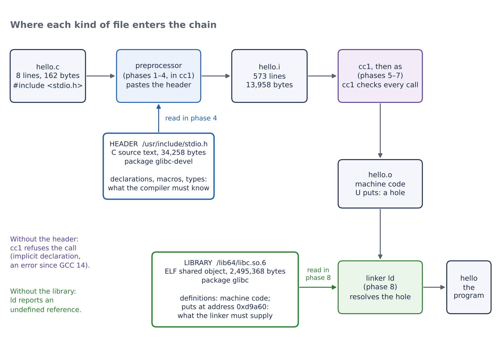

ref: 03.03
title: Preprocessing: Text Before Language
chapter: Chapter 03 — From Source Text to Running Program
part: Part I — The Machine Beneath C
builds: §03.01, §03.02
---
## The question

§03.02 placed the preprocessor in the chain: it is phase 4, the step that carries out the lines beginning with `#` and then deletes them. It also promised that this section would show what the preprocessor's output, printed by `gcc -E`, actually contains. You have already met three facts that call for an explanation. `hello.c` has 8 lines and 162 bytes, but what the compiler proper reads has 573 lines and 13,958 bytes (§03.01). Of the 1,897 tokens that Clang counted in it, your program contributed 15. And the `-E` output was full of lines such as `# 5 "splice.c"`, which you never wrote (§03.02). This section adds four more puzzles:

- a file that is not a header at all, containing two statements, pasted into the middle of a function, compiles and runs (Listing 03.03-1);
- a missing semicolon on line 571 of what the compiler reads is reported, correctly, as an error on line 6 (Listing 03.03-3);
- a program that includes `<math.h>` compiles without complaint and then fails to link, while the same program without `<math.h>` but with the math library fails even to compile (Listings 03.03-4 and 03.03-5);
- a "square" macro computes the square of 1 + 2 as 5 (Listing 03.03-6).

All of them come from one fact: the preprocessor edits text. It knows nothing of functions, types or variables; it pastes files into files and replaces words with other words, and only then does the compiler proper see what it has produced. The questions are:

- What does `#include` physically do, and why did C get a text editor in front of its compiler rather than a way of importing declarations?
- What exactly is in the 573 lines, line by line, and what are the lines beginning with `#` that survive preprocessing?
- What is the difference between a header and a library? Which stage of the chain needs each, and why does confusing them produce two quite different errors?
- What is a macro, and why can a macro that looks like a function compute the wrong answer?

Chapter 22 is devoted to the preprocessor as a tool: search paths (§22.02), the full rules of macros (§22.03 and §22.04), conditional compilation (§22.05). This section is a first look, aimed at one thing: seeing exactly what the preprocessor hands to the compiler, and why.

## The journey

### A text editor in front of the compiler

Suppose you are writing a program in several files, as every program larger than an exercise is written (§21.01). One file defines a function; the other twenty call it. Each of the twenty must tell its compiler what the function looks like: its name, its parameters and its result. You could write that description twenty times, and then, when the function changes, correct it twenty times, and miss one. The obvious remedy is to write it once, in a file of its own, and let each of the twenty say "insert that file here". The same need arises for constants: a buffer size, a pin number or a clock frequency should be written in one place and used everywhere by name.

Both needs were met in C not by the language but by a separate program that edits the text before the compiler reads it.

:::history
Dennis Ritchie, recalling the development of C, wrote that "the most important" change around 1972–3 "was the introduction of the preprocessor", made "partly at the urging of Alan Snyder", but also "in recognition of the utility of the the file-inclusion mechanisms available in BCPL and PL/I". (The doubled "the" is in the original.) "Its original version was exceedingly simple, and provided only included files and simple string replacements": `#include` and `#define` of macros without parameters. Soon afterward it was extended, "mostly by Mike Lesk and then by John Reiser", with macros that take arguments and with conditional compilation. And it stood apart from the language: "The preprocessor was originally considered an optional adjunct to the language itself. Indeed, for some years, it was not even invoked unless the source program contained a special signal at its beginning." Ritchie gives this attitude as the reason for the preprocessor's "incomplete integration" with the rest of the language. When the committee came to standardize C, the preprocessor's interaction with the compiler "had never been well-described" (as §03.02 quoted), which is why the phases of §03.02 exist. §22.01 tells the rest of the story.
:::

Two consequences of that history are with you every time you compile. First, the preprocessor's rules are its own, distinct from C's: a directive is a *line*, while C's grammar ignores line boundaries almost everywhere; and a macro replaces *tokens*, without knowing what they mean. Second, the preprocessor's work is *logically* complete before the compiler proper begins: the standard requires the result to be as if phase 4 had finished first (§03.02). Inside GCC's `cc1` the two are in fact interleaved (the parser asks the preprocessor for one token at a time), but nothing the parser does can change what the preprocessor produces, so the boundary is exactly where the standard puts it, at the end of phase 4, and `gcc -E`, which runs `cc1 -E` (§03.02), lets you stand on it.

### What #include does: it pastes text

The C standard describes `#include` in §6.10.2 (C23 draft N3096; as in the earlier sections, clause numbers are those of that draft). For the form with angle brackets, a directive `# include <...>` "searches a sequence of implementation-defined places for a header identified uniquely by the specified sequence" between the `<` and `>`, "and causes the replacement of that directive by the entire contents of the header." The form with quotation marks "causes the replacement of that directive by the entire contents of the source file identified by the specified sequence between the " delimiters", and if that search fails, the directive is processed again as if it had been written with angle brackets.

The key word is *replacement*. Nothing is imported, linked or registered; the directive line is removed, and the contents of the named file take its place, as if you had opened the file in an editor, copied every line and pasted it there. The preprocessor does not check that the file is a header, or that it contains declarations, or that it is placed sensibly. Listing 03.03-1 tests that claim by pasting a file that is not a header, and contains no declarations, into the middle of a function.

```c Listing 03.03-1  paste.c: #include in the middle of a function
// paste.c
// #include pastes text: any file, at any place.
#include <stdio.h>

int main(void) {
#include "body.txt"
    return 0;
}
```

```c Listing 03.03-2  body.txt: two statements, in a file that is not a header
    printf("these lines came from body.txt\n");
    printf("the compiler never knew they were elsewhere\n");
```

```terminal
$ gcc -std=c23 -Wall -Wextra -pedantic paste.c -o paste && ./paste
```

```output
these lines came from body.txt
the compiler never knew they were elsewhere
```

No warning, even with `-Wall -Wextra -pedantic`. The file's name ends in `.txt`, its lines are statements, and it was included inside `main`: none of that matters, because the preprocessor's job ends when the text is pasted, and the compiler proper, which sees only the result, finds a perfectly ordinary function. The end of the `-E` output shows the result directly:

```terminal
$ gcc -std=c23 -E paste.c | tail -8
```

```output
# 5 "paste.c"
int main(void) {
# 1 "body.txt" 1
    printf("these lines came from body.txt\n");
    printf("the compiler never knew they were elsewhere\n");
# 7 "paste.c" 2
    return 0;
}
```

The two statements now stand where line 6 of `paste.c` stood. The three lines beginning with `#` are not C, and you did not write them; they are notes from the preprocessor to the compiler proper, saying where each line came from, and they are the subject of the next subsection.

If the text is pasted, then including a file twice must paste it twice. A version of `paste.c` with `#include "body.txt"` written on two consecutive lines (`twice.c` in the section's files) prints the two lines twice. That is harmless for statements, which may be repeated, but not for everything a file can contain, and that difference decides what belongs in a header (below, under "Why a header holds declarations").

:::precise
Two details of §6.10.2 are worth knowing exactly. First, the standard says "header" for the angle-bracket form and "source file" for the quoted form, and it means the difference: a footnote to §7.1.2 says that "A header is not necessarily a source file, nor are the < and > delimited sequences in header names necessarily valid source file names." A compiler could keep `<stdio.h>` built into itself, in a database, or anywhere it liked, provided that the effect is the same as pasting its contents. GCC, like nearly every compiler you will use, keeps headers as ordinary files, which is why you can read `/usr/include/stdio.h`. Second, an included file may include others "up to an implementation-defined nesting limit" (§6.10.2, referring to the minimum limits of §5.2.4.1). On the reader's machine, compiling `loop.c`, which includes a header that includes itself (`self.h` in the section's files), stops GCC at the 200th level with the message `self.h:2:18: error: ‘#include’ nested depth 200 exceeds maximum of 200 (use ‘-fmax-include-depth=DEPTH’ to increase the maximum)`.
:::

:::myth
"`#include <stdio.h>` imports the standard input/output library" (or "links it", or "loads it"). It does none of these. It pastes the text of a file of declarations, of the kind you will see in a moment. The library, the machine code of `printf` and `puts`, is a different file, in a different format, used by a different program, at a different phase of translation (Figure 03.03-1). Languages such as Python, Java and Go have an `import` statement that does connect a program to a module; C's `#include` is a much simpler and older device, and in the author's view, much of what is awkward about C's headers (the need for include guards, §21.02, and the cost measured later in this section) follows from that simplicity.
:::

### Reading the 573 lines

Here is the beginning of the `-E` output of `hello.c` (Listing 03.01-1) on the reader's machine:

```terminal
$ gcc -std=c23 -E hello.c -o hello.i
$ head -12 hello.i
```

```output
# 0 "hello.c"
# 0 "<built-in>"
# 0 "<command-line>"
# 1 "/usr/include/stdc-predef.h" 1 3
# 0 "<command-line>" 2
# 1 "hello.c"


# 1 "/usr/include/stdio.h" 1 3
# 28 "/usr/include/stdio.h" 3
# 1 "/usr/include/bits/libc-header-start.h" 1 3
# 33 "/usr/include/bits/libc-header-start.h" 3
```

Every line beginning with `#` and a space is a **line marker**. The GCC preprocessor manual, in its chapter "Preprocessor Output", defines them: they have the form `# linenum filename flags`, and "They mean that the following line originated in file *filename* at line *linenum*." The flags, of which there may be several, are:

- `1`: "This indicates the start of a new file."
- `2`: "This indicates returning to a file (after having included another file)."
- `3`: "This indicates that the following text comes from a system header file, so certain warnings should be suppressed."
- `4`: "This indicates that the following text should be treated as being wrapped in an implicit `extern "C"` block." (It matters only to C++. GCC may still print it in C output: on the reader's Fedora it never appears, while the author's Ubuntu 24.04 with GCC 14 marks its headers `1 3 4`.)

With that key, the twelve lines can be read one by one.

1. `# 0 "hello.c"`: the output begins; the file being preprocessed is `hello.c`.
2. `# 0 "<built-in>"` and `# 0 "<command-line>"`: these are names, not files. They stand for the macros that GCC defines by itself before reading anything (402 of them on the reader's machine, as you will count below) and for macros defined on the command line with `-D` (§22.06).
3. `# 1 "/usr/include/stdc-predef.h" 1 3`: a file is entered (flag 1), and it is a system header (flag 3). You did not include it. The C library supplies it so that the compiler will read it before anything else; its own comment says that the compiler can "include it implicitly at the start of every compilation", and that "GCC knows the name of this header in order to preinclude it." It defines a few macros that announce properties of the C library, such as `__STDC_ISO_10646__`, which says that the library's wide characters are Unicode code points (§08.03). It defines nothing else, so it adds no lines of text.
4. `# 0 "<command-line>" 2`: return (flag 2) from that file.
5. `# 1 "hello.c"`: the next line is line 1 of `hello.c`.
6. Two empty lines: lines 1 and 2 of `hello.c` were comments, each replaced by a space in phase 3 (§03.02), leaving lines with nothing on them.
7. `# 1 "/usr/include/stdio.h" 1 3`: line 3 of `hello.c` was the directive `#include <stdio.h>`. The directive itself is gone; in its place, a new file is entered, at its line 1, and it is a system header.
8. `# 28 "/usr/include/stdio.h" 3`: the next line comes from line 28 of `stdio.h`. Lines 1 to 27 of the header are comments (the license and a note naming the standard's clause), empty lines, and three directives: `#ifndef _STDIO_H` and `#define _STDIO_H 1` at lines 24 and 25, the header's *include guard*, which makes a second inclusion of the file skip everything up to its final `#endif` (§21.02), and one more `#define` at line 27. All of them leave nothing but empty lines. The manual says that "all preprocessing directive lines have been replaced with blank lines" and that "Long runs of blank lines are discarded"; a marker that jumps ahead replaces them.
9. `# 1 "/usr/include/bits/libc-header-start.h" 1 3`: line 28 of `stdio.h` is itself a directive, `#include <bits/libc-header-start.h>`, so the very next thing is the start of another file. The process is recursive, exactly as phase 4 requires (§03.02).

The end of the file shows the way back to your program:

```terminal
$ sed -n 560,573p hello.i
```

```output
extern void perror (const char *__s) __attribute__ ((__cold__));
# 953 "/usr/include/stdio.h" 3
extern int __uflow (FILE *);
extern int __overflow (FILE *, int);
# 977 "/usr/include/stdio.h" 3

# 4 "hello.c" 2


# 5 "hello.c"
int main(void) {
    printf("hello, world\n");
    return 0;
}
```

`# 4 "hello.c" 2` returns (flag 2) to `hello.c` at line 4, the empty line after the `#include`. A few lines later, GCC states the position again, `# 5 "hello.c"`, and the last four lines of the 573 are lines 5 to 8 of your program, unchanged. (GCC decides for itself when to repeat a marker; the rule that matters is that the line after a marker comes from the line it names.)

Table 03.03-1 sorts all 573 lines. The counts were made with `grep`: `grep -c '^# '` for the markers, `grep -c '^$'` for the empty lines.

Table: Table 03.03-1  What the 573 lines of hello.i are, on the reader's Fedora
<!-- widths: 40,14,46 -->
| Kind of line | Lines | Where they come from |
|---|---|---|
| Line markers (`# N "file" flags`) | 111 | added by the preprocessor, one at each entry, return or jump |
| Empty lines | 238 | lines left empty: empty in the source, or emptied by removing comments and directives |
| Lines of C text | 224 | 220 from the headers; 4 from `hello.c` (lines 5 to 8) |
| Total | 573 | from 8 lines of `hello.c` |

The markers name 28 different "files": the three names `"hello.c"`, `"<built-in>"` and `"<command-line>"`, and 25 headers (`stdio.h`, `stdc-predef.h` and 23 others that `stdio.h` includes, directly or indirectly, such as `features.h`, `bits/types.h` and two headers of GCC's own, `stdarg.h` and `stddef.h`). Experiment 03.01-3 counted something related but different: GCC's `-H` option printed 31 header names, one each time a header was *opened* (followed by a short list of headers that could use include guards). Those 31 openings name 24 different headers: the same headers as the markers, less `stdc-predef.h`. `-H` does not report the compiler's own pre-inclusion of that file, and when glibc's `features.h` later names it in an ordinary `#include <stdc-predef.h>` (line 518 on the reader's machine), its include guard lets GCC skip it without opening it again. Some headers are opened more than once; others are included more than once but opened only once, a difference that include guards explain (§21.02).

### What the compiler proper is given

What are the 220 lines of C text that came from the headers? Searching the output answers the question.

```terminal
$ grep -n -E '^extern int (printf|puts) ' hello.i
$ grep -c '^extern ' hello.i
```

```output
380:extern int printf (const char *__restrict __format, ...);
509:extern int puts (const char *__s);
56
```

Line 380 is the declaration of `printf` that §03.01 found, and line 509 that of `puts`, the function GCC actually called (§03.01). In the header file itself, `printf`'s declaration is line 370 of `/usr/include/stdio.h`, which has 979 lines in all. Fifty-six lines of the output begin with `extern`, the word that marks a name as belonging to the whole program, typically one defined elsewhere (§20.03); other lines are the second halves of long declarations, `typedef` lines, which give new names to types, such as line 245, `typedef struct _IO_FILE FILE;`, and the members of structures. Now search for the one thing that a definition of a function must contain, a body in braces:

```terminal
$ grep -n '{' hello.i
```

```output
134:typedef struct { int __val[2]; } __fsid_t;
204:{
207:  {
218:{
226:{
267:{
570:int main(void) {
```

Seven lines with an opening brace, in 573. Six belong to the definitions of types: a small structure used to identify a file system (line 134), an internal type of the library's character conversion (line 204) with a union inside it (line 207), two types that describe a position in a file (lines 218 and 226), and, at line 267, `struct _IO_FILE`, the structure behind every `FILE` (§31.01). A type describes a layout in memory; it generates no machine code. The seventh brace is your `main`. **Not one function body came from the headers.** Everything the compiler proper was given by `stdio.h` is information *about* things: the names, parameters and results of functions, the shapes of types, and (as you will see under macros) the values of constants. The code of `printf` is not here, and never was.

:::hood
Why does the compiler need declarations at all, if it does not need the code? Because to compile a call it must know how to make the call. On x86-64 Linux, the convention by which functions call each other, the System V calling convention (§19.02), says where each argument goes: the first integer or pointer argument in the register `rdi`, the second in `rsi`, a `double` in `xmm0`, and so on; and where the result comes back. A call to a function such as `printf`, declared with `...`, also requires the caller to put in the register `al` (an upper bound on) the number of arguments passed in vector registers (you will see that instruction in §03.04). To choose the right registers, and to convert each argument to the right type, the compiler must know the parameter types; to use the result, it must know its type. A declaration carries that information, and sometimes a little more: attributes such as the `__cold__` of `perror` above, which tell the compiler how the function behaves, and occasionally the name under which the library's definition is to be found. Line 440 of `hello.i` shows the most striking case: `extern int scanf (const char *__restrict __format, ...) __asm__ ("" "__isoc23_scanf")`. Under `-std=c23`, glibc's header tells the compiler that a call to `scanf` must be linked to the library function `__isoc23_scanf`, which follows C23's rules for reading numbers; under an older standard it would name a different function. The header decides which definition in the library a call will reach. That is why the code of a function can be compiled years earlier, by someone else, while your call to it is compiled today: the declaration is the contract between the two, and the header is the means of delivering the same contract to every file that makes the call.
:::

There is one complication, and it is instructive. Preprocess the same file with optimization turned on:

```terminal
$ gcc -std=c23 -O2 -E hello.c | wc -l
$ gcc -std=c23 -O2 -E hello.c | sed -n 565,586p
```

```output
601
# 1 "/usr/include/bits/stdio.h" 1 3
# 38 "/usr/include/bits/stdio.h" 3
extern __inline __attribute__ ((__gnu_inline__)) int
vprintf (const char *__restrict __fmt, __gnuc_va_list __arg)
{
  return vfprintf (stdout, __fmt, __arg);
}


extern __inline __attribute__ ((__gnu_inline__)) int
getchar (void)
{
  return getc (stdin);
}
# 81 "/usr/include/bits/stdio.h" 3
extern __inline __attribute__ ((__gnu_inline__)) int
putchar (int __c)
{
  return putc (__c, stdout);
}
# 971 "/usr/include/stdio.h" 2 3
```

With `-O2`, 28 more lines appear, and among them are three function bodies: `vprintf`, `getchar` and `putchar`. The same header produced different text, because the preprocessor's output depends on the options. GCC defines the macro `__OPTIMIZE__` when optimization is on; glibc's `features.h` (lines 553 to 556 on the reader's machine) defines `__USE_EXTERN_INLINES` only if `__OPTIMIZE__` is defined and `__OPTIMIZE_SIZE__` is not (so `-Os`, which optimizes for size, does not get the bodies: `gcc -std=c23 -Os -E hello.c` gives 573 lines), and `stdio.h` includes `bits/stdio.h` only if `__USE_EXTERN_INLINES` is defined. The header's text chooses what to say by testing macros (conditional compilation, §22.05).

Even these bodies do not replace the library. They are marked `extern __inline` with the attribute `__gnu_inline__`, and the GCC manual states exactly what that means: "If the function is declared extern, then this definition of the function is used only for inlining. In no case is the function compiled as a standalone function, not even if you take its address explicitly." The compiler may copy the short body into the place of a call, saving the call itself (that is *inlining*, §39.02); whenever it does not, "Such an address becomes an external reference, as if you had only declared the function, and had not defined it." The real `putchar` is still in the C library, and every call that is not inlined uses it.

### Line markers at work: an error in the right place

Why does the preprocessor go to the trouble of 111 markers? Listing 03.03-3 shows the reason with one missing character.

```c Listing 03.03-3  semi.c: hello.c with one semicolon missing
// semi.c
// hello.c with one semicolon missing.
#include <stdio.h>

int main(void) {
    printf("hello, world\n")
    return 0;
}
```

```terminal
$ gcc -std=c23 -Wall -Wextra -pedantic semi.c -o semi
```

```output
semi.c: In function ‘main’:
semi.c:6:29: error: expected ‘;’ before ‘return’
    6 |     printf("hello, world\n")
      |                             ^
      |                             ;
    7 |     return 0;
      |     ~~~~~~                   
```

The compiler proper never saw `semi.c`. It saw the preprocessed text, in which the faulty line is line 571:

```terminal
$ gcc -std=c23 -E semi.c -o semi.i
$ grep -n 'hello, world' semi.i
$ gcc -std=c23 -Wall -Wextra -pedantic -c semi.i -o semi.o
```

```output
571:    printf("hello, world\n")
semi.c: In function ‘main’:
semi.c:6:29: error: expected ‘;’ before ‘return’
...
```

(The rest of the message is the same as above.) Compiling the preprocessed file `semi.i` *itself* still reports `semi.c:6:29`, and even quotes line 6 of `semi.c`, because the markers in `semi.i` tell the compiler proper where line 571 came from, and GCC reads the original file to show you the line. Now remove the markers with `-P`:

```terminal
$ gcc -std=c23 -E -P semi.c -o flat.i
$ grep -n 'hello, world' flat.i
$ gcc -std=c23 -Wall -Wextra -pedantic -c flat.i -o flat.o
```

```output
221:    printf("hello, world\n")
flat.i: In function ‘main’:
flat.i:221:29: error: expected ‘;’ before ‘return’
  221 |     printf("hello, world\n")
      |                             ^
      |                             ;
  222 |     return 0;
      |     ~~~~~~                   
```

Without markers, the compiler can only count the lines of the text it was given, and it reports line 221 of a file that you never wrote. (The file is also shorter, 223 lines for `hello.c` instead of 573. Without markers, the empty lines and some line breaks no longer serve to keep later lines at their original positions, so `-P` drops all but two of the empty lines and joins the three declarations of `fscanf`, `scanf` and `sscanf`, which plain `-E` splits over two lines each.) So the markers are the thread that ties every diagnostic, and every line of debugging information (§03.08, §34.04), back to the file and line a person wrote. The third flag has a related purpose: text marked as coming from a system header is excused from certain warnings, so that `-Wall -Wextra -pedantic`, which you have used on every program, speaks about your code and not about the C library's.

:::why
Why a marker, and not simply the original line numbers? Because after preprocessing there is no "original" file. The compiler proper reads one stream of text made from many files, and a single number cannot say both *which* file and *which* line. The standard gives programs a directive for this purpose, `#line` (§6.10.5, "Line control"), which sets the line number and file name that the compiler reports. It exists chiefly for programs that *write* C, such as the parser generators yacc and bison: their output is C generated from a grammar file, and `#line` lets an error in the generated code be reported at the line of the grammar file that produced it. GCC's markers are its own compact form of the same idea, with the flags added (the manual describes the format; it is not the standard's `#line`). In the author's view this is one more sign that the preprocessor was built as a separate tool: something had to carry the knowledge of origins across the boundary between two programs, and a line of text in the stream was the simplest means available.
:::

### Where the headers are found

Where did the preprocessor find `stdio.h`? With `-v`, the driver passes `-v` to `cc1`, which prints the list of directories it searches, in order:

```terminal
$ gcc -std=c23 -v -E - </dev/null 2>&1 | sed -n '/search starts here/,/End of search/p'
```

```output
#include "..." search starts here:
#include <...> search starts here:
 /usr/lib/gcc/x86_64-redhat-linux/16/include
 /usr/local/include
 /usr/include
End of search list.
```

(The `-` makes GCC read its source from standard input, here the empty `/dev/null`, so this prints the search list without compiling anything.) The first directory belongs to GCC itself, and holds the headers that depend on the compiler rather than on the C library: `stdarg.h` and `stddef.h`, which you saw among the 25 headers, are there. The second is for software that the machine's administrator installs by hand; on the reader's machine it is empty (`ls /usr/local/include` lists nothing). The third holds the headers of the system's libraries, including glibc's. The list for the quoted form is empty, but that does not mean the quoted form finds nothing. The GCC manual explains that `#include "file"` first looks in the directory of the file containing the directive (which is how `paste.c` found `body.txt`) and then searches the same list as the angle-bracket form. The option `-I` adds a directory to the front of the list; `gcc -I. -v -E - </dev/null` shows ` .` above the other three. §22.02 explains the search in full, with the options that change it.

Who put the files there? Fedora's package manager can say which package owns each file:

```terminal
$ rpm -qf /usr/include/stdio.h /lib64/libc.so.6 /usr/lib64/libc.a /lib64/libm.so.6
```

```output
glibc-devel-2.44-2.fc45.x86_64
glibc-2.44-2.fc45.x86_64
glibc-static-2.44-2.fc45.x86_64
glibc-2.44-2.fc45.x86_64
```

The header `stdio.h` is in `glibc-devel`, the "development" package, while the library `libc.so.6` is in `glibc` itself. This split is a strong clue to the next subsection: every program on the machine needs the library in order to *run*, but only someone who compiles C needs the header. Fedora's `gcc` package itself depends on `glibc-devel` (`rpm -q --requires gcc` lists `glibc-devel >= 2.2.90-12`), because a C compiler without the C library's headers could not compile even `hello.c`; a machine that only runs programs needs only `glibc`.

### Header and library: two different things

The single most common confusion about C's build process is to treat a header and a library as the same thing, or as two names for one thing: "the header contains `printf`", "`#include` links the library", "I installed the library, so why is the header missing?". The previous subsections already contain the facts that dissolve it; here they are set side by side, with two more experiments.

Table: Table 03.03-2  A header and a library, on the reader's Fedora
<!-- widths: 22,39,39 -->
| | Header `/usr/include/stdio.h` | Library `/lib64/libc.so.6` |
|---|---|---|
| What `file` calls it | C source, ASCII text | ELF 64-bit LSB shared object, x86-64 |
| Size | 34,258 bytes | 2,495,368 bytes |
| Package | `glibc-devel` (needed to compile) | `glibc` (needed to run) |
| What it holds about `printf` | a declaration, line 370: name, parameters, result | the definition: machine code, at address 0xb0c50 within the library |
| Read by | the preprocessor, in phase 4, for the compiler proper, phase 7 | the linker, in phase 8, and the dynamic loader when the program starts (§03.07) |
| Read how often | once for every translation unit that includes it, at every compilation | once per link, and at every run |
| How you name it | `#include <stdio.h>` in the source | `-lc`, which the driver adds by itself (§03.02) |

You can see the definition, or at least where it is, with `nm`, which lists the names in a file of machine code (§03.01). The option `-D` asks for the names that a shared library offers to other programs:

```terminal
$ nm -D /lib64/libc.so.6 | grep -E ' (printf|puts)(@|$)'
$ nm -D /lib64/libc.so.6 | grep -c ' T '
```

```output
00000000000b0c50 T printf@@GLIBC_2.2.5
00000000000d9a60 T puts@@GLIBC_2.2.5
2198
```

`T` means that the name is defined in the code ("text") of this file; the number is its address, counted from wherever the library is placed in memory when a program is loaded (§03.07). On the reader's machine, 2,198 names are marked `T` in this way. That is not exactly the number of functions: some functions appear more than once, under different version labels, and others are marked `W` (weak, 693 of them, like `sqrt` below) or `i` (65 *indirect* functions, such as `strlen`, of which the library holds several versions and picks one for the processor when the program is loaded); §21.04 and §21.06 explain both. (The suffix `@@GLIBC_2.2.5` is a version label: these two functions have kept the same interface since glibc 2.2.5, the first version for x86-64; §21.06 explains versioned names.)

The same functions also exist in a second form, the static library `libc.a` (from `glibc-static`), which is an archive: a single file that collects many object files, like a box of `.o` files (§21.05). `ar t` lists its members, and `ar x` takes one out:

```terminal
$ ar t /usr/lib64/libc.a | wc -l
$ ar x /usr/lib64/libc.a printf.o && nm printf.o
$ objdump -d printf.o | head -11
```

```output
2227
0000000000000000 T _IO_printf
0000000000000000 T __printf
0000000000000000 T printf
                 U __stack_chk_fail
                 U stdout
                 U __vfprintf_internal

printf.o:     file format elf64-x86-64


Disassembly of section .text:

0000000000000000 <_IO_printf>:
   0:	f3 0f 1e fa          	endbr64
   4:	55                   	push   %rbp
   5:	48 89 e5             	mov    %rsp,%rbp
   8:	48 81 ec d0 00 00 00 	sub    $0xd0,%rsp
```

(The command `ar x` was run in a scratch directory, `/tmp/lc`, so as not to scatter files.) Here, at last, is `printf` itself: an object file, one of 2,227 in the archive, whose machine code begins at address 0 of its code, with three names for the same address (`printf` and two internal aliases). And here is something you might not expect: `printf` has holes of its own, marked `U` for "undefined". It uses `stdout`, calls `__stack_chk_fail` (the handler of the stack protector, which stops a program whose stack has been overwritten, §34.06), and calls a function `__vfprintf_internal`, which does the real work of formatting and is defined in another member of the library. A library is not a sealed block of finished code; it is a collection of object files with references between them, resolved by the same linker in the same phase 8 as your own.

:::precise
The standard itself draws the line where this section draws it. §7.1.2 says: "Each library function is declared in a header, whose contents are made available by the #include preprocessing directive." The header *declares*. Where the definitions are kept is not the standard's business; phase 8 simply says that library components are linked to satisfy external references (§5.1.1.2). The standard also allows a header to supply more than declarations: §7.1.4 says that "Any function declared in a header may be additionally implemented as a function-like macro defined in the header" (macros are explained below). And §7.1.2 promises that the standard headers can be included in any order and "more than once in a given scope, with no effect different from being included only once" (with one exception, `<assert.h>`, §34.02). On the reader's machine, a file consisting of one `#include <stdio.h>` and a one-line `main` preprocessed to 567 lines; with the `#include` written three times, to 569, and `diff` shows that the only additions are two empty lines, what is left of the second and third `#include` lines, while the marker before `main` names line 4 instead of line 2. The second and third inclusions added no text at all: the include guard at the top of `stdio.h` made the preprocessor skip the file. §21.02 shows how a header achieves this.
:::

Figure 03.03-1 shows where each kind of file enters the chain of §03.02.

{w=16}

(For a shared library such as `libc.so.6`, "resolves" is the precise word: the linker checks that the library defines `puts` and records that the program needs it from there, but the final address is filled in by the dynamic loader when the program starts. §03.06 and §03.07 follow that hand-over.)

### Two errors from one confusion

If the header and the library serve different phases, leaving out one or the other must produce a failure in a different phase, from a different program, with a different message. The square root function `sqrt` makes the test easy, because on Linux it lives in a library of its own, the math library `libm`, which the driver does *not* add by itself.

```c Listing 03.03-4  root.c: the header, but not the library
// root.c
// A header and a library are two different things.
#include <stdio.h>
#include <math.h>

int main(void) {
    double x = 2.0;
    printf("%f\n", sqrt(x));
    return 0;
}
```

```terminal
$ gcc -std=c23 -Wall -Wextra -pedantic root.c -o root
```

```output
/usr/bin/ld.bfd: /tmp/ccylBDjt.o: in function `main':
root.c:(.text+0x1f): undefined reference to `sqrt'
collect2: error: ld returned 1 exit status
```

Read the message as §03.02 taught: no column, a section offset `(.text+0x1f)`, and `ld returned 1`. It comes from the linker. The compiler proper raised no objection, because the header told it everything it needed: `sqrt` takes a `double` and returns a `double`. The object file proves it:

```terminal
$ gcc -std=c23 -Wall -Wextra -pedantic -c root.c -o root.o && nm root.o
```

```output
0000000000000000 T main
                 U printf
                 U sqrt
```

The compiler made the call and left a hole, `U sqrt`, exactly like the hole for `printf`. (Here `printf` stays `printf`, because its format contains a conversion, `%f`; compare §03.01.) Then the linker searched the libraries it was given, found `printf` in `libc` and `sqrt` nowhere, and stopped. Add the library with `-lm` ("link the library `m`"):

```terminal
$ gcc -std=c23 -Wall -Wextra -pedantic root.c -o root -lm && ./root
```

```output
1.414214
```

(`nm -D /lib64/libm.so.6` shows `sqrt` there, at address 0x8da70, marked `W`, a "weak" definition, a kind of name that §21.04 explains.) Now do the opposite: keep the library and remove the header. Listing 03.03-5 is `root.c` without line 4.

```c Listing 03.03-5  noheader.c: the library, but not the header
// noheader.c
// root.c without its header.
#include <stdio.h>

int main(void) {
    double x = 2.0;
    printf("%f\n", sqrt(x));
    return 0;
}
```

```terminal
$ gcc -std=c23 -Wall -Wextra -pedantic noheader.c -o noheader -lm
```

```output
noheader.c: In function ‘main’:
noheader.c:7:20: error: implicit declaration of function ‘sqrt’ [-Wimplicit-function-declaration]
    7 |     printf("%f\n", sqrt(x));
      |                    ^~~~
noheader.c:4:1: note: include ‘<math.h>’ or provide a declaration of ‘sqrt’
    3 | #include <stdio.h>
  +++ |+#include <math.h>
    4 | 
noheader.c:7:20: warning: incompatible implicit declaration of built-in function ‘sqrt’ [-Wbuiltin-declaration-mismatch]
    7 |     printf("%f\n", sqrt(x));
      |                    ^~~~
noheader.c:7:20: note: include ‘<math.h>’ or provide a declaration of ‘sqrt’
```

This time the message has a file, a line *and a column*: it comes from the compiler proper, in phase 7, and the link was never attempted. The library was available, but the compiler cannot look into a library; the only description of `sqrt` it could have received was the one the header would have pasted in. Without it, the call is to an undeclared function, which C99 removed from the language and GCC has refused by default since GCC 14 (§03.01). (Had the compiler guessed, as compilers before 1999 did, it would have assumed a function returning `int`: the `double` argument would still travel correctly, in `xmm0`, but the result would be read from the integer register `eax` instead of `xmm0`, where `sqrt` leaves it, and so would be an unrelated value: §18.04 shows the damage.) Table 03.03-3 sets the two experiments side by side.

Table: Table 03.03-3  Leaving out the header or the library: two different failures
<!-- widths: 22,15,15,48 -->
| Command | Header | Library | Result |
|---|---|---|---|
| `gcc ... root.c` | yes | no | compiles; the **linker** reports an undefined reference to `sqrt` (phase 8) |
| `gcc ... root.c -lm` | yes | yes | builds; prints `1.414214` |
| `gcc ... noheader.c -lm` | no | yes | the **compiler** reports an implicit declaration (phase 7); no link is attempted |

The practical rule follows directly. An error with a line and a column that names an undeclared function means a missing `#include`, or a misspelled function name; adding `-l` options cannot help. An "undefined reference" from `ld` means a missing library or object file; adding `#include` lines cannot help. Each error points to its own phase.

:::hood
Why is `sqrt` in a separate library at all, when `printf` is in the library that the driver links automatically? The separation is a historical arrangement of Unix systems, not a requirement of C: the C standard treats `<math.h>` as part of the one standard library. On glibc the math functions are still built as a separate file, and of the C library's files the GCC driver adds only `-lc` by itself (it also adds GCC's own support library, `-lgcc`, §03.02). Since glibc 2.34, the separate files of the thread, dynamic-loading and real-time functions have been merged into `libc`, but the math library has not. (The author's understanding is that the separation began when floating-point code was large and many programs had no use for it, so keeping it apart saved memory and disk space; the convention has outlived the reason, as conventions do.) §10.06 returns to the math library and its link order; §03.06 shows the driver's link command in full.
:::

### A third source of knowledge: the compiler's own

One more experiment shows that the picture has a third participant. Build `root.c` again *without* `-lm`, but with optimization:

```terminal
$ gcc -std=c23 -Wall -Wextra -pedantic -O2 root.c -o root2 && ./root2
$ gcc -std=c23 -Wall -Wextra -pedantic -O2 -c root.c -o r2.o && nm r2.o
```

```output
1.414214
0000000000000000 r .LC0
0000000000000000 T main
                 U printf
```

It links and runs, and the hole for `sqrt` has disappeared. GCC knows `sqrt` as a *built-in* function (the same knowledge that turned `printf` into `puts` in §03.01): it knows what `sqrt` computes, and with optimization on it computed √2 while compiling, because the argument, 2.0, was known. The result is stored as a constant, and no call remains to be linked. The assembly shows the constant:

```terminal
$ gcc -std=c23 -Wall -Wextra -pedantic -O2 -S root.c -o - | grep -A3 '^\.LC0:'
```

```output
.LC0:
	.long	1719614413
	.long	1073127582
	.ident	"GCC: (GNU) 16.2.1 20261029 (Red Hat 16.2.1-3)"
```

The two 32-bit numbers are the low and high halves of one 64-bit value, 0x3FF6A09E667F3BCD (1073127582 is 0x3FF6A09E, 1719614413 is 0x667F3BCD), which is the IEEE 754 bit pattern of the `double` nearest to √2, 1.4142135623730951 (§07.03 shows how to decode it). (The `.ident` line that follows merely records the compiler's version.) Change the program so that the argument is known only when it runs (`root3.c` in the section's files takes it from the command line), and the call returns: `gcc -O2` reports an undefined reference to `sqrt` again. With `-fno-math-errno` added, the call disappears once more and the assembly contains the single x86-64 instruction `sqrtsd`, which computes a square root in hardware. The option matters because a call to `sqrt` with a negative argument may be required to set the variable `errno` (§34.03), which the hardware instruction cannot do; the option tells GCC that your program does not rely on it.

So the header declares, the library defines, and sometimes the compiler knows enough to need neither at run time. That is why a program can link at `-O2` and fail to link at `-O0`, a puzzle that sends many programmers looking in the wrong place. GCC folds such calls even without optimization when the argument is written as a constant in the call (Self-check 7). None of this is a reason to leave out `-lm`: a program that needs the library at one optimization level, or for one argument, needs it in principle, and must name it.

### Why a header holds declarations

If `#include` pastes text, anything could be put in a header. Why, then, do headers hold declarations, and (with careful exceptions) not the definitions of functions and variables? Because a header is pasted into many files, and the language allows some things to be said many times and others only once. Three small files show the difference:

```terminal
$ cat def.h a.c b.c decl.h e2.c d2.c
```

```output
int counter = 0;
#include "def.h"
int main(void) { return counter; }
#include "def.h"
int other(void) { return counter + 1; }
extern int counter;
#include "decl.h"
#include "decl.h"
int counter = 3;
int main(void) { return counter; }
#include "def.h"
#include "def.h"
int main(void) { return counter; }
```

(Six files: `def.h` is the first line, `a.c` the next two, `b.c` the next two, `decl.h` one line, `e2.c` three, and `d2.c` the last three.)

`def.h` *defines* a variable: `int counter = 0;` sets aside storage and gives it a value. Include it twice in one file, as `d2.c` does, and the compiler proper objects:

```terminal
$ gcc -std=c23 -Wall -Wextra -pedantic d2.c -o d2
```

```output
In file included from d2.c:2:
def.h:1:5: error: redefinition of ‘counter’
    1 | int counter = 0;
      |     ^~~~~~~
In file included from d2.c:1:
def.h:1:5: note: previous definition of ‘counter’ with type ‘int’
    1 | int counter = 0;
      |     ^~~~~~~
```

Include it once in each of two files, `a.c` and `b.c`, and each file compiles, but the linker finds two variables with the same name:

```terminal
$ gcc -std=c23 -Wall -Wextra -pedantic a.c b.c -o ab
```

```output
/usr/bin/ld.bfd: /tmp/ccvvJLkr.o:(.bss+0x0): multiple definition of `counter'; /tmp/cc61UZvo.o:(.bss+0x0): first defined here
collect2: error: ld returned 1 exit status
```

A *declaration* of the same variable, `extern int counter;` (in `decl.h`), may be included any number of times in any number of files; it says only that such a variable exists somewhere, and `e2.c`, which includes it twice and then defines the variable once, builds and returns 3. So the division of labor is forced by the language: what every file needs its own copy of (declarations, type definitions, macros) goes into headers; what must exist exactly once in the whole program (definitions of functions and variables) goes into one `.c` file, and so into one object file or one library. The rule that a program must have exactly one definition of each such thing is the subject of §20.03 and §21.04. (Even the contents of headers may not always be repeated *within* one file: a structure type may be defined only once in a translation unit before C23, and C23 allows only an identical repetition; a macro may be redefined only identically. That is why headers carry include guards, §21.02.)

The exceptions confirm the rule rather than break it. Glibc's `-O2` bodies above can be pasted into every file because `gnu_inline` guarantees that they never produce an external definition, a symbol that the linker could see twice. The function `_delay_ms` of avr-libc, met in Hands-on A, is defined in a header as `static`, which gives each file its own private copy, and it is always inlined. Both are deliberate, and both are marked in the code.

### Macros: a first look

The second job the preprocessor was created for is replacing names with text. A **macro** is a name that the preprocessor replaces, wherever it appears as a token, with a list of other tokens. The standard (§6.10.4) recognizes two kinds. `#define` followed by a name and a replacement list "defines an object-like macro that causes each subsequent instance of the macro name" to be replaced by the replacement list. If the name is followed *immediately*, with no space, by a left parenthesis, the directive "defines a function-like macro with parameters, whose use is similar syntactically to a function call." Similar syntactically, and in no other way, as Listing 03.03-6 shows.

```c Listing 03.03-6  macros.c: object-like and function-like macros
// macros.c
// A first look at macros: text replaced by text, before the compiler reads it.
#include <stdio.h>

#define LIMIT 10                 // an object-like macro
#define SQUARE(x) x * x          // a function-like macro, written carelessly
#define SQUARE_OK(x) ((x) * (x)) // the same, written carefully

int main(void) {
    printf("%d\n", LIMIT);
    printf("%d\n", SQUARE(3));
    printf("%d\n", SQUARE(1 + 2));
    printf("%d\n", SQUARE_OK(1 + 2));
    return 0;
}
```

Before running it, predict the four lines of output. Then:

```terminal
$ gcc -std=c23 -Wall -Wextra -pedantic macros.c -o macros && ./macros
```

```output
10
9
5
9
```

The third line is 5, not 9. The preprocessed text shows why:

```terminal
$ gcc -std=c23 -E -P macros.c | tail -8
```

```output

int main(void) {
    printf("%d\n", 10);
    printf("%d\n", 3 * 3);
    printf("%d\n", 1 + 2 * 1 + 2);
    printf("%d\n", ((1 + 2) * (1 + 2)));
    return 0;
}
```

The preprocessor replaced `x` by the tokens `1 + 2`, exactly as written, and produced `1 + 2 * 1 + 2`. Only then did the compiler proper parse the expression, by C's rules, in which multiplication binds more tightly than addition (§09.02): 1 + (2 × 1) + 2 = 5. A function receives a *value*; a function-like macro receives *tokens*, and pastes them wherever its parameter appears. The careful version puts parentheses around each use of the parameter and around the whole result, so that the pasted tokens form one group whatever surrounds them. The outer parentheses matter too: with the careless `SQUARE`, `100 / SQUARE(5)` becomes `100 / 5 * 5`, which is 100 (`sq.c` in the section's files). Note also that the comments after each `#define` did not become part of the macros: comments were replaced by spaces in phase 3, before phase 4 read the directives (§03.02).

Even the careful version is not a function: `SQUARE_OK(i++)` would paste `i++` twice and increment `i` twice in one expression, which is undefined behavior (§09.03). Chapter 22 shows the full rules, the traps, and the cases where a macro is still the right tool (§22.04); for ordinary computation C has had a better tool for decades, the `inline` function, which has parameters with types, as a function does. This section's concern is only to see that a macro is replacement of text, and that the compiler proper never sees the macro at all: in the output above, `LIMIT` and `SQUARE` have vanished, and so have the three `#define` lines.

Headers are full of macros. Three of `stdio.h`'s:

```terminal
$ grep -n -E '^#define (stdout|EOF|BUFSIZ)' /usr/include/stdio.h
```

```output
104:#define BUFSIZ 8192
109:#define EOF (-1)
158:#define stdout stdout
```

`EOF` is the value that input functions return at the end of a file; the standard requires it to be a macro that "expands to an integer constant expression, with type int and a negative value" (§7.23.1). Glibc chose −1, and parenthesized it, as the standard requires of every such macro in the library: §7.1.2 says they "shall expand to code that is fully protected by parentheses where necessary, so that it groups in an arbitrary expression as if it were a single identifier." That is the lesson `SQUARE` taught, made a rule. (For `-1` the parentheses rarely matter, because the minus sign binds more tightly than any operator between two operands; they matter against operators written after an operand, such as `[ ]`.) `BUFSIZ` is "the size of the buffer used by the setbuf function" (§7.23.1), and must be at least 256 (§7.23.2); glibc chose 8192. The third is a curiosity worth a moment. The standard says that `stdin`, `stdout` and `stderr` are macros, "expressions of type "pointer to FILE"" (§7.23.1). Glibc declares them as variables, `extern FILE *stdout;` at line 154, and then, at line 158, defines each as a macro whose replacement is its own name, just below the comment "C89/C99 say they're macros. Make them happy." Why does `stdout` not then expand forever? Because of a rule in §6.10.4.4: if the name of the macro being replaced is found again during the rescan of its own replacement, "it is not replaced". The comment gives the reason: conformance. One practical consequence is that a program can test `#ifdef stdout`; once expanded, the macro leaves behind the name of the variable.

How many macros are in force? GCC's option `-dM`, used with `-E`, prints every macro defined by the end of preprocessing instead of the program:

```terminal
$ gcc -std=c23 -dM -E - < /dev/null | wc -l
$ gcc -std=c23 -dM -E - < /dev/null | grep -E '__STDC_VERSION__|__x86_64__ |__GNUC__ |__linux__ |__CHAR_BIT__'
$ gcc -std=c23 -dM -E hello.c | wc -l
```

```output
408
#define __CHAR_BIT__ 8
#define __GNUC__ 16
#define __x86_64__ 1
#define __STDC_VERSION__ 202311L
#define __linux__ 1
670
```

Before your program says anything, 408 macros exist. Of these, 402 are defined by GCC itself, the `<built-in>` of the first line marker (`-nostdinc`, which forbids reading any header, leaves exactly 402), and 6 come from `stdc-predef.h`, which GCC reads even when the input is empty. They describe the compiler, the language version and the machine: `__STDC_VERSION__` is `202311L` because the standard (§6.10.9.1) requires that value under C23, and GCC sets it because of `-std=c23`; `__GNUC__` is GCC's major version; `__x86_64__` and `__linux__` name the processor and the operating system; `__CHAR_BIT__` gives the number of bits in a byte (§05.02). After `stdio.h` and its 24 companions, 670 macros exist. Comparing `-std=c17` with `-std=c23` shows exactly three differences on the reader's machine: `__STDC_VERSION__` (`201710L` against `202311L`) and two macros for the `char8_t` type that C23 added. This is how a single header file, such as `stdio.h`, serves many machines, compilers and language versions: it tests these macros and chooses what text to produce (§22.05 and §22.06).

### What survives preprocessing: #pragma

§03.02 said that at the end of phase 4 every directive is deleted, with one exception in GCC's `-E` output. Listing 03.03-7 tests which directives survive.

```c Listing 03.03-7  pragma.c: which directives survive -E?
// pragma.c
// Which directives survive -E?
#define GREETING "hello"
#pragma GCC diagnostic ignored "-Wunused-variable"

int main(void) {
    int unused;
    return 0;
}
```

```terminal
$ gcc -std=c23 -E pragma.c | grep -n -E 'pragma|GREETING|define'
$ gcc -std=c23 -Wall -Wextra -pedantic pragma.c -o pragma
```

```output
1:# 0 "pragma.c"
6:# 1 "pragma.c"
10:#pragma GCC diagnostic ignored "-Wunused-variable"
```

The `#define` has vanished (and since `GREETING` is never used, so has every trace of it); the `#pragma` is still there, word for word, and the compilation printed nothing. A **pragma** is a directive whose meaning the implementation defines (§6.10.7). A few are meant for the preprocessor itself (`#pragma once`, which §21.02 meets, is one); this one is meant for the compiler proper: it tells GCC to stop warning about unused variables. The preprocessor cannot carry it out, so it passes it on, as the GCC manual says: some directives are duplicated in the output, among them "‘#pragma’ (only if the preprocessor does not handle the pragma itself)". The proof that it reached the compiler proper is the silence. Delete line 4, the pragma (`sed 4d pragma.c > nopragma.c`), and the same command warns:

```output
nopragma.c: In function ‘main’:
nopragma.c:6:9: warning: unused variable ‘unused’ [-Wunused-variable]
    6 |     int unused;
      |         ^~~~~~
```

The standard leaves the meaning of most pragmas to each implementation, and says that "Any such pragma that is not recognized by the implementation is ignored" (§6.10.7), so that a program written for one compiler's pragmas still compiles with another. §22.06 returns to pragmas and their alternative, the `_Pragma` operator, which phase 4 executes (§03.02).

### The cost of pasting, and why C still pastes

Pasting is simple, and simplicity has a price. A file of 11 lines that includes ten common headers (`ten.c` in the section's files: `stdio.h`, `stdlib.h`, `string.h`, `math.h`, `stdint.h`, `stdbool.h`, `time.h`, `errno.h`, `ctype.h`, `limits.h`) became 2,594 lines on the reader's machine (986 with `-P`, which drops the markers and most empty lines). Every `.c` file of a program is a separate translation unit (§03.02), so every one of them reads, tokenizes and checks its headers afresh; a program of a hundred files that each include the same ten headers processes those headers a hundred times. For C's modest headers the cost is small. For C++, whose headers contain the code of templates and are often far larger, the cost became, in the judgment of the committee that adopted modules, a serious burden, and C++20 added *modules*, a mechanism by which a compiled description of an interface is imported instead of text being pasted. C, as of C23, has no such mechanism.

The benefits are just as real. A text-pasting preprocessor is simple to specify and to implement, which mattered on the small machines of the 1970s (§03.02's history box). It needs no compiled form of anything: a header is text, so it can be read by people, generated by programs, and carried between compilers. And it lets one file describe many machines, by testing macros, which is how avr-libc's single `<avr/io.h>` serves every chip the library supports: the reader's `/usr/avr/include/avr` holds 367 files named `io*.h`, most of them one per chip, among which `<avr/io.h>` chooses by testing a macro (§36.03). In the author's judgment, these are the reasons the design has survived fifty years of complaints: its costs fall on compile time, which machines have made cheap, while its simplicity is valued by exactly the people C serves, those who write compilers, operating systems and firmware for new machines.

:::myth
"Macros are evaluated", "a macro is a fast function", "`#define LIMIT 10` creates a constant." A macro is not evaluated, called or created at run time; it does not exist at run time. It is replaced, as text, before the compiler proper starts, and the compiler sees only the result. `#define LIMIT 10` creates no object with an address, no type and no storage; every use of `LIMIT` is replaced by the token `10`, which then has the type of the constant 10 (§05.06). That is exactly why a macro can be used where C requires a value known while compiling, such as the size of an array, and why a debugger usually cannot show you `LIMIT`: by the time the debugging information is written, there is no `LIMIT` left to describe (GCC's `-g3` option keeps macro definitions for the debugger, §34.04). C23 added a second way to name such a constant, `constexpr` (§06.06), which is part of the language proper and has a type.
:::

### On the AVR: a register is a macro

On a microcontroller, the preprocessor does work that is easy to overlook and impossible to do without. Listing 03.03-8 is the smallest useful program for the ATmega328P: it lights the LED on pin 13 of an Arduino Uno, which is bit 5 of the chip's port B (§36.02).

```c Listing 03.03-8  avr_led.c: what PORTB and PB5 really are
// avr_led.c  (ATmega328P)
// What PORTB and PB5 really are.
#include <avr/io.h>

int main(void) {
    DDRB |= (1 << DDB5);     // pin 13 (PB5) as an output
    PORTB |= (1 << PB5);     // drive it high: the LED lights
    for (;;) { }
}
```

`DDRB`, `DDB5`, `PORTB` and `PB5` look like variables and constants. They are macros, all of them, and `-E` shows what the compiler proper actually receives:

```terminal
$ avr-gcc -mmcu=atmega328p -std=c11 -E -P avr_led.c | tail -6
```

```output
} __fuse_t;
int main(void) {
    (*(volatile uint8_t *)((0x04) + 0x20)) |= (1 << 5);
    (*(volatile uint8_t *)((0x05) + 0x20)) |= (1 << 5);
    for (;;) { }
}
```

The chain of replacements can be followed through avr-libc's headers on the reader's machine:

1. `/usr/avr/include/avr/iom328p.h`, line 74: `#define PORTB _SFR_IO8(0x05)`. (The header for this particular chip, chosen by `<avr/io.h>` because the driver defined `__AVR_ATmega328P__`, §03.02.)
2. `/usr/avr/include/avr/sfr_defs.h`, line 179: `#define _SFR_IO8(io_addr) _MMIO_BYTE((io_addr) + __SFR_OFFSET)`, with `__SFR_OFFSET` defined as `0x20` for this family of chips. (A reader who searches the file will also find, at line 152, a second definition of `_SFR_IO8` without `_MMIO_BYTE`, meant for assembly-language programs; conditional compilation, §22.05, selects the one at line 179 for C.)
3. The same file, line 128: `#define _MMIO_BYTE(mem_addr) (*(volatile uint8_t *)(mem_addr))`.
4. For the bit: `iom328p.h`, line 80, `#define PORTB5 5`, and `/usr/avr/include/avr/portpins.h`, line 149, `#  define PB5 PORTB5`, which makes the two names interchangeable.

So `PORTB` is, in the end, the expression `*(volatile uint8_t *)0x25`: "the byte at memory address 0x25", treated as an 8-bit unsigned value that may change or matter without the program's knowledge (`volatile`, §36.04). The ATmega328P's datasheet lists PORTB at I/O address 0x05, which is data-memory address 0x25: the chip's 32 general registers occupy data addresses 0x00 to 0x1F, so its I/O registers are visible in data memory 0x20 higher than their I/O numbers. That is the `+ 0x20`. A register is a place in memory with a fixed address (§36.03), and the header's macros are nothing but a way to write that address with a name.

What did all this text become? Two instructions:

```terminal
$ avr-gcc -mmcu=atmega328p -std=c11 -Wall -Wextra -pedantic -Os avr_led.c -o avr_led.elf
$ avr-objdump -d avr_led.elf | sed -n '/<main>:/,/rjmp/p'
```

```output
00000080 <main>:
  80:	25 9a       	sbi	0x04, 5	; 4
  82:	2d 9a       	sbi	0x05, 5	; 5

00000084 <.L2>:
  84:	ff cf       	rjmp	.-2      	; 0x84 <.L2>
```

`sbi` ("set bit in I/O register") sets one bit of an I/O register in a single instruction; it can reach only the first 32 I/O registers, I/O addresses 0 to 31, which are data addresses 0x20 to 0x3F. The compiler recognized that the address `0x05 + 0x20` lies in that range, and that `|= (1 << 5)` sets bit 5, and wrote `sbi 0x05, 5`. The macro chain, the cast, the `volatile` and the shift all came to one 2-byte instruction. And `avr-nm avr_led.o` lists `main` and nothing undefined: the program contains no reference to any library function at all, because nothing in `<avr/io.h>` is a function. Its 11 headers (the markers name them, with the three names `avr_led.c`, `<built-in>` and `<command-line>`) and the 1,555 macros in force after them (`avr-gcc ... -dM -E avr_led.c | wc -l`) are pure description, consumed entirely in phase 4. On the AVR, the header-against-library distinction is at its sharpest: `<avr/io.h>` has no library behind it, because a register needs no code, only an address.

:::orbit
Flight software is often built for several boards from one source: an engineering model on the bench, a qualification model that is shaken and baked, and the flight model itself, which may differ in clock frequency, memory size or the pins wired to each device. The preprocessor is the usual means of selecting among them, through headers of macros like avr-libc's and through options such as `-DBOARD_FLIGHT`. In the author's view, this section suggests two habits for such work. First, the configuration that was actually compiled is in the preprocessed text, not in the source: an image is fully described only by its `.i` files (or by the exact options and headers that produce them), so a build that will fly should keep them (`-save-temps`, §03.02) along with the image. Second, a macro that should have been defined but was not is nearly silent: `#ifdef` simply takes the other branch. avr-libc's `util/delay.h` shows the danger in miniature: if `F_CPU` is not defined before it is included, it prints the warning `F_CPU not defined for <util/delay.h>` and then defines `F_CPU` as 1,000,000 (lines 89 to 107), so on a 16 MHz board every delay silently becomes sixteen times too short, with a warning that a long build log easily hides. That is why Listing 03.03-9 defines `F_CPU` before the `#include`. For flight configuration, a header should stop the build with `#error` instead (§22.06), and a project should treat every warning as an error.
:::

## Terms introduced

- **Preprocessor**: the stage that carries out the directives and expands macros (phase 4), editing the text before the compiler proper reads it; in GCC it is part of `cc1`.
- **Directive**: a line that begins with `#` and is addressed to the preprocessor, such as `#include`, `#define` or `#pragma`.
- **Header**: what `#include <...>` names; in the standard, not necessarily a file, though in GCC an ordinary file of C text, usually holding declarations, type definitions and macros.
- **Line marker**: a line `# N "file" flags` in the preprocessor's output, telling the compiler proper that the next line came from line N of that file.
- **System header**: a header found in the system's directories, whose text is marked (flag 3) so that certain warnings are suppressed.
- **Search list**: the ordered list of directories in which the preprocessor looks for headers, printed by `gcc -v`.
- **Declaration / definition**: a declaration says that a function or variable exists and what its type is; a definition creates it (gives a function its body, or a variable its storage). Declarations may be repeated; definitions may not.
- **Library**: a file of definitions in machine code, either a shared object (`.so`) or an archive of object files (`.a`), read by the linker in phase 8.
- **Macro**: a name that the preprocessor replaces with a list of tokens; *object-like* without parameters, *function-like* with them.
- **Predefined macro**: a macro defined by the compiler itself before any source is read, such as `__STDC_VERSION__`.
- **Pragma**: a directive whose meaning the implementation defines; a few are carried out by the preprocessor, the rest passed through to the compiler proper; an unrecognized pragma is ignored.
- **Built-in function**: a function whose meaning the compiler knows, so that it may compute the result or emit instructions instead of a call; some are library functions (`sqrt`), others exist only inside the compiler (`__builtin_avr_delay_cycles`).

## Self-check

1. Before reading the answer, predict: if a file `x.txt` contains only the line `return 42;` and a program's `main` consists of `#include "x.txt"` alone, does the program compile, and what is its exit status? Which part of §6.10.2 decides the question?
2. In Listing 03.03-1's `-E` output, why does the marker before the statements have flag 1 and no flag 3, while `stdio.h`'s markers have `1 3`? What would be different if `body.txt` were found in `/usr/include`?
3. Explain each part of the line `# 28 "/usr/include/stdio.h" 3`. Why is there no flag 1 or 2 in it?
4. `hello.i` has 573 lines, but `gcc -E -P hello.c` gives 223. What did `-P` remove, and why could it then remove even more?
5. Compiling `semi.i` reports an error at `semi.c:6`, but compiling `flat.i` reports `flat.i:221`. Explain the difference, and say what you would lose in a large project if every build compiled `-P` output.
6. Someone says, "My program uses `printf`, and `stdio.h` is where `printf` is." Correct the statement in two sentences, naming both files on your Fedora and the phase that reads each.
7. A program sets `double x = 0.0;` and prints `cos(x)`. Predict, for each build, whether it fails, which program reports the failure, and whether the message has a column number: (a) without `<math.h>`, linked with `-lm`; (b) with `<math.h>`, without `-lm`, at `-O0`; (c) the same at `-O2`. Then (d): a version that writes `cos(0.0)` directly links without `-lm` even at `-O0`. Why?
8. Why may `extern int counter;` appear in a header that is included by fifty files, while `int counter = 0;` may not? Which program complains, and with what words, when the second rule is broken (a) within one file, (b) across two files?
9. With `#define TWICE(x) x + x`, what is `3 * TWICE(4)`? Write the text the compiler proper receives, compute the value, and then write a definition that gives 24.
10. Why does `#define stdout stdout` not cause endless replacement? Why does glibc define it at all?
11. `gcc -E` keeps the line `#pragma GCC diagnostic ignored "-Wunused-variable"` but removes `#define GREETING "hello"`. Explain why each is treated as it is, and how the experiment showed that the pragma reached the compiler proper.
12. `hello.c` preprocessed at `-O2` has 601 lines and contains the body of `putchar`. Does this mean that `putchar`'s code is now in your program rather than in the C library? Answer from the GCC manual's description of `gnu_inline`.
13. In `avr_led.c`, follow `PORTB` to the byte at data address 0x25, naming each macro and the file that defines it. Why does the program need no library function to light the LED?

## Experiments

**Experiment 03.03-1. Include anything.** Make a file `nums.txt` containing `1, 2, 3, 4` and write `int a[] = {` `#include "nums.txt"` `};` (on three lines), then print `sizeof a / sizeof a[0]`. Predict the output. This trick, a data file pasted into an initializer, was common in embedded code before C23 added `#embed` for binary data (§22.02).

**Experiment 03.03-2. Count your own system.** Run `gcc -std=c23 -E hello.c | wc -l` and compare it with the 573 of the reader's Fedora. Then compare `wc -l /usr/include/stdio.h`. A different glibc gives a different count; the author's Ubuntu workspace, with glibc 2.39, gave 557 (§03.01). Find which headers differ by comparing the files named in the markers.

**Experiment 03.03-3. Watch the search.** Create a directory `inc` containing a file `stdio.h` with the single line `#error this is not the real stdio.h`. Compile `hello.c` with `-Iinc`. What happens, and why? Then try `-idirafter inc` instead of `-Iinc`, and explain the difference from the `gcc -v` search list (§22.02 explains both options).

**Experiment 03.03-4. The macro as text.** Compile Listing 03.03-6 with `-E -P` and with `-dD -E -P`. What does `-dD` add to the output? Then define `SQUARE` on the command line instead of in the file: `-D'SQUARE(x)=((x)*(x))'`. Where does its definition appear among the line markers?

**Experiment 03.03-5. Header and library, once more.** Write a program that calls `strlen` (declared in `<string.h>`) and `sin` (declared in `<math.h>`), with arguments known only when the program runs (take them from `argv`, converting the number with `strtod`); with constant arguments GCC may fold both calls away, as Self-check 7(d) shows. Build it with every combination of the two headers and `-lm`, at `-O0`, and fill in a table like Table 03.03-3. Why does `strlen` never need an `-l` option? (`nm -D` shows it in `libc.so.6` marked `i`.)

**Experiment 03.03-6. Your own header and library.** Write `greet.h` with the declaration `void greet(void);`, `greet.c` with its definition, and `main.c` that includes `greet.h` and calls it. Build with `gcc -c greet.c`, then `ar rcs libgreet.a greet.o`, then `gcc main.c -L. -lgreet -o main`. Use `nm` on each file. Which file is the header, which the library, and which program read each? (§21.05 builds static libraries properly.)

## Hands-on (AVR / ESP32)

### A: a header that brings a function body

Listing 03.03-9 blinks the LED of the Uno once a second (it changes state every half second), with avr-libc's delay function.

```c Listing 03.03-9  avr_blink.c: a header that brings a function body with it
// avr_blink.c  (ATmega328P at 16 MHz)
// A header that brings a function body with it.
#define F_CPU 16000000UL
#include <avr/io.h>
#include <util/delay.h>

int main(void) {
    DDRB |= (1 << DDB5);
    for (;;) {
        PORTB ^= (1 << PB5);     // toggle the LED
        _delay_ms(500);
    }
}
```

Build it and look at the names in the object file:

```terminal
$ avr-gcc -mmcu=atmega328p -std=c11 -Wall -Wextra -pedantic -Os -c avr_blink.c -o avr_blink.o
$ avr-nm avr_blink.o
```

```output
0000001a t L0
00000010 t .L11
00000004 t .L2
00000000 T main
0000003e a __SP_H__
0000003d a __SP_L__
0000003f a __SREG__
00000000 a __tmp_reg__
00000001 a __zero_reg__
```

(The lowercase `t` and `a` entries are local labels and fixed register addresses that the assembler records; §03.05 explains them.) There is no `U _delay_ms`: the function is not called from a library. Preprocess the program with the same optimization option, and its body appears in the text:

```terminal
$ avr-gcc -mmcu=atmega328p -std=c11 -Wall -Wextra -pedantic -Os -E -P avr_blink.c | grep -n -A8 '^_delay_ms'
```

```output
63:_delay_ms(double __ms)
64-{
65- double __tmp ;
66- uint32_t __ticks_dc;
67- extern void __builtin_avr_delay_cycles(uint32_t);
68- __tmp = ((16000000UL) / 1e3) * __ms;
69-  __ticks_dc = (uint32_t)(__builtin_ceil(__builtin_fabs(__tmp)));
70- __builtin_avr_delay_cycles(__ticks_dc);
71-}
```

The line before it (line 62, `void`, and line 61, its declaration `static __inline__ __attribute__((__always_inline__)) void _delay_ms(double __ms);`) says that each file gets its own private copy, always inlined. Notice line 68: your `F_CPU`, a macro *you* defined before the `#include`, has been pasted into the header's code. The compiler can therefore compute, while compiling, that 500 ms at 16 MHz is 16,000,000 / 1,000 × 500 = 8,000,000 clock cycles. Line 70 then passes that number to `__builtin_avr_delay_cycles`. Despite the declaration on line 67, this is not a library function at all: it is a built-in of avr-gcc, which the compiler replaces by a sequence of instructions that takes exactly the given number of clock cycles (the GCC manual's "AVR Built-in Functions" describes it; the number must be a constant known while compiling). So the assembly (`-S`) contains a counted loop and no call:

```output
	ldi r18,lo8(1599999)
	ldi r19,hi8(1599999)
	ldi r24,hlo8(1599999)
1:	subi r18,1
	sbci r19,0
	sbci r24,0
	brne 1b
	rjmp .
	nop
```

Check the arithmetic against the AVR instruction timings: three `ldi` take 3 cycles; each pass through the loop takes 5 (`subi`, `sbci`, `sbci` one each, `brne` two when it jumps back), and the last pass 4, so 1,599,999 passes take 7,999,994; `rjmp .` (a jump to the next instruction, a two-cycle way of waiting) and `nop` add 3. The total is 8,000,000 cycles, exactly 500 ms at 16 MHz. (The `in`, `eor` and `out` that toggle the pin and the `rjmp .L2` back to them add 5 cycles, so each half-period of the blink is 8,000,005 cycles; the delay itself is exact. Notice also how the jumps are written. An AVR relative jump encodes a distance counted from the *next* instruction, and in GNU's AVR assembly the operand `.` of such a jump means exactly that point: `rjmp .` is a jump of distance 0, to the following instruction, a two-cycle way of doing nothing, while `rjmp .-2` goes two bytes back from there, to itself, which is how `avr-objdump` showed the endless loop of Listing 03.03-8. The author checked both encodings with the AVR assembler in the workspace.)

This is why the delay lives in a header and not in a library, and avr-libc's own documentation, in the comment at the top of `util/delay.h`, states the reason: "The idea behind is that compile-time constant expressions will be eliminated by compiler optimization so floating-point expressions can be used to calculate the number of delay cycles needed based on the CPU frequency passed by the macro F_CPU." A library function compiled years ago could not know *your* clock frequency or *your* delay; pasted into your file, with your macro, the computation is done by the compiler and costs nothing when the program runs. The same comment warns what happens otherwise: the delay "will be much longer (and basically unpredictable), and applications that otherwise do not use floating-point calculations will experience severe code bloat by the floating-point library routines linked into the application." The whole program is 162 bytes of flash (`avr-size`).

Now preprocess *without* `-Os`:

```terminal
$ avr-gcc -mmcu=atmega328p -std=c11 -Wall -Wextra -pedantic -E -P avr_blink.c | wc -l
```

```output
In file included from avr_blink.c:5:
/usr/avr/include/util/delay.h:111:3: warning: #warning "Compiler optimizations disabled; functions from <util/delay.h> won't work as designed" [-Wcpp]
  111 | # warning "Compiler optimizations disabled; functions from <util/delay.h> won't work as designed"
      |   ^~~~~~~
116
```

Lines 110 to 112 of `util/delay.h` test the macro `__OPTIMIZE__`, and the header warns you, through the preprocessor's own `#warning` directive (§22.06), that without optimization its delays will not be what you asked for. And the output is now 116 lines instead of 89, because without `__OPTIMIZE__` the header supplies a different body. The lesson of glibc's `-O2` bodies holds here too: to see what the compiler proper will receive, preprocess with *the same options* you compile with.

### B: the ESP32's headers

The ESP32 Arduino core's `Arduino.h` pulls in a great deal more than `<avr/io.h>`: the ESP-IDF framework's headers, FreeRTOS's, and C++ headers, since Arduino sketches are C++. In the Arduino IDE, turn on verbose output for compilation and find the command that compiles your sketch's `.cpp` file. Copy it, replace `-c` with `-E` and the output file with `sketch.i`, run it in a terminal, and count the lines and the distinct files named in the line markers, as in Table 03.03-1. The author has not run this experiment; expect tens of thousands of lines, and compare the result with the 44 lines (`-E -P`) of `avr_led.c`. Then search the output for `digitalWrite`: you will find a declaration and no body, because, unlike `PORTB`, it is a function in a library (§36.06 reconstructs it for the AVR).

## Answers

**Self-check 1.** It compiles, and the exit status is 42. §6.10.2 says the directive is replaced by "the entire contents" of the file; nothing requires the file to be a header or to contain declarations, so `main`'s body becomes `return 42;`.

**Self-check 2.** `body.txt` was found through the quoted form, in the directory of `paste.c`, which is not a system directory, so its text is not marked as coming from a system header. Had it been found in `/usr/include`, a system directory, its markers would carry flag 3, and certain warnings about its text would be suppressed.

**Self-check 3.** The next line originated at line 28 of `/usr/include/stdio.h`, which is a system header (flag 3). There is no flag 1 or 2 because no file is entered or left: the preprocessor is still in `stdio.h` and has skipped ahead, replacing a long run of empty lines (from the comments and the directives of lines 1 to 27) with a marker.

**Self-check 4.** `-P` removed the 111 line markers, all but two of the 238 empty lines, and three line breaks inside the declarations of `fscanf`, `scanf` and `sscanf`, leaving 223 lines (573 − 111 − 236 − 3). Plain `-E` keeps empty lines and line breaks only to keep later lines at their original positions; without markers, positions no longer matter, so neither serves any purpose.

**Self-check 5.** `semi.i` contains markers that say line 571 came from line 6 of `semi.c`, so the compiler proper reports that position; `flat.i` has none, so it can only count its own lines. In a large project, every error, warning and line of debugging information would point to lines of generated files instead of the files people edit.

**Self-check 6.** `/usr/include/stdio.h`, a text file from `glibc-devel`, *declares* `printf` (line 370), and is read by the preprocessor in phase 4 so that the compiler proper can check the call in phase 7. `/lib64/libc.so.6`, a shared object from `glibc`, *defines* `printf` as machine code, and is read by the linker in phase 8 (and by the dynamic loader at run time).

**Self-check 7.** All four were run on the reader's machine (part (a) with `cos(0.0)` written directly, which makes no difference to a compiler error). (a) The compiler proper (`cc1`), with a column: `implicit declaration of function ‘cos’`, an error since GCC 14; no link is attempted. (b) The linker, without a column: an undefined reference to `cos`. (c) Nothing fails, and the program prints `1.000000`: with `-O2` GCC tracks the value of `x`, computes cos 0 = 1 while compiling, as it computed √2 for `root.c`, and no reference to `cos` remains. (d) When the argument is written as a constant in the call itself, GCC folds the built-in function even without optimization: `nm` on the `-O0` object file shows `U printf` and no `cos`. Whether a library is needed can therefore depend on how an argument is written, which is one more reason to name `-lm` whenever you use `<math.h>`.

**Self-check 8.** A declaration only says that the variable exists elsewhere, and the language allows it to be repeated; a definition creates the variable, and a program must have exactly one. (a) Within one file the compiler proper reports `redefinition of ‘counter’`. (b) Across two files each compiles, and the linker reports a multiple definition of `counter`.

**Self-check 9.** The compiler proper receives `3 * 4 + 4`, which is 16. `#define TWICE(x) ((x) + (x))` gives `3 * ((4) + (4))`, which is 24.

**Self-check 10.** §6.10.4.4: when the name of the macro being replaced is found again during the rescan of its replacement, "it is not replaced", so `stdout` becomes `stdout` once and stops, leaving the name of the variable declared at line 154. Glibc defines it because the standard says `stdin`, `stdout` and `stderr` are macros; its comment says "C89/C99 say they're macros. Make them happy." One consequence is that a program can test `#ifdef stdout`.

**Self-check 11.** `#define` is the preprocessor's own directive, carried out in phase 4 and then deleted. `#pragma GCC diagnostic` concerns the warnings of the compiler proper, which the preprocessor cannot act for, so GCC passes it through. The compilation printed no warning about the unused variable, while the same program without the pragma line did.

**Self-check 12.** No. The body is marked `extern __inline` with `__gnu_inline__`, and the GCC manual says such a definition "is used only for inlining. In no case is the function compiled as a standalone function". Where the compiler inlines a call, the body's code is copied into your function; elsewhere, the call is an external reference, resolved to the C library's `putchar`.

**Self-check 13.** `PORTB` → `_SFR_IO8(0x05)` (`avr/iom328p.h`, line 74) → `_MMIO_BYTE((0x05) + __SFR_OFFSET)` (`avr/sfr_defs.h`, line 179), with `__SFR_OFFSET` defined as `0x20` (`avr/sfr_defs.h`, line 172) → `(*(volatile uint8_t *)(mem_addr))` (`avr/sfr_defs.h`, line 128), the byte at address 0x25. The bit number comes from `PB5` → `PORTB5` (`avr/portpins.h`, line 149) → `5` (`avr/iom328p.h`, line 80). Lighting the LED is writing a bit into that byte, which takes one instruction (`sbi 0x05, 5`); no function is called, so there is nothing for a library to supply.

**Experiment 03.03-1.** `4` (run on the reader's machine). The text `1, 2, 3, 4` is pasted between the braces, giving an initializer list of four elements.

**Experiment 03.03-2.** Answers depend on the system. On the reader's Fedora: 573 lines from a 979-line `stdio.h`. The difference between systems comes from the versions of glibc's headers, which the markers name.

**Experiment 03.03-3.** On the reader's machine: with `-Iinc`, `inc` is searched first and the false `stdio.h` is found; its `#error` prints `error: #error this is not the real stdio.h` and the compilation fails. GCC carries on far enough to report the consequence as well: since the real header was never read, `printf` is undeclared. With `-idirafter`, `inc` is added to the *end* of the list, the real `stdio.h` is found first, and the program prints `hello, world`.

**Experiment 03.03-4.** `-dD` keeps every `#define` in the output, in addition to the result of using them: the predefined macros, each after a marker `# 0 "<built-in>"`, then those of `stdio.h` and its companions, then your three (for `hello.c`, `-dD` printed 692 `#define` lines on the reader's machine, more than the 670 macros of `-dM`, because some are defined more than once along the way or later undefined). A macro defined with `-D` appears under `# 0 "<command-line>"`, after the predefined macros and before the first line of `macros.c`.

**Experiment 03.03-5.** `strlen` is in `libc`, which the driver links by itself, so it needs only its header (`<string.h>`); `sin` behaves like `sqrt` in Table 03.03-3.

**Experiment 03.03-6.** `greet.h` is the header, read by the preprocessor for `main.c`; `libgreet.a` is the library, an archive containing `greet.o`, read by the linker. `nm main.o` shows `U greet`; `nm libgreet.a` shows `T greet` inside `greet.o`.

## Sources and verification

- **Toolchains.** Every program and command was run on the reader's machine through the lab runner: Fedora Linux 45, GCC 16.2.1 (Red Hat 16.2.1-3), binutils 2.47 (Fedora's `ld` is `ld.bfd`), glibc 2.44 (packages `glibc`, `glibc-devel` and `glibc-static` 2.44-2.fc45), avr-gcc 15.3.0 with avr-libc 2.2.1. Outputs are shown exactly as printed there, including GCC's curly quotation marks; the temporary file names in linker messages change from run to run. The `ar x` command was run in `/tmp/lc`. The section's helper files (`twice.c`, `d2.c`, `e2.c`, `decl.h`, `def.h`, `a.c`, `b.c`, `sq.c`, `root3.c`, `ten.c`, `three.c`, `self.h`, `loop.c`, `nopragma.c`) are in the section's build folder with the listings. The x86-64 programs and the AVR macro expansion were cross-checked in the author's workspace (Ubuntu 24.04, GCC 14.2.0, avr-gcc 7.3.0), and by the independent reviewer on Ubuntu with GCC 13 and 14. The results agreed in substance; the counts, flags and names differ as a different glibc and configuration make them differ: 557 lines of `-E` output, markers with flags `1 3 4`, an extra directory `/usr/include/x86_64-linux-gnu` in the search list, 403 predefined macros, `__printf_chk` in place of `printf` (Ubuntu enables `_FORTIFY_SOURCE` by default), and the delay header's warning at line 112 instead of 111.
- **Not run by the author.** Hands-on B (the ESP32 core's preprocessed output). Experiments 03.03-1 and 03.03-3 and all four parts of Self-check 7 were run on the reader's machine; the other experiments are left to the reader.
- **The C standard.** C23 draft N3096: §5.1.1.2 (phase 8, library components linked to satisfy external references); §6.10.2 (source file inclusion: the angle-bracket form "searches a sequence of implementation-defined places for a header" and replaces the directive "by the entire contents of the header"; the quoted form, the fallback to the angle-bracket form if the search fails, and the "implementation-defined nesting limit"); §6.10.4 (object-like and function-like macros, paragraphs 9 and 10); §6.10.4.4 (a macro's own name found during rescanning "is not replaced"); §6.10.5 (`#line`, line control); §6.10.7 ("Any such pragma that is not recognized by the implementation is ignored"); §6.10.9.1 (`__STDC_VERSION__` is `202311L`); §7.1.2 (each library function "is declared in a header"; footnote 230, "A header is not necessarily a source file"; standard headers may be included in any order and more than once); §7.1.4 (functions may additionally be implemented as function-like macros); §7.23.1 (`EOF` "with type int and a negative value"; `stdin`, `stdout`, `stderr` "expressions of type "pointer to FILE""); §7.23.2 (`BUFSIZ` at least 256).
- **History.** D. M. Ritchie, "The Development of the C Language" (1993): the preprocessor introduced around 1972–3, at the urging of Alan Snyder and in recognition of BCPL's and PL/I's file inclusion; its original version providing `#include` and parameterless `#define`; its extension by Mike Lesk and John Reiser; its status as "an optional adjunct", once invoked only when the source began with a special signal; its interaction with the compiler that "had never been well-described". C++20 (ISO/IEC 14882:2020) added modules.
- **GCC.** The GCC preprocessor manual, "Preprocessor Output" (line markers, their flags quoted above; directive lines replaced by blank lines; long runs of blank lines discarded; `#pragma` passed through "only if the preprocessor does not handle the pragma itself"), "Search Path" (the quoted form searched first in the current file's directory). GCC manual, "Preprocessor Options" (`-E`, `-P`, `-dM`, `-dD`, `-D`), "Directory Options" (`-I`, `-idirafter`), "Optimize Options" (`-fno-math-errno`), "Other Builtins" (`sqrt` among GCC's built-in functions), "Common Function Attributes" (`gnu_inline`: the extern definition "used only for inlining", never "compiled as a standalone function", an address becoming "an external reference"). The comment in glibc's `stdc-predef.h` (the implicit include, "GCC knows the name of this header in order to preinclude it"); the GCC 4.8 porting notes, which first announced the pre-inclusion on GNU/Linux. Glibc's `stdio.h` (lines 104, 109, 152–159, 969–971 on the reader's machine) and `features.h` (lines 553–556).
- **AVR.** avr-libc 2.2.1 headers on the reader's machine: `avr/iom328p.h` (lines 54, 64, 70, 74, 80), `avr/sfr_defs.h` (lines 128, 172, 179), `avr/portpins.h` (lines 146–150), `util/delay.h` (lines 110–112, 151–176). Microchip, ATmega328P datasheet, "Register Summary" (PORTB at I/O address 0x05, data address 0x25) and "AVR Memory" (the 32 general registers at data addresses 0x00–0x1F). Microchip, *AVR Instruction Set Manual* (cycle counts of `ldi`, `subi`, `sbci`, `brne`, `rjmp`, `nop`, `sbi`).
- **Inference in this section.** The account of why C met the need for shared declarations with a separate text editor (beyond Ritchie's own words); the reading of GCC's markers as a compact form of the idea behind `#line` and as a sign of the preprocessor's separateness; the explanation of the separate math library's origin; the judgment on why text inclusion has survived and the comparison of costs; the reason given for `_delay_ms` living in a header; the description of GCC's choice of when to repeat a marker; the view that much of what is awkward about headers follows from text inclusion; the predictions of Hands-on B; and the "In orbit" box, are the author's reasoning, not statements from the sources. The description of the effect of C++ headers on compile time is a summary of the motivation commonly given for C++20 modules, not a measurement.
