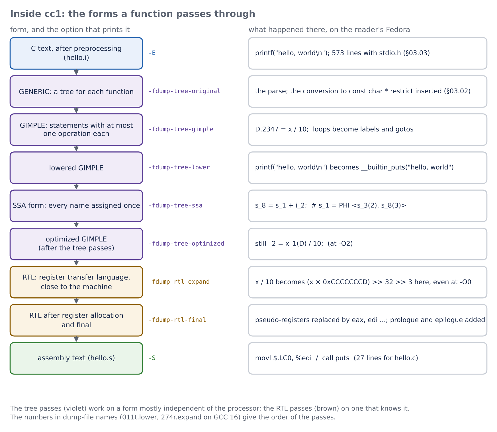

ref: 03.04
title: Compiling: From C to Assembly
chapter: Chapter 03 — From Source Text to Running Program
part: Part I — The Machine Beneath C
builds: §01.06, §02.03, §03.01, §03.02, §03.03
---
## The question

§03.03 followed `hello.c` to the point where the preprocessor hands 573 lines of text to the compiler proper. This section follows it one step further, through `cc1`, to the assembly language that `gcc -S` writes. Several promises are due here. §03.01 showed the seven instructions of `main` and promised to read them one by one, together with the reason why the same program on Ubuntu took 30 bytes instead of 21. §03.02 found that `printf` becomes `puts` in a pass called "lower", and promised a look beyond the first internal form, `-fdump-tree-original`. §03.03 promised the instruction that must be executed before every call to a function such as `printf`. And §02.03, which explained what an optimizer is *allowed* to do, promised a proper reading of `gcc -S`, `objdump -d` and the optimization levels.

Four new puzzles, all from programs in this section, run on your Fedora:

- a function that divides by 10 contains no division instruction, not even with optimization turned off (Listing 03.04-2);
- the instruction sequence that replaces the division multiplies by 3,435,973,837, and a test of all 4,294,967,296 possible inputs confirms that it is always right, while the same sequence with 3,435,973,836 is wrong 429,496,729 times (Listing 03.04-3);
- the same three functions compiled at six optimization levels produce six different pieces of machine code, from 36 to 206 bytes, and all six give the same results (Listing 03.04-4);
- on the ATmega328P the same division becomes a call to a function you never wrote, from a library you never named (Listing 03.04-5).

The questions are:

- What exactly is in a file of assembly language written by GCC, line by line, and how is it read?
- What are x86-64's registers, and how do the seven instructions of `main` implement the C you wrote?
- What does `cc1` do between the C text and the assembly, and where does each change happen?
- What do `-O0`, `-O2`, `-Os` and the other levels change, and why may the compiler change so much?
- What does the same C become on an 8-bit processor?

Each of these questions has a section of its own later: the calling convention in §19.02 and §19.03, the compiler's internals in §39.05, optimization in §39.02. This section is the first full reading, and its aim is that you can open any `.s` file and know what you are looking at.

## The journey

### What the compiler proper writes

§01.06 introduced **assembly language**: a text form of machine code, in which each line names one instruction with a short word, the **mnemonic** (such as `add` or `call`), followed by its **operands**, the things it works on; and in which a name followed by a colon, a **label**, stands for an address. §03.02 showed that `cc1` writes assembly language as text, and that the assembler, `as`, encodes it as machine code. The option `-S` stops the driver after `cc1`, and leaves the text in a file ending in `.s`. Here is the whole of it for `hello.c`, on the reader's machine:

```terminal
$ gcc -std=c23 -Wall -Wextra -pedantic -S hello.c -o hello.s
$ wc -l hello.s
$ cat hello.s
```

```output
27 hello.s
	.file	"hello.c"
	.text
	.section	.rodata
.LC0:
	.string	"hello, world"
	.text
	.globl	main
	.type	main, @function
main:
.LFB0:
	.cfi_startproc
	pushq	%rbp
	.cfi_def_cfa_offset 16
	.cfi_offset 6, -16
	movq	%rsp, %rbp
	.cfi_def_cfa_register 6
	movl	$.LC0, %edi
	call	puts
	movl	$0, %eax
	popq	%rbp
	.cfi_def_cfa 7, 8
	ret
	.cfi_endproc
.LFE0:
	.size	main, .-main
	.ident	"GCC: (GNU) 16.2.1 20261029 (Red Hat 16.2.1-3)"
	.section	.note.GNU-stack,"",@progbits
```

Twenty-seven lines, of four kinds. Seven are **instructions**: `pushq`, `movq`, `movl`, `call`, `movl`, `popq` and `ret`, which the assembler will encode as machine code. Four are **labels**: `.LC0:`, `main:`, `.LFB0:` and `.LFE0:`. The other sixteen begin with a dot and are **directives**, instructions not to the processor but to the assembler, telling it where to put things and what to record about them. Table 03.04-1 sorts them.

Table: Table 03.04-1  The lines of hello.s that are not instructions
<!-- widths: 30,70 -->
| Line | What it tells the assembler |
|---|---|
| `.file "hello.c"` | the name of the source file, to be recorded in the object file's table of names (`nm -a` and `readelf -s` show it, §03.05) |
| `.section .rodata` | put what follows into the section of read-only data |
| `.LC0:` | a local label: this address will be called `.LC0`; names beginning `.L` are normally kept out of the object file's table of names (the AVR toolchain keeps some, as you will see) |
| `.string "hello, world"` | place these 12 characters and a terminating zero byte here: 13 bytes, the newline already removed for `puts` (§03.01) |
| `.text` | put what follows into the section of code ("text") |
| `.globl main` | make the name `main` visible outside this file, so the linker can find it (external linkage, §20.03) |
| `.type main, @function` | record that `main` names a function, not data |
| `main:` | the address of the function's first instruction |
| `.LFB0:`, `.LFE0:` | local labels marking the beginning and end of function 0, used by the unwinding and debugging information |
| `.cfi_...` (six lines) | call frame information: how to find the caller's frame at each instruction (see the box below) |
| `.size main, .-main` | the function's size: the current address (`.`) minus the address of `main` |
| `.ident "GCC: ..."` | the compiler's identification, kept in a section of comments |
| `.section .note.GNU-stack,"",@progbits` | a mark telling the linker that this code does not need an executable stack |

The **section** is the main organizing idea: the assembler builds the object file as several separate pieces, among them code (`.text`), read-only data (`.rodata`) and writable data (`.data`, `.bss`), and the directives say which piece each line belongs to. The string and the instructions are written one after the other in `hello.s`, but they land in different sections, with different permissions when the program is loaded (code may be executed but not written; read-only data may be neither). §03.05 opens the object file and shows the sections, and §27.02 shows how the loader maps them into memory.

:::hood
What are the six `.cfi` lines for? A debugger that stops inside a function, and the machinery that prints a backtrace or propagates a C++ exception, must be able to find the frame of the function that called this one: where its return address is, and where its registers were saved. The address of that frame changes as the function runs (each `push` moves the stack pointer), so GCC records, instruction by instruction, how to find it. `.cfi_def_cfa_offset 16` after `pushq %rbp`, for example, says that the "canonical frame address", the value the stack pointer had before the call (the address just above the return address), is now 16 bytes above the current stack pointer: 8 for the return address that `call` pushed and 8 for the saved `rbp`. The other numbers are register numbers in the DWARF debugging format, in which 6 is `rbp` and 7 is `rsp`: `.cfi_offset 6, -16` says that the caller's `rbp` was saved 16 bytes below the frame address, and `.cfi_def_cfa 7, 8`, after `popq %rbp`, that the frame address is again `rsp` + 8. The assembler gathers these notes into a section of their own, `.eh_frame` (§03.05). The processor never executes it; it is loaded with the program, but read only when something must unwind the stack: a debugger, a function that prints a backtrace, or an exception. The option `-fno-asynchronous-unwind-tables` turns them off: on the reader's machine the file then has 19 lines, the 27 less the six `.cfi` lines and the two labels `.LFB0` and `.LFE0`. Many listings below use it, so that only what runs remains.
:::

### Reading AT&T syntax

The instructions are written in **AT&T syntax**, the default of the GNU assembler. Four conventions make it readable:

1. **The source comes first, the destination last.** `movq %rsp, %rbp` copies the contents of `rsp` *into* `rbp`. (Read the comma as "to".)
2. **Registers are marked with `%`, constants with `$`.** `movl $0, %eax` puts the number 0 into the register `eax`. Without `$`, a number or a name means a *memory address* whose contents are used: `movl .LC0, %edi` would load four bytes from the address `.LC0`, whereas `movl $.LC0, %edi` loads the address itself.
3. **The last letter of the mnemonic gives the size of the operands**: `b` for a byte (8 bits), `w` for a word (16), `l` for a "long" (32) and `q` for a quadword (64). `movq` moves 64 bits; `movl`, 32.
4. **A memory operand is written `displacement(base, index, scale)`** and means the address *base + index × scale + displacement*. `-4(%rbp)`, which you will meet below, is the address four bytes below the one held in `rbp`; `(%rdi,%rdi,4)` is *rdi + rdi × 4*.

The other common notation, used in Intel's and AMD's manuals, is **Intel syntax**, which reverses the order and drops the decorations. GCC writes it on request:

```terminal
$ gcc -std=c23 -Wall -Wextra -pedantic -S -masm=intel hello.c -o hello_intel.s
```

In `hello_intel.s` the seven instructions read `push rbp`, `mov rbp, rsp`, `mov edi, OFFSET FLAT:.LC0`, `call "puts"`, `mov eax, 0`, `pop rbp` and `ret`, after a directive `.intel_syntax noprefix` that tells the assembler which notation follows. (GCC 16 also writes the names `"main"` and `"puts"` in quotation marks in this mode; `OFFSET FLAT:` means "the address of".) Both notations describe exactly the same machine code; this book uses AT&T syntax, because it is what GCC, `objdump` and the GNU debugger show by default on Linux.

:::history
The two notations are a legacy of two traditions. Intel defined the syntax of its manuals with the 8086 in 1978, destination first, as in an assignment (`mov ax, bx` means *ax = bx*). The assemblers of AT&T's Unix put the source first, as the PDP-11's assembler did (§03.02's history box met Ritchie's PDP-11 compiler), and when Unix was carried to Intel's processors, the Unix assemblers kept their own order; the GNU assembler, written to be compatible with them, inherited it. (The account of the PDP-11's influence is the author's understanding of the history; the two notations themselves are as shown.)
:::

### The registers of x86-64

A **register** is a storage cell inside the processor, the fastest storage a program has (§01.05); an instruction can usually name it directly. x86-64 has 16 general-purpose registers of 64 bits, and each has names for its lower parts, because the architecture grew by stages, each keeping the names of the one before. Table 03.04-2 lists them.

Table: Table 03.04-2  The 16 general-purpose registers of x86-64 and their names
<!-- widths: 16,16,16,16,36 -->
| 64 bits | low 32 | low 16 | low 8 | Main use in the System V calling convention (§19.02) |
|---|---|---|---|---|
| `rax` | `eax` | `ax` | `al` | result of a function; `al` before a call to a variadic function (one with a variable number of arguments, such as `printf`) |
| `rbx` | `ebx` | `bx` | `bl` | kept for the caller ("callee-saved") |
| `rcx` | `ecx` | `cx` | `cl` | 4th integer or pointer argument |
| `rdx` | `edx` | `dx` | `dl` | 3rd integer or pointer argument |
| `rsi` | `esi` | `si` | `sil` | 2nd integer or pointer argument |
| `rdi` | `edi` | `di` | `dil` | 1st integer or pointer argument |
| `rbp` | `ebp` | `bp` | `bpl` | frame pointer, when one is used; callee-saved |
| `rsp` | `esp` | `sp` | `spl` | stack pointer: the address of the top of the stack |
| `r8` … `r15` | `r8d` … `r15d` | `r8w` … `r15w` | `r8b` … `r15b` | `r8`, `r9`: 5th and 6th arguments; `r12`–`r15` callee-saved |

The history explains the names. Intel's 8086 of 1978 had eight 16-bit registers, `ax`, `bx`, `cx`, `dx`, `si`, `di`, `bp` and `sp`; the first four could also be used as two 8-bit halves, `ah` and `al` for the high and low bytes of `ax`, and so on. The 80386 of 1985 extended them to 32 bits, and the extended registers were named with an `e`: `eax`. AMD's 64-bit extension (the first processors appeared in 2003) extended them again, named the 64-bit registers with an `r`, and added eight new ones, `r8` to `r15`. It also made the low bytes of `si`, `di`, `bp`, `sp` and the new registers addressable, as `sil`, `dil`, `bpl`, `spl` and `r8b` to `r15b`; instructions that use them need the REX prefix described below (`movb $0,%sil` encodes as `40 b6 00` on the reader's machine), and in such instructions the old high bytes `ah`, `bh`, `ch` and `dh` cannot be named, which is why the table has no column for them. (Intel's manual calls the new byte registers `r8l` to `r15l`; GNU tools write `r8b`.) Besides these, every x86-64 processor has at least 16 registers for floating-point and vector work, `xmm0` to `xmm15`, of 128 bits each; processors with the AVX-512 extension, such as the reader's i5-1135G7 (`/proc/cpuinfo` lists `avx512f`), have 32 vector registers of 512 bits, whose low 128 bits are `xmm0` to `xmm31`. The older x87 registers, used on Linux for `long double` (§07.07), remain too. And there are two special registers: `rip`, the **instruction pointer**, which holds the address of the next instruction (the program counter of §01.06), and `rflags`, whose bits record properties of the last result (zero, negative, carry, overflow) and some control settings.

One rule of 64-bit mode matters at once. Intel's manual states that "32-bit operands generate a 32-bit result, zero-extended to a 64-bit result in the destination general-purpose register." Writing `eax` therefore also sets the upper 32 bits of `rax` to zero; writing `ax` or `al` leaves the other bits unchanged. Compilers use this constantly: when a 64-bit register must receive a value that fits in 32 bits, they write the 32-bit name, because its instructions are shorter (the 64-bit forms need at least an extra prefix byte, as you will see in a moment).

### The seven instructions of main, one by one

The linked program shows the instructions with the bytes that encode them (`objdump -d` disassembles: it turns machine code back into assembly language):

```terminal
$ gcc -std=c23 -Wall -Wextra -pedantic hello.c -o hello
$ objdump -d hello | sed -n '/<main>:/,/ret/p'
```

```output
0000000000401136 <main>:
  401136:	55                   	push   %rbp
  401137:	48 89 e5             	mov    %rsp,%rbp
  40113a:	bf b0 04 40 00       	mov    $0x4004b0,%edi
  40113f:	e8 ec fe ff ff       	call   401030 <puts@plt>
  401144:	b8 00 00 00 00       	mov    $0x0,%eax
  401149:	5d                   	pop    %rbp
  40114a:	c3                   	ret
```

(`objdump` leaves off the size letters where the operands make the size clear.) The first column is the address of each instruction in the program, the second its bytes in hexadecimal, the third the instruction. Before reading them, recall what `main` is: a function, called by the C library's startup code (§02.06) with a `call` instruction, which pushed onto the stack the **return address**, the address of the instruction that should follow when `main` finishes. On entry, then, `rsp` holds the address of that return address.

1. **`push %rbp`** (1 byte, `55`). Subtract 8 from `rsp` and store `rbp` at the new top of the stack. `rbp` belongs to the caller: the convention says that a function must give it back unchanged, so `main` saves it before using it.
2. **`mov %rsp,%rbp`** (3 bytes, `48 89 e5`). Copy the stack pointer into `rbp`, which now marks this function's **frame**: the region of the stack where its local variables would live, at fixed distances below `rbp` (`-4(%rbp)` and so on, as in Listing 03.04-1 below). `main` has no local variables, but at `-O0` GCC always sets up the frame, which makes the code predictable for a debugger (§02.03). The first byte, `48`, is a **REX prefix** that makes the instruction operate on 64 bits; it is the extra byte that 32-bit instructions do without.
3. **`mov $0x4004b0,%edi`** (5 bytes, `bf b0 04 40 00`). Put the address of the string into `edi`, the low half of `rdi`, the register for the first argument. `bf` means "move a 32-bit constant into `edi`", and the four bytes after it are the constant, 0x004004b0, written least significant byte first, x86's **little-endian** order (§06.03). In `hello.s` the operand was the name `$.LC0`; the address was not known when `cc1` wrote the text. In the object file `hello.o` these four bytes are zeros, with a note for the linker beside them, `R_X86_64_32 .rodata` (`objdump -dr hello.o`), and the linker wrote 0x4004b0 there when it placed the string (§03.05, §03.06). Why `edi` and not the full `rdi`? Because the address fits in 32 bits, writing `edi` sets the upper half of `rdi` to zero, and the instruction is shorter. Assembled on the reader's machine, `movq $0x4004b0,%rdi` is `48 c7 c7 b0 04 40 00`, 7 bytes: the REX prefix and also a second byte that names the register (the short `bf` form, given a REX prefix, would take an 8-byte constant instead).
4. **`call 401030 <puts@plt>`** (5 bytes, `e8 ec fe ff ff`). Push the address of the next instruction, 0x401144, and jump. `e8` is "call, relative", and the four bytes are the distance to the target counted from the end of the instruction: 0xfffffeec, which in two's complement (§04.03) is −276; 0x401144 − 276 = 0x401030. That address is not `puts` itself but a small stub in the **procedure linkage table**, `puts@plt`, which jumps on to `puts` in the C library wherever the dynamic loader placed it (§03.06, §03.07).
5. **`mov $0x0,%eax`** (5 bytes, `b8 00 00 00 00`). Put 0 into `eax`: this is `return 0;`, because the convention returns an integer result in `rax` (`eax` for a 32-bit `int`).
6. **`pop %rbp`** (1 byte, `5d`). Restore the caller's `rbp` from the stack and add 8 to `rsp`, which now points at the return address again.
7. **`ret`** (1 byte, `c3`). Pop the return address into `rip`: execution continues in the C library, which passes `main`'s result to `exit` (§02.06).

1 + 3 + 5 + 5 + 5 + 1 + 1 = 21 bytes, the 21 that §03.01 counted. Two of the seven instructions come from the statement `printf("hello, world\n");`: one places its argument in `edi`, one calls (`-fverbose-asm`, Experiment 03.04-1, puts both under line 6). One comes from `return 0;`. The other four are the function's **prologue** and **epilogue**: code that GCC at `-O0` places around every function to build a frame and take it down. The calling convention itself demands less: only that `rbp` and the other registers it calls "callee-saved" come back unchanged, and that the stack be aligned at every call. At `-O2`, as you will see, these four instructions disappear.

:::precise
"The calling convention" has a precise name. On Linux and most other Unix-like systems, x86-64 programs follow the *System V Application Binary Interface, AMD64 Architecture Processor Supplement*, which fixes, among much else, which registers carry arguments (the first six integer or pointer arguments in `rdi`, `rsi`, `rdx`, `rcx`, `r8`, `r9`; floating-point arguments in `xmm0` to `xmm7`), where results come back (`rax`, or `xmm0`), which registers a function must preserve, and that the stack pointer must be a multiple of 16 at every `call`. Windows uses a different convention on the same processors (its first integer argument goes in `rcx`). The C standard says none of this: it is an agreement between compilers, libraries and operating systems, so that code compiled by different compilers, years apart, can call each other. §19.02 reads it in full; this section uses only what it needs.
:::

### Ubuntu's 30 bytes: position-independent code

§03.01 reported that on Ubuntu the same `main` began with `endbr64`, loaded the string's address with `lea`, and took 30 bytes. Three options of GCC produce that form on your Fedora too:

```terminal
$ gcc -std=c23 -Wall -Wextra -pedantic -fPIE -pie -fcf-protection=full hello.c -o hello_pie
$ objdump -d hello_pie | sed -n '/<main>:/,/ret/p'
```

```output
0000000000001159 <main>:
    1159:	f3 0f 1e fa          	endbr64
    115d:	55                   	push   %rbp
    115e:	48 89 e5             	mov    %rsp,%rbp
    1161:	48 8d 05 7c f4 ff ff 	lea    -0xb84(%rip),%rax        # 5e4 <_IO_stdin_used+0x4>
    1168:	48 89 c7             	mov    %rax,%rdi
    116b:	e8 e0 fe ff ff       	call   1050 <puts@plt>
    1170:	b8 00 00 00 00       	mov    $0x0,%eax
    1175:	5d                   	pop    %rbp
    1176:	c3                   	ret
```

4 + 1 + 3 + 7 + 3 + 5 + 5 + 1 + 1 = 30 bytes. The options explain the two differences.

`-fPIE -pie` asks for a **position-independent executable**, one that will work wherever in memory it is loaded. Modern systems load programs at a different, random address each time they run (address space layout randomization, a defense that makes attacks harder, §34.06), and a program whose code contains an absolute address such as 0x4004b0 can run at only one place. A position-independent program never writes an absolute address into its code. Instead it computes the string's address *relative to the instruction pointer*: `lea -0xb84(%rip),%rax` ("load effective address") puts into `rax` the address that lies 0xb84 bytes before the next instruction, whatever that address turns out to be. The distance between the code and its read-only data is fixed when the program is linked, even though the program's position is not. (The addresses printed, such as 0x1159, are therefore relative to wherever the program is loaded; `file hello_pie` calls it a "pie executable". The comment `# 5e4` is `objdump`'s own calculation of the address the instruction refers to: 0x1168 − 0xb84 = 0x5e4.) The result must go into the full 64-bit `rdi`, not `edi`: once the program can be loaded anywhere, the string's address is no longer known to fit in 32 bits. At `-O0`, GCC goes through `rax` and then copies to `rdi`, one instruction more than necessary.

`-fcf-protection=full` adds `endbr64` ("end branch, 64-bit") at the start of every function that might be reached by an indirect jump or call. It is part of Intel's *Control-flow Enforcement Technology*: when the processor supports it and the operating system turns it on for the program, an indirect jump that lands anywhere other than on an `endbr64` stops the program, which hinders attacks that redirect execution into the middle of existing code. The compiler only prepares the program: it marks the object file (`readelf -n hello_pie` reports `x86 feature: IBT, SHSTK` on the reader's machine), and whether the protection is enforced is decided when the program runs. On processors without the feature, the instruction does nothing.

Ubuntu's GCC enables both by default. Fedora's GCC, when you run it yourself, enables neither: on the reader's machine `echo | gcc -dM -E -` lists neither `__PIE__` nor `__CET__` (macros GCC defines when it compiles position-independent code, and code prepared for CET), `gcc -v` shows no `--enable-default-pie`, and the plain `hello` has `main` at the fixed address 0x401136 with no `endbr64`. (Fedora does build its own packages with both: `rpm --eval '%{optflags}'`, the options its packaging system adds, includes `-fcf-protection` and a specs file, `redhat-hardened-cc1`, whose contents add `-fPIE` whenever no other choice of position-independence was given. The defaults differ only for the compiler you call by hand.) Neither choice changes what `hello.c` *means*. They are two translations of the same program, with different costs and protections, and §21.06 explains how shared libraries depend on the same technique.

### A call with arguments

`hello.c` passes one argument. Listing 03.04-1 passes two, of different types, to a function with a variable number of arguments, which shows more of the convention at work.

```c Listing 03.04-1  call.c: two arguments of different types
// call.c
// What a call looks like: two arguments of different types.
#include <stdio.h>

int main(void) {
    int n = 7;
    double x = 2.5;
    printf("%d %f\n", n, x);
    return 0;
}
```

```terminal
$ gcc -std=c23 -Wall -Wextra -pedantic -S -fno-asynchronous-unwind-tables call.c -o - | sed -n '/^main:/,/ret/p'
```

```output
main:
	pushq	%rbp
	movq	%rsp, %rbp
	subq	$16, %rsp
	movl	$7, -4(%rbp)
	movsd	.LC0(%rip), %xmm0
	movsd	%xmm0, -16(%rbp)
	movq	-16(%rbp), %rdx
	movl	-4(%rbp), %eax
	movq	%rdx, %xmm0
	movl	%eax, %esi
	movl	$.LC1, %edi
	movl	$1, %eax
	call	printf
	movl	$0, %eax
	leave
	ret
```

(`-o -` sends the output to standard output, here the terminal, instead of a file; the program prints `7 2.500000`.) Read it in groups.

- **The frame.** After the usual two instructions, `subq $16, %rsp` reserves 16 bytes of stack for the two local variables. At `-O0`, every variable of the abstract machine is an object in memory (§02.03): `n` lives at `-4(%rbp)` and `x` at `-16(%rbp)`.
- **The initializations.** `movl $7, -4(%rbp)` stores 7 into `n`. `x` cannot be set the same way, because x86-64 has no instruction that puts a floating-point constant into a register directly. The constant 2.5 is stored in read-only data as a bit pattern, at label `.LC0`, and `movsd .LC0(%rip), %xmm0` ("move scalar double") loads it, from an address relative to `rip`. (In the `.s` file, `.LC0` appears as `.long 0` and `.long 1074003968`, two 32-bit halves, the low half first, little-endian: 1074003968 is 0x40040000, so the 64-bit pattern is 0x4004000000000000, which is 2.5 in IEEE 754 double format, §07.03. Notice also that this load is relative to `rip` although the program is not position-independent: in 64-bit mode, an address relative to `rip` is the shortest way to name a location in memory, because an absolute 32-bit address needs one more byte of encoding, so GCC uses it for memory operands whenever it can.)
- **The arguments.** The format string is the first argument, so its address goes to `edi`; `n`, the first integer argument after it, goes to `esi`; `x`, the first floating-point argument, goes to `xmm0`. Integer and floating-point arguments are numbered separately: `x` is the third argument of `printf` but the *first* in a vector register. (`-O0` takes a detour through `rdx` and `eax`, loading each variable back from memory before passing it.)
- **`movl $1, %eax`.** This is the instruction that §03.03 promised. `printf` is a **variadic** function, one declared with `...` that accepts a variable number of arguments (§31.03); it does not know, when it starts, how many arguments it was given or of what types; it learns them from the format string. But the code at its start, which saves the argument registers for later use (§31.03), must decide whether to save the eight vector registers, an expensive operation. The convention therefore makes every caller of a variadic function put into `al` an upper bound on the number of vector registers holding arguments. Here one does, `xmm0`. For `printf("%d\n", n)`, with no floating-point argument, GCC writes `movl $0, %eax` instead, and for §03.03's `root.c`, which passes one `double`, `movl $1, %eax` (both checked on the reader's machine). Without this instruction the call would still often work, which is exactly why getting it wrong (for example by calling a variadic function through a declaration without `...`) can stay unnoticed until it fails (§18.04).
- **The end.** `leave` undoes the frame in one instruction (it is `movq %rbp, %rsp` followed by `popq %rbp`), and `ret` returns.

`printf` was not replaced by `puts` here, because its format contains conversions. With `-O2` the same function shrinks to nine instructions:

```output
main:
	subq	$8, %rsp
	movl	$7, %esi
	movl	$.LC1, %edi
	movsd	.LC0(%rip), %xmm0
	movl	$1, %eax
	call	printf
	xorl	%eax, %eax
	addq	$8, %rsp
	ret
```

The variables `n` and `x` are gone: the compiler put their values straight into the argument registers. The frame is gone. `subq $8, %rsp` and `addq $8, %rsp` remain, for the convention's rule about the stack: on entry to any function, `rsp` is 8 bytes past a multiple of 16 (the `call` that entered it pushed 8 bytes), and it must be a multiple of 16 again at the next `call`. At `-O0`, `pushq %rbp` did that adjustment as a side effect. (`-Os` makes the same adjustment differently: its `main` for `hello.c` begins with `pushq %rax` and ends with `popq %rdx`, one byte each against four for `subq $8, %rsp`; the values pushed and popped do not matter, and `rdx` may be overwritten freely, while `rax` already holds the result.) And `return 0;` became `xorl %eax, %eax`: an exclusive OR of a register with itself is zero, and the instruction takes 2 bytes against the 5 of `movl $0, %eax` (on the reader's machine: `31 c0` against `b8 00 00 00 00`).

### Inside cc1: from the tree to the assembly

How did `printf("hello, world\n")` become `call puts`, and `x / 10` become a multiplication? `cc1` does not translate C into assembly in one step. It converts each function through a series of internal forms, and runs a sequence of **passes** over them, each pass a small program that reads the current form and writes an improved or lowered version. GCC can print the form after each pass: `-fdump-tree-all` and `-fdump-rtl-all` produce one file per pass, named after the source with the pass's number and name. On the reader's machine, `hello.c` at `-O0` produced 54 such files:

```terminal
$ gcc -std=c23 -O0 -fdump-tree-all -fdump-rtl-all -S hello.c
$ ls hello.c.* | wc -l
```

```output
54
```

Their names run from `hello.c.006t.original`, `hello.c.007t.gimple`, `hello.c.011t.lower`, …, `hello.c.024t.ssa`, …, `hello.c.273t.optimized`, `hello.c.274r.expand`, …, `hello.c.370r.final` to four bookkeeping dumps after `final`, ending with `hello.c.374t.debug`. Only the passes that actually ran and write a dump produce a file. The number gives the pass's position in GCC's list of passes (it changes between versions: 011 here, 010 in the author's GCC 14), the letter says whether the form is a tree (`t`) or RTL (`r`), and the name is the pass. Figure 03.04-1 shows the main forms, with what each did to this section's programs.

{w=16}

**GENERIC** is the tree that the parser builds for each function, printed by `-fdump-tree-original`, which §03.02 showed. **GIMPLE** comes next: the same function rewritten so that each statement performs at most one operation, with temporary variables for intermediate results and loops replaced by labels and jumps. Here is `hello.c` in GIMPLE (`-fdump-tree-gimple`):

```output
int main ()
{
  int D.2661;

  {
    printf ("hello, world\n");
    D.2661 = 0;
    return D.2661;
  }
  D.2661 = 0;
  return D.2661;
}
```

`D.2661` is a temporary that GCC invented for the returned value (the number is only an internal identifier). The `return` appears twice because of the `return 0;` that C adds at the closing brace of `main` (§03.02). In the dump of the pass called `lower` (`hello.c.011t.lower`), the call has changed (one line of the dump):

```output
  __builtin_puts (&"hello, world"[0]);
```

This is §03.01's replacement of `printf` by `puts`, caught in the act: on the reader's machine the lowered form is the first dump in which `__builtin_puts` appears (`grep -l __builtin_puts hello.c.*t.*` lists `011t.lower` first). GCC treats `printf` as a built-in function (§03.03), and the pass `lower` is where it *folds* calls to built-in functions, simplifying them when it can. GCC's source code (`gimple-low.cc`) gives the reason for doing it there in a comment: "We delay folding of built calls from gimplification to here so the IL is in consistent state for the diagnostic machineries job." (IL, "intermediate language", is the internal form; the warnings about `printf` formats must see the original call.) Folding recognized a format with no conversions, ending in a newline, whose result is not used, and wrote the cheaper call instead, with the newline removed from the string.

Further on, the function is converted into **static single assignment (SSA) form**, in which every variable is given a new numbered name at each assignment, so that each name is assigned exactly once. Here is `sum_to` from Listing 03.04-2 below, after the pass `ssa` (`-fdump-tree-ssa`, at `-O2`; the header line, the declarations and the final block are omitted):

```output
  <bb 2> :
  s_3 = 0;
  i_4 = 1;
  goto <bb 4>; [INV]

  <bb 3> :
  s_8 = s_1 + i_2;
  i_9 = i_2 + 1;

  <bb 4> :
  # s_1 = PHI <s_3(2), s_8(3)>
  # i_2 = PHI <i_4(2), i_9(3)>
  if (i_2 <= n_5(D))
    goto <bb 3>; [INV]
  else
    goto <bb 5>; [INV]
```

The `<bb N>` are **basic blocks**: runs of statements entered only at the top and left only at the bottom. The variable `s` has become three names: `s_3` (the initial 0), `s_8` (the sum after an addition) and `s_1`, defined by a **PHI** at the top of block 4, which means "`s_3` if we arrived from block 2, `s_8` if we arrived from block 3". `n_5(D)` is the parameter's value on entry (the `(D)` marks a "default definition", a value that exists before any assignment), and `[INV]` records that no probability has yet been estimated for the branch. Why go to this trouble? Because once each name has exactly one definition, the question "which assignment produced this value?" always has a single answer, and most optimizations become much simpler to write and to prove correct (§39.05 shows how).

The tree passes work on a form that is mostly independent of the processor (mostly: the vectorizer, which you will meet below, must ask how wide the processor's vector registers are). The division in `div10` (Listing 03.04-2) is still a division at the end of them; in the dump `ops.c.273t.optimized` at `-O2`, it reads `_2 = x_1(D) / 10;`. The next pass, `expand`, converts the function into **RTL** ("register transfer language"), a form close to the machine, in which every operation is one the target processor can perform, on an unlimited supply of **pseudo-registers** (GCC's term; it uses "virtual registers" for something else, handled by the pass `vregs` that follows `expand`). It is in `expand`, choosing the x86-64 instructions for the division, that GCC replaced it: the dump `ops.c.274r.expand` contains the constant `3435973837 [0xcccccccd]`, a `mult`, and two right shifts (`lshiftrt`) by 32 and by 3, with a note recording that the whole equals `(udiv ... (const_int 10))`. (At `-O2` the two shifts later become the single `shrq $35` you will see below: on the reader's machine the constant 35 first appears in the dump of the pass `combine`, `ops.c.309r.combine`, one of the improving passes that do not run at `-O0`.) The later RTL passes allocate real registers to the pseudo-registers (the passes `ira` and `reload`), add the prologue and epilogue (`pro_and_epilogue`), and finally the pass `final` writes the assembly text. §39.05 follows a function through all of them; for this section, it is enough to know that between the C and the `.s` file stand many small, separately understandable transformations, and that GCC will show you any of them.

### Optimization levels

The option `-O` followed by a level chooses how many of those transformations GCC applies. GCC's manual describes each in a few words. `-O2`: "Optimize even more." `-O3`: "Optimize yet more." `-Os`: "Optimize for size." `-Og`: "Optimize while keeping in mind debugging experience." `-O1` (or `-O`) turns on the optimizations that cost little compilation time. Without any option, the level is `-O0`, at which "the compiler's goal is to reduce the cost of compilation" and to make debugging behave as the source leads you to expect (§02.03). GCC will list which optimization options each level enables (`gcc -O2 -Q --help=optimizers`). On the reader's machine, counting the options marked "[enabled]" gives 51 at `-O0`, 93 at `-O1`, 144 at `-O2`, 157 at `-O3`, 135 at `-Os` and 81 at `-Og`. The 51 at `-O0` should not mislead you: the manual warns that "Most optimizations are completely disabled at -O0 or if an -O level is not set on the command line", even if individual optimization options are given.

Listing 03.04-2 gives the optimizer three small things to work on.

```c Listing 03.04-2  ops.c: three small functions, to watch the optimizer at work
// ops.c
// Three small functions, to watch the optimizer at work.
int times10(int x) {
    return x * 10;
}

unsigned div10(unsigned x) {
    return x / 10;
}

int sum_to(int n) {
    int s = 0;
    for (int i = 1; i <= n; ++i) {
        s += i;
    }
    return s;
}
```

Here are `times10` and `div10` at `-O0` (`gcc -std=c23 -O0 -S -fno-asynchronous-unwind-tables ops.c`, directives removed):

```output
times10:
	pushq	%rbp
	movq	%rsp, %rbp
	movl	%edi, -4(%rbp)
	movl	-4(%rbp), %edx
	movl	%edx, %eax
	sall	$2, %eax
	addl	%edx, %eax
	addl	%eax, %eax
	popq	%rbp
	ret
div10:
	pushq	%rbp
	movq	%rsp, %rbp
	movl	%edi, -4(%rbp)
	movl	-4(%rbp), %eax
	movl	%eax, %edx
	movl	$3435973837, %eax
	imulq	%rdx, %rax
	shrq	$32, %rax
	shrl	$3, %eax
	popq	%rbp
	ret
```

The first surprise is that, even without optimization, there is no multiplication in `times10` and no division in `div10`. `times10` computes `x * 10` as ((x × 4) + x) × 2: `sall $2` shifts left by two places, multiplying by 4; adding `x` makes 5x; adding the result to itself makes 10x. `div10` multiplies by 3,435,973,837 and shifts right by 35 places in all. These choices are made in `expand`, which runs at every level; `-O0` turns off the passes that *improve* a function, not the ones that translate it. (The stores to `-4(%rbp)` and loads back are pure `-O0`: the parameter is an object in memory. Notice that these functions store `x` at `-4(%rbp)` without first moving `rsp`, so the store lies *below* the stack pointer. The System V convention allows it: the 128 bytes below `rsp`, the **red zone**, may not be disturbed by signal handlers, so a function that calls no other may use them without adjusting `rsp` (§19.02). `call.c`'s `main` calls `printf`, so it had to reserve its 16 bytes with `subq`.)

Now the same functions at four more levels. At `-O1`, `-O2`, `-O3` and `-Og`, `times10` and `div10` are identical:

```output
times10:
	leal	(%rdi,%rdi,4), %eax
	addl	%eax, %eax
	ret
div10:
	movl	%edi, %eax
	movl	$3435973837, %edx
	imulq	%rdx, %rax
	shrq	$35, %rax
	ret
```

`leal (%rdi,%rdi,4), %eax` is the address-arithmetic instruction used for plain arithmetic: it computes *rdi + rdi × 4* = 5x without touching memory, and `addl` doubles it. `div10` now shifts by 35 in a single instruction. At `-Os`, which values size above speed, the choices change:

```output
times10:
	imull	$10, %edi, %eax
	ret
div10:
	movl	%edi, %eax
	movl	$10, %ecx
	xorl	%edx, %edx
	divl	%ecx
	ret
```

A real multiplication instruction (3 bytes, shorter than `lea` plus `add`) and, at last, a real division, `divl`, which divides the 64-bit number in `edx:eax` by `ecx` (hence the `xorl` that clears `edx`). The whole of `div10` at `-Os` is 12 bytes; at `-O0`, 30 (`objdump -d` on the two object files). Why does `-Os` give up the multiplication? Because a division instruction is slow but small, and `-Os` asks for small.

`sum_to` changes most of all, and its six versions are a short course in what optimizers do. At `-O0` it is §02.03's loop, every variable in memory. At `-O1` the loop keeps `s` and `i` in registers:

```output
sum_to:
	testl	%edi, %edi
	jle	.L6
	addl	$1, %edi
	movl	$1, %eax
	movl	$0, %edx
.L5:
	addl	%eax, %edx
	addl	$1, %eax
	cmpl	%edi, %eax
	jne	.L5
.L3:
	movl	%edx, %eax
	ret
.L6:
	movl	$0, %edx
	jmp	.L3
```

`testl %edi, %edi` and `jle .L6` handle `n` ≤ 0 before the loop starts (the result is then 0); the loop itself is four instructions, `s += i`, `++i`, compare, jump back. The loop has been *rotated*: the test `n ≥ 1` is made once, before it, and the test at the bottom, `i != n + 1`, is equivalent to `i <= n` because `i` starts at 1 and rises by exactly 1. That equivalence assumes that `i` never overflows, which the compiler may assume because signed overflow is undefined behavior (§02.04, §04.04). At `-O2` the loop is **unrolled** by two: it handles `i` and `i + 1` in one pass, adding 2i + 1 with the single instruction `leal 1(%rdx,%rax,2), %edx` (*s + 2i + 1*), after first dealing separately with one leftover step when `n` is odd. This comes from an option specific to x86, `-munroll-only-small-loops`, enabled at `-O2` on the reader's GCC (`gcc -O2 -Q --help=target` lists it), which lets the RTL pass `loop2_unroll` unroll small loops; its dump reports "Unrolled loop 1 times", that is, one extra copy of the body. At `-O3` it is **vectorized**: GCC keeps four partial sums side by side in one 128-bit register (`paddd` adds four 32-bit numbers at once), and combines them at the end; the function grows to 57 lines of assembly, labels included. At `-Os` it is a plain five-instruction loop. Table 03.04-3 gathers the results.

Table: Table 03.04-3  ops.c at six levels on the reader's Fedora (GCC 16.2.1; code sizes from size -A)
<!-- widths: 10,14,25,25,26 -->
| Level | `.text` bytes | `times10` | `div10` | `sum_to` |
|---|---|---|---|---|
| `-O0` | 97 | shifts and adds, through memory | multiply by 0xCCCCCCCD, through memory | loop with `s` and `i` in memory |
| `-O1` | 67 | `lea` + `add` | multiply, shift 35 | loop in registers |
| `-O2` | 101 | `lea` + `add` | multiply, shift 35 | loop unrolled by two |
| `-O3` | 206 (+16 of constants) | `lea` + `add` | multiply, shift 35 | vectorized: four sums at once |
| `-Os` | 36 | `imull $10` | `divl` | short loop |
| `-Og` | 60 | `lea` + `add` | multiply, shift 35 | simple loop in registers |

Clang, given the same `-O2` (version 23.1.5 on the reader's machine), goes further than any of them. Its `sum_to` contains no loop at all:

```terminal
$ clang -std=c23 -O2 -S -fno-asynchronous-unwind-tables ops.c -o - | sed -n '/^sum_to:/,/ret/p'
```

```output
sum_to:                                 # @sum_to
# %bb.0:
                                        # kill: def $edi killed $edi def $rdi
	testl	%edi, %edi
	jle	.LBB2_1
# %bb.2:
	leal	-1(%rdi), %eax
	leal	-2(%rdi), %ecx
	imulq	%rax, %rcx
	shrq	%rcx
	leal	(%rcx,%rdi,2), %eax
	decl	%eax
	retq
```

It computes (n − 1)(n − 2)/2 + 2n − 1, which is n(n + 1)/2, the formula for 1 + 2 + … + n that the young Gauss is said to have found. Clang recognized the loop as a sum of an arithmetic series and replaced it with the closed form. (The lines beginning with `#` are Clang's comments; `.LBB2_1`, outside the excerpt, returns 0.)

:::myth
"Higher optimization levels make programs faster, so `-O3` is best." Table 03.04-3 already shows that the levels trade one cost against another: `-O3` made the biggest code, and on an 8-bit microcontroller with 32 KB of flash, size can matter more than speed (which is why, in the author's experience, embedded projects such as the Arduino cores commonly compile with `-Os`). Whether the vectorized `sum_to` is faster depends on `n`: GCC itself sends `n` ≤ 4 straight to the ordinary code, and for moderate `n` the setup and the final combination of the four sums may cost more than they save. The only way to know is to measure, at the level you will use, on the machine you will use (§33.03). What is true is that `-O2` is a level at which a great deal of code is tested and shipped (Fedora builds its packages at `-O2`, as `rpm --eval '%{optflags}'` shows), and a reasonable default; and that a program that behaves differently at different levels is almost always a program with undefined behavior (§02.04), not a victim of the optimizer.
:::

### Division by multiplication: checking the compiler's arithmetic

Why should multiplying by 3,435,973,837 and shifting right by 35 places divide by 10? Shifting right by 35 places divides by 2³⁵ and discards the fraction, so the instructions compute ⌊x × M / 2³⁵⌋, where M = 3,435,973,837 and ⌊ ⌋ means "rounded down to a whole number". The idea is to choose M close to 2³⁵/10, so that x × M / 2³⁵ is close to x/10. Now 2³⁵/10 = 3,435,973,836.8, which is not a whole number; GCC rounds it *up*, to 3,435,973,837, which is 0xCCCCCCCD. The error this introduces is M − 2³⁵/10 = 0.2, so

*x × M / 2³⁵ = x/10 + 0.2x / 2³⁵.*

Write x = 10q + r, where q is the true quotient and r the remainder, 0 ≤ r ≤ 9. Then x × M / 2³⁵ = q + r/10 + e, where e = 0.2x / 2³⁵. For every 32-bit `x` (that is, x < 2³²), 0 ≤ e < 0.2 × 2³² / 2³⁵ = 0.025. So the value lies between q and q + 0.9 + 0.025 = q + 0.925, never reaching q + 1, and rounding down gives exactly q: the same result as division, for every possible input.

Rounding *down* instead, to 3,435,973,836, makes the value q + r/10 − d, with d = 0.8x / 2³⁵, so that 0 < d < 0.8 × 2³² / 2³⁵ = 0.1 for every x > 0. If r ≥ 1, the value is at least q + 0.1 − d, still above q, and rounding down gives q, the right answer. But if r = 0, that is, whenever x is a positive multiple of 10, the value is q − d, just below q, and rounding down gives q − 1. So exactly the positive multiples of 10 below 2³² fail: ⌊(2³² − 1)/10⌋ = 429,496,729 of them. Listing 03.04-3 checks both claims on all 4,294,967,296 inputs.

```c Listing 03.04-3  check10.c: test the compiler's constant on every 32-bit input
// check10.c
// Is (x * 3435973837) >> 35 equal to x / 10 for every 32-bit x?
#include <stdio.h>
#include <stdint.h>

int main(void) {
    volatile uint32_t ten = 10;        // volatile: forces a real division
    uint64_t wrong = 0, wrong_m1 = 0;
    uint32_t x = 0;
    do {
        uint32_t q = x / ten;
        if ((uint32_t)(((uint64_t)x * 3435973837u) >> 35) != q) {
            ++wrong;                   // the compiler's constant
        }
        if ((uint32_t)(((uint64_t)x * 3435973836u) >> 35) != q) {
            ++wrong_m1;                // one less
        }
    } while (++x != 0);                // after 4294967295, x wraps to 0
    printf("mismatches with 3435973837: %llu\n", (unsigned long long)wrong);
    printf("mismatches with 3435973836: %llu\n", (unsigned long long)wrong_m1);
    return 0;
}
```

The divisor is declared `volatile` (§36.04) so that the compiler must read it from memory each time and cannot know it is 10; otherwise it would replace the reference division with the very multiplication being tested. The loop relies on unsigned arithmetic wrapping from 4,294,967,295 back to 0 (§04.02).

```terminal
$ gcc -std=c23 -Wall -Wextra -pedantic -O2 check10.c -o check10 && time ./check10
```

```output
mismatches with 3435973837: 0
mismatches with 3435973836: 429496729

real	0m6.482s
user	0m6.473s
sys	0m0.000s
```

Zero mismatches for GCC's constant; 429,496,729 for the one below it, exactly as the arithmetic predicted. The reasoning and the test agree, and 6.5 seconds on your laptop was enough to check every case.

Why a shift of 35, and not 34 or 32? The same inequality decides it. With a shift of 34, the best constant is 2³⁴/10 = 1,717,986,918.4 rounded up to 1,717,986,919, an excess of 0.6, so e can approach 0.6 × 2³² / 2³⁴ = 0.15; added to a remainder term of 0.9, that crosses the next whole number. A version of `check10.c` with that constant and that shift (`shift34.c` in the section's files) reported on the reader's machine `shift 34: 143165576 mismatches, first at 2863311539`. So 35 is the smallest shift that works for every 32-bit input, and GCC chooses it. The method, finding for each divisor a multiplier and a shift that give exact results over a whole range of inputs, was published by T. Granlund and P. L. Montgomery in 1994, and compilers have used it since.

Why go to such lengths to avoid one instruction? The program `divcost.c` in the section's files measures it: it runs half a billion dependent steps of `a = (a + i) / ten` with a divisor known only when the program runs, and the same steps with the constant 10. On the reader's machine (an Intel Core i5-1135G7), two runs gave 3.12 and 2.98 nanoseconds per step for the division instruction, and 1.52 and 1.46 for the multiplication: the compiler's replacement roughly halves the cost of each step, including the addition both versions share, and both loops print the same final results, 55555555. This kind of rewriting, which replaces an expensive operation with cheaper ones that compute the same value, is called **strength reduction**; §10.02 shows how hardware multiplies and divides, and why division is the slow one.

### The translator's obligation

A compiler is a translator, and like a translator of books it is judged by one standard: the translation must say what the original said. For a C compiler, "what the original said" has a precise meaning, given in §02.03: the program's **observable behavior** (its accesses to `volatile` objects, the data written to files, and its input and output) must be that of the abstract machine. Everything else (which instructions, how many, in which registers, in what order) is the translator's choice, and the six versions of `ops.c` are six such choices.

You can check the obligation directly. Listing 03.04-4 calls the three functions on 648,574 different inputs and combines all the results into one 64-bit "fingerprint", so that a difference in any single result is certain to change it. (Each result is multiplied by a power of 31 before it is added, and because 31 is odd, multiplying by a power of it never turns a nonzero difference into zero modulo 2⁶⁴; only several differences could cancel.)

```c Listing 03.04-4  test_ops.c: the same tests, whatever level ops.c was compiled at
// test_ops.c
// The same tests, whatever level ops.c was compiled at.
#include <stdio.h>

int times10(int x);
unsigned div10(unsigned x);
int sum_to(int n);

int main(void) {
    unsigned long long h = 0;          // a running "fingerprint" of all results
    for (int x = -100000; x <= 100000; ++x) {
        h = h * 31 + (unsigned)times10(x);
    }
    for (unsigned x = 0; x < 3000000; x += 7) {
        h = h * 31 + div10(x);
    }
    for (int n = 0; n <= 20000; ++n) {
        h = h * 31 + (unsigned)sum_to(n);
    }
    printf("%llx\n", h);
    return 0;
}
```

Compile `ops.c` alone at each level (`gcc -std=c23 -Wall -Wextra -pedantic -O2 -c ops.c -o t_O2.o`), and link each object file with the same test program (`gcc -std=c23 -Wall -Wextra -pedantic test_ops.c t_O2.o -o test_O2`). On the reader's machine, the builds with `ops.c` at all six levels, `-O0`, `-O1`, `-O2`, `-O3`, `-Os` and `-Og`, and one with `ops.c` compiled by Clang at `-O2`, all printed the same line:

```output
17e8766f16198655
```

(The inputs were chosen so that no sum overflows: `sum_to(20000)` is 200,010,000, well below the largest `int`. Had they not been, the program's behavior would be undefined, and the seven builds would have had nothing to agree on, §02.04.) This method, building the same program in different ways and comparing the results, is called **differential testing**, and it is how compilers themselves are tested. A random-program generator called Csmith, built at the University of Utah to produce C programs whose behavior is fully defined, compiled each program with several compilers and optimization levels and compared the outputs; its authors reported in 2011 that in three years it had found more than 325 previously unknown bugs in C compilers, GCC and LLVM among them. Compilers are tested very heavily, and they still contain mistakes, which is why the "In orbit" box below exists.

### On the AVR: the same source, another machine

The ATmega328P is an 8-bit processor with 32 general registers, `r0` to `r31` (§01.06), an `int` of 16 bits (§05.03), a hardware multiplier that multiplies two 8-bit numbers in two clock cycles, and no division instruction at all. Compile `ops.c` with avr-gcc at `-Os`:

```terminal
$ avr-gcc -mmcu=atmega328p -std=c11 -Wall -Wextra -pedantic -Os -S ops.c -o ops_avr.s
```

Here are the first two functions of `ops_avr.s`, without the directives and the five lines at the top that give names to fixed register addresses (`__SREG__ = 0x3f` and the like):

```output
times10:
/* prologue: function */
/* frame size = 0 */
/* stack size = 0 */
.L__stack_usage = 0
	ldi r18,lo8(10)
	movw r20,r24
	mul r18,r20
	movw r24,r0
	mul r18,r21
	add r25,r0
	clr __zero_reg__
/* epilogue start */
	ret
div10:
/* prologue: function */
/* frame size = 0 */
/* stack size = 0 */
.L__stack_usage = 0
	ldi r22,lo8(10)
	ldi r23,0
	call __udivmodhi4
	movw r24,r22
/* epilogue start */
	ret
```

(The lines between `/*` and `*/` are avr-gcc's comments; this assembler accepts C-style comments. `.L__stack_usage = 0` gives a value to a name, recording how many bytes of stack the function uses. `lo8(10)` means "the low byte of 10": `ldi`, "load immediate", loads 8 bits, so a 16-bit value is loaded one byte at a time, with `lo8()` and `hi8()` selecting the bytes.) avr-gcc's convention (§19.03) passes the first argument in the register pair `r25:r24` and returns the result in the same pair. `times10` multiplies a 16-bit `x` by 10 using two 8-bit multiplications: `mul r18,r20` multiplies 10 by the low byte of `x` and leaves the 16-bit product in `r1:r0`, which becomes the low part of the result; `mul r18,r21` multiplies 10 by the high byte, of which only the low byte, added into the result's high byte, matters for a 16-bit answer. `mul` always writes `r1`, which avr-gcc otherwise keeps at zero at all times (it is `__zero_reg__`), so `clr __zero_reg__` sets it back to 0.

`div10` has no arithmetic at all. It loads the divisor, 10, into `r23:r22` and calls `__udivmodhi4`, "unsigned divide and modulo, half integer" (a 16-bit integer, in GCC's internal naming), then copies the quotient from `r23:r22` into the result registers. You did not write `__udivmodhi4`, and you did not name its library. The object file shows the hole that the linker must fill:

```terminal
$ avr-gcc -mmcu=atmega328p -std=c11 -Wall -Wextra -pedantic -Os -c avr_ops.c -o avr_ops.o && avr-nm avr_ops.o
```

```output
00000000 T div10
0000000e t .L3
00000000 T main
0000003e a __SP_H__
0000003d a __SP_L__
0000003f a __SREG__
00000000 a __tmp_reg__
         U __udivmodhi4
00000001 a __zero_reg__
```

(The local label `.L3` appears in this table of names although names beginning `.L` are normally left out: the AVR assembler keeps it because the linker may later shorten instructions to save space, and the jump to `.L3` must then be adjusted; `avr-objdump -r avr_ops.o` lists the note `R_AVR_13_PCREL .L3` for it.) `__udivmodhi4` is defined in **libgcc**, GCC's own support library, which the driver adds to every link (§03.02 saw `-lgcc` among the linker's options); on the reader's machine it is `/usr/lib/gcc/avr/15.3.0/avr5/libgcc.a`, and `avr-nm` finds `T __udivmodhi4` in it. libgcc exists for exactly this purpose: operations that C promises on every machine, but that a particular machine cannot do in one instruction. On the ATmega328P, a 16-bit division is a function call. Hands-on A opens the function and counts its cost.

At `-O2`, avr-gcc does on the AVR what GCC did on x86-64: it multiplies by 0xCCCD (written `lo8(-51)` and `lo8(-52)`, the two bytes 0xCD and 0xCC) using another libgcc function, `__umulhisi3`, which multiplies two 16-bit numbers into a 32-bit result, and then shifts right. The constant is 2¹⁹/10 = 52,428.8 rounded up to 52,429 = 0xCCCD, and the shift is by 19 places: by 16 in taking the upper two bytes of the 32-bit product, then by 3 with three pairs of `lsr`/`ror`. The same proof as for x86-64 shows the constant is exact for every 16-bit input: the error term is below 0.2 × 2¹⁶ / 2¹⁹ = 0.025. Even at `-O0`, avr-gcc uses this multiplication, as GCC did on the laptop; at `-Os` it calls the division routine instead, presumably because the call is smaller. The sizes on the reader's machine (`avr-size` on the object files): 190 bytes at `-O0`, 86 at `-O2`, 56 at `-Os`, not counting the libgcc routines, which the linker adds later (`__udivmodhi4` itself is 40 bytes). `sum_to` at `-Os` contains `subi r18,-1` and `sbci r19,-1`, which add 1 to the 16-bit `i` by *subtracting* −1, because the AVR has a "subtract immediate" instruction but no "add immediate" for most registers (§01.06). It works because subtracting −1 (0xFF) from the low byte produces a borrow exactly when *no* carry should pass into the high byte, and `sbci r19,-1` then adds 1 minus that borrow to the high byte.

Finally, §03.01's `avr_hello.c` (Listing 03.01-9) at `-Os`, the `main` that sends "hello, world" through the serial port:

```output
main:
/* prologue: function */
/* frame size = 0 */
/* stack size = 0 */
.L__stack_usage = 0
	ldi r24,lo8(2)
	sts 192,r24
	ldi r24,lo8(16)
	ldi r25,0
	sts 196+1,r25
	sts 196,r24
	ldi r24,lo8(8)
	sts 193,r24
	ldi r30,lo8(.LC0)
	ldi r31,hi8(.LC0)
.L3:
	ld r24,Z+
.L2:
	lds r25,192
	sbrs r25,5
	rjmp .L2
	sts 198,r24
	ldi r24,hi8(.LC0+14)
	cpi r30,lo8(.LC0+14)
	cpc r31,r24
	brne .L3
.L4:
	rjmp .L4
```

The UART's registers are at data addresses 192 to 198 (0xC0 to 0xC6: avr-libc's `iom328p.h` defines `UCSR0A` as `_SFR_MEM8(0xC0)` and `UDR0` as `_SFR_MEM8(0xC6)`), beyond the range of the short `in`, `out` and `sbi` instructions of §03.03, so they are written with `sts` ("store direct to data space", 4 bytes) and read with `lds`. The function `send` has disappeared: it was **inlined**, its body copied into the loop. `ld r24,Z+` loads the next character through the register pair `r31:r30`, which the AVR calls `Z`, and adds 1 to the pair. The inner loop at `.L2` waits until bit 5 of `UCSR0A`, `UDRE0` ("USART data register empty"), says that the transmit buffer `UDR0` can accept the next character (`sbrs`, "skip if bit in register is set"), and `sts 198,r24` hands over the character.

Now look at how the loop ends. Your C tests `*p != '\0'`: it stops when the character just fetched is the terminating zero. The assembly never tests a character. It compares the pointer `Z` with `.LC0+14`, the address just past the 14 characters of `"hello, world\r\n"`, and stops when they are equal. The compiler knew the string, so it knew that the loop runs exactly 14 times; it turned the exit test into a comparison of the pointer with its final value, and it skipped the test before the first character, which it knew is not zero. (Counted with the manual's cycle times, the two forms of the loop cost the same per character, 9 cycles apart from the wait for the UART; the choice is the compiler's, not a saving.) In the author's workspace, the older avr-gcc 7.3 kept the test of each character (`cpse r24,__zero_reg__`). Two compilers, two translations, and the same 14 characters on the wire: the obligation of the previous subsection, met in two ways.

:::orbit
Software for aircraft and spacecraft is reviewed and analyzed largely as source code, but what flies is the compiler's output, and the two are related only through the compiler. Standards for the most critical software therefore ask about that relation. DO-178C, the guidance used to approve airborne software, says in §6.4.4.2.b: "Independent of the code form on which the structural coverage analysis is performed, if the software level is A and a compiler, linker, or other means generates additional code that is not directly traceable to Source Code statements, then additional verification should be performed to establish the correctness of such generated code sequences." A note to that paragraph describes such code as code that "[introduces] branches or side effects that are not immediately apparent at the Source Code level", and gives compiler-generated array-bound checks as an example. By that test, the multiplication that replaced `x / 10` is not such code: it has no branches and no side effects. `__udivmodhi4` on the AVR, with its loop and its conditional branch hidden behind a `/`, is closer to it, in the author's reading. Vendors of verification tools describe the usual responses: analyzing the compiler's output for each construct a project uses, restricting the optimizations allowed, and keeping the compiler version fixed for the life of the project. A different answer comes from research: CompCert, a C compiler developed by Xavier Leroy and colleagues, comes with a machine-checked mathematical proof, written in the Coq proof assistant, that the code it generates behaves as the semantics of the source prescribes. The proof has limits worth knowing: it covers "a large subset of the C programming language" (Leroy's words), it speaks only of programs whose behavior is defined, and some parts of the tool chain lie outside it. In the author's view, the habits of this section are where such assurance begins: read the assembly of anything that matters, at the level you will ship, and test differentially across levels and compilers.
:::

## Terms introduced

- **Assembly language / mnemonic / operand / label**: the text form of machine code; the short name of an instruction; what it works on; a name for an address.
- **Directive**: a line beginning with a dot, addressed to the assembler rather than the processor, such as `.section` or `.globl`.
- **Section**: one of the separate pieces of an object file, such as code (`.text`) or read-only data (`.rodata`).
- **Call frame information (CFI)**: the notes, written by `.cfi` directives, that let debuggers and unwinders find a function's caller.
- **AT&T syntax / Intel syntax**: the two notations for x86 assembly; AT&T puts the source first and marks registers with `%` and constants with `$`.
- **Register / instruction pointer (`rip`)**: a storage cell inside the processor; the register holding the address of the next instruction.
- **REX prefix**: the byte (such as `48` or `40`) that makes an x86-64 instruction operate on 64 bits, reach the registers `r8`–`r15`, or reach the byte registers `sil`, `dil`, `bpl`, `spl`.
- **Calling convention / ABI**: the agreement on how functions pass arguments and results and which registers they preserve; on Linux x86-64, the System V AMD64 ABI.
- **Return address / frame / prologue / epilogue**: the address `call` pushes; a function's region of the stack; the code that sets the frame up and takes it down.
- **Little-endian**: storing a multi-byte number least significant byte first.
- **Procedure linkage table (PLT)**: the table of small stubs through which a program calls functions in shared libraries.
- **Position-independent executable (PIE)**: a program that can run at any address, because its code refers to its data relative to `rip`.
- **Pass**: one transformation in the compiler's sequence; **GENERIC, GIMPLE, SSA form, RTL**: GCC's internal forms, from the parse tree to a form close to the machine; **pseudo-register**: one of RTL's unlimited registers, before real ones are allocated.
- **Red zone**: the 128 bytes below `rsp` that a function calling no other may use without moving `rsp`.
- **Variadic function**: a function declared with `...`, taking a variable number of arguments.
- **Basic block / PHI**: a run of statements with one entry and one exit; in SSA form, the choice of a value according to the block control came from.
- **Optimization level**: `-O0`, `-O1`, `-O2`, `-O3`, `-Os`, `-Og`; the set of transformations GCC applies.
- **Strength reduction**: replacing an expensive operation by cheaper ones that compute the same value, such as division by a constant by multiplication.
- **Loop unrolling / vectorization**: doing several iterations' work in one pass of a loop; doing several operations at once in one wide register.
- **Inlining**: replacing a call by a copy of the function's body.
- **Differential testing**: building the same program in different ways and comparing the results.
- **libgcc**: GCC's support library of routines for operations a processor cannot do in one instruction, such as division on the AVR.

## Self-check

1. In `hello.s`, which lines will produce bytes in the program, and which only tell the assembler where to put things or what to record? Give one example of each kind of directive.
2. Translate into words, in order of execution: `movl $.LC0, %edi`, then `movl .LC0, %edi`. Which one does `hello.s` contain, and what would the other do?
3. After `movl $-1, %eax`, what does `rax` hold? After `movb $0, %al` executed next, what does it hold? Use the zero-extension rule.
4. Explain each byte of `bf b0 04 40 00`. Why were the last four bytes zero in `hello.o`, and who wrote them?
5. The call `e8 ec fe ff ff` is at address 0x40113f. Compute the address it jumps to, step by step. Why is the distance counted from 0x401144 rather than from 0x40113f?
6. Predict the instruction count of `main` in Listing 03.01-1 compiled with `-fPIE -pie` but *without* `-fcf-protection=full`. Which instruction would disappear, and how many bytes would `main` take?
7. In `call.c`, why does `x` go into `xmm0` although it is `printf`'s third argument, and why is `eax` set to 1? What would `al` be for `printf("%f %f\n", x, x)`?
8. At `-O2`, `main` begins with `subq $8, %rsp` although it stores nothing on the stack. Why? And why does `-Os` use `pushq %rax` instead?
9. In which GCC pass does `printf("hello, world\n")` become a call to `puts`, and in which does `x / 10` become a multiplication? Why is one a tree pass and the other an RTL pass?
10. Before running anything, predict: with `-O0`, is there a `div` instruction in `div10`? Is there one at `-Os`? Explain the difference using what each level is for.
11. Prove, as in the text, that ⌊x × 0xCCCCCCCD / 2³⁵⌋ = ⌊x/10⌋ for every 32-bit `x`. Then explain why the constant one less fails exactly 429,496,729 times.
12. A program prints different results at `-O0` and `-O2`. List, in the order you would investigate them, three possible causes, and say which is the least likely.
13. Why does `div10` on the ATmega328P call `__udivmodhi4`, where does that function come from, and why does the program link without any `-l` option?
14. In `avr_hello.c` at `-Os`, the loop ends without ever comparing a character with zero. Is that a correct translation of `*p != '\0'`? Justify your answer from the translator's obligation (the as-if rule of §02.03).

## Experiments

**Experiment 03.04-1. The annotated assembly.** Compile `call.c` with `-S -fverbose-asm` and read the output. GCC adds, before each group of instructions, the source line it came from (as `# call.c:8:     printf(...)`), and after some instructions the names of the variables involved. Which instructions belong to which line? Then try `objdump -d -S` on an object file built with `-g`, which interleaves the source with the disassembly.

**Experiment 03.04-2. Other divisors.** Compile `unsigned d3(unsigned x){ return x / 3; }`, `unsigned d7(unsigned x){ return x / 7; }` and `int s10(int x){ return x / 10; }` with `-O2 -S`. Find each magic constant, and check it against 2ᵏ/d, where k is the total shift used. Why is the sequence for 7 longer, and why does the signed division need extra instructions? (C rounds a signed quotient toward zero, §10.01.)

**Experiment 03.04-3. Count the passes.** Run `gcc -std=c23 -O2 -fdump-tree-all -fdump-rtl-all -S ops.c` in an empty folder and count the files. Open `ops.c.*t.optimized` and find `sum_to` after all the tree passes: is it already unrolled? Compare with the `-O3` version.

**Experiment 03.04-4. The frame pointer.** Compile `ops.c` at `-O2` with and without `-fno-omit-frame-pointer`. Which functions change, and why do the small ones not? (GCC's manual lists `-fomit-frame-pointer` as "Enabled by default at -O1 and higher.") Fedora builds its own packages with frame pointers kept (`-fno-omit-frame-pointer` appears in `rpm --eval '%{optflags}'` on the reader's machine), so that profilers can walk the stack cheaply (§33.03).

**Experiment 03.04-5. Measure, do not assume.** Add a fourth loop to `divcost.c` that divides by a variable 16 instead of 10, and a fifth that divides by the constant 16. Predict the four timings before running. What does the compiler do for a constant power of two?

**Experiment 03.04-6. Two compilers, one meaning.** Build `test_ops.c` with `ops.c` compiled by Clang at `-O0`, `-O2` and `-Os`, and compare the fingerprints with GCC's `17e8766f16198655`. Then change `sum_to`'s loop to run to `n = 70000` in `test_ops.c`. What does `-fsanitize=undefined` (§34.04) report, and why do the fingerprints now have no reason to agree? (On Fedora the option needs the run-time library from the `libubsan` package; on the reader's machine it was not yet installed, and linking stopped with `cannot find /usr/lib64/libubsan.so.1.0.0`.)

## Hands-on (AVR / ESP32)

### A: the price of a division on the ATmega328P

Listing 03.04-5 links `div10` into a complete program for the Uno.

```c Listing 03.04-5  avr_ops.c: a division the chip cannot do in one instruction
// avr_ops.c  (ATmega328P)
// ops.c's division, linked into a program, to see what it costs.
#include <avr/io.h>

unsigned div10(unsigned x) {
    return x / 10;
}

int main(void) {
    unsigned v = PINB;                 // a value the compiler cannot know
    PORTB = (unsigned char)div10(v);
    for (;;) { }
}
```

Reading `PINB`, the input pins of port B (§36.03), gives a value the compiler cannot know while compiling, so the division must really be done. Build it and disassemble `main`:

```terminal
$ avr-gcc -mmcu=atmega328p -std=c11 -Wall -Wextra -pedantic -Os avr_ops.c -o avr_ops.elf
$ avr-objdump -d avr_ops.elf | sed -n '/<main>:/,/<__udivmodhi4_ep>/p'
```

The first lines of the output are `main`:

```output
0000008c <main>:
  8c:	83 b1       	in	r24, 0x03	; 3
  8e:	90 e0       	ldi	r25, 0x00	; 0
  90:	6a e0       	ldi	r22, 0x0A	; 10
  92:	70 e0       	ldi	r23, 0x00	; 0
  94:	0e 94 4e 00 	call	0x9c	; 0x9c <__udivmodhi4>
  98:	65 b9       	out	0x05, r22	; 5

0000009a <.L3>:
  9a:	ff cf       	rjmp	.-2      	; 0x9a <.L3>
```

`main` never calls `div10`: the function was inlined, as `send` was in `avr_hello.c`, and `main` calls the libgcc routine directly, with `PINB` (I/O address 3) as the dividend in `r25:r24` and 10 as the divisor in `r23:r22`, then writes the quotient from `r22` to `PORTB` (I/O address 5). Now the routine itself (`avr-objdump` also prints some internal labels named `.Loc.N`, removed here):

```terminal
$ avr-objdump -d avr_ops.elf | sed -n '/<__udivmodhi4>:/,/ret/p' | grep -v -E '^$|Loc'
```

```output
0000009c <__udivmodhi4>:
  9c:	aa 1b       	sub	r26, r26
  9e:	bb 1b       	sub	r27, r27
  a0:	51 e1       	ldi	r21, 0x11	; 17
  a2:	07 c0       	rjmp	.+14     	; 0xb2 <__udivmodhi4_ep>
000000a4 <__udivmodhi4_loop>:
  a4:	aa 1f       	adc	r26, r26
  a6:	bb 1f       	adc	r27, r27
  a8:	a6 17       	cp	r26, r22
  aa:	b7 07       	cpc	r27, r23
  ac:	10 f0       	brcs	.+4      	; 0xb2 <__udivmodhi4_ep>
  ae:	a6 1b       	sub	r26, r22
  b0:	b7 0b       	sbc	r27, r23
000000b2 <__udivmodhi4_ep>:
  b2:	88 1f       	adc	r24, r24
  b4:	99 1f       	adc	r25, r25
  b6:	5a 95       	dec	r21
  b8:	a9 f7       	brne	.-22     	; 0xa4 <__udivmodhi4_loop>
  ba:	80 95       	com	r24
  bc:	90 95       	com	r25
  be:	bc 01       	movw	r22, r24
  c0:	cd 01       	movw	r24, r26
  c2:	08 95       	ret
```

This is long division in base 2, the method of school arithmetic with the digits reduced to 0 and 1. The dividend arrives in `r25:r24`, the divisor in `r23:r22`; the running remainder is built in `r27:r26` and the loop count, 17, in `r21`. Each pass shifts the next bit of the dividend into the remainder (`adc`, "add with carry" of a register to itself, shifts it left and brings in the carry bit), compares the remainder with the divisor (`cp`, `cpc`), and subtracts the divisor if it fits (`sub`, `sbc`); whether it fitted becomes, through the carry flag, the next bit of the quotient, shifted into `r25:r24` as the dividend's bits shift out. Because a quotient bit of 1 is recorded as a carry of 0, the quotient comes out inverted, which the two `com` ("one's complement") instructions correct. Why 17 passes through `_ep` and not 16? The entry jumps straight to `_ep`, so the first pass only shifts the dividend's top bit out into the carry; the bit shifted into `r25:r24` on that first pass leaves again on the 17th. The loop body therefore runs 16 times, once for each bit of the quotient. §10.02 shows how hardware itself divides, by the same method. The quotient is returned in `r23:r22` and the remainder in `r25:r24`, which is why the same routine serves both `/` and `%`.

Count the cost, using the cycle counts in Microchip's *AVR Instruction Set Manual* (`call` and `ret` take 4 cycles each on the ATmega328P, `rjmp` 2, a branch 1 if not taken and 2 if taken, the other instructions here 1). Work out the minimum and maximum number of cycles for one call, from `call __udivmodhi4` to the return, and convert them to microseconds at 16 MHz. Then rebuild with `-O2` instead of `-Os` and look at the calls (`avr-objdump -d avr_ops2.elf | grep -E 'call|<main>'`). On the reader's machine, the separate copy of `div10` calls `__umulhisi3`, as in the listing above, but `main`, where `div10` was inlined, calls `__divmodhi4`, the routine for *signed* 16-bit division. Explain why the compiler may use a signed division there (what does it know about a value read from `PINB`?), disassemble both routines, and compare. Which version would you choose for a 16 MHz control loop that runs every 100 µs, and which for a chip whose flash is nearly full?

### B: the ESP32's Xtensa

The same `ops.c` can be compiled for the ESP32's Xtensa processor. In the Arduino IDE, turn on verbose output for compilation, find the command that compiles a sketch file, copy it, and replace `-c` with `-S` and the output name with `ops.s` (put the three functions into a tab of the sketch named `ops.c`). Read `div10`. The Xtensa instruction set has an optional integer divider (instructions such as `quou`, "quotient unsigned"); whether the compiler uses it, multiplies, or calls a library routine depends on how Espressif configured the processor, so the result may look like either of the machines above. The author has not run this experiment; compare what you find with Table 03.04-3, and check the instruction you find in Espressif's ESP32 technical reference.

## Answers

**Self-check 1.** Only the seven instructions and the `.string` directive produce bytes that the program executes or reads as data (the instructions in `.text`, the string's 13 bytes in `.rodata`); the `.cfi` lines produce the bytes of `.eh_frame`, which is loaded but read only when the stack is unwound. `.section` and `.text` say where to put things; `.globl` and `.type` record information about a name; `.cfi_...` describe unwinding information for a separate section; `.ident` records the compiler's version; `.file` records the source's name.

**Self-check 2.** `movl $.LC0, %edi`: put the address `.LC0` into `edi`. `movl .LC0, %edi`: load the four bytes stored at address `.LC0` (the characters `hell`) into `edi`. `hello.s` contains the first; the second would pass `puts` the letters as if they were an address, and the program would almost certainly crash.

**Self-check 3.** `movl $-1, %eax` writes 0xFFFFFFFF into `eax` and zeros the upper half: `rax` = 0x00000000FFFFFFFF. `movb $0, %al` then changes only the low byte: 0x00000000FFFFFF00.

**Self-check 4.** `bf`: "move a 32-bit immediate into `edi`"; `b0 04 40 00`: the value 0x004004b0, least significant byte first. In `hello.o` the address of the string was not yet known, so the assembler wrote zeros and a relocation `R_X86_64_32 .rodata`; the linker wrote the address when it placed `.rodata` (§03.05, §03.06).

**Self-check 5.** The instruction occupies 0x40113f to 0x401143, so the next instruction is at 0x401144. The four bytes `ec fe ff ff`, read little-endian, are 0xfffffeec, which as a signed 32-bit number is −0x114 = −276. 0x401144 − 0x114 = 0x401030, `puts@plt`. The processor adds the distance to the address of the *next* instruction because, by the time it executes the call, `rip` already points there; and that address is also the return address the call pushes.

**Self-check 6.** `endbr64` disappears: eight instructions, 30 − 4 = 26 bytes (`push`, `mov`, a 7-byte `lea`, a 3-byte `mov`, `call`, `mov`, `pop`, `ret`).

**Self-check 7.** Integer and floating-point arguments are assigned to registers separately: `x` is the first floating-point argument, so it goes in `xmm0`. `eax` (in fact `al`) is set to an upper bound on the number of vector registers used for arguments, here 1, because `printf` is variadic. For two `double` arguments, `al` would be 2 (`xmm0` and `xmm1`).

**Self-check 8.** On entry `rsp` is 8 bytes past a multiple of 16, because the `call` that entered `main` pushed 8 bytes; the convention requires a multiple of 16 at the call to `printf` or `puts`, so `main` moves `rsp` by 8. `pushq %rax` also moves `rsp` by 8 (its value is irrelevant) and takes 1 byte instead of 4; `popq %rdx` at the end undoes it in 1 byte, overwriting `rdx`, which the convention allows a function to change.

**Self-check 9.** `printf` becomes `puts` in the tree pass `lower` (`011t.lower` on the reader's GCC 16); `x / 10` becomes a multiplication in `expand` (`274r.expand`), the pass that converts GIMPLE into RTL. Replacing one library call by another does not depend on the processor; choosing a multiplication sequence depends on what the processor's instructions cost, so it is done where GCC knows the processor.

**Self-check 10.** No `div` at `-O0`: `expand` always chooses an instruction sequence, and for a constant divisor it chooses the multiplication, even at `-O0`. At `-Os` there is a `divl`, because `-Os` chooses the smaller sequence (12 bytes for the whole function, against 16 for the multiplication at `-O2`), accepting a slower instruction.

**Self-check 11.** As in the text: M = 3,435,973,837 = 2³⁵/10 + 0.2, so x × M / 2³⁵ = x/10 + 0.2x / 2³⁵, and 0.2x / 2³⁵ < 0.2 × 2³² / 2³⁵ = 0.025; since the fractional part of x/10 is at most 0.9, the sum never reaches the next whole number. With M − 1 the error is −0.8x / 2³⁵, which is negative for every x > 0 and pushes the product just below x/10 exactly when x/10 is a whole number, so the rounded result is one too small for every positive multiple of 10 below 2³²: ⌊(2³² − 1)/10⌋ = 429,496,729 values. For other `x`, the fractional part of x/10 is at least 0.1, and an error of less than 0.8 × 2³² / 2³⁵ = 0.1 cannot pull it below the whole number beneath.

**Self-check 12.** First, undefined behavior in the program (§02.04), such as signed overflow, an uninitialized variable or an access out of bounds; check with `-fsanitize=undefined` and `-fsanitize=address` (§34.04). Second, reliance on something the standard leaves unspecified, such as an order of evaluation (§09.03), or on floating-point details that optimization may change. Third, and least likely, a bug in the compiler; to report one, reduce the program to the smallest version that still shows the difference.

**Self-check 13.** The ATmega328P has no division instruction, so avr-gcc implements 16-bit unsigned division as a call to `__udivmodhi4` in libgcc, GCC's support library. The driver adds libgcc (`-lgcc`) to every link by itself, so no option is needed.

**Self-check 14.** Yes. The observable behavior of the loop is the sequence of accesses to the `volatile` registers (§36.04): the reads of `UCSR0A` while waiting, and the stores to `UDR0`; the compiler knows the string's contents, so it knows that the first zero byte follows the 14th character, and stopping when the pointer reaches the address after the 14th character produces exactly the same accesses: the same 14 stores, each after the same waiting, in the same order. How the loop decides to stop is not observable.

**Experiment 03.04-1.** On the reader's machine, `-fverbose-asm` placed `subq $16, %rsp` before any source line (it belongs to the prologue), `movl $7, -4(%rbp)` under line 6 (`int n = 7;`), the two `movsd` under line 7, and everything from `movq -16(%rbp), %rdx` to `call printf` under line 8, with comments naming `n`, `x` and GCC's temporaries (`tmp100`, `tmp101`, …) beside the instructions that use them.

**Experiment 03.04-2.** On the reader's machine: `d3` multiplies by 2,863,311,531 (0xAAAAAAAB) and shifts right by 33, and 2³³/3 = 2,863,311,530.67, rounded up. `d7`'s constant, 613,566,757, is too small on its own, because the constant that would suffice, 2³⁵/7 rounded up, needs 33 bits; GCC uses a multiply, a subtraction, a shift and an addition to supply the missing bit, and a final shift by 2 (32 + 1 + 2 = 35 places in all). `s10` multiplies by 1,717,986,919 with a signed shift (`sarq $34`), then subtracts the sign (`sarl $31` gives −1 for a negative `x`), which corrects the rounding toward zero that C requires for negative quotients.

**Experiment 03.04-3.** The `optimized` dump still shows `sum_to` as a simple loop: the unrolling of Table 03.04-3 is done later, by the RTL pass `loop2_unroll` (its dump on the reader's machine reports "Unrolled loop 1 times"), so no tree dump shows it.

**Experiment 03.04-4.** At `-O2` the assembly of `ops.c` is identical with and without `-fno-omit-frame-pointer` on the reader's machine (`diff` reports no difference): they call nothing and store nothing on the stack, so GCC sets up no frame for them even when asked to keep frame pointers.

**Experiment 03.04-6.** Not run on the reader's machine in full: GCC's `-fsanitize=undefined` needs the `libubsan` package, which was not installed. With it, the sanitizer would report a signed integer overflow in `sum_to` once `n` reaches 65,536, where the sum first exceeds the largest `int`; from that point the program has no defined meaning, and different builds may print different fingerprints without any of them being wrong.

**Hands-on A.** Counting from the listing: the start (`sub`, `sub`, `ldi`) takes 3 cycles and the `rjmp` 2. The block at `_ep` runs 17 times: 3 cycles each for `adc`, `adc`, `dec`, plus `brne`, taken 16 times (2 cycles) and not taken once (1): 51 + 33 = 84. The loop body runs 16 times: 4 cycles for `adc`, `adc`, `cp`, `cpc`, then either `brcs` taken (2) or not taken with `sub`, `sbc` (1 + 2 = 3): 6 or 7 cycles, 96 to 112 in all. The end (`com`, `com`, `movw`, `movw`) takes 4, the `ret` 4, and the `call` 4. Total: 197 to 213 cycles, about 12.3 to 13.3 µs at 16 MHz; one division uses about an eighth of a 100 µs control period. (This count is the author's, from the manual's cycle counts; measuring it on the simulator or with a timer is a good exercise for §37.02.)

## Sources and verification

- **Toolchains.** Every program and command was run on the reader's machine through the lab runner (jobs 057 to 064): Fedora Linux 45 on an 11th Gen Intel Core i5-1135G7, GCC 16.2.1 (Red Hat 16.2.1-3), GNU assembler 2.47, Clang 23.1.5, avr-gcc 15.3.0 with avr-libc 2.2.1. Outputs are shown exactly as printed there, except where a listing says directives were removed. The timings of `check10` and `divcost` are those of single runs (two for `divcost`) and will vary. The programs were cross-checked in the author's workspace (Ubuntu 24.04, GCC 14.2.0, Clang 18, avr-gcc 7.3.0). They agreed in substance; the differences are those of the systems: Ubuntu's GCC adds `endbr64` and position-independent forms by default, its dump files are numbered differently (`010t.lower`), it counted 54 optimizations enabled at `-O0` and 139 at `-O2`, its `divcost` took 2.97 and 1.85 ns per step on a different processor, and its older avr-gcc tested each character in `avr_hello.c`'s loop.
- **Not run by the author.** Hands-on B (the ESP32); Experiment 03.04-5; the sanitizer part of Experiment 03.04-6, for which the reader's machine lacked the `libubsan` package. The cycle counts of Hands-on A, and the per-character cost of `avr_hello.c`'s loop, were worked out from the manual, not measured. `shift34.c`, the encodings of `movq` and `movb ... %sil`, and the `size -A` figures were run on the reader's machine in job 064.
- **x86-64.** Intel, *Intel 64 and IA-32 Architectures Software Developer's Manual*, Volume 1, §3.4.1.1 ("32-bit operands generate a 32-bit result, zero-extended to a 64-bit result in the destination general-purpose register"); Volume 2 for the encodings shown. H. J. Lu, M. Matz, M. Girkar, J. Hubička, A. Jaeger, M. Mitchell (eds.), *System V Application Binary Interface, AMD64 Architecture Processor Supplement* (argument registers, return registers, stack alignment at calls, `%al` as an upper bound on the vector registers used by a call to a variadic function). Intel's Control-flow Enforcement Technology (`endbr64`). The history of the register names (8086, 80386, AMD64) is standard; the first AMD64 processors shipped in 2003.
- **AVR.** Microchip, *AVR Instruction Set Manual* (instructions and cycle counts used in Hands-on A; `mul`, `sts`, `lds`, `sbrs`, `subi`); ATmega328P datasheet (UART registers at 0xC0–0xC6; no division instruction); avr-libc 2.2.1's `avr/iom328p.h` (lines 737, 747, 769, 787 on the reader's machine); the avr-gcc ABI (argument and result registers, `r1` as the zero register), described on the GCC wiki page "avr-gcc".
- **GCC and Clang.** GCC manual, "Optimize Options" (the descriptions of `-O2`, `-O3`, `-Os`, `-Og`; "the compiler's goal is to reduce the cost of compilation"; "Most optimizations are completely disabled at -O0 or if an -O level is not set on the command line"; `-fomit-frame-pointer` "Enabled by default at -O1 and higher"), "Developer Options" (`-fdump-tree-all`, `-fdump-rtl-all`, the individual dumps, `-Q --help=optimizers`), "Code Gen Options" (`-fPIE`), "Instrumentation Options" (`-fcf-protection`), "x86 Options" (`-masm=intel`); "GCC Internals" (GENERIC, GIMPLE, SSA, RTL, the pass manager). Clang's output as printed by Clang 23.1.5.
- **Division by constants.** T. Granlund and P. L. Montgomery, "Division by Invariant Integers using Multiplication", PLDI 1994 (the method GCC uses); the proofs for 0xCCCCCCCD and 0xCCCD are the author's, checked exhaustively for the 32-bit case on the reader's machine.
- **GCC source.** `gcc/gimple-low.cc`, function `lower_stmt`: the comment "We delay folding of built calls from gimplification to here so the IL is in consistent state for the diagnostic machineries job."
- **Testing and verification.** X. Yang, Y. Chen, E. Eide, J. Regehr, "Finding and Understanding Bugs in C Compilers", PLDI 2011 (Csmith; more than 325 previously unknown bugs reported in three years). X. Leroy, "Formal Verification of a Realistic Compiler", *Communications of the ACM* 52(7), 2009 (CompCert, proved in Coq to preserve the semantics of the source). RTCA DO-178C, §6.4.4.2.b and its note, quoted as published by Rapita Systems ("Verifying additional code for DO-178C") and LDRA ("Object Code Verification and Objective A7-9"), whose publications also describe the usual ways projects meet it. Leroy's paper for CompCert's scope ("Clight (a large subset of the C programming language)").
- **Inference in this section.** The account of how the AT&T order descends from the PDP-11's assembler; the reasons given for GCC's and avr-gcc's choices (why `-Os` prefers `divl` or the call to `__udivmodhi4`, why `-O0` goes through `rax`, why the lowering pass and `expand` are the natural places for their changes, as in Self-check 9); the statement that embedded projects commonly compile with `-Os`; the claim that a program behaving differently at different levels is almost always one with undefined behavior; the per-character cost of the two forms of `avr_hello.c`'s loop; the reason given for the AVR assembler's keeping `.L3`; the statement that CompCert's proof leaves parts of the tool chain outside it (from its authors' and from Csmith's reports, summarized); the description of `printf`'s use of `al`; the judgment in the "Common misconception" box about when vectorization pays; the reading of the multiplication and `__udivmodhi4` as examples of code not traceable to source; the cycle count of Hands-on A; the expectations of Hands-on B, including what the ESP32's compiler may do with a division; and the "In orbit" box's recommended habits, are the author's reasoning, not statements from the sources.
