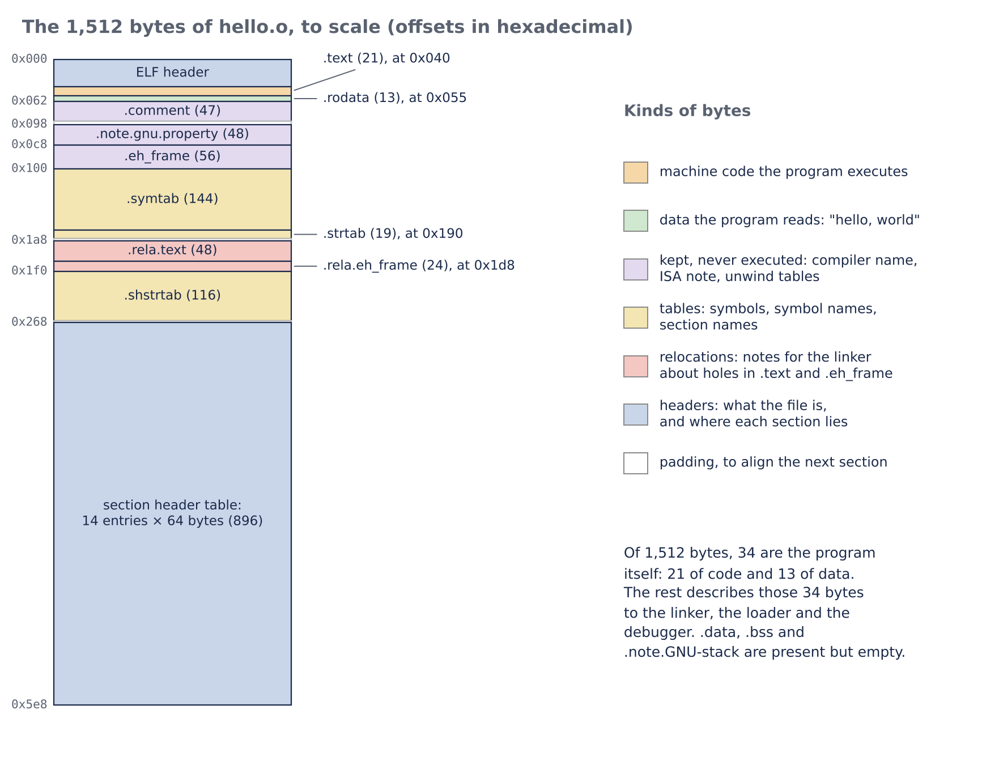

ref: 03.05
title: Assembling: Object Files
chapter: Chapter 03 — From Source Text to Running Program
part: Part I — The Machine Beneath C
builds: §01.05, §01.06, §03.01, §03.02, §03.04
---
## The question

§03.04 ended with a file of text, `hello.s`, and the assembler turned it into `hello.o`. This section opens that file. Several promises are due here. §01.05 and §01.06 introduced the idea of a **relocation**, a place in machine code that cannot be filled until the program's pieces are joined. §03.01 promised that the 13 bytes of `"hello, world"` would be found in a section called `.rodata`, and that the object file records the name of its source file. §03.02 found four zero bytes in `greet.o`, with the note `R_X86_64_PLT32 greet-0x4` beside them, and promised to explain both the name and the `-0x4`. §03.03 and §03.04 left the letters `t` and `a` in `avr-nm`'s output, and a handful of section names, waiting for an explanation.

Six puzzles, all from your Fedora:

- `hello.o` is 1,512 bytes long, but its machine code is 21 bytes and its only data 13 bytes. What are the other 1,478?
- The call to `puts` in `hello.o` is `e8 00 00 00 00`, and `objdump` says it calls `e <main+0xe>`, the very next instruction.
- `main` begins at address 0 in `hello.o`, and in every object file every section begins at address 0.
- A file declaring an array of a million bytes of zeros (Listing 03.05-2, below) produces an object file of 1,360 bytes; give one element the value 1, and the file grows to 1,001,368 bytes.
- `chmod +x hello.o; ./hello.o` gives `cannot execute binary file: Exec format error`, although the file holds the very machine code that runs perfectly in `hello`.
- The linker itself, run directly on `hello.o` (`ld hello.o`), refuses: it cannot find `puts`, and it warns that there is no "entry symbol `_start`".

The questions are:

- What does the assembler do, and how does it produce the file?
- What is the file's format, and what is in each part of it?
- Where does each kind of C object (code, initialized and uninitialized variables, constants, string literals) end up, and why are they kept apart?
- What are the symbol table and the relocations, exactly, down to the byte, and how will the linker use them?
- Which tools show each part, and why is there more than one?
- Why is an object file not yet a program?

§21.03 returns to object files and symbols in more depth, §27.01 to sections and the segments a loader maps, and §21.04 to the linker's resolution of names. This section aims to make every byte of `hello.o` accountable.

## The journey

### What the assembler does

An **assembler** translates assembly language into machine code. Most of that translation is a table lookup: `pushq %rbp` becomes the byte `55`, `ret` becomes `c3`. Three things make it more than a lookup.

First, **labels**. An instruction such as `jmp .L2` must contain the distance to `.L2`, and `.L2` may appear later in the file, after the assembler has already reached the jump. Assemblers solve this *forward reference* either by reading the program twice (once to find where every label is, once to write the code) or by remembering each unfinished instruction and finishing it when the label turns up; the GNU assembler uses the second approach. Either way, the assembler must know, at every line, the address at which the next byte will go. It keeps that address in a **location counter**.

Second, **sections**. As §03.04 showed, the directives `.text` and `.section .rodata` move the assembler between separate pieces of the output. It keeps a location counter for each section, and every section begins at 0.

There is a complication on x86: the *length* of a jump depends on its distance. A jump of fewer than 128 bytes in either direction fits in a 2-byte form (`eb` and a 1-byte distance), a longer one needs 5 bytes (`e9` and a 4-byte distance), and choosing between them moves every later label. The GNU assembler therefore keeps the uncertain instructions as variable-size pieces and settles their sizes once all the labels in the section are known; §03.02's Experiment 03.02-7 found such a short jump, `eb 0a`. (This description of the GNU assembler's method is the author's summary of its documented design, not a quotation.)

Third, **what the assembler cannot know**. A label in the same section of the same file can be measured. But the address of `puts`, which is in another file, or of the string, which is in another section whose final address depends on everything else the linker will combine, cannot. For each such place the assembler writes zeros and a note, a relocation, which the rest of this section examines.

You can watch the location counters at work. The option `-al` makes the GNU assembler print a **listing**, its input with the address and bytes it produced for each line:

```terminal
$ as -al=hello.lst hello.s -o /dev/null && cat hello.lst
```

```output
GAS LISTING hello.s 			page 1


   1              		.file	"hello.c"
   2              		.text
   3              		.section	.rodata
   4              	.LC0:
   5 0000 68656C6C 		.string	"hello, world"
   5      6F2C2077 
   5      6F726C64 
   5      00
   6              		.text
   7              		.globl	main
   8              		.type	main, @function
   9              	main:
  10              	.LFB0:
  11 0000 14000000 		.cfi_startproc
  11      00000000 
  11      017A5200 
  11      01781001 
  11      1B0C0708 
  12 0000 55       		pushq	%rbp
  13 0029 410E10   		.cfi_def_cfa_offset 16
  14 002c 8602     		.cfi_offset 6, -16
  15 0001 4889E5   		movq	%rsp, %rbp
  16 002e 430D06   		.cfi_def_cfa_register 6
  17 0004 BF000000 		movl	$.LC0, %edi
  17      00
  18 0009 E8000000 		call	puts
  18      00
  19 000e B8000000 		movl	$0, %eax
  19      00
  20 0013 5D       		popq	%rbp
  21 0031 500C0708 		.cfi_def_cfa 7, 8
  22 0014 C3       		ret
  23 0035 000000   		.cfi_endproc
  24              	.LFE0:
  25              		.size	main, .-main
  26              		.ident	"GCC: (GNU) 16.2.1 20261029 (Red Hat 16.2.1-3)"
  27              		.section	.note.GNU-stack,"",@progbits
```

The second column is the location counter of the current section. The string occupies `.rodata` from 0000: `68 65 6C 6C …` are the ASCII codes of `h`, `e`, `l`, `l`, ending with the zero byte, 13 bytes in all, as §03.01 promised. The instructions occupy `.text` from 0000 to 0014. And the `.cfi` lines, which §03.04 said produce bytes for a separate section, do: their counter runs 0000, 0029, 002c, 002e, 0031, 0035, interleaved with the `.text` counter. Beside each `.cfi` line the listing shows the bytes of `.eh_frame` that encode it, at the place they will occupy there; the assembler does not write them as it goes, but records each directive and writes the whole `.eh_frame` at the end of the assembly. (Decoded: 0x00 to 0x17 is a fixed preamble; `41` advances the position by one instruction byte, `0e 10` says the frame address is now `rsp` + 16, `86 02` says `rbp` was saved 16 bytes below it, `43` advances three bytes, `0d 06` says the frame address is now computed from `rbp`, `50` advances 16 bytes, `0c 07 08` says it is again `rsp` + 8, and three zero bytes pad the record to 56 bytes.) Notice also `BF000000 00` and `E8000000 00`: the two holes, already present in the assembler's output.

Is this listing the same assembly that `gcc -c` performs? GCC's driver runs the same `as` (§03.02). On the reader's machine, assembling `hello.s` by hand and comparing the result with the `hello.o` that `gcc -c hello.c` produced (the command is repeated in the next block) gives no difference:

```terminal
$ gcc -std=c23 -Wall -Wextra -pedantic -S hello.c -o hello.s
$ as hello.s -o hello_as.o && cmp hello.o hello_as.o && echo identical
```

```output
identical
```

### ELF: the format of the file

```terminal
$ gcc -std=c23 -Wall -Wextra -pedantic -c hello.c -o hello.o
$ ls -l hello.o && file hello.o
```

```output
-rw-r--r--. 1 serajus21 serajus21 1512 Nov 26 22:31 hello.o
hello.o: ELF 64-bit LSB relocatable, x86-64, version 1 (SYSV), not stripped
```

`file` recognizes the **ELF** format, the *Executable and Linking Format* (sometimes expanded as "Executable and Linkable Format"). On Linux, the same format holds three kinds of file: **relocatable** object files such as `hello.o`, which are input to the linker; **executable** files such as `hello`; and **shared objects** such as `libc.so.6` (§21.06). "64-bit" and "x86-64" say which machine the code is for; "LSB" ("least significant byte first") says the numbers in the file are little-endian (§06.03); "not stripped" says it still contains its table of names.

:::history
ELF was created by Unix System Laboratories, the AT&T company responsible for Unix, for System V Release 4 at the end of the 1980s, as part of that system's *Application Binary Interface*. Earlier Unix systems had used a simple format called `a.out`, after the default name of the assembler's and linker's output, which survives today as the name GCC gives a program when you do not use `-o`; AT&T's second format, COFF, was more capable but still limited. The specification's preface says that ELF "was originally developed and published by UNIX System Laboratories (USL) as part of the Application Binary Interface (ABI)." In 1993 an industry consortium, the Tool Interface Standards (TIS) Committee, adopted ELF and published a specification of it, whose version 1.2 appeared in May 1995. Linux moved from `a.out` to ELF around 1995, partly, in the words of one historian of the formats, "because they'd chosen a hard-to-use approach to a.out shared libraries" (the format itself could carry shared libraries: SunOS 4.0 did so in 1988). Windows uses a different format, PE (*Portable Executable*), partly derived from COFF. (Sources: the TIS specification's own preface, and the histories listed at the end of this section.)
:::

### The ELF header, byte by byte

Every ELF file begins with a fixed-size **ELF header**, which says what the file is and where to find everything else. Here are the first 64 bytes of `hello.o` as `xxd` shows them (offset, then 16 bytes in hexadecimal, then the same bytes as characters where they are printable):

```terminal
$ xxd -l 64 hello.o
```

```output
00000000: 7f45 4c46 0201 0100 0000 0000 0000 0000  .ELF............
00000010: 0100 3e00 0100 0000 0000 0000 0000 0000  ..>.............
00000020: 0000 0000 0000 0000 6802 0000 0000 0000  ........h.......
00000030: 0000 0000 4000 0000 0000 4000 0e00 0d00  ....@.....@.....
```

and `readelf -h`, which decodes them:

```terminal
$ readelf -h hello.o
```

```output
ELF Header:
  Magic:   7f 45 4c 46 02 01 01 00 00 00 00 00 00 00 00 00 
  Class:                             ELF64
  Data:                              2's complement, little endian
  Version:                           1 (current)
  OS/ABI:                            UNIX - System V
  ABI Version:                       0
  Type:                              REL (Relocatable file)
  Machine:                           Advanced Micro Devices X86-64
  Version:                           0x1
  Entry point address:               0x0
  Start of program headers:          0 (bytes into file)
  Start of section headers:          616 (bytes into file)
  Flags:                             0x0
  Size of this header:               64 (bytes)
  Size of program headers:           0 (bytes)
  Number of program headers:         0
  Size of section headers:           64 (bytes)
  Number of section headers:         14
  Section header string table index: 13
```

Read the bytes against the decoding.

1. **`7f 45 4c 46`**: the **magic number**, the byte 0x7f followed by the ASCII codes of `E`, `L` and `F`. Every ELF file begins with these four bytes, so that a program (the kernel, `file`, the linker) can recognize the format from the first four bytes alone. (A first byte that is not a printable character makes it unlikely that a text file begins the same way; that is the author's reading of the choice, not a statement of the specification.)
2. **`02 01 01 00 00`**: the **class** (2: 64-bit), the **data encoding** (1: little-endian two's complement), the ELF **version** (1), the **OS/ABI** (0: System V, the generic value) and the **ABI version** (0). The other seven of the first 16 bytes are padding. (The OS/ABI byte is not always 0 on Linux: a file that uses GNU extensions of ELF carries 3, and `readelf -h /lib64/libc.so.6` prints `OS/ABI: UNIX - GNU` on the reader's machine. The original TIS specification had no OS/ABI or ABI version byte; later editions of the System V ABI added them.)
3. **`01 00`** at offset 0x10: the **type**, a 16-bit number stored little-endian, here 1, a relocatable file. (An executable is 2; a shared object or position-independent executable, 3.)
4. **`3e 00`**: the **machine**, 0x3e = 62, the number assigned to x86-64.
5. **`01 00 00 00`**: the version again, now as 32 bits.
6. Eight bytes of **entry point**, all zero: the address at which a program would begin running. An object file is not run, so it has none.
7. Eight bytes giving the position in the file of the **program header table**, zero: there is none (see "Why an object file is not yet a program", below).
8. **`68 02 00 00 00 00 00 00`**: the position of the **section header table**, 0x268 = 616 bytes into the file.
9. After four bytes of flags (zero on x86-64): **`40 00`**, the size of this header, 64 bytes; two zero sizes and counts for the absent program headers; **`40 00`**, the size of each section header, 64; **`0e 00`**, the number of section headers, 14; and **`0d 00`**, 13, the index of the section that holds the sections' names.

The header is a small table of contents. To find anything else, a program reads these 64 bytes, goes to byte 616, and reads 14 section headers of 64 bytes each.

### Sections

`readelf -S` prints the section header table (in its narrow form, two lines per section):

```terminal
$ readelf -S hello.o
```

```output
There are 14 section headers, starting at offset 0x268:

Section Headers:
  [Nr] Name              Type             Address           Offset
       Size              EntSize          Flags  Link  Info  Align
  [ 0]                   NULL             0000000000000000  00000000
       0000000000000000  0000000000000000           0     0     0
  [ 1] .text             PROGBITS         0000000000000000  00000040
       0000000000000015  0000000000000000  AX       0     0     1
  [ 2] .rela.text        RELA             0000000000000000  000001a8
       0000000000000030  0000000000000018   I      11     1     8
  [ 3] .data             PROGBITS         0000000000000000  00000055
       0000000000000000  0000000000000000  WA       0     0     1
  [ 4] .bss              NOBITS           0000000000000000  00000055
       0000000000000000  0000000000000000  WA       0     0     1
  [ 5] .rodata           PROGBITS         0000000000000000  00000055
       000000000000000d  0000000000000000   A       0     0     1
  [ 6] .comment          PROGBITS         0000000000000000  00000062
       000000000000002f  0000000000000001  MS       0     0     1
  [ 7] .note.GNU-stack   PROGBITS         0000000000000000  00000091
       0000000000000000  0000000000000000           0     0     1
  [ 8] .note.gnu.pr[...] NOTE             0000000000000000  00000098
       0000000000000030  0000000000000000   A       0     0     8
  [ 9] .eh_frame         PROGBITS         0000000000000000  000000c8
       0000000000000038  0000000000000000   A       0     0     8
  [10] .rela.eh_frame    RELA             0000000000000000  000001d8
       0000000000000018  0000000000000018   I      11     9     8
  [11] .symtab           SYMTAB           0000000000000000  00000100
       0000000000000090  0000000000000018          12     4     8
  [12] .strtab           STRTAB           0000000000000000  00000190
       0000000000000013  0000000000000000           0     0     1
  [13] .shstrtab         STRTAB           0000000000000000  000001f0
       0000000000000074  0000000000000000           0     0     1
Key to Flags:
  W (write), A (alloc), X (execute), M (merge), S (strings), I (info),
  L (link order), O (extra OS processing required), G (group), T (TLS),
  C (compressed), x (unknown), o (OS specific), E (exclude),
  D (mbind), l (large), p (processor specific)
```

(Section 8's long name, `.note.gnu.property`, is shortened to `.note.gnu.pr[...]` in this form; `readelf -S -W` prints it whole, with each section on one wide line.) Each row describes one section, and the columns answer the questions anyone handling it must ask:

- **Type**: what kind of contents. `PROGBITS` ("program bits") is data defined by the program, code or data, stored in the file; `NOBITS` is a section that occupies memory when the program runs but *no bytes in the file*; `RELA`, `SYMTAB`, `STRTAB` and `NOTE` are relocations, a symbol table, a string table and notes. Section 0 is a required empty entry.
- **Address**: where the section will be in memory. Zero for every section of an object file, because nobody has decided yet; the linker will (§03.06).
- **Offset** and **Size**: where its bytes are in the file, and how many. `.text` is 0x15 = 21 bytes at offset 0x40, immediately after the header.
- **EntSize** ("entry size"): for sections that are tables, the size of each entry. The relocation sections have entries of 0x18 = 24 bytes, the symbol table too.
- **Flags**: what the section needs at run time. `A` ("alloc"): it occupies memory in the running program. `X`: it may be executed. `W`: it may be written. So `.text` is `AX`, `.data` and `.bss` are `WA`, and `.rodata` is `A` alone, read-only. `M` and `S` mark `.comment` as made of strings that the linker may merge (its EntSize, 1, is the size of each character). `I` says that the **Info** column holds the number of a section: for a relocation section, the section it applies to, so `.rela.text` applies to section 1, `.text`. (For `.symtab`, Info means something else, explained under "The symbol table".)
- **Link**: a related section. Both relocation sections link to section 11, the symbol table, whose names they use, and the symbol table links to section 12, the string table that holds those names.
- **Align**: the alignment the section requires (§06.04), a power of two: 8 for the tables of 8-byte numbers, 1 for strings, and 1 for this code, because GCC at `-O0` asks for none (at `-O2` it aligns functions, and the linked `hello`'s `.text` has an alignment of 16).

Table 03.05-1 sorts the 14 sections by purpose, and Figure 03.05-1 shows where each lies in the file.

Table: Table 03.05-1  The sections of hello.o on the reader's Fedora
<!-- widths: 22,9,69 -->
| Section | Bytes | Contents and purpose |
|---|---|---|
| `.text` | 21 | the machine code of `main` |
| `.rodata` | 13 | read-only data: `"hello, world"` and its terminating zero |
| `.data` | 0 | initialized, writable variables: none in this program |
| `.bss` | 0 | writable variables that start as zero: none (and no file bytes even when there are) |
| `.rela.text` | 48 | two relocations for holes in `.text`, 24 bytes each |
| `.eh_frame` | 56 | the call frame information of the `.cfi` directives (§03.04) |
| `.rela.eh_frame` | 24 | one relocation for `.eh_frame`, which must refer to the address of `main` |
| `.symtab` | 144 | the symbol table: six entries of 24 bytes |
| `.strtab` | 19 | the names used by the symbol table |
| `.shstrtab` | 116 | the names of the sections themselves |
| `.comment` | 47 | the compiler's identification, from `.ident` |
| `.note.gnu.property` | 48 | properties of the code for the linker and loader: here, that it needs only the baseline x86-64 instruction set |
| `.note.GNU-stack` | 0 | an empty marker: the code does not need an executable stack |
| (section 0) | 0 | the required null entry |

{w=16}

:::hood
The section header table is the largest part of the file, 896 of its 1,512 bytes, so here is one entry, section 1, `.text`, at offset 0x268 + 64 = 0x2a8 (`xxd -s 0x2a8 -l 64 hello.o`):

```output
000002a8: 2000 0000 0100 0000 0600 0000 0000 0000   ...............
000002b8: 0000 0000 0000 0000 4000 0000 0000 0000  ........@.......
000002c8: 1500 0000 0000 0000 0000 0000 0000 0000  ................
000002d8: 0100 0000 0000 0000 0000 0000 0000 0000  ................
```

In order: the name's position in `.shstrtab`, 0x20; the type, 1 (`PROGBITS`); the flags, 6, which is 2 (alloc) + 4 (execute), the `AX` of `readelf`; eight bytes of address, 0; the offset, 0x40; the size, 0x15; the link and info, 0 and 0; the alignment, 1; and the entry size, 0. Now look at position 0x20 of `.shstrtab`, the section that holds the sections' names (`readelf -x .shstrtab hello.o`): it is inside `.rela.text`, which begins at 0x1b, and position 0x20 is where the letters `.text` of `.rela.text` begin. The string `.text` is not stored separately; the name `.rela.text`, read from its fifth character, ends with the same zero byte and serves for both. `.eh_frame` shares the end of `.rela.eh_frame` in the same way. With that saving, the 116 bytes of `.shstrtab` hold exactly an initial zero byte and eleven names with their terminating zeros, which between them name all thirteen sections.
:::

The arithmetic closes. The header (64 bytes), the sections (21 + 13 + 47 + 48 + 56 + 144 + 19 + 48 + 24 + 116 = 536 bytes), the section header table (14 × 64 = 896 bytes) and 16 bytes of padding in three gaps (7 bytes after `.comment`, 5 after `.strtab` and 4 before the section header table), which keep each part on the alignment it requires, make 64 + 536 + 896 + 16 = 1,512. Of those bytes, 34 are the program; the rest describes the program to the programs that will handle it. `readelf -x .text hello.o` shows the 21 bytes of code, and adds a note that is the theme of the rest of this section: "This section has relocations against it, but these have NOT been applied to this dump."

:::why
Why separate sections at all, instead of one stream of bytes? Because the pieces have different needs, and the operating system enforces needs by pages of memory, not by bytes. Code must be executable and, for safety, not writable; constants must be readable and nothing else; variables must be writable and must not be executable (otherwise an attacker who writes into a variable could run what he wrote, §34.06). Keeping each kind together lets the linker gather the `.text` of every object file into one region, the `.rodata` into another and so on, and lets the loader give each region the right permissions (§27.01). Sections that no running program needs (the symbol table, the relocations, the comment) can be left out of memory altogether, which is what the absence of the `A` flag means.
:::

### Where each kind of object lands

`hello.c` has no variables, so most sections are empty. Listing 03.05-1 has one of each kind.

```c Listing 03.05-1  sections.c: one object of each kind
// sections.c
// One object of each kind, to see where each one lands.
#include <stdio.h>

int counter = 42;                    // a global with an initializer
int zeros[1000];                     // a global without one
const int primes[4] = {2, 3, 5, 7};  // a global constant
static int hidden = 7;               // visible only in this file
extern int elsewhere;                // declared here, defined elsewhere

static int helper(int x) {           // a function visible only in this file
    static int calls;                // keeps its value between calls
    ++calls;
    return x + calls + hidden;
}

int main(void) {
    printf("%s %d %d %d\n", "sections", counter, primes[2], helper(zeros[0]));
    return elsewhere;
}
```

`nm` lists the symbols of an object file, one per line: a value (for a defined symbol, its offset within its section), a letter giving its kind, and its name.

```terminal
$ gcc -std=c23 -Wall -Wextra -pedantic -c sections.c -o sections.o && nm sections.o
```

```output
0000000000000fa0 b calls.0
0000000000000000 D counter
                 U elsewhere
0000000000000000 t helper
0000000000000004 d hidden
000000000000002b T main
0000000000000000 R primes
                 U printf
0000000000000000 B zeros
```

The letter tells which section each object went to, and its case tells whether the name is visible to other files: uppercase for **global** symbols, lowercase for **local** ones. Table 03.05-2 decodes them.

Table: Table 03.05-2  Where each object of sections.c went, by nm's letters
<!-- widths: 22,8,16,54 -->
| Object | Letter | Section | Why there |
|---|---|---|---|
| `main` | `T` | `.text` | code; global, so other files (the C library's startup code) can call it |
| `helper` | `t` | `.text` | code; `static`, so the name is local to this file |
| `counter` | `D` | `.data` | writable, with an initial value (42) that must be stored in the file |
| `hidden` | `d` | `.data` | the same, but `static`: local |
| `zeros` | `B` | `.bss` | writable, starting as zero: only its size is stored |
| `calls.0` | `b` | `.bss` | the `static` variable inside `helper`: it lives as long as the program (§20.02), starts as zero, and is local; GCC adds `.0` to its name, because several functions may each have a `static` variable called `calls` |
| `primes` | `R` | `.rodata` | `const` with an initializer: read-only data |
| `printf`, `elsewhere` | `U` | none | **undefined**: used here, defined in some other file |

One letter you will meet in older books does not appear here: `C`, for "common". Before GCC 10, a global declared without an initializer, such as `zeros`, was by default a *common symbol*, which the linker merged with any other definition of the same name instead of reporting a conflict; GCC 10 changed the default to `-fno-common`. With `-fcommon`, on the reader's machine, `nm` shows `C zeros` and `readelf -s` shows its section as `COM`. §21.04 explains what the linker does with such symbols.

Three details deserve attention. First, the string literals `"sections"` and `"%s %d %d %d\n"` have no symbols at all: they are in `.rodata` (at offsets 0x10 and 0x19, after the 16 bytes of `primes`), and the code refers to them by their position in the section, as the relocations below show. Second, `objdump -s` shows that `.data` holds exactly `2a000000 07000000`: 42 and 7, little-endian, the initial values of `counter` and `hidden`. Third, `.bss` has a size of 4,004 bytes in `readelf -S` (the 4,000 of `zeros` and the 4 of `calls.0`) and an offset in the file, but its type is `NOBITS`: those 4,004 bytes are not in the file.

Listings 03.05-2 and 03.05-3 make the point at a larger scale. `bss.c` declares a million bytes of zeros; `data.c` is identical except that the array begins `= {1}`, so its first element is 1.

```c Listing 03.05-2  bss.c: a million bytes of zeros
// bss.c
// A million bytes of zeros, without storing them.
int big[250000];

int main(void) {
    return big[0];
}
```

```c Listing 03.05-3  data.c: the same array, with one element that is not zero
// data.c
// The same array, with one element that is not zero.
int big[250000] = {1};

int main(void) {
    return big[0];
}
```

```terminal
$ gcc -std=c23 -Wall -Wextra -pedantic -c bss.c data.c
$ ls -l bss.o data.o && size bss.o data.o
```

```output
-rw-r--r--. 1 serajus21 serajus21    1360 Nov 26 22:31 bss.o
-rw-r--r--. 1 serajus21 serajus21 1001368 Nov 26 22:31 data.o
   text	   data	    bss	    dec	    hex	filename
    116	      0	1000000	1000116	  f42b4	bss.o
    116	1000000	      0	1000116	  f42b4	data.o
```

(`size` puts every allocated section that is not writable into its `text` column, so 116 is not code alone: `bss.o`'s 12 bytes of `.text`, 48 of `.note.gnu.property` and 56 of `.eh_frame`. In the same way, `size hello.o` reports `text 138` = 21 + 13 + 48 + 56, which is why §03.04's code sizes had to be taken from `size -A`.) One nonzero element moved a million bytes from `.bss`, where only the number 1,000,000 is stored, to `.data`, where all of them are: 999,999 zeros and a 1, which the file must contain because the loader will copy them into memory. C requires that an object with static storage duration and no initializer start as zero (§06.05), and the `.bss` section exists so that the file need not store zeros it can describe in eight bytes. The loader, or the startup code on a microcontroller (§36.05), sets the memory to zero instead. (The name `.bss` is usually traced to an old assembler directive, "block started by symbol", which reserved a block of memory under a name; the expansion is historical, and the meaning today is simply "zero-initialized data".)

:::myth
"A `const` variable is in read-only memory, so writing to it crashes the program." Sometimes. A `const` object *defined* at file scope with an initializer, such as `primes`, is placed in `.rodata`, which the loader maps without write permission on Linux, and writing to it through a cast does fault there: on the reader's machine, a program that stores 9 through `(int *)&primes[2]` was stopped with `Segmentation fault`. But the C standard says only that modifying a `const` object is undefined behavior (§06.06); a `const` local variable lives on the stack, which is writable, and on the ATmega328P `.rodata` is copied into RAM (see "On the AVR" below), where nothing stops a write. `const` is a promise you make to the compiler, not a guarantee from the hardware. Note also what the compiler did with the promise: `main`'s code contains `mov $0x5,%ecx`, the value of `primes[2]`, used directly, even at `-O0`; the author's reading is that the compiler may do so because a `const` object with a known initializer cannot legally change.
:::

### The symbol table

The letters of `nm` come from the **symbol table**, the section `.symtab`. `readelf -s` prints it in full:

```terminal
$ readelf -s hello.o
```

```output

Symbol table '.symtab' contains 6 entries:
   Num:    Value          Size Type    Bind   Vis      Ndx Name
     0: 0000000000000000     0 NOTYPE  LOCAL  DEFAULT  UND 
     1: 0000000000000000     0 FILE    LOCAL  DEFAULT  ABS hello.c
     2: 0000000000000000     0 SECTION LOCAL  DEFAULT    1 .text
     3: 0000000000000000     0 SECTION LOCAL  DEFAULT    5 .rodata
     4: 0000000000000000    21 FUNC    GLOBAL DEFAULT    1 main
     5: 0000000000000000     0 NOTYPE  GLOBAL DEFAULT  UND puts
```

Each **symbol** is a name with information attached:

- **Value**: for a defined symbol, its offset within its section. `main` is at offset 0 of `.text`.
- **Size**: in bytes, from the `.size` directive: `main` is 21 bytes long.
- **Type**: `FUNC` for code, `OBJECT` for data (none here; `sections.o` has several), `SECTION` for a symbol standing for a whole section, `FILE` for the name of the source file, `NOTYPE` when nothing is known.
- **Bind** ("binding"): `LOCAL` names are private to this file; `GLOBAL` names may be used by, or provided to, other files (C's *linkage*, §20.03). Local symbols always come first in the table: the section header's **Info** column for `.symtab`, 4, is the index of the first global one.
- **Ndx**: the section the symbol belongs to, by number (1 is `.text`), or a special value: `UND` for an **undefined** symbol, one this file uses but does not define, and `ABS` for an absolute value that belongs to no section.

Entry 1 is the promise of §03.01: the symbol of type `FILE` records the name of the source file, `hello.c` (`nm -a hello.o` lists it, with the letter `a`, together with the section symbols, `r .rodata` and `t .text`). You have already seen it used. The linker's error message about `puts`, shown below under "Why an object file is not yet a program", begins `hello.c:(.text+0xa):`, and takes the name `hello.c` from this symbol: on the reader's machine, after the symbol was removed (`objcopy --strip-symbol=hello.c hello.o nofile.o`), `ld nofile.o` reported the same undefined reference beginning only `(.text+0xa):`, with no file name. (Debuggers have a fuller record of source files in the debugging information that `-g` adds, §03.08.) Entries 2 and 3 stand for the sections `.text` and `.rodata` themselves; the relocations use them. Entry 4 is `main`, defined in section 1. Entry 5 is `puts`, used but not defined: the hole the linker must fill. And the label `.LC0` is not here at all, as §03.04 said: the assembler keeps names beginning `.L` out of the table, and refers to the string through the section symbol `.rodata` instead.

Where are the names? Not in the entries, which have a fixed size of 24 bytes. Each entry holds the *position* of its name in a separate section of strings, `.strtab`, which is just the names one after another, each ending with a zero byte:

```terminal
$ readelf -x .strtab hello.o
```

```output

Hex dump of section '.strtab':
  0x00000000 0068656c 6c6f2e63 006d6169 6e007075 .hello.c.main.pu
  0x00000010 747300                              ts.
```

The table begins with a zero byte (position 0, the empty name of entry 0), then `hello.c` at position 1, `main` at 9 and `puts` at 0xe. Here is `main`'s entry, the fifth 24-byte entry of `.symtab`, from `readelf -x .symtab hello.o` (bytes 0x60 to 0x77):

```output
  0x00000060 09000000 12000100 00000000 00000000 ................
  0x00000070 15000000 00000000                   ........
```

(The second line is the first half of the line `readelf` printed, which continues with the next entry.) Decoded with the layout of a 64-bit ELF symbol: `09000000` is the name's position, 9 (`main`); `12` packs two fields into one byte, the binding in the high four bits (1, `GLOBAL`) and the type in the low four (2, `FUNC`); `00` is the visibility (default); `0100` is the section index, 1; the next eight bytes are the value, 0; and `15000000 00000000` is the size, 0x15 = 21. Every column of `readelf -s` is one of these fields. (`puts`'s entry, the next one, has `0e000000` for its name, `10` for global with no type, and section index 0, undefined.)

:::precise
"Global" and "local" in the symbol table are the object file's version of C's **linkage** (§20.03). A name with *external* linkage, such as `main`, `counter` or `printf`, becomes a `GLOBAL` symbol; a name with *internal* linkage, made by `static` at file scope, such as `helper` and `hidden`, becomes a `LOCAL` one, which the linker will never match with a name in another file. A `static` variable inside a function has no linkage at all in C, but it still needs a place in memory and a name in the object file, so GCC invents a local one, `calls.0`. Local variables without `static` (automatic storage, §20.02) have no symbol table entry and no section: they exist only on the stack, while their function runs (with `-g`, the debugging information describes where to find them).
:::

### Relocations: holes with notes

Now the holes. `readelf -r` prints the relocation sections:

```terminal
$ readelf -r hello.o
```

```output

Relocation section '.rela.text' at offset 0x1a8 contains 2 entries:
  Offset          Info           Type           Sym. Value    Sym. Name + Addend
000000000005  00030000000a R_X86_64_32       0000000000000000 .rodata + 0
00000000000a  000500000004 R_X86_64_PLT32    0000000000000000 puts - 4

Relocation section '.rela.eh_frame' at offset 0x1d8 contains 1 entry:
  Offset          Info           Type           Sym. Value    Sym. Name + Addend
000000000020  000200000002 R_X86_64_PC32     0000000000000000 .text + 0
```

(This narrow form prints the 64-bit offset and info fields with their leading zeros cut to 12 digits; the hood box below shows them in full.)

and `objdump -dr` shows each note under the instruction it belongs to:

```terminal
$ objdump -dr hello.o | sed -n '/<main>:/,$p'
```

```output
0000000000000000 <main>:
   0:	55                   	push   %rbp
   1:	48 89 e5             	mov    %rsp,%rbp
   4:	bf 00 00 00 00       	mov    $0x0,%edi
			5: R_X86_64_32	.rodata
   9:	e8 00 00 00 00       	call   e <main+0xe>
			a: R_X86_64_PLT32	puts-0x4
   e:	b8 00 00 00 00       	mov    $0x0,%eax
  13:	5d                   	pop    %rbp
  14:	c3                   	ret
```

A **relocation** names a place (the **offset** within the section the relocation applies to), a **symbol**, a **type**, which says how to compute the value and how wide the hole is, and an **addend**, a number to add. The first entry says: at offset 5 of `.text`, the four bytes after `bf`, write the address of `.rodata` plus 0, as a 32-bit number. The second says: at offset 0xa, the four bytes after `e8`, write a value computed from `puts` with an addend of −4, by the rule of type `R_X86_64_PLT32`. Until those values are written, the code is wrong: `mov $0x0,%edi` would pass a null pointer to `puts`, and `call e` would call the next instruction, which is why `objdump` prints the target as `e <main+0xe>`.

The rules for each type are fixed by the System V ABI's x86-64 supplement, the same document as the calling convention of §03.04, in a table of relocation types. Its rows for the three types in this section read:

```text
R_X86_64_PC32    2   word32   S + A - P
R_X86_64_PLT32   4   word32   L + A - P
R_X86_64_32     10   word32   S + A
```

The second column is the number that identifies the type in the file; `word32` says the hole is 32 bits wide; the last column is the calculation. The letters are defined there: "A Represents the addend used to compute the value of the relocatable field." "P Represents the place (section offset or address) of the storage unit being relocated (computed using r_offset)." "S Represents the value of the symbol whose index resides in the relocation entry." "L Represents the place (section offset or address) of the Procedure Linkage Table entry for a symbol."

**`R_X86_64_32`: an absolute address.** The value is S + A: the address the string will have, plus 0. It is "absolute": the same wherever the instruction itself ends up. It can be used only because the non-PIE program is placed low in memory: the ABI's default "small code model" keeps a program's code and data in the lowest 2 GB of the address space, and requires that "The linker must verify that the generated value for the R_X86_64_32 (R_X86_64_32S) relocation zero-extends (sign-extends) to the original 64-bit value."

**`R_X86_64_PLT32`: a distance to a function, and the −4.** A `call` holds not an address but a distance: the target minus the address of the *next* instruction (§03.04). The relocation's place P is the address of the hole itself, which begins immediately after the `e8` byte and ends four bytes later, where the next instruction begins. So the distance the processor needs is target − (P + 4) = target + (−4) − P. The assembler, which knows the hole is 4 bytes wide and comes last in the instruction, puts the −4 in the addend, and the formula L + A − P then gives exactly the right distance. That is the `-0x4` of `greet.o` that §03.02 promised to explain. The `L` instead of `S` means "the address of the procedure linkage table entry for the symbol": if `puts` is in a shared library, the linker creates a small stub, `puts@plt` (§03.04, §03.06), and the call goes there; if the function turns out to be defined in the program itself, the linker may use its address directly. (The same −4 appears in `sections.o` for each `mov 0x0(%rip),%eax` that reads a global variable, with type `R_X86_64_PC32`, S + A − P: those instructions also end with their 4-byte displacement.)

**Checking the linker's arithmetic.** In the linked `hello` (§03.04), `main` is at 0x401136. The hole of the call is at offset 0xa, so P = 0x401136 + 0xa = 0x401140. The stub `puts@plt` is at L = 0x401030. L + A − P = 0x401030 − 4 − 0x401140 = −0x114, which as a 32-bit two's-complement number is 0xfffffeec, stored little-endian as `ec fe ff ff`: exactly the bytes in `hello`. For the string: the linker's map of `hello` (`-Wl,-Map=hello.map`, §27.04) shows that the program's `.rodata` begins at 0x4004a0 with 4 bytes from the C library's startup file `crt1.o` (the symbol `_IO_stdin_used`), 4 bytes of padding, and 8 bytes from `crtbegin.o`, and that `hello.o`'s 13 bytes follow at 0x4004b0. So S + A = 0x4004b0 + 0 = 0x4004b0, stored as `b0 04 40 00`, again exactly the bytes in `hello`. Every byte of `main` in the program is now accounted for: 13 from `hello.o` as they were, and 8 written by the linker according to two notes.

**`greet.o`, and a function found in the program.** §03.02's `greet.o` has one relocation, `R_X86_64_PLT32 greet - 4` at offset 5. Linked with `greet_def.o`, which defines `greet` (Experiment 03.02-5), the call becomes `e8 07 00 00 00` at 0x40113a, `call 401146 <greet>`: a direct call, with no stub, because `greet` is part of the program. P = 0x40113b, and 0x401146 − 4 − 0x40113b = 7.

**Local names, through their sections.** In `sections.o`, the code refers to `hidden` and `calls.0`, but the relocations name `.data + 0` and `.bss + f9c` instead. This is a choice the GNU assembler makes: its source code (`write.c`) says it will "Convert relocs against local symbols to refer to the corresponding section symbol plus offset instead", and folds the offset into the addend: `calls.0` is at offset 0xfa0 of `.bss`, and 0xfa0 − 4 = 0xf9c; `hidden` is at offset 4 of `.data`, and 4 − 4 = 0. Global symbols such as `zeros` and `counter` are named directly; the same source explains: "If the symbol is undefined, common, weak, or global (ELF shared libs), we can't replace it with the section symbol", because another file might provide or replace them (§21.04). (On the AVR, below, you will see the assembler keep some local names after all.) And the call to `helper`, a local function in the same section of the same file, has no relocation at all: `e8 c4 ff ff ff`, a distance of −60, was computed by the assembler, which knew both ends of the jump.

:::hood
Here are the 48 bytes of `.rela.text` in `hello.o` (`readelf -x .rela.text hello.o`):

```output
  0x00000000 05000000 00000000 0a000000 03000000 ................
  0x00000010 00000000 00000000 0a000000 00000000 ................
  0x00000020 04000000 05000000 fcffffff ffffffff ................
```

Each relocation is 24 bytes: an 8-byte **offset** (5, then 0xa), an 8-byte **info** field, and an 8-byte signed **addend**. The info field packs two numbers: its low 32 bits are the type, and its high 32 bits are the index of the symbol in `.symtab`. The first entry's info, `0a000000 03000000` read little-endian, is 0x000000030000000a: type 10 (`R_X86_64_32`), symbol 3 (`.rodata`); its addend is 0. The second's is 0x0000000500000004: type 4 (`R_X86_64_PLT32`), symbol 5 (`puts`); its addend is `fcffffff ffffffff`, which is −4 in 64-bit two's complement. The ABI says that "The AMD64 ABI architectures uses only Elf64_Rela relocation entries with explicit addends" (the grammar is the document's): the addend lives in the relocation, not in the hole, which is why every hole in an x86-64 object file contains zeros. The older 32-bit x86 uses relocations without an addend field, called REL, in sections named `.rel.text`, and keeps the addend in the hole itself: on the reader's machine, `call puts` assembled for 32 bits (`as --32`) is `e8 fc ff ff ff`, with the −4 already in the hole, and the relocation `R_386_PC32 puts` carries no number. For a 32-bit distance this works well enough. It fails when the hole is narrower than the value: the AVR's `R_AVR_HI8_LDI .LC0 + e` (below) fills an 8-bit field with the high byte of an address plus 14, and that high byte depends on whether adding 14 to the low byte carries, which no 8-bit hole holding only the high byte of 14 could record. The ELF specification leaves the choice to each processor's ABI: "Depending on the processor architecture, one form or the other might be necessary or more convenient."
:::

### The tools, and why there are several

Table 03.05-3 collects the tools this section has used. All but `file` and `xxd` come from GNU binutils, the same package as `as` and `ld` (`rpm -qf` names `file`, `xxd` and `binutils` as their packages on the reader's machine).

Table: Table 03.05-3  Tools for looking inside object files
<!-- widths: 26,74 -->
| Command | What it shows |
|---|---|
| `file x.o` | what kind of file it is, from its headers |
| `size x.o`, `size -A x.o` | the sizes of the sections (`-A`: each section separately) |
| `nm x.o` | the symbols, with a letter for each kind; `-a` also shows file and section symbols |
| `objdump -d x.o` | the code, disassembled; with `-r`, the relocations under their instructions |
| `objdump -h x.o`, `-s -j NAME` | section headers; the contents of one section in hexadecimal |
| `readelf -h`, `-S`, `-s`, `-r` | the ELF header, the section headers, the symbol table, the relocations, exactly as stored |
| `readelf -x NAME`, `-p NAME`, `-n`, `-l` | a section in hexadecimal; its strings; the notes; the program headers |
| `xxd -l N file` | the raw bytes of any file |

Why both `objdump` and `readelf`? `objdump` is built on a library, BFD ("binary file descriptor"), that reads many object formats through a common interface, so the same `objdump` can describe ELF, PE and others; it presents files through BFD's general model. You can see the model at work: `objdump -h hello.o` lists only 8 sections where `readelf -S` lists 14. The null entry, the two relocation sections, the symbol table and both string tables are not shown as sections, because BFD represents them in its own way (relocations become a flag, `RELOC`, on `.text` and `.eh_frame`), and alignments appear as powers of two (`2**3`). `readelf` reads ELF and nothing else, field by field. Its manual says: "This program performs a similar function to objdump but it goes into more detail and it exists independently of the BFD library, so if there is a bug in BFD then readelf will not be affected." When the exact contents of an ELF file matter, `readelf` is the witness to trust; for disassembly, `objdump`.

### Why an object file is not yet a program

Gather the evidence. `hello.o` contains all of `main`'s instructions and all of its data, and still cannot run, for five reasons.

1. **Nothing has an address yet.** Every section starts at 0; `main` is at 0, the string is at 0, the `.eh_frame` is at 0. Many object files will be combined into one program, and only the linker, which sees them all, can give each piece its place.
2. **The holes are empty.** Two places in `main`'s code hold zeros, and the code is wrong until they are filled.
3. **Some names are only promises.** `puts` is `UND`: this file uses it and does not define it. Another file must supply it, or the program cannot be completed.
4. **There is no program to start.** The ELF header's type is `REL`, its entry point is 0, and there are no **program headers**, the table that tells the operating system what to load where and with which permissions.
5. **The code that calls `main` is missing.** `main` is called by the C library's startup code (§02.06), which is not in `hello.o`.

The fourth reason can be seen directly:

```terminal
$ readelf -l hello.o
```

```output

There are no program headers in this file.
```

The linked `hello` has type `EXEC`, entry point 0x401040, and 13 program headers. The kernel's loader for ELF programs accepts only executables and shared objects, and a file without program headers gives it nothing to load. When the kernel refuses a file, the shell reports it; that is the `Exec format error` of the opening puzzle (the words "cannot execute binary file" are the shell's, `bash` here, which otherwise might have tried to run the file as a script):

```terminal
$ cp hello.o h_exec.o && chmod +x h_exec.o && ./h_exec.o
```

```output
bash: line 1: ./h_exec.o: cannot execute binary file: Exec format error
```

For the fifth: the entry point of `hello`, 0x401040, is not `main` (0x401136) but a function called `_start` (`nm hello` lists `T _start` at 0x401040), from `crt1.o`. Running the linker alone on `hello.o` shows the third and fifth gaps at once:

```terminal
$ ld hello.o -o hello_ld
```

```output
/usr/bin/ld.bfd: warning: cannot find entry symbol _start; defaulting to 0000000000401000
/usr/bin/ld.bfd: hello.o: in function `main':
hello.c:(.text+0xa): undefined reference to `puts'
```

`.text+0xa` is the hole of the call, the second relocation. GCC's driver avoids both errors by giving the linker, besides `hello.o`, the startup files `crt1.o`, `crti.o` and `crtbegin.o` before it, the libraries `-lgcc` and `-lc` after it, and `crtend.o` and `crtn.o` at the end (the command that `gcc -v` printed on the reader's machine lists them in that order). That is §03.06's subject.

So an object file is a *piece* of a program: correct code and data, kept in separate sections, each starting at zero, with a list of the names it offers, a list of the names it needs, and a note for every place where a needed address must be written. It is designed to be combined, and it says exactly what combining it requires.

### On the AVR

`avr_hello.o`, from §03.01's `avr_hello.c` compiled at `-Os`, is the same kind of file for a different machine:

```terminal
$ avr-gcc -mmcu=atmega328p -std=c11 -Wall -Wextra -pedantic -Os -c avr_hello.c -o avr_hello.o
$ avr-readelf -h avr_hello.o | grep -E 'Class|Data|Type|Machine'
```

```output
  Class:                             ELF32
  Data:                              2's complement, little endian
  Type:                              REL (Relocatable file)
  Machine:                           Atmel AVR 8-bit microcontroller
```

ELF with 32-bit fields, little-endian, relocatable, for the AVR: the format is the same, and the details differ (a 52-byte header, 40-byte section headers, 16-byte symbols and 12-byte relocations). §03.04's `avr_ops.o` shows the AVR's form of a call: `avr-objdump -dr avr_ops.o` printed `call 0` with `R_AVR_CALL __udivmodhi4` beneath it. The AVR's `call` is a 4-byte instruction that holds an absolute address (in 16-bit words, with 22 bits available), so this relocation writes an address, not a distance; and when the target turns out to be near, relaxation may replace it with the 2-byte `rcall`. Its symbol table (`avr-readelf -s`) answers two questions left open by §03.03 and §03.04.

- The symbols `__SP_H__`, `__SP_L__`, `__SREG__`, `__tmp_reg__` and `__zero_reg__` have section index `ABS`, absolute: they come from the lines `__SREG__ = 0x3f` and the like at the top of every `.s` file avr-gcc writes, which give names to fixed numbers (the I/O address of the status register, the numbers of the registers r0 and r1). They belong to no section and need no relocation. That is the `a` ("absolute") of `avr-nm`.
- The local labels `.L2`, `.L3` and `.L4` are present, `NOTYPE LOCAL` in section 5 (`.text.startup`, where avr-gcc put `main`). In the author's understanding they are kept because the AVR's linker can *relax* the code, replacing long instructions with shorter ones when the final addresses allow, which moves everything after them; so even jumps within one section are left for the linker, with relocations such as `R_AVR_13_PCREL .L2` on the `rjmp` at offset 0x24 and `R_AVR_7_PCREL .L3` on the `brne` at offset 0x30 (`avr-objdump -dr` shows both). (The names count differently: `rjmp` holds a 12-bit distance in words, which reaches about ±4 KB, hence "13"; `brne` holds 7 bits, counting words.) That is the `t` of `avr-nm`. The `t L0` that §03.03's `avr_blink.o` showed is the same kind of thing. The delay loop that `_delay_ms` produces ends with the instruction `rjmp .`, and for the `.` the assembler created a temporary symbol, `L0` followed by the invisible character 0x01 (`avr-objdump` prints it as `L0^A`), with a relocation `R_AVR_13_PCREL L0^A`; the numeric label `1:` of the loop became `.L1^B1` in the same way. On the reader's machine the temporary symbol lies at the *next* instruction (offset 0x1a, after the `rjmp` at 0x18), and a three-line test with `avr-as` placed it the same way, so on the AVR `rjmp .` is not an endless loop but a jump to the following instruction: a pause of two clock cycles, which is why the delay code uses it.
- The label `.LC0`, in section 4, is kept for a different reason, visible in the relocations below.

The relocations for the string show the AVR's 8-bit instructions at work. `ldi r30,lo8(.LC0)` and `ldi r31,hi8(.LC0)` at offsets 0x18 and 0x1a load the string's 16-bit address into `Z` one byte at a time, and each gets a relocation of its own, `R_AVR_LO8_LDI .rodata.str1.1 + 0` and `R_AVR_HI8_LDI .rodata.str1.1 + 0`, which tell the linker to take the low or the high byte of the address and fit it into the immediate field of an `ldi` instruction, whose 8 bits are split across the instruction word. Two more, at offsets 0x2a and 0x2c, are `R_AVR_HI8_LDI .LC0 + e` and `R_AVR_LO8_LDI .LC0 + e`: the address 14 bytes past the start of the string, the end of its 14 characters, which the loop compares with `Z` (§03.04). Here the assembler kept the name `.LC0` instead of writing `.rodata.str1.1 + e`, and its source states the rule: "Never adjust a reloc against local symbol in a merge section with non-zero addend." The section's name says why. `.rodata.str1.1` is read-only data (`rodata`) consisting of strings (`str`) of 1-byte characters (`1`) with an alignment of 1 (the final `.1`), and its flags are `AMS`: allocated, mergeable, strings. The linker may merge identical strings from many object files and move the survivors; "14 bytes into the string `.LC0`" survives that, whereas "offset 14 of this section" might then point into a different string. (That last explanation is the author's; the source gives only the rule.) The same mergeable section appears on x86-64 when GCC optimizes: `gcc -O2 -c hello.c` puts the string into `.rodata.str1.1` instead of `.rodata`. Its cousin, the `.rodata.cst8` of §03.03, is the same idea for constants (`cst`) of 8 bytes each: flags `AM` (no `S`, because they are not strings) and an entry size of 8. Compiled with `gcc -O2 -c` on the reader's machine, `double scale(double x) { return x * 2.5; }` keeps its 2.5 there, as the eight bytes `00 00 00 00 00 00 04 40` (the number 0x4004000000000000, which §07.03 decodes), and the `mulsd` instruction that reads it has the relocation `R_X86_64_PC32 .LC0 - 4`: the addend is −4, not zero, and so, by the rule just quoted, the assembler kept the name `.LC0` here too.

One undefined symbol is a surprise: `__do_copy_data`. The program never mentions it, and no relocation uses it. The compiler wrote `.global __do_copy_data` as the last line of `avr_hello.s`, and that is all: the name is undefined, so the linker must find a definition, and it finds one in **libgcc** (`avr-nm` on the reader's `avr5/libgcc.a` shows `T __do_copy_data` in a member called `_copy_data.o`). Merely naming it pulls the routine into the program. Its code is in a section called `.init4`, one of a series of startup sections that the linker places one after another before `main`, so that the processor runs through them in order after a reset (§36.05). avr-gcc names it because the object file has data in `.rodata.str1.1` (the 15 bytes of `"hello, world\r\n"` and its zero), and on the AVR such data must be *copied into RAM before `main` runs*. The ATmega328P keeps code and data in separate memories with separate address spaces (a **Harvard architecture**, §01.06): the ordinary load instruction `ld` reads RAM, not flash, so a string that `ld` will read must be in RAM. But RAM loses its contents without power, so the initial values must be stored in flash and copied at every start. The linked program shows both addresses:

```terminal
$ avr-gcc -mmcu=atmega328p -std=c11 -Wall -Wextra -pedantic -Os avr_hello.c -o avr_hello.elf
$ avr-objdump -h avr_hello.elf | head -9
```

```output

avr_hello.elf:     file format elf32-avr

Sections:
Idx Name          Size      VMA       LMA       File off  Algn
  0 .data         00000010  00800100  000000ce  00000142  2**0
                  CONTENTS, ALLOC, LOAD, DATA
  1 .text         000000ce  00000000  00000000  00000074  2**1
                  CONTENTS, ALLOC, LOAD, READONLY, CODE
```

The section `.data` (into which the linker gathered the string) has two addresses. Its **LMA**, "load memory address", is 0xce: in flash, immediately after the 206 bytes (0xce) of `.text`, which is where the bytes are stored when the chip is programmed. Its **VMA**, "virtual memory address", is 0x800100: the address the program uses when it runs, which is RAM address 0x100, the first byte of the ATmega328P's internal RAM (the GNU tools add 0x800000 to distinguish data addresses from flash addresses). `__do_copy_data` copies the 16 bytes from one to the other with a loop of `lpm r0, Z+` ("load program memory", reading flash) and `st X+, r0` (storing to RAM), before `main` is called (§36.05). It finds the addresses through three symbols that the linker itself defines in its default script, `__data_start`, `__data_end` and `__data_load_start` (`avr-ld --verbose` prints the script: `PROVIDE (__data_start = .)` and `__data_load_start = LOADADDR(.data)`); `avr-nm` marks the last one `A`, an absolute value that belongs to no section. In the routine's code, the destination register pair `X` is loaded with `ldi r26, 0x00` and `ldi r27, 0x01`: the address 0x0100, not 0x800100. The 0x800000 exists only inside the tools, and the low and high bytes of the address do not include it. `avr-size` reports 206 bytes of `text` and 16 of `data`: the flash holds both, 206 + 16 = 222 bytes, and the RAM holds the 16 of `data`. The string therefore costs flash *and* RAM, a cost that matters on a chip with 2 KB of RAM, and that §36.01 shows how to avoid.

:::orbit
A spacecraft's computer, like the AVR, usually keeps its program in a non-volatile memory (PROM, EEPROM or flash) and its variables in RAM, and the two differ in how they tolerate radiation. In the author's understanding of common practice, code and constants are often protected by error-detecting and correcting codes or periodically checked against a stored checksum, while RAM is protected by error-correcting memory and "scrubbing", which reads and rewrites it to correct single upsets before a second one accumulates in the same word. The sections of this section are where that engineering starts: `.text` and `.rodata` can be checked against the image on the ground because they never change; `.data` begins as a copy of flash and then changes; `.bss` begins as zeros. Knowing which section each variable lands in, and keeping the linker's map file (§27.04) as part of the flight software's documentation, is how a team can answer, months after launch, the question "which variable lives at the address the memory scrubber reported?". These descriptions are general, not taken from a particular mission's documents.
:::

## Terms introduced

- **Assembler / location counter / listing**: the program that turns assembly language into an object file; the address at which the assembler will place the next byte of a section; the assembler's printout of its input with the bytes produced.
- **Object file (relocatable file)**: the assembler's output, an ELF file of type `REL`, input to the linker.
- **ELF / ELF header / magic number**: the Executable and Linking Format; the header that describes the file (64 bytes in a 64-bit file, 52 in a 32-bit one); the four bytes `7f 45 4c 46` that identify it.
- **Section / section header table**: a named piece of an object file holding one kind of content; the table describing every section's type, position, size, flags and alignment.
- **`.text`, `.data`, `.bss`, `.rodata`**: code; initialized writable data; zero-initialized writable data (described, not stored); read-only data.
- **PROGBITS / NOBITS**: contents stored in the file; contents that occupy memory but no file bytes.
- **Symbol / symbol table / string table**: a name with a value, size, type, binding and section; the table of them (`.symtab`); the section holding their names (`.strtab`).
- **Global / local / undefined symbol**: visible to other files; private to this file; used here but defined elsewhere.
- **Relocation / offset / addend / relocation type**: a note asking the linker to write a value into a hole; where the hole is; a constant to add; the rule for computing the value and the hole's width.
- **`R_X86_64_32`, `R_X86_64_PC32`, `R_X86_64_PLT32`**: an absolute 32-bit address (S + A); a 32-bit distance (S + A − P); a 32-bit distance to a function or its PLT stub (L + A − P).
- **Program header / entry point**: the table telling the operating system what to load, which only executables and shared objects have; the address where execution begins.
- **BFD**: the binutils library through which `objdump` and the linker read many object formats.
- **LMA / VMA**: where a section's bytes are stored (load memory address) and where the program uses them (virtual memory address); different for `.data` on a microcontroller.
- **Harvard architecture**: a processor with separate memories and address spaces for code and data.

## Self-check

1. Predict the first four bytes of `bss.o`, of `/bin/ls`, and of `/lib64/libc.so.6`. Which field of the header gives a file's kind, what value will it have for each, and can it tell all three apart?
2. In `readelf -S hello.o`, why is the Address column zero for every section, and what is the difference between the Offset and Address columns in the linked `hello`?
3. Which sections of `hello.o` have the flag `A`, and which do not? What happens to the others when the program runs?
4. Explain why `bss.o` is 1,360 bytes and `data.o` is 1,001,368 bytes, and what the loader must do differently for the two arrays.
5. Before looking: what letter will `nm` give to `static const char tag[] = "v1";` at file scope, and to `int main(void)`? To a function that is declared and called but defined in another file?
6. Decode the symbol table entry `0e000000 10000000 00000000 00000000 00000000 00000000` from `hello.o`.
7. For the relocation `R_X86_64_PLT32 puts - 4` at offset 0xa, write the formula, then compute the bytes the linker would write if `main` were placed at 0x401200 and `puts@plt` at 0x401020.
8. Why is the addend of `sections.o`'s `R_X86_64_PC32` for `calls.0` 0xf9c and not −4? What would the relocation say if `calls` were declared at file scope without `static`?
9. Why does the call to `helper` in `sections.o` have no relocation, while the call to `printf` does?
10. Why are all the holes in `hello.o` filled with zeros, while on 32-bit x86 the hole of a call holds the addend? Find a relocation in `avr_hello.o` whose addend could not have been stored in its hole, and explain why.
11. List the five reasons an object file is not yet a program, and for each name the command that shows it.
12. On the ATmega328P, why does `avr_hello.o` name `__do_copy_data`, where does the routine come from, and why does the string cost both flash and RAM? How do you read the two costs from `avr-size`?
13. A colleague says "`objdump` and `readelf` show the same thing, so use either." In what case does the difference matter?

## Experiments

**Experiment 03.05-1. Strip it.** Copy `hello.o`, run `strip` on the copy, and compare `readelf -S` and `nm` before and after. Then try to link the stripped copy. What did `strip` remove, and why does linking fail? Try `strip --strip-unneeded` instead and explain the difference.

**Experiment 03.05-2. Merge strings.** Write two files whose functions each call `puts("same text")`, compile each with `-c`, and look for `.rodata.str1.1` in `readelf -S` (compile with `-O2`). Link them and use `objdump -s -j .rodata` on the program. How many copies of `"same text"` does the program contain, and which flags of the section allowed the linker to merge them?

**Experiment 03.05-3. A bigger hole.** In `sections.c`, read `zeros[5]` instead of `zeros[0]`. Predict the addend of the relocation for `zeros`, then check with `readelf -r`. Then write `counter = 7;` in `main` and find the relocation for the store: why is its addend not −4? (Look at what comes after the displacement in the instruction.)

**Experiment 03.05-4. Two definitions of one name.** Add `int counter = 1;` to `elsewhere.c` and link it with `sections.o`. Read the linker's message and explain it from the two symbol tables. Then make `counter` `static` in `elsewhere.c` and link again.

**Experiment 03.05-5. Position-independent relocations.** Compile `hello.c` with `-fPIE -c` and compare `readelf -r` with the non-PIE `hello.o`. Which relocation replaced `R_X86_64_32`, and why can a position-independent program not use an absolute address (§03.04)?

**Experiment 03.05-6. The `.comment` section.** Run `objdump -s -j .comment hello.o`, then `readelf -p .comment hello`. How many compilers have left their names in the linked program, and which files did they come from? (The C library's startup files were compiled when glibc was built.)

## Hands-on (AVR / ESP32)

### A: where the string lives

Compile `avr_hello.c` as in the section, and run `avr-objdump -s -j .data avr_hello.elf`. On the reader's machine it printed:

```output

avr_hello.elf:     file format elf32-avr

Contents of section .data:
 800100 68656c6c 6f2c2077 6f726c64 0d0a0000  hello, world....
```

The 14 characters, `0d 0a` for `\r\n`, the terminating zero, and one more zero. Now use `avr-objdump -d avr_hello.elf` to find `__do_copy_data` and read its loop: which registers hold the source address (in flash) and the destination address (in RAM), and how does the loop know when to stop? (Compare with `avr-nm avr_hello.elf | grep -E '__data_(start|end|load_start)'`, which printed `__data_start` = 0x800100, `__data_end` = 0x800110 and `__data_load_start` = 0xce.) Then estimate how many bytes of RAM a program would waste if it printed fifty messages of 40 characters this way, and compare with the 2,048 bytes of RAM in the ATmega328P. §36.01 shows the alternative, keeping such strings in flash.

### B: the ESP32's object files

The ESP32's Xtensa processor uses ELF too. In the Arduino IDE with verbose output on, find where the sketch's `.o` files are written (a temporary folder named in the compile commands), and run the ESP32 toolchain's `readelf -S` and `readelf -r` (its name begins `xtensa-esp32-elf-`) on one of them. Compare the relocation types with x86-64's and the AVR's; Xtensa also needs special handling of constants that are too large for its instructions (look for a section named `.literal`). The author has not run this experiment.

## Answers

**Self-check 1.** All three begin `7f 45 4c 46`. The kind is given by the type field, `e_type`, the two bytes at offset 0x10: 1 (`REL`) for `bss.o`, and 3 (`DYN`) for both `/bin/ls` and `libc.so.6`. So the header cannot tell the last two apart. Fedora builds `ls` as a position-independent executable, which is a shared object in form; `readelf -h` nevertheless labels it `DYN (Position-Independent Executable file)` and `libc.so.6` `DYN (Shared object file)`, because it also looks into the dynamic section, where `ls` carries the flag `PIE` (`readelf -d /bin/ls` printed `Flags: NOW PIE` on the reader's machine; §21.06). A non-PIE program such as `hello` has type 2, `EXEC`. (One more byte differs: `libc.so.6` has OS/ABI 3, `UNIX - GNU`, because it uses GNU extensions; `ls` has 0.)

**Self-check 2.** In an object file, no section has a place in memory yet; the linker assigns addresses. In the linked program, Offset is where the section's bytes are in the file and Address is where they will be in memory: for `hello`'s `.text`, offset 0x1040 and address 0x401040, related by the placement the linker chose.

**Self-check 3.** `.text`, `.rodata`, `.note.gnu.property` and `.eh_frame` have `A` (as do `.data` and `.bss`, which are empty here); `.comment`, the relocation sections, the symbol and string tables, `.shstrtab` and `.note.GNU-stack` do not. Sections without `A` are not loaded into memory: the linker uses some of them (relocations, symbols), copies some into the program (the symbol table, the comments), and drops others.

**Self-check 4.** `big` in `bss.o` is zero-initialized, so it goes into `.bss`, of type `NOBITS`: the file records only its size, 1,000,000. In `data.o` it has a nonzero element, so all million bytes go into `.data` and must be stored. For `.bss` the loader (or startup code) sets the memory to zero; for `.data` it copies the bytes from the file.

**Self-check 5.** `tag` is `const` with an initializer and `static`: `r`, local, in `.rodata`. `main`: `T`. A function called but defined elsewhere: `U`.

**Self-check 6.** Name at position 0xe of `.strtab` (`puts`); info 0x10, binding 1 (`GLOBAL`) and type 0 (`NOTYPE`); visibility 0; section index 0 (`UND`); value 0; size 0. It is `puts`, undefined.

**Self-check 7.** L + A − P, with P = 0x401200 + 0xa = 0x40120a: 0x401020 − 4 − 0x40120a = −0x1ee, which is 0xfffffe12 in 32 bits, written `12 fe ff ff`.

**Self-check 8.** `calls.0` is local, so the relocation names the section `.bss` and folds the symbol's offset, 0xfa0, into the addend with the −4: 0xfa0 − 4 = 0xf9c. A global variable would be named directly, `calls - 4`, as `zeros - 4` is.

**Self-check 9.** `helper` is in the same section of the same file, and local, so the distance from the call to it is fixed and known to the assembler. `printf` is in another file; its distance can be known only when the linker places both.

**Self-check 10.** x86-64 uses `RELA` relocations, whose addend is a field of the relocation, so the hole is left as zeros. 32-bit x86 uses `REL` relocations, without that field, so the addend goes into the hole: `as --32` turned `call puts` into `e8 fc ff ff ff`, the −4 waiting in the hole. For a 32-bit distance nothing essential is lost that way; the costs are that the linker must read the section's bytes to learn each addend, and that a hole narrower than the value cannot hold it. `avr_hello.o` has exactly that case: `R_AVR_HI8_LDI .LC0 + e`. Its field in the `ldi` instruction holds 8 bits, the high byte of S + 14. Whether that high byte is one more than the high byte of S depends on whether adding 14 to the low byte carries, and the hole could hold only the high byte of 14, which is 0: the information would be lost. This is the gABI's "one form or the other might be necessary". (The reasons are the author's analysis; the facts are from the reader's machine.)

**Self-check 11.** (1) No addresses: `readelf -S` (all zero) or `objdump -d` (`main` at 0). (2) Holes: `objdump -dr`, `readelf -r`. (3) Undefined symbols: `nm` (`U`), `readelf -s` (`UND`). (4) No program headers, no entry point, type `REL`: `readelf -h`, `readelf -l`, and the kernel's `Exec format error`. (5) No startup code: `ld hello.o`, which reports the missing `_start`.

**Self-check 12.** The string is initialized data that the program reads with `ld`, which reads RAM; on a Harvard machine the initial value must be stored in flash and copied to RAM at startup. The compiler therefore writes `.global __do_copy_data`, which makes the linker take the routine from libgcc (`_copy_data.o`); it runs in `.init4`, before `main`. In `avr-size`, `text` (206) is the `.text` section alone, and `data` (16) is the initialized data, whose bytes are stored twice: flash holds text + data = 222 bytes (the `dec` column), and RAM holds data + bss = 16.

**Self-check 13.** When the exact contents of an ELF structure matter, for example when debugging a toolchain or a damaged file: `objdump` shows the file through BFD's general model, and a bug in BFD would affect it; `readelf` reads the ELF structures directly.

**Experiment 03.05-1.** On the reader's machine, `strip` removed four sections: the symbol table and its string table, and both relocation sections, `.rela.text` and `.rela.eh_frame` (the copy has 10 sections instead of 14, and `nm` reports `no symbols`). The holes are still zeros, but nothing now says how to fill them: the copy has lost its notes to the linker, and is useless for linking whatever else happens. The link failed accordingly: without its symbol table the file no longer offers the name `main`, so the startup code's call to `main` is an undefined reference, and the linker also complains that it cannot process `.eh_frame`, whose relocation for the start address of `main`'s description is gone. `strip --strip-unneeded` keeps what linking needs (`main` and `puts` remain, with the relocations), and the program links and prints `hello, world`.

**Experiment 03.05-3.** On the reader's machine: for `zeros[5]`, the addend became `+ 10`, that is 0x10 = 16 = 5 × 4 − 4. The store `counter = 7;` is `movl $7, counter(%rip)`, which ends with a 4-byte immediate value after the displacement, so the displacement ends 8 bytes before the next instruction, and its relocation is `counter - 8`.

**Experiment 03.05-4.** Both files now define a global `counter`, and on the reader's machine the linker reported a multiple definition of `counter`, the same error as in §03.03. Made `static`, the second `counter` is local to `elsewhere.c`, no longer matched with the global one, and the link succeeds (this second step is a prediction).

**Experiment 03.05-5.** On the reader's machine, `hello.o` compiled with `-fPIE` has `R_X86_64_PC32 .rodata - 4` where the ordinary build has `R_X86_64_32 .rodata + 0`: the string is reached with `lea` relative to `rip` (§03.04), and the distance, not the address, is what the linker writes.

**Experiment 03.05-6.** Two: `readelf -p .comment hello` printed `GCC: (GNU) 16.2.1 20260819 (Red Hat 16.2.1-2)` and `GCC: (GNU) 16.2.1 20261029 (Red Hat 16.2.1-3)`. The second is your compiler, from `hello.o`; the first comes from the startup files of the C library (§03.06), compiled when Fedora built glibc with an earlier release of the same GCC. The linker keeps one copy of each distinct string, because `.comment` is marked as mergeable strings (`MS`).

**Hands-on A.** On the reader's machine (job 072), `__do_copy_data` begins with five `ldi` instructions: `r17` = 0x01, the high byte of `__data_end`; `X` (`r27:r26`) = 0x0100, the destination in RAM; and `Z` (`r31:r30`) = 0x00ce, the source in flash, `__data_load_start`. It then jumps to the test, `cpi r26, 0x10` and `cpc r27, r17`, which compare `X` with 0x0110, the end of `.data`; `brne` returns to `lpm r0, Z+` and `st X+, r0` until they are equal, so the loop copies exactly 16 bytes. The 16th byte, the second zero, is not part of the string: the linker script ends `.data` with `. = ALIGN(2)`, which rounds the section up to an even size. Fifty messages of 40 characters would need 50 × 41 = 2,050 bytes of RAM with their terminating zeros, more than the chip's 2,048 bytes, before a single variable or the stack.

## Sources and verification

- **Toolchains.** Every program and command was run on the reader's machine through the lab runner (jobs 066 to 074): Fedora Linux 45, GCC 16.2.1 (Red Hat 16.2.1-3), GNU binutils 2.47 (`as`, `ld.bfd`, `objdump`, `readelf`, `nm`, `size`), avr-gcc 15.3.0 with avr-binutils 2.45 and avr-libc 2.2.1. Outputs are shown exactly as printed there; temporary file names and dates will differ. The programs were cross-checked in the author's workspace (Ubuntu 24.04, GCC 14.2.0), where the object files differ in size and some relocations: Ubuntu's `hello.o` is 1,504 bytes, and its PIE default produces `R_X86_64_PC32 .rodata - 4` instead of `R_X86_64_32 .rodata + 0`.
- **Not run by the author.** Hands-on B; Experiment 03.05-2; the second step of Experiment 03.05-4. Experiments 03.05-1, -3, -4 (first step), -5 and -6, and Self-check 1's system files, were run on the reader's machine in jobs 068 and 071.
- **ELF.** Tool Interface Standard Committee, *Executable and Linking Format (ELF) Specification*, version 1.2, May 1995 (header fields, section types and flags, symbol and relocation entries). *System V Application Binary Interface*, generic part (gABI), later editions (the OS/ABI and ABI-version bytes 7 and 8 of the identification, which TIS 1.2 treats as padding; "Depending on the processor architecture, one form or the other might be necessary or more convenient.", which TIS 1.2 also has). *System V Application Binary Interface, AMD64 Architecture Processor Supplement*, Draft 0.99.7 (2014), §3.5.1 (the small code model and the quoted sentence on verifying R_X86_64_32) and §4.4 (the relocation types and calculations quoted, the definitions of A, P, S and L, "The AMD64 ABI architectures uses only Elf64_Rela relocation entries with explicit addends"). The history: the TIS specification; F. Song (MaskRay), "Evolution of ELF object file format" (USL and System V Release 4, the TIS committee); lecture notes by S. McCamant (University of Minnesota) on the a.out, COFF and ELF formats and Linux's change around 1995; D. P. Bovet and M. Cesati, *Understanding the Linux Kernel*, §19.2 (ELF developed by Unix System Laboratories; a.out in older Linux versions).
- **binutils.** The manual pages of `readelf` (the quotation about BFD, from `man readelf` on the reader's machine), `objdump`, `nm`, `size` and `as` (`-al` listings). The GNU linker manual for map files (`-Map`).
- **GNU assembler.** The source file `gas/write.c` of GNU binutils (functions `resolve_reloc_expr_symbols` and `adjust_reloc_syms`), for the three quoted comments on converting local symbols to section symbols, read in the copy distributed with NetBSD 11's sources.
- **AVR.** libgcc for the AVR (`__do_copy_data` in the member `_copy_data.o`, section `.init4`, seen with `avr-nm` and `avr-objdump` on the reader's machine); the GNU linker's default AVR script, printed by `avr-ld --verbose` (`__data_start`, `__data_end`, `__data_load_start`, `. = ALIGN(2)`, the `.init0` to `.init9` order); the ATmega328P datasheet (2 KB of SRAM beginning at data address 0x100); the GNU tools' convention of adding 0x800000 to AVR data addresses; Microchip's *AVR Instruction Set Manual* (`ldi`, `lpm`, `st`).
- **Inference in this section.** The reasons given for keeping sections separate (the "Why" box, beyond the flags themselves); the explanation of why the AVR assembler keeps the labels `.L2` to `.L4` (linker relaxation) and why the rule against converting `.LC0 + e` exists (string merging); the summary of how the GNU assembler settles the lengths of jumps; the reason the compiler may use a `const` object's value directly; the analysis of REL against RELA (Self-check 10); the traditional expansion of `.bss`; and the "In orbit" box, are the author's reasoning or general descriptions, not statements from the sources.
