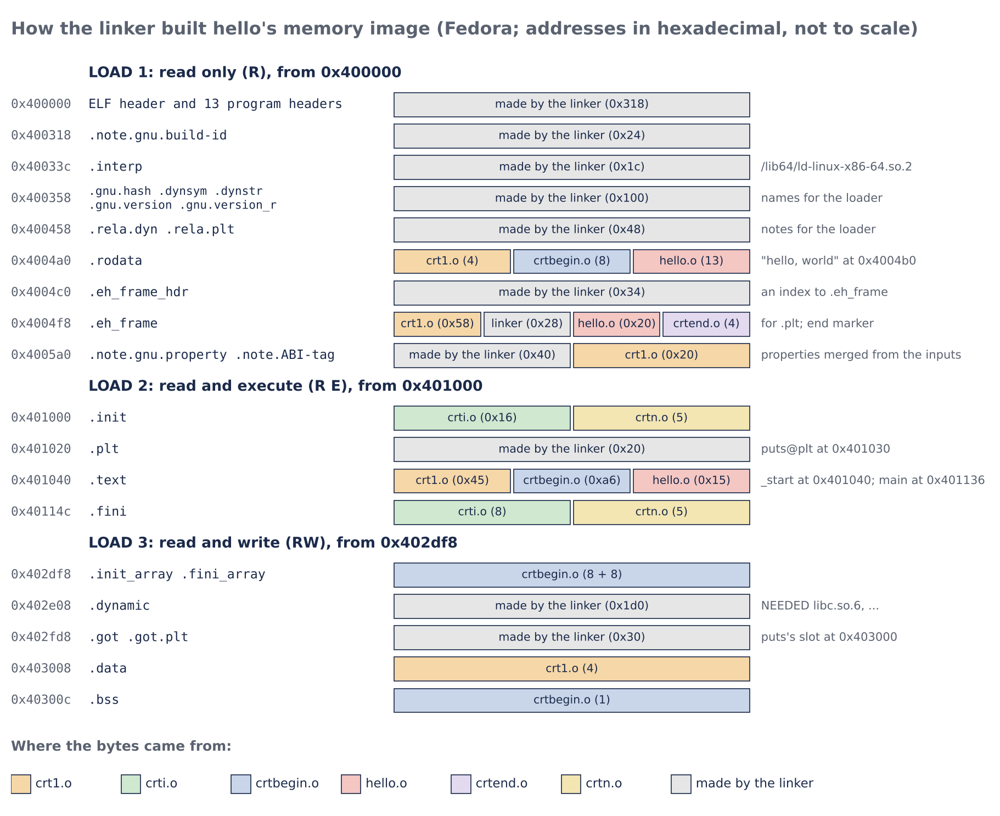

ref: 03.06
title: Linking: Completing the Program
chapter: Chapter 03 — From Source Text to Running Program
part: Part I — The Machine Beneath C
builds: §00.02, §01.06, §02.06, §03.01, §03.02, §03.03, §03.05
---
## The question

§03.05 ended with `hello.o`, a file that holds every instruction of `main` and the 13 bytes of its string, and still cannot run. Its `main` sits at address 0. Two places in its code are holes full of zeros, each with a note, a *relocation*, saying what belongs there. One name, `puts`, is marked `U`: used here, defined somewhere else. And nothing in the file calls `main`. This section follows the program that repairs all four defects, the **linker**: the program that combines object files and libraries into a program that can be loaded and run (on Fedora, `ld`, which is the GNU linker `ld.bfd`). Several promises fall due. §00.02 promised the reason for the name `a.out`. §01.06 promised the linker filling in relocations. §02.06 and §03.02 promised the startup files, Fedora's against Ubuntu's, and the link command built by hand. §03.01 promised the address of `main`, 0x401136, and the `U` symbols that remain in the finished program.

Six puzzles, all from your Fedora:

- `hello.o` defines one function. `nm hello` lists 29 symbols, among them `_start`, `_init`, `_fini`, `frame_dummy` and `register_tm_clones`, none of which you wrote.
- `main` was at 0 in `hello.o`. In `hello` it is at 0x401136, an address with nothing round about it. Who chose that number, and why that one?
- The finished program still lists `U puts@GLIBC_2.2.5`. The code of `puts` is not in `hello` at all.
- The linker finds the C library through the option `-lc`, which leads it to the file `/usr/lib64/libc.so`. That file is not a library: it is five lines of text.
- `gcc -lm cube.c` builds and runs on your Fedora. The same command fails on Ubuntu with an "undefined reference" to `cbrt`, and it fails on Fedora too as soon as `-static` is added.
- `gcc hello.c`, with no `-o`, writes a file named `a.out`, which is the name of an old file format; `file a.out` says that the file is in fact ELF.

The questions are:

- What exactly does the linker receive, and can you build the same program by giving it those files yourself?
- What are the startup files, where do they come from, and why does Ubuntu use different ones?
- How does the linker match each use of a name with its definition, and where does it look for definitions?
- How does it choose the address of every function and every byte of data?
- How does it fill the holes, and what is left for later?
- How does the call to `printf` (or `puts`) reach code that lives in another file?
- Why does the position of `-lm` on the command line sometimes matter, and sometimes not?
- What is the difference between a statically and a dynamically linked program?

§21.04 to §21.06 return to symbol resolution, static libraries and shared libraries in depth; §03.07 follows the finished program as it is loaded and started. This section takes `hello.o` the rest of the way to `hello`, and accounts for every address the linker chose.

## The journey

### What the linker is given

§03.02 showed that GCC's driver ends its work by running `collect2`, which runs `ld`. The driver's `-v` option prints the command. Here it is on the reader's machine, one argument per line (`tr` replaces each space with a newline, and `cat -n` numbers the lines; line 1 is empty because the command begins with a space):

```terminal
$ gcc -std=c23 -Wall -Wextra -pedantic hello.c -o hello -v 2>&1 | grep collect2 | tr ' ' '\n' | cat -n
```

```output
     1	
     2	/usr/libexec/gcc/x86_64-redhat-linux/16/collect2
     3	-plugin
     4	/usr/libexec/gcc/x86_64-redhat-linux/16/liblto_plugin.so
     5	-plugin-opt=/usr/libexec/gcc/x86_64-redhat-linux/16/lto-wrapper
     6	-plugin-opt=-fresolution=/tmp/ccfI4Hkb.res
     7	-plugin-opt=-pass-through=-lgcc
     8	-plugin-opt=-pass-through=-lgcc_s_asneeded
     9	-plugin-opt=-pass-through=-latomic_asneeded
    10	-plugin-opt=-pass-through=-lc
    11	-plugin-opt=-pass-through=-lgcc
    12	-plugin-opt=-pass-through=-lgcc_s_asneeded
    13	--build-id
    14	--no-add-needed
    15	--eh-frame-hdr
    16	--hash-style=gnu
    17	-m
    18	elf_x86_64
    19	-dynamic-linker
    20	/lib64/ld-linux-x86-64.so.2
    21	-o
    22	hello
    23	/usr/lib/gcc/x86_64-redhat-linux/16/../../../../lib64/crt1.o
    24	/usr/lib/gcc/x86_64-redhat-linux/16/../../../../lib64/crti.o
    25	/usr/lib/gcc/x86_64-redhat-linux/16/crtbegin.o
    26	-L/usr/lib/gcc/x86_64-redhat-linux/16
    27	-L/usr/lib/gcc/x86_64-redhat-linux/16/../../../../lib64
    28	-L/lib/../lib64
    29	-L/usr/lib/../lib64
    30	-L/usr/lib/gcc/x86_64-redhat-linux/16/../../..
    31	-L/lib
    32	-L/usr/lib
    33	/tmp/ccOw8T7C.o
    34	-lgcc
    35	-lgcc_s_asneeded
    36	-latomic_asneeded
    37	-lc
    38	-lgcc
    39	-lgcc_s_asneeded
    40	/usr/lib/gcc/x86_64-redhat-linux/16/crtend.o
    41	/usr/lib/gcc/x86_64-redhat-linux/16/../../../../lib64/crtn.o
```

Of the forty words after the empty line, only one, line 33, is your program: the object file that `as` wrote into `/tmp` (the same bytes as `hello.o`). Table 03.06-1 sorts the rest. (The `..` in a path means "the directory above"; `/usr/lib/gcc/x86_64-redhat-linux/16/../../../../lib64` is simply `/usr/lib64`.)

Table: Table 03.06-1  The link command for hello, sorted by purpose
<!-- widths: 14,36,50 -->
| Lines | Arguments | Purpose |
|---|---|---|
| 2 | `collect2` | GCC's helper, which runs `ld` with the same arguments (§03.02) |
| 3–12 | `-plugin ...` | load GCC's link-time optimizer into the linker; used only with `-flto` (§39.02) |
| 13–16 | `--build-id`, `--no-add-needed`, `--eh-frame-hdr`, `--hash-style=gnu` | extras: a unique identifier for the file; a deprecated spelling of an option that is now the default (a library needed only by another library cannot satisfy the program's own references); an index to the unwinding tables, and the format of the symbol index the loader will use |
| 17–18 | `-m elf_x86_64` | the kind of output: 64-bit ELF for x86-64 |
| 19–20 | `-dynamic-linker /lib64/ld-linux-x86-64.so.2` | the *program interpreter*: the kernel starts it together with `hello`, and it loads the shared libraries, connects them, and then jumps to `hello`'s entry point (§03.07) |
| 21–22 | `-o hello` | the output file |
| 23–25 | `crt1.o`, `crti.o`, `crtbegin.o` | startup files, before your code |
| 26–32 | `-L...` | directories in which to look for libraries |
| 33 | `/tmp/ccOw8T7C.o` | your program |
| 34–39 | `-lgcc ... -lc ... -lgcc ...` | libraries: GCC's support library, the atomic-operations library, the C library, then GCC's library again |
| 40–41 | `crtend.o`, `crtn.o` | startup files, after your code |

Where did this list come from? §03.02 showed that the driver follows rules called *specs*, and read the `startfile` spec that chose `crt1.o` on Fedora and `Scrt1.o` on Ubuntu. The files after your code come from three more specs, printed by `gcc -dumpspecs` (shortened here to the parts that apply):

```output
*endfile:
... %{static:crtend.o%s;      shared|static-pie|pie:crtendS.o%s;      :crtend.o%s} crtn.o%s ...

*libgcc:
%{static|static-libgcc|static-pie:-lgcc -lgcc_eh}%{!static:%{!static-libgcc:%{!static-pie:%{!shared-libgcc:-lgcc -lgcc_s_asneeded}...

*link_gcc_c_sequence:
%{static|static-pie:--start-group} %G %{!nolibc:%{!fno-link-libatomic:-latomic_asneeded} %L}    %{static|static-pie:--end-group}%{!static:%{!static-pie:%G}}
```

Read `link_gcc_c_sequence` with two substitutions: `%G` stands for the `libgcc` spec (`-lgcc -lgcc_s_asneeded` for an ordinary program) and `%L` for the `lib` spec (`-lc`). So the sequence is "GCC's library, the atomic library, the C library, then GCC's library again", lines 34 to 39 exactly; with `-static` it is wrapped in `--start-group` and `--end-group`, which you will meet on the AVR below. The `endfile` spec chooses `crtend.o` for an ordinary program, `crtendS.o` for a position-independent one, and `crtn.o` always.

### Building the program by hand

If the driver does nothing but run `ld` with these arguments, you can run `ld` yourself. Lines 13 to 41, with `hello.o` in place of the temporary file, the paths simplified, and only the two `-L` directories that are actually used, give:

```terminal
$ G=/usr/lib/gcc/x86_64-redhat-linux/16
$ ld --build-id --no-add-needed --eh-frame-hdr --hash-style=gnu -m elf_x86_64 \
     -dynamic-linker /lib64/ld-linux-x86-64.so.2 -o hello_byhand2 \
     /usr/lib64/crt1.o /usr/lib64/crti.o $G/crtbegin.o -L$G -L/usr/lib64 \
     hello.o -lgcc -lgcc_s_asneeded -latomic_asneeded -lc -lgcc -lgcc_s_asneeded \
     $G/crtend.o /usr/lib64/crtn.o
$ cmp hello hello_byhand2 && echo identical
```

```output
identical
```

Byte for byte the same program: GCC adds nothing of its own at this stage, and the five other `-L` directories contributed nothing to this link. (The `\` at the end of a line tells the shell that the command continues on the next line.) Now take things away, to see what each part contributes. The smallest command that still produces a working `hello` keeps only `crt1.o`, `hello.o`, the C library and the name of the loader:

```terminal
$ ld -dynamic-linker /lib64/ld-linux-x86-64.so.2 -o h3 /usr/lib64/crt1.o hello.o -lc && ./h3
```

```output
hello, world
```

It is 11,184 bytes, against 12,624, and `nm` lists 15 symbols instead of 29: `crti.o`, `crtbegin.o`, `crtend.o` and `crtn.o` are not needed by *this* program, for reasons the next subsection explains. Leave out `-dynamic-linker` too, and the linker still succeeds, but the program cannot be started:

```terminal
$ ld -o h2 /usr/lib64/crt1.o hello.o -lc; readelf -l h2 | grep interpreter; ./h2
```

```output
      [Requesting program interpreter: /lib/ld64.so.1]
bash: line 1: ./h2: cannot execute: required file not found
```

Without being told, `ld` names a default loader, `/lib/ld64.so.1`, which does not exist on Fedora, and the shell reports that a "required file" is missing, although `h2` itself is right there: the missing file is the loader. §03.07 explains what the "program interpreter" does. Leave out `crt1.o`, and you are back at §03.05's experiment: `ld hello.o` warns that it cannot find the entry symbol `_start`, and reports an undefined reference to `puts`, because without `-lc` nothing defines it.

### The startup files

Five files surround your code. `rpm -qf` names their packages on the reader's machine: `crt1.o`, `crti.o` and `crtn.o` come from `glibc-devel`, the C library's development package, and `crtbegin.o` and `crtend.o` from `gcc`. The names are old Unix abbreviations: "crt" is generally read as "C runtime". Table 03.06-2 shows what `nm` and `size -A` find in each.

Table: Table 03.06-2  The startup files on the reader's Fedora, non-PIE
<!-- widths: 15,15,36,34 -->
| File | Package | Defines (and uses) | Purpose |
|---|---|---|---|
| `crt1.o` | glibc-devel | `_start`; `_IO_stdin_used`, `data_start`; two helpers for static PIE programs, empty here (uses `main`, `__libc_start_main`) | the entry point: the first instructions of the program |
| `crti.o` | glibc-devel | `_init`, `_fini` (first halves, in sections `.init` and `.fini`) | the beginnings of two functions the C library calls at start and exit |
| `crtbegin.o` | gcc | `frame_dummy`, `register_tm_clones`, `__do_global_dtors_aux`, one entry each in `.init_array` and `.fini_array` | GCC's start-up and exit hooks; on this system they only register and deregister transactional-memory clones |
| `crtend.o` | gcc | `__FRAME_END__` (4 zero bytes in `.eh_frame`), `__TMC_END__` | ends the clone table that `crtbegin.o` began, and the unwinding table of the whole program |
| `crtn.o` | glibc-devel | the last halves of `_init` and `_fini` | `add $8, %rsp; ret` |

**`crt1.o` and the entry point.** Nothing calls `main` directly. A program begins at a single address, the **entry point**, recorded in the ELF header (§03.05): a statically linked program is started there by the kernel itself, and a dynamically linked one such as `hello` by the program interpreter, which first loads the shared libraries and then jumps there (§03.07). The linker sets it to the address of the symbol `_start` (its default script says `ENTRY(_start)`), and `_start` is defined in `crt1.o`. Its 38 bytes, as linked into `hello` (a last line, `Disassembly of section .fini:`, is omitted):

```terminal
$ objdump -d --disassemble=_start hello | grep -v '^$'
```

```output
hello:     file format elf64-x86-64
Disassembly of section .init:
Disassembly of section .plt:
Disassembly of section .text:
0000000000401040 <_start>:
  401040:	f3 0f 1e fa          	endbr64
  401044:	31 ed                	xor    %ebp,%ebp
  401046:	49 89 d1             	mov    %rdx,%r9
  401049:	5e                   	pop    %rsi
  40104a:	48 89 e2             	mov    %rsp,%rdx
  40104d:	48 83 e4 f0          	and    $0xfffffffffffffff0,%rsp
  401051:	50                   	push   %rax
  401052:	54                   	push   %rsp
  401053:	45 31 c0             	xor    %r8d,%r8d
  401056:	31 c9                	xor    %ecx,%ecx
  401058:	48 c7 c7 36 11 40 00 	mov    $0x401136,%rdi
  40105f:	ff 15 73 1f 00 00    	call   *0x1f73(%rip)        # 402fd8 <__libc_start_main@GLIBC_2.34>
  401065:	f4                   	hlt
```

Read only what matters for linking here (§03.07 reads every line). `_start` takes the arguments that the kernel placed on the stack, puts the address of `main`, 0x401136, into `rdi`, the register that carries a function's first argument (§03.04), and calls `__libc_start_main`, a function of the C library. That function prepares the library, calls `main`, and passes `main`'s return value to `exit`; it never returns, and the `hlt` after the call is only a safeguard. The consequence for the linker is the line `U main` in `nm /usr/lib64/crt1.o`: the startup file *uses* `main` and does not define it. The C standard requires a hosted program to define a function named `main` (§02.06); this reference is how the toolchain enforces the requirement. Leave it out, and the error comes from the linker, about a file you never named:

```terminal
$ gcc -std=c23 -Wall -Wextra -pedantic -c greet_def.c && gcc greet_def.o -o nomain
```

```output
/usr/bin/ld.bfd: /usr/lib/gcc/x86_64-redhat-linux/16/../../../../lib64/crt1.o: in function `_start':
(.text+0x1b): undefined reference to `main'
collect2: error: ld returned 1 exit status
```

`(.text+0x1b)` is a hole in `crt1.o` at offset 0x1b, which in `hello` became 0x401040 + 0x1b = 0x40105b, the last four bytes of the `mov` at 0x401058. In `crt1.o` itself that instruction was different: `objdump -dr /usr/lib64/crt1.o` shows `48 8b 3d 00 00 00 00`, "load `rdi` from a memory location", with the relocation `R_X86_64_REX_GOTPCRELX main-0x4`. That relocation asks for a *global offset table* entry: a memory slot that will hold the address of `main` (the table is explained below, with `puts`). In a non-PIE program the address of `main` is a known constant, so the linker rewrote the instruction into `48 c7 c7 36 11 40 00`, "put the constant 0x401136 into `rdi`", and saved the memory access. The linker is allowed to do this. H. J. Lu, who proposed these relocation types in 2015, wrote of them: "Linker can treat them the same as R_X86_64_GOTPCREL or it can perform the transformations listed above." The X at the end of the name marks this kind of relocation. So a linker does not only fill holes: within rules the ABI lays down, it may also change instructions. It does so only where it can. The second relocation in `_start`, `R_X86_64_GOTPCRELX __libc_start_main-0x4`, is of the same relaxable kind, but `__libc_start_main` is defined in a shared library whose address is unknown at link time, so that call stayed `call *0x1f73(%rip)`, through a table slot. And in Ubuntu's position-independent `hello`, where not even `main`'s address is a constant, the same relocation in `Scrt1.o` became `lea 0xca(%rip),%rdi` (`48 8d 3d ca 00 00 00`): an address computed relative to the instruction, with no memory access.

**`crti.o` and `crtn.o`: one function in two files.** `crti.o` holds the beginning of a function `_init` in a section named `.init`, and `crtn.o` holds its end in another section of the same name:

```terminal
$ objdump -d -j .init hello | grep -v '^$'
```

```output
hello:     file format elf64-x86-64
Disassembly of section .init:
0000000000401000 <_init>:
  401000:	f3 0f 1e fa          	endbr64
  401004:	48 83 ec 08          	sub    $0x8,%rsp
  401008:	48 8b 05 d1 1f 00 00 	mov    0x1fd1(%rip),%rax        # 402fe0 <__gmon_start__>
  40100f:	48 85 c0             	test   %rax,%rax
  401012:	74 02                	je     401016 <_init+0x16>
  401014:	ff d0                	call   *%rax
  401016:	48 83 c4 08          	add    $0x8,%rsp
  40101a:	c3                   	ret
```

The first 0x16 bytes come from `crti.o`, and the last 5 (`add $0x8,%rsp; ret`) from `crtn.o`. They form one function only because the linker places input sections of the same name one after another, *in the order of the command line*, and `crti.o` comes before every other file that has an `.init` section (only `crt1.o` precedes it, and it has none), while `crtn.o` comes last. Any other object file that put code into `.init` would find it running between the two halves. That is an old Unix mechanism for running code before `main`. The function `_fini` is built the same way, in `.fini`. In `hello`, `_init` does almost nothing: it calls `__gmon_start__` if that function exists, and it exists only in programs built for the profiler `gprof` (`-pg`).

**`crtbegin.o` and `crtend.o`: GCC's own.** These come from GCC, not from the C library. GCC's source for them provides several start-up and exit services, and which ones are compiled in depends on the system: on some systems they register the exception tables or walk an older list of destructors. On this one, the disassembly of `crtbegin.o` (`objdump -dr`) shows that they do one thing only. `frame_dummy` is two instructions, `endbr64` and a jump to `register_tm_clones`; `__do_global_dtors_aux` checks a byte named `completed`, calls `deregister_tm_clones` once, and sets the byte. The two `tm_clones` functions register and deregister a table of functions cloned for *transactional memory* (an optional GCC feature, `-fgnu-tm`) with the library `libitm`, and only if that library is present: the names `_ITM_registerTMCloneTable` and `_ITM_deregisterTMCloneTable` are *weak* undefined symbols (`w` in `nm`), whose address is 0 when nothing defines them, and the code tests for 0 and returns. `crtbegin.o` begins the clone table (`__TMC_LIST__`) and `crtend.o` ends it (`__TMC_END__`). `crtend.o`'s four zero bytes of `.eh_frame` end the unwinding table to which `crt1.o`, `hello.o` and the linker contributed (`crtbegin.o` has no `.eh_frame` of its own). `crtbegin.o` puts the address of `frame_dummy` into `.init_array`, an array of functions the C library calls before `main`, and that of `__do_global_dtors_aux` into `.fini_array`, called at exit. For `hello`, which uses no transactional memory, the two files are idle, which is why `h3` ran without them. In the author's reading, they are linked into every program because whether they are needed depends on what the other object files and libraries contain, which only the linker sees.

**Fedora against Ubuntu.** §03.02 read the `startfile` spec and found `pie:Scrt1.o%s; :crt1.o%s`: a position-independent executable gets `Scrt1.o`, `crtbeginS.o` and `crtendS.o`, and an ordinary one `crt1.o`, `crtbegin.o` and `crtend.o`. Fedora's GCC, run by hand, does not build position-independent programs (§03.04), so it takes the second set; Ubuntu's GCC builds them by default, so it takes the first. In the author's workspace (Ubuntu 24.04, GCC 14.2.0), `gcc -v` shows the other set, together with three options Fedora's command lacks: `-pie`, `-z now -z relro` (hardening options §34.06 explains), and `--as-needed`, which will matter very much later in this section. The two `_start` functions contain the same instructions: a comparison of `objdump -dr` output for Ubuntu's `crt1.o` and `Scrt1.o` showed the same code, `crt1.o` adding only one tiny function, `_dl_relocate_static_pie`, which consists of `endbr64` and `ret`.

:::hood
Can a program do without `crt1.o` entirely? GCC's option `-nostartfiles` leaves out all five startup files (the GCC manual: "Do not use the standard system startup files when linking."). Listing 03.06-1, after this box, supplies its own `_start`, and the experiment shows how far one gets without the C library's start-up code.
:::

```c Listing 03.06-1  nostart.c: a program with its own entry point
// nostart.c
// A program that brings its own entry point instead of crt1.o's.
#include <stdio.h>
#include <stdlib.h>

int main(void) {
    puts("hello, world");
    return 0;
}

void _start(void) {         // the linker's default entry point
    exit(main());           // no __libc_start_main, no argc, no argv
}
```

```terminal
$ gcc -std=c23 -Wall -Wextra -pedantic -nostartfiles nostart.c -o nostart && ./nostart; echo status $?
```

```output
hello, world
status 0
```

It works here, but only by luck and only because the program is dynamically linked: the loader, `ld-linux`, prepares the C library before it jumps to `_start`, so `puts` and `exit` find their library ready. The program receives no `argc` or `argv`, and the stack is not aligned as the ABI promises a function (§19.02). Without your own `_start`, `-nostartfiles` produces a program that the linker starts at the beginning of `.text`, which happens to be `main`. `gcc -nostartfiles hello.c -o hello_ns` warns that it cannot find the entry symbol `_start` and is "defaulting to 0000000000401020", `nm` shows `main` at exactly 0x401020, and running it ended with `Segmentation fault` (status 139): `main` ran, and its `ret` then took a value from the stack that was never a return address. (Under the lab runner, whose output went to a file, not even "hello, world" appeared, because the C library buffers output to a file and the crash came before the buffer was written out.)

### Step one: matching names to definitions

The linker's work divides into three steps. It **resolves symbols**: it matches every use of a global name with exactly one definition. It **lays out** the program: it decides where every section of every input file goes, which gives every symbol its address. And it **relocates**: it fills every hole, now that every address is known. This subsection is about the first step. (In GNU `ld` the steps overlap in time, but each needs the result of the one before it.)

Each object file offers definitions (the symbols `nm` marks `T`, `D`, `B`, `R` and so on) and needs some it does not have (the `U` symbols). The linker reads the inputs in order and keeps one table of all global names. Here is what happens to the four names that matter for `hello`. The linker's option `-y` (in GCC, `-Wl,-y,name`, because `-Wl,` passes what follows to the linker) traces a name: "Print the name of each linked file in which symbol appears", says `man ld`.

```terminal
$ gcc -std=c23 -Wall -Wextra -pedantic hello.o -o hy \
      -Wl,-y,puts -Wl,-y,main -Wl,-y,__libc_start_main -Wl,-y,_start
```

```output
/usr/bin/ld.bfd: /usr/lib/gcc/x86_64-redhat-linux/16/../../../../lib64/crt1.o: definition of _start
/usr/bin/ld.bfd: /usr/lib/gcc/x86_64-redhat-linux/16/../../../../lib64/crt1.o: reference to main
/usr/bin/ld.bfd: /usr/lib/gcc/x86_64-redhat-linux/16/../../../../lib64/crt1.o: reference to __libc_start_main
/usr/bin/ld.bfd: hello.o: definition of main
/usr/bin/ld.bfd: hello.o: reference to puts
/usr/bin/ld.bfd: /lib64/libc.so.6: definition of puts
/usr/bin/ld.bfd: /lib64/libc.so.6: definition of __libc_start_main
```

Seven lines, and the whole story of `hello` is in them. `crt1.o` defines `_start` and needs `main` and `__libc_start_main`. `hello.o` supplies `main`, and adds a need of its own, `puts`. The C library supplies both remaining names. At the end of the inputs, no name is left without a definition, and the link succeeds. If one were left, the link would fail with an *undefined reference*. If one name had two definitions in object files, it would fail with a *multiple definition*, as Experiment 03.05-4 showed. (§21.04 gives the full rules, including *weak* symbols, which may be overridden.)

The same mechanism joins your own files. §03.02's `greet.c` calls `greet`, which `greet_def.c` defines. Linked together, `-Wl,-y,greet` prints `greet.o: reference to greet` and `greet_def.o: definition of greet`, and the call `e8 00 00 00 00` with the relocation `R_X86_64_PLT32 greet-0x4` in `greet.o` became `e8 07 00 00 00`: a direct call to `greet` at 0x401146, seven bytes beyond the end of the call instruction at 0x40113a. When the definition is in an object file, the linker can put the target's own address into the hole. When it is in a shared library, as with `puts`, it cannot, and must do something different (below).

The name `a.out`, which this section explains at its end, carries this rule in its oldest description. The Sixth Edition of the Unix manual (1975; the entry is dated 9/9/73) said of the assembler and the link editor: "Both programs make a.out executable if there were no errors and no unresolved external references." A program is complete exactly when no name is left unresolved.

### Where the linker looks: `-l`, libraries, and a text file

`-lc` means "the library `c`". The linker turns the name into file names and looks in a list of directories. `man ld` explains the search:

"On systems which support shared libraries, ld may also search for files other than libnamespec.a. Specifically, on ELF and SunOS systems, ld will search a directory for a library called libnamespec.so before searching for one called libnamespec.a."

The directories are those of the `-L` options, in order, followed by the linker's built-in list (`ld --verbose` prints it: `/usr/x86_64-redhat-linux/lib64`, `/usr/lib64`, `/usr/local/lib64`, `/lib64`, and four more). For `-lc`, the first match is `/usr/lib64/libc.so`, in the directory of line 27. And that file is not a library:

```terminal
$ file /usr/lib64/libc.so; cat /usr/lib64/libc.so
```

```output
/usr/lib64/libc.so: ASCII text
/* GNU ld script
   Use the shared library, but some functions are only in
   the static library, so try that secondarily.  */
OUTPUT_FORMAT(elf64-x86-64)
GROUP ( /lib64/libc.so.6 /usr/lib64/libc_nonshared.a  AS_NEEDED ( /lib64/ld-linux-x86-64.so.2 ) )
```

It is a **linker script**, a small program in the linker's own command language. When the linker opens a file it cannot recognize as an object file or library, it tries to read it as a script. This one says: use the real shared library `/lib64/libc.so.6` (the 2-megabyte file of §03.01), then the static archive `libc_nonshared.a`, and the loader `ld-linux-x86-64.so.2` only if something needs it. The word `GROUP` means that the files are searched as a group, again and again until a pass adds nothing new, as with the options `--start-group` and `--end-group` that you will meet on the AVR. The linker's `--trace` output for `hello` (Experiment 03.06-4) shows the second pass: it lists `libc_nonshared.a` and `ld-linux-x86-64.so.2` twice. The archive holds the few functions that, as the comment says, exist only in the static library; `ar t` lists its four members: `at_quick_exit.oS`, `atexit.oS`, `pthread_atfork.oS` and `stack_chk_fail_local.oS`. In the author's understanding, these members must exist once in every program because they work on behalf of the module that calls them: `atexit`, for example, registers a function together with an identifier of the calling program or library, `__dso_handle`, the 8 bytes of `crtbegin.o` you will meet in `.rodata` below. Why is the build-time name `libc.so` different from the run-time name `libc.so.6`? The program does not record the name of the file the linker opened. It records the name the library gives itself, its *SONAME*: `readelf -d /lib64/libc.so.6` shows `SONAME  Library soname: [libc.so.6]`, and that is the name in `hello`'s `NEEDED` entry. The number 6 is part of the library's identity: a library with an incompatible interface would take a different name, and old programs would keep asking for the old one (§21.06).

The other libraries on the command line are scripts too. `libgcc_s_asneeded.so`, 136 bytes, contains `INPUT ( AS_NEEDED ( -lgcc_s ) )` ("add GCC's shared support library, but only if needed"), and `libgcc_s.so` contains `GROUP ( /lib64/libgcc_s.so.1 libgcc.a )`. `libm.so`, the math library, contains `GROUP ( /lib64/libm.so.6  AS_NEEDED ( /lib64/libmvec.so.1 ) )`, the second being a library of vector versions of the math functions. The linker's `--verbose` option shows every file it opened, and marks the scripts:

```terminal
$ gcc -std=c23 -Wall -Wextra -pedantic hello.o -o hv -Wl,--verbose 2>&1 | grep -E 'succeeded|opened script'
```

```output
attempt to open /usr/lib/gcc/x86_64-redhat-linux/16/../../../../lib64/crt1.o succeeded
attempt to open /usr/lib/gcc/x86_64-redhat-linux/16/../../../../lib64/crti.o succeeded
attempt to open /usr/lib/gcc/x86_64-redhat-linux/16/crtbegin.o succeeded
attempt to open hello.o succeeded
attempt to open /usr/lib/gcc/x86_64-redhat-linux/16/libgcc.a succeeded
attempt to open /usr/lib/gcc/x86_64-redhat-linux/16/libgcc_s_asneeded.so succeeded
opened script file /usr/lib/gcc/x86_64-redhat-linux/16/libgcc_s_asneeded.so
opened script file /usr/lib/gcc/x86_64-redhat-linux/16/libgcc_s_asneeded.so
attempt to open /usr/lib/gcc/x86_64-redhat-linux/16/libgcc_s.so succeeded
opened script file /usr/lib/gcc/x86_64-redhat-linux/16/libgcc_s.so
opened script file /usr/lib/gcc/x86_64-redhat-linux/16/libgcc_s.so
attempt to open /lib64/libgcc_s.so.1 succeeded
attempt to open /usr/lib/gcc/x86_64-redhat-linux/16/libgcc.a succeeded
attempt to open /usr/lib/gcc/x86_64-redhat-linux/16/libatomic_asneeded.so succeeded
opened script file /usr/lib/gcc/x86_64-redhat-linux/16/libatomic_asneeded.so
opened script file /usr/lib/gcc/x86_64-redhat-linux/16/libatomic_asneeded.so
attempt to open /usr/lib/gcc/x86_64-redhat-linux/16/libatomic.so succeeded
opened script file /usr/lib/gcc/x86_64-redhat-linux/16/libatomic.so
opened script file /usr/lib/gcc/x86_64-redhat-linux/16/libatomic.so
attempt to open /usr/lib64/libatomic.so.1.2.0 succeeded
attempt to open /usr/lib/gcc/x86_64-redhat-linux/16/../../../../lib64/libc.so succeeded
opened script file /usr/lib/gcc/x86_64-redhat-linux/16/../../../../lib64/libc.so
opened script file /usr/lib/gcc/x86_64-redhat-linux/16/../../../../lib64/libc.so
attempt to open /lib64/libc.so.6 succeeded
attempt to open /usr/lib64/libc_nonshared.a succeeded
attempt to open /lib64/ld-linux-x86-64.so.2 succeeded
attempt to open /usr/lib/gcc/x86_64-redhat-linux/16/libgcc.a succeeded
attempt to open /usr/lib/gcc/x86_64-redhat-linux/16/libgcc_s_asneeded.so succeeded
opened script file /usr/lib/gcc/x86_64-redhat-linux/16/libgcc_s_asneeded.so
opened script file /usr/lib/gcc/x86_64-redhat-linux/16/libgcc_s_asneeded.so
attempt to open /usr/lib/gcc/x86_64-redhat-linux/16/libgcc_s.so succeeded
opened script file /usr/lib/gcc/x86_64-redhat-linux/16/libgcc_s.so
opened script file /usr/lib/gcc/x86_64-redhat-linux/16/libgcc_s.so
attempt to open /lib64/libgcc_s.so.1 succeeded
attempt to open /usr/lib/gcc/x86_64-redhat-linux/16/libgcc.a succeeded
attempt to open /usr/lib/gcc/x86_64-redhat-linux/16/crtend.o succeeded
attempt to open /usr/lib/gcc/x86_64-redhat-linux/16/../../../../lib64/crtn.o succeeded
```

What does GCC's own library, `libgcc`, provide? Routines that GCC's generated code calls when the processor has no single instruction for an operation. §03.04 met one on the AVR, `__udivmodhi4`, 16-bit division. On x86-64 the processor divides 64-bit numbers itself, but not 128-bit ones, and `nm` on `libgcc.a` finds `__divti3` and `__udivti3` (128-bit signed and unsigned division) and `__popcountdi2` (counting the 1 bits of a 64-bit number, for processors without such an instruction). `hello` needs none of them, so the linker took nothing from `libgcc.a`, and because of `AS_NEEDED` (`libatomic_asneeded.so` is the same kind of script as `libgcc_s_asneeded.so`), `readelf -d hello` records no need for `libgcc_s.so.1` or `libatomic.so.1` either: `libc.so.6` is the only library the finished program asks for.

### Step two: giving everything an address

The linker now knows which pieces form the program. It must decide where each goes. Its instructions for that come from a linker script too: the **default linker script**, built into `ld`, which `ld --verbose` prints. Three of its lines decide the start:

```output
ENTRY(_start)
  PROVIDE (__executable_start = SEGMENT_START("text-segment", 0x400000));
  . = SEGMENT_START("text-segment", 0x400000) + SIZEOF_HEADERS;
```

In a linker script, `.` is the *location counter*, the address at which the next piece will be placed. The program starts at 0x400000 unless the option `-Ttext-segment` names another address, and the first section is placed after room for the file's headers. The rest of the script lists the output sections in order, and says which input sections go into each: for example, `.text` receives, among others, every input section named `.text`.

You can ask the linker to report every placement it made, in a **map file**, with `-Wl,-Map=hello.map`. The map for `hello` runs to several hundred lines; here are the parts that hold `main`'s code and its string, with the long directory names shortened to the file names:

```output
.init           0x0000000000401000       0x1b
 .init          0x0000000000401000       0x16 crti.o
 .init          0x0000000000401016        0x5 crtn.o

.plt            0x0000000000401020       0x20
 .plt           0x0000000000401020       0x20 crt1.o

.text           0x0000000000401040      0x10b
 .text          0x0000000000401040       0x45 crt1.o
 .text          0x0000000000401085        0x0 crti.o
 .text          0x0000000000401090       0xa6 crtbegin.o
 .text          0x0000000000401136       0x15 hello.o
 .text          0x000000000040114b        0x0 crtend.o
 .text          0x000000000040114b        0x0 crtn.o

.rodata         0x00000000004004a0       0x1d
 .rodata.cst4   0x00000000004004a0        0x4 crt1.o
 .rodata        0x00000000004004a8        0x8 crtbegin.o
 .rodata        0x00000000004004b0        0xd hello.o
```

(The `.plt` line names `crt1.o` although the procedure linkage table is built by the linker; the map shows such linker-made sections under the first input file.) Now the address of `main` can be derived, step by step, as the linker derived it:

1. The output section `.text` begins at 0x401040, after `.init` (0x401000, 0x1b bytes) and `.plt` (0x401020, 0x20 bytes), each placed at the next multiple of its alignment.
2. The first input `.text` is `crt1.o`'s, 0x45 bytes: from 0x401040 to 0x401085.
3. `crti.o`'s `.text` is empty, so the location counter stays at 0x401085.
4. `crtbegin.o`'s `.text` must begin at a multiple of 16 (`readelf -S` on `crtbegin.o` shows alignment 16), so the linker skips to 0x401090. It is 0xa6 bytes long: 0x401090 + 0xa6 = 0x401136.
5. `hello.o`'s `.text` needs alignment 1 only (§03.05), so it begins exactly there: **0x401136**. That is `main`.

The address that looked arbitrary is the sum of the sizes of the code that came before yours, in the order of the command line, rounded up where alignment requires. The string's address follows in the same way: `.rodata` begins at 0x4004a0, and `crt1.o` contributes 4 bytes (`_IO_stdin_used`, 0x4004a0 to 0x4004a3). `crtbegin.o`'s `.rodata` needs 8-byte alignment, so 4 bytes of padding follow, and its 8 bytes (`__dso_handle`) occupy 0x4004a8 to 0x4004af. `hello.o`'s 13 bytes begin at 0x4004b0. Move the start of the program, and everything moves with it. Linked with `-Wl,-Ttext-segment=0x800000`, `main` was at 0x801136 and the string at 0x8004b0, and the program still printed `hello, world`.

Why does the code begin at 0x401000, and not straight after the read-only data, which ends at 0x400600? Because the linker separates code from everything else by whole pages, the 4,096-byte (0x1000) units in which the operating system grants memory permissions (§01.04, §27.01). `ld --help` lists `-z separate-code  Create separate code program header (default)`. So the first page holds the headers and the read-only data, which must not be executable; the code starts at the next page, 0x401000, which must not be writable; and the writable data starts on yet another page. Turn the separation off with `-Wl,-z,noseparate-code`, and the program has two loadable parts instead of three, and `main` moves to 0x4005a6.

The writable data begins at 0x402df8, an address that is not on a page boundary at all. Two facts in `readelf -l` (next subsection) explain it. First, each loadable part keeps the same position within its page in the file as in memory: the part at file offset 0x1df8 goes to 0x402df8, as the part at 0x1000 goes to 0x401000, which is also why the file has padding between offsets 0x600 and 0x1000 and is 12,624 bytes long for 1,068 bytes of `text`. Second, the entry `GNU_RELRO` covers 0x402df8 + 0x208 = 0x403000, a page boundary. RELRO means "read-only after relocation": once the loader has filled `.init_array`, `.fini_array`, `.dynamic` and `.got`, it can make that range read-only, so that an attacker who can write to memory cannot change them (§34.06). The linker therefore placed these sections so that they *end* exactly at 0x403000, and the next byte, at 0x403000, is the slot for `puts`, which must stay writable (below).

### Sections become segments

The linker's units are sections. The loader works with larger units, called **segments**: ranges of the file to be placed in memory with one set of permissions. The linker writes a table of them, the **program header table**, which `hello.o` lacked (§03.05):

```terminal
$ readelf -l hello
```

```output

Elf file type is EXEC (Executable file)
Entry point 0x401040
There are 13 program headers, starting at offset 64

Program Headers:
  Type           Offset             VirtAddr           PhysAddr
                 FileSiz            MemSiz              Flags  Align
  PHDR           0x0000000000000040 0x0000000000400040 0x0000000000400040
                 0x00000000000002d8 0x00000000000002d8  R      0x8
  INTERP         0x000000000000033c 0x000000000040033c 0x000000000040033c
                 0x000000000000001c 0x000000000000001c  R      0x1
      [Requesting program interpreter: /lib64/ld-linux-x86-64.so.2]
  LOAD           0x0000000000000000 0x0000000000400000 0x0000000000400000
                 0x0000000000000600 0x0000000000000600  R      0x1000
  LOAD           0x0000000000001000 0x0000000000401000 0x0000000000401000
                 0x0000000000000159 0x0000000000000159  R E    0x1000
  LOAD           0x0000000000001df8 0x0000000000402df8 0x0000000000402df8
                 0x0000000000000214 0x0000000000000218  RW     0x1000
  DYNAMIC        0x0000000000001e08 0x0000000000402e08 0x0000000000402e08
                 0x00000000000001d0 0x00000000000001d0  RW     0x8
  NOTE           0x0000000000000318 0x0000000000400318 0x0000000000400318
                 0x0000000000000024 0x0000000000000024  R      0x4
  NOTE           0x00000000000005a0 0x00000000004005a0 0x00000000004005a0
                 0x0000000000000040 0x0000000000000040  R      0x8
  NOTE           0x00000000000005e0 0x00000000004005e0 0x00000000004005e0
                 0x0000000000000020 0x0000000000000020  R      0x4
  GNU_PROPERTY   0x00000000000005a0 0x00000000004005a0 0x00000000004005a0
                 0x0000000000000040 0x0000000000000040  R      0x8
  GNU_EH_FRAME   0x00000000000004c0 0x00000000004004c0 0x00000000004004c0
                 0x0000000000000034 0x0000000000000034  R      0x4
  GNU_STACK      0x0000000000000000 0x0000000000000000 0x0000000000000000
                 0x0000000000000000 0x0000000000000000  RW     0x10
  GNU_RELRO      0x0000000000001df8 0x0000000000402df8 0x0000000000402df8
                 0x0000000000000208 0x0000000000000208  R      0x1
```

The three `LOAD` lines say what must be placed in memory (the kernel does this for `hello` when the program is started, §03.07): the first 0x600 bytes of the file are to appear at 0x400000, readable (`R`); 0x159 bytes from file offset 0x1000 at 0x401000, readable and executable (`R E`); and 0x214 bytes from offset 0x1df8 at 0x402df8, readable and writable (`RW`), with a memory size 4 bytes larger than the file size, for `.bss`, which occupies no bytes in the file (§03.05). `INTERP` and `DYNAMIC` point into these: to the name of the program interpreter, and to the table it reads. `GNU_STACK` points nowhere (its offset and size are 0); it exists only to carry its flags, `RW` without `E`, which tell the kernel that the stack must not be executable. (`readelf -l` goes on to print a table of which sections each segment contains, omitted above; its three `LOAD` lines read: `.note.gnu.build-id .interp .gnu.hash .dynsym .dynstr .gnu.version .gnu.version_r .rela.dyn .rela.plt .rodata .eh_frame_hdr .eh_frame .note.gnu.property .note.ABI-tag`; `.init .plt .text .fini`; and `.init_array .fini_array .dynamic .got .got.plt .data .bss`.) Figure 03.06-1 puts the whole layout together, showing from which file every byte came.

{w=16}

Note how many of the sections in Figure 03.06-1 come from no input file at all: `.interp`, `.dynsym`, `.dynstr`, `.rela.plt`, `.plt`, `.dynamic`, `.got.plt` and others are written by the linker. They exist because `puts` is in a shared library, and they are the subject of the next part but one.

:::why
Why is it the linker, and not the compiler, that chooses addresses? Because addresses depend on everything that comes before, and only the linker sees everything. `main` is at 0x401136 because `crt1.o`'s code is 0x45 bytes long and `crtbegin.o`'s is 0xa6; a different version of either file would move it. When the compiler translated `hello.c`, it could not know those sizes; it did not even know which startup files would be used, since that is decided by the driver's specs, by options such as `-pie` and `-static`, and by the distribution. Deferring every address to the last step is the price of separate compilation (§03.02), and relocations are how the price is paid.
:::

### Step three: filling the holes

With every address known, the linker carries out the notes. `hello.o` had two (§03.05), and the linked `main` shows the result:

```terminal
$ objdump -d hello | sed -n '/<main>:/,/^$/p'
```

```output
0000000000401136 <main>:
  401136:	55                   	push   %rbp
  401137:	48 89 e5             	mov    %rsp,%rbp
  40113a:	bf b0 04 40 00       	mov    $0x4004b0,%edi
  40113f:	e8 ec fe ff ff       	call   401030 <puts@plt>
  401144:	b8 00 00 00 00       	mov    $0x0,%eax
  401149:	5d                   	pop    %rbp
  40114a:	c3                   	ret
```

Compute both, with the formulas of the ABI that §03.05 quoted.

1. **`R_X86_64_32 .rodata + 0`, at offset 5 of `main`** (the four bytes after `bf`, at 0x40113b). The value is S + A: the address of `hello.o`'s `.rodata` in the program, 0x4004b0, plus 0. Written as 4 little-endian bytes: `b0 04 40 00`. The instruction `bf` + those bytes is `mov $0x4004b0,%edi`. The ABI requires the linker to check that this 32-bit value zero-extends to the 64-bit address, and it does: the address is far below 4 GB.
2. **`R_X86_64_PLT32 puts - 4`, at offset 0xa.** The value is L + A − P. L is the address of the procedure linkage table entry for `puts`, 0x401030 (`puts@plt`); A is −4; P, the place of the hole, is 0x401136 + 0xa = 0x401140. So 0x401030 − 4 − 0x401140 = −0x114. In 32-bit two's complement, −0x114 is 0xfffffeec, and in little-endian order `ec fe ff ff`. The instruction is `e8 ec fe ff ff`. Check it as the processor will: the next instruction is at 0x401144, and 0x401144 − 0x114 = 0x401030.

§03.05 checked these bytes against the finished `hello`; here you can see where each input to the formula comes from: the map gives S, the PLT the linker built gives L, and the layout gives P. (The relocation in `.eh_frame`, the third note in `hello.o`, was filled in the same way, with the distance to `main`.) In the finished program, these notes are gone: `readelf -r hello` no longer shows any relocation for `main`'s code. It shows three others, which the linker *wrote* for the loader. The holes for `puts` and `__libc_start_main` cannot be filled by the linker at all.

### How the call to `printf` finds its code

The table of contents for this section asks how the call to `printf` finds its code. In `hello`, the call is to `puts`, because GCC replaced the `printf` (§03.01); the mechanism is the same for both, and `cube.c` (below) keeps a real `printf`, whose linked call is `call 401040 <printf@plt>`.

The linker found `puts` in `/lib64/libc.so.6`, a **shared library** (also *shared object*, hence `.so`): a library whose code is not copied into programs but loaded into memory when a program starts, and shared by every program that uses it. Its address in memory is not known when `hello` is linked. It is chosen when the program runs (§03.07; the addresses that `ldd` prints, below, are those of one particular run). So the linker cannot put the address of `puts` into the call. It does three things instead, all visible in `hello`.

**1. It records the need.** The dynamic section, which the loader reads, lists `NEEDED Shared library: [libc.so.6]` (`readelf -d hello`), and the dynamic symbol table lists the names still to be found: `puts` and `__libc_start_main` (and the weak `__gmon_start__`, which may stay unfound). That is why `nm hello` still shows `U puts@GLIBC_2.2.5`. The finished program does not contain `puts`; it contains a request for it.

**2. It builds a jump.** The call goes not to `puts` but to a short piece of code the linker wrote, the **procedure linkage table** (PLT) entry `puts@plt`, at 0x401030:

```output
0000000000401030 <puts@plt>:
  401030:	ff 25 ca 1f 00 00    	jmp    *0x1fca(%rip)        # 403000 <puts@GLIBC_2.2.5>
  401036:	68 00 00 00 00       	push   $0x0
  40103b:	e9 e0 ff ff ff       	jmp    401020 <_init+0x20>
```

The first instruction is an indirect jump: "jump to the address stored at 0x403000". (The distance 0x1fca is counted from the next instruction, as always: 0x401036 + 0x1fca = 0x403000.) The 8 bytes at 0x403000 are a slot in the **global offset table** (GOT), in the writable section `.got.plt`.

**3. It writes a note for the loader.** `readelf -r hello` shows the relocation `R_X86_64_JUMP_SLOT puts@GLIBC_2.2.5` at offset 0x403000: "put the address of `puts` into this slot". It is a relocation like those in `hello.o`, but addressed to the loader instead of the linker. A second note, `R_X86_64_GLOB_DAT __libc_start_main@GLIBC_2.34` at 0x402fd8, fills the slot that `_start` calls through (`call *0x1f73(%rip)  # 402fd8`).

Until the loader acts, the slot does not hold the address of `puts`. `readelf -x .got.plt hello` shows what the linker put there: the 8 bytes `36 10 40 00 00 00 00 00`, the address 0x401036, the *second* instruction of `puts@plt` itself. The first call therefore falls through to `push $0x0; jmp 0x401020`. The `0` is the number of `puts`'s entry in `.rela.plt`. The code at 0x401020, the first entry of the PLT, pushes the contents of the slot at 0x402ff0 and jumps through the slot at 0x402ff8. These are the second and third slots of the table: the first, at 0x402fe8, holds 0x402e08, the address of the `.dynamic` section, and the other two are zero in the file, to be filled by the loader with an identifier of the program and the address of the loader's own *resolver*, the function that looks up `puts` and writes its address into the slot. Later calls jump straight to `puts`. §03.07 watches this happen. The essential point for this section: a call into a shared library costs one extra jump through a table, and in exchange the library's code is not copied into each program.

:::precise
The names in `nm hello` carry versions: `puts@GLIBC_2.2.5`, `__libc_start_main@GLIBC_2.34`. `nm -D /lib64/libc.so.6` shows that the C library defines `__libc_start_main` twice, at the same address, as `__libc_start_main@@GLIBC_2.34` and `__libc_start_main@GLIBC_2.2.5`; the double `@@` marks the default version, the one a new link uses. The linker recorded which version it found, and the loader will insist on it. This **symbol versioning** lets the C library change a function while programs linked against the old version keep receiving the old behavior. It has a consequence worth knowing: a program linked on this machine asks for `GLIBC_2.34`, which an older system's C library cannot provide, so the program will not start there. §21.06 returns to versions.
:::

### Libraries and the order of the command line

§03.03 showed that `sqrt` needs `-lm`, because the math functions are in a library the driver does not add by itself. Listing 03.06-2 is a program for the experiments of this part. It takes its number from the command line, so that the compiler cannot compute the cube root in advance (with a constant argument, GCC can replace `cbrt(27.0)` by 3.0 and need no library at all).

```c Listing 03.06-2  cube.c: a call into the math library
// cube.c
// A function from the math library, with an argument known only when the program runs.
#include <stdio.h>
#include <stdlib.h>
#include <math.h>

int main(int argc, char *argv[]) {
    double x = (argc > 1) ? strtod(argv[1], NULL) : 27.0;
    printf("%g\n", cbrt(x));
    return 0;
}
```

`nm cube.o` shows four names: `T main`, and `U cbrt`, `U printf`, `U strtod`. Without `-lm`, the link fails as §03.03 predicted, with an undefined reference to `cbrt` at `cube.c:(.text+0x4f)`. Now the famous command, with the library *before* the source file: `gcc -lm file.c`. It is often met in this order. On the reader's machine:

```terminal
$ gcc -std=c23 -Wall -Wextra -pedantic -lm cube.c -o cube1 && ./cube1 && ./cube1 2
```

```output
3
1.25992
```

It works. The usual order works too, and `cube2`, built with `cube.c -o cube2 -lm`, is identical to `cube1` (`cmp` printed `identical`). So does the order matter? The GCC manual says that it does:

"It makes a difference where in the command you write this option; the linker searches and processes libraries and object files in the order they are specified. Thus, foo.o -lz bar.o searches library z after file foo.o but before bar.o. If bar.o refers to functions in z, those functions may not be loaded."

Table 03.06-3 records eight experiments, seven on the reader's Fedora and one in the author's Ubuntu workspace.

Table: Table 03.06-3  Where -lm goes, and what happens
<!-- widths: 46,18,36 -->
| Command (with the book's usual flags) | Result | Why |
|---|---|---|
| `gcc cube.c -o cube` | fails: undefined `cbrt` | no library defines it |
| `gcc -lm cube.c -o cube1` | works | `libm.so.6` is shared, and kept |
| `gcc cube.c -o cube2 -lm` | works; same file as `cube1` | the usual order |
| `gcc -Wl,--as-needed -lm cube.c -o cube3` | fails: undefined `cbrt` | `libm.so.6` was not needed *when it was read*, so it was dropped |
| `gcc cube.c -o cube4 -Wl,--as-needed -lm` | works | when it was read, `cbrt` was already wanted |
| `gcc -static -lm cube.c -o cube5` | fails: undefined `cbrt` | the archive `libm.a` was searched once, before anything wanted `cbrt` |
| `gcc -static cube.c -o cube6 -lm` | works; `./cube6 8` prints 2 | searched after `cube.o`, it supplied `cbrt` |
| Ubuntu: `gcc-14 -lm cube.c -o cubeu` | fails: undefined `cbrt` | Ubuntu's GCC passes `--as-needed` itself |

Two rules explain all eight lines.

**Rule 1: an archive is searched once, at its place on the command line.** A static library, `libm.a` (on Fedora, itself a script naming `libm-2.44.a` and `libmvec.a`), is an *archive*, a collection of object files (§21.05). The linker does not take the whole archive. `man ld`:

"The linker will search an archive only once, at the location where it is specified on the command line. If the archive defines a symbol which was undefined in some object which appeared before the archive on the command line, the linker will include the appropriate file(s) from the archive. However, an undefined symbol in an object appearing later on the command line will not cause the linker to search the archive again."

With `-static -lm cube.c`, the linker meets `libm.a` while nothing is yet undefined that the archive could satisfy, takes nothing, and moves on; when `cube.o` later asks for `cbrt`, the archive is behind it. That is `cube5`.

**Rule 2: a shared library is kept whole, unless `--as-needed` says otherwise.** A shared library is not divided into pieces to take or leave. By default the linker records every shared library it is given as `NEEDED`, and its definitions stay available for any later reference. `man ld` on `--as-needed`:

"Normally the linker will add a DT_NEEDED tag for each dynamic library mentioned on the command line, regardless of whether the library is actually needed or not. --as-needed causes a DT_NEEDED tag to only be emitted for a library that at that point in the link satisfies a non-weak undefined symbol reference from a regular object file ..."

and, shortly after: "This is similar to the rules for extraction of object files from archives." So with `--as-needed`, shared libraries behave like archives with respect to order: `libm.so.6` is examined before `cube.o` has asked for anything, is judged unnecessary, and is dropped (`cube3`). The man page speaks only of the `NEEDED` entry, so one might expect `cube3` to link and then fail at run time. It fails at link time, with an undefined reference. The trace of Experiment 03.06-3 shows why, in the author's reading: the linker *did* read `libm.so.6` and printed its definition of `cbrt`, but, having found the library unneeded, it also withdrew the library's definitions, so the later reference had nothing to bind to. The `-y` trace shows the difference in order directly. With `-lm` first, the linker reports the definition before the reference:

```terminal
$ gcc -std=c23 -Wall -Wextra -pedantic -lm cube.c -o cube8 -Wl,-y,cbrt
```

```output
/usr/bin/ld.bfd: /lib64/libm.so.6: definition of cbrt
/usr/bin/ld.bfd: /tmp/cce9DWIq.o: reference to cbrt
```

With `-lm` last (`cube7`), the reference comes first, then the definition. Fedora's GCC does not pass `--as-needed` for ordinary libraries (its link command above has none, only the `AS_NEEDED` inside the scripts), so on Fedora a shared `libm.so.6` given too early is still kept, and `gcc -lm cube.c` works. Ubuntu's GCC does pass it: its `link` spec contains `%{!fsanitize=*:--as-needed}`, and `gcc -v` shows `--as-needed` in its link command. So the same command fails there.

The practical rule follows: **name each library after the object files that use it.** `gcc cube.c -lm` works under both rules, on every system; `gcc -lm cube.c` works only where the library is shared and `--as-needed` is off, which is to say by luck.

:::myth
"Where you put `-lm` does not matter; I have always put it first." On a system whose linker keeps every shared library, it does not matter, and a habit can survive for years. The same command fails on Ubuntu, with `-static`, with any static library, and on any system that adds `--as-needed`. The order matters by the rules of the linker, and the cases in which it does not are exceptions.
:::

### Static and dynamic linking, at a first glance

The option `-static` asks for a program that contains everything it needs, taken from archives instead of shared libraries:

```terminal
$ gcc -std=c23 -Wall -Wextra -pedantic -static hello.c -o hello_static
$ ls -l hello hello_static && file hello hello_static
```

```output
-rwxr-xr-x. 1 serajus21 serajus21   12624 Nov 26 23:32 hello
-rwxr-xr-x. 1 serajus21 serajus21 3372480 Nov 26 23:32 hello_static
hello:        ELF 64-bit LSB executable, x86-64, version 1 (SYSV), dynamically linked, interpreter /lib64/ld-linux-x86-64.so.2, BuildID[sha1]=ddb234d9f741fd5bee907a9e3fca18f11cccdc7a, for GNU/Linux 3.2.0, not stripped
hello_static: ELF 64-bit LSB executable, x86-64, version 1 (GNU/Linux), statically linked, BuildID[sha1]=0aaf895360f73177788cf77133aa0b2b4d971ba4, for GNU/Linux 3.2.0, with debug_info, not stripped, too many notes (256)
```

(This needs the `glibc-static` package, which provides `libc.a`; it is installed on the reader's machine.) The static program is 267 times larger. `size` reports 677,012 bytes of `text` against 1,068, and `nm` lists 1,987 lines against 29. It has no program interpreter (`readelf -l` shows no `INTERP`, and its entry point is 0x429800) and no dynamic section (`readelf -d hello_static` answers `There is no dynamic section in this file.`). Its `main` calls `puts` directly, with no PLT:

```output
  42993e:	e8 cd 38 00 00       	call   42d210 <_IO_puts>
```

and the trace shows where the code came from: `-Wl,-y,puts -Wl,-y,_IO_puts` reports the reference to `puts` from the program's object file, then `libc.a(ioputs.o): definition of _IO_puts` and `libc.a(ioputs.o): definition of puts`. The linker took the member `ioputs.o` out of the 32-megabyte archive `libc.a`, then the members that `ioputs.o` needed, and so on, until no member of the archive defined a name that was still undefined. The map file of a static link (`-Wl,-Map=hs.map`) begins with that chain: `libc.a(libc-start.o)` was included because `crt1.o` referred to `__libc_start_main`, then `libc.a(libc-tls.o)` because `libc-start.o` referred to `__libc_setup_tls`, and so on.

To see which shared libraries a dynamically linked program will load, the usual tool is `ldd`:

```terminal
$ ldd hello; ldd cube1; ldd hello_static
```

```output
	linux-vdso.so.1 (0x00007fce61a36000)
	libc.so.6 => /lib64/libc.so.6 (0x00007fce6181c000)
	/lib64/ld-linux-x86-64.so.2 (0x00007fce61a38000)
	linux-vdso.so.1 (0x00007fe73d6b9000)
	libm.so.6 => /lib64/libm.so.6 (0x00007fe73d581000)
	libc.so.6 => /lib64/libc.so.6 (0x00007fe73d383000)
	/lib64/ld-linux-x86-64.so.2 (0x00007fe73d6bb000)
	not a dynamic executable
```

For `hello`: the C library, found at `/lib64/libc.so.6`; the loader itself; and `linux-vdso.so.1`, a small library that the kernel places into every process and that exists in no file (§03.07). `cube1` adds `libm.so.6`. The addresses in parentheses are where the libraries were placed in one particular run. `ldd` obtains them by having the loader actually prepare the program, and that is a reason for care. `man ldd`, in its section "Security":

"Be aware that in some circumstances (e.g., where the program specifies an ELF interpreter other than ld-linux.so), some versions of ldd may attempt to obtain the dependency information by attempting to directly execute the program, which may lead to the execution of whatever code is defined in the program's ELF interpreter, and perhaps to execution of the program itself."

The same paragraph goes on to say that the upstream `ldd` did this "Before glibc 2.27", so the reader's `ldd`, from glibc 2.44, is safer than the warning suggests; it is still not a tool for files you do not trust. For those, `readelf -d program | grep NEEDED` gives the list of libraries from the file alone, without running anything. The two answers differ in one more way: `readelf` shows only the libraries the program names itself, while `ldd` follows the libraries those libraries need, and so on.

Table 03.06-4 summarizes the comparison. The first rows are measurements on the reader's machine; the rest are the usual arguments, given here as the author's summary rather than as measurements.

Table: Table 03.06-4  hello, linked two ways
<!-- widths: 28,36,36 -->
| | Dynamic (`hello`) | Static (`hello_static`) |
|---|---|---|
| Size of the file | 12,624 bytes | 3,372,480 bytes |
| Library code inside | none: `U puts@GLIBC_2.2.5` | `puts` and everything it needs, from `libc.a` |
| Needs at run time | the loader and `libc.so.6` | nothing but the kernel |
| A call to `puts` | through `puts@plt` and the GOT | a direct `call` |
| Memory, with many programs running | one copy of `libc.so.6` shared by all | each program has its own copy |
| A security fix in the C library | reaches the program at its next start | needs the program to be linked again |
| Start-up | the loader must find and connect libraries | no such work |

§21.06 takes the comparison further, with libraries of your own.

### The name `a.out`

§00.02 promised the reason for this name. Without `-o`, GCC writes `a.out`, and its manual says so plainly: "If -o is not specified, the default is to put an executable file in a.out". On the reader's machine, `gcc hello.c` in a directory holding only `hello.c` produced `a.out`, which printed `hello, world`, and which `cmp` found identical to `hello`: the name of a file has no effect on its contents. `file` calls it ELF.

:::history
The name goes back to the first edition of the *UNIX Programmer's Manual*, by Ken Thompson and Dennis Ritchie, dated November 3, 1971, whose section on file formats has the entry "a.out -- assembler and link editor output", and explains: "a.out is the output file of the assembler as and the link editor ld." In early Unix the assembler wrote its output directly to the file `a.out`, and a program assembled from one file could be run at once; the link editor, `ld`, wrote its combined result to the same name. Because the file had one fixed layout, the name of the file became the name of the layout: the "a.out format", with its header, text, data, symbols and relocation bits. Linux used that format for its programs until the middle of the 1990s, when it moved to ELF (§03.05). The format is gone from Linux programs; the default file name stayed, because generations of commands, scripts and textbooks expected it. (That the name was kept for compatibility is the author's inference; that it was kept is visible on your machine.)
:::

### On the AVR

The AVR has no operating system, no loader and no shared libraries, so everything about its linking is static, and some things are simpler to see. avr-gcc's link command on the reader's machine:

```terminal
$ avr-gcc -mmcu=atmega328p -std=c11 -Os -Wall -Wextra -pedantic avr_hello.c -o avr_hello.elf -v 2>&1 | grep collect2 | tr ' ' '\n' | cat -n
```

```output
     1	
     2	/usr/libexec/gcc/avr/15.3.0/collect2
     3	-plugin
     4	/usr/libexec/gcc/avr/15.3.0/liblto_plugin.so
     5	-plugin-opt=/usr/libexec/gcc/avr/15.3.0/lto-wrapper
     6	-plugin-opt=-fresolution=/tmp/ccMrUeVX.res
     7	-plugin-opt=-pass-through=-lgcc
     8	-plugin-opt=-pass-through=-lm
     9	-plugin-opt=-pass-through=-lc
    10	-plugin-opt=-pass-through=-latmega328p
    11	-mavr5
    12	-Tdata
    13	0x800100
    14	-o
    15	avr_hello.elf
    16	/usr/lib/gcc/avr/15.3.0/../../../../avr/lib/avr5/crtatmega328p.o
    17	-L/usr/lib/gcc/avr/15.3.0/avr5
    18	-L/usr/lib/gcc/avr/15.3.0/../../../../avr/lib/avr5
    19	-L/usr/lib/gcc/avr/15.3.0
    20	-L/usr/lib/gcc/avr/15.3.0/../../../../avr/lib
    21	/tmp/ccCX5Hj3.o
    22	--start-group
    23	-lgcc
    24	-lm
    25	-lc
    26	-latmega328p
    27	--end-group
```

Five differences from Fedora's command deserve a sentence each.

- **One startup file**, `crtatmega328p.o`, from avr-libc, made for this chip: it holds the table of interrupt vectors and the first instructions after reset.
- **`-mavr5`** selects the linker's settings and default script for the "avr5" family of AVR processors, to which the ATmega328P belongs (the `avr5` in the library directories).
- **`-Tdata 0x800100`** places `.data` at the address the tools use for the chip's RAM address 0x100 (§03.05: the 0x800000 exists only inside the tools).
- **`-lm` is on the list already.** avr-gcc adds the math library itself, so on the AVR the question of where to put `-lm` does not arise.
- **`--start-group ... --end-group`** around the libraries. Inside a group, the linker searches the archives again and again until a pass adds nothing new. That suspends Rule 1 for these four archives, which may need one another in any order (§21.05). The spec `link_gcc_c_sequence` of avr-gcc is simply `--start-group %G %{!nolibc:%L} --end-group`.

Every library is an archive, so the linker takes only the members that answer an undefined name, and the map file says which and why. Its first lines for `avr_hello.elf`, after the heading `Archive member included to satisfy reference by file (symbol)` and a blank line:

```output
/usr/lib/gcc/avr/15.3.0/avr5/libgcc.a(_exit.o)
                              /usr/lib/gcc/avr/15.3.0/../../../../avr/lib/avr5/crtatmega328p.o (exit)
/usr/lib/gcc/avr/15.3.0/avr5/libgcc.a(_copy_data.o)
                              /tmp/ccanBaYM.o (__do_copy_data)
```

Read each pair as "this member was included because of this file's reference to this name". `_copy_data.o` came in because `avr_hello.o` named `__do_copy_data` (§03.05); `_exit.o` came in because the startup file names `exit`. Nothing else was taken from the four libraries.

The placement follows the default AVR linker script (`avr-ld --verbose -m avr5` prints it): the interrupt vectors first, then the startup sections `.init0` to `.init9` in numeric order, then the code. The map shows each piece:

```output
.text           0x00000000       0xce
 .vectors       0x00000000       0x68 crtatmega328p.o
 .init2         0x00000068        0xc crtatmega328p.o
 .init4         0x00000074       0x16 libgcc.a(_copy_data.o)
                0x00000074                __do_copy_data
 .init9         0x0000008a        0x8 crtatmega328p.o
 .text          0x00000092        0x4 crtatmega328p.o
 .text.startup  0x00000096       0x34 /tmp/ccanBaYM.o
 .fini0         0x000000ca        0x4 libgcc.a(_exit.o)

.data           0x00800100       0x10 load address 0x000000ce
```

(Directory names shortened, and empty sections omitted.) The sizes add up: 0x68 + 0xc + 0x16 + 0x8 + 0x4 + 0x34 + 0x4 = 0xce, the 206 bytes of `avr-size`. In words, the processor's flash after linking holds, in order:

1. **0x00, the vectors**: 0x68 = 104 bytes, 26 entries of 4 bytes, one for reset and one for each of the chip's 25 interrupt sources. The first, `jmp 0x68`, is where the processor goes after reset. The other 25 jump to `__bad_interrupt` at 0x92, whose `jmp 0` runs the program again from its start code (without resetting the hardware: the peripherals keep their state); they do so because the vectors are *weak* symbols (`avr-nm` shows `W __vector_1` to `W __vector_25`, all at 0x92), which a program replaces by defining an interrupt handler of the same name (§21.07, §37.01).
2. **0x68, `.init2`**: clear `r1`, clear the status register, and set the stack pointer to 0x08ff, the last byte of RAM.
3. **0x74, `.init4`**: `__do_copy_data`, the copy loop of §03.05.
4. **0x8a, `.init9`**: `call 0x96` (to `main`) and `jmp 0xca` (to `_exit`).
5. **0x96, `main`**; then **0xca, `_exit`**, which disables interrupts and loops forever.

The processor runs straight through these sections from the reset vector, which is why they need no calls between them: the linker put them one after another. §03.07 follows that journey; here, observe only that it was *arranged by the linker script*. The section `.data` has the two addresses of §03.05: it belongs at 0x800100 (RAM, the VMA) and is stored at 0xce (flash, the LMA), immediately after the code.

Finally, the holes. In `avr_hello.o`, `ldi r30,lo8(.LC0)` and `ldi r31,hi8(.LC0)` were `e0 e0` and `f0 e0`, with relocations `R_AVR_LO8_LDI` and `R_AVR_HI8_LDI` against `.rodata.str1.1`. The string's address is now 0x800100. Its low byte is 0x00 and its high byte (bits 8 to 15) is 0x01, so the linked `main` has `ldi r30, 0x00` and `ldi r31, 0x01`: `Z` = 0x0100, the string in RAM. The pair `.LC0 + e` became `cpi r30, 0x0E` and, through `r24` = 1, `cpc r31, r24`: the end address 0x010E. And when a program needs a library routine, as `avr_div.c` (Hands-on A) does, the map adds a member, `libgcc.a(_udivmodhi4.o)` "included to satisfy reference by" the program's object file `(__udivmodhi4)`, and the same kind of `call 0` with `R_AVR_CALL __udivmodhi4` that §03.05 showed in `avr_ops.o` becomes, in `avr_div.elf`, `0e 94 54 00`: the address field holds 0x54, a *word* address (the AVR counts flash in 2-byte words, §03.05), which `avr-objdump` shows as the byte address 0xa8, where the linker placed the routine.

:::orbit
In the author's understanding of common practice, software for spacecraft and other critical embedded systems is nearly always linked statically, often with a linker script written for the particular board: the code in a known region of non-volatile memory, the variables in RAM, critical tables at fixed addresses, and the stack where its growth can be watched. Three reasons come from this section. First, there is usually no loader, as on the AVR, so there is nothing to connect libraries at run time. Second, the map file is a complete account of where every byte went and why every library member was included, and such accounts can be checked against a memory budget and reviewed. Third, a statically linked image is a single, fixed set of bytes; it can be given a checksum, stored in two copies, and compared, so that a corrupted copy (for example, by radiation) can be recognized and replaced. The cost is the one Table 03.06-4 shows: every fix to a library requires the whole image to be linked and uploaded again.
:::

## Terms introduced

- **Linker (link editor)**: the program that combines object files and libraries into an executable program: resolving symbols, laying out sections and filling relocations. On Linux, `ld` (GNU `ld.bfd` on Fedora).
- **Link command**: the full list of arguments the driver gives the linker; `gcc -v` prints it.
- **Startup files**: object files the driver adds to every program: `crt1.o` (or `Scrt1.o` for position-independent programs), `crti.o`, `crtbegin.o` (`crtbeginS.o`), `crtend.o` (`crtendS.o`), `crtn.o`.
- **Entry point / `_start`**: the address at which a program's own code begins, recorded in the ELF header (reached directly from the kernel in a static program, through the program interpreter in a dynamic one); the default linker script sets it to the symbol `_start`, defined in `crt1.o`.
- **`__libc_start_main`**: the C library's function that `_start` calls with the address of `main`; it calls `main` and then `exit`.
- **`.init`, `.fini`, `.init_array`, `.fini_array`**: sections holding code or tables of functions to run before `main` and at exit.
- **Symbol resolution**: matching every use of a global name with exactly one definition; failures are undefined references and multiple definitions.
- **`-l` / `-L`**: name a library (`-lm` for `libm.so` or `libm.a`) / add a directory to the search.
- **Linker script**: a program in the linker's command language. The **default linker script** governs layout; small scripts such as `/usr/lib64/libc.so` redirect the linker to the real libraries.
- **Location counter**: in a linker script, the address at which the next piece will be placed, written `.`.
- **Map file**: the linker's report of where every input section went and why each archive member was included (`-Wl,-Map=file`).
- **Segment / program header table**: a range of the file that the loader maps into memory with one set of permissions / the table describing them (`readelf -l`).
- **Shared library (shared object)**: a library loaded into memory when a program starts and shared among programs, such as `libc.so.6`.
- **Static library (archive)**: a collection of object files (`.a`), from which the linker copies only the members that satisfy undefined names.
- **PLT / GOT**: the procedure linkage table, short pieces of code through which calls into shared libraries go / the global offset table, slots holding addresses the loader fills in.
- **Dynamic relocation**: a relocation in the finished program, addressed to the loader (`R_X86_64_JUMP_SLOT`, `R_X86_64_GLOB_DAT`).
- **Symbol versioning**: names such as `puts@GLIBC_2.2.5`, which record the version of a library interface a program was linked against.
- **`--as-needed`**: a linker option that records a shared library only if it satisfies a reference at the point where it appears.
- **Static / dynamic linking**: copying library code into the program at link time / leaving it in shared libraries to be connected at run time.
- **`ldd`**: a tool that lists the shared libraries a program will load; it may run the program's loader, so it is not for untrusted files.
- **Relaxation (x86-64)**: the linker's rewriting of an instruction into a cheaper one when the final addresses allow, as with `R_X86_64_REX_GOTPCRELX` in `_start`.
- **`a.out`**: the default name of GCC's output, and the name of the file format of early Unix that the name comes from.
- **`--start-group` / `--end-group`**: options that make the linker search a group of archives repeatedly until no new members are added.

## Self-check

1. Name the five startup files in Fedora's link command for `hello`, the package each comes from, and what each contributes. Which ones did the minimal program `h3` do without, and why could it?
2. Why must a hosted C program define `main`, seen from the linker's side? Which file's reference fails if it does not, and what does the message look like?
3. Using the map in this section, derive the address of `main`. Then predict where `main` would be if `hello.o`'s `.text` had to begin at a multiple of 16.
4. Verify the bytes `bf b0 04 40 00` and `e8 ec fe ff ff` of the linked `main` from the relocations and the addresses, and say what each formula letter stands for.
5. Why does `nm hello` list `U puts@GLIBC_2.2.5`, while `nm hello_static` lists `W puts` with an address?
6. `/usr/lib64/libc.so` is five lines of text. Why is it there, what does each name in its `GROUP` stand for, and why is `ld-linux-x86-64.so.2` marked `AS_NEEDED`?
7. Before looking at Table 03.06-3, predict the result on Fedora of `gcc -static -lm cube.c`, of `gcc cube.c -Wl,--as-needed -lm`, and of `gcc -lm cube.c` on Ubuntu. Explain each with one of the two rules.
8. With `-lm` before `cube.c`, the trace printed "definition of cbrt" before "reference to cbrt". Why did that order cause no failure on Fedora's default settings?
9. What does `puts@plt` do, instruction by instruction, and what do the 8 bytes at 0x403000 hold in the file? Who will change them, and when?
10. Why does `_start` in `hello` contain `mov $0x401136,%rdi`, when the same instruction in `crt1.o` was a load from memory with the relocation `R_X86_64_REX_GOTPCRELX main-0x4`? Would the change be possible in Ubuntu's PIE program?
11. Why is `ldd` unsafe on a program you do not trust, and what command gives the list of needed libraries without that risk?
12. Why is the code of `hello` at 0x401000 and not immediately after the read-only data at 0x400600? What changed when `-z noseparate-code` was given?
13. On the ATmega328P: what does `--start-group` do, why does the AVR program have no PLT, and why did the linker include `_exit.o` from `libgcc.a`?

## Experiments

**Experiment 03.06-1. Take the link command apart.** Build `hello` with the full `ld` command of this section and confirm with `cmp` that it is identical to GCC's. Then remove pieces one at a time: the four options `--build-id --no-add-needed --eh-frame-hdr --hash-style=gnu` (does it run, and does `cmp` still say identical?); then `crti.o`, `crtbegin.o`, `crtend.o` and `crtn.o`; then `-dynamic-linker`. Before each step, predict whether the program will link, and whether it will run.

**Experiment 03.06-2. Your own entry point.** Build Listing 03.06-1 with `-nostartfiles` and run it. Then add a line to `main` that prints `argc`, with `printf("%d\n", argc)`, after changing `main` to `int main(int argc, char *argv[])` and `_start` to call `main(0, 0)`. Why must `_start` pass the arguments itself? Then build `hello.c` with `-nostartfiles`, run it in a terminal, and compare with the result under the lab runner.

**Experiment 03.06-3. The order of libraries.** Run all eight commands of Table 03.06-3 (the last only if you have an Ubuntu system or container), predicting each result before you run it. Then add `-Wl,-y,cbrt` to the failing ones, and compare the trace of the static failure with that of the `--as-needed` failure.

**Experiment 03.06-4. What the linker opened.** Link `hello.o` with `-Wl,--trace` and then with `-Wl,--verbose`. How many files were opened, how many of them were linker scripts, and which of the libraries ended up in the program's `NEEDED` list? Use `readelf -d` to check.

**Experiment 03.06-5. Move the program.** Link `hello.o` with `-Wl,-Ttext-segment=0x800000` and predict the new addresses of `main`, of the string and of `puts@plt` before checking with `nm` and `objdump -d`. Which bytes of `main` changed, and which did not? Explain why the call's bytes `e8 ec fe ff ff` stayed the same.

**Experiment 03.06-6. Static and dynamic.** Build `hello_static` and compare it with `hello` using `ls -l`, `size`, `file`, `ldd` and `readelf -d`. Then find the code of `puts` in `hello_static` with `objdump -d hello_static --disassemble=_IO_puts | head`, and read the first part of the map file (`-Wl,-Map=hs.map`), headed `Archive member included to satisfy reference by file (symbol)`: follow the chain from `crt1.o`'s reference to `__libc_start_main` for three or four links.

## Hands-on (AVR / ESP32)

### A: the linker's choices on the ATmega328P

Listing 03.06-3 divides two numbers that the compiler cannot know in advance.

```c Listing 03.06-3  avr_div.c: one division by a number known only at run time
// avr_div.c  (ATmega328P)
// One division by a number known only at run time.
#include <avr/io.h>

int main(void) {
    volatile unsigned int n = 1000, d = 7;   // volatile: the compiler must not fold them
    PORTB = (unsigned char)(n / d);
    for (;;) { }
}
```

```terminal
$ avr-gcc -mmcu=atmega328p -std=c11 -Os -Wall avr_div.c -o avr_div.elf -Wl,-Map=avr_div.map
$ sed -n '1,7p' avr_div.map      # the first 7 of the 12 lines printed in the run
```

```output
Archive member included to satisfy reference by file (symbol)

/usr/lib/gcc/avr/15.3.0/avr5/libgcc.a(_udivmodhi4.o)
                              /tmp/cc4jgcQI.o (__udivmodhi4)
/usr/lib/gcc/avr/15.3.0/avr5/libgcc.a(_exit.o)
                              /usr/lib/gcc/avr/15.3.0/../../../../avr/lib/avr5/crtatmega328p.o (exit)
```

Compare with `avr_hello.elf`: which member is new, and which is gone, and why? (`avr_div.c` has no string.) Then find the call to `__udivmodhi4` in `avr-objdump -dr avr_div.o` and in `avr-objdump -d avr_div.elf`, and show that the relocation `R_AVR_CALL __udivmodhi4` was filled with the address the map gives for the routine. Finally, find the two `rcall .+0` instructions at the start of `main` in the object file. What do they do? (Hint: they have nothing to do with calling a function; look at what happens to the stack pointer.)

### B: the ESP32's link

In the Arduino IDE, with verbose output on during compilation, find the final link command for an ESP32 sketch (it runs a program whose name ends in `-gcc` or `-g++`, with `-o` and a file ending in `.elf`). Count the libraries, look for `--start-group`, and find the linker scripts it names with `-T`. Then find the `.map` file in the build folder, if the build writes one, and look for `Archive member included`. The ESP32 has no dynamic loader either, so its program is linked statically, as on the AVR. The author has not run this experiment.

## Answers

**Self-check 1.** `crt1.o` (glibc-devel): `_start`, the entry point, which calls `__libc_start_main` with `main`. `crti.o` (glibc-devel): the first halves of `_init` and `_fini`. `crtbegin.o` (gcc): support for exception tables, transactional-memory clones and old-style destructors, with entries in `.init_array` and `.fini_array`. `crtend.o` (gcc): the end of `.eh_frame` and of the clone table. `crtn.o` (glibc-devel): the last halves of `_init` and `_fini`. `h3` did without `crti.o`, `crtbegin.o`, `crtend.o` and `crtn.o`: `hello` uses none of the features they support and adds no code to `.init`, and the C library ran it without an `_init`, so only `crt1.o`'s `_start` (and with it `main`'s caller) was essential.

**Self-check 2.** Because `crt1.o`, which the driver adds to every ordinary executable (`Scrt1.o` for a PIE), contains a reference to `main` (`U main`): `_start` passes its address to `__libc_start_main`. Without a definition the link fails with an undefined reference to `main` "in function `_start`" of `crt1.o`, at `(.text+0x1b)`: an error about a file the programmer never named.

**Self-check 3.** `.text` starts at 0x401040; `crt1.o` takes 0x45 bytes, to 0x401085; `crti.o` adds nothing; `crtbegin.o` needs alignment 16, so it starts at 0x401090 and ends at 0x401090 + 0xa6 = 0x401136; `hello.o` needs alignment 1 and starts there. With alignment 16, `hello.o`'s `.text` would start at the next multiple of 16, 0x401140, and `main` would be there (a prediction; not run).

**Self-check 4.** S + A for `R_X86_64_32 .rodata + 0`: S = 0x4004b0 (where `hello.o`'s `.rodata` was placed), A = 0, written `b0 04 40 00` after the opcode `bf`. L + A − P for `R_X86_64_PLT32 puts - 4`: L = 0x401030 (the PLT entry), A = −4, P = 0x401140 (the hole); the result, −0x114, is `ec fe ff ff` after the opcode `e8`. S is a symbol's address, L the address of its PLT entry, A the addend, P the address of the place being filled.

**Self-check 5.** In `hello`, `puts` stays in the shared library `libc.so.6`; the program contains only a request for it (a dynamic symbol, undefined, with the version the linker found). In `hello_static`, the linker copied the member `ioputs.o` of `libc.a` into the program, so `puts` has an address there, 0x42d210; it is `W`, weak, because in the C library `puts` is a weak alias of `_IO_puts`, which has the same address.

**Self-check 6.** It is a linker script that `-lc` finds first (`libc.so` is searched before `libc.a`). It redirects the linker to `/lib64/libc.so.6`, the shared library; to `/usr/lib64/libc_nonshared.a`, an archive of four small members that must be copied into each program; and to `/lib64/ld-linux-x86-64.so.2`, the loader, marked `AS_NEEDED` so that it is recorded as needed only if the program refers to something defined in it.

**Self-check 7.** `-static -lm cube.c` fails (Rule 1: the archive was searched before `cube.o` wanted `cbrt`). `cube.c -Wl,--as-needed -lm` works (Rule 2 with `--as-needed`: when `libm.so.6` is read, `cbrt` is already wanted). `-lm cube.c` on Ubuntu fails (Rule 2: Ubuntu's GCC passes `--as-needed`, and at the point where `libm.so.6` is read nothing needs it).

**Self-check 8.** Without `--as-needed`, the linker records every shared library it is given, and the definitions in it stay in the linker's table for the rest of the link. When `cube.o`'s reference to `cbrt` arrived later, the definition from `libm.so.6` was already there to satisfy it.

**Self-check 9.** `jmp *0x1fca(%rip)` jumps to the address stored in the GOT slot at 0x403000. In the file, the slot holds 0x401036, the address of the next instruction of `puts@plt`, so the first call continues with `push $0x0` (the number of `puts`'s entry in `.rela.plt`) and `jmp 0x401020`, which hands the job to the loader. The loader looks up `puts` in `libc.so.6` and writes its address into the slot (following the dynamic relocation `R_X86_64_JUMP_SLOT`), either at the first call or at start-up (§03.07); after that, the indirect jump goes straight to `puts`.

**Self-check 10.** The relocation asked for a GOT slot holding `main`'s address. In a non-PIE program, `main`'s address, 0x401136, is fixed at link time, so the linker could replace the load from the slot with the constant itself, a cheaper instruction: the X relocation types permit such rewriting. In a PIE program, the address of `main` is not known until the program is loaded, so it cannot become a constant; the linker could instead turn the load into a `lea main(%rip), %rdi`, which computes the address relative to the instruction and that is what the author's Ubuntu workspace showed: `48 8d 3d ca 00 00 00   lea 0xca(%rip),%rdi   # 1149 <main>`, relaxed from the same `R_X86_64_REX_GOTPCRELX main-0x4` in `Scrt1.o`.

**Self-check 11.** Because in some circumstances `ldd` runs the program's own interpreter, or the program itself, to obtain the list, so a malicious file could run its code. `readelf -d program | grep NEEDED` (or `objdump -p`) reads the list from the file without running anything.

**Self-check 12.** The default `-z separate-code` keeps code in pages of its own, so that pages holding headers and read-only data are never executable. The read-only data occupies the page at 0x400000 up to 0x400600; the code starts at the next page boundary, 0x401000. With `-z noseparate-code`, the read-only data and the code share pages, the program had two `LOAD` segments instead of three, and `main` moved to 0x4005a6.

**Self-check 13.** `--start-group` and `--end-group` make the linker search the enclosed archives repeatedly until no new member is added, so that their order no longer matters among themselves. The AVR program has no PLT because there are no shared libraries and no loader: every reference is given its final value at link time. `_exit.o` was included because `crtatmega328p.o` refers to `exit` (the jump in `.init9` that follows the call to `main`), and `_exit.o` defines it (`avr-nm` shows `W exit` and `T _exit`, both at 0xca).

**Experiment 03.06-1.** On the reader's machine, the full command produced a file identical to `hello`. Without the four extra options (`hello_byhand4`), the program still printed `hello, world`, but it was 12,416 bytes and differed from `hello` from byte 41, in the ELF header (the position of the section header table, which moved because sections such as the build ID and `.eh_frame_hdr` were missing). Without the four startup files, `h3` ran; without `-dynamic-linker`, `h2` linked but could not be started (`cannot execute: required file not found`, because it asks for `/lib/ld64.so.1`).

**Experiment 03.06-2.** Listing 03.06-1 printed `hello, world` with status 0. `_start` must pass the arguments itself because nothing else will: in a normal program, `_start` takes `argc` and `argv` from the stack where the kernel put them and gives them to `__libc_start_main`, which gives them to `main`. (The `argc` variation was not run by the author.) `hello.c` with `-nostartfiles` produced the warning about `_start` and a program that ended with `Segmentation fault`; whether "hello, world" appears before the crash depends on where the output goes, and in a terminal it is expected to appear (a prediction).

**Experiment 03.06-3.** See Table 03.06-3. On the reader's machine, `-static -lm cube.c` with `-Wl,-y,cbrt` printed only the reference to `cbrt`, then the error: the archive's member defining `cbrt` was never taken. `-Wl,--as-needed -lm cube.c` printed `/lib64/libm.so.6: definition of cbrt`, then the reference, and *still* failed. So the linker did read the library; in the author's reading of this trace, having judged `libm.so.6` unneeded at that point, the linker discarded its definitions, and the later reference found nothing.

**Experiment 03.06-4.** On the reader's machine, `--verbose` reported 23 successful opens of 17 different files (`libgcc.a` four times, the `libgcc_s` scripts and library twice), and 5 of the files were linker scripts: `libgcc_s_asneeded.so`, `libgcc_s.so`, `libatomic_asneeded.so`, `libatomic.so` and `libc.so`. `readelf -d hello` lists one `NEEDED` library only, `libc.so.6`.

**Experiment 03.06-5.** On the reader's machine, `main` was at 0x801136, `_start` at 0x801040, the string at 0x8004b0 and `puts@plt` at 0x801030. The `mov` changed to `bf b0 04 80 00`; the call stayed `e8 ec fe ff ff`, because it holds a *distance*, and moving everything by the same amount leaves every distance unchanged.

**Experiment 03.06-6.** On the reader's machine: 12,624 against 3,372,480 bytes; `size` text 1,068 against 677,012; `ldd` lists three entries for `hello` and prints `not a dynamic executable` for `hello_static`; `readelf -d hello_static` finds no dynamic section. The map's first entries were `libc.a(libc-start.o)`, for `crt1.o`'s `__libc_start_main`, then `libc.a(libc-tls.o)`, for `libc-start.o`'s `__libc_setup_tls`, then `libc.a(__libc_assert_fail.o)`, for `libc-start.o`'s `__libc_assert_fail`.

**Hands-on A.** On the reader's machine, `avr_div.elf`'s map lists `libgcc.a(_udivmodhi4.o)`, included because the program's object file refers to `__udivmodhi4`, and `_exit.o` as before; `_copy_data.o` is absent, because the program has no initialized data and the compiler therefore did not name `__do_copy_data`. The object file has `call 0` with `R_AVR_CALL __udivmodhi4` at offset 0x20, and the linked program has `0e 94 54 00`, shown as `call 0xa8 <__udivmodhi4>`: the field holds the word address 0x54 = 0xa8 / 2. The two `rcall .+0` each push a return address (2 bytes on the ATmega328P) and continue with the next instruction; the compiler uses them as a compact way to make 4 bytes of room on the stack for the two `volatile` variables (an interpretation by the author, from the instruction set's definition of `rcall`).

## Sources and verification

- **Toolchains.** Every program and command was run on the reader's machine through the lab runner (jobs 075 to 086): Fedora Linux 45, GCC 16.2.1 (Red Hat 16.2.1-3), GNU binutils 2.47 (`ld.bfd`), glibc 2.44 with `glibc-devel` and `glibc-static`, avr-gcc 15.3.0 with avr-binutils 2.45 and avr-libc 2.2.1. Outputs are shown exactly as printed there, except where the text says that long directory names were shortened or empty sections omitted; temporary file names, dates and library addresses will differ. The Ubuntu comparisons (link command, `Scrt1.o`, `gcc -lm cube.c`, the relaxed `lea` in `_start`) were run in the author's workspace: Ubuntu 24.04, GCC 14.2.0 (installed as `gcc-14`; that system's plain `gcc` is GCC 13.3, which does not accept `-std=c23`), binutils 2.42.
- **Not run by the author.** Hands-on B; the `argc` variation of Experiment 03.06-2; Self-check 3's alignment variation (a prediction). Self-check 10's PIE variation was run in the author's Ubuntu workspace.
- **GCC.** The manual page `gcc(1)` on the reader's machine: `-o` ("If -o is not specified, the default is to put an executable file in a.out"), `-l` (the paragraph on order, quoted), `-nostartfiles` (quoted). The specs `startfile`, `endfile`, `libgcc`, `lib` and `link_gcc_c_sequence`, from `gcc -dumpspecs` on both systems.
- **GNU ld.** The manual page `ld(1)` on the reader's machine: `-l` (search for `.so` before `.a`; archives searched once, both quoted), `--as-needed` (quoted), `-y` (quoted), `-z separate-code` from `ld --help`. The default linker script from `ld --verbose`.
- **Relaxation.** H. J. Lu, "RFC: Add R_X86_64_GOTPCRELX and R_X86_64_REX_GOTPCRELX", message to the x86-64 ABI list, October 7, 2015 (quoted). The relocation formulas of §03.05 (System V AMD64 psABI).
- **`ldd`.** The manual page `ldd(1)` on the reader's machine, section "Security" (quoted).
- **History.** For Linux's move from a.out to ELF, the sources of §03.05's history box. K. Thompson and D. M. Ritchie, *UNIX Programmer's Manual*, first edition, November 3, 1971, entry "a.out" in section V (quoted). The Sixth Edition manual, entry A.OUT(V) dated 9/9/73 (quoted: "Both programs make a.out executable ...").
- **AVR.** avr-gcc's link command and specs; the map files `avr_hello.map` and `avr_div.map`; avr-libc's `crtatmega328p.o`; the ATmega328P's 26 interrupt vectors (datasheet, "Interrupts").
- **Inference in this section.** The reading of "crt" as "C runtime"; the remark that code in `.init` is an old way of running code before `main`; why `crtbegin.o` and `crtend.o` are linked into every program; why the members of `libc_nonshared.a` must be copied into each program; the purpose of RELRO against attackers; the explanation of why `--as-needed` produces an undefined reference at link time; the consequence of symbol versions for older systems; the remark that `gcc -lm file.c` is often met; that the name `a.out` was kept for compatibility; the summary rows of Table 03.06-4 (memory sharing, security fixes, start-up); the interpretation of the `rcall .+0` instructions in Hands-on A; and the "In orbit" box, are the author's reasoning or general descriptions, not statements from the sources.
