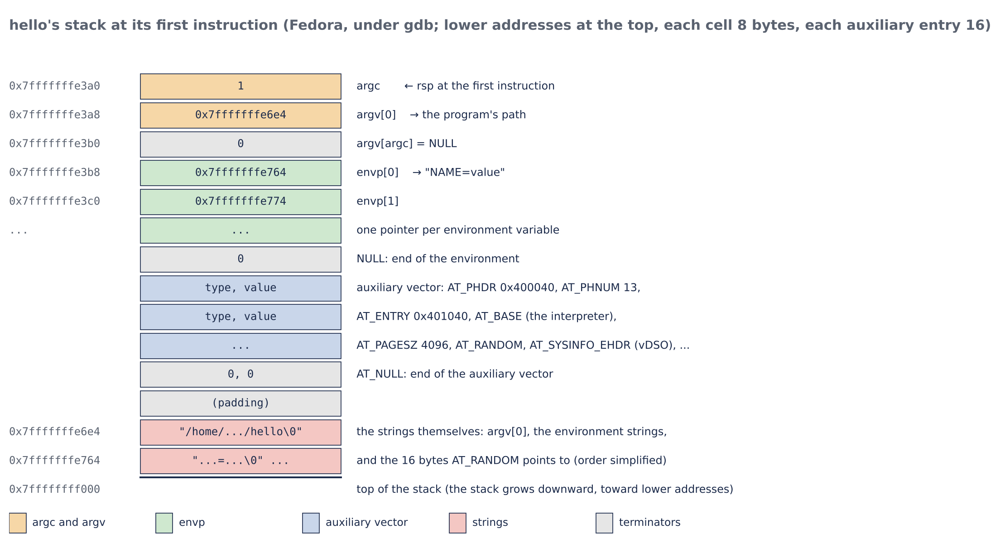

ref: 03.07
title: Loading and Running
chapter: Chapter 03 — From Source Text to Running Program
part: Part I — The Machine Beneath C
builds: §01.04, §01.05, §02.06, §03.01, §03.03, §03.04, §03.05, §03.06
---
## The question

§03.06 left `hello` on the disk, complete. Its program headers say what must be placed where in memory. Its `.interp` section names a program interpreter, `/lib64/ld-linux-x86-64.so.2`. Its entry point is 0x401040. Its call to `puts` goes through a slot at 0x403000 that still holds 0x401036, an address inside `hello` itself. §02.06 drew the outline of what happens next: the kernel, then the dynamic loader, then `_start`, then `__libc_start_main`, then `main`. This section takes that outline apart step by step, with the evidence of your own machine at every step. It keeps the promises made along the way: from §02.06, loading in detail; from §03.03, §03.04 and §03.06, the loader filling the slot of `puts`, a program loaded at a random address, `_start` read line by line; and from §01.05, the AVR's path from the reset vector to `main`.

Seven puzzles, all from your Fedora:

- `strace ./hello` (§03.01) lists 34 system calls. One of them, `write`, does the work of the program. What are the other 33 for?
- Stopped by the debugger at the very first instruction of the new program, the processor is not in `hello` at all. It is at 0x7ffff7fee920, in a function named `_start` that belongs to `/lib64/ld-linux-x86-64.so.2`.
- At that moment the C library is nowhere in memory. When `main` begins, it is.
- When `main` begins, the slot for `puts` at 0x403000 still holds 0x401036. Immediately after the call to `puts`, it holds 0x7ffff7e7ea60.
- A program that prints the address of `puts` prints 0x401030, an address in the program, not in the library. The same program built as a position-independent executable prints a different address on every run.
- A function in `order.c` that you never call runs before `main`, and another runs after `main` has returned.
- On the ATmega328P, `main` returns 7. Nobody receives the 7.

The questions are:

- What does the kernel do with `hello` when you start it, and what does it hand over?
- What does the dynamic loader do before your code runs, and what does it leave for later?
- What does `_start` do, instruction by instruction, and what does `__libc_start_main` do around `main`?
- Where do addresses that change from run to run come from?
- On a microcontroller, with no kernel and no loader, what replaces all of this, how long does it take, and what happens when `main` returns?

§03.01 has already followed `main`'s return value to the shell's `$?`, and this section does not repeat it. §27 returns to the memory of a running process, §34.06 to the protections it receives, and §36.05 and §37.01 to the AVR's start-up and interrupts.

## The journey

### Step 1: `execve`, the kernel's part

A program is started by a running process (the shell) asking the kernel to replace its own program with a new one. That request is the system call `execve`, the first line of every `strace` you have seen. Its manual page, on the reader's machine:

"execve() executes the program referred to by pathname. This causes the program that is currently being run by the calling process to be replaced with a new program, with newly initialized stack, heap, and (initialized and uninitialized) data segments."

The kernel reads the ELF header (§03.05) and the program header table (§03.06) and does three things. The same page names the second: "If the executable is a dynamically linked ELF executable, the interpreter named in the PT_INTERP segment is used to load the needed shared objects."

1. **It maps the program.** For each `LOAD` entry it *maps* the range of the file into the new process's memory with the permissions the entry asks for. To map is to arrange that a range of addresses shows the contents of a file. The kernel does not copy the bytes at once: it marks the pages, and each page is read from the file when the program first touches it (§27.01).
2. **It maps the interpreter.** It finds `INTERP`, which names `/lib64/ld-linux-x86-64.so.2`, and maps that program too, at an address of its own choosing.
3. **It builds a stack and starts the interpreter.** It places the program's arguments and environment on a new stack, together with a table of facts about the program, and starts the new process at the *interpreter's* entry point, not at `hello`'s.

The debugger `gdb` can stop a new process before its first instruction runs. Its command `starti` does that, and `info proc mappings` lists what is then in memory. On the reader's machine (the long path of `hello` is shortened here to `hello`; the command actually run also printed `rdx`, the slots at 0x402fd8 to 0x402ff8 and the top of the stack, which this section uses below):

```terminal
$ gdb -batch -nx -ex 'set debuginfod enabled off' -ex starti \
      -ex 'info registers rip rsp' -ex 'x/gx 0x403000' -ex 'info proc mappings' ./hello
```

```output
Program stopped.
0x00007ffff7fee920 in _start () from /lib64/ld-linux-x86-64.so.2
rip            0x7ffff7fee920      0x7ffff7fee920 <_start>
rsp            0x7fffffffe3a0      0x7fffffffe3a0
0x403000 <puts@got.plt>:	0x0000000000401036
Start Addr         End Addr             Offset Perms File
0x0000000000400000 0x0000000000401000      0x0 r--p  hello
0x0000000000401000 0x0000000000402000   0x1000 r-xp  hello
0x0000000000402000 0x0000000000404000   0x1000 rw-p  hello
0x00007ffff7fb9000 0x00007ffff7fbd000      0x0 r--p  [vvar]
0x00007ffff7fbd000 0x00007ffff7fbf000      0x0 r--p  [vvar_vclock]
0x00007ffff7fbf000 0x00007ffff7fc1000      0x0 r-xp  [vdso]
0x00007ffff7fc1000 0x00007ffff7fce000      0x0 r--p  ld-linux-x86-64.so.2
0x00007ffff7fce000 0x00007ffff7ffb000   0xd000 r-xp  ld-linux-x86-64.so.2
0x00007ffff7ffb000 0x00007ffff7ffe000  0x39000 rw-p  ld-linux-x86-64.so.2
0x00007ffff7ffe000 0x00007ffff7fff000      0x0 rw-p
0x00007ffffffde000 0x00007ffffffff000      0x0 rw-p  [stack]
0xffffffffff600000 0xffffffffff601000      0x0 --xp  [vsyscall]
```

(This is a reduced form. The memory map is shown without its `Size` column, and with the loader's path shortened to its file name. The lines that `gdb` prints about downloading debugging information, which are omitted from every `gdb` output in this section, are left out, and so are the lines `process 45023` and `Mapped address spaces:`. `/usr/lib64` and `/lib64` are the same directory: on Fedora `/lib64` is a symbolic link to `usr/lib64`, and the memory map shows the resolved name.) Every line can be accounted for:

- **`hello`'s three `LOAD` segments**, at the addresses the linker chose: the read-only page at 0x400000 (`r--p`; the `p` means *private*, so changes made by this process are not written back to the file), the code at 0x401000 (`r-xp`), and the writable data. The third segment covers file offsets 0x1df8 to 0x200c, which touch two pages, so the mapping spans 0x402000 to 0x404000. Each mapping keeps the file's position within the page: offset 0x1000 at 0x401000, and the third mapping begins at file offset 0x1000 too, for page 0x402000.
- **The interpreter**, `ld-linux-x86-64.so.2`, in three parts of its own, placed by the kernel near the top of the address space.
- **The `[vdso]` and its data pages, `[vvar]` and `[vvar_vclock]`**: code the kernel itself provides (below). `[vsyscall]` is an older mechanism of the same kind.
- **The stack.**
- **An anonymous `rw-p` page at 0x7ffff7ffe000**, belonging to no file: the zero-filled memory that the interpreter's data segment asks for beyond its file contents (its `.bss`), which the kernel supplies when a `LOAD` entry's size in memory exceeds its size in the file. You will meet an address inside it, 0x7ffff7ffe3c0, twice more below.
- **And no C library.** `libc.so.6` is not mapped yet. The kernel knows nothing of `NEEDED` entries; loading libraries is the interpreter's job.

The processor's first instruction in the new program is therefore `ld-linux`'s own `_start`, at 0x7ffff7fee920. The slot of `puts` holds 0x401036, exactly the bytes the linker wrote into the file. (`gdb` turns off address randomization for the programs it starts, so these addresses are the same on every run under `gdb`; outside it, the interpreter's and the stack's addresses change from run to run, as Step 5 shows.)

### What the kernel puts on the stack

The register `rsp` holds 0x7fffffffe3a0, the lowest address of the stack in use so far (the stack grows downward, toward lower addresses), and the kernel has filled the memory from that address upward. glibc's source for `_start`, in the file `sysdeps/x86_64/start.S`, describes what the program finds there:

```output
%rsp		The stack contains the arguments and environment:
		0(%rsp)				argc
		LP_SIZE(%rsp)			argv[0]
		...
		(LP_SIZE*argc)(%rsp)		NULL
		(LP_SIZE*(argc+1))(%rsp)	envp[0]
		...
						NULL
```

(`LP_SIZE` is the size of a pointer, 8 bytes here.) After the environment comes one more table, which that comment does not show: the **auxiliary vector**, a list of pairs of numbers, each a *type* and a *value*, ending with a pair of type 0 (`AT_NULL`). It carries facts that the kernel knows and the program might need. glibc prints it if the environment variable `LD_SHOW_AUXV` is set:

```terminal
$ LD_SHOW_AUXV=1 ./hello
```

```output
AT_SYSINFO_EHDR:      0x7eff5f81b000
AT_MINSIGSTKSZ:       3632
AT_HWCAP:             0xbfebfbff
AT_PAGESZ:            4096
AT_CLKTCK:            100
AT_PHDR:              0x400040
AT_PHENT:             56
AT_PHNUM:             13
AT_BASE:              0x7eff5f81d000
AT_FLAGS:             0x0
AT_ENTRY:             0x401040
AT_UID:               1000
AT_EUID:              1000
AT_GID:               1000
AT_EGID:              1000
AT_SECURE:            0
AT_RANDOM:            0x7ffca7fcf5d9
AT_HWCAP2:            0x2
AT_EXECFN:            ./hello
AT_PLATFORM:          x86_64
AT_RSEQ_FEATURE_SIZE: 33
AT_RSEQ_ALIGN:        64
hello, world
```

Here §03.06's numbers come back. `AT_PHDR` is 0x400040, the address of the program header table: 64 bytes after the start of the file, which the first segment maps at 0x400000. `AT_PHENT` is 56, the size of one program header, and `AT_PHNUM` is 13, their number. `AT_ENTRY` is 0x401040, `hello`'s entry point, `_start`. `AT_BASE` is the address at which the kernel placed the interpreter. The manual page `getauxval(3)` describes these entries one by one; for instance, `AT_ENTRY`: "The entry address of the executable." and `AT_BASE`: "The base address of the program interpreter (usually, the dynamic linker)." The interpreter needs exactly these facts: where the program's headers are, so that it can find `.dynamic` and the `NEEDED` list; where the program begins, so that it can jump there when it has finished; and where it has itself been placed. The interpreter is a shared object at an address chosen at run time, so before it can use any of its own global data it must relocate itself, adding `AT_BASE` to the stored addresses inside its own file. In the author's understanding of glibc's loader, that is its very first task, done by code written to need no relocation. `AT_RANDOM` points to 16 random bytes the kernel supplies, which, in the author's understanding, the C library uses for protections such as the stack protector's secret value (§34.06), and `AT_SYSINFO_EHDR` gives the address of the `[vdso]` (Step 6).

Listing 03.07-1 finds all of this from inside `main`, by walking past the end of `argv` and the environment, as the comment from `start.S` describes.

```c Listing 03.07-1  stack.c: walking up the stack the kernel built
// stack.c
// What the kernel placed on the stack before _start ran.
#include <stdio.h>
#include <stdint.h>
#include <inttypes.h>
#include <elf.h>          // Elf64_auxv_t and the AT_ names
#include <sys/auxv.h>     // getauxval

extern char **environ;    // the environment, as the C library sees it

int main(int argc, char *argv[]) {
    printf("argc = %d at %p\n", argc, (void *)&argc);
    printf("argv = %p, argv[argc] = %p\n", (void *)argv, (void *)argv[argc]);
    char **envp = argv + argc + 1;                 // just past argv's NULL
    printf("envp = %p, environ = %p\n", (void *)envp, (void *)environ);
    char **p = envp;
    while (*p != NULL) ++p;                        // skip the environment
    Elf64_auxv_t *aux = (Elf64_auxv_t *)(p + 1);   // the auxv follows
    for (; aux->a_type != AT_NULL; ++aux) {
        switch (aux->a_type) {
        case AT_PHDR: case AT_PHNUM: case AT_PAGESZ: case AT_BASE:
        case AT_ENTRY: case AT_RANDOM: case AT_SYSINFO_EHDR: case AT_EXECFN:
            printf("auxv %2" PRIu64 ": 0x%" PRIx64 "\n",
                   (uint64_t)aux->a_type, (uint64_t)aux->a_un.a_val);
        }
    }
    printf("getauxval(AT_ENTRY) = 0x%lx, main = 0x%" PRIxPTR "\n",
           getauxval(AT_ENTRY), (uintptr_t)main);
    return 0;
}
```

```terminal
$ ./stack one two
```

```output
argc = 3 at 0x7ffdbf18585c
argv = 0x7ffdbf1859c8, argv[argc] = (nil)
envp = 0x7ffdbf1859e8, environ = 0x7ffdbf1859e8
auxv 33: 0x7fa6e0200000
auxv  6: 0x1000
auxv  3: 0x400040
auxv  5: 0xd
auxv  7: 0x7fa6e0202000
auxv  9: 0x401050
auxv 25: 0x7ffdbf185ce9
auxv 31: 0x7ffdbf187ff0
getauxval(AT_ENTRY) = 0x401050, main = 0x401146
```

Check the arithmetic. With `argc` = 3, `argv` has 3 pointers and a NULL, 4 × 8 = 32 bytes, and `envp` begins at 0x7ffdbf1859c8 + 0x20 = 0x7ffdbf1859e8: exactly where the C library's own variable `environ` points. The numbers before the colons are the types (`AT_SYSINFO_EHDR` is 33, `AT_PAGESZ` 6, `AT_PHDR` 3, `AT_PHNUM` 5, `AT_BASE` 7, `AT_ENTRY` 9, `AT_RANDOM` 25, `AT_EXECFN` 31). The program walked the table by hand and found the same entry point, 0x401050, that the library function `getauxval` reports. (It is 0x401050, not 0x401040, because `stack` calls more library functions than `hello`, so its PLT is longer.) Note also that `argc`, the parameter, is at 0x7ffdbf18585c, not on top of the table: `main` received *copies* of `argc` and `argv` in registers, and keeps its own copy of `argc` in its stack frame. Figure 03.07-1 draws the stack of `hello` at its first instruction.

{w=15}

### Step 2: the dynamic loader's part

The manual page `ld.so(8)` states the interpreter's task in one sentence: "The programs ld.so and ld-linux.so* find and load the shared objects (shared libraries) needed by a program, prepare the program to run, and then run it." The `strace` of `hello` shows how. Here are its first 28 lines:

```output
execve("./hello", ["./hello"], 0x7fff697f8130 /* 49 vars */) = 0
newfstatat(AT_FDCWD, "/etc/ld.so.cache", {st_mode=S_IFREG|0644, st_size=79767, ...}, 0) = 0
openat(AT_FDCWD, "/etc/ld.so.cache", O_RDONLY|O_CLOEXEC) = 3
fstat(3, {st_mode=S_IFREG|0644, st_size=79767, ...}) = 0
mmap(NULL, 79767, PROT_READ, MAP_PRIVATE, 3, 0) = 0x7f8c49f04000
close(3)                                = 0
brk(NULL)                               = 0xddd9000
mmap(NULL, 8192, PROT_READ|PROT_WRITE, MAP_PRIVATE|MAP_ANONYMOUS, -1, 0) = 0x7f8c49f02000
access("/etc/ld.so.preload", R_OK)      = -1 ENOENT (No such file or directory)
newfstatat(AT_FDCWD, "/etc/ld.so.cache", {st_mode=S_IFREG|0644, st_size=79767, ...}, 0) = 0
openat(AT_FDCWD, "/lib64/libc.so.6", O_RDONLY|O_CLOEXEC) = 3
read(3, "\177ELF\2\1\1\3\0\0\0\0\0\0\0\0\3\0>\0\1\0\0\0 \325\7\0\0\0\0\0"..., 1024) = 1024
fstat(3, {st_mode=S_IFREG|0755, st_size=2495368, ...}) = 0
mmap(NULL, 2087760, PROT_READ, MAP_PRIVATE|MAP_DENYWRITE, 3, 0) = 0x7f8c49d04000
mmap(0x7f8c49d7e000, 1531904, PROT_READ|PROT_EXEC, MAP_PRIVATE|MAP_FIXED|MAP_DENYWRITE, 3, 0x7a000) = 0x7f8c49d7e000
mmap(0x7f8c49ef4000, 24576, PROT_READ|PROT_WRITE, MAP_PRIVATE|MAP_FIXED|MAP_DENYWRITE, 3, 0x1ef000) = 0x7f8c49ef4000
mmap(0x7f8c49efa000, 31568, PROT_READ|PROT_WRITE, MAP_PRIVATE|MAP_FIXED|MAP_ANONYMOUS, -1, 0) = 0x7f8c49efa000
close(3)                                = 0
mmap(NULL, 12288, PROT_READ|PROT_WRITE, MAP_PRIVATE|MAP_ANONYMOUS, -1, 0) = 0x7f8c49d01000
arch_prctl(ARCH_SET_FS, 0x7f8c49d01740) = 0
set_tid_address(0x7f8c49d01d68)         = 44924
set_robust_list(0x7f8c49d01a20, 24)     = 0
rseq({cpu_id_start=0, cpu_id=RSEQ_CPU_ID_UNINITIALIZED, rseq_cs=NULL, flags=0, node_id=0, mm_cid=0, slice_ctrl={request=0, granted=0, __reserved=0}, __reserved=0}, 33, 0, 0x53053053) = 0
getrandom("\x5e\x6d\xf2\x16\x29\x13\x30\x99\xbf\x43\xbc\xd4\x0b\x0c\x12\xa5", 16, GRND_NONBLOCK) = 16
mprotect(0x7f8c49ef4000, 16384, PROT_READ) = 0
mprotect(0x402000, 4096, PROT_READ)     = 0
mprotect(0x7f8c49f5a000, 8192, PROT_READ) = 0
prlimit64(0, RLIMIT_STACK, NULL, {rlim_cur=8192*1024, rlim_max=RLIM64_INFINITY}) = 0
```

Grouped by purpose:

- **Finding the library** (lines 2–6, 9 and 10). The name in `NEEDED` is `libc.so.6`, without a directory. The loader looks it up in `/etc/ld.so.cache`, a table of library names and their files that the command `ldconfig` builds from its built-in trusted directories (such as `/lib64`) and from the directories named in `/etc/ld.so.conf`, which on the reader's machine only includes the files of `/etc/ld.so.conf.d/` (`ldconfig -p` lists `libc.so.6 (libc6,x86-64) => /lib64/libc.so.6`). It maps the cache into memory to read it. `access("/etc/ld.so.preload", ...)` checks for a file that could name libraries to load before all others; there is none.
- **Loading the library** (lines 11–18). It opens `/lib64/libc.so.6`, reads its first 1,024 bytes (the ELF header, whose magic number `\177ELF` you can see, and the program headers), and then maps it as the kernel mapped `hello`: one `mmap` reserves 2,087,760 bytes of address space for the whole library, readable; the next three, with `MAP_FIXED`, place the executable part, the writable data and an anonymous, zero-filled region for the library's `.bss` at fixed positions inside that reservation. A library is loaded by the same means as a program, one level up.
- **Preparing the C library's machinery** (lines 7–8 and 19–24). The `brk` call asks where the heap ends. `arch_prctl(ARCH_SET_FS, ...)` points the processor's `fs` register at a block of memory for this thread, its *thread control block*. `set_tid_address`, `set_robust_list` and `rseq` register information about the thread with the kernel, and `getrandom` fetches 16 random bytes. These calls belong to the loader and the library working together; they are listed here for completeness and are not needed to understand loading.
- **Protecting what was relocated** (lines 25–27), discussed below with RELRO.
- **Line 28**, `prlimit64`, asks the limit on the size of the stack (8 MB).

The remaining six lines are `getrandom`, `fstat(1, ...)`, two `brk`, `write` and `exit_group(0)`. In the author's reading, `fstat` on file descriptor 1 is the C library checking what kind of file standard output is, to decide how to buffer it, and the two `brk` calls obtain memory for the buffer; `write` is `puts`'s output, and `exit_group` ends the process. One system call does the program's work; the others prepare the stage or close it. The loader reports its own cost:

```terminal
$ LD_DEBUG=statistics ./hello
```

```output
     44971:	
     44971:	runtime linker statistics:
     44971:	  total startup time in dynamic loader: 28845 cycles
     44971:	            time needed for relocation: 502 cycles (1.7%)
     44971:	                 number of relocations: 96
     44971:	      number of relocations from cache: 7
     44971:	        number of relative relocations: 0
     44971:	           time needed to load objects: 5646 cycles (19.5%)
     44971:	
     44971:	runtime linker statistics:
     44971:	           final number of relocations: 97
     44971:	final number of relocations from cache: 7
hello, world
```

(The number at the start of each line is the process ID. `LD_DEBUG` is read by the loader itself; `LD_DEBUG=help ./hello` lists its options.) 28,845 "cycles", counted with the processor's time-stamp counter, which ticks at a constant rate (for the reader's i5-1135G7, `/proc/cpuinfo` gives the rated frequency, 2.40 GHz): about 12 microseconds. The line "number of relocations: 96" is named loosely: glibc increments it once for each *name looked up*, not for each relocation applied, so it counts 96 lookups, most of them made by `libc.so.6` for itself. By the end of the run the count is 97; the extra lookup is the lazy binding of `puts`, explained next (the bindings trace below shows exactly 95 bindings before control passes to the program and one, `puts`, after it).

### Relocating: the notes for the loader

§03.06 found three dynamic relocations in `hello`. The loader carries them out, and `gdb` shows the result. Stopped at `hello`'s own `_start`, 0x401040, the first instruction of the program proper (the command run on the reader's machine also printed the registers, used in Step 3):

```terminal
$ gdb -batch -nx -ex 'set debuginfod enabled off' -ex 'break *0x401040' -ex run \
      -ex 'x/gx 0x402fd8' -ex 'info symbol *(long *)0x402fd8' \
      -ex 'x/3gx 0x402fe8' -ex 'info symbol *(long *)0x402ff8' -ex 'x/gx 0x403000' ./hello
```

```output
Breakpoint 1, 0x0000000000401040 in _start ()
0x402fd8:	0x00007ffff7e22390
__libc_start_main_impl in section .text of /lib64/libc.so.6
0x402fe8:	0x0000000000402e08	0x00007ffff7ffe3c0
0x402ff8:	0x00007ffff7fe2f60
_dl_runtime_resolve_xsavec in section .text of /lib64/ld-linux-x86-64.so.2
0x403000 <puts@got.plt>:	0x0000000000401036
```

(The line reporting where the breakpoint was set and two lines about the thread library are omitted.) At the first instruction of the program (in the loader), every one of these slots held what the file held: 0x402fd8, 0x402ff0 and 0x402ff8 were 0, 0x402fe8 held 0x402e08 and 0x403000 held 0x401036. Now:

- **The slot at 0x402fd8**, named by the relocation `R_X86_64_GLOB_DAT __libc_start_main@GLIBC_2.34`, holds 0x7ffff7e22390, which `gdb` identifies as `__libc_start_main_impl` in `libc.so.6`. (`__libc_start_main_impl` is the library's internal name for the function; `__libc_start_main` is the name, with the version `GLIBC_2.34`, under which the library exports it. They are the same code: on the reader's machine, `nm -D /lib64/libc.so.6` gives `__libc_start_main@@GLIBC_2.34` the value 0x7d390, an address counted from the library's *base*, the address at which its first byte is loaded; the memory map that `gdb` printed when stopped at `main` showed that first byte, the mapping `r--p /usr/lib64/libc.so.6`, at 0x7ffff7da5000; and 0x7ffff7da5000 + 0x7d390 = 0x7ffff7e22390. For code, this offset from the base happens to equal the position in the file; for data it does not: the `strace` above maps file offset 0x1ef000 at base + 0x1f0000.) `_start`'s `call *0x1f73(%rip)` will go through this slot, and that is why the loader had to fill it at once: the code reads it directly, with no way back into the loader. `start.S` says so in the sentence after the one quoted in Table 03.07-1: "Since __libc_start_main in libc.so is called very early, lazy binding isn't relevant here. Use indirect branch via GOT to avoid extra branch to PLT slot." A `R_X86_64_GLOB_DAT` slot is used directly and must be ready. A `R_X86_64_JUMP_SLOT` slot first points back into its own PLT entry, which leads to the resolver, and so it can wait.
- **The two reserved slots** of `.got.plt` (§03.06), at 0x402ff0 and 0x402ff8, now hold 0x7ffff7ffe3c0, an identifier for `hello` in the loader's own tables (its *link map*, kept in the loader's anonymous page at 0x7ffff7ffe000), and 0x7ffff7fe2f60, the loader's function `_dl_runtime_resolve_xsavec`, the *resolver*. (The suffix names the processor instruction `XSAVEC`, which, in the author's understanding, the resolver uses to save the registers holding the arguments of the call in progress, including the vector registers, so that the lookup does not disturb them.)
- **The slot of `puts`**, at 0x403000, still holds 0x401036.

The loader filled the slot of `__libc_start_main` and left the slot of `puts` alone. This is **lazy binding**: a function's slot is filled not at start-up but at the first call. The loader's trace shows the timing. With `LD_DEBUG=bindings`, it reports each name it binds. Here are its lines from the first binding for `hello` to the binding of `puts` (the earlier lines, in which the vDSO and `libc.so.6` bind names within themselves, and the later `calling fini` lines, are omitted):

```output
     44967:	binding file ./hello [0] to /lib64/libc.so.6 [0]: normal symbol `__libc_start_main' [GLIBC_2.34]
     44967:	binding file ./hello [0] to /lib64/libc.so.6 [0]: normal symbol `calloc' [GLIBC_2.2.5]
     44967:	binding file ./hello [0] to /lib64/libc.so.6 [0]: normal symbol `free' [GLIBC_2.2.5]
     44967:	binding file ./hello [0] to /lib64/libc.so.6 [0]: normal symbol `malloc' [GLIBC_2.2.5]
     44967:	binding file ./hello [0] to /lib64/libc.so.6 [0]: normal symbol `realloc' [GLIBC_2.2.5]
     44967:	binding file ./hello [0] to /lib64/ld-linux-x86-64.so.2 [0]: normal symbol `_r_debug'
     44967:	
     44967:	calling init: /lib64/ld-linux-x86-64.so.2
     44967:	
     44967:	
     44967:	calling init: /lib64/libc.so.6
     44967:	
     44967:	
     44967:	initialize program: ./hello
     44967:	
     44967:	
     44967:	transferring control: ./hello
     44967:	
     44967:	binding file ./hello [0] to /lib64/libc.so.6 [0]: normal symbol `puts' [GLIBC_2.2.5]
```

`__libc_start_main` is bound before "transferring control"; `puts` after it, while `main` runs. The trace is a timeline of this whole section: the bindings are the loader's relocation work (this Step); the two lines `calling init` are the loader running the initializers of the libraries; and, according to glibc's source (`csu/libc-start.c`), the lines `initialize program` and `transferring control` are printed by `__libc_start_main` itself, after the loader has already jumped to `_start`, just before it runs the program's constructors and just before it calls `main` (Steps 3 and 4). (The bindings of `calloc`, `free`, `malloc` and `realloc` "in file `./hello`" are lookups the loader makes on its own behalf; `hello` does not call these functions. The author has not traced their purpose.) The environment variable `LD_BIND_NOW` changes the rule. `man ld.so`: "If set to a nonempty string, causes the dynamic linker to resolve all symbols at program startup instead of deferring function call resolution to the point when they are first referenced." With `LD_BIND_NOW=1`, the same trace shows the line for `puts` second, immediately after `__libc_start_main` and before "transferring control".

And the debugger shows the slot changing. Stopped at `main` (0x40113a; `gdb` places a breakpoint on a function after the instructions that set up its frame), then at 0x401144, the instruction after the call, and finally asked for the value of `puts` itself (the backtrace, the memory map and the lines reporting the breakpoints are omitted here):

```output
Breakpoint 1, 0x000000000040113a in main ()
0x403000 <puts@got.plt>:	0x0000000000401036
Breakpoint 2, 0x0000000000401144 in main ()
0x403000 <puts@got.plt>:	0x00007ffff7e7ea60
puts in section .text of /lib64/libc.so.6
$1 = (void *) 0x7ffff7e7ea60 <puts>
```

The arithmetic of the previous paragraph works here too: `nm -D` gives `puts@@GLIBC_2.2.5` the value 0xd9a60, and 0x7ffff7da5000 + 0xd9a60 = 0x7ffff7e7ea60. The loader's whole task, for each name, is this one addition, once it knows where the library was placed and where in the library the name is defined.

The first call to `puts` followed the path §03.06 traced in the file:

1. `call 0x401030`: to `puts@plt`.
2. `jmp *0x403000`: the slot still holds 0x401036, so the jump lands on the next instruction of the PLT entry.
3. `push $0x0; jmp 0x401020`: push the number of `puts`'s relocation, go to the first PLT entry.
4. `push 0x402ff0; jmp *0x402ff8`: push the link map, jump to the resolver, `_dl_runtime_resolve_xsavec`.
5. The resolver takes relocation 0 of `.rela.plt` (`R_X86_64_JUMP_SLOT puts@GLIBC_2.2.5` at 0x403000), searches the loaded libraries for `puts` with that version, finds it at 0x7ffff7e7ea60, writes that address into the slot, and jumps to `puts`.

Every later call takes step 1, then step 2, and step 2 now leads straight to `puts`: the cost of the shared library is one indirect jump per call. Why defer the work at all? In the author's understanding, because a large program may import thousands of functions and call few of them in any one run, so filling every slot at start-up would spend time on calls that never happen. The cost is that the slots must stay writable for the whole run, which is exactly the weakness that the next protection addresses.

### RELRO: making the filled tables read-only

§03.06 found the entry `GNU_RELRO` covering 0x402df8 to 0x403000: `.init_array`, `.fini_array`, `.dynamic` and `.got`. Line 26 of the `strace` above is the loader acting on it, after its relocations: `mprotect(0x402000, 4096, PROT_READ)`, "make the page at 0x402000 read-only". The memory map at `main` confirms it. Where the map at the first instruction had one writable mapping from 0x402000 to 0x404000, there are now two:

```output
0x0000000000402000 0x0000000000403000   0x1000 r--p  hello
0x0000000000403000 0x0000000000404000   0x2000 rw-p  hello
```

The page holding the table of `__libc_start_main` and the program's dynamic section can no longer be written, while the page at 0x403000, holding the slot of `puts` that the resolver must still write, stays writable. This is the reason, which §03.06 could only state, why the linker made the read-only range end at exactly 0x403000. The other two `mprotect` calls do the same for `libc.so.6` and the loader itself. (`LD_BIND_NOW` fills every slot at start-up but leaves `.got.plt` writable, because the read-only range was fixed in the file by the linker. Linking with `-z now` both fills every slot at start-up and lets the linker place `.got.plt` inside `GNU_RELRO`, so that the whole table is protected; §34.06 compares the two.)

### What a program sees as the address of `puts`

Listing 03.07-2 prints four addresses.

```c Listing 03.07-2  where.c: where things are in memory
// where.c
// Print where main, a global, a local and puts are in memory.
#include <stdio.h>
#include <stdint.h>
#include <inttypes.h>

int global = 1;

int main(void) {
    int local = 2;
    printf("main   0x%" PRIxPTR "\n", (uintptr_t)main);
    printf("global %p\n", (void *)&global);
    printf("local  %p\n", (void *)&local);
    printf("puts   0x%" PRIxPTR "\n", (uintptr_t)puts);
    return local - 2;
}
```

```output
main   0x401146
global 0x403014
local  0x7ffceb7cc1dc
puts   0x401030
```

The address of `puts`, as the program sees it, is 0x401030: an address in the program, its PLT entry, not the function in the library. In a program that is not position-independent, the compiler treats the address of `puts` as a constant, as it treats the address of `main`, so the linker must give it a constant value before any library is loaded, and the PLT entry is the only address of `puts` it knows. `readelf --dyn-syms where` shows the consequence: the dynamic symbol `puts` is still undefined (`UND`), but carries the value 0x401030, whereas in `where_pie` its value is 0. In the author's understanding, the loader then uses that value for every reference to the address of `puts` anywhere in the process, including inside `libc.so.6`, so that two pointers to `puts` compare equal whichever module took them. (This explanation is the author's reading; the observed facts are the values 0x401030 and 0.) In the position-independent version below, the same line prints the library's real address.

### Step 3: `_start`, line by line

The loader's last act is to jump to `AT_ENTRY`, 0x401040. §03.06 printed the 38 bytes of `_start` from `crt1.o`, and `start.S`, the source from which glibc builds that file, comments every instruction. Table 03.07-1 puts the two side by side, with the register values `gdb` showed on the reader's machine. (At `hello`'s first instruction, 0x401040, `rdx` held 0x7ffff7fd2ea0, which `gdb` named `_dl_fini`, a function of the loader; at the first instruction of the program, in the loader, it was 0. The kernel passes no function in `rdx`; the loader puts its own clean-up function there before jumping to `hello`. Just before the `call`, the registers held the values in the last column.)

Table: Table 03.07-1  hello's _start, with glibc's comments from start.S
<!-- widths: 30,40,30 -->
| Instruction | start.S comment (quoted) | Value (observed with gdb, or computed) |
|---|---|---|
| `endbr64` | (none; marks a valid target of an indirect jump, §03.04) | |
| `xor %ebp,%ebp` | "Clear the frame pointer. The ABI suggests this be done, to mark the outermost frame obviously." | `rbp` = 0 (computed) |
| `mov %rdx,%r9` | "Address of the shared library termination function." | `r9` = `_dl_fini` |
| `pop %rsi` | "Pop the argument count." | `rsi` = 1 (`argc`) |
| `mov %rsp,%rdx` | "argv starts just at the current stack top." | `rdx` = 0x7fffffffe3a8 |
| `and $0xfffffffffffffff0,%rsp` | "Align the stack to a 16 byte boundary to follow the ABI." | `rsp` = 0x7fffffffe3a0 (computed) |
| `push %rax` | "Push garbage because we push 8 more bytes." | |
| `push %rsp` | "Provide the highest stack address to the user code (for stacks which grow downwards)." | 0x7fffffffe398 pushed (observed on the stack) |
| `xor %r8d,%r8d`, `xor %ecx,%ecx` | "These used to be the addresses of .fini and .init." | `r8` = `rcx` = 0 |
| `mov $0x401136,%rdi` | (the address of `main`; §03.06 explained the relaxation) | `rdi` = 0x401136 |
| `call *0x1f73(%rip)` | "Call the user's main function, and exit with its value. But let the libc call main." | to `__libc_start_main_impl` |
| `hlt` | "Crash if somehow 'exit' does return." | |

The same file states the meaning of the registers on the way out, "the arguments for __libc_start_main", in this order: "main: %rdi", "argc: %rsi", "argv: %rdx", "init: %rcx", "fini: %r8", "rtld_fini: %r9", "stack_end: stack." Each observed value matches. Three details deserve a sentence each.

- **`rdx` at entry.** The ABI leaves most registers undefined when a program starts, with exceptions; `start.S` quotes it: "%rdx Contains a function pointer to be registered with 'atexit'. This is how the dynamic linker arranges to have DT_FINI functions called for shared libraries that have been loaded before this code runs." (In the source the names are quoted with a backquote and an apostrophe; here, as in the table, with two apostrophes.) The loader handed `hello` the address of its own clean-up function, `_dl_fini`, and `_start` passes it on as `rtld_fini`. You will see it run, after `main`, in Step 4.
- **The two zeros.** The comment says what these arguments used to carry: the addresses of the program's `.init` and `.fini` code, which ran its constructors and destructors. Now `crt1.o` passes zeros. glibc's `csu/libc-start.c` handles both cases: if `init` is not null, "This is a legacy program which supplied its own init routine."; otherwise, "This is a current program. Use the dynamic segment to find constructors." The dynamic section that §03.06 found in `hello` lists `INIT` (0x401000, the `_init` of `crti.o` and `crtn.o`) and `INIT_ARRAY` (0x402df8), and `__libc_start_main` calls them from there; in Step 4, `gdb` shows it calling a constructor directly. That change is why `hello` asks for `__libc_start_main@GLIBC_2.34`, the new version of the function, and not the old `@GLIBC_2.2.5` that the library also still provides for older programs (§03.06). (That the version number marks this change is the author's inference from these comments together with the two versions in `nm -D /lib64/libc.so.6`.)
- **The stack.** After `pop %rsi`, `rsp` is 0x7fffffffe3a8; rounding down to a multiple of 16 gives 0x7fffffffe3a0; the two `push` instructions leave it at 0x7fffffffe390, again a multiple of 16, as the ABI requires at every `call` (§19.02). The value pushed by `push %rsp` is the address before that push, 0x7fffffffe398, and `gdb` found exactly that at the top of the stack. Since `push %rsp` must be preceded by one 8-byte push to keep the alignment, the comment calls the first one "garbage": `rax` held 0x38, a value that means nothing here.

### Step 4: `__libc_start_main`, around `main`

`__libc_start_main` prepares the C library, runs the program's constructors, calls `main`, and passes `main`'s result to `exit`. Listing 03.07-3 makes each of those steps visible.

```c Listing 03.07-3  order.c: what runs before main, and after it
// order.c
// What runs before main, and after it.
#include <stdio.h>
#include <stdlib.h>

__attribute__((constructor))
static void before(void) { puts("constructor: before main"); }

__attribute__((destructor))
static void after(void) { puts("destructor: after exit's handlers"); }

static void bye(void) { puts("atexit handler: inside exit"); }

int main(void) {
    atexit(bye);
    puts("main");
    return 0;
}
```

`__attribute__((constructor))` is a GCC extension: the compiler puts the address of `before` into the section `.init_array` (§03.06), and `after` into `.fini_array`. `atexit` is standard C: it registers a function to be called when the program ends. The output:

```output
constructor: before main
main
atexit handler: inside exit
destructor: after exit's handlers
```

Who called each function? A breakpoint in each, and `gdb`'s `bt` (backtrace: the chain of calls that led to the current function, most recent first):

```output
Breakpoint 1, 0x000000000040114a in before ()
#0  0x000000000040114a in before ()
#1  0x00007ffff7e22494 in __libc_start_main_impl () from /lib64/libc.so.6
#2  0x0000000000401075 in _start ()
Breakpoint 2, 0x000000000040116c in bye ()
#0  0x000000000040116c in bye ()
#1  0x00007ffff7e3b8ef in __run_exit_handlers () from /lib64/libc.so.6
#2  0x00007ffff7e3b9ce in exit () from /lib64/libc.so.6
#3  0x00007ffff7e22308 in __libc_start_call_main () from /lib64/libc.so.6
#4  0x00007ffff7e22418 in __libc_start_main_impl () from /lib64/libc.so.6
#5  0x0000000000401075 in _start ()
Breakpoint 3, 0x000000000040115b in after ()
#0  0x000000000040115b in after ()
#1  0x00007ffff7fcf012 in _dl_call_fini (closure_map=closure_map@entry=0x7ffff7ffe3c0) at dl-call_fini.c:43
#2  0x00007ffff7fd30ae in _dl_fini () at dl-fini.c:120
#3  0x00007ffff7e3b8ef in __run_exit_handlers () from /lib64/libc.so.6
#4  0x00007ffff7e3b9ce in exit () from /lib64/libc.so.6
#5  0x00007ffff7e22308 in __libc_start_call_main () from /lib64/libc.so.6
#6  0x00007ffff7e22418 in __libc_start_main_impl () from /lib64/libc.so.6
#7  0x0000000000401075 in _start ()
```

(The lines reporting where each breakpoint was set, the two thread-library lines and blank lines are omitted.) Read the three chains from the bottom up, and the whole life of the program appears:

1. `_start` called `__libc_start_main_impl`, which, before calling `main`, called `before` directly: the program's constructors, from `.init_array`, are run by the C library's start function. (0x401075 is the return address of `_start`'s `call`, which is its `hlt`: `order` imports more functions than `hello`, so its PLT is longer, its `_start` begins at 0x401050 instead of 0x401040, and its `hlt` is at 0x401050 + 0x25 = 0x401075. `gdb` shows each calling frame at its return address.)
2. `__libc_start_main_impl` called `__libc_start_call_main`, which called `main` (the frame of `main` has disappeared, because `main` has returned), and then called `exit` with `main`'s value.
3. `exit` ran the handlers registered with it, newest first (the C standard requires the reverse order of registration), in `__run_exit_handlers`. The first was `bye`, registered by `main`. The second was `_dl_fini`, registered by `__libc_start_main` before it ran the constructors (glibc's `libc-start.c` registers `rtld_fini` with `__cxa_atexit`): the function whose address arrived in `rdx` and was passed as `rtld_fini`. `_dl_fini` runs the destructors of every loaded object, through `_dl_call_fini`, and with them the program's `.fini_array`, which contains `after`. Its argument, `closure_map=0x7ffff7ffe3c0`, is `hello`'s link map again, the value found in `.got.plt` in Step 2. (`gdb` shows source file names and line numbers for the loader's functions but not for the C library's; the author takes this to mean that Fedora's loader carries some debugging information.)

At `main` itself, the registers show what `main` received: `rdi` = 1 (`argc`), `rsi` = 0x7fffffffe3a8 (`argv`), and `rdx` = 0x7fffffffe3b8, 16 bytes past `argv`, that is `argv + 2` in C (past `argv[0]` and the NULL): the environment, passed as a third argument, as the manual page `execve(2)` describes for `int main(int argc, char *argv[], char *envp[])`, a form it notes "is not specified in POSIX.1".

### Where `main`'s return value goes

§03.01 followed the value to the shell's `$?`. The chain above adds the steps inside the program. `__libc_start_call_main` passes the value to `exit`. `exit` runs the handlers and flushes the output streams, and finally makes the system call that ends the process, `exit_group`, with the value. `strace` restricted to three calls shows the program's life from the kernel's side:

```terminal
$ strace -e trace=execve,write,exit_group ./hello
```

```output
execve("./hello", ["./hello"], 0x7ffddcc085a0 /* 49 vars */) = 0
write(1, "hello, world\n", 13hello, world
)          = 13
exit_group(0)                           = ?
+++ exited with 0 +++
```

`exit_group` returns nothing (`= ?`): there is nothing to return to. The kernel keeps the status until the parent, the shell, collects it.

### Step 5: addresses that change from run to run

Run `where` (Listing 03.07-2) twice, then once under `setarch -R`, which asks the kernel to turn off address randomization for one program:

```output
main   0x401146
global 0x403014
local  0x7ffceb7cc1dc
puts   0x401030
main   0x401146
global 0x403014
local  0x7fff24f9201c
puts   0x401030
main   0x401146
global 0x403014
local  0x7fffffffe37c
puts   0x401030
```

(Three runs, one after another.) `main`, `global` and `puts` (the PLT entry) never move: the linker fixed them. The local variable, on the stack, moves on every run, because the kernel places the stack at a random address; this is **address space layout randomization** (ASLR), which the setting `/proc/sys/kernel/randomize_va_space` controls (2 on the reader's machine: full randomization). Under `setarch -R` the stack sits at the top of the address space, as under `gdb`. The C library moves too, as `ldd` showed in §03.06.

Now the position-independent build, which Ubuntu's GCC makes by default and Fedora's makes when asked (`-fPIE -pie`, §03.04):

```terminal
$ gcc -std=c23 -Wall -Wextra -pedantic -fPIE -pie where.c -o where_pie
$ ./where_pie; ./where_pie; setarch -R ./where_pie
```

```output
main   0x55ffbc6cc139
global 0x55ffbc6ce014
local  0x7ffdffec9e7c
puts   0x7fcf51478a60
main   0x560134e41139
global 0x560134e43014
local  0x7ffd4b3a1c6c
puts   0x7fac95c3ea60
main   0x555555555139
global 0x555555557014
local  0x7fffffffe36c
puts   0x7ffff7e7ea60
```

`readelf -h where_pie` gives the type `DYN (Position-Independent Executable file)` and the entry point 0x1050, and `nm where_pie` gives `main` the value 0x1139: the linker numbered everything from 0, and the kernel chose a *base address* at which to place the whole file, different on every run. The last three hexadecimal digits never change (`139`, `014`), because the base is always a multiple of the page size, 4,096 = 0x1000. Subtract the linker's address from the run-time address, and you have the base: without randomization, 0x555555555139 − 0x1139 = 0x555555554000. And `puts` is now the library's real address, 0x7ffff7e7ea60 without randomization, the same value that the slot in `hello` received: a position-independent program does not need a constant address for `puts`, so it reads the real one from the global offset table. Placing a program at a random address costs the loader work that `hello` did not need: every stored absolute address inside the program must be adjusted by the base. These are *relative relocations*. `LD_DEBUG=statistics` counted 3 of them for `where_pie` and 0 for `hello`. It counts only those that an object lists as ordinary relocations: `libc.so.6`, which is also placed at a random base and certainly needs them, stores its own in a packed form (`readelf -d` shows the entries `RELR` and `RELRSZ`, 280 bytes), which this counter does not include. Why go to that trouble? Because an attacker who wants to make a program jump to a particular piece of its code must know where that code is, and randomization takes that knowledge away (§34.06).

### Step 6: the vDSO, a library from the kernel

The memory maps showed a `[vdso]` and two `[vvar]` areas that no file provides, and `ldd` in §03.06 listed `linux-vdso.so.1`. The manual page `vdso(7)`: "The "vDSO" (virtual dynamic shared object) is a small shared library that the kernel automatically maps into the address space of all user-space applications." Why? The same page: "There are some system calls the kernel provides that user-space code ends up using frequently, to the point that such calls can dominate overall performance." A system call costs a switch from the program into the kernel and back. Some questions, above all "what time is it?", can be answered by reading memory that the kernel keeps up to date (the `[vvar]` pages) with code that the kernel provides (the `[vdso]`), without entering the kernel at all. Listing 03.07-4 asks the time three times, through the standard C function `timespec_get` (C11).

```c Listing 03.07-4  clock.c: three questions about the time
// clock.c
// Ask for the time three times. Does the kernel hear about it?
#include <stdio.h>
#include <time.h>

int main(void) {
    struct timespec t;
    for (int i = 0; i < 3; ++i) {
        timespec_get(&t, TIME_UTC);                 // standard C since C11
        printf("%lld.%09ld\n", (long long)t.tv_sec, t.tv_nsec);
    }
    return 0;
}
```

On the reader's machine it printed:

```output
1795723563.485631473
1795723563.485649448
1795723563.485649766
```

The first two answers are about 18 microseconds apart, the last two about 0.3 microseconds: between the first two, the first `printf` had to set up the output buffer, with system calls of its own. `strace -c`, which counts system calls instead of listing them, counted 34 in all: `execve`, `mmap`, `mprotect`, one `write` and the rest of the start-up calls, and no system call for the time at all. The three questions were answered in the program's own process; in the author's understanding, by the vDSO's `__vdso_clock_gettime`, one of the six names that the trace of bindings showed the loader connecting first, before anything else (`__vdso_clock_gettime`, `__vdso_gettimeofday`, `__vdso_time`, `__vdso_getcpu`, `__vdso_clock_getres`, `__vdso_getrandom`). The kernel gives the loader its address through the auxiliary vector's `AT_SYSINFO_EHDR`.

:::precise
§03.04 promised a look at CET, the processor's *control-flow enforcement technology*, at run time. CET has two parts: the *shadow stack*, a second, protected copy of every return address, checked at each `ret`; and *indirect branch tracking* (IBT), which requires every target of an indirect jump or call to begin with `endbr64`, the instruction at the start of `_start`. The reader's processor has both: `/proc/cpuinfo` lists the flags `ibt` and `user_shstk` for each of its 8 logical processors. Whether they are active for a process is shown by the line `x86_Thread_features` of `/proc/<process>/status`, which Listing 03.07-6 (in Experiment 03.07-6) prints for itself. On the reader's machine, the line was empty for every combination the author tried: the program as `hello` is built, the program built with `-fcf-protection=full` (whose notes then read `x86 feature: IBT, SHSTK`, like those of Fedora's `/usr/bin/ls`), and both again with the glibc setting `GLIBC_TUNABLES=glibc.cpu.x86_shstk=on`. So on this system, as configured, neither protection was active for these programs, although the processor supports both and the files carry the markings. Why not is not established here; the author's understanding is that Linux supports only the shadow stack for user programs, and that its use depends on the C library, the kernel and their configuration together. Notice also that `hello` itself is not marked: `readelf -n hello` shows no `x86 feature: IBT, SHSTK` line. In the author's understanding, the linker keeps the marking only if every input object carries it, and `hello.o`, compiled without `-fcf-protection`, did not.
:::

### Step 7: the AVR, from reset to `main` and beyond

The ATmega328P has no kernel, no file and no loader. §02.06 listed the steps of its start-up in order, and §03.06 showed the linker arranging them. Here they run, and are measured. Listing 03.07-5 gives the start-up code something to do in each of its steps.

```c Listing 03.07-5  avr_life.c: one variable of each kind, and a main that returns
// avr_life.c  (ATmega328P)
// One variable with an initializer, one without, and a main that returns.
#include <avr/io.h>

unsigned char ready = 0x5A;     // .data: copied from flash at start-up
unsigned char count;            // .bss: cleared to zero at start-up

int main(void) {
    DDRB = (unsigned char)(ready + count);   // use both, so neither is removed
    return 7;                                // and then: to whom?
}
```

Built on the reader's machine (`avr-gcc -mmcu=atmega328p -std=c11 -Os -Wall -Wextra -pedantic`), `avr-size` reports 188 bytes of `text`, 2 of `data` and 1 of `bss`. The `data` is 2 bytes, not 1, because the linker script rounds `.data` up to an even size (§03.05). Everything the processor executes after the vector table, as `avr-objdump -d` shows it (the labels that the disassembler inserts, `.Loc.N`, `L0` and `.L__do_copy_data_...`, and blank lines are omitted):

```output
00000068 <__ctors_end>:
  68:	11 24       	eor	r1, r1
  6a:	1f be       	out	0x3f, r1	; 63
  6c:	cf ef       	ldi	r28, 0xFF	; 255
  6e:	d8 e0       	ldi	r29, 0x08	; 8
  70:	de bf       	out	0x3e, r29	; 62
  72:	cd bf       	out	0x3d, r28	; 61
00000074 <__do_copy_data>:
  74:	11 e0       	ldi	r17, 0x01	; 1
  76:	a0 e0       	ldi	r26, 0x00	; 0
  78:	b1 e0       	ldi	r27, 0x01	; 1
  7a:	ec eb       	ldi	r30, 0xBC	; 188
  7c:	f0 e0       	ldi	r31, 0x00	; 0
  7e:	02 c0       	rjmp	.+4      	; 0x84 <.L__do_copy_data_start>
  80:	05 90       	lpm	r0, Z+
  82:	0d 92       	st	X+, r0
  84:	a2 30       	cpi	r26, 0x02	; 2
  86:	b1 07       	cpc	r27, r17
  88:	d9 f7       	brne	.-10     	; 0x80 <.L__do_copy_data_loop>
0000008a <__do_clear_bss>:
  8a:	21 e0       	ldi	r18, 0x01	; 1
  8c:	a2 e0       	ldi	r26, 0x02	; 2
  8e:	b1 e0       	ldi	r27, 0x01	; 1
  90:	01 c0       	rjmp	.+2      	; 0x94 <.Loc.5>
  92:	1d 92       	st	X+, r1
  94:	a3 30       	cpi	r26, 0x03	; 3
  96:	b2 07       	cpc	r27, r18
  98:	e1 f7       	brne	.-8      	; 0x92 <.Loc.4>
  9a:	0e 94 53 00 	call	0xa6	; 0xa6 <main>
  9e:	0c 94 5c 00 	jmp	0xb8	; 0xb8 <_exit>
000000a2 <__bad_interrupt>:
  a2:	0c 94 00 00 	jmp	0	; 0x0 <__vectors>
000000a6 <main>:
  a6:	80 91 00 01 	lds	r24, 0x0100	; 0x800100 <ready>
  aa:	90 91 02 01 	lds	r25, 0x0102	; 0x800102 <count>
  ae:	89 0f       	add	r24, r25
  b0:	84 b9       	out	0x04, r24	; 4
  b2:	87 e0       	ldi	r24, 0x07	; 7
  b4:	90 e0       	ldi	r25, 0x00	; 0
  b6:	08 95       	ret
000000b8 <_exit>:
  b8:	f8 94       	cli
000000ba <__stop_program>:
  ba:	ff cf       	rjmp	.-2      	; 0xba <__stop_program>
```

Follow the processor from a reset:

1. **The reset vector.** The processor starts at flash address 0, whose `jmp 0x68` skips the remaining 25 vectors.
2. **`.init2` (0x68–0x73).** Make `r1` zero (the compiler assumes it always is), clear the status register `SREG`, and set the stack pointer to 0x08ff, the last byte of RAM. §02.06 explained why this is done although a reset already does it: address 0 can also be reached by a jump, from `__bad_interrupt`.
3. **`.init4`, `__do_copy_data` (0x74–0x89).** Copy `.data` from flash to RAM: `Z` = 0x00bc, the source in flash, immediately after the code (`avr-nm` names the address `__data_load_start`); `X` = 0x0100, the destination in RAM; and the end, 0x0102, compared in two halves: `r26` against 0x02 and `r27` against `r17` = 0x01. The loop runs twice: `ready`'s 0x5A and the padding byte.
4. **`.init4`, `__do_clear_bss` (0x8a–0x99).** Store `r1`, which is zero, into RAM from 0x0102 up to, but not including, 0x0103: one byte, `count`. This routine came from libgcc for the same reason as `__do_copy_data` in §03.05: the compiler named it, because the program has a variable in `.bss`.
5. **`.init9` (0x9a).** `call main`, and when `main` returns, `jmp exit`. (`avr-objdump -dr` on the startup file `crtatmega328p.o` shows the two relocations, `R_AVR_CALL main` and `R_AVR_CALL exit`; the linked disassembly names the target `_exit` because libgcc defines both names at the same address, `avr-nm` showing `T _exit` and `W exit` at 0xb8.)
6. **`main` (0xa6).** It reads `ready` and `count`, writes their sum to `DDRB`, puts 7 in `r24` (and 0 in `r25`: an `int` is 16 bits on the AVR, returned in `r25:r24`), and returns to 0x9e.
7. **`exit` (0xb8).** This `exit`, from libgcc, would first run any code placed in the sections `.fini8` to `.fini1` (C++ destructors, for example); here there is none. Then `cli` disables interrupts, and `rjmp .-2` jumps to itself, at 0xba, forever.

This `exit` ignores `r24`, and nothing receives the value: the 7 stays in the register until the power goes off or the chip is reset.

Here is the run, measured. The simulator `simavr` emulates an ATmega328P and can be controlled by `avr-gdb`. The author ran the very `avr_life.elf` built on the reader's machine in the workspace's `simavr`, with `avr-gdb` stepping one instruction at a time and counting, using the script of Hands-on A. Its summary lines (`gdb`'s report of each step and its warnings about the missing libgcc source files, about 55 lines, are omitted; they name `__do_copy_data`, `__do_clear_bss` and `exit` as coming from libgcc's `lib1funcs.S`):

```output
instructions from reset to main: 38
ready = 0x5a, count = 0x00
instructions from main to __stop_program: 9
r24            0x7                 7
r25            0x0                 0
pc             0x5d                0xba <__stop_program>
SREG           0x0                 0
```

(`avr-gdb` shows the program counter both in words, 0x5d, and in bytes, 0xba: the AVR counts flash in 2-byte words, §03.05.) Thirty-eight instructions take the processor from reset to the first instruction of `main`: 1 `jmp`, 6 in `.init2`, 19 in the copy (6 to set up, then 3 for the first test, then 5 for each of the 2 bytes), 11 in the clearing (4, then 3, then 4 for 1 byte), and the `call`. The datasheet's cycle counts turn that into time: 9 cycles for the vector and `.init2`, 28 for the copy, 14 for the clearing and 4 for the `call`, 55 cycles in all, or 3.44 microseconds at 16 MHz (a calculation from the instruction set's cycle counts; the simulator was not asked to count cycles). After `main`, 9 more instructions reach `__stop_program`, and there the processor stays: two more `stepi` commands left `pc` at 0xba. `SREG` is 0, so the interrupt flag is clear and no interrupt can take the processor elsewhere.

So what does it mean for `main` to return on a microcontroller? Nothing receives the value, and nothing else is scheduled to run. The processor executes a jump to itself, 8 million times a second (one `rjmp` every 2 of its 16 million cycles), with interrupts disabled, until a reset. On an Arduino board this never happens, because the Arduino core's `main` calls `loop()` forever (§02.06). And on an Uno, an external reset (the reset button, or the serial line's signal) first runs the bootloader, Optiboot, before the program's vector 0; after power-on, it starts the program at once (§02.06). In the author's reading, a program for a microcontroller that is meant to run indefinitely should therefore never let `main` return; if it does, the device stops doing anything useful while appearing powered and well, and only a hardware mechanism such as a watchdog timer (Chapter 37) can notice and restart it.

:::orbit
In the author's understanding of practice, the start-up path of a spacecraft's computer receives more scrutiny than almost any other code, for reasons this section makes concrete. Every instruction between reset and `main` runs before the application can check anything, so it must not depend on the state of memory: on the AVR, the start-up code sets `r1`, `SREG` and the stack pointer itself, and copies and clears every variable, precisely because the previous state cannot be trusted. Its duration matters: 55 cycles here, but on a large processor the copy of initialized data and the clearing of `.bss` can take a measurable time, and a system that must respond quickly after a reset (for example after a radiation-induced upset) must budget for it. And "`main` returns" is never an acceptable state in flight: flight software runs forever, a watchdog checks that it is still doing so, and the response to the unexpected is a controlled reset into a known-good start-up path.
:::

## Terms introduced

- **`execve`**: the system call that replaces a process's program with a new one; the kernel maps the program and its interpreter, builds the stack, and starts the interpreter.
- **Map (a file into memory)**: to make a range of addresses show the contents of a file; pages are read when first touched.
- **Program interpreter / dynamic loader** (`ld-linux-x86-64.so.2`): the program named in `INTERP`, which loads shared libraries, relocates, and jumps to the program's entry point.
- **Auxiliary vector**: the table of (type, value) pairs that the kernel places on the stack after the environment: `AT_PHDR`, `AT_ENTRY`, `AT_BASE`, `AT_RANDOM`, `AT_SYSINFO_EHDR` and others; read with `getauxval`.
- **`/etc/ld.so.cache` / `ldconfig`**: the loader's table of library names and files / the program that builds it.
- **Lazy binding**: filling a function's slot in the global offset table at its first call, through the resolver; `LD_BIND_NOW` turns it off.
- **Resolver**: the loader's function (`_dl_runtime_resolve_xsavec` on the reader's machine) that finds a function at its first call and fills its slot.
- **Link map**: the loader's record of one loaded object; its address is placed in the second slot of `.got.plt`.
- **RELRO**: making the relocated tables read-only after relocation, with `mprotect`.
- **`__libc_start_main`**: the C library's start function; it runs the program's constructors, calls `main`, and passes the result to `exit`.
- **Constructor / destructor (GCC)**: a function placed in `.init_array` / `.fini_array`, run before `main` / at exit.
- **`atexit`**: the standard C function that registers a function to run when `exit` is called; handlers run newest first.
- **`exit_group`**: the Linux system call with which a process ends, carrying its exit status.
- **ASLR (address space layout randomization)**: the kernel's placing of the stack, the libraries and position-independent programs at random addresses.
- **Base address**: the address at which the kernel or the loader places an object whose addresses were assigned from 0.
- **Relative relocation**: a relocation that adds the base address to a stored address; needed by position-independent programs.
- **vDSO**: a small shared library the kernel maps into every process, answering some requests, such as the time, without a system call.
- **CET (shadow stack, IBT)**: the processor's protections for return addresses and indirect branch targets.
- **`.init2`, `.init4`, `.init9` (AVR)**: the start-up sections, in which the stack is set, data copied and `.bss` cleared, and `main` called.
- **`__do_clear_bss`**: the libgcc routine that clears `.bss` on the AVR at start-up.
- **`__stop_program`**: the AVR's final loop after `_exit`, with interrupts disabled.

## Self-check

1. List, in order, the first three pieces of code that run in the new process when you type `./hello`, and say which program each belongs to.
2. At the first instruction, `info proc mappings` shows `hello`, the interpreter, the stack and the vDSO, but no `libc.so.6`. Why not, and which system calls in the `strace` put it there?
3. Using `AT_PHDR` = 0x400040, `AT_PHNUM` = 13 and `AT_PHENT` = 56, compute where the program header table ends, and check your answer against §03.06's layout.
4. In `stack one two`, why does `envp` equal `argv + 4`, and what would it be for `./stack` with no arguments? Check against the logs.
5. Explain what each of the four values in the slots 0x402fd8, 0x402ff0, 0x402ff8 and 0x403000 means at `_start`, and which of them changed from the first instruction.
6. Trace the first call to `puts` instruction by instruction, from `main`'s `call` to `puts`. Which steps are skipped on the second call?
7. What does `mprotect(0x402000, 4096, PROT_READ)` protect, and why does it not include 0x403000?
8. Why does `where` print `puts 0x401030`, while `where_pie` prints an address such as 0x7ffff7e7ea60?
9. In `_start`, why are `rcx` and `r8` set to zero, and how does that connect to the version `GLIBC_2.34`?
10. In `order`, why does the destructor run after the `atexit` handler, although both run inside `exit`? Name the function that calls each.
11. For `where_pie` with randomization off, `main` was at 0x555555555139. What address did the linker assign to `main`, and how do you know the base without being told?
12. How many instructions and cycles does the ATmega328P spend between reset and `main` for `avr_life.c`, and how would the count change if `.data` held 100 bytes instead of 2?
13. What happens to the 7 returned by `main` on the AVR, and what is the state of the processor afterwards?

## Experiments

**Experiment 03.07-1. Watch the slot fill.** Run the `gdb` command of Step 2 that stops at `main` and at 0x401144, and confirm that the slot at 0x403000 changes from 0x401036 to the address of `puts`. Then run it again with `LD_BIND_NOW=1` set in `gdb` (`-ex 'set environment LD_BIND_NOW 1'`). Predict the value at `main` before you run it.

**Experiment 03.07-2. The loader's diary.** Run `LD_DEBUG=libs ./hello`, then `LD_DEBUG=bindings ./hello 2>&1 | tail -20`, then the same with `LD_BIND_NOW=1`. Where does the line for `puts` appear in each? Then try `LD_DEBUG=help ./hello` and choose one more option to explore.

**Experiment 03.07-3. The stack, again.** Run `stack` with different arguments and with an empty environment (`env -i ./stack`). Which numbers change, and why? Then add the line `printf("argv[0] = %s\n", argv[0]);` to `main` and see what `argv[0]` contains when the program is started by `env -i`.

**Experiment 03.07-4. Before and after main.** Add a second constructor and a second `atexit` handler to `order.c`, and predict the order of all six lines before running it. Then replace `return 0;` in `main` with `_Exit(0);` (C99), and predict which lines disappear.

**Experiment 03.07-5. Randomness.** Run `where_pie` five times and record `main`'s address. Which digits change, and which never do? Then run `cat /proc/self/maps` twice and compare the addresses of `[stack]` and `[vdso]`.

**Experiment 03.07-6. CET on your machine.** Build Listing 03.07-6 (below) twice, without and with `-fcf-protection=full`, and run both, with and without `GLIBC_TUNABLES=glibc.cpu.x86_shstk=on`. Compare `readelf -n` of the two programs. Record what your system reports; if your kernel or C library is updated later, run it again.

```c Listing 03.07-6  cet.c: which control-flow protections are active
// cet.c
// Report which control-flow protections are active for this process.
#include <stdio.h>
#include <string.h>

int main(void) {
    FILE *f = fopen("/proc/self/status", "r");
    if (f == NULL) return 1;
    char line[256];
    while (fgets(line, sizeof line, f) != NULL)
        if (strncmp(line, "x86_Thread_features", 19) == 0)
            fputs(line, stdout);
    fclose(f);
    return 0;
}
```

## Hands-on (AVR / ESP32)

### A: count the start-up on the ATmega328P

Build `avr_life.c` for the ATmega328P and run it under `simavr` with `avr-gdb`, as in Step 7:

```terminal
$ avr-gcc -mmcu=atmega328p -std=c11 -Os -Wall -Wextra -pedantic avr_life.c -o avr_life.elf
$ simavr -m atmega328p -f 16000000 -g avr_life.elf &
$ avr-gdb -batch -nx -x count.gdb avr_life.elf
```

where `count.gdb` contains:

```output
target remote :1234
set $n = 0
while $pc != 0xa6
  stepi
  set $n = $n + 1
end
printf "instructions from reset to main: %d\n", $n
printf "ready = 0x%02x, count = 0x%02x\n", *(unsigned char *)0x800100, *(unsigned char *)0x800102
```

(Check `main`'s address with `avr-nm avr_life.elf | grep main` and adjust 0xa6 if your compiler places it elsewhere. The script used for Step 7 continued with a second loop, `set $m = 0`, then `while $pc != 0xba`, `stepi`, `set $m = $m + 1`, `end`, a `printf` of `$m`, and `info registers r24 r25 pc SREG`.) Then change `ready` into an array of 50 bytes with an initializer, and `count` into an array of 50 bytes without one, predict the new count of instructions, and measure it. On a real Uno, you can observe the time from reset to `main` by setting a pin high as the first statement of `main` and watching the reset line and that pin with an oscilloscope; remember that Optiboot runs first, and its delay will dominate.

### B: the ESP32's start

§02.06 described the ESP32's start through its first- and second-stage bootloaders to `app_main`, and its manual's statement that `app_main` may return. In the Arduino IDE, upload a sketch to an ESP32 board with the serial monitor open at 115200 baud, and press the board's reset button: the bootloaders print several lines before your sketch starts. Read them and identify the stages. The author has not run this experiment.

## Answers

**Self-check 1.** The interpreter's `_start` (in `ld-linux-x86-64.so.2`), which loads `libc.so.6` and relocates; then, called by the interpreter, the libraries' initializers (`calling init: /lib64/libc.so.6`), code that belongs to the libraries; then `hello`'s `_start` (from `crt1.o`, in `hello`), and `__libc_start_main` (in `libc.so.6`). (Before all of them, the kernel's `execve` ran, but in the kernel, not in the process.)

**Self-check 2.** The kernel maps only the program and the interpreter named in `INTERP`; it does not read `NEEDED`. The interpreter opens `/lib64/libc.so.6` (`openat`), reads its headers (`read` of 1,024 bytes) and maps it with four `mmap` calls.

**Self-check 3.** 0x400040 + 13 × 56 = 0x400040 + 728 = 0x400040 + 0x2d8 = 0x400318, which is where §03.06's first section, `.note.gnu.build-id`, begins.

**Self-check 4.** `argv` holds `argc` = 3 pointers and a NULL, 4 pointers, and `envp` follows immediately. With no arguments, `argc` = 1 and `envp` = `argv` + 2: on the reader's machine, `argv` = 0x7fff16058d38 and `envp` = 0x7fff16058d48, 16 bytes further.

**Self-check 5.** 0x402fd8: the address of `__libc_start_main` (filled by `R_X86_64_GLOB_DAT`; it was 0 at the first instruction). 0x402ff0: the link map of `hello` (was 0). 0x402ff8: the resolver (was 0). 0x403000: still 0x401036, the second instruction of `puts@plt`, unchanged, because of lazy binding. The first slot of `.got.plt`, 0x402fe8, holds the address of `.dynamic`, 0x402e08, in the file and at run time.

**Self-check 6.** `call 0x401030`; `jmp *0x403000` (to 0x401036); `push $0x0`; `jmp 0x401020`; `push 0x402ff0`; `jmp *0x402ff8` (the resolver); the resolver writes the slot and jumps to `puts`. On the second call: `call 0x401030` and `jmp *0x403000`, which now leads to `puts` directly; everything from `push $0x0` on is skipped.

**Self-check 7.** The page 0x402000–0x402fff, which holds `.init_array`, `.fini_array`, `.dynamic` and `.got` (including the slot of `__libc_start_main`), the range of `GNU_RELRO`. The page at 0x403000 holds the slot of `puts`, which the resolver must still be able to write at the first call.

**Self-check 8.** In the non-PIE `where`, the compiler treats `puts`'s address as a link-time constant, and the linker supplies the only address it has, the PLT entry (the author's reading, Step 2; `readelf --dyn-syms where` shows `puts` with the value 0x401030). In `where_pie`, code reads `puts`'s address from the global offset table, which the loader fills with the real address in `libc.so.6`.

**Self-check 9.** They used to carry the addresses of the functions that ran the program's constructors and destructors; since glibc 2.34, `__libc_start_main` finds those tables itself, and the arguments are passed as zero. The new behavior is a new version of the function, `__libc_start_main@GLIBC_2.34`, which is the one `hello` asks for (the connection between the change and the version is the author's inference, stated in Step 3).

**Self-check 10.** `exit` runs its registered handlers newest first. `bye` was registered by `main`, after `_dl_fini` had been registered at start-up (it was passed in as `rtld_fini`), so `bye` runs first, from `__run_exit_handlers`; then `_dl_fini`, which calls `_dl_call_fini`, which runs the program's `.fini_array` and so `after`.

**Self-check 11.** 0x1139, which you find by reading the file, without being told the base: `nm where_pie` gives `main` the value 0x1139 (and the entry point, 0x1050, confirms that the file's addresses start near 0). The base is then 0x555555555139 − 0x1139 = 0x555555554000, a multiple of the page size, as it must be.

**Self-check 12.** 38 instructions and 55 cycles (3.44 µs at 16 MHz). The copy costs 5 instructions per byte (`lpm`, `st`, `cpi`, `cpc`, `brne`), so 100 bytes instead of 2 would add 98 × 5 = 490 instructions, for 528 in all, and about 98 × 9 = 882 cycles (3 + 2 + 1 + 1 + 2 per byte with the branch taken) (a calculation, not run).

**Self-check 13.** It is left in `r25:r24`. `.init9` jumps to `_exit`, which executes `cli` and then jumps to itself forever: interrupts disabled, `pc` = 0xba, until a reset or power-off.

**Experiment 03.07-1.** With `LD_BIND_NOW=1`, the slot holds the address of `puts` already at `main` (a prediction; not run by the author).

**Experiment 03.07-2.** On the reader's machine: with `LD_DEBUG=bindings`, the line for `puts` follows "transferring control: ./hello"; with `LD_BIND_NOW=1`, it comes second, immediately after `__libc_start_main`, before "calling init". `LD_DEBUG=libs` shows the search for `libc.so.6` in the cache, then the calls of the initializers and finalizers.

**Experiment 03.07-3.** On the reader's machine, `env -i ./stack` printed `argv = 0x7ffe565ef5e8` and `envp = 0x7ffe565ef5f8`, 16 bytes further, as before: with an empty environment, `envp[0]` is the NULL itself, and the auxiliary vector follows immediately. The addresses change on every run in any case, because of ASLR. `argv[0]` is whatever the caller of `execve` passed, by convention the name used to start the program, here `./stack` (a prediction; the `argv[0]` line was not run by the author).

**Experiment 03.07-4.** Constructors run before `main`, in order; `atexit` handlers run newest first; destructors last. With two of each, the expected order is: constructor 1, constructor 2, main, the second handler, the first handler, destructor. With `_Exit(0)`, the process ends immediately: no `atexit` handler and no destructor runs, and output still in a buffer is not written (§03.01). So the result depends on where the output goes: on a terminal, where `puts` writes each line at once, the constructor lines and `main` appear; into a file or a pipe, where the output waits in a buffer, nothing at all may appear. (Predictions; not run by the author.)

**Experiment 03.07-5.** (The five runs and the `/proc/self/maps` comparison are for the reader.) On the reader's machine, in three runs, `main` was at 0x55ffbc6cc139, 0x560134e41139 and (without randomization) 0x555555555139: the last three hexadecimal digits never change, because the base is a multiple of the page size.

**Hands-on A.** With 50 bytes of `.data` and 50 of `.bss`: the copy takes 6 + 3 + 5 × 50 = 259 instructions and the clearing 4 + 3 + 4 × 50 = 207, so 1 + 6 + 259 + 207 + 1 = 474 instructions from reset to `main` (a calculation; the independent reviewer of this section measured 474 in the author's workspace with avr-gcc 7.3, whose start-up code is the same).

**Experiment 03.07-6.** On the reader's machine, `x86_Thread_features` was empty in all four combinations; `readelf -n` reported `x86 feature: IBT, SHSTK` only for the program built with `-fcf-protection=full`.

## Sources and verification

- **Toolchains and machines.** Every x86-64 command was run on the reader's machine through the lab runner (jobs 087 to 092): Fedora Linux 45, kernel 7.3.4, GCC 16.2.1, binutils 2.47, glibc 2.44, GDB from Fedora's package, strace. The AVR program was built there with avr-gcc 15.3.0 and avr-libc 2.2.1; the author ran that same file in the workspace's simavr with avr-gdb (GDB 15.0.50). Outputs are shown as printed, except where the text says that lines were omitted or paths shortened; process IDs and randomized addresses will differ.
- **Not run by the author.** Experiments 03.07-1 (with `LD_BIND_NOW` under `gdb`), the `argv[0]` line of 03.07-3, and 03.07-4 (the six lines and `_Exit`); Hands-on B; the oscilloscope measurement in Hands-on A; Self-check 12's 100-byte variation (a calculation).
- **Linux manual pages** on the reader's machine: `execve(2)` (quoted twice, and the form of `main` with `envp`), `ld.so(8)` (the description and `LD_BIND_NOW`, quoted), `vdso(7)` (quoted twice), `getauxval(3)` (`AT_ENTRY`, `AT_BASE`, quoted).
- **glibc.** `sysdeps/x86_64/start.S` (the entry-state comment and the comments on each instruction of `_start`, quoted) and `csu/libc-start.c` (the two comments on `init`, quoted; the `dl_debug_printf` calls that print "initialize program" and "transferring control"; the registration of `rtld_fini` with `__cxa_atexit`), as reported by the independent reviewer, read from the GNU C Library's source repository (mirror at github.com/bminor/glibc, master branch, November 2026).
- **AVR.** The ATmega328P datasheet, "Instruction Set Summary" and the AVR Instruction Set Manual (cycle counts: `jmp` 3, `call` 4 on devices with a 16-bit program counter, `lpm` 3, `st` 2, `rjmp` 2, `brne` 1 or 2, `ldi`, `out`, `eor`, `cpi`, `cpc` 1).
- **Inference in this section.** The loader relocating itself first; what `XSAVEC` saves in the resolver; the vDSO function that answered `timespec_get`; the loader using the PLT address for every reference to `puts`; the linker's rule for keeping CET markings; the reading of the last six system calls; the use of `AT_RANDOM`; the debugging information in Fedora's loader; the reason for lazy binding; the explanation of why a non-PIE program sees the PLT entry as the address of `puts`; the connection between the zeroed `rcx`/`r8` and the version `GLIBC_2.34`; the explanation of ASLR's purpose; the remarks on CET support in Linux; the conclusion that a microcontroller program should not let `main` return; and the "In orbit" box, are the author's reasoning, not statements from the sources.
