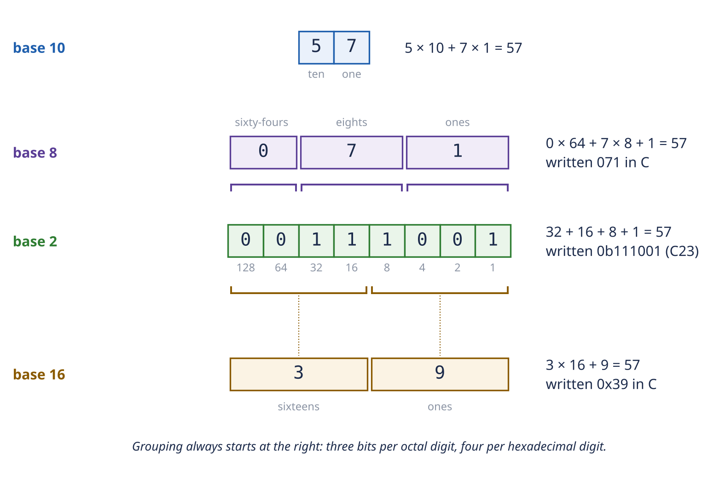
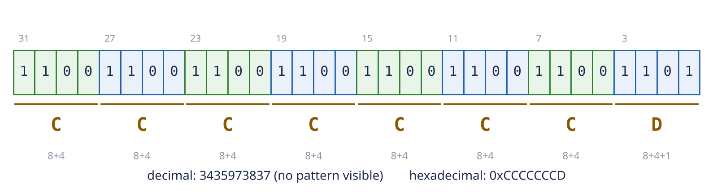

ref: 04.01
title: Positional Notation from First Principles
chapter: Chapter 04 — Numbers as Patterns of Bits
part: Part II — Data: How C Sees Bits
builds: §01.01
---
## The question

Part I of this book went down to the bottom of the machine: voltages that stand for bits (§01.01), gates that add them (§01.03), a stored-program machine that fetches them as instructions (§01.05), and the long chain of programs that turns a C file into a running process (Chapter 03). Part II now climbs back up. Its subject is **data**: how C turns a pattern of bits into a number, a character or a fraction, and why it sometimes turns the same bits into something you did not expect. This chapter begins with the simplest data there is, whole numbers.

Before we start, look back at the road behind us. It is scattered with numbers that this book had to use before it could teach the notation they are written in. Some came with an explicit promise that this section would explain them; others were explained on the spot, but only by taking hexadecimal and octal on trust:

- §01.05's toy machine was programmed with bytes such as `0x39`, with the remark that hexadecimal is "base 16, which §04.01 explains", and that each hexadecimal digit stands for four bits, so that `0x39` is `0011 1001`.
- §01.06 printed a whole AVR program as three short lines of Intel HEX, the first of them `:10000000259A1D9A20E03AE648E1215030404040D0`.
- §02.01, modeling the 18-bit words of a PDP-7, wrote a mask as `0777777`, and read the word `150145` as the two characters `h` and `e`.
- §03.02 found that `0x1E+1` would not compile, though `0x1E + 1` would.
- §03.04's compiler divided by ten by multiplying by 3,435,973,837, a number it also wrote as `0xCCCCCCCD`.
- §03.05 showed that every ELF file begins with the four bytes `7f 45 4c 46`.
- §03.07 ran one program three times and found `main` at three different addresses, `0x55ffbc6cc139`, `0x560134e41139` and `0x555555555139`: every digit could change except the last three.

This section lays the foundation under all of them, and returns to each in turn. Start with one small program, Listing 04.01-1.

```c Listing 04.01-1  same.c: one quantity, four spellings, and one surprise
// same.c
// One quantity, four spellings, and one surprise.
#include <stdio.h>

int main(void) {
    printf("%d %d %d %d\n", 57, 071, 0x39, 0b111001);
    printf("%d %d\n", 0b1010, 0x2F);
    printf("%d\n", 010);
}
```

```terminal
$ gcc -std=c23 -Wall -Wextra -pedantic same.c -o same
$ ./same
```

```output
57 57 57 57
10 47
8
```

Four very different pieces of text, `57`, `071`, `0x39` and `0b111001`, all printed as 57. The second line decodes the two strange numbers §00.01 used in its table of notation, `0b1010` and `0x2F`. And the third line is a small shock: `010`, which any shopkeeper would read as ten, printed as 8.

So, before reading on, consider these questions:

- If four different strings of symbols all mean 57, what *is* 57? Is a number the marks on the page, or something else?
- What does a digit mean because of the *place* it stands in? Why is the 5 in 57 worth fifty, and not five?
- How do you change a number from one way of writing it to another, and why do the methods work?
- The machine stores only bits. Why, then, do engineers write bytes in base sixteen, a base that no everyday system of human counting has ever used, instead of in binary, or in the decimal everyone knows?
- Why did a leading zero, which means nothing in everyday arithmetic, turn ten into eight?
- Why did three hexadecimal digits of an address stay fixed in §03.07, when no digit of the same address written in decimal would?

## The journey

### A number is not its numeral

Imagine a market stall in Dhaka with a heap of fifty-seven mangoes on it. The heap has a size, and that size is a fact about the world: it would be the same if nobody counted it, and the same in every language. Now let three people write it down. One writes 57. One, writing Bengali, writes ৫৭. A third, a child who has not yet learned digits, draws fifty-seven strokes, ||||| ||||| ..., in groups of five.

Three pieces of writing, one quantity. This is the first distinction of the chapter, and everything else rests on it:

- A **number** is an abstract quantity: "how many", or "how much".
- A **numeral** is a piece of writing that names a number: a string of symbols on paper, on a screen, or in a C source file.

The symbols a numeral is built from are called **digits**. ৫ and 5 are different digits with the same meaning; the Bengali digits ০ to ৯ and the digits 0 to 9 that this book prints both descend from the numerals of ancient India, and they work in exactly the same way. Only the shapes differ.

The child's strokes are the oldest kind of numeral, a *tally*: one mark for each thing. A tally is perfectly clear, but its length grows with the number. A tally of a million would fill a book. The Roman numerals, LVII for 57, are shorter, because some symbols stand for bundles (L for fifty, V for five), but they have a deeper flaw: to know what a symbol is worth you must know the symbol, and every larger bundle needs a new one. Worse, Roman numerals make arithmetic hard; try multiplying LVII by XIV without first translating.

The numerals we use today solved both problems with a single idea: **the value of a digit depends on its position**. In 57, the 5 is worth fifty because of *where* it stands. Ten symbols are then enough for every number there is. Notice what Listing 04.01-1 has shown: `57`, `071`, `0x39` and `0b111001` are four numerals for one number. The rest of this section explains how each of them names 57, and why each one exists.

### Bundles: what a place means

Let us build the idea from the ground up, with money, because money already works this way.

Suppose a shop pays out only in 1-taka coins and 10-taka and 100-taka notes, and it follows one rule: *never hand over ten of anything when one of the next larger kind would do*. Then any amount up to 999 taka is paid with at most nine coins, at most nine 10-taka notes and at most nine 100-taka notes. To pay 307 taka, the shop hands over three 100s, no 10s and seven 1s. Writing the three counts side by side, largest kind on the left, gives 3 0 7. That is exactly what the numeral 307 means:

307 = 3 × 100 + 0 × 10 + 7 × 1

Every feature of our notation follows from the shop's rule.

1. **Each place is worth ten times the place to its right**, because ten of one kind are exchanged for one of the next: 1, 10, 100, 1000, and so on, without end.
2. **Each place holds a count from 0 to 9.** It can never hold ten, because ten would be exchanged. That is why there are exactly ten digits.
3. **Counting up is exchanging.** Count from 7 to 10: after 9 ones comes a tenth one, the ten ones are exchanged for one ten, and the ones place returns to 0. That exchange is the **carry** you met in §01.03, where a column of an adder passed a 1 to the next column whenever its sum did not fit in one digit. In decimal, a carry happens at ten; in the binary adder it happened at two. It is the same event.
4. **Zero is a placeholder.** In 307 the 0 says "no tens", and it is essential: without it, 307 would read as 37. A positional notation cannot work without a symbol for an empty place.

The number of times each place outweighs the place to its right, ten here, is called the **base** of the notation, or its **radix**. The value of a place, 1, 10, 100, ..., is its **place value**, and the whole scheme is called **positional notation**. The rightmost digit, worth the least, is the **least significant digit**; the leftmost, worth the most, is the **most significant digit**.

Now the idea in general. A numeral with *k* digits in base *b* is written

d<sub>k−1</sub> d<sub>k−2</sub> ... d<sub>1</sub> d<sub>0</sub>

and names the number

N = d<sub>k−1</sub> × b<sup>k−1</sup> + ... + d<sub>2</sub> × b<sup>2</sup> + d<sub>1</sub> × b + d<sub>0</sub>

Every symbol here has a plain meaning:

- *b* is the base: how many of one kind make one of the next.
- *d*<sub>0</sub>, *d*<sub>1</sub>, ... are the digits, counted from the right, starting at 0. Each one is a count between 0 and *b* − 1.
- The small raised number counts how many times 1 is multiplied by *b*: b<sup>2</sup> = 1 × b × b, the value of the hundreds place when *b* is 10. b<sup>1</sup> = 1 × b = b, and b<sup>0</sup> = 1, with no multiplication at all: the ones place, which is worth one whatever the base.
- So the digit with index *i* is worth *d<sub>i</sub>* × b<sup>*i*</sup>: its count times its place value. The numbering from 0 is chosen so that a digit's index *is* the power of the base it multiplies, which is also why §01.03 numbered its adder's columns 0 to 7.

Is the representation unique? Could one number have two different numerals in the same base (leaving aside zeros written on the left, which add nothing)? The shop's rule answers this. However the amount is paid, the number of 1-taka coins must be the remainder when the amount is divided by 10, because everything else comes in tens; that fixes the last digit. Take those coins away and exchange the rest into tens, and the same argument fixes the next digit, and so on. Every digit is forced, so every number has exactly one numeral. Later in this section this argument becomes an algorithm.

:::history
Positional notation was invented more than once. The Babylonians of Mesopotamia wrote numbers in base sixty nearly four thousand years ago, and their legacy is still on your wrist: sixty seconds to the minute, sixty minutes to the hour, and sixty minutes of arc to the degree. For most of their history they had no sign for an empty place and left a gap; a separating sign for a missing place was in use by about 300 BCE, though as punctuation rather than as a number. The Maya of Central America counted in twenties, with a zero (in their calendar counts the third place was worth 360 rather than 400).

Our own numerals come from India, where a decimal place-value notation with a zero was in use by the middle of the first millennium CE; in 628 the astronomer Brahmagupta gave rules for calculating *with* zero, treating it as a number in its own right. In Baghdad, around 825, the mathematician Muhammad ibn Musa al-Khwarizmi wrote a treatise explaining the Indian system. His Arabic original is lost, but a twelfth-century Latin translation, known today by the title its editor gave it in 1857, *Algoritmi de numero Indorum* ("Algoritmi on the numbers of the Indians"), helped carry the system into Europe, and the Latin form of his name gave us the words *algorism* and, later, **algorithm**. Leonardo of Pisa (Fibonacci) argued for the new numerals in his *Liber Abaci* of 1202. The very word for every algorithm in this book, then, is named after a man who taught the world to write numbers by position.
:::

Notice one more thing about writing large numbers. In Bangladesh one lakh, a hundred thousand, is written 1,00,000, and one crore, ten million, 1,00,00,000; most of the world writes the same numbers 100,000 and 10,000,000. The commas differ, but the numbers do not. Commas group digits for the reader's eye, and the grouping is pure convention. Keep this in mind: hexadecimal, below, is at heart a way of grouping digits for the eye.

### Any base will do

Nothing in the shop's rule needs the number ten. Exchange in eights, and you have base 8; in sixteens, base 16; in twos, base 2. In every base *b*, the same four facts hold: places worth 1, *b*, *b*<sup>2</sup>, ...; digits from 0 to *b* − 1; a carry when a place reaches *b*; and exactly one numeral for each number. (The base must be at least 2. With *b* = 1 there would be nothing to exchange, only one mark per unit: the child's tally. Positional notation begins at base 2.)

So the question "what is 57 in base 8?" means "pay 57 with coins worth 1, notes worth 8 and notes worth 64, never handing over eight of anything". 64 is too large, so no 64s; 57 contains seven 8s (56), leaving 1. The numeral is 71 in base 8. When a number could be read in more than one base, mathematicians write the base as a small subscript: 57<sub>10</sub> = 71<sub>8</sub>. C, which cannot write subscripts, marks the base with a **prefix** instead, and Listing 04.01-1 has already shown three of them: a leading `0` for base 8, `0x` for base 16, and `0b` for base 2. `071` is 71<sub>8</sub>, which is why it printed 57.

How many numbers can *k* digits in base *b* write? Each of the *k* places can take any of *b* values, independently, so there are *b* × *b* × ... × *b* = b<sup>k</sup> numerals: the numbers from 0 to b<sup>k</sup> − 1. Three decimal digits write 1000 numbers, 000 to 999. You met the base-2 case of this rule in §01.01, as "*n* bits have 2<sup>*n*</sup> patterns". It is not a special fact about bits. It is a fact about places.

### Base 2: the machine's own notation

§01.01 showed why every computer in this book is built from parts with two states: two states can be kept far apart, with wide safety margins between them, so that noise and wear rarely turn one into the other. A row of such parts holds a numeral in base 2, **binary**, whose two digits, 0 and 1, are the **bits**. Base 2 is therefore not a choice the programmer makes; it is what the hardware *is*. Binary arithmetic itself is older than any such machine: Gottfried Leibniz described it in a paper written for the Paris Academy of Sciences, dated 1703 and printed in 1705, two and a half centuries before it became the language of hardware.

In binary each place is worth twice the place to its right: 1, 2, 4, 8, 16, 32, 64, 128, ... Counting looks strange at first only because carries come so often:

Table: Table 04.01-1  Counting from 0 to 16 in binary
<!-- widths: 14,22,14,22,14,14 -->
| Decimal | Binary | Decimal | Binary | Decimal | Binary |
|---|---|---|---|---|---|
| 0 | 0 | 6 | 110 | 12 | 1100 |
| 1 | 1 | 7 | 111 | 13 | 1101 |
| 2 | 10 | 8 | 1000 | 14 | 1110 |
| 3 | 11 | 9 | 1001 | 15 | 1111 |
| 4 | 100 | 10 | 1010 | 16 | 10000 |
| 5 | 101 | 11 | 1011 | | |

Read the table as an odometer with only two digits per wheel. From 1 to 2, the ones wheel passes 1 and rolls over to 0, carrying 1 into the twos place: `10`. From 7 to 8, three wheels roll over at once, `111` to `1000`, exactly as 999 rolls over to 1000. (§04.02 builds its whole account of unsigned arithmetic on this odometer.)

To read a binary numeral, add up the place values of the places that hold a 1. Here are the two promises made in Chapter 00 and Chapter 01:

- `0b1010`, from §00.01's table of notation: places 8, 4, 2, 1 hold 1, 0, 1, 0, so the value is 8 + 2 = **10**.
- `0011 1001`, the byte `0x39` of §01.05: places 128, 64, 32, 16, 8, 4, 2, 1 hold 0, 0, 1, 1, 1, 0, 0, 1, so the value is 32 + 16 + 8 + 1 = **57**.

The place values of binary are the powers of two, and an engineer meets the same few of them so often that they become old friends:

Table: Table 04.01-2  Powers of two worth knowing
<!-- widths: 14,30,56 -->
| Power | Value | Where you meet it |
|---|---|---|
| 2<sup>4</sup> | 16 | the patterns of 4 bits; one hexadecimal digit (below) |
| 2<sup>8</sup> | 256 | the patterns of one byte, 0 to 255 |
| 2<sup>10</sup> | 1,024 | "one K" of memory, close to a thousand by happy accident |
| 2<sup>12</sup> | 4,096 | the size of a memory page on your laptop (§03.07) |
| 2<sup>15</sup> | 32,768 | the ATmega328P's flash memory, in bytes ("32 KB") |
| 2<sup>16</sup> | 65,536 | the patterns of 16 bits, the width of an `int` on the AVR |
| 2<sup>32</sup> | 4,294,967,296 | the patterns of 32 bits, the width of an `int` on your laptop |
| 2<sup>64</sup> | 18,446,744,073,709,551,616 | the patterns of 64 bits, the width of an address on your laptop |

:::precise
2<sup>10</sup> = 1,024 is so close to 1,000 that computing borrowed the decimal prefix *kilo* for it, and the confusion has never quite ended. Datasheets use "KB" for 1,024 bytes: the ATmega328P's "32 KB" of flash are 32 × 1,024 = 32,768 bytes. Disk makers use it for 1,000. Since 1998 the International Electrotechnical Commission has offered unambiguous names for the binary multiples, *kibibyte* (KiB, 1,024 bytes), *mebibyte* (MiB, 1,024<sup>2</sup>) and *gibibyte* (GiB, 1,024<sup>3</sup>), which some Linux tools print (`free -h` writes `Gi`); others, such as `ls -lh`, still write plain K, M and G for the binary multiples, so the confusion survives even there. When a size matters, check which one is meant.
:::

Binary has one serious weakness: it is long. Each binary digit carries less information than a decimal digit, so a number needs about 3.32 times as many binary digits as decimal ones (3.32 is log<sub>2</sub> 10, the information in one decimal digit, which §01.01 computed). 4,294,967,295 has ten decimal digits and thirty-two binary ones. A human being cannot read thirty-two bits at a glance, and cannot copy them from a screen without error. We shall need a better way to write bits for human eyes. But first, the two basic conversions.

### From numeral to number: two ways to read

You have already seen the first way to turn a numeral into the number it names: **multiply each digit by its place value, and add**. For `111001` in base 2:

1 × 32 + 1 × 16 + 1 × 8 + 0 × 4 + 0 × 2 + 1 × 1 = 57

This works, but it needs the place values in advance, and you must count the digits before you start, to know what the first one is worth. There is a second way that needs neither. Take the general formula, for four digits, and factor out *b* step by step:

d<sub>3</sub> × b<sup>3</sup> + d<sub>2</sub> × b<sup>2</sup> + d<sub>1</sub> × b + d<sub>0</sub> = ((d<sub>3</sub> × b + d<sub>2</sub>) × b + d<sub>1</sub>) × b + d<sub>0</sub>

Read the right-hand side from the inside out, and it is a recipe: **start with 0; for each digit from left to right, multiply what you have by the base and add the digit**. Each multiplication by *b* moves everything read so far one place to the left, exactly as writing a 0 after a decimal numeral multiplies it by ten, and makes room for the next digit in the ones place. This recipe is called **Horner's method**, after the English mathematician William Horner, who published a related method in 1819, though the idea is far older. In binary, multiplying by 2 is doubling, so you can read `111001` aloud as a chain: 1, then 1 × 2 + 1 = 3, then 7, then 14, then 28, then 57.

Horner's method is how a program reads a number, and Listing 04.01-2 writes it in C, printing every step.

```c Listing 04.01-2  read_digits.c: from a written numeral to a number, one digit at a time
// read_digits.c
// From a written numeral to a number, one digit at a time.
#include <stdio.h>

static int digit_value(char c) {
    if (c >= '0' && c <= '9') return c - '0';
    if (c >= 'A' && c <= 'F') return c - 'A' + 10;
    if (c >= 'a' && c <= 'f') return c - 'a' + 10;
    return -1;                          // not a digit in any base up to 16
}

static void read_digits(const char *text, unsigned base) {
    unsigned long value = 0;
    printf("\"%s\" in base %u:\n", text, base);
    for (const char *p = text; *p != '\0'; ++p) {
        int d = digit_value(*p);
        if (d < 0 || (unsigned)d >= base) {
            printf("  '%c' is not a digit in base %u\n", *p, base);
            return;
        }
        printf("  %lu x %u + %d = %lu\n", value, base, d, value * base + d);
        value = value * base + d;
    }
    printf("  value: %lu\n", value);
}

int main(void) {
    read_digits("307", 10);
    read_digits("111001", 2);
    read_digits("71", 8);
    read_digits("2F", 16);
    read_digits("19", 8);
}
```

The program uses some C you have not studied yet. Each piece is explained here as far as this section needs, and the chapter that teaches it fully is named.

- Lines 5–10: `digit_value` turns one *character* of the numeral into the count it stands for. Inside the machine a character is itself a number, its code (§03.02 met the code 0x41 for `A`; Chapter 08 is devoted to codes). C guarantees that the codes of `'0'` to `'9'` are consecutive, so `c - '0'` is 0 for `'0'`, 1 for `'1'`, and so on: subtracting the code of `'0'` gives the digit's count. Lines 7 and 8 do the same for the letters that serve as digits from ten to fifteen, explained below. Any other character gives −1, "not a digit".
- Line 12: `read_digits` takes the numeral as a *string*, a row of characters ending with a null character (§03.02 counted the null character in a string literal's size; Chapter 25 treats strings fully), and the base. Two small words come before the two functions. `static` keeps a function private to this file (§20.03); `const` in `const char *text` promises that the function will only read the characters, never change them (§06.06, §24.04). And `void` says that `read_digits` returns no value: its `return;` on line 19 simply leaves the function early.
- Line 13: `value` holds "what we have so far", and starts at 0, as the recipe says. Its type, `unsigned long`, holds whole numbers from 0 to 2<sup>64</sup> − 1 on your laptop (Chapter 05).
- Line 14: `\"` inside a string is an *escape sequence* for a quotation mark, which would otherwise end the string (§08.02). `%s` prints a string, `%u` an `unsigned`, and later `%c` a single character and `%lu` an `unsigned long`; each conversion must match the type of its argument (§31.02).
- Line 15: a `for` loop (Chapter 16) that visits each character of the string in turn, from left to right, stopping at the null character `'\0'`. `p` points at the current character, and `*p` is that character (pointers are Chapter 24).
- Line 17: a digit must be less than the base. A 9 is not a digit in base 8, any more than "ten" is a digit in base 10. `||` means "or" (Chapter 12). `(unsigned)d` is a *cast*, a conversion written on purpose (§10.05): it turns the `int` `d` into an `unsigned` before the comparison with `base`. Without it, `-Wextra` would warn that a signed and an unsigned number are being compared, a comparison with a trap in it that §10.04 explains; here the cast is safe, because the test `d < 0` on its left has already ruled out a negative `d`.
- Lines 21–22: Horner's step, printed and then performed: multiply by the base, add the digit.

```terminal
$ gcc -std=c23 -Wall -Wextra -pedantic read_digits.c -o read_digits
$ ./read_digits
```

```output
"307" in base 10:
  0 x 10 + 3 = 3
  3 x 10 + 0 = 30
  30 x 10 + 7 = 307
  value: 307
"111001" in base 2:
  0 x 2 + 1 = 1
  1 x 2 + 1 = 3
  3 x 2 + 1 = 7
  7 x 2 + 0 = 14
  14 x 2 + 0 = 28
  28 x 2 + 1 = 57
  value: 57
"71" in base 8:
  0 x 8 + 7 = 7
  7 x 8 + 1 = 57
  value: 57
"2F" in base 16:
  0 x 16 + 2 = 2
  2 x 16 + 15 = 47
  value: 47
"19" in base 8:
  0 x 8 + 1 = 1
  '9' is not a digit in base 8
```

Look at the first case. Reading the *text* "307" and producing the *number* 307 is not a trivial copy: the characters `'3'`, `'0'`, `'7'` have the codes 51, 48 and 55, and none of these is 307. Some program must do this arithmetic every time a number is read from text. When you write `307` in a C source file, that program is the compiler: in phase 7 of translation (§03.02), it converts the preprocessing number `307` into the value that will be built into your program. When a program reads a number typed by a user, the library function `strtol` does it (§25.05). Both use this recipe.

:::precise
The C standard guarantees that the ten decimal digits have consecutive codes (C23 §5.2.1, in draft N3096). It makes no such promise for letters. In ASCII and its successor UTF-8, which all three of this book's machines use, `'A'` to `'F'` happen to be consecutive (codes 65 to 70), and so they are in IBM's older EBCDIC; but the standard does not require it, so lines 7 and 8 rely on a property of the character set, not of C. Code that must run everywhere looks the character up in a string of digits instead. Ken Thompson's 1972 manual for B, C's predecessor, noted the same dependence in its own example of printing numbers: its arithmetic with `'0'` worked because the digit codes were consecutive.
:::

### From number to numeral: repeated division

Now the opposite journey: given a number, find its digits in base *b*. Look at the formula once more, and divide N by *b*:

N = (d<sub>k−1</sub> × b<sup>k−2</sup> + ... + d<sub>1</sub>) × b + d<sub>0</sub>

Everything except d<sub>0</sub> is a whole number of *b*'s, and d<sub>0</sub> is less than *b*. So when N is divided by *b*, **the remainder is the last digit d<sub>0</sub>, and the quotient is the numeral with its last digit removed**: d<sub>k−1</sub> ... d<sub>1</sub>. You already know this in base 10: 307 divided by 10 is 30, remainder 7. Dividing by the base drops the last digit off the right-hand end, and the remainder is the digit that fell off.

So repeat it. Divide the quotient by *b* again, and the remainder is d<sub>1</sub>; again, and it is d<sub>2</sub>; stop when the quotient reaches 0. The digits come out **from right to left**, least significant first, so you read the remainders upward. This is the shop's rule of the previous section, turned into a procedure: the number of 1-taka coins is the remainder; exchange the rest into tens, and repeat.

On paper, the method is usually written as a ladder. Here are 57 in base 2, and 300 in base 16:

```text
  57 in base 2                300 in base 16
  (read the remainders         (read the remainders
   from the bottom up)          from the bottom up)

  57 / 2 = 28  remainder 1     300 / 16 = 18  remainder 12 (C)
  28 / 2 = 14  remainder 0      18 / 16 =  1  remainder  2
  14 / 2 =  7  remainder 0       1 / 16 =  0  remainder  1
   7 / 2 =  3  remainder 1
   3 / 2 =  1  remainder 1     result: 12C
   1 / 2 =  0  remainder 1
  result: 111001
```

The second ladder answers an old question. In §01.06's experiment, an assembler asked to store 300 in one byte printed it as `0x12C`, three hexadecimal digits for a number that does not fit in two. Now you can see where those digits came from: 300 = 1 × 256 + 2 × 16 + 12.

Listing 04.01-3 is the ladder in C.

```c Listing 04.01-3  write_digits.c: from a number to a written numeral, by repeated division
// write_digits.c
// From a number to a written numeral, by repeated division.
#include <stdio.h>

static void write_digits(unsigned long n, unsigned base) {
    const char symbols[] = "0123456789ABCDEF";
    char reversed[64];                  // enough for 64 binary digits
    int count = 0;
    printf("%lu in base %u:\n", n, base);
    do {
        unsigned long q = n / base;
        unsigned long r = n % base;
        printf("  %lu / %u = %lu, remainder %lu: digit %c\n",
               n, base, q, r, symbols[r]);
        reversed[count++] = symbols[r];
        n = q;
    } while (n != 0);
    printf("  read upward: ");
    while (count > 0)
        putchar(reversed[--count]);
    putchar('\n');
}

int main(void) {
    write_digits(57, 2);
    write_digits(57, 8);
    write_digits(300, 16);
    write_digits(0, 2);
}
```

- Line 6: the digit symbols, in order. `symbols[r]` is the symbol for the count `r`: `symbols[0]` is `'0'` and `symbols[12]` is `'C'`. (Arrays are Chapter 23's subject.)
- Line 7: the digits come out backward, so they are collected here and printed in reverse at the end. 64 places suffice, because an `unsigned long` has 64 bits, and base 2 is the longest case. `count` (line 8) says how many have been stored so far.
- Lines 11–12: `/` on whole numbers gives the quotient, discarding any fraction, and `%` gives the remainder. Together they perform one rung of the ladder.
- Lines 10 and 17: a `do ... while` loop runs its body *first* and tests afterwards (Chapter 16). That choice matters for one number: 0. Zero has one digit, `0`, and an ordinary loop that tested `n != 0` first would print no digits at all.
- Line 15: `reversed[count++] = ...` stores the digit in place `count`, and *then* adds 1 to `count`. Line 20's `reversed[--count]` does the opposite: it first subtracts 1, then reads that place. Together they make the array a stack of plates: the last digit stored is the first taken out (§11.03 explains `++` and `--`).
- Lines 19–20: read upward, printing the last digit found first. `putchar` prints one character (§08.04).

```terminal
$ gcc -std=c23 -Wall -Wextra -pedantic write_digits.c -o write_digits
$ ./write_digits
```

```output
57 in base 2:
  57 / 2 = 28, remainder 1: digit 1
  28 / 2 = 14, remainder 0: digit 0
  14 / 2 = 7, remainder 0: digit 0
  7 / 2 = 3, remainder 1: digit 1
  3 / 2 = 1, remainder 1: digit 1
  1 / 2 = 0, remainder 1: digit 1
  read upward: 111001
57 in base 8:
  57 / 8 = 7, remainder 1: digit 1
  7 / 8 = 0, remainder 7: digit 7
  read upward: 71
300 in base 16:
  300 / 16 = 18, remainder 12: digit C
  18 / 16 = 1, remainder 2: digit 2
  1 / 16 = 0, remainder 1: digit 1
  read upward: 12C
0 in base 2:
  0 / 2 = 0, remainder 0: digit 0
  read upward: 0
```

Every `printf("%d", ...)` you have ever run had to solve this same problem, because the screen shows characters, and the number inside the machine is only bits. §25.05 writes such a routine in full, as `printf` needs it.

:::history
The idea is as old as C itself. Ken Thompson's *Users' Reference to B*, the January 1972 Bell Labs memorandum describing B on the PDP-11, includes as an example a five-line function, `printn`, that prints a number in any base from 2 to 10. It divides by the base, calls itself to print the quotient's digits first, and then prints the remainder as a character by adding the code of `'0'`. Calling itself first is another way of solving the problem of line 7 of Listing 04.01-3: the digits that must be printed first are found last, and the function lets its own unfinished calls hold them until they are needed. §19.05 explains such *recursive* functions.
:::

There is one more way to see what the ladder does, and it leads straight into the machine. In base 10, dividing by 10 removes the last decimal digit. In base 2, dividing by 2 removes the last *bit*. But in a register, the number is *already* written in base 2, so dividing an `unsigned` number by 2 needs no arithmetic at all: every bit simply moves one place to the right, and the bit that falls off the end is the remainder. Ask GCC to divide an `unsigned x` by 2 and by 16 (Experiment 04.01-4 shows how), and that is exactly what it does:

```text
x / 2   (x unsigned):   shrl  %eax          shift right 1 place: drop one binary digit
x / 16  (x unsigned):   shrl  $4, %eax      shift right 4 places: drop four binary digits
```

(This is for numbers without a sign. For a signed `int`, C rounds a negative quotient toward zero, −7 / 2 = −3, while a plain shift would round it down, to −4; so for `int` GCC adds a small correction before shifting. §04.03 explains how a negative number is stored, and §10.02 shows the trap.)

`shr` ("shift right") moves the bits of a register toward the less significant end. Dividing by 16 drops four bits at once, and four bits, as you are about to see, are exactly one hexadecimal digit. Division by 10 is not so lucky, because 10 is not a power of two: there is no digit of the register's binary numeral that "is" the last decimal digit. That is why §03.04 found the compiler multiplying by a strange constant instead, and why the AVR, which has no divide instruction at all, had to call a library routine. Chapter 13 makes the shift operators your own tools, and §10.02 shows how hardware multiplies and divides.

### Why hexadecimal and octal exist

We now have two notations, and neither suits an engineer.

**Binary is faithful but unreadable.** It shows every bit, but thirty-two of them are a blur. Copying `11001100110011001100110011001101` from a screen without an error is a real test of patience.

**Decimal is readable but hides the bits.** Because 10 is not a power of 2, a decimal digit does not correspond to any group of bits. Change one bit, and the decimal numeral can change almost everywhere:

Table: Table 04.01-3  Flipping one bit, as seen in decimal and in hexadecimal
<!-- widths: 16,21,21,21,21 -->
| Bit flipped | Before (decimal) | After (decimal) | Before (hex) | After (hex) |
|---|---|---|---|---|
| 15 | 1 | 32,769 | 0x0001 | 0x8001 |
| 7 | 57 | 185 | 0x39 | 0xB9 |
| 3 | 4,096 | 4,104 | 0x1000 | 0x1008 |

In the first row, one bit changed and the decimal numeral changed out of all recognition, while in the hexadecimal column one digit changed. In the last row, one bit changed and three of the four decimal digits changed with it. In hexadecimal, a change to one bit always changes exactly one digit, and you can see *which* bit from *which* digit. That is the property we want.

Here is the idea that gives it to us. Choose a base that is itself a power of 2. Take base 16 = 2<sup>4</sup>. Write a binary numeral, and split its bits into groups of four, starting at the right. Then look at the place values. The rightmost group covers places 8, 4, 2, 1, so it holds a count from 0 to 15. The next group covers places 128, 64, 32, 16, which are 16 times 8, 4, 2, 1: so that group holds a count from 0 to 15 *of sixteens*. The group after that counts 256s, which are 16 × 16. In other words, **a binary numeral, cut into groups of four bits, already is a base-16 numeral**: each group of four bits is one base-16 digit. The same argument works for groups of three bits and base 8 = 2<sup>3</sup>, and for any base that is a power of two. No arithmetic is needed to convert, only grouping, the very thing the lakh and crore commas do for decimal digits.

Base 16 is called **hexadecimal**, "hex" for short, and base 8 **octal**. Base 16 needs sixteen digit symbols, and our Indian heritage supplies only ten, so the letters A to F are drafted in for the counts ten to fifteen. Figure 04.01-1 shows the number 57 in all four bases, and the grouping that ties the bottom three together.

{w=15.5}

There are only sixteen patterns of four bits, and once you know them, you can read hex as fluently as decimal. Listing 04.01-4 prints them all.

```c Listing 04.01-4  nibbles.c: the sixteen patterns of four bits, in four notations
// nibbles.c
// The sixteen patterns of four bits, in four notations.
#include <stdio.h>

int main(void) {
    printf("dec  bin   oct  hex\n");
    for (unsigned n = 0; n < 16; ++n)
        printf("%3u  %04b  %3o  %3X\n", n, n, n, n);
}
```

Line 8 asks `printf` to write the same number four times, in decimal (`%u`), binary padded with zeros to four digits (`%04b`), octal (`%o`) and hexadecimal with capital letters (`%X`); the numbers 3 and 4 in the conversions are minimum widths, so the columns line up. These conversions are explained properly below.

```terminal
$ gcc -std=c23 -Wall -Wextra -pedantic nibbles.c -o nibbles
$ ./nibbles
```

```output
dec  bin   oct  hex
  0  0000    0    0
  1  0001    1    1
  2  0010    2    2
  3  0011    3    3
  4  0100    4    4
  5  0101    5    5
  6  0110    6    6
  7  0111    7    7
  8  1000   10    8
  9  1001   11    9
 10  1010   12    A
 11  1011   13    B
 12  1100   14    C
 13  1101   15    D
 14  1110   16    E
 15  1111   17    F
```

A group of four bits has a name of its own, the **nibble** (§01.01): half a byte, and one hex digit. You do not need to learn this table by rote; you can rebuild any row in a second from the place values 8, 4, 2, 1, and a few landmarks make it faster:

- **A = 1010** (ten = 8 + 2), the alternating pattern; **5 = 0101** is its mirror.
- **F = 1111**, all four bits set; **8 = 1000**, only the top bit; **7 = 0111**, all but the top bit.
- **C = 1100** (8 + 4) and **3 = 0011** (2 + 1) are each other's complement.

That last pair points to a pretty fact. Two digits whose patterns are complements always add up to F, because between them every bit is set once: 3 + C = F, 5 + A = F, 7 + 8 = F. So to flip every bit of a hexadecimal numeral of a given width, subtract each digit from F. This is §01.03's rule NOT B = 255 − B, seen digit by digit: in 8 bits, the NOT of 0x39 is 0xC6, and 255 − 57 = 198 = 0xC6. The width matters. In a 32-bit `int`, `0x39` is really `0x00000039`, and flipping every bit gives `0xFFFFFFC6`: the six leading zeros become six Fs (Chapter 13).

Octal works the same way with three bits per digit, and it reads the low half of the table, 000 to 111, as 0 to 7. To convert between octal and hex, go through binary: 0x39 is 0011 1001; regroup in threes from the right, 00 111 001, and the octal digits are 0, 7, 1: the numeral 71, with a leading 0 that adds nothing. Figure 04.01-1 shows exactly this regrouping. Do not confuse that leading octal *digit* with C's octal *prefix*, which is a separate 0 written in front of all the digits. For 57 the two happen to look the same: 71<sub>8</sub> is written `071` in C. But take 0xFF = 11 111 111, which is 377 in octal: C writes it `0377`, the prefix followed by three digits.

How long are these numerals for the widths you will meet every day? Since each hex digit is 4 bits and each octal digit 3, the answer is a division, rounded up:

Table: Table 04.01-4  Digits needed to write every value of a given width
<!-- widths: 16,18,18,18,30 -->
| Width | Binary | Octal | Hexadecimal | Decimal (largest value) |
|---|---|---|---|---|
| 8 bits | 8 | 3 | 2 | 3 (255) |
| 16 bits | 16 | 6 | 4 | 5 (65,535) |
| 32 bits | 32 | 11 | 8 | 10 (4,294,967,295) |
| 64 bits | 64 | 22 | 16 | 20 (18,446,744,073,709,551,615) |

Hexadecimal fits the machine perfectly: a byte is exactly two hex digits, and every width in the table is a whole number of them. Octal does not: 8 bits are two octal digits and two bits left over. That single fact decided which of the two notations would dominate, as the history shows.

:::history
**Octal came first.** Many early computers had words of 12, 18, 24 or 36 bits, all multiples of 3, so octal digits fell exactly on the word's boundaries: the 12-bit PDP-8, the 18-bit PDP-1 and PDP-7, the 36-bit IBM 7090 and PDP-10. You saw why in §02.01: in its model of an 18-bit PDP-7 word holding two 9-bit characters (a packing that §02.01 noted no manual of the time records), each character is three octal digits, so `150145` reads directly as the codes `150` (`h`) and `145` (`e`). And the mask `0777777` is six octal 7s, six groups of `111`: eighteen 1 bits, exactly one word. Even the 16-bit PDP-11, on which C was born, was documented in octal, because its instructions were built from 3-bit fields: a 3-bit addressing mode and a 3-bit register number for each operand, so that the instruction `MOV R2,R3` reads, in octal, as `010203`. Thompson's B manual of 1972 already said that a number beginning with a zero is octal, and C kept the rule. (Today's C is stricter than its ancestors. B's manual notes that `09` was legal and equal to `011`, and Ritchie's *C Reference Manual* of the mid-1970s said the same of C: the digits 8 and 9 had the octal values 10 and 11. Only the first standard, ANSI C in 1989, made them errors.) The leading 0 of `010203`, by the way, is not a prefix: it is the top bit of the 16-bit word, the one bit left over after five groups of three.

**Hexadecimal won with the 8-bit byte.** Base sixteen had been proposed long before computers, under many names; the word *hexadecimal*, half Greek and half Latin, was in use for computer notation by 1950. Early machines did not agree on the six extra symbols: the SWAC (1950) and the Bendix G-15 (1956) used the letters u to z. A 2023 history of the term traces the word to the description of the SEAC, a computer of the US National Bureau of Standards, in 1950, and credits the same bureau with the digits A to F, the convention that survives. It is often said that IBM coined the word; that history shows it did not. But when IBM's System/360 (1964) made the 8-bit byte the industry's standard (§01.01), a byte became exactly two hex digits; IBM's manuals for it wrote memory in hexadecimal with the digits A to F, and hexadecimal became the common language of anyone who looks at memory.
:::

Octal has not disappeared. It survives wherever bits really do come in threes, and one such place is on your Fedora machine right now. Linux records who may read, write and execute a file as nine bits, three each for the file's owner, its group, and everyone else. Three bits per class make one octal digit per class:

```terminal
$ stat -c '%a %A %n' same same.c
```

```output
755 -rwxr-xr-x same
600 -rw------- same.c
```

`stat` printed each file's permissions twice, once in octal (`%a`) and once as letters (`%A`). Take `755`: 7 = 111 gives the owner read, write and execute (`rwx`); 5 = 101 gives the group and everyone else read and execute, but not write (`r-x`). `600` is 110 000 000: the owner may read and write, and no one else may do anything. The command `chmod 640 file` sets the bits directly, in octal. Three bits, one octal digit: the notation fits the data. (A file you create yourself will probably show `644`, `-rw-r--r--`, the usual default: a new file made on the reader's Fedora did. `same.c` shows `600` only because of the way the author's tools copied it onto the machine. Three more bits, called set-user-ID, set-group-ID and sticky, make a fourth octal digit on the left when any of them is set: on the reader's Fedora, `stat` reports `/usr/bin/passwd` as `4755` and the directory `/tmp` as `1777`. §32.01 returns to permissions.)

### Fluency in reading hex

Hexadecimal is the notation of debuggers, disassemblers, datasheets, memory maps, file formats and network captures. An engineer reads it the way a musician reads notes, without translating each one. That fluency comes from a handful of habits.

**1. Read bytes in pairs.** A byte is two hex digits, from `00` to `FF`. A few byte values are landmarks: `0x7F` = 127, the largest byte whose top bit is 0; `0x80` = 128, the top bit alone; `0xFF` = 255, all eight bits set.

**2. Know the place values.** In hex, the places are worth 1, 16, 256 (0x100), 4,096 (0x1000), 65,536 (0x10000), and so on, each sixteen times the last. A 1 followed by *n* hex zeros is 2<sup>4*n*</sup>. So 0x400 = 4 × 256 = 1,024 (one K), and 0x8000 = 8 × 4,096 = 32,768.

**3. Convert small values by the two recipes.** Hex to decimal is Horner's method with sixteens: `0x2F` = 2 × 16 + 15 = **47**, which is the last of the promises from §00.01 (and what Listing 04.01-1 printed). `0x12C` = (1 × 16 + 2) × 16 + 12 = 300. Decimal to hex is the ladder: 200 / 16 = 12 remainder 8, so 200 = `0xC8`. For anything larger, let the machine do it: `printf` below, or the shell's `$((16#2F))`.

**4. Count and add in hex, carrying at sixteen.** After `0x09` comes `0x0A`, then on to `0x0F`, and then `0x10`, which is sixteen. To add 0x39 + 0x07: 9 + 7 = 16, which is `10` in hex, so write 0 and carry 1; then 3 + 1 = 4. The sum is `0x40`. And `0xFF` + 1 = `0x100`: every digit rolls over, like 999 + 1, because the odometer now has sixteen marks on each wheel. (§04.02 asks what happens when the odometer has only two wheels.)

**5. Read the landmarks of your own machines.** On the ATmega328P, the toolchain's header `<avr/io.h>` defines the edges of the three memories, and on the reader's Fedora, avr-gcc 15.3 expanded them as `0x7FFF`, `0x8FF` and `0x3FF`. Read them now: the flash runs from 0x0000 to 0x7FFF, which is 0x8000 = 32,768 bytes; the EEPROM from 0x000 to 0x3FF, 0x400 = 1,024 bytes; and the 2 KB of SRAM from 0x100 to 0x8FF, which is 0x800 = 2,048 bytes, starting at 0x100 because the addresses below it belong to the chip's registers (§27.03 draws the whole map). These are the 32 KB, 1 KB and 2 KB of §01.04, written the way the datasheet writes them.

**6. Let the page boundary explain the addresses.** §03.07 gave the reason for its fixed `139` in one sentence: the kernel loads a position-independent program at a *base address* that is always a multiple of the page size, 4,096 = 0x1000 (the reader's Fedora reports `getconf PAGESIZE` as 4096, which `printf '%x'` turns into `1000`). The base is chosen at random in every run (the third of §03.07's runs had randomization switched off). Now you can see why only hexadecimal makes this visible. A multiple of 0x1000 ends in three hex zeros, so adding it to the address the linker gave `main`, `0x1139`, can never change the last three digits: every run printed an address ending in `139`. In decimal, 4,096 is not a round number at all, and no decimal digit of the address is protected. The pattern was there all along, but only hexadecimal could show it.

**7. Read long addresses in groups.** A 64-bit address has sixteen hex digits, and tools usually leave out the zeros on the left. The address `0x7fffffffe26c` that `gdb` showed in §03.08 is twelve digits, `0x00007fffffffe26c` in full. On x86-64 Linux, a program's own addresses normally lie below 0x0000800000000000, that is, below 2<sup>47</sup>, and the stack is placed near the top of that range: which is why stack addresses so often begin `0x7ff`. Chapter 27 explains the whole layout.

**8. Read a hex dump.** A **hex dump** shows the bytes of a file or of memory as hex digits, usually sixteen to a line, with the offset of the first byte on the left and the printable characters on the right. Listing 04.01-5 writes ten bytes whose values you know, so that you can check your reading.

```c Listing 04.01-5  hexdump_me.c: ten known bytes, written to a file
// hexdump_me.c
// Write a few known bytes to a file, then look at them with xxd.
#include <stdio.h>

int main(void) {
    FILE *f = fopen("bytes.bin", "wb");
    if (f == NULL) return 1;
    unsigned char bytes[] = {0x7F, 'E', 'L', 'F',
                             57, 0x39, 071, 0b111001, 255, 0};
    fwrite(bytes, 1, sizeof bytes, f);
    fclose(f);
}
```

Line 6 opens the file `bytes.bin` for writing; the `b` in `"wb"` asks for the bytes to be written exactly as given, with no translation of line endings, and `f` is the program's handle on the open file. If the file cannot be opened, `fopen` returns `NULL`, the null pointer (§24.02), and line 7 stops the program with exit status 1 (§03.07). Lines 8–9 list ten byte values. Line 10 writes them to the file exactly as they are: from `bytes`, items of size 1 byte, `sizeof bytes` of them, which is 10 (`sizeof` gives the size of an object in bytes, §06.02). Line 11 closes the file. Chapter 32 is devoted to files. `unsigned char` is C's type for one byte, holding 0 to 255 on all three of this book's machines (§05.02; C allows wider bytes, §01.01).

```terminal
$ gcc -std=c23 -Wall -Wextra -pedantic hexdump_me.c -o hexdump_me
$ ./hexdump_me
$ xxd bytes.bin
```

```output
00000000: 7f45 4c46 3939 3939 ff00                 .ELF9999..
```

Read it: the offset `00000000` (the first byte is at offset 0), then the ten bytes in pairs, and on the right the same bytes as characters, with a dot where a byte is not a printable character. The first four bytes are the very ones that begin every ELF file (§03.05): `7f`, then `45 4c 46`, the codes of `E`, `L` and `F`. Then come four bytes that the source spelled four different ways, `57`, `0x39`, `071` and `0b111001`: in the file they are four identical bytes, `39`, which happen to be the code of the character `9`. The machine never knew how you wrote them. Then `ff`, 255, and `00`. The same file in octal and in hex, with `od`:

```terminal
$ od -A d -t o1 bytes.bin
$ od -A x -t x1 bytes.bin
```

```output
0000000 177 105 114 106 071 071 071 071 377 000
0000010
000000 7f 45 4c 46 39 39 39 39 ff 00
00000a
```

The last line of each shows the offset just past the end, which is the file's size: 10 in decimal, `0a` in hex. Now look again at §01.06's first line of Intel HEX, `:10000000259A...D0`, and check §01.06's reading of it yourself: `10` bytes of data (sixteen), to be placed at address `0000`, record type `00` (data), then the bytes of the program, `25 9A`, `1D 9A`, and so on, and finally the checksum byte `D0`. The checksum is pure hexadecimal arithmetic: it is chosen so that all the bytes of the record, the checksum included, add up to a multiple of 0x100. The twenty bytes before it add up to 0x630, whose last two digits are 0x30, and 0x30 + 0xD0 = 0x100. A receiver that adds up a record and does not find two hex zeros at the end knows that a byte was corrupted on the way.

:::hood
**The pattern in 0xCCCCCCCD.** In §03.04, GCC divided an `unsigned` by 10 by multiplying it by M = 3,435,973,837 and shifting the product right by 35 places, and §03.04 proved that this gives the right quotient for every 32-bit input. Written in decimal, M looks like a random number. Compile the same function on the reader's Fedora, and `gcc -S` shows the constant as `movl $3435973837, %edx`, while `objdump -d` on the object file shows the same instruction as the bytes `ba cd cc cc cc` and the text `mov $0xcccccccd,%edx`. `gcc -S` writes constants in decimal; `objdump` writes them in hex, and in hex the pattern leaps out (Figure 04.01-2). Where does it come from? The constant was chosen as 2<sup>35</sup>/10 rounded up, and 2<sup>35</sup>/10 = 2<sup>34</sup>/5. Now 1/5 in hexadecimal is 0.3333...<sub>16</sub>, with 3s repeating forever: you can check that 0.333...<sub>16</sub> = 3/15 = 1/5, just as 0.333... = 3/9 = 1/3 in decimal. Multiplying by 2<sup>34</sup> = 2<sup>32</sup> × 4 moves the hex point eight places to the right (each place is four bits) and multiplies by 4, and 4 × 3 = 12 = C. So 2<sup>35</sup>/10 = 0xCCCCCCCC.CCCC..., a C in every place, before and after the point. Rounding up gives 0xCCCCCCCD. In decimal, the same fact reads 3,435,973,836.8, rounded up: true, but impossible to *see*.

Two more lessons hide in that one line. First, look at the byte order: the instruction stores the constant as `cd cc cc cc`, least significant byte first. That is the *little-endian* order of x86-64, which §06.03 explains. Second, the reason 1/5 never ends in base 16 is the reason 1/10 never ends in base 2, and so the reason the 0.1 of §00.01 cannot be stored exactly: §07.02 takes positional notation to the right of the point and shows which fractions end in which bases.
:::

{w=15.5}

### Writing numbers in C

C lets you write an integer constant in four bases, and you have now seen all four. Table 04.01-5 collects them, with the edition of C that introduced each.

Table: Table 04.01-5  Integer constants in C
<!-- widths: 18,22,22,38 -->
| Base | Written as | Example (= 57) | In the language since |
|---|---|---|---|
| 10 | a first digit 1 to 9 | `57` | C from the start (1972–73); inherited from B |
| 8 | a leading `0` | `071` | C from the start; inherited from B (digits 8 and 9 tolerated until C89) |
| 16 | `0x` or `0X`, digits `0`–`9`, `a`–`f` or `A`–`F` | `0x39` | by K&R (1978); absent from the mid-1970s *C Reference Manual* |
| 2 | `0b` or `0B` | `0b111001` | C23; a GCC extension since GCC 4.3 (2008) |

The binary form is the newest. GCC accepted it as an extension for about fifteen years before C23 made it standard, so older code often uses it too. Under an earlier standard with `-pedantic`, GCC says so, as a warning:

```terminal
$ gcc -std=c17 -Wall -Wextra -pedantic same.c -o same17
```

```output
same.c: In function ‘main’:
same.c:6:44: warning: binary constants are a C23 feature or GCC extension [-Wpedantic]
    6 |     printf("%d %d %d %d\n", 57, 071, 0x39, 0b111001);
      |                                            ^~~~~~~~
same.c:7:23: warning: binary constants are a C23 feature or GCC extension [-Wpedantic]
    7 |     printf("%d %d\n", 0b1010, 0x2F);
      |                       ^~~~~~
```

The message names the exact column of each binary constant, and its bracket names the option, `-Wpedantic`, that controls it: §03.08's reading of messages, put to use. The program still compiles and prints the same three lines, because GCC supports the extension in every mode.

Here, too, is the answer to §03.02's puzzle. In `0x1E`, the `E` is a hexadecimal *digit*, fourteen: 0x1E = 1 × 16 + 14 = 30. But the preprocessor's rule for numbers (§03.02) knows nothing of bases, and an `E` followed by `+` might be the start of a floating-point exponent, as in `1.5E+10`; so it takes `0x1E+1` as a single preprocessing number, which the compiler then cannot accept as a constant. `0x1F+1` contains no `E`, and compiles. With spaces, `0x1E + 1`, the `E` is safely inside its numeral.

And now the shock of `010`. A leading zero is not decoration in C: it is the prefix for base 8, so `010` is 1 × 8 + 0 = 8. It is a trap that has caught many programmers who lined up numbers with zeros, or typed a date as `07` and `09` (Experiment 04.01-3 springs it). §05.06 treats the rules for constants in full, including what decides a constant's type and the C23 digit separator.

:::precise
A few facts about C's integer constants that matter later. **A constant has no sign:** `-57` is not one constant but the operator `-` applied to the constant `57` (Chapters 09 and 10 explain operators, and §04.03 what a negative number is to the machine). **Zero is octal:** by the grammar of C23 §6.4.4.1 (draft N3096), a decimal constant must begin with a digit from 1 to 9, so the constant `0` is, strictly, an octal constant; nothing changes, since zero is zero in every base. **The base can change the type:** a constant's type depends on its value, its suffix and its base. On the reader's Fedora, the decimal constant `3735928559`, too large for an `int`, has the type `long`, while the same value written `0xDEADBEEF` has the type `unsigned int`; a `_Generic` test (§22.07) reported exactly that. §05.06 gives the rule and its reasons.
:::

Writing numbers in a base is the compiler's half of the story; printing them is the library's. `printf` can write an integer in four bases too, and Listing 04.01-6 asks for each.

```c Listing 04.01-6  printf_bases.c: asking printf to write one value in four bases
// printf_bases.c
// Asking printf to write one value in four bases.
#include <stdio.h>

int main(void) {
    unsigned x = 57;
    printf("decimal  %u\n", x);
    printf("octal    %o    %#o\n", x, x);
    printf("hex      %x    %X    %#x    %#X\n", x, x, x, x);
    printf("binary   %b    %#b\n", x, x);
    printf("padded   [%08b]  [%04X]  [%8x]  [%#06x]\n", x, x, x, x);
    unsigned big = 3735928559;
    printf("big      %u = %#x = %#o\n", big, big, big);
}
```

```terminal
$ gcc -std=c23 -Wall -Wextra -pedantic printf_bases.c -o printf_bases
$ ./printf_bases
```

```output
decimal  57
octal    71    071
hex      39    39    0x39    0X39
binary   111001    0b111001
padded   [00111001]  [0039]  [      39]  [0x0039]
big      3735928559 = 0xdeadbeef = 033653337357
```

- Line 6: `x` is `unsigned`, a whole number with no sign; the conversions `%u`, `%o`, `%x`, `%X` and `%b` all expect one (Chapter 05).
- Line 8: `%o` writes octal. The `#` flag asks for the "alternative form", which for octal adds a leading 0, so that the output can be read back as a C constant.
- Line 9: `%x` writes hex with small letters, `%X` with capitals; with `#` they add `0x` or `0X`.
- Line 10: `%b` writes binary, and `%#b` adds `0b`. This conversion is new in C23, and the GNU C library has supported it since version 2.35 (2022); the reader's Fedora has 2.44. C23 also *recommends* a `%B` that writes `0B`, but leaves it optional, because capital letters were never reserved for the standard, and some library might already have used `%B` for something else. glibc supports it.
- Line 11: a number after `%` is a minimum width; a `0` before it pads with zeros instead of spaces. `[%08b]` shows all eight bits of a byte, the way you would draw it; `[%#06x]` pads to six characters *including* the `0x`.
- Lines 12–13: the decimal number 3,735,928,559 turns out to be `0xdeadbeef`, which spells English words in hex digits. Programmers choose such values on purpose to fill memory that should never be used, so that a stray value is recognizable in a hex dump at once; you will meet them again when you go looking for bugs in memory with the tools of §34.04. In octal, the same number is meaningless: 33653337357.

With an older standard, GCC warns at each `%b`: `ISO C17 does not support the ‘%b’ gnu_printf format [-Wformat=]`. On a C library older than 2.35, `%b` would not work at all, so a program that must run on old systems writes its own binary printer, like Listing 04.01-3.

:::myth
**"The computer stores numbers in hexadecimal."** It does not, and it does not store them in decimal either. Memory holds bits: physical states, as §01.01 described. Decimal, octal, hexadecimal and the 0s and 1s of binary are all ways for *people* to write down those states. `57`, `071`, `0x39` and `0b111001` in your source produced the same byte, as `xxd` showed, and `printf` can display that byte in any base you ask for. The base is a property of a numeral, never of a number.
:::

:::orbit
A spacecraft's data reaches the ground as streams of bytes, and the engineers who read them read hex. Many missions, those of NASA and ESA among them, package their data in **Space Packets**, defined by the Consultative Committee for Space Data Systems (standard CCSDS 133.0-B-2). Every packet begins with a 6-byte primary header, whose 48 bits are fields of uneven widths: a 3-bit version number, a 1-bit packet type (0 for telemetry, 1 for a telecommand), a 1-bit flag saying whether a secondary header follows, an 11-bit application identifier (APID) naming the on-board process the packet belongs to, a 2-bit sequence-flags field, a 14-bit sequence count, and a 16-bit length (the number of bytes that follow the primary header, minus one). Suppose a ground station receives a packet that begins `08 64 C0 2A 00 0F`. In hex, the bytes are easy to copy and compare; but the fields do not fall on hex digits, so to decode them you go down to the bits. The first two bytes, `08 64`, are 000 0 1 000 0110 0100: the version field 000 (which the standard calls Version 1), a telemetry packet, a secondary header present, and the APID 000 0110 0100 = 0x064 = 100. The next two, `C0 2A`, are 11 00 0000 0010 1010: sequence flags 11 (a packet complete in itself) and the count 0x02A = 42. The last two, `00 0F`, are 15, so 16 bytes follow the primary header: the secondary header and the data together. Hex for the eye, binary for the fields, decimal for the report: the fluent engineer moves among all three without effort. CCSDS documents, incidentally, call an 8-bit unit an **octet**, the unambiguous name for what C, which allows bytes wider than 8 bits (§01.01), cannot call simply a byte. Chapter 13 gives you the C tools, shifts and masks, to pull such fields out of a header, and §28.06 builds structures for protocols and telemetry.
:::

## Terms introduced

- **Number / numeral**: an abstract quantity / a piece of writing that names it.
- **Digit**: one symbol of a numeral; in base *b*, a count from 0 to *b* − 1.
- **Positional notation**: writing numbers so that a digit's value depends on its place.
- **Base (radix)**: how many units of one place make one unit of the next.
- **Place value**: the value of one unit in a given place, *b*<sup>*i*</sup> for the place with index *i*.
- **Least / most significant digit**: the rightmost digit, worth least / the leftmost, worth most.
- **Carry**: the exchange of *b* units of one place for one unit of the next.
- **Horner's method**: reading a numeral from left to right by "multiply by the base, add the digit".
- **Repeated division**: finding the digits of a number, last digit first, as the remainders of successive divisions by the base.
- **Binary / octal / hexadecimal (hex)**: base 2 / 8 / 16. Octal and hexadecimal digits correspond to groups of 3 and 4 bits.
- **Nibble**: a group of four bits; one hexadecimal digit.
- **Prefix**: the marking of a constant's base in C: `0` (octal), `0x` (hexadecimal), `0b` (binary, C23).
- **Kibibyte (KiB)**: 1,024 bytes, the unambiguous name for the "K" of memory sizes.
- **Hex dump**: a display of bytes as hexadecimal digits, with offsets and printable characters.
- **Alternative form (`#`)**: the `printf` flag that adds `0`, `0x` or `0b` to an octal, hexadecimal or binary conversion.
- **`%o`, `%x`, `%X`, `%b`**: `printf` conversions writing an unsigned integer in octal, hexadecimal (small or capital letters) and binary (C23).
- **Octet**: an 8-bit unit, so named in communication standards.

## Self-check

1. In your own words, what is the difference between a number and a numeral? Give four numerals for the number of days in four weeks, in four different bases.
2. Why does a base-*b* notation need exactly *b* digits, and why can no place ever hold *b*? Explain how this is the same event as the carry of §01.03's adder.
3. Explain, without the formula, why every number has only one numeral in a given base (apart from zeros written on the left).
4. Read the binary numeral `1011 0110` both ways: as a place-value sum, and by Horner's method, writing every step. What is its value?
5. Convert 200 to binary by repeated division. Then convert the result to hexadecimal by grouping, and check it by repeated division by 16.
6. Why can binary be converted to hexadecimal one group at a time, but not to decimal? What property of the base decides it?
7. Convert `0x2F`, `0xFF`, `0x100`, `0x12C` and `0x8FF` to decimal.
8. A file has the permissions `755`. Write the nine permission bits, and say what each class of user may do. What would `chmod 640` allow?
9. Convert `0x39` to octal, through binary, and show why the grouping must start from the right.
10. Compute in hex, without converting to decimal: `0x3F + 0x01`, `0xFF + 0x01`, `0x39 + 0x07`. Then flip every bit of the byte `0x39`, and check your answer with §01.03's NOT B = 255 − B.
11. How many hex digits are needed to write any value of an 11-bit field, and how many values can the field hold?
12. In §03.07, the address of `main` ended in `139` in every run. Explain why exactly three hexadecimal digits stayed fixed, and why no decimal digit would have.
13. Why did `printf("%d\n", 010);` print 8? What would Thompson's B have made of `09`, and what does GCC 16 make of it?
14. Using 1/5 = 0.333...<sub>16</sub>, show that 2<sup>35</sup>/10 = 0xCCCCCCCC.CCC... Why does GCC's constant end in `D`?
15. A telecommand's primary header begins `18 2C C0 05 00 03`. Decode the packet type, the secondary header flag, the APID, the sequence count and the number of data bytes.

## Experiments

**Experiment 04.01-1. Odometers in three bases.** Before running anything, predict what Listing 04.01-3 prints for 255 and 256 in bases 2, 8 and 16, and for 65,535 and 65,536 in base 16. Change `main` to print them, and run it. What happens to the digits each time a power of the base is crossed? (Keep your notes: §04.02 starts from this.)

**Experiment 04.01-2. Beyond sixteen.** Extend `digit_value` in Listing 04.01-2 to accept the letters up to `Z`, so that it can read numerals in any base up to 36, and add `read_digits("ZZ", 36)` and `read_digits("C", 36)` to `main`. Predict both values first. (The standard function `strtol` also accepts bases up to 36; §25.05 uses it.)

**Experiment 04.01-3. The leading-zero trap.** Build this program, which stores a date as a person might type it:

```c
// octal_trap.c
// Leading zeros, as a person might type a date.
#include <stdio.h>

int main(void) {
    int day = 07;
    int month = 09;
    printf("%d/%d\n", day, month);
}
```

Read the compiler's message, and explain why line 6 is accepted and line 7 is not. Then change `09` to `010` and predict the output before you run it.

**Experiment 04.01-4. Dividing by the base.** Put the function `unsigned tenth(unsigned x) { return x / 10; }` in a file `div10.c`, and compile it with the command below (the options of §02.03, which remove lines that do not matter here: `-fno-asynchronous-unwind-tables` the `.cfi` directives and `-fcf-protection=none` the `endbr64` instruction, both met in §03.04; `-fno-stack-protector` and `-U_FORTIFY_SOURCE` two kinds of safety check that GCC can add). Then change the 10 to 2, and to 16, and compare. Explain what each `shr` instruction does to the binary numeral in the register, in the language of this section.

```terminal
$ gcc -std=c23 -O2 -S -fno-asynchronous-unwind-tables -fcf-protection=none \
      -fno-stack-protector -U_FORTIFY_SOURCE div10.c -o -
```

**Experiment 04.01-5. One file, three dumps.** Run Listing 04.01-5, then view `bytes.bin` with `xxd`, with `od -A d -t o1` and with `od -A d -t d1`. Find the same byte in all three. Then run `od -t o1 bytes.bin` without `-A`: what base is `od` using for its offsets now, and what does the last offset mean? Then look at the first 16 bytes of one of your own programs with `head -c 16 same | xxd`, and find the ELF signature of §03.05.

**Experiment 04.01-6. The edges of printf.** Predict, then check: what does `printf("[%#x] [%#o] [%#b] [%#x] [%#B]\n", 0u, 0u, 0u, 255u, 5u);` print? Why might the standard have chosen not to print `0x0` for zero?

## Hands-on (AVR / ESP32)

### A: bases on an 8-bit chip

Listing 04.01-7 runs the repeated division of Listing 04.01-3 on the ATmega328P, which has no divide instruction, and asks avr-libc's `printf` for the bases it supports.

```c Listing 04.01-7  avr_bases.c: the same repeated division, on an 8-bit chip with no divide instruction
// avr_bases.c
// The same repeated division, on an 8-bit chip with no divide instruction.
#include <stdio.h>
#include <avr/io.h>

static void print_in_base(unsigned n, unsigned base) {
    const char symbols[] = "0123456789ABCDEF";
    char reversed[16];                  // an unsigned is 16 bits here
    int count = 0;
    do {
        reversed[count++] = symbols[n % base];
        n = n / base;
    } while (n != 0);
    while (count > 0)
        putchar(reversed[--count]);
    putchar('\n');
}

int main(void) {
    print_in_base(57, 2);
    print_in_base(57, 16);
    print_in_base(RAMEND, 16);
    printf("%u %o %x %X\n", 57, 57, 57, 0x2F);
    printf("PORTB: data address 0x%02X\n", _SFR_MEM_ADDR(PORTB));
}
```

- Line 8: on the AVR, an `unsigned` has 16 bits (Chapter 05), so 16 places suffice for any base.
- Line 22: `RAMEND` is the last address of the SRAM, defined by `<avr/io.h>` for this chip.
- Line 23: avr-libc's `printf` writes `%u`, `%o`, `%x` and `%X`, but has no `%b`; that is one reason to write your own.
- Line 24: `PORTB` is the register that drives the pins of port B, among them pin 13 of an Uno with its LED. `_SFR_MEM_ADDR` gives its address in the chip's data memory (§36.03 explains such registers).

It was built on the reader's machine with avr-gcc 15.3, together with `avr_stdio.c`, the same small harness that §02.02 used (it is kept with this section's programs, not printed; it connects `printf` to the chip's serial port, and §31.06 explains how such a connection works). That very file was then run in the simulator in the author's workspace, because Fedora has no simavr package:

```terminal
$ avr-gcc -mmcu=atmega328p -std=c11 -Os -Wall -Wextra -pedantic \
      avr_bases.c avr_stdio.c -o avr_bases.elf
```

```terminal In the author's workspace (simulator)
$ simavr -m atmega328p -f 16000000 avr_bases.elf
```

```output
111001
39
8FF
57 71 39 2F
PORTB: data address 0x25
```

The datasheet lists `PORTB` at I/O address 0x05, and the header adds 0x20 to that, because the first 32 data addresses belong to the 32 general registers: 0x05 + 0x20 = 0x25. (§22.07 shows how `<avr/io.h>` builds `PORTB` from these numbers.) Every address in the ATmega328P's datasheet is written in hex, and so is every register value in its pages; Chapter 36 takes you through them.

Now look at how the division was done. In the reader's build, `avr-objdump -d avr_bases.elf | grep 'call.*div'` finds one call in `print_in_base`'s code, to `__udivmodhi4`, the libgcc routine that §03.04 found dividing by ten. (Its two other matches lie inside `__ultoa_invert`, avr-libc's own routine that turns numbers into digits for `printf`; as its name says, it produces the digits inverted, last digit first, just as the ladder does.) One call, although line 11 asks for `n % base` and line 12 for `n / base`: the routine returns the quotient *and* the remainder together, exactly the two results each rung of the ladder needs, and the compiler noticed that both came from the same division. (Because `print_in_base` is compiled once, as one function for whatever base it is given, its division must work for any divisor, and no shift or multiplication trick fits them all.)

Finally, on a real Uno (the author has not run this; it is for you), the same notations appear in Arduino code. In an Arduino sketch, `Serial.println(57, BIN)` prints `111001`, and `HEX` and `OCT` work the same way. And these three lines all switch on the LED of pin 13 (bit 5 of `PORTB`), once you have made the pin an output with `DDRB = 0x20;`:

```c
PORTB = 0x20;          // hexadecimal
PORTB = 0b00100000;    // binary: bit 5 is the only 1
PORTB = 1 << 5;        // a 1 shifted five places to the left (Chapter 13)
```

Which one reads best to you? Many embedded programmers prefer the third, usually with the bit's name from `<avr/io.h>`, `PORTB = 1 << PB5;`, because it names the bit's position directly (in the author's view, the clearest of the three); Chapter 13 explains why.

### B: the ESP32

On an ESP32 board in the Arduino IDE, `Serial.printf` passes its format to the C library of the ESP32's toolchain. Print 57 with `%o`, `%x`, `%#x` and `%b`, and print the address of a global variable with `%p`. The author has not run this experiment and does not know whether that library supports `%b`; if it does not, you will see the letter `b` or nothing where the digits should be. The address will be eight hex digits, because the ESP32 is a 32-bit machine; compare it with the twelve digits of an address on your laptop.

## Answers

**Self-check 1.** A number is a quantity; a numeral is writing that names it. Twenty-eight: `28` (base 10), `0x1C` (base 16), `034` (base 8), `0b11100` (base 2).

**Self-check 2.** Each place holds a count of units not yet exchanged, and *b* of them are always exchanged for one unit of the next place, so a place holds 0 to *b* − 1: *b* possible values, one digit for each. When counting makes a place reach *b*, it returns to 0 and passes 1 to the next place: in base 2, a column of the adder whose sum reached 2 wrote 0 and carried 1.

**Self-check 3.** The last digit must be the number of units left over after taking out as many *b*'s as possible, which is the remainder on division by *b*, and that is fixed by the number. Removing those units and exchanging the rest into units of the next place leaves a smaller number whose last digit is fixed in the same way, and so on. No digit can be chosen freely, so there is only one numeral.

**Self-check 4.** 128 + 32 + 16 + 4 + 2 = 182. Horner: 1, 2, 5, 11, 22, 45, 91, 182.

**Self-check 5.** 200 / 2 = 100 r 0; 100 / 2 = 50 r 0; 50 / 2 = 25 r 0; 25 / 2 = 12 r 1; 12 / 2 = 6 r 0; 6 / 2 = 3 r 0; 3 / 2 = 1 r 1; 1 / 2 = 0 r 1. Read upward: 1100 1000. Grouped: `C8`. Check: 200 / 16 = 12 r 8, 12 / 16 = 0 r 12 (C): `0xC8`.

**Self-check 6.** Because 16 = 2<sup>4</sup>, every place value of base 16 is also a place value of base 2, and each hex place covers exactly four binary places; a group of four bits is therefore one hex digit, with no interaction between groups. 10 is not a power of 2, so decimal places do not line up with any group of bits, and a conversion needs real arithmetic (division or Horner's method).

**Self-check 7.** 47, 255, 256, 300, 2,303.

**Self-check 8.** 111 101 101: owner read, write and execute (`rwx`); group and others read and execute (`r-x`). 640 is 110 100 000 (`rw-r-----`): owner read and write, group read, others nothing; on the reader's Fedora, `stat` showed `640 -rw-r-----`.

**Self-check 9.** `0x39` = 0011 1001; regrouped from the right, 00 111 001 = `071`. Grouping from the left would give 001 110 01, which puts the place boundaries in the wrong positions: groups must start from the ones place, the only place whose value is the same, 1, in every base.

**Self-check 10.** `0x40`, `0x100`, `0x40`. NOT `0x39` = `0xC6` (F − 3 = C, F − 9 = 6); 255 − 57 = 198 = 0xC6.

**Self-check 11.** 11 bits = 2 full nibbles and 3 bits more, so 3 hex digits (the top one only from 0 to 7). 2<sup>11</sup> = 2,048 values.

**Self-check 12.** The base address is a multiple of 4,096 = 0x1000, which ends in three hex zeros; adding it changes only the digits from the fourth onward, so the last three digits are those of `main`'s offset, `139`. 4,096 is not a multiple of 10, so adding a multiple of it can change any decimal digit, including the last.

**Self-check 13.** The leading 0 makes `010` an octal constant: 1 × 8 + 0 = 8. B's manual allowed `09` and made it equal to `011`, that is, 9. GCC 16 rejects it: `error: invalid digit ‘9’ in octal constant`. (C itself accepted `09`, as 9, until the 1989 standard.)

**Self-check 14.** 2<sup>35</sup>/10 = 2<sup>34</sup>/5 = 4 × 2<sup>32</sup> × 0.333...<sub>16</sub>. Multiplying by 2<sup>32</sup> = 16<sup>8</sup> moves the hex point eight places right, giving 0x33333333.333...; multiplying by 4 turns every 3 into C, with no carries (4 × 3 = 12 < 16). The value is not a whole number, and GCC rounds it *up* (§03.04 explains why up), which turns the last C into D.

**Self-check 15.** `182C` = 000 1 1 000 0010 1100: version 0, type 1 (telecommand), secondary header present, APID 0x02C = 44. `C005` = 11 00 0000 0000 0101: sequence flags 11, count 5. `0003` = 3, so 4 bytes follow the primary header.

**Experiment 04.01-1.** 255: `11111111`, `377`, `FF`; 256: `100000000`, `400`, `100`; 65,535: `FFFF`; 65,536: `10000` (the octal and hexadecimal values were checked on the reader's Fedora with the shell's `printf`). Each time a power of the base is crossed, all the digits roll over to 0 and a new digit 1 appears on the left.

**Experiment 04.01-2.** For letters, return `c - 'A' + 10` for `'A'` to `'Z'` (and likewise for small letters), with the same caveat about letter codes as in the text. Here the caveat stops being academic: in EBCDIC the letters come in three separate runs, A to I, J to R and S to Z, with gaps between them, so `'J' - 'A'` is 16 there, not 9. This is where looking each character up in a string of digits, `"0123456789ABCDEFGHIJKLMNOPQRSTUVWXYZ"`, really earns its place. `"ZZ"` in base 36 is 35 × 36 + 35 = 1,295; `"C"` is 12.

**Experiment 04.01-3.** On the reader's Fedora: `octal_trap.c:7:17: error: invalid digit ‘9’ in octal constant`. `07` is a valid octal constant (equal to 7); `09` is not, because 9 is not an octal digit. With `010`, the program prints `7/8`.

**Experiment 04.01-4.** On the reader's Fedora, `x / 2` became `shrl %eax` (a shift right by one place) and `x / 16` became `shrl $4, %eax`. Shifting the binary numeral right by one place drops its last binary digit, and by four places its last hexadecimal digit: division by the base, done by dropping digits.

**Experiment 04.01-5.** On the reader's Fedora, the byte `39` appears as `39` in hex, `071` in `od`'s octal and `57` in decimal. One surprise waits in the decimal dump: the byte `ff` appears there not as 255 but as `-1`, because `-t d1` reads each byte as a *signed* number. The same eight bits, read two ways: §04.03 explains how a pattern of bits can mean −1. Without `-A`, `od` writes its offsets in octal, so the last line is `0000012`: 12 in octal, which is ten once more, written in yet another base. The first four bytes of `same` are `7f 45 4c 46`, the ELF signature.

**Experiment 04.01-6.** On the reader's Fedora: `[0] [0] [0] [0xff] [0B101]`. The standard says the `#` flag adds `0x` (or `0b`) only to a nonzero result, and for octal ensures only that the first digit is 0, which zero already satisfies; a plain `0` is already a valid constant in every base, so nothing is lost.

**Hands-on A.** The outputs shown come from the simulator; on a real Uno, the serial monitor should show the same lines (a prediction). The datasheet's I/O address 0x05 plus the offset 0x20 gives 0x25.

## Sources and verification

- **Toolchains.** Every x86-64 program was built and run on the reader's machine through the lab runner (jobs 099, 100 and 101): Fedora Linux 45, GCC 16.2.1 (Red Hat 16.2.1-3), glibc 2.44, binutils 2.47, avr-gcc 15.3.0 and avr-libc 2.2.1. All x86-64 outputs shown are from that machine. The same programs were also compiled and run in the author's workspace with GCC 14.2.0 and glibc 2.39 (Ubuntu 24.04), with identical outputs. Listing 04.01-7 was compiled on the reader's machine with avr-gcc 15.3.0 (`avr-size`: 2,098 bytes of text, 72 of data; one call to `__udivmodhi4`, and two internal calls inside `__ultoa_invert`), and that ELF file was run in the author's workspace on simavr (ATmega328P at 16 MHz); a build with the workspace's avr-gcc 7.3.0 and avr-libc 2.0.0 printed the same five lines. simavr's coloring and line-end marks are omitted from the output. The values of `RAMEND`, `FLASHEND`, `E2END`, `RAMSTART` and `PORTB` are avr-gcc 15.3's expansions of `<avr/io.h>` on the reader's machine.
- **Not run by the author.** The Uno sketch lines and the LED in Hands-on A; Hands-on B.
- **The C standard.** C23 working draft N3096: §5.2.1 (the decimal digits' consecutive codes); §6.4.4.1 (integer constants: decimal, octal, hexadecimal and, new in C23, binary constants; the types of unsuffixed constants); §7.23.6.1 (`fprintf`: the `b`, `o`, `x` and `X` conversions, the `#` flag, and the recommended practice for `B`). The `%b` conversion was proposed in WG14 paper N2630 (J. Wunsch). In later drafts and the published standard some clauses are numbered differently; search by title. The type of the constants `3735928559` (`long`) and `0xDEADBEEF` (`unsigned int`) was confirmed on the reader's machine with a short `_Generic` test (`zero.c`, kept with the section's Fedora build products, not printed), which also produced the output of Experiment 04.01-6.
- **GCC and glibc.** GCC manual, "Binary Constants using the '0b' Prefix"; the extension was implemented by J. Wunsch in 2007 and released in GCC 4.3 (2008). glibc's `%b` and `%B`: J. Myers's patch "Support C2X printf %b, %B" (November 2021), released in glibc 2.35.
- **History.** Ken Thompson, *Users' Reference to B*, Bell Labs Technical Memorandum, January 7, 1972 (the octal rule and its remark that `09` is legal and equal to `011`, paraphrased; `printn` and its remark that it relies on consecutive digit codes, paraphrased); Dennis M. Ritchie, *C Reference Manual* (mid-1970s; §2.3.1: the digits 8 and 9 have the octal values 10 and 11; no hexadecimal constants), as published on Dennis Ritchie's pages. On the word *hexadecimal*, the SEAC's A–F and the claim about IBM: J. Strickland and J. Jones, "F Things You (Probably) Didn't Know About Hexadecimal", *The Mathematical Intelligencer* 45 (2023), 126–130. The SWAC's and Bendix G-15's u–z, and IBM's System/360 manuals as the vehicle of the A–F convention: standard histories of hexadecimal notation. Al-Khwarizmi: the MacTutor History of Mathematics archive (St Andrews), which notes that the Latin text differs much from the lost original, whose title is unknown; the date of about 825, the twelfth-century translation and B. Boncompagni's 1857 edition, which gave it the title *Algoritmi de numero Indorum*: standard histories; the Babylonian separator sign by about 300 BCE: accounts based on O. Neugebauer. Brahmagupta (628) and Fibonacci (1202): standard histories. Leibniz's *Explication de l'arithmétique binaire* (dated 1703, printed 1705) is the first widely noticed publication on binary arithmetic. The PDP-11's 3-bit operand fields and the encoding of `MOV R2,R3` as `010203`: DEC's PDP-11 instruction format.
- **Space Packets.** CCSDS 133.0-B-2, *Space Packet Protocol* (2020): the primary header's fields and widths, as summarized in open implementations of the standard. The example headers are the author's.
- **Inference in this section.** The money-and-exchange model of place value, the uniqueness argument, the reading of the commas of lakh and crore as grouping for the eye, the explanation of 0xCCCCCCCD through 1/5 = 0.333...<sub>16</sub> (checked arithmetically), the account of why hexadecimal displaced octal, the remark that the AVR compiler used one call for both `/` and `%` because both came from the same division, the rationale offered in the answer to Experiment 04.01-6 (that a plain `0` needs no prefix), the preference for `1 << PB5`, and the predictions for the Uno and the ESP32 are the author's reasoning, not statements from the sources.
